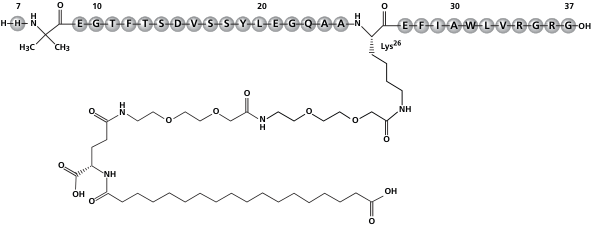
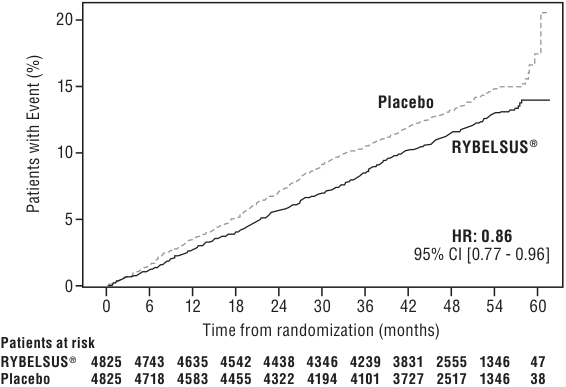

**HIGHLIGHTS OF PRESCRIBING INFORMATION These highlights do not include all the information needed to use RYBELSUS****®** **and OZEMPIC****®** **tablets safely and effectively. See full prescribing information for RYBELSUS****®** **and OZEMPIC****®** **tablets. RYBELSUS****®** **(semaglutide) tablets, for oral use OZEMPIC****®** **(semaglutide) tablets, for oral use Initial U.S. Approval: 2017** 

# **WARNING: RISK OF THYROID C−CELL TUMORS**

## **_See full prescribing information for complete boxed warning._**

- **In rodents, semaglutide causes thyroid C-cell tumors. It is unknown whether RYBELSUS****®** **and OZEMPIC****®** **tablets cause thyroid C-cell tumors, including medullary thyroid carcinoma (MTC), in humans as the human relevance of semaglutide-induced rodent thyroid C-cell tumors has not been determined (5.1, 13.1).** 

- **RYBELSUS****®** **and OZEMPIC****®** **tablets are contraindicated in patients with a personal or family history of MTC or in patients with Multiple Endocrine Neoplasia syndrome type 2 (MEN 2). Counsel patients regarding the potential risk of MTC and symptoms of thyroid tumors (4, 5.1).** 

# **———  RECENT MAJOR CHANGES  ———**

- Indications and Usage (1) . . . . . . . . . . . . . . . . . . . . . . . . . . . . . . . . . . . . . . . . . . . . . . . . . . . . ..10/2025 Dosage and Administration (2) . . . . . . . . . . . . . . . . . . . . . . . . . . . . . . . . . . . . . . . . . . . . . . . . . 12/2025 

Warnings and Precautions 

- Acute Pancreatitis (5.2) . . . . . . . . . . . . . . . . . . . . . . . . . . . . . . . . . . . . . . . . . . . . . . . . . . . . . 10/2025 Acute Kidney Injury Due to Volume Depletion (5.5) . . . . . . . . . . . . . . . . . . . . . . . . . . . . . . . 10/2025 Severe Gastrointestinal Adverse Reactions (5.6) . . . . . . . . . . . . . . . . . . . . . . . . . . . . . . . . . 10/2025 Acute Gallbladder Disease (5.8) . . . . . . . . . . . . . . . . . . . . . . . . . . . . . . . . . . . . . . . . . . . . . . 10/2025 

# **———  INDICATIONS AND USAGE  ———**

RYBELSUS® and OZEMPIC® tablets are glucagon-like peptide-1 (GLP-1) receptor agonists 

indicated: 

- as an adjunct to diet and exercise to improve glycemic control in adults with type 2 diabetes mellitus. (1) 

- to reduce the risk of major adverse cardiovascular events (cardiovascular death, non-fatal myocardial infarction, or non-fatal stroke) in adults with type 2 diabetes mellitus who are at high risk for these events. (1) 

# **———  DOSAGE AND ADMINISTRATION  ———**

- RYBELSUS® and OZEMPIC® tablets are not substitutable on a mg-to-mg basis. 

- Take RYBELSUS® or OZEMPIC® tablets orally once daily on an empty stomach in the morning with water (up to 4 ounces of water); do not take with other liquids besides water. (2.1) 

- Swallow tablets whole. Do not split, crush, chew or dissolve in any solution. (2.1) 

- After taking RYBELSUS® or OZEMPIC® tablets, wait at least 30 minutes before eating food, drinking beverages or taking other oral medications. (2.1) 

- See the Full Prescribing Information for instructions on switching between RYBELSUS® and OZEMPIC® tablets (2.3) and from OZEMPIC® injections to RYBELSUS® or OZEMPIC® tablets. (2.4) 

# **———  DOSAGE FORMS AND STRENGTHS  ———**

- RYBELSUS® tablets: 3 mg, 7 mg and 14 mg (3) 

- OZEMPIC® tablets: 1.5 mg, 4 mg and 9 mg (3) 

# **———  CONTRAINDICATIONS  ———**

- Personal or family history of MTC or in patients with MEN 2 syndrome type 2 (4) 

- Prior serious hypersensitivity reaction to semaglutide or any of the excipients in OZEMPIC® (4) 

# **———  WARNINGS AND PRECAUTIONS  ———**

- Acute Pancreatitis: Has been observed in patients treated with GLP-1 receptor agonists, including RYBELSUS® or OZEMPIC® tablets. Discontinue if pancreatitis is suspected. (5.2) 

- Diabetic Retinopathy Complications: Has been reported in a cardiovascular outcomes trial with semaglutide injection. Patients with a history of diabetic retinopathy should be monitored. (5.3) 

- Hypoglycemia with Concomitant Use of Insulin Secretagogues or Insulin: May increase the risk of hypoglycemia, including severe hypoglycemia. Reducing the dosage of insulin secretagogue or insulin may be necessary. (5.4) 

- Acute Kidney Injury Due to Volume Depletion: Monitor renal function in patients reporting adverse reactions that could lead to volume depletion. (5.5) 

- Severe Gastrointestinal Adverse Reactions: Use of RYBELSUS® or OZEMPIC® tablets has been associated with gastrointestinal adverse reactions, sometimes severe. RYBELSUS® and OZEMPIC® tablets are not recommended in patients with severe gastroparesis. (5.6) 

- Hypersensitivity Reactions: Serious hypersensitivity reactions (e.g., anaphylaxis and angioedema) have been reported. Discontinue RYBELSUS® or OZEMPIC® tablets if hypersensitivity reactions occur and monitor until signs and symptoms resolve. (5.7) 

- Acute Gallbladder Disease: If cholelithiasis or cholecystitis are suspected, gallbladder studies are indicated. (5.8) 

- Pulmonary Aspiration During General Anesthesia or Deep Sedation: Has been reported in patients receiving GLP-1 receptor agonists undergoing elective surgeries or procedures. Instruct patients to inform healthcare providers of any planned surgeries or procedures. (5.9) 

# **———  ADVERSE REACTIONS  ———**

Most common adverse reactions (incidence ≥5%) are nausea, abdominal pain, diarrhea, decreased appetite, vomiting and constipation. (6.1) 

## **To report SUSPECTED ADVERSE REACTIONS, contact Novo Nordisk Inc., at 1-833-457-7455 or FDA at 1-800-FDA-1088 or www.fda.gov/medwatch.**

# **———  DRUG INTERACTIONS  ———**

Other Oral Drugs: RYBELSUS® and OZEMPIC® tablets delay gastric emptying. Consider increased clinical or laboratory monitoring when co-administered with other oral medications that have a narrow therapeutic index or that require clinical monitoring. (7.2) 

# **———  USE IN SPECIFIC POPULATIONS  ———**

- _Pregnancy:_ See Pregnancy subsection. (8.1) 

- Lactation: Breastfeeding not recommended. (8.2) 

- Females and Males of Reproductive Potential: Discontinue RYBELSUS® or OZEMPIC® tablets in women at least 2 months before a planned pregnancy due to the long washout period for semaglutide. (8.3) 

## **See 17 for PATIENT COUNSELING INFORMATION and Medication Guide.**

**Revised: 1/2026** 

## <u>Recommended Starting, Escalation and Maintenance Dosage of RYBELSUS</u>® <u>and OZEMPIC</u>®

## <u>Tablets (2.2)</u>

RYBELSUS® (2.2) 

- Day 1 to 30: Recommended starting dosage is 3 mg orally once daily for 30 days (this dosage is not effective for glycemic control) 

- Days 31 to 60: Increase the dosage to 7 mg orally once daily. 

- On Day 61 or thereafter, if: (2.2) 

   - No additional glycemic control is needed, maintain the dosage at 7 mg orally once daily. 

- Additional glycemic control is needed, increase the dosage to 14 mg orally once daily. 

- OZEMPIC® Tablets (2.2) 

- Day 1 to 30: Recommended starting dosage is 1.5 mg orally once daily for 30 days (this dosage is not effective for glycemic control). 

- Days 31 to 60: Increase the dosage to 4 mg orally once daily. 

- On Day 61 or thereafter, if: (2.2) 

   - No additional glycemic control is needed, maintain the dosage at 4 mg orally once daily. 

   - Additional glycemic control is needed, increase the dosage to 9 mg orally once daily.

> **PDF page 1**

**RYBELSUS**® (semaglutide) tablets and **OZEMPIC****®** (semaglutide) tablets, for oral use 

# **FULL PRESCRIBING INFORMATION: CONTENTS* WARNING: RISK OF THYROID C−CELL TUMORS**

- **1 INDICATIONS AND USAGE** 

- **2 DOSAGE AND ADMINISTRATION** 

   - 2.1 Important Administration Instructions 

   - 2.2 Recommended Starting, Escalation and Maintenance Dosage of RYBELSUS® and OZEMPIC® Tablets 

   - 2.3 Switching Between RYBELSUS® and OZEMPIC® Tablets 

   - 2.4 Switching from OZEMPIC® Injection to RYBELSUS® or OZEMPIC® Tablets 

- **3 DOSAGE FORMS AND STRENGTHS 4 CONTRAINDICATIONS** 

- **5 WARNINGS AND PRECAUTIONS** 

   - 5.1 Risk of Thyroid C-Cell Tumors 

   - 5.2 Acute Pancreatitis 

   - 5.3 Diabetic Retinopathy Complications 

   - 5.4 Hypoglycemia with Concomitant Use of Insulin Secretagogues or Insulin 

   - 5.5 Acute Kidney Injury Due to Volume Depletion 

   - 5.6 Severe Gastrointestinal Adverse Reactions 

   - 5.7 Hypersensitivity Reactions 

   - 5.8 Acute Gallbladder Disease 

   - 5.9 Pulmonary Aspiration During General Anesthesia or Deep Sedation 

# **6 ADVERSE REACTIONS**

   - 6.1 Clinical Trials Experience 

   - 6.2 Postmarketing Experience 

- **7 DRUG INTERACTIONS** 

   - 7.1 Concomitant Use with an Insulin Secretagogue (e.g., Sulfonylurea) or with Insulin 

   - 7.2 Other Oral Drugs 

- **8 USE IN SPECIFIC POPULATIONS** 

   - 8.1 Pregnancy 

   - 8.2 Lactation 

   - 8.3 Females and Males of Reproductive Potential 

   - 8.4 Pediatric Use 

   - 8.5 Geriatric Use 

   - 8.6 Renal Impairment 

   - 8.7 Hepatic Impairment 

- **10 OVERDOSAGE** 

- **11 DESCRIPTION** 

- **12 CLINICAL PHARMACOLOGY** 

   - 12.1 Mechanism of Action 

   - 12.2 Pharmacodynamics 

   - 12.3 Pharmacokinetics 

   - 12.6 Immunogenicity 

- **13 NONCLINICAL TOXICOLOGY** 

   - 13.1  Carcinogenesis, Mutagenesis, Impairment of Fertility 

# **14 CLINICAL STUDIES**

- 14.1 Overview of Clinical Studies 

- 14.2  Monotherapy Use of Semaglutide Tablets in Patients with Type 2 Diabetes Mellitus 

- 14.3  Combination Therapy Use of Semaglutide Tablets in Patients with Type 2 Diabetes Mellitus 

- 14.4  Cardiovascular Outcomes Trial of Semaglutide Tablets in Adult Patients with Type 2 Diabetes Mellitus and High Risk of Having a Cardiovascular Event 

# **16 HOW SUPPLIED/STORAGE AND HANDLING**

# **17 PATIENT COUNSELING INFORMATION**

*Sections or subsections omitted from the full prescribing information are not listed. 

- 13.2 Animal Toxicology and/or Pharmacology 

> **PDF page 2 (printed page 7)**

**RYBELSUS**® (semaglutide) tablets and **OZEMPIC****®** (semaglutide) tablets, for oral use 

# **FULL PRESCRIBING INFORMATION**

- **WARNING: RISK OF THYROID C−CELL TUMORS** 

- **• In rodents, semaglutide causes dose-dependent and treatment-durationdependent thyroid C-cell tumors at clinically relevant exposures. It is unknown whether RYBELSUS****®** **and OZEMPIC****®** **tablets causes thyroid C-cell tumors, including medullary thyroid carcinoma (MTC), in humans as human relevance of semaglutide-induced rodent thyroid C-cell tumors has not been determined** **_[see Warnings and Precautions (5.1), Nonclinical Toxicology (13.1)]_ .** 

- **RYBELSUS****®** **and OZEMPIC****®** **tablets are contraindicated in patients with a personal or family history of MTC or in patients with Multiple Endocrine Neoplasia syndrome type 2 (MEN 2)** **_[see Contraindications (4)]_ . Counsel patients regarding the potential risk for MTC with the use of RYBELSUS****®** **or OZEMPIC****®** **tablets and inform them of symptoms of thyroid tumors (e.g., a mass in the neck, dysphagia, dyspnea, persistent hoarseness). Routine monitoring of serum calcitonin or using thyroid ultrasound is of uncertain value for early detection of MTC in patients treated with RYBELSUS****®** **or OZEMPIC****®** **tablets** **_[see Contraindications (4), Warnings and Precautions (5.1)]_ .** 

# **1 INDICATIONS AND USAGE**

RYBELSUS® and OZEMPIC® tablets are indicated: 

- as an adjunct to diet and exercise to improve glycemic control in adults with type 2 diabetes mellitus. 

- to reduce the risk of major adverse cardiovascular (CV) events (CV death, non-fatal myocardial infarction or non-fatal stroke) in adults with type 2 diabetes mellitus who are at high risk for these events. 

# **2 DOSAGE AND ADMINISTRATION**

## **2.1 Important Administration Instructions**

- **RYBELSUS****®** **and OZEMPIC****®** **tablets are not substitutable on a mg-to-mg basis.** 

- Take one RYBELSUS® or OZEMPIC® tablet orally once daily on an empty stomach in the morning with water (up to 4 ounces of water). Do not take RYBELSUS® or OZEMPIC® tablets with other liquids besides water [see Clinical Pharmacology (12.3)]. 

- Do not take more than one tablet per day. 

- Swallow tablets whole. Do not split, crush, chew or dissolve in any solution. 

- After taking RYBELSUS® or OZEMPIC® tablets, wait at least 30 minutes before eating food, drinking beverages or taking other oral medications [see Clinical Pharmacology (12.3)]. 

- • If a dose is missed, skip the missed dose and take the next dose the following day. 

- **2.2 Recommended Starting, Escalation and Maintenance Dosage of RYBELSUS****®** **and OZEMPIC****®** **Tablets** 

- <u>RYBELSUS</u>® <u>: Recommended Dosage</u> Follow the RYBELSUS® starting, escalation, and maintenance dosage described below to reduce the risk of gastrointestinal (GI) adverse reactions [see Warnings and Precautions (5.6), Adverse Reactions (6.1)]: • Starting Dosage (Initiation Phase) (Days 1 to 30): The recommended starting dosage is 3 mg orally once daily (this dosage is not effective for glycemic control). 

- Escalation and Maintenance Dosage (Days 31 and beyond): 

   - Days 31 to 60: Increase the dosage to 7 mg orally once daily. 

   - On Day 61 or thereafter, if: 

- No additional glycemic control is needed, maintain the dosage at 7 mg orally once daily. 

- Additional glycemic control is needed, increase the dosage to 14 mg orally once daily. 

- <u>OZEMPIC</u>® <u>Tablets: Recommended Dosage</u> Follow the OZEMPIC® tablets starting, escalation, and maintenance dosage described below to reduce the risk of GI adverse reactions [see Warnings and Precautions (5.6), Adverse Reactions (6.1)]: • Starting Dosage (Initiation Phase) (Days 1 through 30): The recommended starting dosage is 1.5 mg orally once daily (this dosage is not effective for glycemic control). 

- Escalation and Maintenance Dosage (Days 31 and beyond): 

   - Days 31 to 60: Increase the dosage to 4 mg orally once daily. 

   - On Day 61 or thereafter, if: 

   - No additional glycemic control is needed, maintain the dosage at 4 mg orally once daily. 

   - Additional glycemic control is needed, increase the dosage to 9 mg orally once daily. 

## **2.3 Switching Between RYBELSUS****®** **and OZEMPIC****®** **Tablets**

- Do not switch between RYBELSUS® and OZEMPIC® tablets during the initiation phase (Days 1 to 30) [see Dosage and Administration (2.2)]. 

- After 30 days of RYBELSUS® or OZEMPIC® tablet treatment (after the initiation phase) [see Dosage and Administration (2.2)], patients may switch between RYBELSUS® and OZEMPIC® tablet products (see **Table 1** ). 

- When switching between RYBELSUS® and OZEMPIC® tablets, initiate the other semaglutide tablet product the day after discontinuing the previous semaglutide tablet product. 

- **Table 1. Switching Between Escalation or Maintenance Dosage of RYBELSUS****®** **and OZEMPIC****®** **Tablets** 

- One week after discontinuing 0.5 mg of subcutaneous OZEMPIC® injection, start 7 mg or 14 mg of RYBELSUS® orally once daily. 

Switching from OZEMPIC® Injection to OZEMPIC® Tablets 

- Patients taking the 0.5 mg dose of OZEMPIC® injection may switch to OZEMPIC® tablets. 

- One week after discontinuing 0.5 mg of subcutaneous OZEMPIC® injection, start 4 mg or 9 mg of OZEMPIC® tablets orally once daily. 

# **3 DOSAGE FORMS AND STRENGTHS**

RYBELSUS® (semaglutide) tablets are available as: 

- 3 mg: white to light yellow, oval shaped debossed with “3” on one side and “novo” on the other side. 

- 7 mg: white to light yellow, oval shaped debossed with “7” on one side and “novo” on the other side. 

- 14 mg: white to light yellow, oval shaped debossed with “14” on one side and “novo” on the other side. 

OZEMPIC® (semaglutide) tablets are available as: 

- 1.5 mg: white to light yellow, round shaped debossed with “1.5” on one side and “novo” on the other side. 

- 4 mg: white to light yellow, round shaped debossed with “4” on one side and “novo” on the other side. 

- 9 mg: white to light yellow, round shaped debossed with “9” on one side and “novo” on the other side. 

# **4 CONTRAINDICATIONS**

RYBELSUS® and OZEMPIC® tablets are contraindicated in patients with: 

- A personal or family history of medullary thyroid carcinoma (MTC) or in patients with Multiple Endocrine Neoplasia syndrome type 2 (MEN 2) [see Warnings and Precautions (5.1)]. 

- A prior serious hypersensitivity reaction to semaglutide or to any of the excipients in RYBELSUS® or OZEMPIC® tablets. Serious hypersensitivity reactions including anaphylaxis and angioedema have been reported with semaglutide tablets [see Warnings and Precautions (5.7)]. 

# **5 WARNINGS AND PRECAUTIONS**

## **5.1 Risk of Thyroid C-Cell Tumors**

In mice and rats, semaglutide caused a dose-dependent and treatment-duration-dependent increase in the incidence of thyroid C-cell tumors (adenomas and carcinomas) after lifetime exposure at clinically relevant plasma exposures [see Nonclinical Toxicology (13.1)]. It is unknown whether RYBELSUS® and OZEMPIC® tablets cause thyroid C-cell tumors, including medullary thyroid carcinoma (MTC), in humans as human relevance of semaglutide-induced rodent thyroid C-cell tumors has not been determined. Cases of MTC in patients treated with liraglutide, another GLP-1 receptor agonist, have been reported in the postmarketing period; the data in these reports are insufficient to establish or exclude a causal relationship between MTC and GLP-1 receptor agonist use in humans. 

RYBELSUS® and OZEMPIC® tablets are contraindicated in patients with a personal or family history of MTC or in patients with MEN 2. Counsel patients regarding the potential risk for MTC with the use of RYBELSUS® or OZEMPIC® tablets and inform them of symptoms of thyroid tumors (e.g., a mass in the neck, dysphagia, dyspnea, persistent hoarseness). 

Routine monitoring of serum calcitonin or using thyroid ultrasound is of uncertain value for early detection of MTC in patients treated with RYBELSUS® or OZEMPIC® tablets. Such monitoring may increase the risk of unnecessary procedures, due to the low-test specificity for serum calcitonin and a high background incidence of thyroid disease. Significantly elevated serum calcitonin value may indicate MTC and patients with MTC usually have calcitonin values >50 ng/L. If serum calcitonin is measured and found to be elevated, the patient should be further evaluated. Patients with thyroid nodules noted on physical examination or neck imaging should also be further evaluated. 

## **5.2 Acute Pancreatitis**

Acute pancreatitis, including fatal and non-fatal hemorrhagic or necrotizing pancreatitis, has been observed in patients treated with GLP-1 receptor agonists, including semaglutide tablets [see Adverse Reactions (6)]. After initiation of RYBELSUS® or OZEMPIC® tablets, observe patients carefully for signs and symptoms of acute pancreatitis, which may include persistent or severe abdominal pain (sometimes radiating to the back), and which may or may not be accompanied by nausea or vomiting. If pancreatitis is suspected, discontinue RYBELSUS® or OZEMPIC® tablets and initiate appropriate management. 

## **5.3 Diabetic Retinopathy Complications**

In a pooled analysis of glycemic control trials, patients reported diabetic retinopathy related adverse reactions during the trial (4.2% with semaglutide tablets and 3.8% with comparator) [see Adverse Reactions (6.1)]. 

In a 2-year CV outcomes trial with semaglutide injection involving patients with type 2 diabetes mellitus and high CV risk, diabetic retinopathy complications (which was a 4-component adjudicated endpoint) occurred in patients treated with semaglutide injection (3%) compared to placebo (1.8%). The absolute risk increase for diabetic retinopathy complications was larger among patients with a history of diabetic retinopathy at baseline (semaglutide injection 8.2%, placebo 5.2%) than among patients without a known history of diabetic retinopathy (semaglutide injection 0.7%, placebo 0.4%). Rapid improvement in glucose control has been associated with a temporary worsening of diabetic retinopathy. The effect of long-term glycemic control with RYBELSUS® and OZEMPIC® tablets on diabetic retinopathy complications has not been studied. Patients with a history of diabetic retinopathy should be monitored for progression of diabetic retinopathy. 

## **5.4 Hypoglycemia with Concomitant Use of Insulin Secretagogues or Insulin**

| RYBELSUS® | OZEMPIC® Tablets |
| --- | --- |
| 7 mg orally once daily | 4 mg orally once daily |
| 14 mg orally once daily | 9 mg orally once daily | 

- **2.4 Switching from OZEMPIC****®** **Injection to RYBELSUS****®** **or OZEMPIC****®** **Tablets** Switching from OZEMPIC® Injection to RYBELSUS® Tablets 

• Patients taking the 0.5 mg dose of OZEMPIC® injection may switch to RYBELSUS® tablets. 

Patients receiving RYBELSUS® or OZEMPIC® tablets in combination with an insulin secretagogue (e.g., sulfonylurea) or insulin may have an increased risk of hypoglycemia, including severe hypoglycemia [see Adverse Reactions (6.1), Drug Interactions (7)]. 

The risk of hypoglycemia may be lowered by a reduction in the dosage of sulfonylurea (or other concomitantly administered insulin secretagogue) or insulin. Inform patients using these concomitant medications of the risk of hypoglycemia and educate them on the signs and symptoms of hypoglycemia. 

> **PDF page 3**

**RYBELSUS**® (semaglutide) tablets and **OZEMPIC****®** (semaglutide) tablets, for oral use 

# **5.5 Acute Kidney Injury Due to Volume Depletion** 

There have been postmarketing reports of acute kidney injury in some cases requiring hemodialysis, in patients treated with semaglutide. The majority of the reported events occurred in patients who experienced gastrointestinal reactions leading to dehydration such as nausea, vomiting, or diarrhea [see Adverse Reactions (6)]. 

Monitor renal function in patients reporting adverse reactions to RYBELSUS® or OZEMPIC® tablets that could lead to volume depletion, especially during dosage initiation and escalation of RYBELSUS® or OZEMPIC® tablets. 

# **5.6 Severe Gastrointestinal Adverse Reactions** 

Use of semaglutide tablets has been associated with gastrointestinal adverse reactions, sometimes severe [see Adverse Reactions (6.1)]. In clinical trials, severe gastrointestinal adverse reactions were reported more frequently among patients who received semaglutide tablets (7 mg 0.6%, 14 mg 2%) than placebo (0.3%). Severe gastrointestinal adverse reactions have also been reported postmarketing with GLP-1 receptor agonists. 

RYBELSUS® and OZEMPIC® tablets are not recommended in patients with severe gastroparesis. 

# **5.7 Hypersensitivity Reactions** 

Serious hypersensitivity reactions (e.g., anaphylaxis, angioedema) have been reported in patients treated with semaglutide tablets. If hypersensitivity reactions occur, discontinue use of RYBELSUS® or OZEMPIC® tablets; treat promptly per standard of care and monitor until signs and symptoms resolve. RYBELSUS® and OZEMPIC® tablets are contraindicated in patients with a prior serious hypersensitivity reaction to semaglutide or to any of the excipients in RYBELSUS® or OZEMPIC® tablets [see Adverse Reactions (6.2)]. 

Anaphylaxis and angioedema have been reported with GLP-1 receptor agonists. Use caution in a patient with a history of angioedema or anaphylaxis with another GLP-1 receptor agonist because it is unknown whether such patients will be predisposed to anaphylaxis with RYBELSUS® or OZEMPIC® tablets. 

<u>Pool of Placebo- and Active-Controlled Trials</u> The occurrence of adverse reactions was also evaluated in a larger pool of adult patients with type 2 diabetes mellitus participating in 9 placebo- and active-controlled trials [see Clinical Studies (14)]. In this pool, 4,116 patients with type 2 diabetes mellitus were treated with semaglutide tablets for a mean duration of 59.8 weeks. The mean age of patients was 58 years, 5% were 75 years or older and 55% were male. In these trials, 65% were White, 6% were Black or African American and 24% were Asian; 15% identified as Hispanic or Latino ethnicity. At baseline, patients had type 2 diabetes mellitus for an average of 8.8 years and had a mean HbA1c of 8.2%. At baseline, 16.6% of the population reported retinopathy. Baseline estimated renal function was normal (eGFR ≥90 mL/min/1.73m2 ) in 65.9%, mildly impaired (eGFR 60 to 90 mL/min/1.73m2 ) in 28.5% and moderately impaired (eGFR 30 to 60 mL/min/1.73m2 ) in 5.4% of the patients. 

# <u>Common Adverse Reactions</u> 

**Table 2** shows common adverse reactions, excluding hypoglycemia, associated with the use of semaglutide tablets in adult patients with type 2 diabetes mellitus in the pool of placebo-controlled trials. These adverse reactions occurred more commonly on semaglutide tablets than on placebo and occurred in at least 5% of patients treated with semaglutide tablets. 

# **Table 2. Adverse Reactions in Placebo-Controlled Trials Reported in ≥5% of Semaglutide Tablets-Treated Patients with Type 2 Diabetes Mellitus** 

| Column 1 | Column 2 | Column 3 | Column 4 |
| --- | --- | --- | --- |
| Adverse Reaction | Placebo (N=362) % | Semaglutide Tablets 7 mg (N=356) % | Semaglutide Tablets 14 mg (N=356) % |
| Nausea | 6 | 11 | 20 |
| Abdominal Pain | 4 | 10 | 11 |
| Diarrhea | 4 | 9 | 10 |
| Decreased appetite | 1 | 6 | 9 |
| Vomiting | 3 | 6 | 8 |
| Constipation | 2 | 6 | 5 | 

# **5.8 Acute Gallbladder Disease** 

Acute events of gallbladder disease such as cholelithiasis or cholecystitis have been reported in GLP-1 receptor agonist trials and postmarketing. In placebo-controlled trials to improve glycemic control, cholelithiasis was reported in 1% of patients treated with semaglutide tablets (7 mg once daily). In a 4-year CV outcomes trial (Trial 7), cholelithiasis was reported in 1.1% of patients treated with semaglutide tablets (14 mg once daily) and in 0.9% of placebo-treated patients. In Trial 7, cholecystitis was reported in 1.1% of patients treated with semaglutide tablets (14 mg once daily) and in 0.7% of placebo-treated patients [see Adverse Reactions (6.1)]. If cholelithiasis or cholecystitis is suspected, gallbladder studies and appropriate clinical follow-up are indicated [see Adverse Reactions (6.2)]. 

# **5.9 Pulmonary Aspiration During General Anesthesia or Deep Sedation** 

RYBELSUS® and OZEMPIC® tablets delay gastric emptying [see Clinical Pharmacology (12.2)]. There have been rare postmarketing reports of pulmonary aspiration in patients receiving GLP-1 receptor agonists undergoing elective surgeries or procedures requiring general anesthesia or deep sedation who had residual gastric contents despite reported adherence to preoperative fasting recommendations. Available data are insufficient to inform recommendations to mitigate the risk of pulmonary aspiration during general anesthesia or deep sedation in patients taking RYBELSUS® or OZEMPIC® tablets, including whether modifying preoperative fasting recommendations or temporarily discontinuing RYBELSUS® or OZEMPIC® tablets could reduce the incidence of retained gastric contents. Instruct patients to inform healthcare providers prior to any planned surgeries or procedures if they are taking 

RYBELSUS® or OZEMPIC® tablets. 

# **6 ADVERSE REACTIONS**

The following serious adverse reactions are described below or elsewhere in the prescribing information: 

- Risk of Thyroid C-cell Tumors _[see Warnings and Precautions (5.1)]_ • Acute Pancreatitis _[see Warnings and Precautions (5.2)]_ • Diabetic Retinopathy Complications _[see Warnings and Precautions (5.3)]_ 

- Hypoglycemia with Concomitant Use of Insulin Secretagogues or Insulin _[see Warnings and Precautions (5.4)]_ 

- • Acute Kidney Injury Due to Volume Depletion _[see Warnings and Precautions (5.5)]_ • Severe Gastrointestinal Adverse Reactions [see Warnings and Precautions (5.6)] • Hypersensitivity Reactions [see Warnings and Precautions (5.7)] • Acute Gallbladder Disease [see Warnings and Precautions (5.8)] • Pulmonary Aspiration During General Anesthesia or Deep Sedation [see Warnings and Precautions (5.9)] 

## **6.1 Clinical Trials Experience**

In the pool of placebo- and active-controlled trials, the types and frequency of common adverse reactions, excluding hypoglycemia, were similar to those listed in **Table 2** . In a 4-year CV outcomes trial (Trial 7), 4,825 patients were randomized to semaglutide tablets for a median follow-up of 49.6 months and 4,825 patients were randomized to placebo for a median follow-up of 49.4 months [see Clinical Studies (14.4)]. Safety data collection was limited to serious adverse events (including death), adverse events leading to discontinuation, and adverse events of special interest. Study drug was permanently discontinued due to an adverse event in 15.5% of semaglutide tablets-treated patients and 11.6% of placebo-treated patients. 

Additional information from this trial is included in subsequent sections below, when relevant. 

## <u>Gastrointestinal Adverse Reactions</u>

In the pool of placebo-controlled trials, gastrointestinal adverse reactions occurred more frequently among patients who received semaglutide tablets than placebo: semaglutide tablets 14 mg once daily (41%), semaglutide tablets 7 mg once daily (32%) and placebo (21%), including severe reactions (semaglutide tablets 14 mg 2.0%, semaglutide tablets 7 mg 0.6%, placebo 0.3%). The majority of reports of nausea, vomiting and/or diarrhea occurred during dose escalation. A greater percentage of patients who received semaglutide tablets 14 mg once daily (8%) and semaglutide tablets 7 mg once daily (4%) discontinued treatment due to gastrointestinal adverse reactions than patients who received placebo (1%). 

In addition to the reactions in **Table 2** , the following gastrointestinal adverse reactions with a frequency of <5% occurred in semaglutide tablets -treated patients (frequencies listed, respectively, as 14 mg once daily, 7 mg once daily and placebo): abdominal distension (3%, 2% and 1%), dyspepsia (0.6%, 3%, 0.6%), eructation (2%, 0.6%, 0%,), flatulence (1%, 2%, 0%), gastroesophageal reflux disease (2%, 2%, 0.3%) and gastritis (2%, 2%, 0.8%). 

## <u>Other Adverse Reactions</u>

Pancreatitis: In the pool of placebo- and active-controlled trials with semaglutide tablets, pancreatitis was reported as a serious adverse event in 6 semaglutide tablets -treated patients (0.1 events per 100 patient years) versus 1 in comparator-treated patients (<0.1 events per 100 patient years). Diabetic Retinopathy Complications: In the pool of placebo- and active-controlled trials with semaglutide tablets, patients reported diabetic retinopathy related adverse reactions during the trial (4.2% with semaglutide tablets and 3.8% with comparator). 

Hypoglycemia: **Table 3** summarizes the incidence of hypoglycemia by various definitions in the placebo-controlled trials. 

Because clinical trials are conducted under widely varying conditions, adverse reaction rates observed in the clinical trials of a drug cannot be directly compared to rates in the clinical trials of another drug and may not reflect the rates observed in practice. 

The safety of OZEMPIC® tablets (1.5 mg, 4 mg and 9 mg strengths) [see Dosage and Administration (2.2)] and RYBELSUS® (3 mg, 7, mg and 14 mg strengths) [see Dosage and Administration (2.2)] has been established as an adjunct to diet and exercise to improve glycemic control in adults with type 2 diabetes mellitus based on adequate and well-controlled studies of RYBELSUS® in adult patients with type 2 diabetes mellitus [see Clinical Pharmacology (12.3), Clinical Studies (14)]. Below is a display of the safety results of the adequate and well-controlled studies of RYBELSUS® (referred to below as semaglutide tablets) in adult patients with type 2 diabetes mellitus. 

## <u>Pool of Placebo-Controlled Trials</u>

The data in **Table 2** are derived from 2 placebo-controlled trials in adult patients with type 2 diabetes mellitus [see Clinical Studies (14)]. These data reflect exposure of 1,071 patients to semaglutide tablets (3 mg, 7, mg or 14 mg orally once daily) with a mean duration of exposure of 41.8 weeks. The mean age of patients was 58 years, 3.9% were 75 years or older and 52% were male. In these trials, 63% were White, 6% were Black or African American and 27% were Asian; 19% identified as Hispanic or Latino ethnicity. At baseline, patients had type 2 mellitus diabetes for an average of 9.4 years and had a mean HbA1c of 8.1%. At baseline, 20.1% of the population reported retinopathy. Baseline estimated renal function was normal (eGFR ≥90 mL/min/1.73m2 ) in 66.2%, mildly impaired (eGFR 60 to 90 mL/ min/1.73m2 ) in 32.4% and moderately impaired (eGFR 30 to 60 mL/min/1.73m2 ) in 1.4% of patients. 

> **PDF page 4**

**RYBELSUS**® (semaglutide) tablets and **OZEMPIC****®** (semaglutide) tablets, for oral use 

**Table 3. Hypoglycemia Adverse Reactions in Placebo-Controlled Trials in Patients with Type 2 Diabetes Mellitus** 

at exposure below the MRHD (rabbit) and ≥10-fold the MRHD (monkey). These findings coincided with a marked maternal body weight loss in both animal species (see Data). The estimated background risk of major birth defects is 6% to 10% in women with pre-gestational diabetes with an HbA1c >7 and has been reported to be as high as 20% to 25% in women with a HbA1c >10. In the U.S. general population, the estimated background risk of major birth defects and miscarriage in clinically recognized pregnancies is 2% to 4% and 15% to 20%, respectively. 

# <u>Clinical Considerations</u> 

|  | Placebo | Semaglutide Tablets 7 mg | Semaglutide Tablets 14 mg |
| --- | --- | --- | --- |
| Monotherapy |  |  |  |
| (26 weeks) | N=178 | N=175 | N=175 |
| Severe* | 0% | 1% | 0% |
| P lasma glucose &lt;54 mg/dL | 1% | 0% | 0% |
| Add-on to metformin and/or sulfonylurea, basal insulin alone or metformin in combination with basal insulin in patients with moderate renal impairment |  |  |  |
| (26 weeks) | N=161 | – | N=163 |
| Severe* | 0% | – | 0% |
| P lasma glucose &lt;54 mg/dL | 3% | – | 6% |
| Add-on to insulin with or without metformin |  |  |  |
| (52 weeks) | N=184 | N=181 | N=181 |
| Severe* | 1% | 0% | 1% |
| P lasma glucose &lt;54 mg/dL | 32% | 26% | 30% | 

Disease Associated Maternal and Fetal Risk: Poorly controlled diabetes during pregnancy increases the maternal risk for diabetic ketoacidosis, preeclampsia, spontaneous abortions, preterm delivery and delivery complications. Poorly controlled diabetes increases the fetal risk for major birth defects, stillbirth and macrosomia related morbidity. 

# <u>Data</u> 

Animal Data: In a combined fertility and embryofetal development study in rats, subcutaneous doses of 0.01, 0.03 and 0.09 mg/kg/day (0.2-, 0.7- and 2.1-fold the MRHD) were administered to males for 4 weeks prior to and throughout mating and to females for 2 weeks prior to mating, and throughout organogenesis to Gestation Day 17. In parental animals, pharmacologically mediated reductions in body weight gain and food consumption were observed at all dose levels. In the offspring, reduced growth and fetuses with visceral (heart blood vessels) and skeletal (cranial bones, vertebra, ribs) abnormalities were observed at the human exposure. 

* “Severe” hypoglycemia adverse reactions are episodes requiring the assistance of another person. Hypoglycemia was more frequent when semaglutide tablets were used in combination with insulin secretagogues (e.g., sulfonylureas) or insulin. 

Increases in Amylase and Lipase: In placebo-controlled trials, patients exposed to semaglutide tablets 7 mg and 14 mg tablets had a mean increase from baseline in amylase of 10% and 13%, respectively and lipase of 30% and 34%, respectively. These changes were not observed in placebo-treated patients. Cholelithiasis: In placebo-controlled trials to improve glycemic control, cholelithiasis was reported in 1% of patients treated with semaglutide tablets 7 mg. 

In a 4-year CV outcomes trial (Trial 7), cholelithiasis was reported in 1.1% of patients treated with semaglutide 14 mg tablets and in 0.9% of placebo-treated patients. In Trial 7, cholecystitis was reported in 1.1% of patients treated with semaglutide 14 mg tablets and in 0.7% of placebo-treated patients. Increases in Heart Rate: In placebo-controlled trials, semaglutide tablets 7 mg and 14 mg tablets resulted in a mean increase in heart rate of 1 to 3 beats per minute. There was no change in heart rate in placebo-treated patients. 

# **6.2 Postmarketing Experience** 

The following adverse reactions have been reported during post-approval use of semaglutide, the active ingredient in RYBELSUS® and OZEMPIC® tablets. Because these reactions are reported voluntarily from a population of uncertain size, it is not always possible to reliably estimate their frequency or establish a causal relationship to drug exposure. 

- Gastrointestinal: acute pancreatitis and necrotizing pancreatitis, sometimes resulting in death; ileus, intestinal obstruction, severe constipation including fecal impaction 

- Hypersensitivity: anaphylaxis, angioedema, rash, urticaria 

- Hepatobiliary: cholecystitis, cholelithiasis requiring cholecystectomy 

- Nervous system disorders: dizziness, dysesthesia, dysgeusia, headache 

- Pulmonary: Pulmonary aspiration has occurred in patients receiving GLP-1 receptor agonists undergoing elective surgeries or procedures requiring general anesthesia or deep sedation 

- Renal: acute kidney injury 

- Skin and Subcutaneous Tissue: alopecia 

# **7 DRUG INTERACTIONS**

## **7.1 Concomitant Use with an Insulin Secretagogue (e.g., Sulfonylurea) or with Insulin**

Semaglutide stimulates insulin release in the presence of elevated blood glucose concentrations. Patients receiving RYBELSUS® or OZEMPIC® tablets in combination with an insulin secretagogue (e.g., sulfonylurea) or insulin may have an increased risk of hypoglycemia, including severe hypoglycemia. When initiating RYBELSUS® or OZEMPIC® tablets, consider reducing the dosage of concomitantly administered insulin secretagogue (such as sulfonylureas) or insulin to reduce the risk of hypoglycemia [see Warnings and Precautions (5.4), Adverse Reactions (6.1)]. 

## **7.2 Other Oral Drugs**

Semaglutide cause a delay of gastric emptying and thereby has the potential to impact the absorption of other oral drugs. Levothyroxine exposure was increased 33% (90% CI: 1.25 to 1.42) when administered with semaglutide tablets in a drug interaction study [see Clinical Pharmacology (12.3)]. 

When using RYBELSUS® or OZEMPIC® tablets concomitantly with other oral drugs that have a narrow therapeutic index or that require clinical monitoring, consider increased clinical or laboratory monitoring [see Dosage and Administration (2)]. 

# **8 USE IN SPECIFIC POPULATIONS**

## **8.1 Pregnancy**

<u>Risk Summary</u> 

Available data with semaglutide use in pregnant women are insufficient to evaluate for a drugassociated risk of major birth defects, miscarriage or other adverse maternal or fetal outcomes. There are clinical considerations regarding the risks of poorly controlled diabetes in pregnancy (see Clinical Considerations). Based on animal reproduction studies, there may be potential risks to the fetus from exposure to semaglutide during pregnancy. RYBELSUS® or OZEMPIC® tablets should be used during pregnancy only if the potential benefit justifies the potential risk to the fetus. 

In pregnant rats administered semaglutide during organogenesis, embryofetal mortality, structural abnormalities and alterations to growth occurred at maternal exposures below the maximum recommended human dose (MRHD) based on AUC. In rabbits and cynomolgus monkeys administered semaglutide during organogenesis, early pregnancy losses and structural abnormalities were observed 

In an embryofetal development study in pregnant rabbits, subcutaneous doses of 0.0010, 0.0025 or 0.0075 mg/kg/day (0.06-, 0.6- and 4.4-fold the MRHD) were administered throughout organogenesis from Gestation Day 6 to 19. Pharmacologically mediated reductions in maternal body weight gain and food consumption were observed at all dose levels. Early pregnancy losses and increased incidences of minor visceral (kidney, liver) and skeletal (sternebra) fetal abnormalities were observed at ≥0.0025 mg/kg/day, at clinically relevant exposures. 

In an embryofetal development study in pregnant cynomolgus monkeys, subcutaneous doses of 0.015, 0.075 and 0.15 mg/kg twice weekly (1.9-, 9.9- and 29-fold the MRHD) were administered throughout organogenesis, from Gestation Day 16 to 50. Pharmacologically mediated, marked initial maternal body weight loss and reductions in body weight gain and food consumption coincided with the occurrence of sporadic abnormalities (vertebra, sternebra, ribs) at ≥0.075 mg/kg twice weekly (≥9X human exposure). 

In a pre- and postnatal development study in pregnant cynomolgus monkeys, subcutaneous doses of 0.015, 0.075 and 0.15 mg/kg twice weekly (1.3-, 6.4- and 14-fold the MRHD) were administered from Gestation Day 16 to 140. Pharmacologically mediated marked initial maternal body weight loss and reductions in body weight gain and food consumption coincided with an increase in early pregnancy losses and led to delivery of slightly smaller offspring at ≥0.075 mg/kg twice weekly (≥6X human exposure). 

Salcaprozate sodium (SNAC), an absorption enhancer in RYBELSUS® and OZEMPIC® tablets, crosses the placenta and reaches fetal tissues in rats. In a pre- and postnatal development study in pregnant Sprague Dawley rats, SNAC was administered orally at 1,000 mg/kg/day (exposure levels were not measured) on Gestation Day 7 through lactation Day 20. An increase in gestation length, an increase in the number of stillbirths and a decrease in pup viability were observed. 

## **8.2 Lactation**

## <u>Risk Summary</u>

A clinical lactation study reported semaglutide concentrations below the lower limit of quantification in human breast milk. However, SNAC and/or its metabolites are present in human milk. Since the activity of enzymes involved in SNAC clearance may be lower in infants compared to adults, higher SNAC plasma levels may occur in neonates and infants. Because of the unknown potential for serious adverse reactions in the breastfed infant due to the possible accumulation of SNAC, and because there are alternative semaglutide products that do not contain SNAC that can be used during lactation, advise patients that breastfeeding is not recommended during treatment with RYBELSUS® or OZEMPIC® tablets. 

## **8.3 Females and Males of Reproductive Potential**

Discontinue RYBELSUS® or OZEMPIC® tablets in women at least 2 months before a planned pregnancy due to the long washout period for semaglutide [see Use in Specific Populations (8.1)]. 

## **8.4 Pediatric Use**

The safety and effectiveness of RYBELSUS® and OZEMPIC® tablets have not been established in pediatric patients. 

## **8.5 Geriatric Use**

In the pool of glycemic control trials, 1,229 (30%) patients treated with semaglutide tablets were 65 years of age and over and 199 (5%) patients treated with semaglutide tablets were 75 years of age and over [see Clinical Studies (14)]. In Trial 8, one of the CV outcomes trials, 891 (56%) patients treated with semaglutide tablets were 65 years of age and over and 200 (13%) patients treated with semaglutide tablets were 75 years of age and over. 

No overall differences in safety or effectiveness for semaglutide tablets have been observed between patients 65 years of age and older and younger adult patients. 

## **8.6 Renal Impairment**

The recommended dosage of RYBELSUS® and OZEMPIC® tablets in patients with renal impairment is the same as those with normal renal function. 

The safety and effectiveness of semaglutide tablets was evaluated in a 26-week clinical study that included 324 patients with moderate renal impairment (eGFR 30 to 59 mL/min/1.73 m2 ) [see Clinical Studies (14.1)]. In patients with renal impairment including end-stage renal disease (ESRD), no clinically relevant change in semaglutide pharmacokinetics was observed [see Clinical Pharmacology (12.3)]. 

## **8.7  Hepatic Impairment**

The recommended dosage in patients with hepatic impairment is the same as those with normal hepatic function. 

In a study in subjects with different degrees of hepatic impairment, no clinically relevant change in semaglutide pharmacokinetics was observed [see Clinical Pharmacology (12.3)]. 

> **PDF page 5**

**RYBELSUS**® (semaglutide) tablets and **OZEMPIC****®** (semaglutide) tablets, for oral use 

# **10 OVERDOSAGE**

In the event of overdose, appropriate supportive treatment should be initiated according to the patient’s clinical signs and symptoms. Consider contacting the Poison Help line (1-800-222-1222) or a medical toxicologist for additional overdosage management recommendations. A prolonged period of observation and treatment for these symptoms may be necessary, taking into account the long half-life of semaglutide of approximately 1 week. 

# **11 DESCRIPTION**

RYBELSUS® and OZEMPIC® tablets, for oral use, contain semaglutide, a GLP-1 receptor agonist. The peptide backbone is produced by yeast fermentation. The main protraction mechanism of semaglutide is albumin binding, facilitated by modification of position 26 lysine with a hydrophilic spacer and a C18 fatty di-acid. Furthermore, semaglutide is modified in position 8 to provide stabilization against degradation by the enzyme dipeptidyl-peptidase 4 (DPP-4). A minor modification was made in position 34 to ensure the attachment of only one fatty di-acid. The molecular formula is C187H291N45O59 and the molecular weight is 4113.58 g/mol. 

Structural formula: 

<!-- Start of picture text -->
7 O 10 20 O 30 37 H H H H N E G T F T S D V S S Y L E G Q A A N E F I A W L V R G R G O H H3C CH3 Lys 26 O O HN O O NH O N O H O O NH OH OH O O <!-- End of picture text -->

Semaglutide is a white to almost white hygroscopic powder. 

RYBELSUS® tablets contain 3 mg, 7 mg or 14 mg of semaglutide and the following inactive ingredients: magnesium stearate, microcrystalline cellulose, povidone and salcaprozate sodium (SNAC). OZEMPIC® tablets contain 1.5 mg, 4 mg or 9 mg of semaglutide and the following inactive ingredients: magnesium stearate and SNAC. 

# **12  CLINICAL PHARMACOLOGY**

## **12.1 Mechanism of Action**

Semaglutide is a GLP-1 analogue with 94% sequence homology to human GLP-1. Semaglutide acts as a GLP-1 receptor agonist that selectively binds to and activates the GLP-1 receptor, the target for native GLP-1. 

GLP-1 is a physiological hormone that has multiple actions on glucose, mediated by the GLP-1 receptors. The principal mechanism of protraction resulting in the long half-life of semaglutide is albumin binding, which results in decreased renal clearance and protection from metabolic degradation. Furthermore, semaglutide is stabilized against degradation by the DPP-4 enzyme. 

Semaglutide reduces blood glucose through a mechanism where it stimulates insulin secretion and lowers glucagon secretion, both in a glucose-dependent manner. Thus, when blood glucose is high, insulin secretion is stimulated and glucagon secretion is inhibited. The mechanism of blood glucose lowering also involves a minor delay in gastric emptying in the early postprandial phase. 

## **12.2 Pharmacodynamics**

The pharmacodynamic evaluations described below were in patients with type 2 diabetes mellitus who received once-weekly subcutaneous injections of placebo or semaglutide injection over 12 weeks (semaglutide injection-treated patients were started on lower dosages and then titrated up to 1 mg once weekly). RYBELSUS® and OZEMPIC® tablets are not approved for subcutaneous use. 

## <u>Fasting and Postprandial Glucose</u>

Semaglutide reduces fasting and postprandial glucose concentrations. In patients with type 2 diabetes mellitus, treatment with semaglutide injection 1 mg resulted in reductions in glucose in terms of absolute change from baseline and relative reduction compared to placebo of 29 mg/dL (22%) for fasting glucose, 74 mg/dL (36%) for 2-hour postprandial glucose and 30 mg/dL (22%) for mean 24-hour glucose concentration. 

## <u>Insulin Secretion</u>

Both first- and second-phase insulin secretion are increased in patients with type 2 diabetes mellitus treated with semaglutide compared with placebo. 

## <u>Glucagon Secretion</u>

Semaglutide lowers the fasting and postprandial glucagon concentrations. 

## <u>Glucose dependent insulin and glucagon secretion</u>

Semaglutide lowers high blood glucose concentrations by stimulating insulin secretion and lowering glucagon secretion in a glucose-dependent manner. 

During induced hypoglycemia, semaglutide did not alter the counter regulatory responses of increased glucagon compared to placebo and did not impair the decrease of C-peptide in patients with type 2 diabetes mellitus. 

## <u>Gastric emptying</u>

Semaglutide causes a delay of early postprandial gastric emptying, thereby reducing the rate at which glucose appears in the circulation postprandially. 

## <u>Cardiac Electrophysiology</u>

The effect of subcutaneously administered semaglutide on cardiac repolarization was tested in a thorough QTc trial. At an average exposure level 4-fold higher than that of the maximum recommended dose of semaglutide tablets, semaglutide does not prolong QTc intervals to any clinically relevant extent. 

## **12.3 Pharmacokinetics**

Semaglutide estimated mean steady-state concentration was 6.7 nmol/L and 14.6 nmol/L following once daily oral administration of 7 mg and 14 mg of RYBELSUS® , respectively, in patients with type 2 diabetes mellitus. 

Semaglutide exposures increased in a dose-proportional manner. Steady-state exposure was achieved following 4 to 5 weeks of semaglutide tablets oral administration. 

## <u>Absorption</u>

RYBELSUS® and OZEMPIC® tablets are co-formulated with SNAC which facilitates the absorption of semaglutide after oral administration. The absorption of semaglutide predominantly occurs in the stomach. 

Semaglutide estimated absolute bioavailability was approximately: 

- 0.4% to 1% after oral administration of 3 mg, 7 mg and 14 mg of RYBELSUS® . 

- 1% to 2% after oral administration of 1.5 mg, 4 mg and 9 mg of OZEMPIC® tablets. 

Semaglutide maximum concentration was reached approximately 1-hour after oral administration of semaglutide tablets. 

Effect of Semaglutide Tablet Formulations: There were no clinically significant differences observed in the mean steady state AUC0-24h,SS and Cmax,SS between the 3 mg, 7 mg and 14 mg doses of RYBELSUS® and the 1.5 mg, 4 mg and 9 mg doses of OZEMPIC® tablets, respectively, in a clinical study conducted in healthy subjects. 

Effect of Volume and Timing of Water Consumption: Single oral doses of semaglutide tablets were administered with 50 mL or 240 mL of water after an 8-hour overnight fast and a continued fast of 4 hours post-dose in healthy subjects. Semaglutide absorption (i.e., area under the curve (AUC) and peak concentrations (Cmax) were higher following dosing with 50 mL water compared to that of 240 mL water. For 10 days, healthy subjects received semaglutide tablets once daily doses orally with 50 mL or 120 mL of water under fasting conditions with post-dose fasting period of 15, 30, 60 or 120 minutes. In this study, semaglutide absorption (i.e., AUC and Cmax) was higher after a longer post-dose fasting period. There were no clinically significant differences in semaglutide absorption with administration of 50 mL or 120 mL of water. 

## <u>Distribution</u>

Semaglutide absolute volume of distribution is approximately 8 L in patients with type 2 diabetes. Semaglutide is >99% bound to plasma albumin. 

## <u>Elimination</u>

Semaglutide elimination half-life is approximately one week with an absolute clearance of approximately 0.04 L/hour in patients with type 2 diabetes. Semaglutide is present in the circulation for about five weeks after the last semaglutide tablet dose. 

Metabolism: The primary route of elimination for semaglutide is metabolism following proteolytic cleavage of the peptide backbone and sequential beta-oxidation of the fatty acid side chain. Excretion: The primary excretion routes of semaglutide-related material are via the urine and feces. Approximately 3% of the absorbed dose is excreted in the urine as intact semaglutide. 

## <u>Specific Populations</u>

No clinically significant differences in semaglutide pharmacokinetics were observed based on age (≥18 years old), sex, race (White, Asian or Black or African American), ethnicity, body weight (40 to 188 kg), upper GI disease (i.e., chronic gastritis and/or gastroesophageal reflux disease), hepatic impairment (i.e., mild, moderate, severe based on the Child-Pugh system) and renal impairment (i.e., mild, moderate, severe, end staged renal disease). 

## <u>Drug Interaction Studies</u>

Clinical Studies and Model-Informed Approaches: The delay of gastric emptying with semaglutide may influence the absorption of concomitantly administered oral drugs. Trials were conducted to study the potential effect of semaglutide on the absorption of oral drugs taken with semaglutide administered orally at steady-state exposure. 

<u>Levothyroxine: Total thyroxine (i.e., adjusted for endogenous levels) AUC was increased by 33%</u> following administration of a single dose of levothyroxine 600 mcg concomitantly administered with semaglutide tablets. Maximum exposure (Cmax) was unchanged. 

<u>Other Drugs: No clinically significant differences in semaglutide pharmacokinetics were observed when</u> used concomitantly with omeprazole. No clinically significant differences in the pharmacokinetics of the following drugs were observed when used concomitantly with semaglutide: lisinopril, S-warfarin, R-warfarin, metformin, digoxin, ethinyl estradiol, levonorgestrel, furosemide or rosuvastatin. 

In Vitro Studies: Semaglutide has very low potential to inhibit or induce CYP enzymes, and to inhibit drug transporters. 

## **12.6 Immunogenicity**

The observed incidence of anti-drug antibodies is highly dependent on the sensitivity and specificity of the assay. Differences in assay methods preclude meaningful comparisons of the incidence of anti-drug antibodies in the studies described below with the incidence of anti-drug antibodies in other studies, including those of semaglutide or of other semaglutide products. 

During the 26- to 78-week treatment periods in 5 clinical trials in adults with type 2 diabetes mellitus [see Clinical Studies (14.2, 14.3)] and 1 clinical trial in Japanese adults with type 2 diabetes mellitus, 14/2,924 (0.5%) of semaglutide tablet-treated patients developed anti-semaglutide antibodies. Of these 14 semaglutide tablet -treated patients, 7 patients (0.2% of the total semaglutide tablet-treated study population) developed antibodies that cross-reacted with native GLP-1. No identified clinically significant effect of anti-semaglutide antibodies on pharmacokinetics of semaglutide tablets was observed. There is insufficient information to characterize the effects of anti-semaglutide antibodies on pharmacodynamics, safety or effectiveness of semaglutide. 

# **13 NONCLINICAL TOXICOLOGY**

## **13.1 Carcinogenesis, Mutagenesis, Impairment of Fertility**

In a 2-year carcinogenicity study in CD-1 mice, subcutaneous doses of 0.3, 1 and 3 mg/kg/day [9-, 33- and 113- fold the maximum recommended human dose (MRHD) of semaglutide tablet 14 mg, based on AUC] were administered to the males, and 0.1, 0.3 and 1 mg/kg/day (3-, 9- and 33-fold MRHD) were administered to the females. A statistically significant increase in thyroid C-cell adenomas

> **PDF page 6 (printed page 11)**

**RYBELSUS**® (semaglutide) tablets and **OZEMPIC****®** (semaglutide) tablets, for oral use 

and a numerical increase in C-cell carcinomas were observed in males and females at all dose levels (>3 times human exposure). 

In a 2-year carcinogenicity study in Sprague Dawley rats, subcutaneous doses of 0.0025, 0.01, 0.025 and 0.1 mg/kg/day were administered (below quantification, 0.8-, 1.8- and 11-fold the exposure at the MRHD). A statistically significant increase in thyroid C-cell adenomas was observed in males and females at all dose levels, and a statistically significant increase in thyroid C-cell carcinomas was observed in males at ≥0.01 mg/kg/day, at clinically relevant exposures. 

Human relevance of thyroid C-cell tumors in rats is unknown and could not be determined by clinical studies or nonclinical studies [see Boxed Warning, Warnings and Precautions (5.1)]. Semaglutide was not mutagenic or clastogenic in a standard battery of genotoxicity tests (bacterial mutagenicity (Ames), human lymphocyte chromosome aberration, rat bone marrow micronucleus). In a combined fertility and embryo-fetal development study in rats, subcutaneous doses of 0.01, 0.03 and 0.09 mg/kg/day (0.2-, 0.7- and 2.1-fold the MRHD) were administered to male and female rats. Males were dosed for 4 weeks prior to mating, and females were dosed for 2 weeks prior to mating and throughout organogenesis until Gestation Day 17. No effects were observed on male fertility. In females, an increase in estrus cycle length was observed at all dose levels, together with a small reduction in numbers of corpora lutea at ≥0.03 mg/kg/day. These effects were likely an adaptive response secondary to the pharmacological effect of semaglutide on food consumption and body weight. 

# **13.2 Animal Toxicology and/or Pharmacology** 

RYBELSUS® and OZEMPIC® tablets contain SNAC as an absorption enhancer. Increase in lactate levels and decrease in glucose levels in the plasma and cerebrospinal fluid (CSF) were observed in mechanistic studies with SNAC in rats. Small but statistically significant increases in lactate levels (up to 2-fold) were observed in a few animals at approximately the clinical exposure. At higher exposures these findings were associated with moderate to marked adverse clinical signs (lethargy, abnormal respiration, ataxia, reduced activity, body tone and reflexes) and marked decreases in plasma and CSF glucose levels. These findings are consistent with inhibition of cellular respiration and lead to mortality at SNAC concentrations ≥100-times the clinical Cmax. 

The mean baseline body weight was 88.6 kg, 89 kg and 88.1 kg in the placebo, semaglutide tablets 7 mg, and semaglutide tablets 14 mg arms, respectively. The mean changes from baseline to Week 26 were -1.4 kg, -2.3 kg and -3.7 kg in the placebo, semaglutide tablets 7 mg and semaglutide tablets 14 mg arms, respectively. The difference from placebo (95% CI) for semaglutide tablets 7 mg was -0.9 kg (-1.9, 0.1) and for semaglutide tablets 14 mg was -2.3 kg (-3.1, -1.5). 

# **14.3  Combination Therapy Use of Semaglutide Tablets in Patients with Type 2 Diabetes Mellitus** 

# <u>Combination with Metformin</u> 

In a 26-week trial (Trial 2, NCT02863328), 822 adult patients with type 2 mellitus diabetes were randomized to semaglutide tablets 14 mg orally once daily or empagliflozin 25 mg orally once daily, all in combination with metformin. Patients had a mean age of 58 years and 50% were men. The mean duration of type 2 diabetes mellitus was 7.4 years and the mean BMI was 33 kg/m2 . Overall, 86% were White, 7% were Black or African American and 6% were Asian; 24% identified as Hispanic or Latino ethnicity. 

Treatment with semaglutide tablets 14 mg once daily for 26 weeks resulted in a statistically significant reduction in HbA1c compared to empagliflozin 25 mg once daily (see **Table 5** ). 

# **Table 5. Trial 2 Results at Week 26 in a Trial of Semaglutide Tablets Compared to Empagliflozin in Adult Patients with Type 2 Diabetes Mellitus in Combination with Metformin** 

|  | Semaglutide Tablets 14 mg | Empagliflozin 25 mg |
| --- | --- | --- |
| Intent-to-Treat (ITT) Population (N)a | 411 | 410 |
| HbA1c (%) |  |  |
| Baseline (mean) | 8.1 | 8.1 |
| Change at Week 26b | -1.3 | -0.9 |
| Difference from empagliflozinb [95% CI] | -0.4 [-0.6, -0.3]c |  |
| Patients (%) achieving HbA1c &lt;7% | 67 | 40 |
| FPG (mg/dL) |  |  |
| Baseline (mean) | 172 | 174 |
| Change at Week 26b | -36 | -36 | 

# **14 CLINICAL STUDIES**

## **14.1 Overview of Clinical Studies**

The effectiveness of OZEMPIC® tablets (1.5 mg, 4 mg and 9 mg strengths) [see Dosage and Administration (2.2)] and RYBELSUS® (3 mg, 7, mg and 14 mg strengths) [see Dosage and Administration (2.3)] has been established as an adjunct to diet and exercise to improve glycemic control in adults with type 2 diabetes mellitus based on adequate and well-controlled studies of RYBELSUS® in adult patients with type 2 diabetes mellitus [see Clinical Pharmacology (12.3)]. Below is a display of the efficacy results of the adequate and well-controlled studies of RYBELSUS® , referred to below as semaglutide tablets, in adult patients with type 2 diabetes mellitus. 

Semaglutide tablets have been studied as monotherapy and in combination with metformin, sulfonylureas, sodium-glucose co-transporter-2 (SGLT-2) inhibitors, insulins, and thiazolidinediones in patients with type 2 diabetes mellitus. The efficacy of semaglutide tablets was compared with placebo, empagliflozin, sitagliptin and liraglutide. Semaglutide tablets have also been studied in patients with type 2 diabetes mellitus with mild and moderate renal impairment. 

In patients with type 2 diabetes mellitus, semaglutide tablets produced clinically significant reduction from baseline in HbA1c compared with placebo. 

The efficacy of semaglutide tablets was not impacted by baseline age, sex, race, ethnicity, BMI, body weight, duration of diabetes and degree of renal impairment. 

## **14.2 Monotherapy Use of Semaglutide Tablets in Patients with Type 2 Diabetes Mellitus**

In a 26-week double-blind trial (Trial 1, NCT02906930), 703 adult patients with type 2 diabetes mellitus inadequately controlled with diet and exercise were randomized to semaglutide tablets 3 mg, semaglutide tablets 7 mg or semaglutide tablets 14 mg orally once daily or placebo. Patients had a mean age of 55 years and 51% were men. The mean duration of type 2 diabetes mellitus was 3.5 years, and the mean BMI was 32 kg/m2 . Overall, 75% were White, 5% were Black or African American and 17% were Asian; 26% identified as Hispanic or Latino ethnicity. 

Monotherapy with semaglutide tablets 7 mg and semaglutide tablets 14 mg tablets once daily for 26 weeks resulted in a statistically significant reduction in HbA1c compared with placebo (see **Table 4** ). 

## **Table 4. Trial 1 Results at Week 26 in a Monotherapy Trial of Semaglutide Tablets in Adult Patients with Type 2 Diabetes Mellitus Inadequately Controlled with Diet and Exercise**

a The intent-to-treat population includes all randomized patients. At Week 26, the primary HbA1c endpoint was missing for 4.6% and 3.7% of patients randomized to semaglutide tablets 14 mg and empagliflozin 25 mg, respectively. Missing data were imputed by a pattern mixture model using multiple imputation (MI). Pattern was defined by randomized treatment and treatment status at Week 26. During the trial, additional anti-diabetic medication was initiated as an add on to randomized treatment by 1.9% and 1.2% of patients randomized to semaglutide tablets 14 mg and empagliflozin 25 mg, respectively. 

b Estimated using an ANCOVA based on data irrespectively of discontinuation of trial product or initiation of rescue medication adjusted for baseline value and region. 

c p<0.001 (unadjusted 2-sided) for superiority, controlled for multiplicity. 

The mean baseline body weight was 91.9 kg and 91.3 kg in the semaglutide tablets 14 mg and empagliflozin 25 mg arms, respectively. The mean changes from baseline to Week 26 were -3.8 kg and -3.7 kg in the semaglutide tablets 14 mg and empagliflozin 25 mg arms, respectively. The difference from empagliflozin (95% CI) for semaglutide tablets 14 mg was -0.1 kg (-0.7, 0.5). 

## <u>Combination with Metformin or Metformin with Sulfonylurea</u>

In a 26-week, double-blind trial (Trial 3, NCT02607865), 1864 adult patients with type 2 mellitus diabetes on metformin alone or metformin with sulfonylurea were randomized to semaglutide tablets 3 mg, semaglutide tablets 7 mg, semaglutide tablets 14 mg orally once daily or sitagliptin 100 mg once daily. Patients had a mean age of 58 years and 53% were men. The mean duration of type 2 diabetes mellitus was 8.6 years, and the mean BMI was 32 kg/m2 . Overall, 71% were White, 9% were Black or African American and 13% were Asian; 17% identified as Hispanic or Latino ethnicity. Treatment with semaglutide tablets 7 mg and semaglutide tablets 14 mg once daily for 26 weeks resulted in a statistically significant reduction in HbA1c compared to sitagliptin 100 mg once daily (see **Table 6** ). 

**Table 6. Trial 3 Results at Week 26 in a Trial of Semaglutide Tablets Compared to Sitagliptin 100 mg Once Daily in Adult Patients with Type 2 Diabetes Mellitus in Combination with Metformin or Metformin with Sulfonylurea** 

|  | Semaglutide Tablets 7 mg | Semaglutide Tablets 14 mg | Sitagliptin 100 mg |
| --- | --- | --- | --- |
| Intent-to-Treat (ITT) Population (N)a | 465 | 465 | 467 |
| HbA1c (%) |  |  |  |
| Baseline (mean) | 8.4 | 8.3 | 8.3 |
| Change at Week 26b | -1 | -1.3 | -0.8 |
| Difference from sitagliptinb [95% CI] | -0.3 [-0.4; -0.1]c | -0.5 [-0.6; -0.4]c |  |
| Patients (%) achieving HbA1c &lt;7% | 44 | 56 | 32 |
| FPG (mg/dL) |  |  |  |
| Baseline (mean) | 170 | 168 | 172 |
| Change at Week 26b | -21 | -31 | -15 | 

|  | Placebo | Semaglutide Tablets 7 mg | Semaglutide Tablets 14 mg |
| --- | --- | --- | --- |
| Intent-to-Treat (ITT) Population (N)a | 178 | 175 | 175 |
| HbA1c (%) |  |  |  |
| Baseline (mean) | 7.9 | 8 | 8 |
| Change at Week 26b | -0.3 | -1.2 | -1.4 |
| Difference from placebob [95% CI] |  | -0.9 [-1.1; -0.6]c | -1.1 [-1.3; -0.9]c |
| Patients (%) achieving HbA1c &lt;7% | 31 | 69 | 77 |
| F PG (mg/dL) |  |  |  |
| Baseline (mean) | 160 | 162 | 158 |
| Change at Week 26b | -3 | -28 | -33 | 

> a The intent-to-treat population includes all randomized patients. At Week 26, the primary HbA1c endpoint was missing for 5.6%, 8.6% and 8.6% of patients randomized to placebo, semaglutide tablets 7 mg and semaglutide tablets 14 mg, respectively. Missing data were imputed by a pattern mixture model using multiple imputation (MI). Pattern was defined by randomized treatment and treatment status at Week 26. During the trial, additional anti-diabetic medication was initiated as an add on to randomized treatment by 15%, 2% and 1% of patients randomized to placebo, semaglutide tablets 7 mg and semaglutide tablets 14 mg, respectively. b Estimated using an ANCOVA model based on data irrespectively of discontinuation of trial product or initiation of rescue medication adjusted for baseline value and region. c p<0.001 (unadjusted 2-sided) for superiority, controlled for multiplicity. 

a The intent-to-treat population includes all randomized patients. At Week 26, the primary HbA1c endpoint was missing for 5.8%, 6.2% and 4.5% of patients randomized to semaglutide tablets 7 mg, semaglutide tablets 14 mg and sitagliptin 100 mg, respectively. Missing values were imputed by a pattern mixture model using multiple imputation (MI). Pattern was defined by randomized treatment and treatment status at Week 26. During the trial, additional anti-diabetic medication was initiated as an add on to randomized treatment by 2.4%, 1.1% and 2.8% of patients randomized to semaglutide tablets 7 mg, semaglutide tablets 14 mg and sitagliptin 100 mg, respectively. 

b Estimated using an ANCOVA based on data irrespectively of discontinuation of trial product or initiation of rescue medication adjusted for baseline value, background medication and region. c p<0.001 (unadjusted 2-sided) for superiority, controlled for multiplicity. 

> **PDF page 7**

**RYBELSUS**® (semaglutide) tablets and **OZEMPIC****®** (semaglutide) tablets, for oral use 

The mean baseline body weight was 91.3 kg, 91.2 kg and 90.9 kg in the semaglutide tablets 7 mg, semaglutide tablets 14 mg and sitagliptin 100 mg arms, respectively. The mean changes from baseline to Week 26 were -2.2 kg, -3.1 kg and -0.6 kg in the semaglutide tablets 7 mg, semaglutide tablets 14 mg and sitagliptin 100 mg arms, respectively. The difference from sitagliptin (95% CI) for semaglutide tablets 7 mg was -1.6 kg (-2.0, -1.1) and semaglutide tablets 14 mg was -2.5 kg (-3.0, -2.0). <u>Combination with Metformin or Metformin with SGLT-2 Inhibitors</u> 

In a 26-week, double-blind, double-dummy trial (Trial 4, NCT02863419), 711 adult patients with type 2 diabetes mellitus on metformin alone or metformin with SGLT-2 inhibitors were randomized to semaglutide tablets 14 mg orally once daily, liraglutide 1.8 mg subcutaneous injection once daily or placebo. Patients had a mean age of 56 years and 52% were men. The mean duration of type 2 diabetes mellitus was 7.6 years and the mean BMI was 33 kg/m2 . Overall, 73% were White, 4% were Black or African American and 13% were Asian; 6% identified as Hispanic or Latino ethnicity. Treatment with semaglutide tablets 14 mg once daily for 26 weeks resulted in statistically significant reductions in HbA1c compared to placebo. Treatment with semaglutide tablets 14 mg once daily for 26 weeks resulted in non-inferior reductions in HbA1c compared to liraglutide 1.8 mg (see **Table 7** ). **Table 7. Trial 4 Results at Week 26 in a Trial of Semaglutide Tablets Compared to Liraglutide and Placebo in Adult Patients with Type 2 Diabetes Mellitus in Combination with Metformin or Metformin with SGLT-2i** 

multiple imputation (MI). Pattern was defined by randomized treatment and treatment status at Week 26. During the trial, additional anti-diabetic medication was initiated as an add on to randomized treatment by 10% and 4.3% of patients randomized to placebo and semaglutide tablets 14 mg, respectively. b Estimated using an ANCOVA based on data irrespectively of discontinuation of trial product or initiation of rescue medication adjusted for baseline value, background medication, renal status and region. c p<0.001 (unadjusted 2-sided) for superiority, controlled for multiplicity. 

The mean baseline body weight was 90.4 kg and 91.3 kg in the placebo and semaglutide tablets 14 mg arms, respectively. The mean changes from baseline to Week 26 were -0.9 kg and -3.4 kg in the placebo and semaglutide tablets 14 mg arms, respectively. The difference from placebo (95% CI) for semaglutide tablets 14 mg was -2.5 kg (-3.2, -1.8). 

# <u>Combination with Insulin with or without Metformin</u> 

In a 26-week double blind trial (Trial 6, NCT03021187), 731 adult patients with type 2 diabetes mellitus inadequately controlled on insulin (basal, basal/bolus or premixed) with or without metformin, were randomized to semaglutide tablets 3 mg, 7 mg and 14 mg orally once daily or placebo once daily. All patients reduced their insulin dose by 20% at randomization to reduce the risk of hypoglycemia. Patients were allowed to increase the insulin dose only up to the starting insulin dose prior to randomization. Patients had a mean age of 61 years and 54% were men. The mean duration of type 2 diabetes mellitus was 15 years and the mean BMI was 31 kg/m2 . Overall, 51% were White, 7% were Black or African American and 36% were Asian; 13% identified as Hispanic or Latino ethnicity. Treatment with semaglutide tablets 7 mg and 14 mg once daily for 26 weeks resulted in a statistically significant reduction in HbA1c from baseline compared to placebo once daily (see **Table 9** ). 

**Table 9. Trial 6 Results at Week 26 in a Trial of Semaglutide Tablets Compared to Placebo in Adult Patients with Type 2 Diabetes Mellitus in Combination with Insulin alone or with Metformin** 

|  | Placebo | Semaglutide Tablets 14 mg | Liraglutide 1.8 mg |
| --- | --- | --- | --- |
| Intent-to-Treat (ITT) Population (N)a | 142 | 285 | 284 |
| HbA1c (%) |  |  |  |
| Baseline (mean) | 7.9 | 8 | 8 |
| Change at Week 26b | -0.2 | -1.2 | -1.1 |
| Difference from placebob [95% CI] |  | -1.1 [-1.2; -0.9]c |  |
| Difference from liraglutideb [95% CI] |  | -0.1 [-0.3; 0] |  |
| Patients (%) achieving HbA1c &lt;7% | 14 | 68 | 62 |
| FPG (mg/dL) |  |  |  |
| Baseline (mean) | 167 | 167 | 168 |
| Change at Week 26b | -7 | -36 | -34 | 

|  | Placebo | Semaglutide Tablets 7 mg | Semaglutide Tablets 14 mg |
| --- | --- | --- | --- |
| Intent-to-Treat (ITT) Population (N)a | 184 | 182 | 181 |
| HbA1c (%) |  |  |  |
| Baseline (mean) | 8.2 | 8.2 | 8.2 |
| Change at Week 26b | -0.1 | -0.9 | -1.3 |
| Difference from placebob [95% CI] |  | -0.9 [-1.1; -0.7]c | -1.2 [-1.4; -1]c |
| Patients (%) achieving HbA1c &lt;7% | 7 | 43 | 58 |
| FPG (mg/dL) |  |  |  |
| Baseline (mean) | 150 | 153 | 150 |
| Change at Week 26b | 5 | -20 | -24 | 

a The intent-to-treat population includes all randomized patients. At Week 26, the primary HbA1c endpoint was missing for 5.6%, 4.2% and 2.5% of patients randomized to placebo, liraglutide 1.8 mg and semaglutide tablets 14 mg, respectively. Missing values were imputed by a pattern mixture model using multiple imputation (MI). Pattern was defined by randomized treatment and treatment status at Week 26. During the trial, additional anti-diabetic medication was initiated as an add on to randomized treatment by 7.7%, 3.2% and 3.5% of patients randomized to placebo, liraglutide 1.8 mg and semaglutide tablets 14 mg respectively. b Estimated using an ANCOVA based on data irrespectively of discontinuation of trial product or initiation of rescue medication adjusted for baseline value, background medication and region. c p<0.001 (unadjusted 2-sided) for superiority, controlled for multiplicity. 

The mean baseline body weight was 93.2 kg, 95.5 kg and 92.9 kg in the placebo, liraglutide 1.8 mg and semaglutide tablets 14 mg arms, respectively. The mean changes from baseline to Week 26 were -0.5 kg, -3.1 kg and -4.4 kg in the placebo, liraglutide 1.8 mg and semaglutide tablets 14 mg arms, respectively. The difference from placebo (95% CI) for semaglutide tablets 14 mg was -3.8 kg (-4.7, -3). The difference from liraglutide 1.8 mg for semaglutide tablets 14 mg was -1.2 (-1.9, -0.6). <u>Combination in patients with Type 2 Diabetes Mellitus and Moderate Renal Impairment with Metformin alone, Sulfonylurea alone, Basal Insulin alone or Metformin in Combination with either Sulfonylurea or Basal Insulin</u> 

In a 26-week, double-blind trial (Trial 5, NCT02827708), 324 adult patients with moderate renal impairment (eGFRCKD-EPI 30 to 59 mL/min/1.73 m2 ) were randomized to semaglutide tablets 14 mg orally once daily or placebo once daily. Semaglutide tablets were added to the patient’s stable pre-trial antidiabetic regimen. The insulin dose was reduced by 20% at randomization for patients on basal insulin. Dose reduction of insulin and sulfonylurea was allowed in case of hypoglycemia; up titration of insulin was allowed but not beyond the pre-trial dose. 

Patients had a mean age of 70 years and 48% were men. The mean duration of type 2 diabetes mellitus was 14 years and the mean BMI was 32 kg/m2 . Overall, 96% were White, 4% were Black or African American and 0.3% were Asian; 6.5% identified as Hispanic or Latino ethnicity. 39.5% of patients had an eGFR value of 30 to 44 mL/min/1.73 m2 . 

Treatment with semaglutide tablets 14 mg once daily for 26 weeks resulted in a statistically significant reduction in HbA1c from baseline compared to placebo (see **Table 8** ). 

# **Table 8. Trial 5 Results at Week 26 in a Trial of Semaglutide Tablets Compared to Placebo in Patients with Moderate Renal Impairment** 

|  | Placebo | Semaglutide Tablets 14 mg |
| --- | --- | --- |
| Intent-to-Treat (ITT) Population (N)a | 161 | 163 |
| HbA1c (%) |  |  |
| Baseline (mean) | 7.9 | 8 |
| Change at Week 26b | -0.2 | -1 |
| Difference from placebob [95% CI] |  | -0.8 [-1.0; -0.6]c |
| Patients (%) achieving HbA1c &lt;7% | 23 | 58 |
| FPG (mg/dL) |  |  |
| Baseline (mean) | 164 | 164 |
| Change at Week 26b | -7 | -28 | 

a The intent-to-treat population includes all randomized patients. At Week 26, the primary HbA1c endpoint was missing for 4.3%, 4.4% and 4.4% of patients randomized to placebo, semaglutide tablets 7 mg and semaglutide tablets 14 mg, respectively. Missing values were imputed by a pattern mixture model using multiple imputation (MI). Pattern was defined by randomized treatment and treatment status at Week 26. During the trial, additional anti-diabetic medication was initiated as an add on to randomized treatment by 4.9%, 1.1 % and 2.2% of patients randomized to placebo, semaglutide tablets 7 mg and semaglutide tablets 14 mg, respectively. 

b Estimated using an ANCOVA based on data irrespectively of discontinuation of trial product or initiation of rescue medication adjusted for baseline value, background medication and region. c p<0.001 (unadjusted 2-sided) for superiority, controlled for multiplicity. 

The mean baseline body weight was 86 kg, 87.1 kg and 84.6 kg in the placebo, semaglutide tablets 7 mg and semaglutide tablets 14 mg arms, respectively. The mean changes from baseline to Week 26 were -0.4 kg, -2.4 kg and -3.7 kg in the placebo, semaglutide tablets 7 mg and semaglutide tablets 14 mg arms, respectively. The difference from placebo (95% CI) for semaglutide tablets 7 mg was -2 kg (-3, -1) and for semaglutide tablets 14 mg was -3.3 kg (-4.2, -2.3). 

# **14.4 Cardiovascular Outcomes Trial of Semaglutide Tablets in Adult Patients with** 

# **Type 2 Diabetes Mellitus and High Risk of Having a Cardiovascular Event** 

Trial 7 (NCT03914326) was a randomized, double-blind, parallel-group, placebo-controlled trial. In this trial, 9,650 patients with type 2 diabetes mellitus and established cardiovascular (CV) disease and/or chronic kidney disease (CKD) (defined as eGFR <60 mL/min/1.73 m2 ), were randomized to either once daily semaglutide tablets 14 mg or placebo, in addition to standard of care. The primary endpoint, major adverse cardiovascular events (MACE), was the time to first occurrence of a three-part composite outcome which included CV death, non-fatal myocardial infarction (MI) and non-fatal stroke. Patients eligible to enter the trial were: 50 years of age or older and with established CV disease or CKD. In total, 5,468 patients (56.7%) had established CV disease without CKD, 1,241 (13%) had CKD only, and 2,620 (27%) had both CV disease and CKD. Most patients (97%) were treated with one or more glucose lowering medications at baseline: metformin (76%), insulin (51%), SGLT-2 inhibitor (27%), sulfonylurea (29%), and DPP-4 inhibitor (23%). At baseline, CV disease and risk factors were managed with lipid-lowering medications (89%), platelet-aggregation inhibitors including aspirin (77%), angiotensin converting enzyme inhibitors or angiotensin II receptor blockers (79%), and beta blockers (64%). 

The mean age at baseline was 66.1 years, and 71% of the patients were men. Overall, 69% were White, 3% were Black or African American, and 23% were Asian; 14% identified as Hispanic or Latino ethnicity. The mean duration of diabetes was 15.4 years, the mean BMI was 31.1 kg/m2 , the mean HbA1c was 8%, and the mean eGFR was 73.8 mL/min/1.73 m2 . Concomitant diseases included heart failure (23%), hypertension (91%), previous ischemic stroke (12%), previous MI (40%), and peripheral artery disease (16%). In total, 98.4% patients completed the trial, and the vital status was known at the end of the trial for 99.5%. 

Semaglutide tablets significantly reduced the occurrence of MACE. The estimated hazard ratio for time to first MACE was 0.86 (95% CI: 0.77, 0.96) over the median follow-up duration of 49.6 months and 49.4 months for patients randomized to RYBELSUS® and placebo, respectively. Refer to **Table 10** and **Figure 1** . The treatment effect for the primary composite endpoint and its components in Trial 7 are shown in **Table 10** . 

a The intent-to-treat population includes all randomized patients including patients on rescue medication. At Week 26, the primary HbA1c endpoint was missing for 3.7% and 5.5% of patients randomized to placebo and semaglutide tablets 14 mg, respectively. Missing values were imputed by a pattern mixture model using 

> **PDF page 8**

**RYBELSUS**® (semaglutide) tablets and **OZEMPIC****®** (semaglutide) tablets, for oral use 

**Table 10. Trial 7 Treatment Effect for MACE and its Components** 

How Supplied RYBELSUS® strengths are available as follows: 

# **16 HOW SUPPLIED/STORAGE AND HANDLING**

## |  | Placebo N=4,825 | Semaglutide Tablets 14 mg N=4,825 | Hazard Ratio vs Placebo (95% CI) |
| --- | --- | --- | --- |
| Primary composite endpoint |  |  |  |
| MACE: Composite of CV death, non-fatal MI, non-fatal stroke (time to first occurrence) | 668 (13.8%) | 579 (12%) | 0.86 (0.77, 0.96) |
| CV death | 320 (6.6%) | 301 (6.2%) | 0.93 (0.8, 1.09) |
| Non-fatal MI | 253 (5.2%) | 191 (4%) | 0.74 (0.61, 0.89) |
| Non-fatal stroke | 161 (3.3%) | 144 (3%) | 0.88 (0.7, 1.11) | 

| Tablet Strength | Description | Package Configuration | NDC Number |
| --- | --- | --- | --- |
| 3 mg | White to light yellow, oval shaped debossed with “3” on one side and “novo” on the other side | Bottle of 30 tablets | 0169-4303-30 |
| 7 mg | White to light yellow, oval shaped debossed with “7” on one side and “novo” on the other side | Bottle of 30 tablets | 0169-4307-30 |
| 14 mg | White to light yellow, oval shaped debossed with “14” on one side and “novo” on the other side | Bottle of 30 tablets | 0169-4314-30 | 

Note: Data from the in-trial period based on full analysis set defined as all randomized patients. Time from randomization to each endpoint was analyzed using a Cox proportional hazards model with treatment as categorical fixed factor. Subjects without events of interest were censored at the end of their in-trial period. For the primary endpoint the hazard ratio and CI were adjusted for the group sequential design using likelihood ratio ordering. CV death, non-fatal MI and non-fatal stroke are listed descriptively for supportive purpose. CV death includes both CV death and undetermined cause of death. N=number of patients; %: percentage of participants in the full analysis set with at least one event; CI: confidence interval 

OZEMPIC® tablet strengths are available as follows: 

| Tablet Strength | Description | Package Configuration | NDC Number |
| --- | --- | --- | --- |
| 1.5 mg | White to light yellow, round shaped debossed with “1.5” on one side and “novo” on the other side | Bottle of 30 tablets | 0169-1715-30 |
| 4 mg | White to light yellow, round shaped debossed with “4” on one side and “novo” on the other side | Bottle of 30 tablets | 0169-1704-30 |
| 9 mg | White to light yellow, round shaped debossed with “9” on one side and “novo” on the other side | Bottle of 30 tablets | 0169-1709-30 | 

**Figure 1: Time to First Occurrence of a MACE in Trial 7** 

<!-- Start of picture text -->
20 15 Placebo 10 RYBELSUS ® 5 HR: 0.86 95% CI [0.77 - 0.96] 0 0 6 12 18 24 30 36 42 48 54 60 Time from randomization (months) Patients at risk RYBELSUS ® 4825 4743 4635 4542 4438 4346 4239 3831 2555 1346 47 Placebo 4825 4718 4583 4455 4322 4194 4101 3727 2517 1346 38 Patients with Event (%) <!-- End of picture text -->

Data from the in-trial period based on full analysis set defined as all randomized patients. Cumulative incidence estimates are based on time from randomization to first EAC-confirmed MACE with non-CV death modeled as competing risk using the Aalen-Johansen estimator. Patients without events of interest were censored at the end of their in-trial observation period. Time from randomization to first MACE was analyzed using a Cox proportional hazards model with treatment as categorical fixed factor. The hazard ratio and confidence interval are adjusted for the group sequential design using the likelihood ratio ordering. HR: Hazard ratio; CI: confidence interval. 

## **Cardiovascular Outcomes Trial in Patients with Type 2 Diabetes Mellitus and Cardiovascular Disease**

Trial 8 (NCT02692716) was a multi-center, multi-national, placebo-controlled, double-blind trial. In this trial, 3,183 adult patients with inadequately controlled type 2 diabetes mellitus and atherosclerotic CV disease were randomized to semaglutide tablets 14 mg orally once daily or placebo for a median observation time of 16 months. The trial compared the risk of a MACE between semaglutide tablets 14 mg and placebo when added to current standard of care treatments for diabetes and cardiovascular CV disease. The primary endpoint, MACE, was the time to first occurrence of a three-part composite outcome which included cardiovascular death, non-fatal MI and non-fatal stroke. 

Patients eligible to enter the trial were 50 years of age or older and had established, stable, CV, cerebrovascular, peripheral artery disease, CKD or NYHA class II and III heart failure or were 60 years of age or older and had other specified risk factors for CV disease. In total, 1,797 patients (56.5%) had established CV disease without CKD, 354 patients (11.1%) had CKD only, and 544 patients (17.1%) had both CV disease and CKD; 488 patients (15.3%) had CV risk factors without established CV disease or CKD. The mean age at baseline was 66 years and 68% were men. The mean duration of diabetes was 14.9 years and mean BMI was 32 kg/m2 . Overall, 72% were White, 6% were Black or African American and 20% were Asian; 16% identified as Hispanic or Latino ethnicity. Concomitant diseases of patients in this trial included, but were not limited to, heart failure (12%), history of ischemic stroke (8%) and history of a MI (36%). In total, 99.7% of the patients completed the trial and the vital status was known at the end of the trial for 100%. 

For the primary analysis, a Cox proportional hazards model was used to test for non-inferiority of semaglutide tablets 14 mg to placebo for time to first MACE using a risk margin of 1.3. Type-1 error was controlled across multiple tests using a hierarchical testing strategy. Non-inferiority to placebo was established, with a hazard ratio equal to 0.79 (95% CI: 0.57, 1.11) over the median observation time of 16-months. The proportion of patients who experienced at least one MACE was 3.8% (61/1591) for semaglutide tablets 14 mg and 4.8% (76/1592) for placebo. 

## Storage and Handling

Store RYBELSUS® and OZEMPIC® tablets at 20°C to 25°C (68°F to 77°F); excursions permitted to 15°C to 30°C (59°F to 86°F) [see USP Controlled Room Temperature]. Store and dispense in the original bottle. 

Store tablets in the original bottle until use to protect tablets from moisture. Store product in a dry place away from moisture. 

# **17 PATIENT COUNSELING INFORMATION**

Advise the patient to read the FDA-approved patient labeling (Medication Guide). 

Risk of Thyroid C-cell Tumors 

Inform patients that semaglutide causes thyroid C-cell tumors in rodents and that the human relevance of this finding has not been determined. Counsel patients to report symptoms of thyroid tumors (e.g., a lump in the neck, hoarseness, dysphagia or dyspnea) to their physician [see Boxed Warning, Warnings and Precautions (5.1)]. 

## Acute Pancreatitis

Inform patients of the potential risk for acute pancreatitis and its symptoms: severe abdominal pain that may radiate to the back, and which may or may not be accompanied by nausea or vomiting. Instruct patients to discontinue RYBELSUS® or OZEMPIC® tablets promptly and contact their physician if pancreatitis is suspected [see Warnings and Precautions (5.2)]. 

## Diabetic Retinopathy Complications

Inform patients to contact their physician if changes in vision are experienced during treatment with RYBELSUS® or OZEMPIC® tablets [see Warnings and Precautions (5.3)]. 

Hypoglycemia with Concomitant Use of Insulin Secretagogues or Insulin 

Inform patients that the risk of hypoglycemia is increased when RYBELSUS® or OZEMPIC® tablets are used with an insulin secretagogue (such as a sulfonylurea) or insulin. Educate patients on the signs and symptoms of hypoglycemia [see Warnings and Precautions (5.4)]. 

Acute Kidney Injury Due to Volume Depletion 

Inform patients of the potential risk of acute kidney injury due to dehydration associated with gastrointestinal adverse reactions. Advise patients to take precautions to avoid fluid depletion. Inform patients of the signs and symptoms of acute kidney injury and instruct them to promptly report any of these signs or symptoms or persistent (or extended) nausea, vomiting, and diarrhea to their healthcare provider [see Warnings and Precautions (5.5)]. 

## Severe Gastrointestinal Adverse Reactions

Inform patients of the potential risk of severe gastrointestinal adverse reactions. Instruct patients to contact their healthcare provider if they have severe or persistent gastrointestinal symptoms [see Warnings and Precautions (5.6)]. 

## Hypersensitivity Reactions

Inform patients that serious hypersensitivity reactions have been reported during postmarketing use of semaglutide tablets. Advise patients on the symptoms of hypersensitivity reactions and instruct them to stop taking RYBELSUS® or OZEMPIC® tablets and seek medical advice promptly if such symptoms occur [see Warnings and Precautions (5.7)]. 

## Acute Gallbladder Disease

Inform patients of the potential risk for cholelithiasis or cholecystitis. Instruct patients to contact their physician if cholelithiasis or cholecystitis is suspected for appropriate clinical follow-up [see Warnings and Precautions (5.8)]. 

## Pulmonary Aspiration During General Anesthesia or Deep Sedation:

Inform patients that RYBELSUS® or OZEMPIC® tablets may cause their stomach to empty more slowly which may lead to complications with anesthesia or deep sedation during planned surgeries or procedures. Instruct patients to inform healthcare providers prior to any planned surgeries or procedures if they are taking RYBELSUS® or OZEMPIC® tablets [see Warnings and Precautions (5.9)]. 

## Pregnancy

Advise a pregnant woman of the potential risk to a fetus. Advise women to inform their healthcare provider if they are pregnant or intend to become pregnant [see Use in Specific Populations (8.1, 8.3)]. 

> **PDF page 9**

**RYBELSUS**® (semaglutide) tablets and **OZEMPIC****®** (semaglutide) tablets, for oral use 

Lactation RYBELSUS® and OZEMPIC® tablets pass into breast milk, and it is not known how it affects your baby. Advise females not to breastfeed during treatment with RYBELSUS® or OZEMPIC® tablets [see Use in Specific Populations (8.2)]. Females and Males of Reproductive Potential Discontinue RYBELSUS® or OZEMPIC® tablets at least 2 months before a planned pregnancy due to the long washout period for semaglutide [see Use in Specific Populations (8.3)]. 

Marketed by: Novo Nordisk Inc Plainsboro, NJ 08536 For additional information about RYBELSUS® and OZEMPIC® tablets contact: Novo Nordisk Inc. 800 Scudders Mill Road Plainsboro, NJ 08536 1-833-457-7455 

RYBELSUS® and OZEMPIC® are registered trademarks of Novo Nordisk A/S. Patent Information: http://www.novonordisk-us.com/products/productpatents.html 

© 2026 Novo Nordisk     US25OZM01341     April 2026

> **PDF page 10**

**RYBELSUS****®** **(semaglutide) tablets and OZEMPIC****®** **(semaglutide) tablets, for oral use  Medication Guide** 

| MEDICATION GUIDE RYBELSUS® (reb-EL-sus) OZEMPIC® (oh-ZEM-pick) (semaglutide) (semaglutide) tablets, for oral use tablets, for oral use | What are the possible side effects of RYBELSUS® and OZEMPIC® tablets? RYBELSUS® and OZEMPIC® tablets may cause serious side effects, including: • See “What is the most important information I should know about RYBELSUS® and OZEMPIC® tablets?” • inflammation of your pancreas (pancreatitis). Stop using RYBELSUS® or OZEMPIC® tablets and call your healthcare provider right away if you have severe pain in your stomach area (abdomen) that will not go away, with or without nausea or vomiting. Sometimes you may feel the pain from your abdomen to your back. • changes in vision. Tell your healthcare provider if you have changes in vision during treatment with RYBELSUS® or OZEMPIC® tablets. • low blood sugar (hypoglycemia). Your risk for getting low blood sugar may be higher if you use RYBELSUS® or OZEMPIC® tablets with another medicine that can cause low blood sugar, such as a sulfonylurea or insulin. Signs and symptoms of low blood sugar may include: • dizziness or light-headedness • blurred vision • anxiety, irritability, or mood changes • sweating • slurred speech • hunger • confusion or drowsiness • shakiness • weakness • headache • fast heartbeat • feeling jittery • dehydration leading to kidney problems. Diarrhea, nausea, and vomiting may cause a loss of fluids (dehydration) which may cause kidney problems. It is important for you to drink fluids to help reduce your chance of dehydration. Tell your healthcare provider right away if you have nausea, vomiting, or diarrhea that does not go away. • severe stomach problems. Stomach problems, sometimes severe, have been reported in people who use RYBELSUS® or OZEMPIC® tablets. Tell your healthcare provider if you have stomach problems that are severe or will not go away. • serious allergic reactions. Stop using RYBELSUS® or OZEMPIC® tablets and get medical help right away, if you have any symptoms of a serious allergic reaction including: • swelling of your face, lips, tongue or throat • problems breathing or swallowing • severe rash or itching • fainting or feeling dizzy • very rapid heartbeat • gallbladder problems. Gallbladder problems have happened in some people who take RYBELSUS® and OZEMPIC® tablets. Tell your healthcare provider right away if you get symptoms of gallbladder problems, which may include: • pain in your upper stomach (abdomen) • yellowing of skin or eyes (jaundice) • fever • clay-colored stools • food or liquid getting into the lungs during surgery or other procedures that use anesthesia or deep sleepiness (deep sedation). RYBELSUS® and OZEMPIC® tablets may increase the chance of food getting into your lungs during surgery or other procedures. Tell all your healthcare providers that you are taking RYBELSUS® or OZEMPIC® tablets before you are scheduled to have surgery or other procedures. The most common side effects of RYBELSUS® and OZEMPIC® tablets may include nausea, stomach (abdominal) pain, diarrhea, decreased appetite, vomiting and constipation. Nausea, vomiting and diarrhea are most common when you first start RYBELSUS® or OZEMPIC® tablets. Talk to your healthcare provider about any side effect that bothers you or does not go away. These are not all the possible side effects of RYBELSUS® and OZEMPIC® tablets. Call your doctor for medical advice about side effects. You may report side effects to FDA at 1-800- FDA-1088. |
| --- | --- |
| Read this Medication Guide before you start using RYBELSUS® or OZEMPIC® tablets and each time you get a refill. There may be new information. This information does not take the place of talking to your healthcare provider about your medical condition or your treatment. |  |
| What is the most important information I should know about RYBELSUS® and OZEMPIC® tablets? RYBELSUS® and OZEMPIC® tablets may cause serious side effects, including: • Possible thyroid tumors, including cancer. Tell your healthcare provider if you get a lump or swelling in your neck, hoarseness, trouble swallowing, or shortness of breath. These may be symptoms of thyroid cancer. In studies with rodents, RYBELSUS® and OZEMPIC® tablets and other medicines that work like RYBELSUS® and OZEMPIC® tablets caused thyroid tumors, including thyroid cancer. It is not known if RYBELSUS® and OZEMPIC® tablets will cause thyroid tumors or a type of thyroid cancer called medullary thyroid carcinoma (MTC) in people. • Do not use RYBELSUS® or OZEMPIC® tablets if you or any of your family have ever had a type of thyroid cancer called medullary thyroid carcinoma (MTC), or if you have an endocrine system condition called Multiple Endocrine Neoplasia syndrome type 2 (MEN 2). |  |
| What are RYBELSUS® and OZEMPIC® tablets? RYBELSUS® and OZEMPIC® tablets are prescription medicines used: • along with diet and exercise to improve blood sugar (glucose) in adults with type 2 diabetes mellitus. • to reduce the risk of major cardiovascular events such as heart attack, stroke or death in adults with type 2 diabetes mellitus who are at high risk for these events. It is not known if RYBELSUS® and OZEMPIC® tablets are safe and effective for use in children. |  |
| Do not use RYBELSUS® or OZEMPIC® tablets if: • you or any of your family have ever had a type of thyroid cancer called medullary thyroid carcinoma (MTC) or if you have an endocrine system condition called Multiple Endocrine Neoplasia syndrome type 2 (MEN 2). • you have had a serious allergic reaction to semaglutide or any of the ingredients in RYBELSUS® or OZEMPIC® tablets. See the end of this Medication Guide for a complete list of ingredients in RYBELSUS® and OZEMPIC® tablets. See “What are the possible side effects of RYBELSUS® and OZEMPIC® tablets?” for symptoms of a serious allergic reaction. |  |
| Before using RYBELSUS® or OZEMPIC® tablets, tell your healthcare provider if you have any other medical conditions, including if you: • have or have had problems with your pancreas or kidneys. • have a history of vision problems related to your diabetes. • are scheduled to have surgery or other procedures that use anesthesia or deep sleepiness (deep sedation). • are pregnant or plan to become pregnant. It is not known if RYBELSUS® and OZEMPIC® tablets will harm your unborn baby. You should stop using RYBELSUS® or OZEMPIC® tablets 2 months before you plan to become pregnant. Talk to your healthcare provider about the best way to control your blood sugar if you plan to become pregnant or while you are pregnant. • are breastfeeding or plan to breastfeed. Breastfeeding is not recommended during treatment with RYBELSUS® or OZEMPIC® tablets. Tell your healthcare provider about all the medicines you take, including prescription and over-the-counter medicines, vitamins, and herbal supplements. RYBELSUS® and OZEMPIC® tablets may affect the way some medicines work, and some medicines may affect the way RYBELSUS® and OZEMPIC® tablets work. Before using RYBELSUS® or OZEMPIC® tablets, talk to your healthcare provider about low blood sugar and how to manage it. Tell your healthcare provider if you are taking other medicines to treat diabetes, including insulin or sulfonylureas. Know the medicines you take. Keep a list of them to show your healthcare provider and pharmacist when you get a new medicine. |  |
|  | How should I store RYBELSUS® and OZEMPIC® tablets? • Store RYBELSUS® or OZEMPIC® tablets at room temperature between 68°F and 77°F (20°C to 25°C). • Store in a dry place away from moisture. • Store tablets in the original closed RYBELSUS® or OZEMPIC® bottle until you are ready to take one. Do not store in any other container. • Keep RYBELSUS®, OZEMPIC® tablets and all medicines out of the reach of children. |
|  | General information about the safe and effective use of RYBELSUS® and OZEMPIC® tablets. Medicines are sometimes prescribed for purposes other than those listed in a Medication Guide. Do not use RYBELSUS® or OZEMPIC® tablets for a condition for which it was not prescribed. Do not give RYBELSUS® or OZEMPIC® tablets to other people, even if they have the same symptoms that you have. It may harm them. You can ask your pharmacist or healthcare provider for information about RYBELSUS® or OZEMPIC® tablets that is written for health professionals. |
| How should I take RYBELSUS® or OZEMPIC® tablets? • Take RYBELSUS® or OZEMPIC® tablets exactly as your healthcare provider tells you to. • Take 1 RYBELSUS® or OZEMPIC® tablet by mouth on an empty stomach in the morning with water (no more than 4 ounces). Do not take RYBELSUS® or OZEMPIC® tablets with any other liquids besides water. • Do not split, crush, chew, or dissolve RYBELSUS® or OZEMPIC® tablets. Swallow RYBELSUS® or OZEMPIC® tablets whole. • After 30 minutes, you can eat, drink, or take other oral medicines. • Do not take more than 1 RYBELSUS® or OZEMPIC® tablet each day. • If you miss a dose of RYBELSUS® or OZEMPIC® tablets, skip the missed dose and go back to your regular schedule. • If you take too much RYBELSUS® or OZEMPIC® tablets, call your healthcare provider or Poison Help line at 1-800-222-1222, or go to the nearest hospital emergency room right away. Advice is also available online at poisonhelp.org. Your dose of RYBELSUS® or OZEMPIC® tablets and other diabetes medicines may need to change because of: change in level of physical activity or exercise, weight gain or loss, increased stress, illness, change in diet, fever, trauma, infection, surgery or because of other medicines you take. |  |
|  | What are the ingredients in RYBELSUS® and OZEMPIC® tablets? Active Ingredient in RYBELSUS® and OZEMPIC®: semaglutide Inactive Ingredients in RYBELSUS®: magnesium stearate, microcrystalline cellulose, povidone and salcaprozate sodium Inactive ingredients in OZEMPIC®: magnesium stearate and salcaprozate sodium | 

For more information, go to www.RYBELSUS.com, www.OZEMPIC.com or call 1-833-GLP-PILL. 

© 2026 Novo Nordisk     US25OZM01341    April 2026 

> **PDF page 11**
