- **HIGHLIGHTS OF PRESCRIBING INFORMATION** • To reduce excess body weight and maintain weight reduction • Hypoglycemia: Concomitant use with insulin or an insulin **These highlights do not include all the information** long term in adults with obesity, or in adults with overweight secretagogue may increase the risk of hypoglycemia, **needed to use WEGOVY****®** **safely and effectively. See** in the presence of at least one weight-related comorbid including severe hypoglycemia. Reducing the dose of insulin **full prescribing information for WEGOVY****®** **.** condition. (1) or insulin secretagogue may be necessary. Inform all patients **WEGOVY****®** **(semaglutide) injection, for subcutaneous** <u>Limitations of Use:</u> of the risk of hypoglycemia and educate them on the signs and **use** • Concomitant use of WEGOVY® (semaglutide) tablets or symptoms of hypoglycemia. (5.4) **WEGOVY****®** **(semaglutide) tablets, for oral use** WEGOVY® (semaglutide) injection with other semaglutide• Acute Kidney Injury Due to Volume Depletion: Monitor renal **Initial U.S. Approval: 2017** containing products or with any other GLP-1 receptor agonist function in patients reporting adverse reactions that could is not recommended. (1) lead to volume depletion. (5.5) 

- **WARNING: RISK OF THYROID C−CELL TUMORS** • Severe Gastrointestinal Adverse Reactions: Use has been **_See full prescribing information for complete_ ———  DOSAGE AND ADMINISTRATION  ———** associated with gastrointestinal adverse reactions, sometimes **_boxed warning._** In patients with diabetes, monitor blood glucose prior to starting severe. WEGOVY® is not recommended in patients with 

- **• In rodents, semaglutide causes thyroid C-cell** and during WEGOVY® treatment. (2.1) severe gastroparesis. (5.6) **tumors at clinically relevant exposures. It is** <u>WEGOVY</u>® <u>Injection</u> • Hypersensitivity Reactions: Anaphylactic reactions and **unknown whether WEGOVY****®** **causes thyroid C-cell** • Administer WEGOVY® injection once weekly as an adjunct angioedema have been reported postmarketing. Discontinue **tumors, including medullary thyroid carcinoma** to diet and increased physical activity, on the same day each WEGOVY® if suspected and promptly seek medical advice. **(MTC), in humans as the human relevance of** week, at any time of day, with or without meals. (2.1) (5.7) **semaglutide-induced rodent thyroid C-cell tumors** • Inject subcutaneously in the abdomen, thigh, or upper arm. • Diabetic Retinopathy Complications in Patients with Type **has not been determined. (5.1, 13.1)** (2.1) 2 Diabetes: Has been reported in trials with semaglutide. 

- **• WEGOVY****®** **is contraindicated in patients with a** • Initiate at 0.25 mg once weekly for 4 weeks. Then follow the Patients with a history of diabetic retinopathy should be **personal or family history of MTC or in patients** dosage escalation schedule in Table 1, titrating every 4 weeks monitored. (5.8) **with Multiple Endocrine Neoplasia syndrome** to achieve the maintenance dosage. (2.2) • Heart Rate Increase: Monitor heart rate at regular intervals. **type 2 (MEN 2). Counsel patients regarding the** • The usual recommended maintenance dosage of WEGOVY® (5.9) **potential risk of MTC and symptoms of thyroid** injection is 2.4 mg once weekly. Refer to the full PI for • Pulmonary Aspiration During General Anesthesia or **tumors. (4, 5.1)** maintenance dosages based on the indication. (2.2) Deep Sedation: Has been reported in patients receiving <u>WEGOVY</u>® <u>Tablets</u> GLP-1 receptor agonists undergoing elective surgeries or 

- **———  RECENT MAJOR CHANGES  ———** • Take WEGOVY® tablets orally once-daily on an empty procedures. Instruct patients to inform healthcare providers of 

- Indications and Usage (1) ..................................08/2025, 12/2025 stomach in the morning with water (up to 4 ounces). Do not any planned surgeries or procedures. (5.10) Dosage and Administration (2) .........08/2025, 12/2025, 03/2026 take with other liquids besides water. (2.1) • Never Share WEGOVY® FlexTouch® Between Patients, even if Warnings and Precautions, • Swallow tablets whole. Do not split, crush, chew or dissolve. the needle is changed. (5.11) Acute Kidney Injury Due to Volume Depletion (5.5) .......08/2025 (2.1) **———  ADVERSE REACTIONS  ———** Severe Gastrointestinal Adverse Reactions (5.6) ........... 10/2025 • After taking WEGOVY® tablet wait at least 30 minutes Most common adverse reactions (incidence ≥5%) in adults or Suicidal Behavior and Ideation (5.10) .......... (Removed) 01/2026 before eating food, drinking beverages or taking other oral pediatric patients aged 12 years and older are: nausea, diarrhea, Never Share WEGOVY® FlexTouch® Between Patients medications. (2.1) vomiting, constipation, abdominal pain, dysesthesia, headache, (5.11) ................................................................................06/2026 • Initiate WEGOVY® tablet with a dosage of 1.5 mg once daily fatigue, dyspepsia, dizziness, abdominal distension, eructation, **———  INDICATIONS AND USAGE  ———** for 30 days. Then follow the dosage escalation schedule, hypoglycemia in patients with type 2 diabetes, flatulence, titrating every 30 days to achieve the maintenance dosage. gastroenteritis, gastroesophageal reflux disease, and hair loss. 

- WEGOVY® is a glucagon-like peptide-1 (GLP-1) receptor (2.2) (6.1) agonist. WEGOVY® injection is indicated in combination with a • The recommended maintenance dosage of WEGOVY® tablets **To report SUSPECTED ADVERSE REACTIONS, contact** 

- reduced calorie diet and increased physical activity: is 25 mg orally once daily for cardiovascular risk reduction **Novo Nordisk Inc., at 1-833-934-6891 or FDA at 1-800-** 

- • To reduce the risk of major adverse cardiovascular (CV) events and weight reduction in adults. (2.3) **FDA-1088 or www.fda.gov/medwatch.** (CV death, non-fatal myocardial infarction, or non-fatal stroke) in adults with established CV disease and either obesity or **———  DOSAGE FORMS AND STRENGTHS  ——— ———  DRUG INTERACTIONS  ———** overweight. (1) • Injection (3): WEGOVY® delays gastric emptying. May impact absorption 

WEGOVY® delays gastric emptying. May impact absorption of concomitantly administered oral medications. Consider increased clinical or laboratory monitoring when used concomitantly with other oral medications that have a narrow therapeutic index or that require clinical monitoring. (7.2) 

- overweight. (1) • Injection (3): 

- • To reduce excess body weight and maintain weight reduction • 0.25 mg/0.5 mL, 0.5 mg/0.5 mL, 1 mg/0.5 mL, long term in: 1.7 mg/0.75 mL, 2.4 mg/0.75 mL, or 7.2 mg/0.75 mL 

- • Adults and pediatric patients aged 12 years and older with (WEGOVY® HD) in a single-dose pen obesity. (1) • 0.25 mg/0.5 mL, 0.5 mg/0.5 mL, 1 mg/0.5 mL, 1.7 

- • Adults with overweight in the presence of at least one mg/0.75 mL, or 2.4 mg/0.75 mL in a single-dose syringe weight-related comorbid condition. (1) • 9.6 mg/3 mL (3.2 mg/mL) solution in a single-patient-use 

- • For the treatment of noncirrhotic metabolic dysfunctionpen (WEGOVY® FlexTouch® ) that delivers four 2.4 mg/0.75 associated steatohepatitis (MASH), formerly known as mL doses nonalcoholic steatohepatitis (NASH), with moderate to • Tablets: 1.5 mg, 4 mg, 9 mg and 25 mg (3) advanced liver fibrosis (consistent with stages F2 to F3 **———  CONTRAINDICATIONS  ———** fibrosis) in adults. This indication is approved under • Personal or family history of MTC or in patients with MEN 2. 

- accelerated approval based on improvement of MASH and (4) 

- fibrosis. Continued approval for this indication may be contingent upon the verification and description of clinical • Known hypersensitivity to semaglutide or any of the excipients benefit in a confirmatory trial. (1) in WEGOVY® tablets or WEGOVY® injection. (4) 

# **———  USE IN SPECIFIC POPULATIONS  ———**

   - Pregnancy: May cause fetal harm. For patients receiving WEGOVY® for CV risk reduction or weight reduction, discontinue WEGOVY® when pregnancy is recognized. For patients with MASH, use during pregnancy only if the potential benefit justifies the potential risk to the fetus. (8.1) 

   - • Lactation: Breastfeeding not recommended during treatment with WEGOVY® tablets. (8.2) 

- Personal or family history of MTC or in patients with MEN 2. (4) 

- • Known hypersensitivity to semaglutide or any of the excipients in WEGOVY® tablets or WEGOVY® injection. (4) **———  WARNINGS AND PRECAUTIONS  ———** 

   - Females and Males of Reproductive Potential: For patients receiving WEGOVY® for CV risk reduction or weight reduction, or for MASH where the potential risk outweighs the potential benefit, discontinue WEGOVY® at least 2 months before a planned pregnancy because of the long half-life of semaglutide. (8.3) 

- WEGOVY® tablets are indicated in combination with a reduced calorie diet and increased physical activity: 

   - Acute Pancreatitis: Has been observed in patients treated with GLP-1 receptor agonists, including WEGOVY® . Discontinue if pancreatitis is suspected. (5.2) 

- To reduce the risk of major adverse CV events (CV death, non-fatal myocardial infarction, or non-fatal stroke) in adults with established CV disease and either obesity or overweight. (1) 

**See 17 for PATIENT COUNSELING INFORMATION and Medication Guide.** 

- Acute Gallbladder Disease: Has occurred in clinical trials. If cholelithiasis is suspected, gallbladder studies and clinical follow-up are indicated. (5.3) 

**Revised: 06/2026**

> **PDF page 1**

WEGOVY® (semaglutide) injection and WEGOVY® (semaglutide) tablets 

|**FULL PRE** **WARNING** **1** **INDI**|**SCRIBING INFORMATION: CONTENTS*** **: RISK OF THYROID C−CELL TUMORS** **CATIONS AND USAGE**|5.10  Pulmonary Aspiration During General Anesthesia or Deep Sedation 5.11  Never Share WEGOVY®FlexTouch®Between |**13** **NONCLINICAL TOXICOLOGY** 13.1  Carcinogenesis, Mutagenesis, Impairment of Fertility |
|---|---|---|---|
|**2** **DOS**|**AGE AND ADMINISTRATION**|Patients   |13.2 Animal Toxicology and/or Pharmacology|
|2.1 |Important Monitoring and Administration Instructions |**6** **ADVERSE REACTIONS** 6.1 Clinical Trials Experience|**14** **CLINICAL STUDIES** 14.1  Cardiovascular Outcomes Trial in Adult Patients |
|2.2 2.3 |Recommended Dosage for WEGOVY®Injection Recommended Dosage of WEGOVY®Tablets |6.2 Postmarketing Experience **7** **DRUG INTERACTIONS**|with Cardiovascular Disease and Either Obesity or Overweight|
|2.4 2.5 **3** **DOS** **4** **CON**|Recommendations Regarding Missed Dose(s) Switching Between WEGOVY®Injection and WEGOVY®Tablets **AGE FORMS AND STRENGTHS** **TRAINDICATIONS**|   7.1 Concomitant Use with Insulin or an Insulin Secretagogue (e.g., Sulfonylurea) 7.2 Oral Medications **8** **USE IN SPECIFIC POPULATIONS**   |14.2  Weight Reduction and Long-term Maintenance Studies in Adults with Obesity or Overweight 14.3  Weight Reduction and Long-term Maintenance Study of WEGOVY®Injection in Pediatric Patients Aged 12 Years and Older with Obesity|
|**5** **WAR** 5.1 5.2 5.3 54|**NINGS AND PRECAUTIONS** Risk of Thyroid C-Cell Tumors Acute Pancreatitis Acute Gallbladder Disease Hypoglycemia|8.1 Pregnancy 8.2 Lactation 8.3 Females and Males of Reproductive Potential 8.4 Pediatric Use 8.5 Geriatric Use|14.4  Noncirrhotic Metabolic Dysfunction-associated Steatohepatitis with Moderate to Advanced Liver Fibrosis in Adults Treated with WEGOVY®Injection **16** **HOW SUPPLIED/STORAGE AND HANDLING** **17** **PATIENT COUNSELING INFORMATION** |
|. 5.5 5.6 5.7 5.8|Acute Kidney Injury Due to Volume Depletion Severe Gastrointestinal Adverse Reactions Hypersensitivity Reactions Diabetic Retinopathy Complications in Patients with Type 2 Diabetes|8.6 Type 2 Diabetes Mellitus **10** **OVERDOSAGE** **11** **DESCRIPTION** **12** **CLINICAL PHARMACOLOGY** 12.1 Mechanism of Action |*Sections or subsections omitted from the full prescribing information are not listed.|
|5.9|Heart Rate Increase|12.2 Pharmacodynamics 12.3 Pharmacokinetics 12.6  Immunogenicity||

> **PDF page 2 (printed page 14)**

WEGOVY® (semaglutide) injection and WEGOVY® (semaglutide) tablets 

|**FULL PRESCRIBING INFORMATION** |•WEGOVY®FlexTouch®is not recommended for self- administration by those who are visually impaired.|reescalation to 2.4 mg once weekly [see Adverse Reactions (61) Clinical Studies (144)]|
|---|---|---|
|**WARNING: RISK OF THYROID C−CELL TUMORS** **• In rodents, semaglutide causes dose-dependent** **and treatment-duration-dependent thyroid C-cell** **tumors at clinically relevant exposures. It is** **unknown whether WEGOVY****®****causes thyroid C-cell** **tumors, including medullary thyroid carcinoma** **(MTC), in humans as human relevance of** **semaglutide-induced rodent thyroid C-cell tumors** **has not been determined****_[see Warnings and_** **_Precautions (5.1), Nonclinical Toxicology (13.1)]_.** **• WEGOVY****®****is contraindicated in patients with a**| • Visually inspect the WEGOVY®injection prior to each administration. Only use if the solution is clear, colorless, and contains no particles. • Administer WEGOVY®injection once weekly, on the same day each week, at any time of day, with or without meals. • Inject WEGOVY®subcutaneously in the abdomen, thigh, or upper arm. The time of day and the injection site can be changed without the need for a dosage modification. • Rotate injection sites with each dose. WEGOVY®Tablets|.,   .. **2.3 Recommended Dosage of WEGOVY****®****Tablets** Recommended Dosage of WEGOVY®Tablets for Cardiovascular Risk Reduction or Weight Reduction in Adults • The recommended starting dosage of WEGOVY®tablets is 1.5 mg taken orally once daily. Follow the dosage escalation in**Table 2**to reduce the risk of gastrointestinal adverse reactions [see Warnings and Precautions (5.6), Adverse Reactions (6.1)]. • If patients do not tolerate a dose during dosage escalation, |
| **personal or family history of MTC or in patients** **with Multiple Endocrine Neoplasia syndrome** **type 2 (MEN 2)****_[see Contraindications (4)]_. ** **Counsel patients regarding the potential risk** **for MTC with the use of WEGOVY****®****and inform** **them of symptoms of thyroid tumors (e.g.,** **a mass in the neck, dysphagia, dyspnea,** **persistent hoarseness). Routine monitoring of** **serum calcitonin or using thyroid ultrasound** **is of uncertain value for early detection of** **MTC in patients treated with WEGOVY****®** **_[see_** **_Contraindications (4), Warnings and Precautions_** **_(5.1)]_.**| • Take one WEGOVY®tablet orally once daily on an empty stomach in the morning with water (up to 4 ounces). Do not take WEGOVY®tablets with other liquids besides water [see Clinical Pharmacology (12.3)]. • Do not take more than one tablet per day. • Swallow tablets whole. Do not split, crush, chew or dissolve in any solution. • After taking a WEGOVY®tablet, wait at least 30 minutes before eating food, drinking beverages or taking other oral medications [see Clinical Pharmacology (12.3)]. **2.2 Recommended Dosage for WEGOVY****®****Injection** Recommended Starting Dosage and Dosage Escalation of ®|consider delaying dosage escalation. • The recommended maintenance dosage of WEGOVY®tablets is 25 mg orally once daily. • If patients do not tolerate the 25 mg once daily maintenance dosage, consider switching to WEGOVY®injection 1.7 mg once weekly [see Dosage and Administration (2.5)]. **Table 2. Recommended Dosage of WEGOVY****®** **Tablets for Cardiovascular Risk Reduction or Weight** **Reduction in Adults**|
|**1** **INDICATIONS AND USAGE** ®|WEGOVYInjection for All Approved Indications • The recommended starting dosage of WEGOVY®injection is |<table>
<tr>
<th rowspan="2">Injection of</th>
<th></th>
<th>Days</th>
<th>Once Daily Tablet Dosage</th>
</tr>
<tr>
<td>Starting Dosage</td>
<td>1 through 30</td>
<td>1.5 mg</td>
</tr>
<tr>
<td>injection is</td>
<td rowspan="2"></td>
<td>31 through 60</td>
<td>4 mg</td>
</tr>
<tr>
<td>the risk</td>
<td>61 through 90</td>
<td>9 mg</td>
</tr>
<tr>
<td>and</td>
<td>Maintenance Dosage</td>
<td>91 and onward</td>
<td>25 mg</td>
</tr>
</table>|
|WEGOVYinjection is indicated in combination with a reduced calorie diet and increased physical activity:|0.25 mg administered subcutaneously once weekly. • Follow the dosage escalation in**Table 1**to reduce the risk||
|• To reduce the risk of major adverse cardiovascular (CV)| of gastrointestinal adverse reactions [see Warnings and||
| events (CV death, non-fatal myocardial infarction, or non-fatal stroke) in adults with established CV disease and either obesity or overweight. | Precautions (5.6), Adverse Reactions (6.1)]. • If patients do not tolerate a dose during dosage escalation, consider delaying dosage escalation for 4 weeks.|**2.4 Recommendations Regarding Missed Dose(s)** WEGOVY®Injection  ®|
|• To reduce excess body weight and maintain weight reduction |**Table 1. Recommended Starting Dosage and Dosage**|• If one dose of WEGOVYinjection is missed and the next |
|long term in: •Adults and pediatric patients aged 12 years and older with obesity. •Adults with overweight in the presence of at least one | **Escalation of WEGOVY****®****Injection for All Approved** **Indications in Adults and Pediatric Patients Aged 12** **Years and Older**|scheduled dose is: •More than 2 days away, administer WEGOVY®injection as soon as possible. •Less than 2 days away, do not administer the WEGOVY® |
|weight-related comorbid condition. • For the treatment of noncirrhotic metabolic dysfunction-||injection dose. Resume dosing on the regularly scheduled day of the week.|
| associated steatohepatitis (MASH) formerly known as|| • If 2 or more consecutive doses of WEGOVY®injection are|
|, nonalcoholic steatohepatitis (NASH) with moderate to|| |
|, advanced liver fibrosis (consistent with stages F2 to F3 fibrosis) in adults. This indication is approved under |<table>
<tr>
<th></th>
<th>Weeks</th>
<th>Once-weekly Subcutaneous Injection Dosage</th>
</tr>
<tr>
<td>Starting Dosage</td>
<td>1 through 4</td>
<td>0.25 mg</td>
</tr>
<tr>
<td rowspan="3">Dosage Escalation</td>
<td>5 through 8</td>
<td>0.5 mg</td>
</tr>
<tr>
<td>9 through 12</td>
<td>1 mg</td>
</tr>
<tr>
<td>13 through 16</td>
<td>1.7 mg</td>
</tr>
<tr>
<td>Maintenance Dosage</td>
<td>17 and onward</td>
<td>See the indication below for the recommended</td>
</tr>
</table>|missed, reinitiate dosage escalation at a lower dosage to reduce the risk of gastrointestinal adverse reactions [see Dosage and Administration (2.2), Warnings and Precautions|
|accelerated approval based on improvement of MASH and ||(5.6), Adverse Reactions (6.1)].|
|fibrosis [see Clinical Studies (14.4)]. Continued approval for || ®|
|this indication may be contingent upon the verification and description of clinical benefit in a confirmatory trial.||WEGOVYTablets If a dose of WEGOVY®tablets is missed, skip the missed dose and|
| WEGOVY®tablets are indicated in combination with a reduced calorie diet and increased hsical activit:||take the next dose the following day. **25 Sithi Bt WEGOVY****®****Iti d**|
|py y • To reduce the risk of major adverse CV events (CV death, non-fatal myocardial infarction, or non-fatal stroke) in adults with established CV disease and either obesity or overweight.|Recommended Maintenance Dosage of WEGOVY®Injection for All Approved Indications |**. wcng eween njecon an** **WEGOVY****®****Tablets** Switching from WEGOVY®Injection to WEGOVY®Tablets • Patients takin WEGOVY®24 m injection for cardiovascular|
| • To reduce excess body weight and maintain weight reduction long term in adults with obesity, or in adults with overweight in the presence of at least one weight-related comorbid condition.|_Cardiovascular Risk Reduction in Adults_ • The maintenance dosage of WEGOVY®injection for cardiovascular risk reduction in adults is either 2.4 mg (recommended) or 1.7 mg once weekly. • Consider treatment resonse and tolerabilit when selectin|g. g risk reduction or weight reduction in adults may switch to WEGOVY®25 mg tablets. • One week after discontinuing WEGOVY®2.4 mg injection, initiate 25 mg of WEGOVY®tablets orally once daily|
|Limitations of Use Concomitant use of WEGOVY®(semalutide) tablets or|p  y  g the maintenance dosage [see Adverse Reactions (6.1), |. Switching from WEGOVY®Tablets to WEGOVY®Injection|
|g WEGOVY®ltid iti ith th ltid|Clinical Studies (14.1)].|• Patients may switch from WEGOVY®25 mg tablets to|
|(semague) njecon w oer semague- containing products or with any other GLP-1 receptor agonist is |_Weight Reduction in Adults_ • The maintenance dosage of WEGOVY®for weight reduction| WEGOVY®injection.  ®|
|not recommended.| in adults is either 17 m or 24 m (recommended) injected|• The day after discontinuing WEGOVYtablets 25 mg once |
|**2** **DOSAGE AND ADMINISTRATION**|. g  . g btl  kl|daily, initiate WEGOVY®2.4 mg subcutaneous injection once |
|   **2.1 Important Monitoring and Administration** **Instructions** |sucuaneousy once weey. • For patients who tolerate the 2.4 mg dosage for at least 4 weeks and additional weight reduction is clinically indicated, |weekly. For patients who do not tolerate WEGOVY®25 mg tablets, consider switching to WEGOVY®1.7 mg injection. |
|In patients with diabetes mellitus, monitor blood glucose prior to starting WEGOVY®and during WEGOVY®treatment [see Warnings|the dosage may be increased to a maximum dosage of 7.2 mg subcutaneously once weekly.|• If additional weight reduction is needed in patients with type 2 diabetes mellitus treated with WEGOVY®25 mg tablets, |
| and Precautions (5.4)]. Administer WEGOVY®in combination with a reduced-calorie diet| • Consider treatment response and tolerability when selecting the maintenance dosae [see Adverse Reactions (61)|consider switching to WEGOVY®1.7 mg injection and follow the recommended dosage escalation for WEGOVY®injection.|
| and increased physical activity. |g    ., Clinical Studies (14.2)]. | [see Dosage and Administration (2.2), Use in Specific Poulations (86) Clinical Pharmacolo (123)]|
|WEGOVY®Injection • Inform patients and their caregiver(s) which WEGOVY®|_Weight Reduction in Pediatric Patients Aged 12 Years and Older_ • The maintenance dosage of WEGOVY®injection for weight|p .,  gy .. **3** **DOSAGE FORMS AND STRENGTHS**|
| presentation (e.g., single-dose pen or syringe, or WEGOVY® FlexTouch®single-patient-use pen) they will receive and h i ii i f h ifi| reduction in pediatric patients aged 12 years and older is either 2.4 mg (recommended), or 1.7 mg once weekly. •|Injection: clear, colorless solution available as follows:|
|ensure tey receve tranng approprate or tat specc presentation. If the prescribed WEGOVY®presentation |Consider treatment response and tolerability when selecting the maintenance dosage [see Adverse Reactions (6.1), ||
|changes, ensure patients and caregivers receive appropriate training and instruct them to consult the Instructions for Use for the newly prescribed presentation.|Clinical Studies (14.3)]. _Noncirrhotic MASH with Moderate to Advanced Liver Fibrosis_ _in Adults_||
| • Prior to initiation, train patients and their caregiver(s) on proper injection technique for the prescribed WEGOVY® presentation [see Instructions for Use]. After training, a patient may self-inject WEGOVY®if the healthcare provider determines that it can be properly administered, except for the following:| • The recommended maintenance dosage of WEGOVY® injection for the treatment of noncirrhotic MASH with moderate to advanced liver fibrosis in adults is 2.4 mg injected subcutaneously once weekly. If patients do not tolerate the maintenance dosage of 2.4 mg once weekly, the dosage can be decreased to 1.7 mg once weekly. Consider|| Column 1 | Column 2 |
| --- | --- |
| Single-Dose Pens |  |
| Dose per Injection | Total Strength per Total Volume |
| 0.25 mg | 0.25 mg/0.5 mL |
| 0.5 mg | 0.5 mg/0.5 mL |
| 1 mg | 1 mg/0.5 mL |
| 1.7 mg | 1.7 mg/0.75 mL |
| 2.4 mg | 2.4 mg/0.75 mL |
| 7.2 mg (WEGOVY® HD) | 7.2 mg/0.75 mL ||

> **PDF page 3**

WEGOVY® (semaglutide) injection and WEGOVY® (semaglutide) tablets 

|| Column 1 | Column 2 |
| --- | --- |
| Single-Patient-Use Pen (4 doses per Pen) (WEGOVY® FlexTouch) |  |
| Dose per Injection | Total Strength per Total Volume |
| 2.4 mg | 9.6 mg/3 mL (3.2 mg/mL) ||injection-treated patients and 0.7% of placebo injection-treated patients, and by 2.5% of WEGOVY®tablet-treated patients and 1% of placebo tablet-treated patients. Cholecystitis was reported by 0.6% of WEGOVY®injection-treated adult patients and 0.2% of placebo- treated patients. In a clinical trial in pediatric patients aged 12 years and older for weight reduction, cholelithiasis was reported by 3.8% of WEGOVY®injection-treated patients and 0% placebo-treated patients. Cholecystitis was reported by 0.8% of WEGOVY®injection-treated pediatric patients and 0% placebo- treated patients [see Adverse Reactions (6.1)]. Sil  i ih l  i h ik f|In a trial of adult patients with type 2 diabetes and BMI greater than or equal to 27 kg/m[^2]for weight reduction (Study 3), diabetic retinopathy was reported by 4% of WEGOVY®injection-treated patients and 2.7% placebo-treated patients [see Clinical Studies (14.2)]. In a glycemic control trial evaluating a dose comparable to the 9 mg dose and the 25 mg semaglutide tablet dose in patients with type 2 diabetes, a similar proportion of patients in each dose group reported diabetic retinopathy related adverse reactions during the trial; 1.3% and 1.9% of patients in the 9 mg and 25 mg semaglutide|
|---|---|---|
|| Column 1 | Column 2 |
| --- | --- |
| Single-Dose Syringes |  |
| Dose per Injection | Total Strength per Total Volume |
| 0.25 mg | 0.25 mg/0.5 mL |
| 0.5 mg | 0.5 mg/0.5 mL |
| 1 mg | 1 mg/0.5 mL |
| 1.7 mg | 1.7 mg/0.75 mL |
| 2.4 mg | 2.4 mg/0.75 mL ||ubstanta or rapd wegt oss can ncrease te rs o cholelithiasis; however, the incidence of acute gallbladder disease was greater in WEGOVY®-treated patients than in placebo-treated patients, even after accounting for the degree of weight loss. If cholelithiasis is suspected, gallbladder studies and appropriate clinical follow-up are indicated.|group, respectively, reported moderate-severe non-proliferative diabetic retinopathy events, and 0% and 0.4% reported proliferative retinopathy events, respectively. Rapid improvement in glucose control has been associated with a temporary worsening of diabetic retinopathy. The effect |
|Tablets: available as: <table>
<tr>
<th>Dose per</th>
<th>Injection</th>
<th>Total Strength per Total Volume</th>
</tr>
<tr>
<td colspan="2">2.4 mg</td>
<td>9.6 mg/3 mL (3.2 mg/mL)</td>
</tr>
<tr>
<td>Single-Dose</td>
<td>Syringes</td>
<td></td>
</tr>
<tr>
<td>Dose per</td>
<td>Injection</td>
<td>Total Strength per Total Volume</td>
</tr>
<tr>
<td>0.25 mg</td>
<td></td>
<td>0.25 mg/0.5 mL</td>
</tr>
<tr>
<td>0.5 mg</td>
<td></td>
<td>0.5 mg/0.5 mL</td>
</tr>
<tr>
<td>1 mg</td>
<td></td>
<td>1 mg/0.5 mL</td>
</tr>
<tr>
<td>1.7 mg</td>
<td></td>
<td>1.7 mg/0.75 mL</td>
</tr>
<tr>
<td></td>
<td></td>
<td></td>
</tr>
<tr>
<td>2.4 mg</td>
<td></td>
<td>2.4 mg/0.75 mL</td>
</tr>
<tr>
<td>Tablets:</td>
<td>available as:</td>
<td></td>
</tr>
<tr>
<td colspan="3">Tablet strength Description</td>
</tr>
<tr>
<td>1.5 mg</td>
<td colspan="2">White to light yellow, round shaped debossed with “1.5” on one side and “novo” on the other side</td>
</tr>
<tr>
<td>4 mg</td>
<td>White to light “4” on one</td>
<td>yellow, round shaped debossed with side and “novo” on the other side</td>
</tr>
<tr>
<td>9 mg</td>
<td colspan="2">White to light yellow, round shaped debossed with “9” on one side and “novo” on the other side</td>
</tr>
<tr>
<td>25 mg</td>
<td colspan="2">White to light yellow, oval shaped debossed with “25” on one side and “novo” on the other side</td>
</tr>
</table>| **5.4 Hypoglycemia** WEGOVY®lowers blood glucose and can cause hypoglycemia. In a trial of WEGOVY®injection in adult patients with type 2 diabetes and body mass index (BMI) greater than or equal to 27 kg/m[^2]for weight reduction (Study 3), hypoglycemia (defined as a plasma glucose less than 54 mg/dL) was reported in more patients treated with WEGOVY®versus placebo [see Adverse Reactions (6.1)]. One episode of severe hypoglycemia (requiring the assistance of another person) was reported in one WEGOVY®treated patient versus no placebo-treated patients [see Clinical Studies (14.2)]. In glycemic control clinical trials, the risk of hypoglycemia was increased when semaglutide injection or tablet was used concomitantly with insulin or an insulin secretagogue (e.g., sulfonylurea). Patients with diabetes mellitus taking WEGOVY®in |of long-term glycemic control with semaglutide on diabetic retinopathy complications has not been studied. Patients with a history of diabetic retinopathy should be monitored for progression of diabetic retinopathy. **5.9 Heart Rate Increase** Treatment with WEGOVY®was associated with increases in resting heart rate. Mean increases in resting heart rate of 1 to 4 beats per minute (bpm) were observed in WEGOVY®injection-treated adult patients compared to placebo in clinical trials for weight reduction. More adult patients treated with WEGOVY®injection compared with placebo had maximum changes from baseline at any visit of 10 to 19 bpm (41% versus 34%, respectively) and 20 bpm or more (26% versus 16%, respectively). In a clinical trial in pediatric patients aged 12 years and older with normal baseline heart rate, more |
|**4** **CONTRAINDICATIONS** WEGOVY®is contraindicated in the following conditions: • A personal or family history of MTC or in patients with MEN 2 [see Warnings and Precautions (5.1)].|combination with insulin or an insulin secretagogue may have an increased risk of hypoglycemia, including severe hypoglycemia. The use of WEGOVY®in patients with type 1 diabetes mellitus or in combination with insulin has not been evaluated. Inform patients of the risk of hypoglycemia and educate them |patients treated with WEGOVY®injection compared to placebo had maximum changes in heart rate of 20 bpm or more (54% versus 39%) [see Adverse Reactions (6.1)]. Findings were similar in a trial with the WEGOVY®tablets. Monitor heart rate at regular intervals consistent with usual clinical|
|• A prior serious hypersensitivity reaction to semaglutide or to any of the excipients in WEGOVY®injection or WEGOVY® tablet. Serious hypersensitivity reactions, including anaphylaxis and angioedema, have been reported with WEGOVY®[see Warnings and Precautions (5.7)].   |on the signs and symptoms of hypoglycemia. In patients with diabetes, monitor blood glucose prior to starting WEGOVY® and during WEGOVY®treatment. When initiating WEGOVY®, consider reducing the dose of concomitantly administered insulin or insulin secretagogue to reduce the risk of hypoglycemia [see Drug Interactions (7.1)].| practice. Instruct patients to inform their healthcare providers of palpitations or feelings of a racing heartbeat while at rest during WEGOVY®treatment. If patients experience a sustained increase in resting heart rate, discontinue WEGOVY®. **5.10 Pulmonary Aspiration During General Anesthesia** |

Treatment with WEGOVY® was associated with increases in resting heart rate. Mean increases in resting heart rate of 1 to 4 beats per minute (bpm) were observed in WEGOVY® injection-treated adult patients compared to placebo in clinical trials for weight reduction. More adult patients treated with WEGOVY® injection compared with placebo had maximum changes from baseline at any visit of 10 to 19 bpm (41% versus 34%, respectively) and 20 bpm or more (26% versus 16%, respectively). In a clinical trial in pediatric patients aged 12 years and older with normal baseline heart rate, more patients treated with WEGOVY® injection compared to placebo had maximum changes in heart rate of 20 bpm or more (54% versus 39%) [see Adverse Reactions (6.1)]. Findings were similar in a trial with the WEGOVY® tablets. 

# **5.10 Pulmonary Aspiration During General Anesthesia or Deep Sedation** 

# **5 WARNINGS AND PRECAUTIONS 5.1 Risk of Thyroid C-Cell Tumors** 

# **5.5 Acute Kidney Injury Due to Volume Depletion** 

WEGOVY® delays gastric emptying [see Clinical Pharmacology (12.2)]. There have been rare postmarketing reports of pulmonary aspiration in patients receiving GLP-1 receptor agonists undergoing elective surgeries or procedures requiring general anesthesia or deep sedation who had residual gastric contents despite reported adherence to preoperative fasting recommendations. Available data are insufficient to inform recommendations to mitigate the risk of pulmonary aspiration during general anesthesia or deep sedation in patients taking WEGOVY® , including whether modifying preoperative fasting recommendations or temporarily discontinuing WEGOVY® could reduce the incidence of retained gastric contents. Instruct patients to inform healthcare providers prior to any planned surgeries or procedures if they are taking WEGOVY® . 

There have been postmarketing reports of acute kidney injury, in some cases requiring hemodialysis, in patients treated with semaglutide [see Adverse Reactions (6)]. The majority of the reported events occurred in patients who experienced gastrointestinal adverse reactions leading to dehydration such as nausea, vomiting, or diarrhea [see Adverse Reactions (6)]. Monitor renal function in patients reporting adverse reactions to WEGOVY® that could lead to volume depletion, especially during dosage initiation and escalation of WEGOVY® . 

In mice and rats, semaglutide caused a dose-dependent and treatment-duration-dependent increase in the incidence of thyroid C-cell tumors (adenomas and carcinomas) after lifetime exposure at clinically relevant plasma exposures [see Nonclinical Toxicology (13.1)]. It is unknown whether WEGOVY® causes thyroid C-cell tumors, including MTC, in humans, as human relevance of semaglutide-induced rodent thyroid C-cell tumors has not been determined. 

Cases of MTC in patients treated with liraglutide, another GLP-1 receptor agonist, have been reported in the postmarketing period; the data in these reports are insufficient to establish or exclude a causal relationship between MTC and GLP-1 receptor agonist use in humans. 

# **5.6 Severe Gastrointestinal Adverse Reactions** 

Use of WEGOVY® has been associated with gastrointestinal adverse reactions, sometimes severe [see Adverse Reactions (6)]. In clinical trials for adults for weight reduction, severe gastrointestinal adverse reactions were reported more frequently among patients receiving WEGOVY® than placebo. Severe gastrointestinal adverse reactions were reported in 4.1% and 0.9% of WEGOVY® injection and placebo-treated patients, respectively, and in 2% of WEGOVY® tablet-treated and 0% of placebo-treated patients, respectively. Severe gastrointestinal adverse reactions have also been reported postmarketing with GLP-1 receptor agonists. WEGOVY® is not recommended in patients with severe gastroparesis. 

WEGOVY® is contraindicated in patients with a personal or family history of MTC or in patients with MEN 2. Counsel patients regarding the potential risk for MTC with the use of WEGOVY® and inform them of symptoms of thyroid tumors (e.g., a mass in the neck, dysphagia, dyspnea, persistent hoarseness). 

# **5.11 Never Share WEGOVY****®** **FlexTouch****®** **Between Patients** 

WEGOVY® FlexTouch® must never be shared between patients, even if the needle is changed. Pen-sharing poses a risk for transmission of blood-borne pathogens. 

Routine monitoring of serum calcitonin or using thyroid ultrasound is of uncertain value for early detection of MTC in patients treated with WEGOVY® . Such monitoring may increase the risk of unnecessary procedures, due to the low-test specificity for serum calcitonin and a high background incidence of thyroid disease. Significantly elevated serum calcitonin value may indicate MTC and patients with MTC usually have calcitonin values greater than 50 ng/L. If serum calcitonin is measured and found to be elevated, the patient should be further evaluated. Patients with thyroid nodules noted on physical examination or neck imaging should also be further evaluated. 

# **6 ADVERSE REACTIONS**

The following serious adverse reactions are described below or elsewhere in the prescribing information: 

## **5.7 Hypersensitivity Reactions**

- Risk of Thyroid C-Cell Tumors [see Warnings and Precautions (5.1)] 

Serious hypersensitivity reactions (e.g., anaphylaxis, angioedema) have been reported with WEGOVY® . If hypersensitivity reactions occur, discontinue use of WEGOVY® , treat promptly per standard of care, and monitor until signs and symptoms resolve. WEGOVY® is contraindicated in patients with a prior serious hypersensitivity reaction to semaglutide or to any of the excipients in WEGOVY® [see Adverse Reactions (6.2)]. Anaphylaxis and angioedema have been reported with other GLP-1 receptor agonists. Use caution in a patient with a history of anaphylaxis or angioedema with another GLP-1 receptor agonist because it is unknown whether such patients will be predisposed to these reactions with WEGOVY® . 

- Acute Pancreatitis [see Warnings and Precautions (5.2)] 

- Acute Gallbladder Disease [see Warnings and Precautions (5.3)] 

- Hypoglycemia [see Warnings and Precautions (5.4)] 

- Acute Kidney Injury Due to Volume Depletion [see Warnings and Precautions (5.5)] 

## **5.2 Acute Pancreatitis**

Acute pancreatitis, including fatal and non-fatal hemorrhagic or necrotizing pancreatitis, has been observed in patients treated with GLP-1 receptor agonists, including WEGOVY® [see Adverse Reactions (6)]. After initiation of WEGOVY® , observe patients carefully for signs and symptoms of acute pancreatitis, which may include persistent or severe abdominal pain (sometimes radiating to the back), and which may or may not be accompanied by nausea or vomiting. If pancreatitis is suspected, discontinue WEGOVY® and initiate appropriate management. 

- Severe Gastrointestinal Adverse Reactions [see Warnings and Precautions (5.6)] 

- Hypersensitivity Reactions [see Warnings and Precautions (5.7)] 

- • Diabetic Retinopathy Complications in Patients with Type 2 Diabetes [see Warnings and Precautions (5.8)] 

## **5.8 Diabetic Retinopathy Complications in Patients with Type 2 Diabetes**

to the back), and which may or may not be accompanied by nausea In a 2-year trial with semaglutide 0.5 mg and 1 mg once-weekly or vomiting. If pancreatitis is suspected, discontinue WEGOVY® injection in adult patients with type 2 diabetes and high CV risk, and initiate appropriate management. diabetic retinopathy complications (which was a 4-component **5.3 Acute Gallbladder Disease** adjudicated endpoint) occurred in patients treated with semaglutide Treatment with WEGOVY® is associated with an increased injection (3%) compared to placebo (1.8%). The absolute risk occurrence of cholelithiasis and cholecystitis. The incidence of increase for diabetic retinopathy complications was larger cholelithiasis and cholecystitis was higher in WEGOVY® injectionamong patients with a history of diabetic retinopathy at baseline treated pediatric patients aged 12 years and older than in WEGOVY® (semaglutide injection 8.2%, placebo 5.2%) than among patients injection-treated adults. In randomized clinical trials in adults for without a known history of diabetic retinopathy (semaglutide weight reduction, cholelithiasis was reported by 1.6% of WEGOVY® injection 0.7%, placebo 0.4%). 

- Heart Rate Increase [see Warnings and Precautions (5.9)] • Pulmonary Aspiration During General Anesthesia or Deep Sedation [see Warnings and Precautions (5.10)] 

## **6.1 Clinical Trials Experience**

Because clinical trials are conducted under widely varying conditions, adverse reaction rates observed in the clinical trials of a drug cannot be directly compared to rates in the clinical studies of another drug and may not reflect the rates observed in practice. 

> **PDF page 4**

WEGOVY® (semaglutide) injection and WEGOVY® (semaglutide) tablets 

<u>Adverse Reactions in Clinical Trials in Adults with Obesity or</u> [see Clinical Studies (14.2)]. After dosage escalation, 1,149 patients **Table 5.  Adverse Reactions (≥3% and Greater than** <u>Overweight for Weight Reduction</u> received at least one dose of WEGOVY® 7.2 mg injection, and 578 **Placebo) in WEGOVY****®** **2.4 mg Injection-** _WEGOVY__®_ _2.4 mg Subcutaneous Injection Weekly Dosage_ patients received 7.2 mg for at least 1 year. Baseline characteristics **treated Pediatric Patients Aged 12 Years and** WEGOVY® was evaluated for safety in 3 randomized, double-blind, in the WEGOVY® 7.2 mg injection arm included a mean age of 49 **Older with Obesity for Weight Reduction** placebo-controlled trials that included 2,116 adult patients with years, 70% female, 85% White, 5% Asian, 8% Black or African obesity or overweight treated with 2.4 mg WEGOVY® injection American, and 2% reported as other or unknown; and 5% were for up to 68 weeks and a 7-week off-drug follow-up period [see Hispanic or Latino ethnicity. At baseline, mean BMI was 39.5 kg/ Clinical Studies (14.2)]. Baseline characteristics included a mean m[^2] , 52% with hypertension, 38% with dyslipidemia, 40% with a BMI greater than 40 kg/m[^2] , and 14% with CV disease. age of 48 years, 71% female, 72% White, 14% Asian, 9% Black or African American, and 5% reported as other or unknown; and In these clinical trials, 5% of patients treated with 7.2 mg WEGOVY® 85% were not Hispanic or Latino ethnicity, 13% were Hispanic injection, 5% of patients treated with 2.4 mg of WEGOVY® injection or Latino ethnicity, and 2% reported as unknown. The baseline and 2% of patients treated with placebo permanently discontinued characteristics were 42% with hypertension, 19% with type 2 treatment as a result of adverse reactions. The most common diabetes, 43% with dyslipidemia, 28% with a BMI greater than 40 adverse reactions leading to discontinuation were gastrointestinal kg/m[^2] and 4% with CV disease. disorders: 3%, 3%, and 0.3%, for WEGOVY® 7.2 mg injection, In these clinical trials, 6.8% of patients treated with 2.4 mg WEGOVY® 2.4 mg injection, and placebo, respectively. WEGOVY® injection and 3.2% of patients treated with placebo **Table 4** shows adverse reactions reported in greater than or equal permanently discontinued treatment as a result of adverse to 2% of WEGOVY® 7.2 mg injection and more frequently than reactions. The most common adverse reactions leading to 2.4 mg injection-treated and placebo-treated patients from these discontinuation were nausea (1.8% versus 0.2%), vomiting (1.2% studies. <table>
<tr>
<th>or African and 5% were was 39.5 kg/ 40% with a</th>
<th></th>
<th>Placebo N=67 %</th>
<th>WEGOVY® Injection (2.4 mg Once Weekly) N=133 %</th>
</tr>
<tr>
<td>WEGOVY®</td>
<td>Nausea</td>
<td>18</td>
<td>42</td>
</tr>
<tr>
<td>injection discontinued</td>
<td>Vomiting</td>
<td>10</td>
<td>36</td>
</tr>
<tr>
<td rowspan="6">common gastrointestinal mg injection, than or equal frequently than from these</td>
<td>Diarrhea</td>
<td>19</td>
<td>22</td>
</tr>
<tr>
<td>Headache</td>
<td>16</td>
<td>17</td>
</tr>
<tr>
<td>Abdominal Pain</td>
<td>6</td>
<td>15</td>
</tr>
<tr>
<td>Nasopharyngitis</td>
<td>10</td>
<td>12</td>
</tr>
<tr>
<td>Dizziness</td>
<td>3</td>
<td>8</td>
</tr>
<tr>
<td>Gastroenteritis</td>
<td>3</td>
<td>7</td>
</tr>
<tr>
<td></td>
<td>Constipation</td>
<td>2</td>
<td>6</td>
</tr>
<tr>
<td rowspan="3">Than WEGOVY® Obesity</td>
<td>Gastroesophageal Reflux Disease</td>
<td>2</td>
<td>4</td>
</tr>
<tr>
<td>Sinusitis</td>
<td>2</td>
<td>4</td>
</tr>
<tr>
<td>Urinary tract infection</td>
<td>2</td>
<td>4</td>
</tr>
<tr>
<td></td>
<td>Ligament sprain</td>
<td>2</td>
<td>4</td>
</tr>
<tr>
<td></td>
<td>Anxiety</td>
<td>2</td>
<td>4</td>
</tr>
<tr>
<td></td>
<td>Hair Loss</td>
<td>0</td>
<td>4</td>
</tr>
<tr>
<td></td>
<td>Cholelithiasis</td>
<td>0</td>
<td>4</td>
</tr>
<tr>
<td></td>
<td>Eructation</td>
<td>0</td>
<td>4</td>
</tr>
<tr>
<td>39</td>
<td>Influenza</td>
<td>0</td>
<td>3</td>
</tr>
<tr>
<td>22</td>
<td>Rash</td>
<td>0</td>
<td>3</td>
</tr>
<tr>
<td>22</td>
<td>Urticaria</td>
<td>0</td>
<td>3</td>
</tr>
</table> versus 0%), and diarrhea (0.7% versus 0.1%) for WEGOVY® and **Table 4.  Adverse Reactions (2% and Greater Than** placebo, respectively. **WEGOVY****®** **2.4 mg and Placebo) in WEGOVY****®** **Table 3** shows adverse reactions reported in greater than or equal **7.2 mg Injection-treated Adults with Obesity** to 2% of WEGOVY® 2.4 mg injection-treated adult patients and **for Weight Reduction** more frequently than in the placebo group from these trials. **Table 3.  Adverse Reactions (≥2% and Greater Than Placebo) in WEGOVY****®** **2.4 mg Injectiontreated Adults with Obesity or Overweight for Weight Reduction** 

|  | Placebo N=303 % | WEGOVY® Injection (2.4 mg Once Weekly) N=304 % | WEGOVY® Injection (7.2 mg Once Weekly) N=1,311 % |
| --- | --- | --- | --- |
| Nausea | 13 | 35 | 39 |
| Vomiting | 6 | 16 | 22 |
| Dysesthesiaa | 0 | 6 | 22 |
| Constipation | 8 | 19 | 20 |
| Abdominal painb | 7 | 9 | 12 |
| Fatiguec | 5 | 9 | 11 |
| Headache | 7 | 8 | 9 |
| Dizzinessd | 1 | 5 | 6 |
| Hair loss | 1 | 3 | 6 |
| Flatulence | 2 | 2 | 4 | 

# <u>Adverse Reactions in Clinical Trials in Adults with MASH Treated with WEGOVY</u>® <u>Injection</u> 

<table>
<tr>
<th></th>
<th rowspan="6">Placebo N=1,261 %</th>
<th rowspan="6">Injection (2.4 mg Once Weekly) N=2,116 %</th>
<th rowspan="6">Nausea Vomiting Dysesthesiaa</th>
<th rowspan="6">13 6 0</th>
</tr>
<tr>
<th></th>
</tr>
<tr>
<th></th>
</tr>
<tr>
<th></th>
</tr>
<tr>
<th></th>
</tr>
<tr>
<th></th>
</tr>
<tr>
<td>Nausea</td>
<td>16</td>
<td>44</td>
<td>Abdominal painb</td>
<td>7</td>
</tr>
<tr>
<td>Diarrhea</td>
<td>16</td>
<td>30</td>
<td>Fatiguec</td>
<td>5</td>
</tr>
<tr>
<td>Vomiting</td>
<td>6</td>
<td>24</td>
<td>Headache</td>
<td>7</td>
</tr>
<tr>
<td>Constipation</td>
<td>11</td>
<td>24</td>
<td>Dizzinessd</td>
<td>1</td>
</tr>
<tr>
<td>Abdominal Paina</td>
<td>10</td>
<td>20</td>
<td>Hair loss</td>
<td>1</td>
</tr>
<tr>
<td>Headache</td>
<td>10</td>
<td>14</td>
<td>Flatulence</td>
<td>2</td>
</tr>
<tr>
<td>Fatigueb</td>
<td>5</td>
<td>11</td>
<td rowspan="5" colspan="2">a Includes allodynia, b Includes abdominal pain, gastrointestinal pain, abdominal epigastric discomfort. c Includes fatigue and asthenia. d Includes dizziness and dizziness</td>
</tr>
<tr>
<td>Abdominal Distension</td>
<td>5</td>
<td>7</td>
</tr>
<tr>
<td>Eructation</td>
<td>&lt;1</td>
<td>7</td>
</tr>
<tr>
<td>Hypoglycemia in T2DMc</td>
<td>2</td>
<td>6</td>
</tr>
<tr>
<td>Flatulence</td>
<td>4</td>
<td>6</td>
</tr>
<tr>
<td>Gastroenteritis</td>
<td>4</td>
<td>6</td>
<td colspan="2">blind, obesity treated 7-week (14.2)].</td>
</tr>
<tr>
<td>Gastroesophageal Reflux Disease</td>
<td>3</td>
<td>5</td>
<td colspan="2"></td>
</tr>
<tr>
<td>Gastritisd</td>
<td>1</td>
<td>4</td>
<td></td>
<td></td>
</tr>
<tr>
<td>Gastroenteritis Viral</td>
<td>3</td>
<td>4</td>
<td></td>
<td></td>
</tr>
<tr>
<td>Hair Loss</td>
<td>1</td>
<td>3</td>
<td></td>
<td></td>
</tr>
<tr>
<td>Dysesthesiae</td>
<td>1</td>
<td>2</td>
<td>Baseline</td>
<td></td>
</tr>
</table> 

a Includes abdominal pain, abdominal pain upper, abdominal pain lower, gastrointestinal pain, abdominal tenderness, abdominal discomfort and epigastric discomfort. b Includes fatigue and asthenia. 

c Defined as blood glucose <54 mg/dL with or without symptoms of hypoglycemia or severe hypoglycemia (requiring the assistance of another person) in patients with type 2 diabetes not on concomitant insulin (Study 3, WEGOVY® N=403, Placebo N=402). See text below for further information regarding hypoglycemia in patients with and without type 2 diabetes. T2DM = type 2 diabetes mellitus. d Includes chronic gastritis, gastritis, gastritis erosive, and reflux gastritis. e Includes paresthesia, hyperesthesia, burning sensation, allodynia, dysesthesia, skin burning sensation, pain of skin, and sensitive skin. 

# _CV Outcomes Trial_ 

In a CV outcomes trial, 8,803 patients were exposed to WEGOVY® injection for a median of 37.3 months and 8,801 patients were exposed to placebo for a median of 38.6 months [see Clinical Studies (14.1)]. Safety data collection was limited to serious adverse events (including death), adverse events leading to discontinuation, and adverse events of special interest. Sixteen percent (16%) of WEGOVY® injection-treated patients and 8% of placebo-treated patients, respectively, discontinued study drug due to an adverse event. Additional information from this trial is included in subsequent sections below when relevant. 

_WEGOVY__®_ _7.2 mg Subcutaneous Injection Weekly Dosage_ The safety of WEGOVY® 7.2 mg injection was evaluated in two 72-week double-blinded randomized placebo-controlled 3-armed trials (Study 8 and Study 9), including 1,311 patients with obesity (BMI ≥30 kg/m[^2] ) exposed in the treatment arm with WEGOVY® 7.2 mg injection, 304 patients exposed in the treatment arm with WEGOVY® 2.4 mg injection, and 303 patients exposed to placebo 

a Includes allodynia, burning sensation, dysesthesia, hyperesthesia, hyperpathia, pain of skin, paresthesia, sensitive skin, skin burning sensation, skin discomfort, and skin sensitization. b Includes abdominal pain, abdominal pain upper, abdominal pain lower, gastrointestinal pain, abdominal tenderness, abdominal discomfort and epigastric discomfort. 

c Includes fatigue and asthenia. 

d Includes dizziness and dizziness postural. 

_WEGOVY__®_ _Tablet 25 mg Oral Daily Dosage_ 

WEGOVY® tablet was evaluated for safety in a randomized, doubleblind, placebo-controlled trial that included 204 adult patients with obesity or overweight and at least one weight-related comorbidity, treated with WEGOVY® 25 mg tablets for up to 64 weeks and a 7-week off drug follow-up period (Study 7) [see Clinical Studies (14.2)]. Patients with type 2 diabetes mellitus were excluded. Baseline characteristics included a mean age of 48 years, 76% were female, 93% were White, 0.5% were Asian, 6% were Black or African American, and 8% were Hispanic or Latino ethnicity. Mean baseline body weight was 106.4 kg and mean BMI was 37.5 kg/m[^2] . The baseline characteristics were 44% with hypertension, 31% with dyslipidemia, 27% with a BMI greater than 40 kg/m[^2] and 1.5% with coronary artery disease. 

In the clinical trial, 6.9% of patients treated with WEGOVY® 25 mg tablets and 5.9% patients treated with placebo permanently discontinued treatment as a result of adverse reactions. The most common event type leading to discontinuation was gastrointestinal adverse reactions reported in 3.4% with WEGOVY® tablets and 2% with placebo. In the clinical trial with WEGOVY® 25 mg tablets, the types and frequency of common adverse reactions were similar to those listed in **Table 3** . 

# <u>Adverse Reactions in a Clinical Trial of Pediatric Patients Aged 12 Years and Older with Obesity Treated with WEGOVY</u>® <u>2.4 mg Injection for Weight Reduction</u> 

WEGOVY® injection was evaluated in a 68-week, double-blind, randomized, parallel group, placebo-controlled, multi-center trial in 201 pediatric patients aged 12 years and older with obesity [see Clinical Studies (14.3)]. Baseline characteristics included a mean age of 15.4 years; 38% of patients were male; 79% were White, 8% were Black or African American, 2% were Asian, and 11% were of other or unknown race; and 11% were of Hispanic or Latino ethnicity. The mean baseline body weight was 107.5 kg, and mean BMI was 37 kg/m[^2] . 

**Table 5** shows adverse reactions reported in greater than or equal to 3% of WEGOVY® injection-treated pediatric patients and more frequently than in the placebo group from a trial in pediatric patients aged 12 years and older. 

The safety of WEGOVY® injection was evaluated in a randomized, double-blind, placebo-controlled trial (Study 11) that included 1,195 adult patients with MASH, including 800 patients who were exposed to WEGOVY® for a median of 95.3 weeks and 395 patients who were exposed to placebo for a median of 83.1 weeks [see Clinical Studies (14.4)]. 

The most commonly reported adverse reactions were consistent with the other approved WEGOVY® indications (see **Table 3** ). There is limited information in patients with MASH and a BMI <25 kg/m[^2] . Additional information from the MASH trial is included in subsequent sections when notable. Unless indicated, the incidence of the adverse reactions in MASH patients was similar to other approved indications. 

<u>Other Adverse Reactions in Adults and/or Pediatric Patients Treated with WEGOVY</u>® <u>Injection or WEGOVY</u>® <u>Tablets</u> 

The safety of WEGOVY® tablets and WEGOVY® 7.2 mg injection have not been established in pediatric patients or patients with MASH. 

# _Acute Gallbladder Disease_ 

In WEGOVY® clinical trials in adults for weight reduction, cholelithiasis was reported by 1.6% of WEGOVY® injectiontreated patients and 0.7% of placebo-treated patients and by 2.5% of WEGOVY® tablet-treated patients and 1% of placebo tablet-treated patients. Cholecystitis was reported by 0.6% of WEGOVY® injection-treated adult patients and 0.2% of placebotreated patients. In a clinical trial in pediatric patients aged 12 years and older for weight reduction [see Clinical Studies (14.3)], cholelithiasis was reported by 3.8% of WEGOVY® injectiontreated patients and 0% placebo-treated patients. Cholecystitis was reported by 0.8% of WEGOVY® injection-treated pediatric patients and 0% placebo-treated patients. 

# _Hypoglycemia_ 

_<u>Patients with Type 2 Diabetes</u>_ 

In a trial of adult patients with type 2 diabetes and BMI greater than or equal to 27 kg/m[^2] for weight reduction, clinically significant hypoglycemia (defined as a plasma glucose less than 54 mg/dL) was reported in 6.2% of WEGOVY® injection-treated patients versus 2.5% of placebo-treated patients. A higher rate of clinically significant hypoglycemic episodes was reported with WEGOVY® injection (semaglutide 2.4 mg) versus semaglutide 1 mg injection (10.7 vs. 7.2 episodes per 100 patient years of exposure, respectively); the rate in the placebo-treated group was 3.2 episodes per 100 patient years of exposure. In addition, one episode of severe hypoglycemia requiring intravenous glucose was reported in a WEGOVY® injection-treated patient versus none in placebo-treated patients. The risk of hypoglycemia was increased when WEGOVY® was used with a sulfonylurea. 

In a glycemic control trial evaluating a dose comparable to the 9 mg and 25 mg semaglutide tablet dose in patients with type 2 diabetes not on insulin, clinically significant hypoglycemia was reported in similar proportions of subjects in both treatment groups. 

> **PDF page 5 (printed page 18)**

# WEGOVY® (semaglutide) injection and WEGOVY® (semaglutide) tablets 

_<u>Patients without Type 2 Diabetes</u>_ dysesthesia with WEGOVY® 7.2 mg injection, 18% did not report In a clinical trial in adults with MASH, fractures occurred in 4.4% Episodes of hypoglycemia have been reported with GLP-1 receptor recovering during the trial duration; in most of the patients who of WEGOVY® -treated patients (2.6 cases per 100 patient years) agonists in adult patients without type 2 diabetes mellitus. In did not recover, the WEGOVY® dosage was unchanged and not compared to 3.3% of placebo-treated patients (2 cases per 100 WEGOVY® clinical trials in adult patients without type 2 diabetes discontinued. Of the patients who recovered after action taken patient years). Fractures were reported in both males and females mellitus for weight reduction, there was no systematic capturing with WEGOVY® , 38 patients were re-escalated to 7.2 mg. Of with a median age of 61 years (range, 44 to 75). or reporting of hypoglycemia. these 38 patients, 17 (45%) subsequently reported recurrence _Urolithiasis_ In a CV outcomes trial in adult patients without type 2 diabetes, of dysesthesia. In a CV outcomes trial, 1.2% of WEGOVY® -treated patients and 3 episodes of serious hypoglycemia were reported in WEGOVY® In a clinical trial with WEGOVY® 25 mg tablets, 5% of WEGOVY® - 0.8% of patients receiving placebo reported urolithiasis, including injection-treated patients versus 1 episode in placebo. Patients treated patients and no placebo-treated patients reported serious reactions that were reported more frequently among with a history of bariatric surgery (a risk factor for hypoglycemia) dysesthesia adverse reactions. patients receiving WEGOVY® (0.6%) than placebo (0.4%). had more events of serious hypoglycemia while taking WEGOVY® <u>Other Adverse Reactions in Adults and/or Pediatric Patients</u> injection (2.3%, 2/87) than placebo (0%, 0/97). The below adverse reactions were reported in WEGOVY® injection _Dysgeusia_ In clinical trials in adults for weight reduction, 1.7% of WEGOVY® - _Retinal Disorders in Patients with Type 2 Diabetes_ clinical trials and are applicable to both WEGOVY® injection and treated patients and 0.5% of placebo-treated patients reported In a trial of adult patients with type 2 diabetes and BMI greater WEGOVY® tablets. The safety of WEGOVY® tablets have not been dysgeusia. than or equal to 27 kg/m[^2] for weight reduction, retinal disorders established in pediatric patients or patients with MASH. were reported by 6.9% of patients treated with WEGOVY® injection _Acute Pancreatitis Hair Loss_ (semaglutide 2.4 mg), 6.2% of patients treated with semaglutide In WEGOVY® clinical trials in adults for weight reduction, acute Hair loss adverse reactions in WEGOVY® injection-treated patients 1 mg, and 4.2% of patients treated with placebo. The majority pancreatitis was confirmed by adjudication in 4 WEGOVY® -treated were associated with weight reduction. In a pool of studies 2, 3, and of events were reported as diabetic retinopathy (4%, 2.7%, and patients (0.2 cases per 100 patient years) and 1 in placebo-treated 4, hair loss was reported in 3.3% of patients treated with WEGOVY® 2.7%, respectively) and non-proliferative retinopathy (0.7%, 0%, patients (less than 0.1 cases per 100 patient years). One additional 2.4 mg (4% female, 0.9% male) and in 1% of patients treated with and 0%, respectively). case of acute pancreatitis was confirmed in a patient treated with placebo (2% female, 0 male). In a pediatric trial, hair loss was In a glycemic control trial evaluating the 9 mg and 25 mg semaglutide WEGOVY® in another clinical trial. reported in 4% of patients treated with 2.4 mg of WEGOVY® and tablet doses in patients with type 2 diabetes, a similar proportion of no placebo-treated patients. _Acute Kidney Injury_ patients in each dose group reported diabetic retinopathy related In clinical trials with WEGOVY® 7.2 mg injection, hair loss was adverse reactions during the trial; 1.3% and 1.9% of patients in the 9 Acute kidney injury occurred in clinical trials for weight reduction reported in 5.8% of patients treated with WEGOVY® 7.2 mg (8.4% mg and 25 mg semaglutide group, respectively, reported moderatein 7 adult patients (0.4 cases per 100 patient years) receiving female, 0.2% male), 3.3% of patients treated with WEGOVY® 2.4 severe non-proliferative diabetic retinopathy events, and 0% and WEGOVY® versus 4 patients (0.2 cases per 100 patient years of mg (5.4% female, 0 male), and 1.0% of patients on placebo (1.5% 0.4% reported proliferative retinopathy events, respectively. exposure) receiving placebo. Some of these adverse reactions female, 0 male). In the WEGOVY® 7.2 mg group, 1 event led to occurred in association with gastrointestinal adverse reactions In a 2-year trial with semaglutide 0.5 mg and 1 mg once-weekly or dehydration. In addition, 2 patients treated with WEGOVY® had permanent treatment discontinuation, 1 event led to temporary injection in adult patients with type 2 diabetes and high acute kidney injury with dehydration in other clinical trials. The interruption, and 5 events led to dose reduction, versus none of cardiovascular risk, diabetic retinopathy complications (which was risk of renal adverse reactions with WEGOVY® was increased in these actions in the WEGOVY® 2.4 mg or placebo groups. a 4-component adjudicated endpoint) occurred in patients treated adult patients with a history of renal impairment (trials included **Laboratory Abnormalities in Adults and/or Pediatric** with semaglutide injection (3%) compared to placebo (1.8%). 65 patients with a history of moderate or severe renal impairment **Patients Treated with WEGOVY****®** **Injection** The absolute risk increase for diabetic retinopathy complications was larger among patients with a history of diabetic retinopathy at baseline), and occurred more frequently during dose titration. The below laboratory abnormalities are applicable for both at baseline (semaglutide injection 8.2%, placebo 5.2%) than _Increase in Heart Rate_ WEGOVY® injection and WEGOVY® tablets and include among patients without a known history of diabetic retinopathy Mean increases in resting heart rate of 1 to 4 beats per minute descriptions of WEGOVY® injection clinical trial data, where (semaglutide injection 0.7%, placebo 0.4%). (bpm) were observed with routine clinical monitoring in WEGOVY® - relevant. The safety and effectiveness of WEGOVY® tablets have _Gastrointestinal Adverse Reactions_ treated adult patients compared to placebo in clinical trials for weight not been established in pediatric patients or patients with MASH. 

In clinical trials with WEGOVY® 7.2 mg injection, hair loss was reported in 5.8% of patients treated with WEGOVY® 7.2 mg (8.4% female, 0.2% male), 3.3% of patients treated with WEGOVY® 2.4 mg (5.4% female, 0 male), and 1.0% of patients on placebo (1.5% female, 0 male). In the WEGOVY® 7.2 mg group, 1 event led to permanent treatment discontinuation, 1 event led to temporary interruption, and 5 events led to dose reduction, versus none of these actions in the WEGOVY® 2.4 mg or placebo groups. 

The below laboratory abnormalities are applicable for both WEGOVY® injection and WEGOVY® tablets and include descriptions of WEGOVY® injection clinical trial data, where relevant. The safety and effectiveness of WEGOVY® tablets have not been established in pediatric patients or patients with MASH. 

Mean increases in resting heart rate of 1 to 4 beats per minute (bpm) were observed with routine clinical monitoring in WEGOVY® - treated adult patients compared to placebo in clinical trials for weight reduction. In weight reduction trials in which adult patients were randomized prior to dose-escalation, more patients treated with WEGOVY® , compared with placebo, had maximum changes from baseline at any visit of 10 to 19 bpm (41% versus 34%, respectively) and 20 bpm or more (26% versus 16%, respectively). In a clinical trial for weight reduction in pediatric patients aged 12 years and older with normal baseline heart rate, more patients treated with WEGOVY® compared to placebo had maximum changes in heart rate of 20 bpm or more (54% versus 39%). 

# _<u>Amylase and Lipase</u>_ 

In clinical trials in adults for weight reduction, 73% of WEGOVY® injection-treated patients and 47% of patients receiving placebo reported gastrointestinal adverse reactions, including severe reactions that were reported more frequently among patients receiving WEGOVY® injection (4.1%) than placebo (0.9%). The most frequently reported reactions were nausea (44% vs. 16%), vomiting (25% vs. 6%), and diarrhea (30% vs. 16%). Other reactions that occurred at a higher incidence among WEGOVY® injection-treated adult patients included dyspepsia, abdominal pain, abdominal distension, eructation, flatulence, gastroesophageal reflux disease, gastritis, hemorrhoids, and hiccups. These reactions were most frequently reported during dosage escalation. Severe gastrointestinal adverse reactions were reported in 2% of WEGOVY® tablet-treated and 0% of placebo-treated patients, respectively. 

Adult and pediatric patients treated with WEGOVY® had a mean increase from baseline in amylase of 15% to 16% and lipase of 39% in clinical trials for weight reduction. These changes were not observed in the placebo group. 

In a clinical trial in adults with MASH, increases in lipase greater than 3 times the upper limit of normal (ULN) occurred in 4.7% (35/750) of WEGOVY® -treated patients compared with 1.3% (5/374) of placebo-treated patients. The clinical significance of elevations in lipase or amylase with WEGOVY® is unknown in the absence of other signs and symptoms of pancreatitis. 

_Hypotension and Syncope_ 

Adverse reactions related to hypotension (hypotension, orthostatic absence of other signs and symptoms of pancreatitis. hypotension, and decreased blood pressure) were reported in 1.3% _<u>Liver Tests</u>_ of WEGOVY® -treated adult patients versus 0.4% of placebo-treated In a pediatric clinical trial for weight reduction, increases in alanine patients and syncope was reported in 0.8% of WEGOVY® -treated aminotransferase (ALT) greater than or equal to 5 times the ULN patients versus 0.2% of placebo-treated patients in clinical trials for were observed in 4 (3%) WEGOVY® -treated patients compared with weight reduction. Some reactions were related to gastrointestinal adverse reactions and volume loss associated with WEGOVY® . 0% of placebo-treated patients. In some patients, increases in ALT and AST were associated with other confounding factors (such as Hypotension and orthostatic hypotension were more frequently seen in patients on concomitant antihypertensive therapy. In a gallstones). In the CV outcomes trial in adults, increases in total clinical trial in pediatric patients aged 12 years and older for weight bilirubin greater than or equal to 3 times the ULN were observed reduction, hypotension was reported in 2.3% of WEGOVY® -treated in 0.3% (30/8,585) of WEGOVY® -treated patients versus 0.2% patients versus 0% in placebo-treated patients. (14/8,579) of placebo-treated patients. **6.2 Postmarketing Experience** _Appendicitis_ The following adverse reactions have been reported during postAppendicitis (including perforated appendicitis) occurred in 10 approval use of semaglutide, the active ingredient of WEGOVY (0.5%) WEGOVY® -treated adult patients and 2 (0.2%) patients Because these reactions are reported voluntarily from a population receiving placebo in clinical trials for weight reduction. of uncertain size, it is not always possible to reliably estimate their _Injection Site Reactions_ frequency or establish a causal relationship to drug exposure. In clinical trials in adults for weight reduction, 1.4% of WEGOVY® - Gastrointestinal Disorders: acute pancreatitis and necrotizing treated patients and 1% of patients receiving placebo experienced pancreatitis, sometimes resulting in death; ileus, intestinal injection site reactions (including injection site pruritus, erythema, obstruction, severe constipation including fecal impaction inflammation, induration, and irritation). Hypersensitivity: anaphylaxis, angioedema, rash, urticaria _Hypersensitivity Reactions_ Pulmonary: Pulmonary aspiration has occurred in patients Serious hypersensitivity reactions (e.g., anaphylaxis, angioedema) receiving GLP-1 receptor agonists undergoing elective surgeries have been reported with WEGOVY® . or procedures requiring general anesthesia or deep sedation In a pediatric clinical trial for weight reduction, rash was reported Renal and Urinary Disorders: acute kidney injury in 3% of WEGOVY® -treated patients and 0% of placebo-treated patients, and urticaria was reported in 3% of WEGOVY® -treated **7 DRUG INTERACTIONS** patients and 0% of placebo-treated patients. **7.1 Concomitant Use with Insulin or an Insulin** In adult clinical trials for weight reduction, allergic reactions **Secretagogue (e.g., Sulfonylurea)** occurred in 16% (8/50) of WEGOVY® -treated patients with antiWEGOVY® lowers blood glucose and can cause hypoglycemia. semaglutide antibodies and in 7% (114/1659) of WEGOVY® -treated The risk of hypoglycemia is increased when WEGOVY patients who did not develop anti-semaglutide antibodies [see used concomitantly with insulin or insulin secretagogues (e.g., Clinical Pharmacology (12.6)]. sulfonylureas). The addition of WEGOVY® in patients treated with 

In a pediatric clinical trial for weight reduction, increases in alanine aminotransferase (ALT) greater than or equal to 5 times the ULN were observed in 4 (3%) WEGOVY® -treated patients compared with 0% of placebo-treated patients. In some patients, increases in ALT and AST were associated with other confounding factors (such as gallstones). In the CV outcomes trial in adults, increases in total bilirubin greater than or equal to 3 times the ULN were observed in 0.3% (30/8,585) of WEGOVY® -treated patients versus 0.2% (14/8,579) of placebo-treated patients. 

In the pediatric clinical trial for weight reduction, 62% of WEGOVY® injection-treated patients and 42% of placebo-treated patients reported gastrointestinal adverse reactions. The most frequently reported reactions were nausea (42% vs. 18%), vomiting (36% vs. 10%), and diarrhea (22% vs. 19%). Other gastrointestinal-related reactions that occurred at a higher incidence than placebo among WEGOVY® injection-treated pediatric patients included abdominal pain, constipation, eructation, gastroesophageal reflux disease, dyspepsia, and flatulence. 

The following adverse reactions have been reported during postapproval use of semaglutide, the active ingredient of WEGOVY® . Because these reactions are reported voluntarily from a population of uncertain size, it is not always possible to reliably estimate their frequency or establish a causal relationship to drug exposure. Gastrointestinal Disorders: acute pancreatitis and necrotizing pancreatitis, sometimes resulting in death; ileus, intestinal obstruction, severe constipation including fecal impaction Hypersensitivity: anaphylaxis, angioedema, rash, urticaria Pulmonary: Pulmonary aspiration has occurred in patients receiving GLP-1 receptor agonists undergoing elective surgeries or procedures requiring general anesthesia or deep sedation Renal and Urinary Disorders: acute kidney injury 

Permanent discontinuation of treatment as a result of a gastrointestinal adverse reaction occurred in 4.3% of WEGOVY® injection-treated adult patients versus 0.7% of placebo-treated patients. In a pediatric clinical trial for weight reduction, 2.3% of patients treated with WEGOVY® injection versus 1.5% of patients who received placebo discontinued treatment as a result of gastrointestinal adverse reactions. 

# _Dysesthesia_ 

Dysesthesia, and related events of altered skin sensations including paresthesia, pain of skin, sensitive skin, and burning skin sensation, occurred in clinical trials with WEGOVY® injection and tablet. The incidence of dysesthesia with WEGOVY® increased with increasing dosage and drug levels in the blood. 

In clinical trials evaluating patients with and without type 2 diabetes mellitus, WEGOVY® 7.2 mg injection dysesthesia was reported at a higher rate in the WEGOVY® 7.2 mg injection group (22%), compared to WEGOVY® 2.4 mg injection (6%) and placebo (0.3%). Among 288 patients who experienced dysesthesia with WEGOVY® 7.2 mg injection, 2% permanently discontinued treatment, 8% had temporary interruption, and 23% had dose reduction; most subjects with these actions taken to WEGOVY® 7.2 mg injection (permanent discontinuation, temporary interruption, or dose reduction) recovered from the event. When an action was taken with WEGOVY® , events resolved faster than the events where no action was taken with WEGOVY® . Among patients who experienced 

occurred in 16% (8/50) of WEGOVY® -treated patients with antiWEGOVY® lowers blood glucose and can cause hypoglycemia. semaglutide antibodies and in 7% (114/1659) of WEGOVY® -treated The risk of hypoglycemia is increased when WEGOVY® is patients who did not develop anti-semaglutide antibodies [see used concomitantly with insulin or insulin secretagogues (e.g., Clinical Pharmacology (12.6)]. sulfonylureas). The addition of WEGOVY® in patients treated with _Fractures_ insulin has not been evaluated. In the CV outcomes trial in adults, more fractures of the hip and When initiating WEGOVY® , consider reducing the dose of pelvis were reported on WEGOVY® than on placebo in female concomitantly administered insulin secretagogue or insulin to patients: 1% (24/2,448) vs. 0.2% (5/2,424), and in patients ages reduce the risk of hypoglycemia [see Warnings and Precautions 75 years and older: 2.4% (17/703) vs. 0.6% (4/663), respectively. (5.4), Adverse Reactions (6.1)]. 

> **PDF page 6**

WEGOVY® (semaglutide) injection and WEGOVY® (semaglutide) tablets 

|**7.2 Oral Medications** WEGOVY®causes a delay of gastric emptying and thereby has the potential to impact the absorption of concomitantly administered oral medications. In clinical pharmacology trials with semaglutide 1 mg once weekly injection, semaglutide did not affect the absorption of orally administered medications [see Clinical Pharmacology (12.3)]. In a drug interaction study with the semaglutide tablet, levothyroxine exposure was increased 33% (90% CI: 1.25-1.42). Monitor the effects of oral medications concomitantly administered with WEGOVY®. Consider increased clinical or laboratory monitoring for medications that have a narrow therapeutic index or that require clinical monitoring.|that do not contain SNAC that can be used during lactation, advise patients that breastfeeding is not recommended during treatment with WEGOVY®tablets. _WEGOVY__®__Subcutaneous Injection_ There are no data on the presence of subcutaneously administered semaglutide or its metabolites in human milk, the effects on the breastfed infant, or the effects on milk production. WEGOVY® subcutaneous injection does not contain the SNAC metabolites. The developmental and health benefits of breastfeeding should be considered along with the mother’s clinical need for WEGOVY®and any potential adverse effects on the breastfed infant from WEGOVY®|
|---|---|
|**8** **USE IN SPECIFIC POPULATIONS**|or from the underlying maternal condition.|
|**8.1 Pregnancy**|**8.3 Females and Males of Reproductive Potential** |
|Pregnancy Exposure Registry There is a pregnancy exposure registry that monitors pregnancy outcomes in women exposed to WEGOVY®during pregnancy. Pregnant women exposed to WEGOVY®and healthcare providers are encouraged to contact Novo Nordisk at 1-877-390-2760 or www.wegovypregnancyregistry.com. Risk Summary Based on animal reproduction studies, there may be potential risks to the fetus from exposure to semaglutide during pregnancy. Available pharmacovigilance data and data from clinical trials with WEGOVY®use in pregnant patients are insufficient to establish a drug-associated risk of major birth defects, miscarriage or adverse maternal or fetal outcomes. Weight loss offers no benefit to a pregnant patient and may cause fetal harm. When a pregnancy is recognized, advise the pregnant patient of the risk to a fetus. Discontinue WEGOVY®in pregnant patients who are using it for weight reduction (see Clinical Considerations).|Because of the potential for fetal harm, discontinue WEGOVY®in patients at least 2 months before they plan to become pregnant to account for the long half-life of semaglutide [see Use in Specific Populations (8.1)]. **8.4 Pediatric Use** The safety and effectiveness of WEGOVY®injection in combination with a reduced-calorie diet and increased physical activity to reduce excess body weight and maintain weight reduction long term in pediatric patients aged 12 years and older with obesity have been established. Use of WEGOVY® injection for this indication is supported by a 68-week, double-blind, placebo-controlled clinical trial in 201 pediatric patients aged 12 years and older with a BMI corresponding to ≥95th percentile for age and sex [see Clinical Studies (14.3)] and from trials in adult patients with obesity [see Clinical Studies (14.2)]. Use of the 1.7 mg once weekly maintenance dosage of WEGOVY®injection in pediatric patients is also supported by additional exposure-efficacy and safety analyses in pooled adult and pediatric patients.|
|There may be risks to the mother and fetus related to underlying MASH with advanced liver fibrosis (see Clinical Considerations). Whether WEGOVY®treatment during pregnancy reduces these risks is unknown. WEGOVY®for the treatment of MASH with advanced liver fibrosis should be used during pregnancy only if the potential benefit justifies the potential risk to the fetus. In pregnant rats administered semaglutide during organogenesis, embryofetal mortality, structural abnormalities and alterations to growth occurred at clinically relevant maternal exposures at the maximum recommended human dose (MRHD) of WEGOVY®subcutaneous injection 7.2 mg/week, based on AUC. In pregnant rabbits and cynomolgus monkeys administered semaglutide during organogenesis, early pregnancy losses and structural abnormalities were observed in rabbits and monkeys at clinically relevant exposures. These findings coincided with a marked maternal body weight loss in both animal species (see Data). The background risk of major birth defects and miscarriage for the indicated populations are unknown. In the U.S. general population, the estimated background risk of major birth defects and miscarriage in clinically recognized pregnancies is 2% to 4% and 15% to 20%, respectively.|Adverse reactions with WEGOVY®injection treatment in pediatric patients aged 12 years and older were generally similar to those reported in adults. Pediatric patients aged 12 years and older treated with WEGOVY®injection had greater incidences of cholelithiasis, cholecystitis, hypotension, rash, and urticaria compared to adults treated with WEGOVY®[see Adverse Reactions (6.1)]. Although there was an increased frequency of hypoglycemia in adults with type 2 diabetes with obesity or overweight treated with WEGOVY®injection, there are insufficient data to determine if the risk of hypoglycemia is higher in WEGOVY®-treated pediatric patients with type 2 diabetes with obesity. Inform pediatric patients of the risk of hypoglycemia and educate them on the signs and symptoms of hypoglycemia. In pediatric patients aged 12 years and older with type 2 diabetes, monitor blood glucose prior to starting WEGOVY®injection and during treatment. When initiating WEGOVY® injection in pediatric patients aged 12 years and older with type 2 diabetes, consider reducing the dosage of concomitantly administered insulin secretagogue (such as sulfonylureas) or insulin to reduce the risk of hypoglycemia [see Warnings and Precautions (5.4)]. The safety and effectiveness of WEGOVY®injection have not been established in pediatric patients: |

Adverse reactions with WEGOVY® injection treatment in pediatric patients aged 12 years and older were generally similar to those reported in adults. Pediatric patients aged 12 years and older treated with WEGOVY® injection had greater incidences of cholelithiasis, cholecystitis, hypotension, rash, and urticaria compared to adults treated with WEGOVY® [see Adverse Reactions (6.1)]. 

Although there was an increased frequency of hypoglycemia in adults with type 2 diabetes with obesity or overweight treated with WEGOVY® injection, there are insufficient data to determine if the risk of hypoglycemia is higher in WEGOVY® -treated pediatric patients with type 2 diabetes with obesity. Inform pediatric patients of the risk of hypoglycemia and educate them on the signs and symptoms of hypoglycemia. In pediatric patients aged 12 years and older with type 2 diabetes, monitor blood glucose prior to starting WEGOVY® injection and during treatment. When initiating WEGOVY® injection in pediatric patients aged 12 years and older with type 2 diabetes, consider reducing the dosage of concomitantly administered insulin secretagogue (such as sulfonylureas) or insulin to reduce the risk of hypoglycemia [see Warnings and Precautions (5.4)]. 

- The safety and effectiveness of WEGOVY® injection have not been established in pediatric patients: • to reduce the risk of major adverse CV events. Clinical trials for this indication are highly impracticable because of the low prevalence of the condition in pediatric patients. 

# <u>Clinical Considerations</u> 

Disease-Associated Maternal and/or Embryo/fetal Risk: Appropriate weight gain based on pre-pregnancy weight is currently recommended for all pregnant patients, including those who already have overweight or obesity, because of the obligatory weight gain that occurs in maternal tissues during pregnancy. There may be risks to the mother and fetus related to MASH with advanced liver fibrosis, such as increased risks of gestational diabetes, hypertensive complications, preterm birth, and postpartum hemorrhage. The effect of WEGOVY® on these risks is unknown. 

- to reduce excess body weight and maintain weight reduction long term with the 7.2 mg once weekly dosage. 

- to reduce excess body weight and maintain weight reduction long term in those less than 12 years of age. 

- for the treatment of noncirrhotic MASH. 

The safety and effectiveness of WEGOVY® tablets have not been established in pediatric patients. **8.5 Geriatric Use** 

# <u>Data</u> 

In the WEGOVY® injection clinical trials for weight reduction and long-term maintenance, 233 (9%) WEGOVY® injection-treated patients were aged 65 to less than 75 years and 23 (1%) WEGOVY® injection-treated patients were aged 75 years and older [see Clinical Studies (14.2)]. In a WEGOVY® 25 mg tablets clinical trial for weight reduction and long-term maintenance, 16 (8%) WEGOVY® tablets-treated patients were aged 65 to less than 75 years and 5 (2%) WEGOVY® tablet-treated patients were aged 75 years and older [see Clinical Studies (14.2)]. 

Animal Data: In a combined fertility and embryofetal development study in male and female rats, subcutaneous semaglutide doses of 0.01, 0.03, and 0.09 mg/kg/day (up to 0.1-fold the MRHD, based on AUC) were administered to male rats for 4 weeks prior to and throughout mating and to female rats for 2 weeks prior to mating, and throughout organogenesis to Gestation Day 17. In parental rats, pharmacologically mediated reductions in body weight gain and food consumption were observed at all dose levels. In the offspring, reduced growth and fetuses with visceral (heart blood vessels) and skeletal (cranial bones, vertebra, ribs) abnormalities were observed at clinically relevant exposures at the MRHD. 

In a CV outcomes trial, 2,656 (30%) WEGOVY® injection-treated patients were aged 65 to 75 years and 703 (8%) WEGOVY® injection -treated patients were aged 75 years and older [see Clinical Studies (14.1)]. No overall difference in the effectiveness was observed between patients aged 65 years and older and younger adult patients. In the CV outcomes trial, patients aged 75 years and older reported more hip and pelvis fractures in the WEGOVY® injection-treated patients than placebo-treated patients. Patients aged 75 years and older (WEGOVY® injection-treated and placebo-treated) reported more serious adverse reactions overall compared to younger adult patients [see Adverse Reactions (6.1)]. In the clinical trial in patients with MASH, of the 534 patients randomized to WEGOVY® injection, 138 (26%) were aged 65 years and older and 13 (2%) were aged 75 years and older [see Clinical Studies (14.4)]. No overall differences in safety or effectiveness of WEGOVY® injection have been observed between patients 65 years of age and older and younger adult patients with MASH. 

In an embryofetal development study in pregnant rabbits, subcutaneous semaglutide doses of 0.001, 0.0025, or 0.0075 mg/kg/day (up to 0.3-fold the MRHD) were administered throughout organogenesis from Gestation Day 6 to 19. Pharmacologically mediated reductions in maternal body weight gain and food consumption were observed at all dose levels. Early pregnancy losses and increased incidences of minor visceral (kidney, liver) and skeletal (sternebra) fetal abnormalities were observed at greater than or equal to 0.0025 mg/kg/day, at clinically relevant exposures at the MRHD. In an embryofetal development study in pregnant cynomolgus monkeys, subcutaneous semaglutide doses of 0.015, 0.075, and 0.15 mg/kg twice weekly (up to 2-fold the MRHD) were administered throughout organogenesis, from Gestation Day 16 to 50. Pharmacologically mediated, marked initial maternal body weight loss and reductions in body weight gain and food consumption coincided with the occurrence of sporadic abnormalities (vertebra, sternebra, ribs) at greater than or equal to 0.075 mg/kg twice weekly, at clinically relevant exposures at the MRHD. 

# **8.6 Type 2 Diabetes Mellitus** 

WEGOVY® tablets have not been studied for weight reduction in adults with type 2 diabetes and obesity or overweight [see Clinical Studies (14.2)]. 

Administration of WEGOVY® injection resulted in less weight reduction in patients with type 2 diabetes and obesity or overweight compared to those without type 2 diabetes and obesity or overweight [see Clinical Studies (14.2)]. 

In a pre- and postnatal development study in pregnant cynomolgus monkeys, subcutaneous semaglutide doses of 0.015, 0.075, and 0.15 mg/kg twice weekly (up to 0.8-fold the MRHD) were administered from Gestation Day 16 to 140. Pharmacologically mediated marked initial maternal body weight loss and reductions in body weight gain and food consumption coincided with an increase in early pregnancy losses and led to delivery of slightly smaller offspring at greater than or equal to 0.075 mg/kg twice weekly, at clinically relevant exposures at the MRHD. Salcaprozate sodium (SNAC), an absorption enhancer in WEGOVY® tablets, crosses the placenta and reaches fetal tissues in rats. In a pre- and postnatal development study in pregnant Sprague Dawley rats, SNAC was administered orally at 1,000 mg/kg/day (exposure levels were not measured) on Gestation Day 7 through lactation Day 20. An increase in gestation length, an increase in the number of stillbirths and a decrease in pup viability were observed. 

In patients without type 2 diabetes, the average semaglutide blood concentrations following administration of WEGOVY® 25 mg tablets once daily or WEGOVY® 2.4 mg injection once weekly were similar. In patients with type 2 diabetes, the average semaglutide blood concentrations following administration of WEGOVY® 25 mg tablets once daily were lower than the average semaglutide blood concentrations following use of WEGOVY® 2.4 mg injection once weekly [see Clinical Pharmacology (12.3)]. The lower semaglutide blood concentrations after administration of WEGOVY® tablets in patients with type 2 diabetes may be associated with reductions in absolute bioavailability. Given the differences in average semaglutide blood concentrations after administration of WEGOVY® tablets and WEGOVY® injection, and the higher variability in semaglutide blood concentrations after administration of WEGOVY® tablets in all patient populations, some patients with type 2 diabetes taking WEGOVY® tablets may experience subtherapeutic semaglutide blood concentrations. In patients with type 2 diabetes with an inadequate response to WEGOVY® tablets, consider alternative therapies, including switching to WEGOVY® injection [see Dosage and Administration (2.5)]. 

# **8.2 Lactation** 

# <u>Risk Summary</u> 

# _WEGOVY__®_ _Oral Tablets_ 

Data from a clinical lactation study with semaglutide oral tablet formulation reported semaglutide concentrations below the lower limit of quantification in human milk. However, SNAC and/or its metabolites are present in human milk. Since the activity of enzymes involved in SNAC clearance may be lower in infants compared to adults, higher SNAC plasma levels may occur in neonates and infants. Because of the unknown potential for serious adverse reactions in the breastfed infant due to the possible accumulation of SNAC, and because there are alternative formulations of semaglutide 

# **10 OVERDOSAGE**

Overdoses have been reported with other GLP-1 receptor agonists. Effects have included severe nausea, severe vomiting, and severe hypoglycemia. In the event of overdose, appropriate supportive treatment should be initiated according to the patient’s clinical signs and symptoms. In the event of an overdose of WEGOVY® , consider contacting the Poison Help line (1-800-222-1222) or a 

> **PDF page 7 (printed page 8)**

WEGOVY® (semaglutide) injection and WEGOVY® (semaglutide) tablets 

medical toxicologist for additional overdosage management recommendations. A prolonged period of observation and treatment for these symptoms may be necessary, taking into account the long half-life of WEGOVY® of approximately 1 week. 

# **11 DESCRIPTION**

WEGOVY® contains semaglutide, a human GLP-1 receptor agonist (or GLP-1 analog). The peptide backbone is produced by yeast fermentation. The main protraction mechanism of semaglutide is albumin binding, facilitated by modification of position 26 lysine with a hydrophilic spacer and a C18 fatty di-acid. Furthermore, semaglutide is modified in position 8 to provide stabilization against degradation by the enzyme dipeptidyl-peptidase 4 (DPP-4). A minor modification was made in position 34 to ensure the attachment of only one fatty di-acid. The molecular formula is C187H291N45O59 and the molecular weight is 4113.58 g/mol. 

## **Figure 1. Structural Formula of Semaglutide**

WEGOVY® injection is a sterile, aqueous, clear, colorless solution. Each 0.5 mL single-dose pen contains a solution of WEGOVY® containing 0.25 mg, 0.5 mg or 1 mg of semaglutide; and each 0.75 mL single-dose pen contains a solution of WEGOVY® containing 1.7, 2.4 mg or 7.2 mg of semaglutide. Each 0.5 mL single-dose prefilled syringe contains a solution of WEGOVY® containing 0.25 mg, 0.5 mg or 1 mg of semaglutide; and each 0.75 mL single-dose prefilled syringe contains a solution of WEGOVY® containing 1.7, 2.4 mg of semaglutide. Each 1 mL of WEGOVY® contains the following inactive ingredients: disodium phosphate dihydrate, 1.42 mg; sodium chloride, 8.25 mg; and water for injection. WEGOVY® has a pH of approximately 7.4. Hydrochloric acid or sodium hydroxide may be added to adjust pH. 

Each 3 mL prefilled single-patient-use pen contains semaglutide 9.6 mg (3.2 mg/mL), which provides 4 doses of 2.4 mg semaglutide per 0.75 mL. Each 1 mL of WEGOVY® FlexTouch® solution also contains the following inactive ingredients: disodium phosphate dihydrate, 1.42 mg; phenol, 5.5 mg; propylene glycol, 14 mg; and water for injections. WEGOVY® has a pH of approximately 7.4. Hydrochloric acid or sodium hydroxide may be added to adjust pH. 

Each single-patient-use WEGOVY® FlexTouch® Pen contains additional volume to allow for device priming. 

WEGOVY® tablets include semaglutide as a white to almost white hygroscopic powder. Each tablet of WEGOVY® contains 1.5 mg, 4 mg, 9 mg or 25 mg of semaglutide and the following inactive ingredients: magnesium stearate and salcaprozate sodium (SNAC). 

# **12 CLINICAL PHARMACOLOGY**

## **12.1 Mechanism of Action**

Semaglutide is a GLP-1 analogue with 94% sequence homology to human GLP-1. Semaglutide acts as a GLP-1 receptor agonist that selectively binds to and activates the GLP-1 receptor, the target for native GLP-1. 

GLP-1 is a physiological regulator of appetite and caloric intake, and the GLP-1 receptor is present in several areas of the brain involved in appetite regulation. Animal studies show that semaglutide distributed to and activated neurons in brain regions involved in regulation of food intake. The exact mechanism of semaglutide in CV risk reduction in adults has not been established. For treatment of MASH in humans, the precise mechanism of action of semaglutide is not fully understood and may involve multiple pathways mediated by weight loss and other factors. In a mouse model of diet-induced MASH, treatment with semaglutide resulted in histological improvements in steatosis, inflammation, and fibrosis in liver compared to baseline, which was associated with body weight loss, intermittent periods of reduced food intake, and improvements in relevant biomarkers. The relationship between the pathophysiology of MASH in animal models and humans has not been fully established. 

## **12.2 Pharmacodynamics**

Semaglutide lowers body weight with greater fat mass loss than lean mass loss. Semaglutide decreases calorie intake. The effects are likely mediated by affecting appetite. Semaglutide stimulates insulin secretion and reduces glucagon secretion in a glucose-dependent manner. These effects can lead to a reduction of blood glucose. 

## <u>Gastric Emptying</u>

Semaglutide delays gastric emptying. 

## <u>Cardiac Electrophysiology (QTc)</u>

The effect of semaglutide on cardiac repolarization was tested in a thorough QTc trial. Semaglutide did not prolong QTc intervals at subcutaneous doses up to 1.5 mg at steady state. 

## <u>Noninvasive Liver Disease Markers</u>

Semaglutide decreases liver fat content measured by Magnetic Resonance Imaging Proton Density Fat Fraction (MRI-PDFF), liver stiffness assessed by transient elastography (TE), Enhanced Liver Fibrosis (ELF) score, and the levels of the pro-peptide of type III collagen biomarker (Pro-C3). The clinical relevance of these changes is yet to be confirmed. 

## **12.3 Pharmacokinetics**

## <u>Absorption</u>

## _WEGOVY__®_ _Injection_

Absolute bioavailability of semaglutide is 89% following subcutaneous administration. Maximum concentration of semaglutide is reached 1 to 3 days post dose. Similar exposure was achieved with subcutaneous administration of semaglutide in the abdomen, thigh, or upper arm. 

The average semaglutide steady state concentration following subcutaneous administration of WEGOVY® 2.4 mg once weekly was approximately 75 nmol/L in patients with obesity or overweight 

(BMI greater than or equal to 27 kg/m[^2] ). The average semaglutide steady state concentration following subcutaneous administration of WEGOVY® 7.2 mg once weekly injection was approximately 230 nmol/L in patients with obesity (BMI greater than or equal to 30 kg/m[^2] ). The steady state exposure concentrations increased proportionally with doses up to 7.2 mg once weekly. 

_WEGOVY__®_ _Tablets_ WEGOVY® tablets are co-formulated with SNAC which facilitates the absorption of semaglutide after oral WEGOVY® tablet administration. The absorption of semaglutide predominantly occurs in the stomach. 

Absolute bioavailability of semaglutide is estimated to be approximately 1% to 2% following oral tablet administration. Maximum concentration of semaglutide is reached 1 hour post dose. The average semaglutide steady state concentration following 25 mg tablet oral administration was approximately 77 nmol/L in patients with obesity or overweight (BMI greater than or equal to 27 kg/ m[^2] ). The steady-state concentrations increased approximately proportionally with doses up to 25 mg once daily. 

In patients with overweight or obesity without type 2 diabetes, semaglutide concentrations following once-daily administration of oral WEGOVY® 25 mg tablet are predicted to be comparable to WEGOVY® 2.4 mg once-weekly injection, with higher variability in semaglutide concentrations compared to subcutaneous administration (90% of patients had average concentrations between 27 and 186 nmol/L with WEGOVY® 25 mg tablet versus 51 and 110 nmol/L with WEGOVY® 2.4 mg once-weekly injection). Effect of Volume and Timing of Water Consumption: Single doses of oral semaglutide tablet were administered with 50 mL or 240 mL of water after an 8-hour overnight fast and a continued fast of 4 hours post-dose in healthy subjects. Semaglutide absorption [i.e., area under the curve (AUC) and peak concentrations (Cmax)] was higher following dosing with 50 mL water compared to that of 240 mL water. For 10 days, healthy subjects received once daily doses of oral semaglutide with 50 mL or 120 mL of water under fasting conditions with post-dose fasting period of 15, 30, 60, or 120 minutes. In this study, semaglutide absorption (i.e., AUC and Cmax) was higher after a longer post-dose fasting period. There were no clinically significant differences in semaglutide absorption with administration of 50 mL or 120 mL of water. 

## <u>Distribution</u>

The mean volume of distribution of semaglutide following subcutaneous administration in patients with obesity or overweight is approximately 12.5 L. Semaglutide is extensively bound to plasma albumin (greater than 99%) which results in decreased renal clearance and protection from degradation. 

## <u>Elimination</u>

The apparent clearance of semaglutide in patients with overweight or obesity is approximately 0.05 L/h. With an elimination half-life of approximately 1 week, semaglutide will be present in the circulation for about 5 to 7 weeks after the last injectable dose of 2.4 mg or 7.2 mg or oral dose of 25 mg. Metabolism: The primary route of elimination for semaglutide is metabolism following proteolytic cleavage of the peptide backbone and sequential beta-oxidation of the fatty acid sidechain. Excretion: The primary excretion routes of semaglutide-related material are via the urine and feces. Approximately 3% of the dose is excreted in the urine as intact semaglutide. 

## <u>Specific Populations</u>

Age, Sex, Race, Ethnicity, Body Weight, and Other Intrinsic Factors: No clinically significant differences in semaglutide pharmacokinetics were observed based on age (<65 years, 65 to 74, ≥75 years old), sex, race (White, Asian, or Black or African American), ethnicity, body weight, upper GI disease (i.e. chronic gastritis and/or gastroesophageal reflux disease), renal impairment [estimated glomerular filtration rate (eGFR) ≥30 to <90 mL/minute], or mild, moderate, and severe hepatic impairment (Child-Pugh Class A-C) or fibrosis stage (F2 or F3 in patients with MASH). 

There is no difference observed in the exposure of semaglutide following subcutaneous administration of WEGOVY® between patients with MASH and patients with overweight or obesity. 

## _Patients with Type 2 Diabetes_ :

The average semaglutide steady state concentration following subcutaneous administration of WEGOVY® 2.4 mg once weekly was approximately 68 nmol/L in patients with type 2 diabetes and obesity or overweight (BMI greater than or equal to 27 kg/m[^2] ). The average semaglutide steady state concentration following 25 mg oral administration was approximately 44 nmol/L in patients with type 2 diabetes and obesity or overweight (BMI greater than or equal to 25 kg/m[^2] ) with higher variability in semaglutide concentrations compared to subcutaneous administration (90% of patients had average concentrations between 11 nmol/L and 134 nmol/L with WEGOVY® 25 mg tablet versus 47 nmol/L and 99 nmol/L with WEGOVY® 2.4 mg once-weekly injection) [see Use in Specific Populations (8.6)]. 

## <u>Drug Interactions Studies</u>

## _Subcutaneous Injection_

The delay of gastric emptying with semaglutide may influence the absorption of concomitantly administered oral medications [see Drug Interactions (7.2)]. 

## _Oral Tablets_

Clinical Studies and Model-Informed Approaches: The delay of gastric emptying with semaglutide may influence the absorption of concomitantly administered oral drugs [see Drug Interactions (7.2)]. Trials were conducted to study the potential effect of semaglutide on the absorption of oral drugs taken with semaglutide tablets administered orally at steady-state exposure. 

- Levothyroxine: Total thyroxine (i.e., adjusted for endogenous levels) AUC of was increased by 33% following administration of a single dose of levothyroxine 600 mcg concomitantly administered with oral semaglutide. Maximum exposure (Cmax) was unchanged. 

- • Other Drugs: No clinically significant differences in semaglutide pharmacokinetics were observed when used concomitantly with omeprazole. No clinically significant differences in the pharmacokinetics of the following drugs were observed when used concomitantly with semaglutide: lisinopril, S-warfarin, R-warfarin, metformin, digoxin, ethinyl estradiol, levonorgestrel, furosemide or rosuvastatin. 

- In Vitro Studies: Semaglutide has very low potential to inhibit or induce CYP enzymes, and to inhibit drug transporters. 

## **12.6 Immunogenicity**

The observed incidence of anti-drug antibodies is highly dependent on the sensitivity and specificity of the assay. Differences in assay methods preclude meaningful comparisons of the incidence of anti-drug antibodies in the studies described below with the incidence of anti-drug antibodies in other studies, including those of semaglutide or of other semaglutide products. During the 68-week treatment periods in Studies 2 and 3 in adults [see Clinical Studies (14.2)], 50/1709 (3%) of patients treated with WEGOVY® 2.4 mg injection developed anti-semaglutide antibodies (referred to as anti-drug-antibodies or ADA). A total of 28 (56% of the 50 patients treated

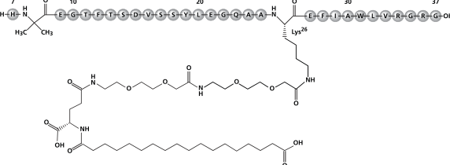

> **PDF page 8**

WEGOVY® (semaglutide) injection and WEGOVY® (semaglutide) tablets 

<!-- Start of picture text -->
with WEGOVY ®  2.4 mg injection who tested ADA positive) patients developed antibodies that cross- Figure 2.  Cumulative Incidence Function: Time to First Occurrence of MACE in reacted with native GLP-1 in Studies 2 and 3. Using a new assay, 202/1311 (15.4%) of patients  Study 1 with WEGOVY ®  Injection treated with WEGOVY ®  7.2 mg injection and 34/304 (11.2%) of patients treated with WEGOVY ®  2.4 mg injection developed anti-semaglutide antibodies during 72-week treatment periods in Studies 8  10 Placebo and 9. A total of 36 (17.8% of 202 patients treated with WEGOVY ®  7.2 mg injection who tested ADA positive) and 3 (8.8% of 34 patients treated with WEGOVY ®  2.4 mg injection who tested ADA positive)  8 patients developed antibodies that cross reacted with native GLP-1 in Studies 8 and 9. The clinical consequences of antibodies that cross react with native GLP-1 are unknown. In adults with MASH treated with WEGOVY ®  injection for 72 weeks in Study 11 [see Clinical Studies  6 WEGOVY ® (14.4)], 3/763 (0.4%) of patients developed ADA which were also cross-reactive to native GLP-1.  Injection No identified clinically significant effect of ADA on pharmacokinetics for WEGOVY ®  injection was  4 observed. HR: 0.80 There is insufficient evidence to characterize the effects of ADA on pharmacodynamics, safety, or  2 95% CI[0.72 - 0.90] effectiveness of WEGOVY ® . 13  NONCLINICAL TOXICOLOGY 0 13.1 Carcinogenesis, Mutagenesis, Impairment of Fertility 0 6 12 18 24 30 36 42 48 54 In a 2-year carcinogenicity study in CD-1 mice, subcutaneous semaglutide doses of 0.3, 1 and 3 mg/kg/day (up to 7-fold the MRHD of WEGOVY ®  subcutaneous injection 7.2 mg/week, based  Patients at risk Time from randomization (months) on AUC) were administered to the males, and 0.1, 0.3 and 1 mg/kg/day (up to 2-fold MRHD) were administered to the females. A statistically significant increase in thyroid C-cell adenomas and a  WEGOVYInjectionPlacebo ® 88038801 86528695 84878561 84278326 82548164 72297101 56605777 40154126 17341672 7159 Patients with Event (%) <!-- End of picture text -->

In a 2-year carcinogenicity study in CD-1 mice, subcutaneous semaglutide doses of 0.3, 1 and 3 mg/kg/day (up to 7-fold the MRHD of WEGOVY 3 mg/kg/day (up to 7-fold the MRHD of WEGOVY® subcutaneous injection 7.2 mg/week, based on AUC) were administered to the males, and 0.1, 0.3 and 1 mg/kg/day (up to 2-fold MRHD) were administered to the females. A statistically significant increase in thyroid C-cell adenomas and a administered to the females. A statistically significant increase in thyroid C-cell adenomas and a numerical increase in C-cell carcinomas were observed in males and females at all dose levels, at clinically relevant exposures. In a 2-year carcinogenicity study in Sprague Dawley rats, subcutaneous semaglutide doses of 0.0025, 0.01, 0.025 and 0.1 mg/kg/day were administered (up to 0.7-fold the exposure at the MRHD). A statistically significant increase in thyroid C-cell adenomas was observed in males and females at all dose levels, and a statistically significant increase in thyroid C-cell carcinomas was observed in males at greater than or equal to 0.01 mg/kg/day, at clinically relevant exposures. Human relevance of thyroid C-cell tumors in rats is unknown and could not be determined by clinical studies or nonclinical studies [see Warnings and Precautions (5.1)]. Semaglutide was not mutagenic or clastogenic in a standard battery of genotoxicity tests (i.e., bacterial mutagenicity [Ames], human lymphocyte chromosome aberration, rat bone marrow micronucleus). In a combined fertility and embryo-fetal development study in rats, subcutaneous semaglutide doses of 0.01, 0.03 and 0.09 mg/kg/day (up to 0.1-fold the MRHD) were administered to male and female rats. Males were dosed for 4 weeks prior to mating, and females were dosed for 2 weeks prior to mating and throughout organogenesis until Gestation Day 17. No effects were observed on male fertility. In females, an increase in estrus-cycle length was observed at all dose levels, together with a small reduction in numbers of corpora lutea at greater than or equal to 0.03 mg/kg/day, at clinically relevant exposures. These effects were likely an adaptive response secondary to the pharmacological effect of semaglutide on food consumption and body weight. 

Data from the in-trial period. Cumulative incidence estimates are based on time from randomization to first 

EAC-confirmed cardiovascular death, non-fatal myocardial infarction, or non-fatal stroke with non-CV death modeled as competing risk using the Aalen-Johansen estimator. Patients without events of interest were censored at the end of their in-trial observation period. Time from randomization to first cardiovascular death, non-fatal myocardial infarction, or non-fatal stroke was analyzed using a Cox proportional hazards model with treatment as categorical fixed factor. The hazard ratio and confidence interval are adjusted for the group sequential design using the likelihood ratio ordering. HR: Hazard ratio; CI: confidence interval; CV: cardiovascular 

The treatment effect for the primary composite endpoint, its components, and other relevant endpoints in Study 1 are shown in **Table 6** . 

# **Table 6. Treatment Effect for MACE and Other Events in Study 1 with WEGOVY****®** **Injection** 

# **13.2 Animal Toxicology and/or Pharmacology** 

WEGOVY® tablets contain SNAC as an absorption enhancer. An increase in lactate levels and a decrease in glucose levels in plasma and cerebrospinal fluid (CSF) were observed in mechanistic rat studies with SNAC. Small but statistically significant increases in lactate levels (up to 2-fold) were observed in a few rats at approximately the clinical exposure. At higher exposures these findings were associated with moderate to marked adverse clinical signs (lethargy, abnormal respiration, ataxia, and reduced activity, body tone and reflexes) and marked decreases in plasma and CSF glucose levels. These findings are consistent with inhibition of cellular respiration and lead to mortality at SNAC concentrations >100-times the clinical Cmax. 

<table>
<tr>
<th></th>
<th colspan="2">Patients with events n (%)</th>
<th rowspan="2">Hazard Ratio (95% CI)</th>
</tr>
<tr>
<th></th>
<th>Placebo N=8,801</th>
<th>WEGOVY® Injection N=8,803</th>
</tr>
<tr>
<td>Primary composite endpoint</td>
<td></td>
<td></td>
<td></td>
</tr>
<tr>
<td>Composite of CV death, non-fatal myocardial infarction, or non-fatal stroke1</td>
<td>701 (8%)</td>
<td>569 (6.5%)</td>
<td>0.8 (0.72; 0.9)*,2</td>
</tr>
<tr>
<td>Key secondary endpoints</td>
<td></td>
<td></td>
<td></td>
</tr>
<tr>
<td>CV death3</td>
<td>262 (3%)</td>
<td>223 (2.5%)</td>
<td>0.85 (0.71; 1.01)</td>
</tr>
<tr>
<td>All-cause death4</td>
<td>458 (5.2%)</td>
<td>375 (4.3%)</td>
<td>0.81 (0.71; 0.93)</td>
</tr>
<tr>
<td>Other endpoints</td>
<td></td>
<td></td>
<td></td>
</tr>
<tr>
<td>Fatal or non-fatal myocardial infarction5</td>
<td>334 (3.8%)</td>
<td>243 (2.8%)</td>
<td>0.72 (0.61; 0.85)</td>
</tr>
<tr>
<td>Fatal or non-fatal stroke5</td>
<td>178 (2%)</td>
<td>160 (1.8%)</td>
<td>0.89 (0.72; 1.11)</td>
</tr>
<tr>
<td>Hospitalization for heart failure or urgent heart failure visits5,6</td>
<td>122 (1.4%)</td>
<td>97 (1.1%)</td>
<td>0.79 (0.6; 1.03)</td>
</tr>
</table> 

# **14 CLINICAL STUDIES**

## **14.1 Cardiovascular Outcomes Trial in Adult Patients with Cardiovascular Disease and Either Obesity or Overweight**

## <u>Overview of Clinical Trial</u>

Study 1 (NCT03574597) was a multi-national, multi-center, placebo-controlled, double-blind trial to determine the effect of WEGOVY® injection relative to placebo on major adverse CV events (MACE) when added to current standard of care, which included management of CV risk factors and individualized healthy lifestyle counseling (including diet and physical activity) in adults with established CV disease and either obesity or overweight. The primary endpoint, MACE, was the time to first occurrence of a three-part composite outcome which included CV death, non-fatal myocardial infarction, and non-fatal stroke. During the 16-week dose escalation period, patients were titrated to WEGOVY® 2.4 mg injected subcutaneously once weekly or placebo. Patients who could not tolerate the recommended escalation dosage could stay at a lower dose level. 

* p-value <0.001, one-sided p-value 1 Primary endpoint 2 Adjusted for group sequential design using the likelihood ratio ordering. 3 CV death was the first confirmatory secondary endpoint in the testing hierarchy and superiority was not confirmed. 4 Confirmatory secondary endpoint. Not statistically significant based on the prespecified testing hierarchy. 5 Not included in the prespecified testing hierarchy for controlling type-I error. 6 Effect on heart failure has not been established. NOTE: Time to first event was analyzed in a Cox proportional hazards model with treatment as factor. For patients with multiple events, only the first event contributed to the composite endpoint. 

**Table 7. Mean Changes in Anthropometry and Cardiometabolic Parameters at Week 104 in Study 1****1,2** 

All patients were 45 years or older, with an initial BMI of 27 kg/m[^2] or greater and established CV disease (prior myocardial infarction, prior stroke, or peripheral arterial disease). Patients with a history of type 1 or type 2 diabetes were excluded. Concomitant CV therapies could be adjusted, at the discretion of the investigator, to ensure participants were treated according to the current standard of care for patients with established CV disease. 

In this trial, 17,604 patients were randomized to WEGOVY® injection or placebo. At baseline, the mean age was 62 years (range 45 to 93), 72% were male, 84% were White, 4% were Black or African American, and 8% were Asian, and 10% were Hispanic or Latino. Mean baseline body weight was 97 kg and mean BMI was 33 kg/m[^2] . At baseline, prior myocardial infarction was reported in 76% of randomized individuals, prior stroke in 23%, and peripheral arterial disease in 9%. Heart failure was reported in 24% of patients. At baseline, CV disease and risk factors were managed with lipid-lowering therapy (90%), platelet aggregation inhibitors (86%), angiotensin converting enzyme inhibitors or angiotensin II receptor blockers (74%), and beta blockers (70%). A total of 10% had moderate renal impairment (eGFR 30 to <60 mL/min/1.73m[^2] ) and 0.4% had severe renal impairment eGFR <30 mL/min/1.73m[^2] . 

|  | PLACEBO Baseline | PLACEBO Change from Baseline (LSMean) | WEGOVY® Injection Baseline | WEGOVY® Injection Change from Baseline (LSMean) | WEGOVY® Injection Difference from Placebo (LSMean) |
| --- | --- | --- | --- | --- | --- |
| Body Weight (kg) | 96.8 | -0.93 | 96.5 | -9.43 | -8.53 |
| Waist Circumference (cm) | 111.4 | -1 | 111.3 | -7.6 | -6.5 |
| Systolic Blood Pressure (mmHg) | 131 | -0.5 | 131 | -3.8 | -3.3 |
| Diastolic Blood Pressure (mmHg) | 79 | -0.5 | 79 | -1 | -0.5 |
| Heart Rate | 69 | 0.7 | 69 | 3.8 | 3.1 |
| HbA1c (%) | 5.8 | 0 | 5.8 | -0.3 | -0.3 |
|  | Baseline | % Change from Baseline (LSMean) | Baseline | % Change from Baseline (LSMean) | Relative difference from placebo (%) (LSMean) |
| Total Cholesterol (mg/dL)4 | 156 | -1.9 | 155.5 | -4.6 | -2.8 |
| LDL Cholesterol (mg/dL)4 | 78.5 | -3.1 | 78.5 | -5.3 | -2.2 |
| HDL Cholesterol (mg/dL)4 | 44.2 | 0.6 | 44.1 | 4.9 | 4.2 |
| Triglycerides (mg/dL)4 | 139.5 | -3.2 | 138.6 | -18.3 | -15.6 | 

## <u>Results</u>

In total, 96.9% of patients completed the trial, and vital status was available for 99.4% of patients. The median follow-up duration was 41.8 months. A total of 31% of WEGOVY® injection-treated patients and 27% of placebo-treated patients permanently discontinued study drug. Of those patients on treatment at 1 year, 76% were on the 2.4 mg dose, 8% were on the 1.7 mg dose, and 16% were on lower doses. Of those patients on treatment at 2 years, 77% were on the 2.4 mg dose, 7% were on the 1.7 mg dose, and 17% were on lower doses. 

For the primary analysis, a Cox proportional hazards model was used to test for superiority. Type 1 error was controlled across multiple tests. 

[^1]: Parameters listed in the table were not included in the pre-specified hierarchical testing. 

WEGOVY® injection significantly reduced the risk for first occurrence of MACE. The estimated hazard ratio (95% CI) was 0.80 (0.72, 0.90) (see **Figure 2** and **Table 6** ). 

2 Responses were analyzed using an ANCOVA with treatment as fixed factor and baseline value as covariate. Before analysis, missing data were multiple imputed. The imputation model (linear regression) was done separately for each

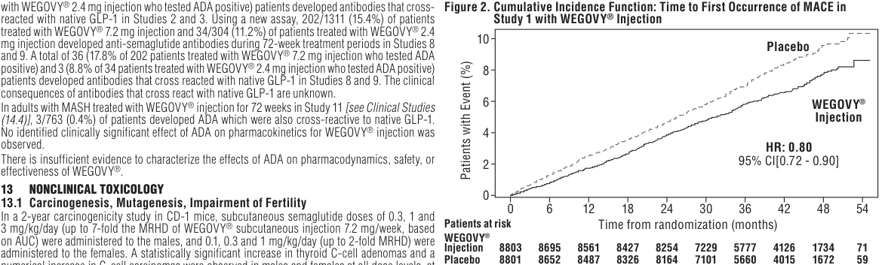

> **PDF page 9**

# WEGOVY® (semaglutide) injection and WEGOVY® (semaglutide) tablets 

treatment arm and included baseline value as a covariate and was fitted to all subjects with a measurement regardless of Study 9 was a 72-week trial that enrolled 512 patients with obesity and type 2 diabetes. Patients treatment status at Week 104. included in the trial had HbA1c 7 to 10% and were treated with either: diet and exercise alone or 1 3 For body weight the ‘change from baseline’ and ‘difference to placebo’ the unit is percentage change from baseline. to 3 oral antidiabetic drugs (metformin, sulfonylurea, glitazone or sodium-glucose co-transporter 2 4 Baseline value is the geometric mean. inhibitor). Patients were randomized in a 3:1:1 ratio to receive either WEGOVY® 7.2 mg, WEGOVY® The reduction of MACE with WEGOVY® injection was not impacted by age, sex, race, ethnicity, BMI 2.4 mg or placebo once weekly. At baseline, the mean age was 56 years (range 19 to 79), 52% were at baseline, or level of renal function impairment. female, 84% were White, 6% were Asian and 9% were Black or African American. A total of 6% were **14.2 Weight Reduction and Long-term Maintenance Studies in Adults with Obesity** Hispanic or Latino ethnicity. Mean baseline body weight was 110.1 kg and mean BMI was 38.6 kg/m[^2] . **or Overweight** <u>Results Overview of Clinical Trials in Adults</u> In Studies 2, 3, and 4, 16% of WEGOVY® injection-treated patients and 19% of the placebo-treated The efficacy of WEGOVY® once weekly subcutaneous injection for weight reduction and long-term patients discontinued therapy. In these studies, 6.8% of WEGOVY® injection-treated patients and maintenance of body weight in conjunction with a reduced-calorie diet and increased physical activity 3.2% of placebo-treated patients discontinued their treatment due to an adverse reaction [see Adverse were studied in three 68-week, randomized, double-blind, placebo-controlled trials; one 68-week, Reactions (6.1)]. In Study 5, the proportions of patients who discontinued study drug were 5.8% and randomized, double-blind, placebo withdrawal trial; one 68-week, randomized, double-blind trial that 11.6% for WEGOVY® injection and placebo, respectively. In Study 6, the proportions of patients who investigated two different doses of WEGOVY® injection versus placebo and two 72- week randomized, double-blind trials that investigated two different doses of WEGOVY® injection versus placebo. In discontinued study drug were 7.9%, 6.5%, and 3% for WEGOVY® 1.7 mg injection, WEGOVY® 2.4 mg Studies 2 (NCT#03548935), 3 (NCT#03552757), and 4 (NCT#03611582), WEGOVY® or matching injection, and placebo, respectively. In Study 7, the proportions of patients who discontinued study placebo was escalated to 2.4 mg subcutaneous injection weekly during a 16-week period followed drug were 18% and 25.5% for WEGOVY® 25 mg tablet and placebo, respectively. Adverse reactions by 52 weeks on maintenance dose. In Study 5 (NCT#03548987), WEGOVY® injection was escalated led to treatment discontinuation in 6.8% of patients treated with WEGOVY® 25 mg tablet and 5.9% during a 20-week run-in period, and patients who reached a WEGOVY® 2.4 mg subcutaneous injection patients receiving placebo. In Study 8, 5.4% of patients treated with WEGOVY® 7.2 mg and 1% patients weekly dosage after the run-in period were randomized to either continued treatment with WEGOVY® treated with placebo permanently discontinued treatment as a result of adverse reactions. In Study 9, injection or placebo for 48 weeks. In Study 6 (NCT#03811574), WEGOVY® injection was escalated to 5.5% of patients treated with WEGOVY® 7.2 mg and 2% patients treated with placebo permanently 1.7 mg or 2.4 mg subcutaneous weekly dosages or placebo over 12 to 16 weeks followed by 52 weeks discontinued treatment as a result of adverse reactions. on either maintenance dose. In Study 8 (NCT#05646706) and Study 9 (NCT#05649137) WEGOVY® For Studies 2, 3 and 4, the primary efficacy parameters were mean percent change in body weight and injection was escalated to 2.4 mg or 7.2 mg subcutaneous weekly dosages or placebo over 20 weeks the percentages of patients achieving greater than or equal to 5% weight loss from baseline to Week 68. followed by 52 weeks on maintenance dose. 

In Studies 2, 3, and 4, 16% of WEGOVY® injection-treated patients and 19% of the placebo-treated patients discontinued therapy. In these studies, 6.8% of WEGOVY® injection-treated patients and 3.2% of placebo-treated patients discontinued their treatment due to an adverse reaction [see Adverse Reactions (6.1)]. In Study 5, the proportions of patients who discontinued study drug were 5.8% and 11.6% for WEGOVY® injection and placebo, respectively. In Study 6, the proportions of patients who discontinued study drug were 7.9%, 6.5%, and 3% for WEGOVY® 1.7 mg injection, WEGOVY® 2.4 mg injection, and placebo, respectively. In Study 7, the proportions of patients who discontinued study drug were 18% and 25.5% for WEGOVY® 25 mg tablet and placebo, respectively. Adverse reactions led to treatment discontinuation in 6.8% of patients treated with WEGOVY® 25 mg tablet and 5.9% patients receiving placebo. In Study 8, 5.4% of patients treated with WEGOVY® 7.2 mg and 1% patients treated with placebo permanently discontinued treatment as a result of adverse reactions. In Study 9, 5.5% of patients treated with WEGOVY® 7.2 mg and 2% patients treated with placebo permanently discontinued treatment as a result of adverse reactions. 

For Studies 2, 3 and 4, the primary efficacy parameters were mean percent change in body weight and the percentages of patients achieving greater than or equal to 5% weight loss from baseline to Week 68. After 68 weeks, treatment with WEGOVY® injection resulted in a statistically significant reduction in body weight compared with placebo. Greater proportions of patients treated with WEGOVY® injection achieved 5%, 10% and 15% weight loss than those treated with placebo as shown in **Table 8** . **Table 8. Changes in Body Weight at Week 68 in Studies 2, 3, and 4 with WEGOVY****®** **2.4 mg Injection** 

The efficacy of WEGOVY® 25 mg oral once daily tablet for weight reduction and long-term maintenance of body weight in conjunction with a reduced-calorie diet and increased physical activity was evaluated in a 64-week randomized, double-blind, placebo-controlled trial [Study 7 (NCT#05564117)]. WEGOVY® tablet or matching placebo was escalated to a 25 mg tablet once daily during a 12-week period followed by 52-week maintenance period. 

In Studies 2, 3, 5, 7, 8 and 9, all patients received instruction for a reduced-calorie diet (approximately 500 kcal/day deficit) and increased physical activity counseling (recommended to a minimum of 150 min/week) that began with the first dose of study medication or placebo and continued throughout the trial. In Study 4, patients received an initial 8-week low-calorie diet (total energy intake 1,000 to 1,200 kcal/day) followed by 60 weeks of a reduced-calorie diet (1200 to 1800 kcal/day) and increased physical activity (100 mins/week with gradual increase to 200 mins/week). 

Study 2 was a 68-week trial that enrolled 1,961 patients with obesity (BMI greater than or equal to 30 kg/m[^2] ) or with overweight (BMI 27 to 29.9 kg/m[^2] ) and at least one weight-related comorbid condition, such as treated or untreated dyslipidemia or hypertension; patients with type 2 diabetes mellitus were excluded. Patients were randomized in a 2:1 ratio to either WEGOVY® injection or placebo. At baseline, mean age was 46 years (range 18 to 86), 74% were female, 75% were White, 13% were Asian and 6% were Black or African American. A total of 12% were Hispanic or Latino ethnicity. Mean baseline body weight was 105.3 kg and mean BMI was 37.9 kg/m[^2] . 

Study 3 was a 68-week trial that enrolled 807 patients with type 2 diabetes and BMI greater than or equal to 27 kg/m[^2] . Patients included in the trial had HbA1c 7-10% and were treated with either: diet and exercise alone or 1 to 3 oral anti-diabetic drugs (metformin, sulfonylurea, glitazone or sodiumglucose co-transporter 2 inhibitor). Patients were randomized in a 1:1 ratio to receive either WEGOVY® injection or placebo. At baseline, the mean age was 55 years (range 19 to 84), 51% were female, 62% were White, 26% were Asian and 8% were Black or African American. A total of 13% were Hispanic or Latino ethnicity. Mean baseline body weight was 99.8 kg and mean BMI was 35.7 kg/m[^2] . Study 4 was a 68-week trial that enrolled 611 patients with obesity (BMI greater than or equal to 30 kg/m[^2] ) or with overweight (BMI 27 to 29.9 kg/m[^2] ) and at least one weight-related comorbid condition such as treated or untreated dyslipidemia or hypertension; patients with type 2 diabetes mellitus were excluded. The patients were randomized in a 2:1 ratio to receive either WEGOVY® injection or placebo. At baseline, the mean age was 46 years, 81% were female, 76% were White, 19% were Black or African American and 2% were Asian. A total of 20% were Hispanic or Latino ethnicity. Mean baseline body weight was 105.8 kg and mean BMI was 38 kg/m[^2] . 

|  | Study 2 (Obesity or Overweight with Comorbidity) | Study 2 (Obesity or Overweight with Comorbidity) | Study 3 (Type 2 Diabetes with Obesity or Overweight) | Study 3 (Type 2 Diabetes with Obesity or Overweight) | Study 4 (Obesity or Overweight with Comorbidity Undergoing Intensive Lifestyle Therapy) | Study 4 (Obesity or Overweight with Comorbidity Undergoing Intensive Lifestyle Therapy) |
| --- | --- | --- | --- | --- | --- | --- |
| Intention-to-Treat1 | PLACEBO N=655 | WEGOVY® Injection N=1,306 | PLACEBO N=403 | WEGOVY® Injection N=404 | PLACEBO N=204 | WEGOVY® Injection N=407 |
| Body Weight |  |  |  |  |  |  |
| Baseline mean (kg) | 105.2 | 105.4 | 100.5 | 99.9 | 103.7 | 106.9 |
| % change from baseline (LSMean) | -2.4 | -14.9 | -3.4 | -9.6 | -5.7 | -16 |
| % difference from placebo (LSMean) (95% CI) |  | -12.4 (-13.3; -11.6)* |  | -6.2 (-7.3; -5.2)* |  | -10.3 (-11.8; -8.7)* |
| % of Patients losing greater than or equal to 5% body weight | 31.1 | 83.5 | 30.2 | 67.4 | 47.8 | 84.8 |
| % difference from placebo (LSMean) (95% CI) |  | 52.4 (48.1; 56.7)* |  | 37.2 (30.7; 43.8)* |  | 37 (28.9; 45.2)* |
| % of Patients losing greater than or equal to 10% body weight | 12 | 66.1 | 10.2 | 44.5 | 27.1 | 73 |
| % difference from placebo (LSMean) (95% CI) |  | 54.1 (50.4; 57.9)* |  | 34.3 (28.4; 40.2)* |  | 45.9 (38; 53.7)* |
| % of Patients losing greater than or equal to 15% body weight | 4.8 | 47.9 | 4.3 | 25.1 | 13.2 | 53.4 |
| % difference from placebo (LSMean) (95% CI) |  | 43.1 (39.8; 46.3)* |  | 20.7 (15.7; 25.8)* |  | 40.2 (33.1; 47.3)* |
| % of Patients losing greater than or equal to 20% body weight2 | 1.7 | 30.2 | 2.3 | 12.8 | 3.5 | 33.9 |
| % difference from placebo (LSMean) (95% CI)2 |  | 28.6 (25,8; 31.3) |  | 10.6 (6.4; 14.7) |  | 30.4 (24.8; 36.1) | 

Study 5 was a 68-week trial that enrolled 902 patients with obesity (BMI greater than or equal to 30 kg/m[^2] ) or with overweight (BMI 27 to 29.9 kg/m[^2] ) and at least one weight-related comorbid condition such as treated or untreated dyslipidemia or hypertension; patients with type 2 diabetes mellitus were excluded. Mean body weight at baseline for the 902 patients was 106.8 kg and mean BMI was 38.3 kg/m². All patients received WEGOVY® injection during the run-in period of 20 weeks that included 16 weeks of dose escalation. Trial product was permanently discontinued before randomization in 99 of 902 patients (11%); the most common reason was adverse reactions (n=48, 5.3%); 803 patients reached WEGOVY® 2.4 mg injection and were then randomized in a 2:1 ratio to either continue on WEGOVY® injection or receive placebo. Among the 803 randomized patients, the mean age was 46 years, 79% were female, 84% were White, 13% were Black or African American, and 2% Asian. A total of 8% were Hispanic or Latino ethnicity. Mean body weight at randomization (Week 20) was 96.1 kg and mean BMI at randomization (Week 20) was 34.4 kg/m[^2] . 

Study 6 was a 68-week trial that enrolled 401 East-Asian patients (Japan and South Korea) with BMI greater than or equal to 35 kg/m[^2] and at least one weight-related comorbid condition or with BMI 27 to 34.9 kg/m[^2] and at least two weight-related comorbid conditions. The patients were randomized 2:1:1 to receive subcutaneous injection of WEGOVY® 2.4 mg, WEGOVY® 1.7 mg, or placebo. At baseline, the mean age was 51 years, 63% were male, and all patients were Asian. Mean baseline body weight was 87.5 kg and mean BMI was 31.9 kg/m[^2] . At baseline, 24.7% of patients had type 2 diabetes mellitus. Study 7 was a 64-week trial that enrolled 307 patients with obesity (BMI greater than or equal to 30 kg/m[^2] ) or with overweight (BMI 27-29.9 kg/m[^2] ) and at least one weight-related comorbid condition, such as treated or untreated dyslipidemia or hypertension; patients with type 2 diabetes mellitus were excluded. Patients were randomized in a 2:1 ratio to either WEGOVY® 25 mg tablet or placebo. At baseline, mean age was 48 years, 79% were women, 92% were White, 1% were Asian and 7% were Black or African American. A total of 7.8% were Hispanic or Latino ethnicity. Mean baseline body weight was 106 kg and mean BMI was 38 kg/m[^2] . 

Study 8 was a 72-week trial that enrolled 1,407 patients with obesity (BMI greater than or equal to 30 kg/m[^2] ), patients with type 2 diabetes mellitus were excluded. Patients were randomized in a 5:1:1 ratio to either WEGOVY® 7.2 mg, WEGOVY® 2.4 mg or placebo once weekly. At baseline, mean age was 47 years (range 18 to 80), 74% were female, 86% were White, 4% were Asian and 9% were Black or African American. A total of 5% were Hispanic or Latino ethnicity. Mean baseline body weight was 113 kg and mean BMI was 39.9 kg/m[^2] . 

LSMean = least squares mean; CI = confidence interval 

1 The intent-to-treat population includes all randomized patients. In Study 2, at Week 68, the body weight was missing for 7.2% and 11.9% of patients randomized to WEGOVY® injection and placebo, respectively. In Study 3, at Week 68, the body weight was missing for 4% and 6.7% of patients randomized to WEGOVY® injection and placebo, respectively. In Study 4, at Week 68, the body weight was missing for 8.4% and 7.4% of patients randomized to WEGOVY® injection and placebo, respectively. Missing data were imputed from retrieved subjects of the same randomized treatment arm (RD-MI). 2 Not included in the pre-specified hierarchical testing. 

* p<0.0001 (unadjusted 2-sided) for superiority. 

For Study 5, the primary efficacy parameter was mean percent change in body weight from randomization (Week 20) to Week 68. 

From randomization (Week 20) to Week 68, treatment with WEGOVY® injection resulted in a statistically significant reduction in body weight compared with placebo ( **Table 9** ). Because patients who discontinued WEGOVY® injection during titration and those who did not reach the 2.4 mg weekly dose were not eligible for the randomized-treatment period, the results may not reflect the experience of patients in the general population who are first starting WEGOVY® injection. 

> **PDF page 10**

WEGOVY® (semaglutide) injection and WEGOVY® (semaglutide) tablets 

# **Table 9.  Changes in Body Weight at Week 68 in Study** with placebo. Greater proportions of patients treated with WEGOVY® 25 mg tablets achieved 5%, 10%, 15% and 20% weight loss than **5 (Obesity or Overweight with Comorbidity** those treated with placebo as shown in **Table 11** . **After 20-week Run-in) with WEGOVY****®** **2.4 mg Table 11.  Changes in Body Weight at Week 64 in Study 7 with WEGOVY****®** **25 mg Tablets Injection** 

<table>
<tr>
<th></th>
<th rowspan="2" colspan="2">WEGOVY® Injection N=8031 patients)</th>
<th rowspan="4">Body % %</th>
</tr>
<tr>
<th rowspan="3">Body Weight (only randomized Mean at Week 0 (kg)</th>
</tr>
<tr>
<th colspan="2"></th>
</tr>
<tr>
<th>N=268</th>
<th>Injection N=535</th>
</tr>
<tr>
<td>Body Weight</td>
<td></td>
<td></td>
<td>% of</td>
</tr>
<tr>
<td>Mean at Week 20 (SD) (kg)</td>
<td>95.4 (22.7)</td>
<td>96.5 (22.5)</td>
<td>%</td>
</tr>
<tr>
<td>% change from Week 20 at Week 68 (LSMean)</td>
<td>6.9</td>
<td>-7.9</td>
<td>% of %</td>
</tr>
<tr>
<td>% difference from placebo (LSMean) (95% CI)</td>
<td></td>
<td>-14.8 (-16; -13.5)*</td>
<td>% of</td>
</tr>
<tr>
<td></td>
<td></td>
<td></td>
<td></td>
</tr>
</table> 

<table>
<tr>
<th rowspan="3"></th>
<th colspan="2">Study 7 (Obesity or overweight with Comorbidity)</th>
</tr>
<tr>
<th>PLACEBO N=102</th>
<th>WEGOVY® 25 mg Tablet N=205</th>
</tr>
<tr>
<td></td>
<td></td>
</tr>
<tr>
<td>(kg)</td>
<td>104.8</td>
<td>106.4</td>
</tr>
<tr>
<td>baseline (LSMean)3</td>
<td>-2.4</td>
<td>-13.6</td>
</tr>
<tr>
<td>from placebo (LSMean) (95% CI)3</td>
<td></td>
<td>-11.2 [-13.6; -8.8]2</td>
</tr>
<tr>
<td>losing greater than or equal to 5% body weight3</td>
<td>31.3</td>
<td>76.3</td>
</tr>
<tr>
<td>from placebo (LSMean) (95% CI)3</td>
<td></td>
<td>45.1 [33.8; 56.3]2</td>
</tr>
<tr>
<td>losing greater than or equal to 10% body weight</td>
<td>14.4</td>
<td>59.8</td>
</tr>
<tr>
<td>from placebo (LSMean) (95% CI)3</td>
<td></td>
<td>45.3 [35.5; 55.2]2</td>
</tr>
<tr>
<td>losing greater than or equal to 15% body weight3</td>
<td>5.5</td>
<td>47</td>
</tr>
<tr>
<td>from placebo (LSMean) (95% CI)3</td>
<td></td>
<td>41.5 [33.2; 49.8]2</td>
</tr>
<tr>
<td>losing greater than or equal to 20% body weight3</td>
<td>3.1</td>
<td>27.9</td>
</tr>
<tr>
<td>from placebo (LSMean) (95% CI)3</td>
<td></td>
<td>24.8 [17.7; 31.9]2</td>
</tr>
</table> 

LSMean = least squares mean; CI = confidence interval 1 902 patients were enrolled at Week 0 with a mean baseline body weight of 106.8 kg. The intent-to-treat population includes all randomized patients. At Week 68, the body weight was missing for 2.8% and 6.7% of patients randomized to WEGOVY® injection and placebo, respectively. Missing data LSMean=least squares mean; CI=confidence interval were imputed from retrieved subjects of the same randomized treatment arm 1 The intent-to-treat population includes all randomized patients. In Study 7, at Week 64, the body weight was missing for 6.3% and 11.8% of patients randomized (RD-MI). to WEGOVY® tablets and placebo, respectively. * p<0.001 (unadjusted 2-sided) for superiority, controlled for multiplicity. 2 p<0.0001 (unadjusted 2-sided) for superiority. 3 Model based estimates are based on an analysis of covariance (or logistic regression for the 5%, 10%, 15% or 20% achievement endpoints) including treatment For Study 6, the primary efficacy parameters were mean percent as a factor and baseline value as a covariate. Missing data were multiple imputed from retrieved subjects of the same randomized treatment arm (RD-MI). The change in body weight and the percentage of patients achieving imputation model was a linear regression of the endpoint with gender as factor and baseline value of the endpoint, timing and the value of last available observation greater than or equal to 5% weight loss from baseline to Week 68. – on study (LAO-OS) of the endpoint as covariates, imputed by treatment status. For the 5%, 10%, 15% or 20% achievement endpoints, the missing body weight After 68 weeks, treatment with WEGOVY® 1.7 mg and 2.4 mg measurements were imputed before performing the logistic regression analyses. RD-MI: Retrieved Drop-outs Multiple Imputation injection resulted in a statistically significant reduction in body weight compared with placebo. Greater proportions of patients For Studies 8 and 9, the primary efficacy parameters were mean percent change in body weight and the percentages of patients achieving treated with WEGOVY® injection achieved 5%, 10%, and 15% greater than or equal to 5% weight loss from baseline to Week 72. weight loss than those treated with placebo as shown in **Table 10** . After 72 weeks of treatment, WEGOVY® 7.2 mg injection resulted in a statistically significant reduction in body weight compared with **Table 10.  Changes in Body Weight at Week 68 in Study** placebo in Studies 8 and 9 (see **Table 12** and **Figures 6** and **10** ). **6 in East-Asian Patients with WEGOVY****®** **Table 12. Changes in Body Weight at Week 72 in Studies 8 and 9 with WEGOVY****®** **7.2 mg Injection 1.7 mg and 2.4 mg Injection** <table>
<tr>
<th rowspan="2"></th>
<th colspan="3">with obesity)</th>
<th colspan="3">(Type 2 diabetes with obesity)</th>
</tr>
<tr>
<th>PLACEBO N=201</th>
<th>WEGOVY® 2.4 mg Injection N=201</th>
<th>WEGOVY® 7.2 mg Injection N=1005</th>
<th>PLACEBO N=102</th>
<th>WEGOVY® 2.4 mg Injection N=103</th>
<th>WEGOVY® 7.2 mg Injection N=307</th>
</tr>
<tr>
<td></td>
<td></td>
<td></td>
<td></td>
<td></td>
<td></td>
<td></td>
</tr>
<tr>
<td>(kg)</td>
<td>112.4</td>
<td>116.5</td>
<td>112.4</td>
<td>112.1</td>
<td>107</td>
<td>110.5</td>
</tr>
<tr>
<td>from baseline (LSMean)a</td>
<td>-3.9</td>
<td>-15.5</td>
<td>-18.8</td>
<td>-3.8</td>
<td>-10.4**</td>
<td>-13.2</td>
</tr>
<tr>
<td>from placebo (LSMean)</td>
<td></td>
<td></td>
<td>-14.9 [-16.2; -13.6]*</td>
<td></td>
<td></td>
<td>-9.4 [-11.0; -7.8]*</td>
</tr>
<tr>
<td>(%) from 2.4 mg [95% CI]</td>
<td></td>
<td></td>
<td>-3.3 [-4.9; -1.6]*</td>
<td></td>
<td></td>
<td></td>
</tr>
<tr>
<td>losing greater than or equal to weight</td>
<td>38.3</td>
<td>86.6**</td>
<td>88.7</td>
<td>34</td>
<td>74**</td>
<td>83.7</td>
</tr>
<tr>
<td>from placebo (LSMean)</td>
<td></td>
<td></td>
<td>50.4 [42.5; 58.3]*</td>
<td></td>
<td></td>
<td>49.8 [39.6; 59.9]*</td>
</tr>
<tr>
<td>losing greater than or equal to weight</td>
<td>20.3</td>
<td>72**</td>
<td>79.8</td>
<td>11.2</td>
<td>49.5**</td>
<td>60.7</td>
</tr>
<tr>
<td>from placebo (LSMean)</td>
<td></td>
<td></td>
<td>59.5 [53.0; 66.0]*</td>
<td></td>
<td></td>
<td>49.5 [41.2; 57.7]*</td>
</tr>
<tr>
<td>losing greater than or equal to weight</td>
<td>7.5</td>
<td>52.3**</td>
<td>63.8</td>
<td>6.9</td>
<td>27**</td>
<td>39.8</td>
</tr>
<tr>
<td>from placebo (LSMean)</td>
<td></td>
<td></td>
<td>56.4 [51.5; 61.2]*</td>
<td></td>
<td></td>
<td>32.9 [25.5; 40.3]*</td>
</tr>
<tr>
<td>losing greater than or equal to weight</td>
<td>2.8</td>
<td>32.3</td>
<td>45.5</td>
<td>2</td>
<td>13.5**</td>
<td>20.6</td>
</tr>
<tr>
<td>from placebo (LSMean)</td>
<td></td>
<td></td>
<td>42.7 [38.8; 46.6]*</td>
<td></td>
<td></td>
<td>18.7 [13.4; 24.1]*</td>
</tr>
</table> |  | Study 6 (BMI ≥35 kg/m2 with at least one Comorbidity or BMI 27-34.9 kg/m2 with at least two Comorbidities) | Study 6 (BMI ≥35 kg/m2 with at least one Comorbidity or BMI 27-34.9 kg/m2 with at least two Comorbidities) | Study 6 (BMI ≥35 kg/m2 with at least one Comorbidity or BMI 27-34.9 kg/m2 with at least two Comorbidities) |
| --- | --- | --- | --- |
| Intention-to-treat1 | PLACEBO N=101 | WEGOVY® 1.7 mg Injection N=101 | WEGOVY® 2.4 mg Injection N=199 |
| Body Weight |  |  |  |
| Baseline mean (kg) | 90.2 | 86.1 | 86.9 |
| % change from baseline (LSMean) | -2.1 | -9.6 | -13.2 |
| % difference from placebo (LSMean) (95% CI) |  | -7.5 (-9.6; -5.4)* | -11.1 (-12.9; -9.2)* |
| % of Patients losing greater than or equal to 5% body weight | 19.4 | 72.8 | 84 |
| % difference from placebo (LSMean) (95% CI) |  | 53.3 (41; 65.6)* | 64.5 (54.8; 74.3)* |
| % of Patients losing greater than or equal to 10% body weight | 4.5 | 39.1 | 59.9 |
| % difference from placebo (LSMean) (95% CI) |  | 34.5 (23.9; 45.1)* | 55.4 (47.3; 63.6)* |
| % of Patients losing greater than or equal to 15% body weight | 2.6 | 20.8 | 38.2 |
| % difference from placebo (LSMean) (95% CI) |  | 18.2 (9.8; 26.7)* | 35.6 (27.9; 43.3)* | * p<0.0001 (unadjusted 2-sided) for superiority. ** This endpoint was not included in the hierarchy testing and is only for informative purposes. LSMean = least squares mean; CI = confidence interval 1 The intent-to-treat population includes all randomized patients. In Study 8, at Week 72, the body weight was missing for 5.5%, 6.0% and 15.0% of patients 1 The intent-to-treat population includes all randomized patients. At baseline, randomized to WEGOVY® 7.2 mg, WEGOVY® 2.4 mg and placebo, respectively. In Study 9, at Week 72, the body weight was missing for 5.2% and 6.9% of patients 24.7% of patients had type 2 diabetes mellitus. At Week 68, the body weight randomized to WEGOVY® 7.2 mg and placebo, respectively. was missing for 3%, 3%, and 1% of patients randomized to WEGOVY® 1.7 a Model based estimates are based on an analysis of covariance (or logistic regression for the 5%, 10%, 15% or 20% achievement endpoints) including treatment mg injection, WEGOVY® 2.4 mg injection, and placebo, respectively. Missing as a factor and baseline value as a covariate. Missing data were multiple imputed from retrieved subjects of the same randomized treatment arm (RD-MI) in Study 8 data were imputed from retrieved subjects of the same randomized treatment or all retrieved subjects regardless of treatment arm assignment in Study 9. The imputation model was a linear regression of the endpoint with gender as factor and arm (RD-MI). baseline value of the endpoint, timing and the value of last available observation – on study (LAO-OS) of the endpoint as covariates, imputed by treatment status. * p<0.0001 (unadjusted 2-sided) for superiority. For the 5%, 10%, 15% or 20% achievement endpoints, the missing body weight measurements were imputed before performing the logistic regression analyses. RD-MI: Retrieved Drop-outs Multiple Imputation For Study 7, the primary efficacy parameters were mean percent change in body weight and the percentages of patients achieving A reduction in body weight was observed with WEGOVY® irrespective of age, sex, race, ethnicity, BMI at baseline, body weight (kg) greater than or equal to 5% weight loss from baseline to Week 64. at baseline, and level of renal function impairment. After 64 weeks, treatment with WEGOVY® 25 mg tablets resulted The cumulative frequency distributions of change in body weight are shown in **Figure 3** , **Figure 4** , **Figure 5** and **Figure 6** for in a statistically significant reduction in body weight compared Studies 2, 3, 7 and 8. One way to interpret this figure is to select a change in body weight of interest on the horizontal axis and note 

> **PDF page 11**

WEGOVY® (semaglutide) injection and WEGOVY® (semaglutide) tablets 

<!-- Start of picture text -->
the corresponding proportions of patients (vertical axis) in each treatment group who achieved at least that degree of weight loss. For example, note that the vertical line arising from -10% in Study 2 intersects the WEGOVY ®  injection and placebo curves at approximately 66%, and 12%, respectively, which correspond to the values shown in  Table 8 . Figure 3.  Change in Body Weight (%) from Baseline to  Figure 4.  Change in Body Weight (%) from Baseline to  Figure 5.  Change in Body Weight (%) from Baseline Week 68 (Study 2) with WEGOVY ®  Injection Week 68 (Study 3) with WEGOVY ®  Injection to Week 64 (Study 7) with WEGOVY ®  25 mg 100 100 Tablets 90 90 100 80 80 90 70 70 80 60 60 70 50 50 60 40 40 50 30 30 40 20 20 30 10 10 20 0 0 10 -40 -30 -20 -10 0 10 20 30 40 -40 -30 -20 -10 0 10 20 30 40 0 Change in body weight (%) Change in body weight (%) -50 -40 -30 -20 -10 0 10 20 30 WEGOVY ®  Injection Placebo WEGOVY ®  Injection Placebo Change in body weight (%) Observed data from in-trial period including imputed data for missing  Observed data from in-trial period including imputed data for missing  WEGOVY ®  Tablet Placebo observations (RD-MI). observations (RD-MI). Observed data from in-trial period including imputed data for missing observations (RD-MI). The missing observation was the patient-level average from the 1,000 imputed datasets. Figure 6.  Change in Body Weight (%) from Baseline to Week 72 (Study 8) with WEGOVY ®  7.2 mg Injection 100 90 80 70 60 50 40 30 20 10 0 -60 -50 -40 -30 -20 -10 0 10 20 Body weight (%) - change from baseline Observed data from in-trial period including imputed data for missing observations (RD-MI). WEGOVY ®  7.2 mg Injection WEGOVY ®  2.4 mg Injection Missing observations were multiply (x1000) imputed from retrieved participants of the same Placebo randomized treatment arm and missing value was replaced by the average across imputations. Cumulative frequency (%) Cumulative frequency (%) Cumulative frequency (%) Cumulative frequency (%) <!-- End of picture text -->

Observed data from in-trial period including imputed data for missing observations (RD-MI). Missing observations were multiply (x1000) imputed from retrieved participants of the same randomized treatment arm and missing value was replaced by the average across imputations. 

<!-- Start of picture text -->
The time courses of weight loss with WEGOVY ®  injection and placebo from baseline through Week 68 are depicted in  Figures 7 ,  8 , and  9 , and through Week 72 in  Figure 10 . Figure 7. Change from Baseline (%) in Body Weight (Study 2 on Left and Study 3 on Right) with WEGOVY ®  Injection 0 0 -2 -2.8 -2.4 -2 -3.3 -3.4 -4 -4 -6 -6 -8 -8 -9.9 -9.6 -10 -10 -12 -12 -14 -15.6 -14.9 -14 -16 -16 -18 -18 -20 -20 0 4 8 12 16 20 28 36 44 52 60 68 RD-MI 0 4 8 12 16 20 28 36 44 52 60 68 RD-MI WEGOVY ®  Injection 1306 1281 1248 Weeks 1203 1212 1306 WEGOVY ®  Injection 404 397 392 Weeks 381 388 404 Placebo 655 641 603 549 577 655 Placebo 403 394 383 367 376 403 visit, and estimates with multiple imputations from WEGOVY ®  Injection Placebo WEGOVY ®  Injection Placebo retrieved dropouts (RD-MI). Figure 8.  Change from Baseline (%) in Body Weight (Study 4 on Left and Study 5 a  on Right) with WEGOVY ®  Injection 0 0 -2 -2 -4 -5.8 -4 -5.4 -5.0 -6 -5.7 -6 -8 -8 -10 -10 -12 -12 -14 -14 -16 -16.5 -16.0 -16 -17.7 -17.4 -18 -18 -20 -20 visit, and estimates with multiple imputations from 0 4 8 12 16 20 24 28 32 36 40 44 48 52 56 60 64 68 RD-MI 0 4 8 12 16 20 24 28 36 44 52 60 68 RD-MI retrieved dropouts (RD-MI). WEGOVY ®  Injection 407 396 385 Weeks 367 373 407 WEGOVY ®  Injection 803 803 535 Weeks 521 520 535 a  Change from Week 0 was not a primary endpoint in  Change from Week 0 was not a primary endpoint in Placebo 204 197 194 183 189 204 Placebo 268 254 250 268 WEGOVY ®  Injection Placebo WEGOVY ®  Injection Placebo that discontinued during the 20-week run-in period. Change in body weight (%) Change in body weight (%) Change in body weight (%) Change in body weight (%) <!-- End of picture text -->

Observed values for patients completing each scheduled visit, and estimates with multiple imputations from retrieved dropouts (RD-MI). 

Observed values for patients completing each scheduled visit, and estimates with multiple imputations from retrieved dropouts (RD-MI). 

a  Change from Week 0 was not a primary endpoint in  Change from Week 0 was not a primary endpoint in Study 5. Dotted line indicates time of randomization. Randomized patients (shown) do not include 99 patients that discontinued during the 20-week run-in period.

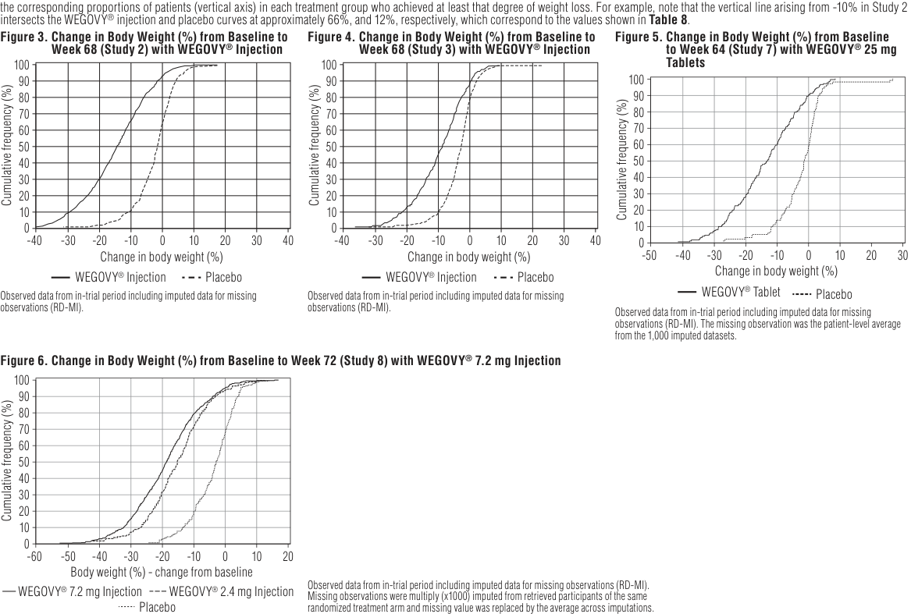

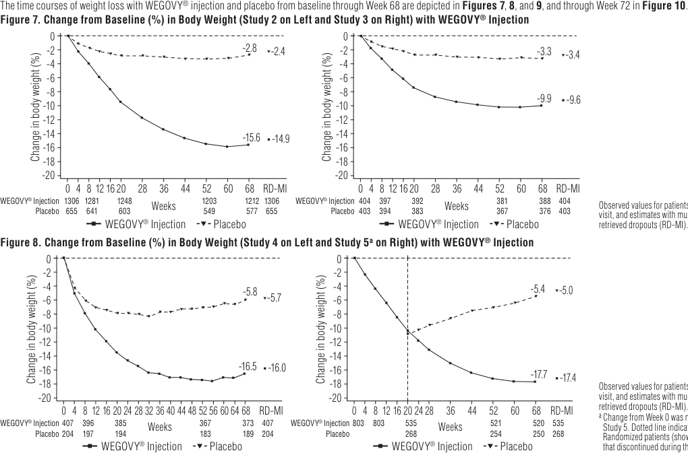

> **PDF page 12 (printed page 100)**

WEGOVY® (semaglutide) injection and WEGOVY® (semaglutide) tablets 

**Table 13. Changes in Anthropometry and Cardiometabolic Parameters at Week 68 in Studies 2, 3 and 4 with WEGOVY****®** **Injection** 

<!-- Start of picture text -->
Figure 9.  Change in Body Weight (%) from Baseline to Week 68 (Study 6 in East-Asian Patients) with WEGOVY ®  Injection 0 -1.9 -2 -2.1 -4 -6 -8 -9.9 -10 -9.6 -12 -13.4 -13.2 -14 -16 -18 -20 0 4 8 12 16 20 28 36 44 52 60 68 RD-MI WEGOVY ®  1.7 mg Injection 101 99 98 97 98 101 WEGOVY ®   2.4 mg Injection 199 198 197 Weeks 191 193 199 Placebo 101 101 100 99 100 101 WEGOVY ®  1.7 mg Injection WEGOVY ®  2.4 mg Injection Placebo Observed values for patients completing each scheduled visit and estimates with multiple imputations from retrieved dropouts (RD-MI). At baseline, 24.7% of patients had type 2 diabetes mellitus. Change in body weight (%) <!-- End of picture text -->

# **Figure 10.  Mean Change in Body Weight (%) from Baseline to Week 72 (WEGOVY****®** 

<!-- Start of picture text -->
7.2 mg Injection– Study 8) 0 -2 -3.8 -3.9 -4 -6 -8 -10 -12 -14 -15.5 -16 -16.4 -18 -18.8 -19.5 -20 0 4 8 12 16 20 24 32 40 48 56 64 72 72 (MI) WEGOVY ®  7.2 mg Injection 1005 996 989 975 948 937 950 1005 WEGOVY ®   2.4 mg Injection 201 196 194 193 Weeks 186 187 189 201 Placebo 201 200 195 185 163 158 171 201 WEGOVY ®  7.2 mg Injection WEGOVY ®  2.4 mg Injection Placebo Change in body weight (%) <!-- End of picture text -->

<table>
<tr>
<th rowspan="2">Intention-to-Treat</th>
<th colspan="3">Study 2 (Obesity or overweight with comorbidity)</th>
<th colspan="2">Study 3 (Type 2 diabetes with or overweight)</th>
<th colspan="2">Study 4 (Obesity or overweight with comorbidity undergoing intensive lifestyle therapy)</th>
</tr>
<tr>
<th>PLACEBO N=655</th>
<th></th>
<th>WEGOVY® Injection N=1,306</th>
<th>PLACEBO N=403</th>
<th>WEGOVY® Injection N=404</th>
<th>PLACEBO N=204</th>
<th>WEGOVY® Injection N=407</th>
</tr>
<tr>
<td>Waist Circumference (cm) Baseline Changes from baseline (LSMean1) Difference from placebo (LSMean) Systolic Blood Pressure</td>
<td>114.8 -4.1</td>
<td></td>
<td>114.6 -13.5 -9.4</td>
<td>115.5 -4.5</td>
<td>114.5 -9.4 -4.9</td>
<td>111.8 -6.3</td>
<td>113.6 -14.6 -8.3</td>
</tr>
<tr>
<td>(mmHg) Baseline Changes from baseline (LSMean1) Difference from placebo (LSMean) Diastolic Blood Pressure</td>
<td>127 -1.1</td>
<td></td>
<td>126 -6.2 -5.1</td>
<td>130 -0.5</td>
<td>130 -3.9 -3.4</td>
<td>124 -1.6</td>
<td>124 -5.6 -3.9</td>
</tr>
<tr>
<td>(mmHg)2 Baseline Changes from baseline (LSMean1) Difference from placebo (LSMean)</td>
<td>80 -0.4</td>
<td></td>
<td>80 -2.8 -2.4</td>
<td>80 -0.9</td>
<td>80 -1.6 -0.7</td>
<td>81 -0.8</td>
<td>80 -3 -2.2</td>
</tr>
<tr>
<td>Heart Rate2,3 Baseline Changes from baseline (LSMean1) Difference from placebo (LSMean)</td>
<td>72 -0.7</td>
<td></td>
<td>72 3.5 4.3</td>
<td>76 -0.2</td>
<td>75 2.5 2.7</td>
<td>71 2.1</td>
<td>71 3.1 1</td>
</tr>
<tr>
<td>HbA1c (%)2 Baseline Changes from baseline (LSMean1) Difference from placebo (LSMean)</td>
<td>5.7 -0.2</td>
<td></td>
<td>5.7 -0.4 -0.3</td>
<td>8.1 -0.4</td>
<td>8.1 -1.6 -1.2</td>
<td>5.8 -0.3</td>
<td>5.7 -0.5 -0.2</td>
</tr>
<tr>
<td>(mg/dL)2,4 Baseline Percent Change from baseline (LSMean1) Relative difference from placebo (LSMean) LDL Cholesterol</td>
<td>192.1 0.1</td>
<td></td>
<td>189.6 -3.3 -3.3</td>
<td>170.8 -0.5</td>
<td>170.8 -1.4 -0.9</td>
<td>188.7 2.1</td>
<td>185.4 -3.9 -5.8</td>
</tr>
<tr>
<td>(mg/dL)2,4 Baseline Percent Change from baseline (LSMean1) Relative difference from placebo (LSMean) HDL (mg/dL)2,4</td>
<td>112.5 1.3</td>
<td></td>
<td>110.3 -2.5 -3.8</td>
<td>90.1 0.1</td>
<td>90.1 0.5 0.4</td>
<td>111.8 2.6</td>
<td>107.7 -4.7 -7.1</td>
</tr>
<tr>
<td>Baseline Percent Change from baseline (LSMean1) Relative difference from placebo (LSMean) Triglycerides (mg/dL)2,4</td>
<td>49.5 1.4</td>
<td></td>
<td>49.4 5.2 3.8</td>
<td>43.8 4.1</td>
<td>44.7 6.9 2.7</td>
<td>50.9 5</td>
<td>51.6 6.5 1.5</td>
</tr>
<tr>
<td>Baseline Percent Change from baseline (LSMean1) Relative difference from placebo (LSMean)</td>
<td>127.9 -7.3</td>
<td></td>
<td>126.2 -21.9 -15.8</td>
<td>159.5 -9.4</td>
<td>154.9 -22 -13.9</td>
<td>110.9 -6.5</td>
<td>107.9 -22.5 -17</td>
</tr>
</table> 

Observed values for patients completing each scheduled visit, and estimates with multiple imputations from retrieved dropouts (RD-MI). 

_Effect of WEGOVY__®_ _Injection on Anthropometry and Cardiometabolic Parameters in Adults_ Changes in waist circumference and cardiometabolic parameters with WEGOVY® injection are shown in **Table 13** for Studies 2, 3, and 4; in **Table 14** for Study 5; in **Table 15** for Study 6; **Table 16** for Study 7, and in **Table 17** for Studies 8 and 9. 

Missing data were imputed from retrieved subjects of the same randomized treatment arm (RD-MI). 

[^1]: Model based estimates based on an analysis of covariance model including treatment (and stratification factors for Study 3 only) as a factor and baseline value as a covariate. 

[^2]: Not included in the pre-specified hierarchical testing (except HbA1c for Study 3). 

[^3]: Model based estimates based on a mixed model for repeated measures including treatment (and stratification factors for Study 3 only) as a factor and baseline values as a covariate. 

[^4]: Baseline value is the geometric mean.

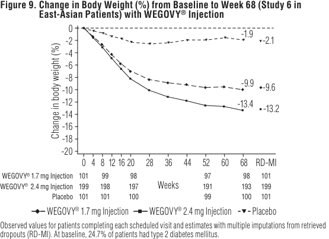

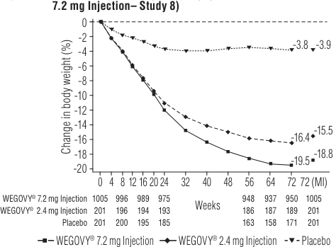

> **PDF page 13**

WEGOVY® (semaglutide) injection and WEGOVY® (semaglutide) tablets 

**Table 15. Mean Changes in Anthropometry and Cardiometabolic Parameters at Week 68 in Study 6 in East-Asian Patients with WEGOVY****®** **Injection** 

# **Table 14. Mean Changes in Anthropometry and Cardiometabolic Parameters in Study 5 (Obesity or Overweight with Comorbidity after 20-week Run-in)****1** **with WEGOVY****®** **Injection** 

<table>
<tr>
<th></th>
<th colspan="2">PLACEBO N=268</th>
<th colspan="2">WEGOVY® Injection N=535</th>
<th rowspan="2">Difference from placebo (LSMean)</th>
</tr>
<tr>
<th></th>
<th>Randomization (Week 20)</th>
<th>Change from Randomization (Week 20) to Week 68 (LSMean1)</th>
<th>Randomization (Week 20)</th>
<th>Change from Randomization (Week 20) to Week 68 (LSMean1)</th>
</tr>
<tr>
<td>Waist Circumference (cm)</td>
<td>104.7</td>
<td>3.3</td>
<td>105.5</td>
<td>-6.4</td>
<td>-9.7</td>
</tr>
<tr>
<td>Systolic Blood Pressure (mmHg)</td>
<td>121</td>
<td>4.4</td>
<td>121</td>
<td>0.5</td>
<td>-3.9</td>
</tr>
<tr>
<td>Diastolic Blood Pressure (mmHg)2</td>
<td>78</td>
<td>0.9</td>
<td>78</td>
<td>0.3</td>
<td>-0.5</td>
</tr>
<tr>
<td>Heart Rate2,3</td>
<td>76</td>
<td>-5.3</td>
<td>76</td>
<td>-2</td>
<td>3.3</td>
</tr>
<tr>
<td>HbA1c (%)2</td>
<td>5.4</td>
<td>0.1</td>
<td>5.4</td>
<td>-0.1</td>
<td>-0.2</td>
</tr>
<tr>
<td></td>
<td>Randomization (Week 20)</td>
<td>% Change from Randomization (Week 20) (LSMean1)</td>
<td>Randomization (Week 20)</td>
<td>% Change from Randomization (Week 20) (LSMean1)</td>
<td>Relative difference from placebo (LSMean)</td>
</tr>
<tr>
<td>Total Cholesterol (mg/dL)2,4</td>
<td>175.1</td>
<td>11.4</td>
<td>175.9</td>
<td>4.9</td>
<td>-5.8</td>
</tr>
<tr>
<td>LDL Cholesterol (mg/dL)2,4</td>
<td>109.1</td>
<td>7.6</td>
<td>108.7</td>
<td>1.1</td>
<td>-6.1</td>
</tr>
<tr>
<td>HDL Cholesterol (mg/dL)2,4</td>
<td>43.6</td>
<td>17.8</td>
<td>44.5</td>
<td>18.2</td>
<td>0.3</td>
</tr>
<tr>
<td>Triglycerides (mg/dL)2,4</td>
<td>95.3</td>
<td>14.8</td>
<td>98.1</td>
<td>-5.6</td>
<td>-17.8</td>
</tr>
</table> 

<table>
<tr>
<th></th>
<th colspan="2">PLACEBO N=268</th>
<th colspan="2">WEGOVY® Injection</th>
<th rowspan="2">Difference from placebo (LSMean)</th>
<th rowspan="2">Intention-to-treat Waist circumference (cm)</th>
<th colspan="3">Study 6 (BMI ≥35 kg/m2 with at least one comorbidity or BMI 27 to 34.9 kg/m2 with at least two comorbidities)</th>
</tr>
<tr>
<th></th>
<th>Randomization (Week 20)</th>
<th>Change from Randomization (Week 20) to Week 68 (LSMean1)</th>
<th>Randomization (Week 20)</th>
<th>Change from Randomization (Week 20) to Week 68 (LSMean1)</th>
<th>PLACEBO N=101</th>
<th>WEGOVY® 1.7 mg Injection N=101</th>
<th>WEGOVY® 2.4 mg Injection N=199</th>
</tr>
<tr>
<td>Waist Circumference (cm)</td>
<td>104.7</td>
<td>3.3</td>
<td>105.5</td>
<td>-6.4</td>
<td>-9.7</td>
<td>Baseline Change from baseline (LSMean1) Difference from placebo (LSMean)</td>
<td>103.8 -1.8 133</td>
<td>101.4 -7.7 -5.9</td>
<td>103.8 -11 -9.3</td>
</tr>
<tr>
<td>Systolic Blood Pressure (mmHg)</td>
<td>121</td>
<td>4.4</td>
<td>121</td>
<td>0.5</td>
<td>-3.9</td>
<td rowspan="2">Systolic blood pressure (mmHg)2 Baseline Change from baseline (LSMean1) Difference from placebo (LSMean)</td>
<td rowspan="2">-5.3</td>
<td>135</td>
<td>133</td>
</tr>
<tr>
<td>Diastolic Blood Pressure (mmHg)2</td>
<td>78</td>
<td>0.9</td>
<td>78</td>
<td>0.3</td>
<td>-0.5</td>
<td></td>
<td>-10.8 -5.5</td>
</tr>
<tr>
<td>Heart Rate2,3</td>
<td>76</td>
<td>-5.3</td>
<td>76</td>
<td>-2</td>
<td>3.3</td>
<td>Diastolic blood pressure (mmHg)2</td>
<td></td>
<td></td>
<td></td>
</tr>
<tr>
<td rowspan="2">HbA1c (%)2</td>
<td>5.4</td>
<td>0.1</td>
<td>5.4</td>
<td>-0.1</td>
<td>-0.2</td>
<td>Baseline</td>
<td>86</td>
<td>85</td>
<td>83</td>
</tr>
<tr>
<td>Randomization (Week 20)</td>
<td>% Change from Randomization (Week 20) (LSMean1)</td>
<td>Randomization (Week 20)</td>
<td>% Change from Randomization (Week 20) (LSMean1)</td>
<td>Relative difference from placebo (LSMean)</td>
<td>Difference from placebo (LSMean) Heart Rate2,3 Baseline Change from baseline (LSMean1) Difference from placebo (LSMean)</td>
<td>73 2.4</td>
<td>-2.4 73 4.4 2</td>
<td>-3.1 73 6.3 3.9</td>
</tr>
<tr>
<td>Total Cholesterol (mg/dL)2,4</td>
<td>175.1</td>
<td>11.4</td>
<td>175.9</td>
<td>4.9</td>
<td>-5.8</td>
<td rowspan="2">HbA1c (%)2 Baseline Change from baseline (LSMean1) Difference from placebo (LSMean)</td>
<td></td>
<td></td>
<td></td>
</tr>
<tr>
<td>LDL Cholesterol (mg/dL)2,4</td>
<td>109.1</td>
<td>7.6</td>
<td>108.7</td>
<td>1.1</td>
<td>-6.1</td>
<td>6.4 0</td>
<td>6.4 -0.9 -0.9</td>
<td>6.4 -0.9 -0.9</td>
</tr>
<tr>
<td>HDL Cholesterol (mg/dL)2,4</td>
<td>43.6</td>
<td>17.8</td>
<td>44.5</td>
<td>18.2</td>
<td>0.3</td>
<td rowspan="2">Total Cholesterol (mg/dL)2,4 Baseline Percent change from baseline (LSMean1) Relative difference from placebo (LSMean)</td>
<td rowspan="2">203.1 0.8</td>
<td>203.3</td>
<td>197.2</td>
</tr>
<tr>
<td>Triglycerides (mg/dL)2,4</td>
<td>95.3</td>
<td>14.8</td>
<td>98.1</td>
<td>-5.6</td>
<td>-17.8</td>
<td>-6.6 -7.3</td>
<td>-8.7 -9.4</td>
</tr>
<tr>
<td colspan="6">Missing data were imputed from retrieved subjects of the same randomized treatment arm (RD-MI). Model based estimates based on an analysis of covariance model including treatment as a factor and baseline value covariate. Not included in the pre-specified hierarchical testing. Model based estimates based on a mixed model for repeated measures including treatment as a factor and baseline values as a covariate.</td>
<td>LDL Cholesterol (mg/dL)2,4 Baseline Percent change from baseline (LSMean1) Relative difference from placebo (LSMean) HDL Cholesterol (mg/dL)2,4</td>
<td>123.3 -3.8</td>
<td>120.1 -10.1 -6.5</td>
<td>116.5 -14.6 -11.2</td>
</tr>
</table> 

Missing data were imputed from retrieved subjects of the same randomized treatment arm (RD-MI). 1 Model based estimates based on an analysis of covariance model including treatment as a factor and baseline value as a covariate. 

2 Not included in the pre-specified hierarchical testing. 

3 Model based estimates based on a mixed model for repeated measures including treatment as a factor and baseline values as a covariate. 

4 Baseline value is the geometric mean. 

Missing data were imputed from retrieved subjects of the same randomized treatment arm (RD-MI). At baseline, 24.7% of patients had type 2 diabetes mellitus. 

1 Model based estimates based on an analysis of covariance model including treatment and type 2 diabetes status as factors and baseline value as a covariate. 2 Not included in the pre-specified hierarchical testing. 

- 3 Model based estimates based on a mixed model for repeated measures including treatment and type 2 diabetes status as factors and baseline values as a covariate. 

4 Baseline value is the geometric mean. 

> **PDF page 14**

WEGOVY® (semaglutide) injection and WEGOVY® (semaglutide) tablets 

**Table 16.  Mean Changes in Anthropometry and Cardiometabolic Parameters in Study 7 with WEGOVY****®** **25 mg Tablets (Obesity or Overweight with Comorbidity)** 

**Table 17.  Changes in Anthropometry and Cardiometabolic Parameters at Week 72 in Studies 8 and 9 (WEGOVY****®** **7.2 mg Injection)** 

<table>
<tr>
<th rowspan="2">Intention-to-Treat</th>
<th colspan="3">Study 8 (Patients with obesity)</th>
<th colspan="3">Study 9 (Type 2 diabetes obesity)</th>
</tr>
<tr>
<th>PLACEBO N=201</th>
<th>WEGOVY® 2.4 mg Injection N=201</th>
<th>WEGOVY® 7.2 mg Injection N=1,005</th>
<th>PLACEBO N=102</th>
<th>WEGOVY® 2.4 mg Injection N=103</th>
<th>WEGOVY® 7.2 mg Injection N=307</th>
</tr>
<tr>
<td>Circumference (cm) from baseline (LSMean1) from placebo (LSMean [95% CI])</td>
<td>118.6 -5.6 -</td>
<td>120.3 -14.2</td>
<td>118.4 -17.5 -11.9 [-13.2; -10.6]*</td>
<td>123.9 -5.8 -</td>
<td>119.1 -10.7</td>
<td>121.8 -12.3 -6.6 [-9; -4.1]*</td>
</tr>
<tr>
<td>Blood Pressure (mmHg)2 from baseline (LSMean1) from placebo (LSMean)</td>
<td>130 -4.8 -</td>
<td>129 -8.5</td>
<td>131 -10.1 -5.3</td>
<td>132 -3.5 -</td>
<td>134 -5.6</td>
<td>134 -7.5 -4</td>
</tr>
<tr>
<td>Blood Pressure (mmHg)2 from baseline (LSMean1) from placebo (LSMean)</td>
<td>83 -1.8 -</td>
<td>83 -3</td>
<td>84 -4.5 -2.7</td>
<td>82 -2.9</td>
<td>83 -2.3</td>
<td>82 -3.1 -0.2</td>
</tr>
<tr>
<td>Rate (beats/min)2 from baseline (LSMean1) from placebo (LSMean)</td>
<td>75 -0.6</td>
<td>76 0.3</td>
<td>75 0.5 1</td>
<td>77 -2.7</td>
<td>76 1</td>
<td>77 1.1 3.9</td>
</tr>
<tr>
<td>(%)2 from baseline (LSMean1) from placebo (LSMean [95% CI])</td>
<td>5.7 0.0</td>
<td>5.6 -0.3</td>
<td>5.7 -0.3 -0.3</td>
<td>8.2 -0.2</td>
<td>8.1 -1.6</td>
<td>8 -1.7 -1.5 [-1.8; -1.2]*</td>
</tr>
<tr>
<td>Cholesterol (mg/dL)2,3 change from baseline (LSMean1) difference from placebo (LSMean)</td>
<td>193.4 -4.0 -</td>
<td>190.4 -3.6</td>
<td>193.6 -3.4 0.6</td>
<td>176.8 3.5 -</td>
<td>172.6 -1.4</td>
<td>175.2 0.1 -3.4</td>
</tr>
<tr>
<td>Cholesterol (mg/dL)2,3 change from baseline (LSMean1) difference from placebo (LSMean)</td>
<td>116.4 -4.8 -</td>
<td>114.4 -4.8</td>
<td>115.8 -3.5 1.3</td>
<td>93.5 6.7 -</td>
<td>93.8 2.7</td>
<td>91.5 10.5 3.8</td>
</tr>
<tr>
<td>(mg/dL)2,3 change from baseline (LSMean1) difference from placebo (LSMean)</td>
<td>48.9 -0.5 -</td>
<td>48.2 7.0</td>
<td>48.8 9.5 10.1</td>
<td>42.5 7.4</td>
<td>41.9 6</td>
<td>42.6 11.4 4.0</td>
</tr>
<tr>
<td>(mg/dL)2,3 change from baseline (LSMean1) difference from placebo (LSMean)</td>
<td>121.9 -0.9 -</td>
<td>121.6 -9.8</td>
<td>124.2 -16.4 -15.4</td>
<td>180.5 17.2</td>
<td>161.1 -14.8</td>
<td>175.5 -7.8 -25.0</td>
</tr>
</table> 

<table>
<tr>
<th rowspan="2">Intention-to-treat</th>
<th colspan="2">Study 7 (Obesity or overweight with comorbidity)</th>
</tr>
<tr>
<th>PLACEBO N=102</th>
<th>WEGOVY® Tablets 25 mg N=205</th>
</tr>
<tr>
<td>Waist circumference (cm)2 Baseline Change from baseline (LSMean1) Difference from placebo (LSMean)</td>
<td>113.6 -2.8</td>
<td>114 -12.2 -9.4</td>
</tr>
<tr>
<td>Systolic blood pressure (mmHg)2 Baseline Change from baseline (LSMean1) Difference from placebo (LSMean)</td>
<td>131 -5.4</td>
<td>131 -7 -1.6</td>
</tr>
<tr>
<td>Diastolic blood pressure (mmHg)2 Baseline Change from baseline (LSMean1) Difference from placebo (LSMean)</td>
<td>83 -1.8</td>
<td>83 -2.8 -1</td>
</tr>
<tr>
<td>Heart Rate2 Baseline Change from baseline (LSMean1) Difference from placebo (LSMean)</td>
<td>74 2.4</td>
<td>72 2.7 0.4</td>
</tr>
<tr>
<td>HbA1c (%)2 Baseline Change from baseline (LSMean1) Difference from placebo (LSMean)</td>
<td>5.7 -0.1</td>
<td>5.7 -0.3 -0.2</td>
</tr>
<tr>
<td>Total Cholesterol (mg/dL)2,3 Baseline Percent change from baseline (LSMean1) Relative difference from placebo (LSMean)</td>
<td>190.5 -2.2</td>
<td>191.4 -3.3 -1.2</td>
</tr>
<tr>
<td>LDL Cholesterol (mg/dL)2,3 Baseline Percent change from baseline (LSMean1) Relative difference from placebo (LSMean)</td>
<td>114.2 0.2</td>
<td>111.1 -2.9 -3.1</td>
</tr>
<tr>
<td>HDL Cholesterol (mg/dL)2,3 Baseline Percent change from baseline (LSMean1) Relative difference from placebo (LSMean)</td>
<td>50.1 -1.1</td>
<td>49.6 3.3 4.5</td>
</tr>
<tr>
<td>Triglyceride (mg/dL)2,3 Baseline Percent change from baseline (LSMean1) Relative difference from placebo (LSMean)</td>
<td>117.5 -9.1</td>
<td>115.9 -18.1 -9.9</td>
</tr>
</table> 

|1Model based estimates are based on an analysis of covariance including treatment as a factor and baseline value as a covariate. Missing data were multiple imputed from retrieved subjects of the same randomized treatment arm (RD-MI). The imputation model was a linear regression of the endpoint with gender as factor and baseline value of the endpoint, timing and the value of last available observation – on study (LAO-OS) of the endpoint as covariates, imputed by treatment status. RD-MI: Retrieved Drop-outs Multiple Imputation 2Not included in the pre-specified hierarchical testing. 3Baseline value is the geometric mean.|* p<0.0001 (unadjusted 2-sided) for superiority. The difference or relative difference from placebo was comparison between WEGOVY®7.2 mg and the placebo arms. 1Model based estimates based on an analysis of covariance model including randomized treatment as factor and baseline value as a covariate Missing data were multiple imputed from retrieved subjects of the same randomized treatment arm (RD-MI) in Study 8 or all retrieved subjects regardless of treatment arm assignment in Study 9. The imputation model was a linear regression of the endpoint with gender as factor and baseline value of the endpoint, timing and the value of last available observation – on study (LAO-OS) of the endpoint as covariates, imputed by treatment status. RD-MI: Retrieved Drop-outs Multiple Imputation 2Not included in the pre-specified hierarchical testing (except the comparison between placebo and WEGOVY®7.2 mg in Study 8 and Study 9 for waist circumference and HbA1cfor Study 9). 3Baseline value is the geometric mean. **14.3 Weight Reduction and Long-term Maintenance Study of WEGOVY****®****Injection in Pediatric Patients Aged 12** **Years and Older with Obesity** Overview of Clinical Trial in Pediatric Patients WEGOVY®injection was evaluated to reduce excess body weight in pediatric patients aged 12 years of age and older with obesity in a 68-week, double-blind, randomized, parallel group, placebo-controlled, multi-center trial in 201 pubertal pediatric patients aged 12 years and older with BMI corresponding to ≥95th percentile standardized for age and sex (Study 10) (NCT#04102189). After a 12-week lifestyle run-in period (including dietary recommendations and physical activity counseling), patients were randomized 2:1 to WEGOVY®injection once weekly or placebo once weekly. WEGOVY®injection or matching placebo was escalated to 2.4 mg or maximally tolerated dose during a 16-week period followed by 52 weeks on maintenance dose. Of WEGOVY®injection-treated patients who completed the trial, 86.7% were on the 2.4 mg dosage at the end of the trial; for 5% of patients, 1.7 mg was the maximum tolerated dosage. The mean age was 15 years; 38% of patients were male; 79% were White, 8% were Black or African American, 2% were Asian, and 11% were of other or unknown race; and 11% were of Hispanic or Latino ethnicity. The mean baseline body weight was 108 kg, and mean BMI was 37 kg/m[^2]. Results The proportions of patients who discontinued study drug were 10% for the WEGOVY®injection-treated group and 10% for the placebo-treated group. The primary endpoint was percent change in BMI from baseline to Week 68. After 68 weeks, treatment with WEGOVY®injection resulted in a statistically significant reduction in percent BMI compared with placebo. Greater proportions of patients treated with WEGOVY® injection achieved ≥5% reduction in baseline BMI than those treated with placebo as shown in**Table 18**.|
|---|---|

> **PDF page 15**

WEGOVY® (semaglutide) injection and WEGOVY® (semaglutide) tablets 

**Table 18.  Changes in Weight and BMI at Week 68 in Pediatric Patients with Obesity Aged 12 Years and Older in Study 10 with WEGOVY****®** **2.4 mg Injection in Study 10** 

**Table 19.  Mean Changes in Anthropometry and Cardiometabolic Parameters in Pediatric Patients with Obesity Aged 12 Years and Older in Study 10 with WEGOVY****®** **Injection** 

<table>
<tr>
<th></th>
<th colspan="2">PLACEBO N=67</th>
<th colspan="2">WEGOVY® Injection N=134</th>
<th rowspan="2">Difference from placebo (LSMean)</th>
</tr>
<tr>
<th></th>
<th>Baseline</th>
<th>Change from Baseline (LSMean)</th>
<th>Baseline</th>
<th>Change from Baseline (LSMean)</th>
</tr>
<tr>
<td>Waist Circumference (cm)2</td>
<td>107.3</td>
<td>-0.6</td>
<td>111.9</td>
<td>-12.7</td>
<td>-12.1</td>
</tr>
<tr>
<td>Systolic Blood Pressure (mmHg)2</td>
<td>120</td>
<td>-0.8</td>
<td>120</td>
<td>-2.7</td>
<td>-1.9</td>
</tr>
<tr>
<td>Diastolic Blood Pressure (mmHg)2</td>
<td>73</td>
<td>-0.8</td>
<td>73</td>
<td>-1.4</td>
<td>-0.6</td>
</tr>
<tr>
<td>Heart Rate3</td>
<td>76</td>
<td>-2.3</td>
<td>79</td>
<td>1.2</td>
<td>3.5</td>
</tr>
<tr>
<td rowspan="2">HbA1c (%)2,4</td>
<td>5.4</td>
<td>-0.1</td>
<td>5.5</td>
<td>-0.4</td>
<td>-0.2</td>
</tr>
<tr>
<td>Baseline</td>
<td>% Change from Baseline (LSMean)</td>
<td>Baseline</td>
<td>% Change from Baseline (LSMean)</td>
<td>Relative difference from placebo (LSMean)</td>
</tr>
<tr>
<td>Total Cholesterol (mg/dL)2,5</td>
<td>160.1</td>
<td>-1.3</td>
<td>159.4</td>
<td>-8.3</td>
<td>-7.1</td>
</tr>
<tr>
<td>LDL Cholesterol (mg/dL)2,5</td>
<td>91.7</td>
<td>-3.6</td>
<td>89.8</td>
<td>-9.9</td>
<td>-6.6</td>
</tr>
<tr>
<td>HDL Cholesterol (mg/dL)2,5</td>
<td>43.3</td>
<td>3.2</td>
<td>43.7</td>
<td>8</td>
<td>4.7</td>
</tr>
<tr>
<td>Triglycerides (mg/dL)2,5</td>
<td>108</td>
<td>2.6</td>
<td>111.3</td>
<td>-28.4</td>
<td>-30.2</td>
</tr>
</table> 

<table>
<tr>
<th>Intention-to-Treata</th>
<th>PLACEBO N=67</th>
<th>WEGOVY® 2.4 mg Injection N=134</th>
</tr>
<tr>
<td>BMI</td>
<td></td>
<td></td>
</tr>
<tr>
<td>Baseline mean (kg/m2)</td>
<td>35.7</td>
<td>37.7</td>
</tr>
<tr>
<td>% change from baseline in BMI (LSMean)</td>
<td>0.6</td>
<td>-16.1</td>
</tr>
<tr>
<td>% difference from placebo (LSMean) (95% CI)</td>
<td></td>
<td>-16.7 (-20.3; -13.2)*</td>
</tr>
<tr>
<td>% of Patients with greater than or equal to 5% reduction in baseline BMIb</td>
<td>19.7</td>
<td>77.1</td>
</tr>
<tr>
<td>% difference from placebo (LSMean)</td>
<td></td>
<td>57.4</td>
</tr>
<tr>
<td>% of Patients with greater than or equal to 10% reduction in baseline BMIb</td>
<td>7.7</td>
<td>65.1</td>
</tr>
<tr>
<td>% difference from placebo (LSMean)</td>
<td></td>
<td>57.5</td>
</tr>
<tr>
<td>% of Patients with greater than or equal to 15% reduction in baseline BMIb</td>
<td>4</td>
<td>57.8</td>
</tr>
<tr>
<td>% difference from placebo (LSMean)</td>
<td></td>
<td>53.9</td>
</tr>
<tr>
<td>Body Weightb</td>
<td></td>
<td></td>
</tr>
<tr>
<td>Baseline mean (kg)</td>
<td>102.6</td>
<td>109.9</td>
</tr>
<tr>
<td>% change from baseline (LSMean)a</td>
<td>2.7</td>
<td>-14.7</td>
</tr>
<tr>
<td>% difference from placebo (LSMean)</td>
<td></td>
<td>-17.4</td>
</tr>
</table> 

LSMean=least squares mean; CI=confidence interval 

a  The intention-to-treat population includes all randomized patients. Missing data were imputed using available data according to value and timing of last available observation on treatment and endpoint’s baseline value from retrieved subjects (RD-MI). At Week 68, the BMI was missing for 2.2% and 7.5% of patients randomized to WEGOVY® injection and placebo, respectively. 

b Parameters not included in the pre-specified hierarchical testing. 

* p<0.0001 (unadjusted 2-sided) for superiority. 

The time course of change in BMI with WEGOVY® injection and placebo from baseline through Week 68 is depicted in **Figure 11** . The cumulative frequency distribution of change in BMI is shown in **Figure 12** . 

<!-- Start of picture text -->
Figure 11.  Change from Baseline (%) in BMI in Pediatric Patients with Obesity Aged 12 Years and Older in Study 10 with WEGOVY ®  Injection 4 2 0.6 -0.1 0 -2 -4 -6 -8 -10 -12 -14 -16.2 -16.1 -16 -18 0 12 28 44 52 68 RD-MI WEGOVY ®  Injection 134 119 131 131 131 134 Weeks Placebo 67 56 63 62 62 67 WEGOVY ®  Injection Placebo Change in BMI (%) <!-- End of picture text -->

- 1 Parameters listed in the table were not included in the pre-specified hierarchical testing. 2 Missing data were imputed using available data according to value and timing of last available observation on treatment and endpoint’s baseline value from retrieved subjects (RD-MI). Model based estimates based on an analysis of covariance model including treatment and stratification groups (gender, Tanner stage group) and the interaction between stratification groups as factors and baseline value as a covariate. 3 Model based estimates based on a mixed model for repeated measures including treatment as a factor and baseline value as a covariate all nested within visit. 4 For patients without type 2 diabetes at randomization (N=129 for WEGOVY® injection-treated patients and N=64 for placebo-treated patients). 

5 Baseline value is the geometric mean. 

# **14.4 Noncirrhotic Metabolic Dysfunction-associated Steatohepatitis with Moderate to Advanced Liver Fibrosis in Adults Treated with WEGOVY****®** **Injection** 

# <u>Overview of Clinical Trial</u> 

The efficacy of WEGOVY® injection was evaluated based on an efficacy analysis at Week 72 in Study 11 (NCT#04822181), a 240-week, randomized, double-blind, placebo-controlled trial. Enrolled patients had a baseline or recent liver biopsy showing clinically significant MASLD (metabolic dysfunction-associated steatotic liver disease), defined as MASH with fibrosis stage 2 or 3 and a non-alcoholic fatty liver disease (NAFLD) Activity Score (NAS) ≥4 with a score of 1 or more in steatosis, lobular inflammation, and hepatocyte ballooning. Efficacy determination was based on the effect of WEGOVY® injection on resolution of steatohepatitis without worsening of liver fibrosis and on at least one stage improvement in liver fibrosis without worsening of steatohepatitis, on post-baseline liver biopsies collected at 72 weeks. 

The Week 72 analysis included 800 F2 and F3 (at eligibility) patients randomized 1:2 to receive placebo (n=266) or WEGOVY® once weekly (n=534), in addition to standard of care for cardiometabolic comorbidities and healthy lifestyle counseling. WEGOVY® injection or matching placebo was escalated to 2.4 mg once weekly during the initial 16 weeks of the treatment period. Dose escalation could be prolonged or patients could remain at a lower dose if 2.4 mg once weekly was not tolerable. Demographic and baseline characteristics were balanced between treatment and placebo groups. Overall, the median (Q1 to Q3) age of patients at baseline was 57 (49 to 65) years, 57% were female, 18% were Hispanic, 68% were White, 27% were Asian, and 0.6% were Black or African American. Median (Q1 to Q3) body mass index (BMI) was 34 (30 to 38) kg/m[^2] and median (Q1 to Q3) body weight was 93 (79 to 110) kg. Baseline characteristics are presented in **Table 20** . 

# **Table 20.  Baseline Characteristics in Adults Patients with Noncirrhotic MASH with Stage 2 to Stage 3 Fibrosis in Study 11** 

Observed values for patients completing each scheduled visit, and estimates with multiple imputations from retrieved dropouts (RD-MI). 

- **Figure 12. Change in BMI (%) from Baseline to Week 68 in Pediatric Patients with Obesity Aged 12 Years and Older in Study 10 with WEGOVY****®** **Injection** 

<!-- Start of picture text -->
100 90 80 70 60 50 40 30 20 10 0 -50 -40 -30 -20 -10 0 10 20 Change in BMI (%) WEGOVY ®  Injection Placebo Cumulative frequency (%) <!-- End of picture text -->

Observed data from in-trial period including imputed data for missing observations (RD-MI). 

_Effect of WEGOVY__®_ _Injection on Anthropometry and Cardiometabolic Parameters in Pediatric Patients with Obesity Aged 12 Years and Older_ 

<table>
<tr>
<th>Characteristic</th>
<th>Overall (N=800)</th>
</tr>
<tr>
<td>Fibrosis stage, n (%) F2 F3</td>
<td>250 (31) 550 (69)</td>
</tr>
<tr>
<td>Body Mass Index (BMI, kg/m2), n (%)a &lt;25 25-30 30-35 ≥35</td>
<td>53 (7) 164 (21) 252 (32) 330 (41)</td>
</tr>
<tr>
<td>Lean MASH, n (%)b</td>
<td>22 (3)</td>
</tr>
<tr>
<td>Type 2 Diabetes, n (%)</td>
<td>447 (56)</td>
</tr>
<tr>
<td></td>
<td></td>
</tr>
<tr>
<td>Hypertension, n (%)</td>
<td>503 (63)</td>
</tr>
<tr>
<td>Dyslipidemia, n (%)</td>
<td>198 (25)</td>
</tr>
<tr>
<td>Statin use, n (%)</td>
<td>300 (38)</td>
</tr>
<tr>
<td>Fibrosis Index Based on 4 Factors (FIB-4), Median (Q1, Q3)a</td>
<td>1.6 (1.1, 2.3)</td>
</tr>
<tr>
<td>Enhanced Liver Fibrosis (ELF), Median (Q1, Q3)</td>
<td>9.9 (9.3, 10.5)</td>
</tr>
</table> 

a Less than 5% missingness in the variable is omitted. 

> b Lean MASH defined as BMI <25 kg/m2 for non-Asian patients and BMI <23 kg/m2 for Asian patients. Among the 79% of the patients with vibration-controlled transient elastography (VCTE) at baseline, median (Q1 to Q3) VCTE was 10.9 (8.6 to 15.5) kPa, which may not be representative of the entire study population. The 21% of patients with missing VCTE at baseline had higher percentages of being female and having baseline diabetes, hypertension, and dyslipidemia. 

Changes in waist circumference and cardiometabolic parameters with WEGOVY® injection are shown in **Table 19** for the study in pediatric patients aged 12 years and older.

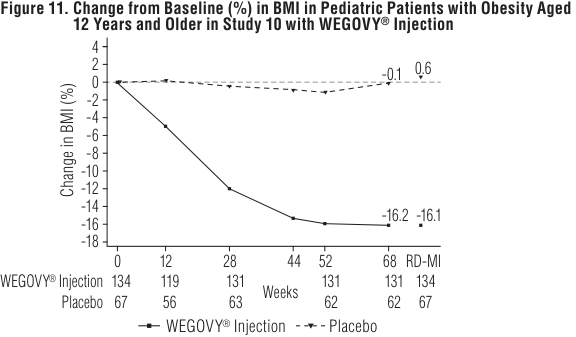

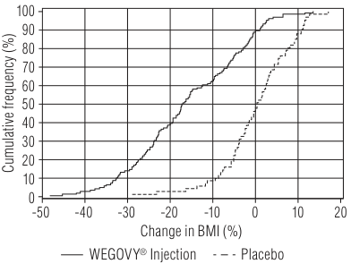

> **PDF page 16 (printed page 120)**

WEGOVY® (semaglutide) injection and WEGOVY® (semaglutide) tablets 

<u>Results</u> **Table 21** presents the Week 72 histopathology primary endpoint results comparing WEGOVY® injection with placebo on: 1) the estimated percentage of patients with resolution of steatohepatitis and no worsening of liver fibrosis and 2) the estimated percentage of patients with at least one stage improvement in liver fibrosis and no worsening of steatohepatitis. The secondary endpoint results of the estimated percentage of patients with resolution of steatohepatitis and improvement in liver fibrosis at Week 72 are also presented. Two pathologists independently read the liver biopsies for each patient; a third pathologist performed adjudication if consensus could not be reached between the two pathologists. WEGOVY® injection demonstrated improvement on these histopathology endpoints at Week 72 compared to placebo. **Table 21. Efficacy Results at Week 72 in Adult Patients with Noncirrhotic MASH with Stage 2 or Stage 3 Fibrosis in Study 11 of WEGOVY****®** **Injection** 

for 56 days between 15°C to 30°C (59°F to 86°F) or in a refrigerator 2°C to 8°C (36°F to 46°F). WEGOVY® FlexTouch® single-patient-use pen should be protected from excessive heat and light. Keep the pen cap on when not in use. Always remove and safely discard the needle after each injection. Store the WEGOVY® FlexTouch® single-patient-use pen without an injection needle attached. Always use a new needle for each injection. <u>WEGOVY</u>® <u>Tablets</u> _How Supplied_ WEGOVY® tablets are available as: 

<table>
<tr>
<th>Tablet Strength</th>
<th>Description</th>
<th>Package Configuration</th>
<th>NDC Number</th>
</tr>
<tr>
<td>1.5 mg</td>
<td>White to light yellow, round shaped debossed with “1.5” on one side and “novo” on the other side</td>
<td>Bottle of 30 tablets</td>
<td>0169- 4415-31</td>
</tr>
<tr>
<td>4 mg</td>
<td>White to light yellow, round shaped debossed with “4” on one side and “novo” on the other side</td>
<td>Bottle of 30 tablets</td>
<td>0169- 4404-31</td>
</tr>
<tr>
<td>9 mg</td>
<td>White to light yellow, round shaped debossed with “9” on one side and “novo” on the other side</td>
<td>Bottle of 30 tablets</td>
<td>0169- 4409-31</td>
</tr>
<tr>
<td>25 mg</td>
<td>White to light yellow, oval shaped debossed with “25” on one side and “novo” on the other side</td>
<td>Bottle of 30 tablets</td>
<td>0169- 4425-31</td>
</tr>
</table> 

<table>
<tr>
<th></th>
<th>Placebo N=266</th>
<th>WEGOVY® Injection N=534</th>
</tr>
<tr>
<td>Resolution of steatohepatitis and no worsening of liver fibrosis</td>
<td></td>
<td></td>
</tr>
<tr>
<td>Response Rate (%)</td>
<td>34</td>
<td>63</td>
</tr>
<tr>
<td>Difference in response rate vs. placebo (95% CI)</td>
<td></td>
<td>29 (21, 36)*</td>
</tr>
<tr>
<td>Improvement in liver fibrosis and no worsening of steatohepatitis</td>
<td></td>
<td></td>
</tr>
<tr>
<td>Response Rate (%)</td>
<td>22</td>
<td>37</td>
</tr>
<tr>
<td>Difference in response rate vs. placebo (95% CI)</td>
<td></td>
<td>14 (8, 21)*</td>
</tr>
<tr>
<td>Resolution of steatohepatitis and improvement in liver fibrosis</td>
<td></td>
<td></td>
</tr>
<tr>
<td>Response Rate (%)</td>
<td>16</td>
<td>33</td>
</tr>
<tr>
<td>Difference in response rate vs. placebo (95% CI)</td>
<td></td>
<td>17 (10, 23)*</td>
</tr>
</table> 

_Recommended Storage_ Store at 20°C to 25°C (68°F to 77°F); excursions permitted to 15°C to 30°C (59°F to 86°F) [see USP Controlled Room Temperature]. Store and dispense WEGOVY® tablets in the original bottle. Store WEGOVY® tablet in the original bottle until use to protect tablets from moisture. Store WEGOVY® tablets in a dry place away from moisture. 

||**17** **PATIENT COUNSELING INFORMATION** Advise the patient to read the FDA-approved patient labeling (Medication Guide and Instructions for Use).|
|---|---|
|* Results were statistically significant. Endpoints were evaluated according to the MASH Clinical Research Network (CRN). Resolution of steatohepatitis is defined as a score of 0 to 1 for lobular inflammation, 0 for ballooning, and any value for steatosis. No worsening of steatohepatitis is defined as no increase from baseline in score for ballooning, lobular inflammation, or steatosis. Estimated using pooled Mantel-Haenszel (MH) estimates stratified by baseline type 2 diabetes status (presence or absence) and baseline fibrosis stage (F2 or F3) with missing data handled by reference-based multiple imputation and 95% confidence intervals (CIs) calculated using Rubin’s rule to pool Sato’s estimate of standard errors across the imputed datasets. Another secondary endpoint was the percent change in body weight from baseline to Week 72. Patients treated with WEGOVY®injection (mean baseline body weight 95.4 kg) achieved an average of 10.5% weight loss from baseline at Week 72, and patients treated with placebo (mean baseline weight 97.6 kg) achieved an average of 2% weight loss from baseline at Week 72; treatment with WEGOVY®injection resulted in an average of 8.5% greater weight loss from baseline compared to placebo (95% CI: 7.4% to 9.5%). Starting at Week 12 and through Week 72, there was a trend of greater reductions from baseline in average ALT and AST in the WEGOVY®injection group as compared to the placebo group.|_Risk of Thyroid C-cell Tumors_ Inform patients that semaglutide causes thyroid C-cell tumors in rodents and that the human relevance of this finding has not been determined. Counsel patients to report symptoms of thyroid tumors (e.g., a lump in the neck, hoarseness, dysphagia, or dyspnea) to their physician [see Boxed Warning, Warnings and Precautions (5.1)]. _Acute Pancreatitis_ Inform patients of the potential risk for acute pancreatitis and its symptoms: severe abdominal pain that sometimes radiates to the back, and which may or may not be accompanied by nausea or vomiting. Instruct patients to discontinue WEGOVY®promptly and contact their physician if pancreatitis is suspected [see Warnings and Precautions (5.2)]. _Acute Gallbladder Disease_ Inform patients of the risk of acute gallbladder disease. Advise patients that substantial or rapid weight loss can increase the risk of gallbladder disease, but that gallbladder disease may also occur in the absence of substantial or rapid weight loss. Instruct patients to contact their healthcare provider for appropriate clinical follow-up if gallbladder disease is suspected [see Warnings and Precautions (5.3)].|
|**16** **HOW SUPPLIED/STORAGE AND HANDLING** WEGOVY®Injection _How Supplied_ WEGOVY®injection is a clear, colorless solution available in cartons containing 4 single-dose pens, 4 single-dose syringes with integrated needles, or 1 single-patient-use pen (WEGOVY®FlexTouch®) as follows:|_Hypoglycemia_ Inform patients of the risk of hypoglycemia and educate patients on the signs and symptoms of hypoglycemia. Advise patients with diabetes mellitus on glycemic lowering therapy that they may have an increased risk of hypoglycemia when using WEGOVY®and to report signs and/or symptoms of hypoglycemia to their healthcare provider [see Warnings and Precautions (5.4)]. _Acute Kidney Injury Due to Volume Depletion_ Inform patients of the potential risk of acute kidney injury due to dehydration associated with gastrointestinal adverse reactions. Advise patients to take precautions to avoid fluid depletion. Inform patients of the signs and symptoms of acute kidney injury and instruct them to promptly report any of these signs or symptoms or persistent (or extended) nausea, vomiting, and diarrhea to their healthcare provider [see Warnings and Precautions (5.5)]. _Severe Gastrointestinal Adverse Reactions_ Inform patients of the potential risk of severe gastrointestinal adverse reactions. Instruct patients to contact their healthcare provider if they have severe or persistent gastrointestinal symptoms [see Warnings and Precautions (5.6)]. _Hypersensitivity Reactions_ |
|<table>
<tr>
<th>Device Type</th>
<th>Name</th>
<th>Total Strength per Total Volume</th>
<th>NDC</th>
</tr>
<tr>
<td>Single-dose Pen</td>
<td rowspan="5">WEGOVY®</td>
<td>0.25 mg/0.5 mL</td>
<td>0169-4525-14</td>
</tr>
<tr>
<td>Single-dose Pen</td>
<td>0.5 mg/0.5 mL</td>
<td>0169-4505-14</td>
</tr>
<tr>
<td>Single-dose Pen</td>
<td>1 mg/0.5 mL</td>
<td>0169-4501-14</td>
</tr>
<tr>
<td>Single-dose Pen</td>
<td>1.7 mg/0.75 mL</td>
<td>0169-4517-14</td>
</tr>
<tr>
<td>Single-dose Pen</td>
<td>2.4 mg/0.75 mL</td>
<td>0169-4524-14</td>
</tr>
<tr>
<td>Single-dose Pen</td>
<td>WEGOVY® HD</td>
<td>7.2 mg/0.75 mL</td>
<td>0169-4572-14</td>
</tr>
<tr>
<td>Single-patient-use Pen (with 4 weekly doses of 2.4 mg)</td>
<td>WEGOVY® FlexTouch®</td>
<td>9.6 mg/3 mL (3.2 mg/mL)</td>
<td>0169-4915-32</td>
</tr>
<tr>
<td>Single-dose Syringe</td>
<td rowspan="5">WEGOVY®</td>
<td>0.25 mg/0.5 mL</td>
<td>0169-1602-14</td>
</tr>
<tr>
<td>Single-dose Syringe</td>
<td>0.5 mg/0.5 mL</td>
<td>0169-1605-14</td>
</tr>
<tr>
<td>Single-dose Syringe</td>
<td>1 mg/0.5 mL</td>
<td>0169-1610-14</td>
</tr>
<tr>
<td>Single-dose Syringe</td>
<td>1.7 mg/0.75 mL</td>
<td>0169-1617-14</td>
</tr>
<tr>
<td>Single-dose Syringe</td>
<td>2.4 mg/0.75 mL</td>
<td>0169-1624-14</td>
</tr>
</table>|Inform patients that serious hypersensitivity reactions have been reported during postmarketing use of semaglutide, the active ingredient in WEGOVY®. Advise patients on the symptoms of hypersensitivity reactions and instruct them to stop taking WEGOVY®and seek medical advice promptly if such symptoms occur [see Warnings and Precautions (5.7)]. _Diabetic Retinopathy Complications in Patients with Type 2 Diabetes_ Inform patients with type 2 diabetes to contact their physician if changes in vision are experienced during treatment with WEGOVY®[see Warnings and Precautions (5.8)]. _Heart Rate Increase_ Instruct patients to inform their healthcare providers of palpitations or feelings of a racing heartbeat while at rest during WEGOVY®treatment [see Warnings and Precautions (5.9)]. _Pulmonary Aspiration During General Anesthesia or Deep Sedation_|
|_Recommended Storage_ • Do not store WEGOVY®in the freezer or directly adjacent to the refrigerator cooling element. • Do not freeze WEGOVY®and do not use if it has been frozen. _Single-Dose Pen or Single-Dose Syringe Storage_ Store the WEGOVY®prefilled single-dose pen or single-dose syringe in the refrigerator from 2°C to 8°C (36°F to 46°F). If needed, prior to the pen or syringe cap removal, the pen can be kept from 8°C to 30°C (46°F to 86°F) up to 28 days. Protect WEGOVY®injection from light. WEGOVY® injection must be kept in the original carton until time of administration. Discard the WEGOVY®pen or syringe after use. _Single-Patient-Use Pen (WEGOVY__®__FlexTouch__®__) Storage_ Prior to first use, store WEGOVY®FlexTouch®single-patient-use pen in a refrigerator between 2°C to 8°C (36°F to 46°F). After first use, WEGOVY®FlexTouch®single-patient-use pen can be stored|Inform patients that WEGOVY®may cause their stomach to empty more slowly which may lead to complications with anesthesia or deep sedation during planned surgeries or procedures. Instruct patients to inform healthcare providers prior to any planned surgeries or procedures if they are taking WEGOVY®[see Warnings and Precautions (5.10)]. _Never Share a WEGOVY__®__FlexTouch__®__pen Between Patients_ Advise patients that they must never share a WEGOVY®FlexTouch®with another person, even if the needle is changed, because doing so carries a risk for transmission of blood-borne pathogens [see Warnings and Precautions (5.11)]. _Pregnancy_ WEGOVY®may cause fetal harm. Advise patients to inform their healthcare provider of a known or suspected pregnancy. Advise patients who are exposed to WEGOVY®during pregnancy to contact Novo Nordisk at 1-877-390-2760 or www.wegovypregnancyregistry.com [see Use in Specific Populations (8.1)].|

> **PDF page 17**

WEGOVY® (semaglutide) injection and WEGOVY® (semaglutide) tablets 

_Administration_ Instruct patients how to prepare and administer the correct dose of WEGOVY® and assess their ability to inject subcutaneously to ensure the proper administration of WEGOVY® . Inform patients and their caregiver(s) which WEGOVY® presentation (e.g., single-dose pen or syringe, WEGOVY® FlexTouch® single-patient-use pen) they will receive and ensure they receive training appropriate for that specific presentation. If the prescribed WEGOVY® presentation changes, ensure patients and caregivers receive appropriate training and instruct them to consult the Instructions for Use for the newly prescribed presentation. Advise caregivers that WEGOVY® FlexTouch® is not recommended for self-administration by those with visual impairment unless their healthcare provider determines the patient can properly administer [see Dosage and Administration (2.1)]. _Missed Doses_ 

Inform patients if a dose of WEGOVY® injection is missed and the next scheduled dose is more than 2 days away (48 hours), administer WEGOVY® injection as soon as possible. If one dose is missed and the next scheduled dose is less than 2 days away (48 hours), do not administer the dose. Inform patients to resume their regular once-weekly dosing schedule [see Dosage and Administration (2.4)]. Inform patients if a dose of WEGOVY® tablets is missed, skip the missed dose and take the next dose the following day [see Dosage and Administration (2.4)]. 

_Lactation_ Advise females not to breastfeed during treatment with WEGOVY® tablets [see Use in Specific Populations (8.2)]. 

Marketed by: Novo Nordisk Inc. Plainsboro, NJ 08536 For additional information about WEGOVY® contact: Novo Nordisk Inc. 800 Scudders Mill Road Plainsboro, NJ 08536 1-833-934-6891 WEGOVY® and FlexTouch® are registered trademarks of Novo Nordisk A/S. Patent Information: http://www.novonordisk-us.com/products/product-patents.html © 2026 Novo Nordisk    All rights reserved.  US26SEMO01307   June 2026

> **PDF page 18**

**WEGOVY****®** **(semaglutide) injection and WEGOVY****®** **(semaglutide) tablets  Medication Guide** 

<table>
<tr>
<th colspan="2">MEDICATION GUIDE</th>
<th rowspan="2">How should I use WEGOVY®? • Use WEGOVY® exactly as your healthcare provider tells you to. • Use WEGOVY® with a reduced-calorie diet and increased physical activity. • If you take too much WEGOVY®, you may have severe nausea, severe vomiting and severe</th>
</tr>
<tr>
<th>WEGOVY® (wee-GOH-vee) (semaglutide) injection, for subcutaneous use</th>
<th>WEGOVY® (wee-GOH-vee) (semaglutide) tablets, for oral use</th>
</tr>
<tr>
<td colspan="2">Do not share your pen WEGOVY® FlexTouch® or needles with other people, even if the needle has been changed. You may give other people a serious infection, or get a serious infection from them.</td>
<td>low blood sugar. Call your healthcare provider or Poison Help line at 1-800-222-1222 or go to the nearest hospital emergency room right away. Advice is also available online at poisonhelp.org. WEGOVY® Injection</td>
</tr>
<tr>
<td colspan="2">Read this Medication Guide and Instructions for Use before you start using WEGOVY® and each time you get a refill. There may be new information. This information does not take the place of talking to your healthcare provider about your medical condition or your treatment. What is the most important information I should know about WEGOVY®?</td>
<td>• Read the Instructions for Use that comes with WEGOVY®. • Your healthcare provider should tell you which WEGOVY® product you will be using (for example – single-dose pen or syringe, single-patient-use pen, or tablets). Before you use WEGOVY® injection for the first time, your healthcare provider</td>
</tr>
<tr>
<td></td>
<td></td>
<td>should show you how to use it . Once you have been trained, you may inject WEGOVY®</td>
</tr>
<tr>
<td>WEGOVY® may cause serious side effects,</td>
<td>including:</td>
<td>yourself if your healthcare provider determines that you are able to do so safely. If you are</td>
</tr>
<tr>
<td colspan="2">a lump or swelling in your neck, hoarseness, trouble swallowing, or shortness of breath.</td>
<td>• If you are prescribed a different WEGOVY® product at any point, make sure you receive new</td>
</tr>
<tr>
<td>is not known if WEGOVY® will cause thyroid</td>
<td>tumors or a type of thyroid cancer called</td>
<td>• Change (rotate) your injection site with each injection. Do not use the same site for each</td>
</tr>
<tr>
<td>medullary thyroid carcinoma (MTC) in people. • Do not use WEGOVY® if you or any of your</td>
<td>family have ever had a type of thyroid cancer</td>
<td>injection.</td>
</tr>
<tr>
<td>• WEGOVY® injection is a prescription medicine increased physical activity to: • reduce the risk of major cardiovascular adults with known heart disease and with • help adults and children aged 12 years and excess weight (overweight) who also have weight and keep the weight off. • treat adults with metabolic dysfunction-associated moderate to advanced liver scarring (fibrosis), • WEGOVY® tablets are a prescription medicine increased physical activity to: • reduce the risk of major cardiovascular adults with known heart disease and with • help adults with obesity, or some adults weight-related medical problems to lose • WEGOVY® contains semaglutide and should</td>
<td>used with a reduced-calorie diet and events such as death, heart attack, or stroke in either obesity or overweight. older with obesity, or some adults with weight-related medical problems to lose steatohepatitis (MASH) with but not with cirrhosis of the liver. used with a reduced-calorie diet and events such as death, heart attack, or stroke in either obesity or overweight. with excess weight (overweight) who also have weight and keep the weight off. not be used with other semaglutide-containing</td>
<td>• If you miss a dose of WEGOVY® and the next scheduled dose is more than 2 days away (48 hours), take the missed dose as soon as possible. If you miss a dose of WEGOVY® and the next scheduled dose is less than 2 days away (48 hours), do not administer the dose. Take your next dose on the regularly scheduled day. • If you miss doses of WEGOVY® for 2 or more consecutive weeks, contact your healthcare provider to talk about how to restart your treatment. • You can take WEGOVY® with or without food. WEGOVY® Tablets • Take 1 WEGOVY® tablet by mouth on an empty stomach in the morning with water (no more than 4 ounces). Do not take WEGOVY® tablets with any other liquids besides water. • Do not split, crush, chew or dissolve WEGOVY® tablets. Swallow WEGOVY® tablets whole. • Do not take more than 1 WEGOVY® tablet each day. • After 30 minutes, you can eat, drink, or take other oral medicines. • If you miss a dose of WEGOVY®, skip the missed dose and go back to your regular schedule for the next dose.</td>
</tr>
<tr>
<td colspan="2">called medullary thyroid carcinoma (MTC), or if you have an endocrine system condition</td>
<td>• Use WEGOVY® 1 time each week, on the same day each week, at any time of</td>
</tr>
<tr>
<td rowspan="2" colspan="2">called Multiple Endocrine Neoplasia syndrome type 2 (MEN 2).</td>
<td>the day.</td>
</tr>
<tr>
<td>• If you need to change the day of the week, you may do so as long as your last dose of WEGOVY® was given 2 or more days before.</td>
</tr>
<tr>
<td rowspan="3" colspan="2">products or other GLP-1 receptor agonist under 18 years. • to help children under 12 years of age lose weight and keep the weight off. • for the treatment of MASH in people under 18 years of age. • It is not known if WEGOVY® tablets are safe and effective for use in people under 18 years of age. Do not use WEGOVY® if:</td>
<td>will not go away, with or without nausea or vomiting. Sometimes you may feel the pain from</td>
</tr>
<tr>
<td>What are the possible side effects of WEGOVY®? WEGOVY® may cause serious side effects, including:</td>
</tr>
<tr>
<td>• See “What is the most important information I should know about WEGOVY®?”</td>
</tr>
<tr>
<td></td>
<td></td>
<td>• inflammation of your pancreas (pancreatitis). Stop using WEGOVY® and call your healthcare provider right away if you have severe pain in your stomach area (abdomen) that</td>
</tr>
<tr>
<td rowspan="2" colspan="2">• you or any of your family have ever had a type of thyroid cancer called MTC or if you have an</td>
<td>your abdomen to your back. • gallbladder problems. WEGOVY® may cause gallbladder problems including gallstones.</td>
</tr>
<tr>
<td>Some gallbladder problems need surgery. Call your healthcare provider if you have any of the following symptoms: • pain in your upper stomach (abdomen) • yellowing of skin or eyes (jaundice)</td>
</tr>
</table> 

> **PDF page 19**

**WEGOVY****®** **(semaglutide) injection and WEGOVY****®** **(semaglutide) tablets  Medication Guide** 

| Column 1 |
| --- |
| What are the possible side effects of WEGOVY®? (cont’d) • food or liquid getting into the lungs during surgery or other procedures that use anesthesia or deep sleepiness (deep sedation). WEGOVY® may increase the chance of food getting into your lungs during surgery or other procedures. Tell all your healthcare providers that you are taking WEGOVY® before you are scheduled to have surgery or other procedures. The most common side effects of WEGOVY® in adults or children aged 12 years and older may include: • nausea • stomach (abdomen) pain • dizziness • gas • diarrhea • changes in skin sensations • feeling bloated • stomach flu • vomiting • headache • belching • heartburn • constipation • tiredness (fatigue) • low blood sugar in people • hair loss • upset stomach with type 2 diabetes Talk to your healthcare provider about any side effect that bothers you or does not go away. These are not all the possible side effects of WEGOVY®. Call your doctor for medical advice about side effects. You may report side effects to FDA at 1-800-FDA-1088. |
| How should I store WEGOVY®? WEGOVY® injection • Do not store WEGOVY® in the freezer or directly beside the refrigerator cooling element. • Do not freeze WEGOVY® and do not use WEGOVY® if it has been frozen. • WEGOVY® single-dose pen and single-dose syringe: • Store in the refrigerator between 36°F to 46°F (2°C to 8°C). • If needed, before removing the pen or syringe cap, WEGOVY® single-dose pen and single-dose syringe can be stored from 46°F to 86°F (8°C to 30°C) in the original carton for up to 28 days. • Keep WEGOVY® single-dose pen and syringe in the original carton to protect it from light. • Throw away the WEGOVY® single-dose pen or syringe if it has been frozen, has been exposed to light or temperatures above 86°F (30°C), has been out of the refrigerator for 28 days or longer, or after use. • WEGOVY® FlexTouch® single-patient-use pen: • Store in the refrigerator between 36°F to 46°F (2°C to 8°C). • After first use, store WEGOVY® FlexTouch® pen between 59°F to 86°F (15°C to 30°C) or in the refrigerator between 36°F to 46°F (2°C to 8°C) for up to 56 days. • Protect WEGOVY® FlexTouch® pen from excessive heat and light. • Keep the pen cap on when not in use. • Always remove and safely discard the needle after each injection. • Store WEGOVY® FlexTouch® pen without an injection needle attached. • Always use a new needle for each injection. • Throw away if the WEGOVY® FlexTouch® pen if it has been frozen, has been exposed to light or temperatures above 86°F (30°C), or has been out of the refrigerator for 56 days or longer. WEGOVY® tablets • Store WEGOVY® tablets at room temperature between 68°F to 77°F (20°C to 25°C). • Store tablets in the original closed WEGOVY® bottle until you are ready to take one. Do not store in any other container. • Store in a dry place away from moisture. Keep WEGOVY® and all medicines out of the reach of children. |
| General information about the safe and effective use of WEGOVY®. Medicines are sometimes prescribed for purposes other than those listed in a Medication Guide. Do not use WEGOVY® for a condition for which it was not prescribed. Do not give WEGOVY® to other people, even if they have the same condition that you have. It may harm them. You can ask your pharmacist or healthcare provider for information about WEGOVY® that is written for health professionals. |
| What are the ingredients in WEGOVY®? Active Ingredient: semaglutide Inactive Ingredients in WEGOVY® injection: disodium phosphate dihydrate, sodium chloride, water for injection. Phenol and propylene glycol are also inactive ingredients in the single-patient-use WEGOVY® FlexTouch®. Hydrochloric acid or sodium hydroxide may be added to adjust pH. Inactive Ingredients in WEGOVY® tablets: salcaprozate sodium (SNAC) and magnesium stearate | 

This Medication Guide has been approved by the U.S. Food and Drug Administration. Revised: 06/2026 

> Marketed by: Novo Nordisk Inc., Plainsboro, NJ 08536 WEGOVY® and FlexTouch® are registered trademarks of Novo Nordisk A/S. Patent Information: http://novonordisk-us.com/products/product-patents. html 

> For more information, go to startWegovy.com or call 1-833-Wegovy-1. 

> © 2026 Novo Nordisk    All rights reserved.  US26SEMO01307   June 2026

> **PDF page 20**

**WEGOVY****®** **(semaglutide) injection  Instructions For Use** 

**Instructions for Use WEGOVY****®** (semaglutide) injection 

# **Pull out to get started** 

WEGOVY® comes in five strengths: 

**0.25 mg / 0.5 mL 0.5 mg / 0.5 mL 1 mg / 0.5 mL 1.7 mg / 0.75 mL 2.4 mg / 0.75 mL** 

**Before you use your WEGOVY****®** **pen for the first time,** talk to your healthcare provider or your caregiver about how to prepare and inject WEGOVY® correctly. 

# **How to use your WEGOVY****®** **pen** 

# **Important information** 

**Read this Instructions for Use before you start using WEGOVY****®** **. This information does not replace talking to your healthcare provider about your medical condition or treatment.** 

# **Do not use your WEGOVY****®** **pen without receiving training** 

**from your healthcare provider.** Make sure that you or your caregiver know how to give an injection with the pen before you 

start your treatment. 

- **Your WEGOVY****®** **pen is for 1 time use only.** The WEGOVY® pen is for subcutaneous (under the skin) use only. 

Read and follow the instructions so that you use your 

WEGOVY® pen correctly: 

- **The dose of WEGOVY****®** **is already set on your pen.** 

# **Preparation** 

- **The needle is covered by the needle cover and the needle will not be seen.** 

# **Step 1. Prepare for your injection.** 

- Do not remove the pen cap until you are ready to inject. 

   - **Supplies you will need to give your WEGOVY****®** **injection:** 

- Do not touch or push on the needle cover. You could get a needle stick injury. 

- Your WEGOVY® injection will start when the needle cover is pressed firmly against your skin. 

   - WEGOVY® pen 

- **Do not** remove the pen from your skin before the yellow bar in the pen window has stopped moving. The medicine may appear on the skin or squirt from the needle and you may not get your full dose of WEGOVY® if: 

- 1 alcohol swab or soap and water 

- 1 gauze pad or cotton ball 

   - 1 sharps disposable container for used WEGOVY® pens 

- the pen is removed too early **<u>or</u>** 

   - **Wash your hands.** 

- you have not pressed the pen firmly against the skin for the entire injection. 

   - **Check your WEGOVY****®** **pen.** 

- If the yellow bar does not start moving or stops during the injection, contact your healthcare provider or Novo Nordisk at startWegovy.com or call Novo Nordisk Inc. at 1-833-934-6891. 

   - Do not use your WEGOVY® pen if: 

   - The pen appears to have been used or any part of the pen appears broken, for example if it has been dropped. 

- The needle cover will lock when the pen is removed from your skin. **You cannot stop the injection and restart it later.** 

   - The WEGOVY® medicine is not clear and colorless through the pen window. 

- People who are blind or have vision problems should not use the WEGOVY® pen without help from a person trained to use the WEGOVY® pen. 

- The expiration date (EXP) has passed. 

# **How do I store WEGOVY****®** **?** 

- Store the WEGOVY® pen in the refrigerator between 36°F to 46°F (2°C to 8°C). 

Contact Novo Nordisk at 1-833-934-6891 if your WEGOVY® pen fails any of these checks. 

- If needed, before removing the pen cap, WEGOVY® can be stored from 46°F to 86°F (8°C to 30°C) in the original carton for up to 28 days. 

# **Step 2. Choose your injection site.** 

- Keep WEGOVY® in the original carton to protect it from light. 

- Your healthcare provider can help you choose the injection site that is best for you 

- **Do not freeze.** 

- Throw away the pen if WEGOVY® has been frozen, has been exposed to light or temperatures above 86°F(30°C), or has been out of the refrigerator for 28 days or longer. 

- You may inject into your upper leg (front of the thighs), lower stomach (keep 2 inches away from your belly button) or upper arm. 

- your belly button) or upper arm. Upper arms 

- • Do not inject into an area where the skin is tender, Stomach 

- bruised, red, or hard. Avoid injecting into areas with scars or stretch marks. Upper legs 

# **Keep WEGOVY****®** **and all medicines out of the reach of children.** 

<!-- Start of picture text -->
WEGOVY ®  pen parts Before use After use Expiration date (on the back) Check that WEGOVY ® has not expired. Always  check you have the medicine and dose that your healthcare provider prescribed. Either: 0.25 mg / 0.5 mL 0.5 mg / 0.5 mL 1 mg / 0.5 mL 1.7 mg / 0.75 mL 2.4 mg / 0.75 mL Pen window Pen window Check that WEGOVY ®  is clear and  Check that the yellow colorless. Air bubbles are normal.  bar has stopped They do not affect your dose. moving to make sure you received your full dose. Needle cover  Needle cover Needle is hidden inside. locks after use. <!-- End of picture text -->

• You may inject in the same body area each week, but make sure it is not in the same spot each time. Clean the injection site with an alcohol swab or soap and water. Do not touch the injection site after cleaning. Allow the skin to dry before injecting. 

**Pen cap** Remove it just before you are ready to inject.

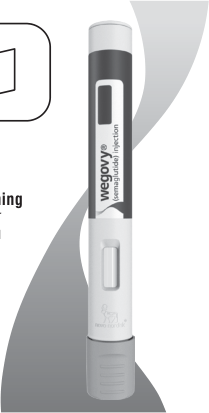

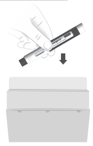

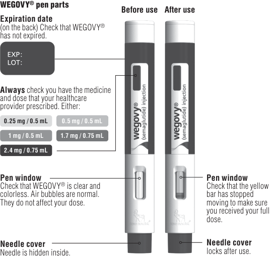

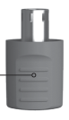

> **PDF page 21**

**WEGOVY****®** **(semaglutide) injection  Instructions For Use** 

**Injection Step 3. Remove pen cap.** 

**• Pull the pen cap straight off your pen.** 

# **Step 4. Inject WEGOVY****®** **.** 

- **Push the pen firmly against your skin and keep applying pressure until the yellow bar has stopped moving.** If the yellow bar does not start moving, press the pen more firmly against your skin. 

- **You will hear 2 clicks during the injection.** 

- Click 1: the injection has started. 

- Click 2: the injection is ongoing. 

- **If you have problems with the injection, refer to the “Troubleshooting” section.** 

<!-- Start of picture text -->
The injection takes about 5-10 seconds. Click 1 The injection starts. Click 2 Keep applying pressure until the yellow bar has stopped moving. Yellow bar has stopped moving. The injection is complete.  Lift the pen slowly. <!-- End of picture text -->

**Throw away pen Step 5. Throw away (dispose of) pen.** Safely dispose of the WEGOVY® pen right away after each use. See **“How do I throw away (dispose of) WEGOVY****®** **pens?”** 

- **What if blood appears after injection?** If blood appears at the injection site, press the site lightly with a gauze pad or cotton ball. 

**Troubleshooting** 

- **If you have problems injecting, change to a more firm injection site, such as upper leg, or upper arm or consider standing up while injecting into the lower stomach.** 

- **If medicine appears on the skin or squirts from the needle, make sure the next time you inject to keep applying pressure until the yellow bar has stopped moving. Then you can lift the pen slowly from your skin.** 

**Medicine How do I throw away (dispose of) WEGOVY****®** **pens?** Put the used WEGOVY® pen in an FDA-cleared sharps disposal container right away after use. **Do not throw away (dispose of)** the pen in your household trash. If you do not have an FDA-cleared sharps disposal container, you may use a household container that is: • made of a heavy-duty plastic, 

- able to be closed with a tight-fitting, puncture-resistant lid, without sharps being able to come out, 

- • upright and stable during use, 

- leak-resistant, and 

- properly labeled to warn of hazardous waste inside the container. 

When your sharps disposal container is almost full, you will need to follow your community guidelines for the right way to dispose of your sharps disposal container. There may be state or local laws about how you should throw away used needles and syringes. For more information about safe sharps disposal, and for specific sharps disposal in the state that you live in, go to the FDA’s website at http://www.fda.gov/safesharpsdisposal. 

- Do not reuse the pen. 

- Do not recycle the pen or sharps disposal container, or throw them into household trash. 

- **Important:** Keep your WEGOVY® pen, sharps disposal container and all medicines out of the reach of children. 

# **How do I care for my pen?** 

<!-- Start of picture text -->
Protect your pen <!-- End of picture text -->

- Do not drop your pen or knock it against hard surfaces. 

- Do not expose your pen to any liquids. 

- If you think that your pen may be damaged, do not try to fix it. Use a new one. 

- Keep the pen cap on until you are ready to inject. Your pen will no longer be sterile if you store an unused pen without the cap, if you pull the pen cap off and put it on again, or if the pen cap is missing. This could lead to an infection. 

   - If you have any questions about WEGOVY® , go to startWegovy.com or call Novo Nordisk Inc. at 1-833-Wegovy-1 

Marketed by: Novo Nordisk Inc. Plainsboro, NJ 08536 For information about WEGOVY® , go to startWegovy.com or contact: Novo Nordisk Inc. 800 Scudders Mill Road Plainsboro, NJ 08536 1-833-Wegovy-1 WEGOVY® is a registered trademark of Novo Nordisk A/S. PATENT Information: http://novonordisk-us.com/products/ product-patents.html This Instructions for Use has been approved by the U.S. Food and Drug Administration. Revised: November 2025 © 2026 Novo Nordisk     All rights reserved. US26SEMO01307    June 2026

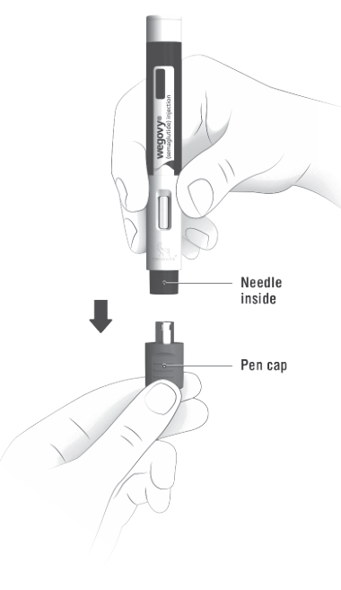

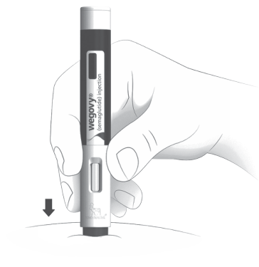

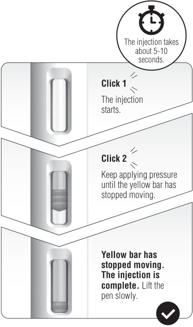

> **PDF page 22**

**WEGOVY****®** **HD (semaglutide) injection  Instructions For Use** 

# **Instructions for Use WEGOVY****®** **HD** (semaglutide) injection 

**Pull out to get started** 

WEGOVY® HD comes in the following strength: 

# **7.2 mg / 0.75 mL** 

**Before you use your WEGOVY****®** **pen for the first time,** talk to your healthcare provider or your caregiver about how to prepare and inject WEGOVY® correctly. 

# **How to use your WEGOVY****®** **pen** 

# **Important information** 

**Read this Instructions for Use before you start using WEGOVY****®** **. This information does not replace talking to your healthcare provider about your medical condition or treatment.** 

# **Do not use your WEGOVY****®** **pen without receiving training** 

**from your healthcare provider.** Make sure that you or your 

caregiver know how to give an injection with the pen before you 

start your treatment. 

- **Your WEGOVY****®** **pen is for 1 time use only.** The WEGOVY® pen is for subcutaneous (under the skin) use only. 

Read and follow the instructions so that you use your 

WEGOVY® pen correctly: 

- **The dose of WEGOVY****®** **is already set on your pen.** 

# **Preparation** 

- **The needle is covered by the needle cover and the needle will not be seen.** 

# **Step 1. Prepare for your injection.** 

- Do not remove the pen cap until you are ready to inject. 

   - **Supplies you will need to give your WEGOVY****®** **injection:** 

- Do not touch or push on the needle cover. You could get a needle stick injury. 

- Your WEGOVY® injection will start when the needle cover is pressed firmly against your skin. 

   - WEGOVY® pen 

- **Do not** remove the pen from your skin before the yellow bar in the pen window has stopped moving. The medicine may appear on the skin or squirt from the needle and you may not get your full dose of WEGOVY® if: 

- 1 alcohol swab or soap and water 

- 1 gauze pad or cotton ball 

   - 1 sharps disposable container for used WEGOVY® pens 

- the pen is removed too early **<u>or</u>** 

   - **Wash your hands.** 

- you have not pressed the pen firmly against the skin for the entire injection. 

   - **Check your WEGOVY****®** **pen.** 

- If the yellow bar does not start moving or stops during the injection, contact your healthcare provider or Novo Nordisk at startWegovy.com or call Novo Nordisk Inc. at 1-833-934-6891. 

   - Do not use your WEGOVY® pen if: 

   - The pen appears to have been used or any part of the pen appears broken, for example if it has been dropped. 

- The needle cover will lock when the pen is removed from your skin. **You cannot stop the injection and restart it later.** 

   - The WEGOVY® medicine is not clear and colorless through the pen window. 

- People who are blind or have vision problems should not use the WEGOVY® pen without help from a person trained to use the WEGOVY® pen. 

- The expiration date (EXP) has passed. 

# **How do I store WEGOVY****®** **?** 

- Store the WEGOVY® pen in the refrigerator between 36°F to 46°F (2°C to 8°C). 

Contact Novo Nordisk at 1-833-934-6891 if your WEGOVY® pen fails any of these checks. 

- If needed, before removing the pen cap, WEGOVY® can be stored from 46°F to 86°F (8°C to 30°C) in the original carton for up to 28 days. 

# **Step 2. Choose your injection site.** 

- Do not store WEGOVY® in the freezer or directly beside the refrigerator cooling element. 

- Your healthcare provider can help you choose the injection site that is best for you. 

- **Do not freeze WEGOVY****®** **and do not use if it has been frozen.** 

- Keep WEGOVY® in the original carton to protect it from light. 

- You may inject into your upper leg (front of the thighs), lower stomach (keep 2 inches away from your belly button) or upper arm. 

• Throw away the pen if WEGOVY® has been frozen, has been exposed to light or temperatures above 86°F (30°C), or has been out of the refrigerator for 28 days or longer or after use. **Keep WEGOVY****®** **and all medicines out of the reach of children.** 

- your belly button) or upper arm. Upper arms 

- • Do not inject into an area where the skin is tender, Stomach 

- bruised, red, or hard. Avoid injecting into areas with scars or stretch marks. Upper legs 

<!-- Start of picture text -->
WEGOVY ®  pen parts Before use After use Expiration date (on the back) Check that WEGOVY ® has not expired. Always  check you have the medicine and dose that your healthcare provider prescribed. 7.2 mg / 0.75 mL Pen window Pen window Check that WEGOVY ®  is clear and  Check that the yellow colorless. Air bubbles are normal.  bar has stopped They do not affect your dose. moving to make sure you received your full dose. Needle cover  Needle cover Needle is hidden inside. locks after use. Pen cap Remove it just before you are ready to inject. <!-- End of picture text -->

• You may inject in the same body area each week, but make sure it is not in the same spot each time. Clean the injection site with an alcohol swab or soap and water. Do not touch the injection site after cleaning. Allow the skin to dry before injecting.

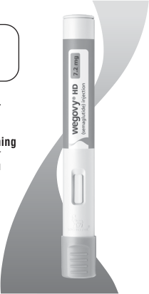

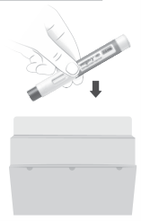

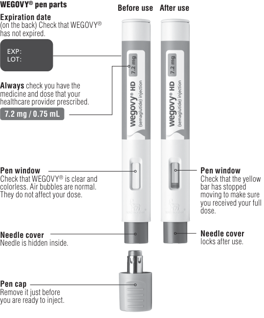

> **PDF page 23**

**WEGOVY****®** **HD (semaglutide) injection  Instructions For Use** 

**Injection Step 3. Remove pen cap.** 

**• Pull the pen cap straight off your pen.** 

# **Step 4. Inject WEGOVY****®** **.** 

- **Push the pen firmly against your skin and keep applying pressure until the yellow bar has stopped moving.** If the yellow bar does not start moving, press the pen more firmly against your skin. 

- **You will hear 2 clicks during the injection.** 

- Click 1: the injection has started. 

- Click 2: the injection is ongoing. 

- **If you have problems with the injection, refer to the “Troubleshooting” section.** 

<!-- Start of picture text -->
The injection takes about 5-10 seconds. Click 1 The injection starts. Click 2 Keep applying pressure until the yellow bar has stopped moving. Yellow bar has stopped moving. The injection is complete.  Lift the pen slowly. Throw away pen Step 5. Throw away (dispose of) pen. Safely dispose of the WEGOVY ®  pen right away after each use. See  “How do I throw away (dispose of) WEGOVY ® pens?” <!-- End of picture text -->

- **What if blood appears after injection?** If blood appears at the injection site, press the site lightly with a gauze pad or cotton ball. **Troubleshooting** 

- **If you have problems injecting, change to a more firm injection site, such as upper leg, or upper arm or consider standing up while injecting into the lower stomach.** 

**• If medicine appears on the skin or squirts from the needle, make sure the next time you inject to keep applying pressure until the yellow bar has stopped moving. Then you can lift the pen slowly from your skin. Medicine How do I throw away (dispose of) WEGOVY****®** **pens?** Put the used WEGOVY® pen in an FDA-cleared sharps disposal container right away after use. **Do not throw away (dispose of)** the pen in your household trash. If you do not have an FDA-cleared sharps disposal container, you may use a household container that is: • made of a heavy-duty plastic, 

- able to be closed with a tight-fitting, puncture-resistant lid, without sharps being able to come out, 

- upright and stable during use, 

- leak-resistant, and 

- properly labeled to warn of hazardous waste inside the container. 

When your sharps disposal container is almost full, you will need to follow your community guidelines for the right way to dispose of your sharps disposal container. There may be state or local laws about how you should throw away used needles and syringes. For more information about safe sharps disposal, and for specific sharps disposal in the state that you live in, go to the FDA’s website at http://www.fda.gov/safesharpsdisposal. 

- Do not reuse the pen. 

- Do not recycle the pen or sharps disposal container, or throw them into household trash. 

- **Important:** Keep your WEGOVY® pen, sharps disposal container and all medicines out of the reach of children. 

# **How do I care for my pen?** 

<!-- Start of picture text -->
Protect your pen <!-- End of picture text -->

- Do not drop your pen or knock it against hard surfaces. 

- Do not expose your pen to any liquids. 

- If you think that your pen may be damaged, do not try to fix it. Use a new one. 

- Keep the pen cap on until you are ready to inject. Your pen will no longer be sterile if you store an unused pen without the cap, if you pull the pen cap off and put it on again, or if the pen cap is missing. This could lead to an infection. 

   - If you have any questions about WEGOVY® , go to startWegovy.com or call Novo Nordisk Inc. at 1-833-Wegovy-1 

Marketed by: Novo Nordisk Inc. Plainsboro, NJ 08536 For information about WEGOVY® , go to startWegovy.com or contact: Novo Nordisk Inc. 800 Scudders Mill Road Plainsboro, NJ 08536 1-833-Wegovy-1 WEGOVY® is a registered trademark of Novo Nordisk A/S. Patent Information: http://novonordisk-us.com/products/productpatents.html This Instructions for Use has been approved by the U.S. Food and Drug Administration. Revised: 03/2026 © 2026 Novo Nordisk     All rights reserved. US26SEMO01307    June 2026

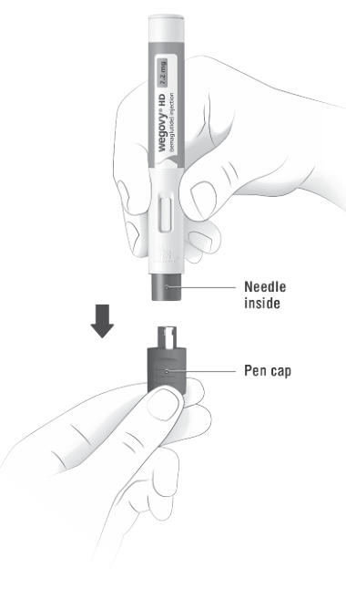

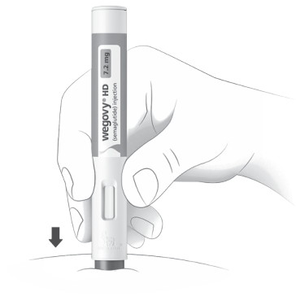

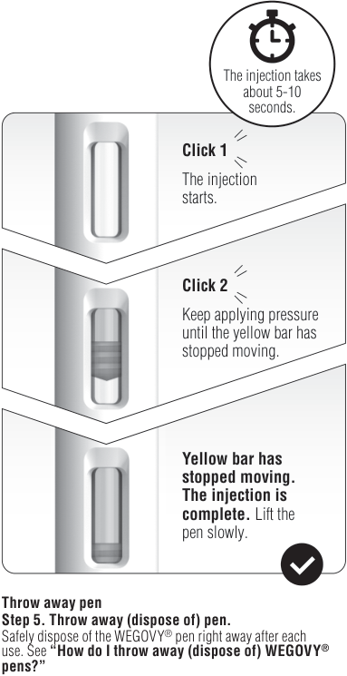

> **PDF page 24**

**WEGOVY****®** **FlexTouch****®** **(semaglutide) injection  Instructions For Use** 

**INSTRUCTIONS FOR USE WEGOVY****®** **(wee-GOH-vee) FlexTouch****®** 

(semaglutide) injection, for subcutaneous use 

**Step 1. Prepare your pen with a new needle** 

Turn the dose selector **until the dose counter** G **shows the flow check** 

<!-- Start of picture text -->
<table>
<tr>
<th rowspan="3">INSTRUCTIONS FOR USE WEGOVY® (wee-GOH-vee) FlexTouch® (semaglutide) injection, for subcutaneous use 2.4 mg dose single-patient-use pen Each pen contains 4 fixed doses, one dose taken weekly. Unfold the whole leaflet and read these instructions carefully before using your WEGOVY® FlexTouch® single-patient-use pen. This single-patient-use pen contains four doses of WEGOVY® 2.4 mg. If you have been using a single- dose WEGOVY® pen until now, please get familiar with your WEGOVY® FlexTouch® single-patient-use pen and needles. Do not use your pen without proper training from</th>
<th rowspan="2" colspan="2">Step 1. Prepare your pen with a new needle Wash your hands with soap and water. Check the name and colored label of your pen, to make sure that it contains your 2.4 mg dose of WEGOVY®. This is especially important if you take more than 1 type of medicine. Pull off the pen cap. See Figure A. A</th>
<th rowspan="3" colspan="2">Turn the dose selector until the dose counter shows the flow check symbol ( ). See Figure G. Make sure that the flow check symbol lines up with the dose pointer.</th>
<th>0</th>
<th></th>
</tr>
<tr>
<th>G</th>
<th></th>
</tr>
<tr>
<th></th>
<th></th>
<th colspan="2">0</th>
</tr>
<tr>
<td>your healthcare provider. Make sure that you know how give yourself an injection with the pen before you start your treatment. Do not share your WEGOVY® pen with other people, even if the needle has been changed. You may give other people a serious infection or get a serious infection from them.</td>
<td>medicine in your pen is clear and colorless. Look through the pen window. If the medicine looks cloudy, do not use the pen. See Figure B.</td>
<td>B</td>
<td>Hold the pen with the needle pointing up. Press and hold in the dose button until the dose counter shows . The must line up with the dose pointer. See Figure H.</td>
<td></td>
<td>H</td>
<td></td>
</tr>
<tr>
<td>trained to use the WEGOVY® pen. Please use the table inside the lid of the carton to keep track how many injections you have used and how many doses remain in your pen. Start by checking your pen to make sure that it contains WEGOVY®, then look at the pictures in this</td>
<td>needle to your pen until you are ready to take your injection. Take a new needle, and tear off the paper tab. See Figure C.</td>
<td>C</td>
<td>If no drop appears, check the flow again. This should only be done twice. If there is still no drop of medicine, change the needle and check the</td>
<td></td>
<td></td>
<td></td>
</tr>
<tr>
<td>‘Instructions for Use’ to get to know the different parts your pen and needle. Your pen is a prefilled, single-patient-use, dial-a- dose pen. One pen contains 4 doses of 2.4 mg. You can only select doses of 2.4 mg . NovoFine® Plus 32G 4 mm disposable needles are included with your WEGOVY® FlexTouch® pen. Always use a new needle for each injection.</td>
<td>Push the needle straight onto the pen. Turn until it is on tight. See Figure D.</td>
<td>D</td>
<td>flow 1 more time. Do not use the pen if a drop of medicine still does not appear.</td>
<td></td>
<td>0</td>
<td></td>
</tr>
<tr>
<td>other compatible disposable needles with a length up to 8 mm can be used. For needle compatibility information, talk to your healthcare professional. Supplies you will need to give your WEGOVY® injection: WEGOVY® FlexTouch® pen 2.4 mg dose a new NovoFine Plus or NovoFine needle or other compatible needle</td>
<td>The needle is covered by 2 caps. You must remove both caps. If you forget to remove both</td>
<td>E</td>
<td>Always make sure that the needle tip before you makes sure that the medicine If no drop of medicine medicine, even though the mean that there is a A small drop of medicine not be injected.</td>
<td>a use a appears, dose blocked may</td>
<td rowspan="3" colspan="2">drop of medicine appears at new pen for the first time. This flows. you will not inject any counter may move. This may or damaged needle. remain at the needle tip, but it will flow before your first I</td>
</tr>
<tr>
<td>cotton ball or gauze an FDA-cleared sharps disposal container for throwing away used WEGOVY® pens and needles. See Step 5 ‘After your injection’ for information concerning disposal.</td>
<td>caps, you will not inject any medicine. Pull off the outer needle cap. Do not throw it away. See</td>
<td>needle cap</td>
<td>Only check the medicine injection with each new Step 3. Set your dose</td>
<td></td>
</tr>
<tr>
<td>WEGOVY® FlexTouch® pen and needle (examples)</td>
<td>Figure E.</td>
<td></td>
<td>Turn the dose selector until the dose counter stops, and it shows</td>
<td></td>
</tr>
</table> <!-- End of picture text -->

ZZTABLE0025 _01ZZ 

<!-- Start of picture text -->
tip. This is normal, but you must still check the Expiration date (EXP) Dose Dose medicine flow, if you use a  2.4 mg on back of pen label pointer button new pen for the first time. selected Flow Dashed line Never use a bent or damaged needle. check (used to guide  Always use a new needle for each injection. symbol to your dose) This will prevent contamination, infection, leakage of medicine, and blocked needles leading to the wrong dose. The dashed line in the dose counter will guide you to  J Pen cap Do not reuse or share your needles with other people. You may give other people a serious infection or get a  your 2.4 mg dose. See  Figure J . serious infection from them. The dose selector clicks differently when turned Step 2. Check the flow with each new pen forward or backwards. You Outer needle cap Inner needle cap Needle Paper tab Before you inject your first dose with your new pen check the medicine flow. ,  will hear a ‘click’ every time you turn the dose selector. For your second, third and fourth dose with this pen, go to  Do not set the dose by Step 3 .  Set your dose . counting the number of clicks you hear. 0 2.4 <!-- End of picture text -->

You can only select 2.4 mg for each dose. When your pen contains less than 2.4 mg, the dose counter stops before 2.4 mg is shown. There is not enough medicine for your dose injection. 

**When your prescribed dose of 2.4 mg lines up with the dose pointer, you have selected your dose.** See **Figure I** .

|  | tw dr th flo |
| --- | --- |

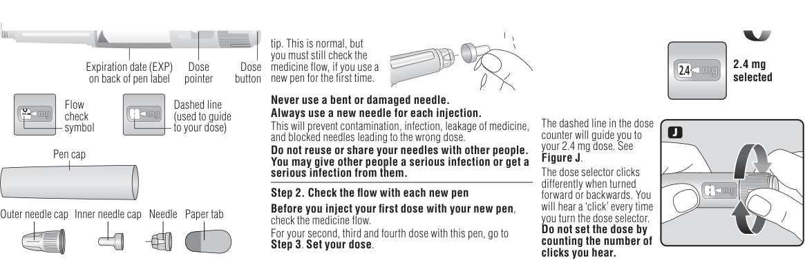

> **PDF page 25 (printed page 0)**

# **WEGOVY****®** **FlexTouch****®** **(semaglutide) injection  Instructions For Use** 

If the dose counter stops before you reach your prescribed **Always watch the dose counter to make sure you have** • leak-resistant dose, see the section **‘Do you have enough medicine?’** . **injected your complete dose.** Hold the dose button down • properly labeled to warn of hazardous waste inside the until the dose counter shows . container. **Do you have enough medicine? How to identify a blocked or damaged needle?** When your sharps disposal container is almost full, you will If the dose counter stops before you reach your K If pressing the dose button, you may have used a blocked or  does not appear in the dose counter after continuously need to follow your community guidelines for the right way to dispose of your sharps disposal container. There may be state prescribed dose of 2.4 mg, damaged needle. or local laws about how you should throw away used needle there is not enough **0** and syringes. For more information about the safe sharps medicine left for a full If this happens you have **not** received **any** medicine even disposal, and for specific information about sharps disposal in dose. Throw away (dispose though the dose counter has moved from the original dose that the state that you live in, go to the FDA’s website at: http://www. of) the pen and use a new you have selected. fda.gov/safesharpsdisposal. WEGOVY® pen. **How to handle a blocked needle?** • **Do not** dispose of your used sharps disposal container in **Dose** Change the needle as described in **Step 1: “Prepare your** your household trash unless your community guidelines **counter pen with a new needle”.** Make sure you select the full dose permit this. **stopped:** you need. • **Do not** recycle your used sharps disposal container. **2.4 mg left Never touch the dose counter when you inject.** This can • Safely dispose of medicine that is out of date or no longer stop the injection. needed. **Step 5. After your injection Important Choose your injection site Carefully unscrew the** Caregivers must **be very careful when handling used** Choose an injection site on **needle from the pen.** P **needles** to prevent needle sticks and cross infection. your upper arms, stomach or Do not put the needle Never use a syringe to withdraw medicine from your pen. upper legs. Keep a distance of 2 inches (5 cm) from your caps back on the needle, Always keep your pen and needles **out of reach of others,** belly button. See image for **Upper arms** to avoid needle sticks. **especially children** . locations. **Stomach** See **Figure P** . **Do not share your pen or needles with anyone else.** You may inject in the same You may give an infection to them or get an infection from them. body area each week, but **Upper legs Do not** leave it in a car or other place where it can get too hot make sure it is not in the same or too cold. spot used for the last injection. Wipe the skin with an alcohol **Caring for your pen** swab. Let the injection site dry before you inject your dose. **Place the needle in an FDA-cleared sharps** Q **Do not drop your pen** you drop it or suspect a problem, attach a new needle and check  or knock it against hard surfaces. If **container** reduce the risk of needle  right away to the medicine flow before you inject. **Step 4. Inject your dose** sticks. See **Figure Q** . **Do not try to repair your pen** or pull it apart. **Insert the needle Do not expose your pen to dust, dirt, or liquid. into your skin** as your L **Do not wash, soak, or lubricate your pen** . If necessary, healthcare provider has **Sharps** clean it with mild detergent on a moistened cloth. shown you. See **Figure L** . **container How should I store my WEGOVY****®** **pen? Make sure you can see the dose counter.** • Store in the refrigerator between 36°F to 46°F (2°C to 8°C). Do not cover it with your • After first use, store WEGOVY® FlexTouch® between 68°F to fingers. This could stop 77°F (20°C to 25°C) or in a refrigerator 36°F to 46°F (2°C to **Put the pen cap on** the injection. R 8°C) for up to 56 days. your pen after each use to protect the medicine from • WEGOVY® should be protected from excessive heat and light. See **Figure R** . light. • Keep the pen cap on when not in use. **Press and hold down** • Always remove and safely discard the needle after each **the dose button until** M injection. **the dose counter** • Store the **single-patient-use** WEGOVY® FlexTouch® pen **shows** . The must without an injection needle attached. line up with the dose • Throw away if the **single-patient-use** WEGOVY® pointer. You may then hear or feel a click. See If you do not have an  FDA-cleared sharps S FlexTouch® pen has been frozen, has been exposed to light or temperatures above 86°F (30°C), or has been out of the **Figure M** . disposal container, follow refrigerator for 56 days or longer. a one-handed needle recapping method. Carefully slip the needle into the outer needle cap. **outer** Push the capped needle **needle cap Continue pressing the dose button while** N **Count slowly:** against a firm, vertical surface until you hear a **keeping the needle** “click.” Twist off the capped needle from the pen and dispose of **in your skin and 1-2-3-4-5-6** the needle in an FDA-cleared sharps disposal container as soon **count slowly to 6.** as possible or in a household container as listed in **‘Disposing** See **Figure N** . **of used pens and needles’** . See **Figure S** . If the needle is removed **Never try to put the inner needle cap back on the** earlier, you may see **needle.** You may stick yourself with the needle. a stream of medicine coming from the needle **Always remove the needle from your pen.** This prevents This Instructions for Use has been approved by the U.S. Food tip. If this happens, the full contamination, infection, leakage of medicine, and blocked and Drug Administration. dose will not be delivered. needles leading to the wrong dose. If the needle is blocked, you Revised 06/2026 will not inject any medicine. Marketed by: **Always throw away (dispose of) the needle after each** Novo Nordisk Inc. **injection.** Plainsboro, NJ 08536 **Remove the needle from your skin.** You O **Throwing away (disposing of) used pens and needles:** For information about WEGOVY® , contact: can then release the dose • After having injected all four doses, there may still be Novo Nordisk Inc. button. See **Figure O** . medicine left in the pen. The pen should be thrown away 800 Scudders Mill Road If blood appears at the (disposed of). Plainsboro, NJ 08536 injection site, press the site • Put your used WEGOVY® pen and needle in an FDA-cleared 1-833-wegovy-1 lightly with a cotton ball or sharps disposal container right away after use. (se habla español) gauze. Do not rub the area. • If you do not have an FDA-cleared sharps disposal container, WEGOVY® , FlexTouch® , NovoFine® and NovoFine Plus® are You may see a drop of you may use a household container that is: registered trademarks of Novo Nordisk A/S. medicine at the needle • made of a heavy-duty plastic Patent Information: http://novonordisk-us. tip after injecting. This is • can be closed with a tight-fitting, puncture-resistant lid, com/products/product-patents.html normal and does not affect without sharps being able to come out your dose. • upright and stable during use © 2026 Novo Nordisk     All rights reserved. US26SEMO01307    June 2026 **0 2.4** 

**Caring for your pen Do not drop your pen** or knock it against hard surfaces. If you drop it or suspect a problem, attach a new needle and check  or knock it against hard surfaces. If the medicine flow before you inject. **Do not try to repair your pen** or pull it apart. **Do not expose your pen to dust, dirt, or liquid. Do not wash, soak, or lubricate your pen** . If necessary, clean it with mild detergent on a moistened cloth. 

> **PDF page 26 (printed page 0)**

**WEGOVY****®** **(semaglutide) injection - Prefilled Syringe  Instructions For Use** 

# **INSTRUCTIONS FOR USE WEGOVY****®** **[wee-GOH-vee] (semaglutide) injection, subcutaneous only single-dose prefilled syringe** 

Before using your prefilled syringe always read these instructions carefully. 

This leaflet instructs how to perform an injection under the skin (subcutaneous). 

The prefilled syringe might be different than any other device you have used previously. Before you use your prefilled syringe, talk to your healthcare provider about how to inject your prefilled syringe correctly. 

# **Get to Know Your Prefilled Syringe** 

You should check the label on the carton and prefilled syringe to ensure it contains the correct medicine. Please make sure you have the correct dose prescribed by your healthcare provider. 

**Important Information You Need to Know Before Injecting with your Prefilled Syringe** 

- Use the prefilled syringe exactly the way your healthcare provider tells you to. 

- The prefilled syringe contains 1 complete dose. It is for one-time use only. 

- **Do not** use the prefilled syringe if the carton is damaged or if the tamper-evident is broken. 

- **Do not** warm the prefilled syringe using any heat sources such as hot water or a microwave. 

- **Do not** use the prefilled syringes if the expiration date on the label or carton has expired. 

- **Do not** use the prefilled syringe if it has been frozen or thawed. 

- People who are blind or have vision problems should not use the prefilled syringe without help from a person who knows how to use the prefilled syringe. 

# **Gather the Following Materials Before Your Injection** 

- 1 WEGOVY® prefilled syringe. 

- Alcohol wipe. 

- Cotton ball or gauze. 

- Sharps disposal container for used prefilled syringes. **Not Included in Your Carton** 

# **Frequently Asked Questions** 

**Do I inject the full volume of the prefilled syringe?** Yes, the prefilled syringe is for one-time (single) use and contains one complete dose. 

# **What if the prefilled syringe is damaged?** 

**Do not** use a dropped, damaged or broken prefilled syringe. Take a new prefilled syringe for your injection. 

# **What if the needle is broken?** 

**Do not** use a needle that appears to be bent, dropped, damaged or broken. Take a new prefilled syringe for your injection. 

If you have any questions about WEGOVY® , go to startWegovy.com or call Novo Nordisk Inc. at 1-833Wegovy-1. 

# **Prepare Your Prefilled Syringe** 

# **1. Take One Prefilled Syringe** 

- Wash and dry your hands. 

- Open the carton. 

- Gently take out one prefilled syringe by holding the glass barrel. 

- Check the syringe label. Confirm you have the dose prescribed by your healthcare provider. 

- **Do not** hold or touch the prefilled syringe by the plunger rod or needle cap. 

Keep the needle cap on, until you are ready to inject. 

**2. Inspect your Prefilled Syringe** •  Check the expiration date (EXP) on the label has not passed. 

- **Check that the medicine in the prefilled syringe is clear and colorless.** If the medicine looks cloudy or contains particles, **do not** use the prefilled syringe. 

- It is normal to see air bubbles; they do not affect your dose. **Do not** try to remove bubbles. **Do not** use the prefilled syringe if it appears to have been used, dropped, damaged or broken. 

# **3. Choose Your Injection Site** 

Inject into the skin of: 

- stomach area (abdomen) at least 2 inches from the belly button. 

- thighs. 

- back of upper arm (only with help from someone else). Clean the injection site with an alcohol wipe and allow to dry. Your healthcare provider can help you choose the injection site that is best for you. 

Avoid using the exact same spot as the last time between injections. 

# **Inject Your Dose** 

# **4. Pull Off the Needle Cap** 

- Pull the needle cap straight off and throw it in a sharps disposal container. 

You might see drops of medicine from the needle tip. This is normal and does not affect your dose. Continue with your injection right away. 

**Do not** put the needle cap back on, to avoid needle stick injuries. 

# **5. Insert Your Prefilled Syringe** 

- Pinch and hold a fold of skin at the injection site between your thumb and fingers. Hold the pinch throughout the injection. 

- Fully insert the needle into the pinched skin at a 45-degree angle. 

This is to inject under the skin (subcutaneous) and not the muscle. 

# **6. Inject Your Dose** 

- Keep a 45-degree angle. With a constant pressure, gently push the plunger rod all the way down until the plunger stops. 

When the plunger is at the bottom and the prefilled syringe is empty, your dose is complete. 

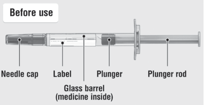

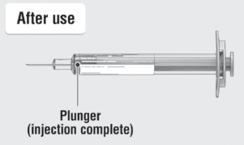

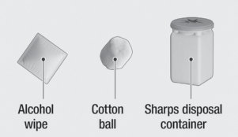

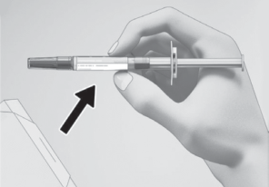

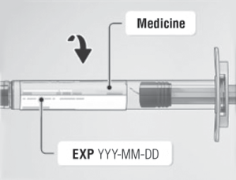

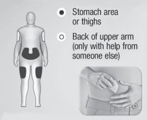

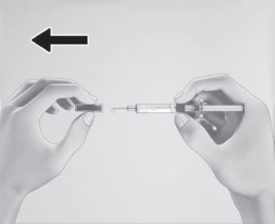

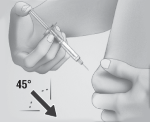

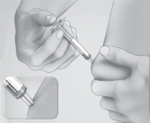

> **PDF page 27**

**WEGOVY****®** **(semaglutide) injection - Prefilled Syringe  Instructions For Use** 

# **7. Remove Your Syringe** 

- Pull out the empty syringe at a 45-degree angle. Your injection is complete. 

If blood appears at the injection site, lightly press with a cotton ball or gauze over it, without rubbing. **Do not** put the needle cap back on the syringe. 

# **After Injection** 

# **8. Dispose of (Throw Away) Your Used Syringe** 

- Put the used syringe in an FDA-cleared sharp disposal container right away after use. 

- If you do not have an FDA-cleared sharps disposal container, you may use a household container that is: 

- made of a heavy-duty plastic, 

- can be closed with a tight-fitting, puncture-resistant lid, without sharps being able to come out, 

- upright and stable during use, 

- leak-resistant, and, 

- properly labeled to warn of hazardous waste inside the container. 

- When your sharps disposal container is almost full, you will need to follow your community guidelines for the right way to dispose of your sharps disposal container. There may be state or local laws about how you should throw away used needles and syringes. For more information about safe sharps disposal, and for specific information about sharps disposal in the state that you live in, go to the FDA’s website at: http://www.fda.gov/safesharpsdisposal 

- **Do not** dispose of your used sharps disposal container in your household trash unless your community guidelines permit this. **Do not** recycle your used sharps disposal container. 

Safely dispose of your syringe that is out of date or no longer needed 

**Keep your syringe and all medicines out of the reach of children.** 

# **How Should I Store My WEGOVY****®** **Prefilled Syringe?** 

- Store the unused WEGOVY® prefilled syringes in the refrigerator between 36°F to 46°F (2°C to 8°C). 

- If needed, the prefilled syringes can be stored out of the refrigerator between 46°F to 86°F (8°C to 30°C) for up to 28 days. Record the date your prefilled syringe was removed from the refrigerator and dispose of it, if not used within 28 days. 

- **Do not** freeze. 

- Always keep the prefilled syringes in the original carton to protect from light. 

**Keep the prefilled syringe and all medicines out of the reach of children.** 

Marketed by: Novo Nordisk Inc. Plainsboro, NJ 08536 For information about WEGOVY® , contact: Novo Nordisk Inc. 800 Scudders Mill Road Plainsboro, NJ 08536 1-833-Wegovy-1 WEGOVY® is a registered trademark of Novo Nordisk A/S. Patent Information: http://www.novonordisk-us.com/products/ product-patents.html 

The Instructions for Use has been approved by the U.S Food and Drug Administration. Approved: 05/2026 

© 2026 Novo Nordisk     All rights reserved. US26SEMO01307    June 2026

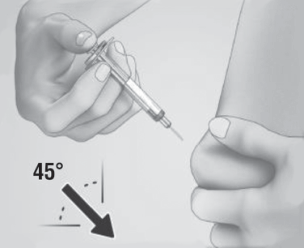

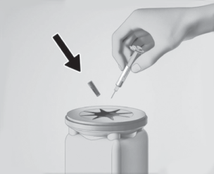

> **PDF page 28**
