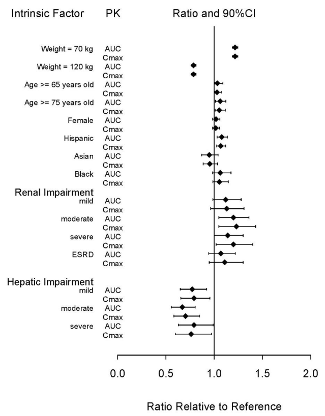
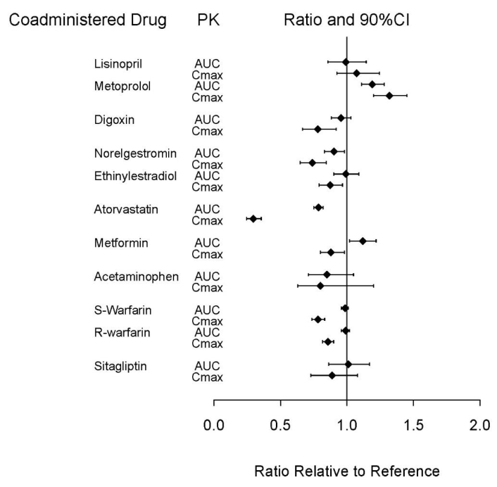
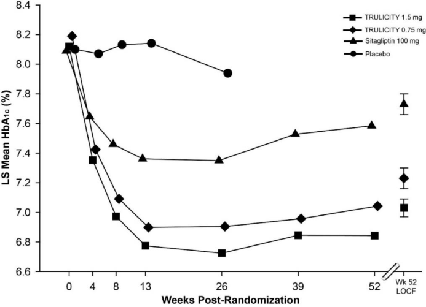
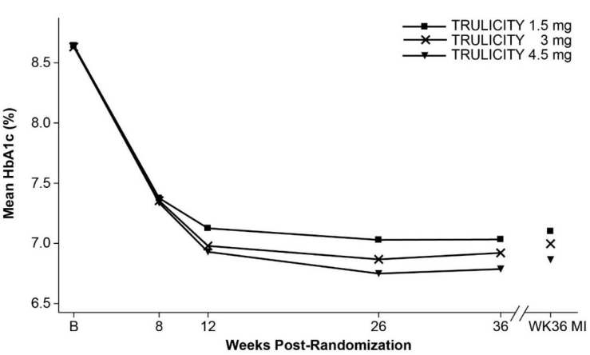
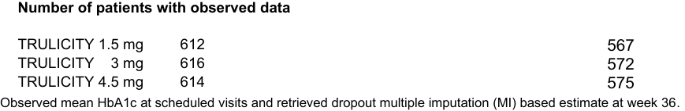
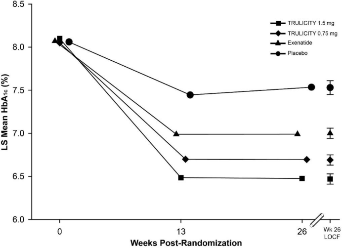
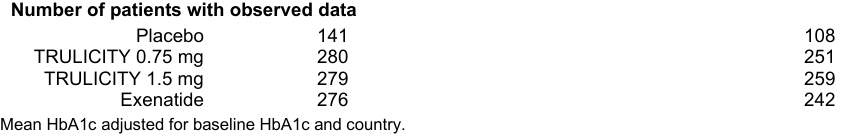
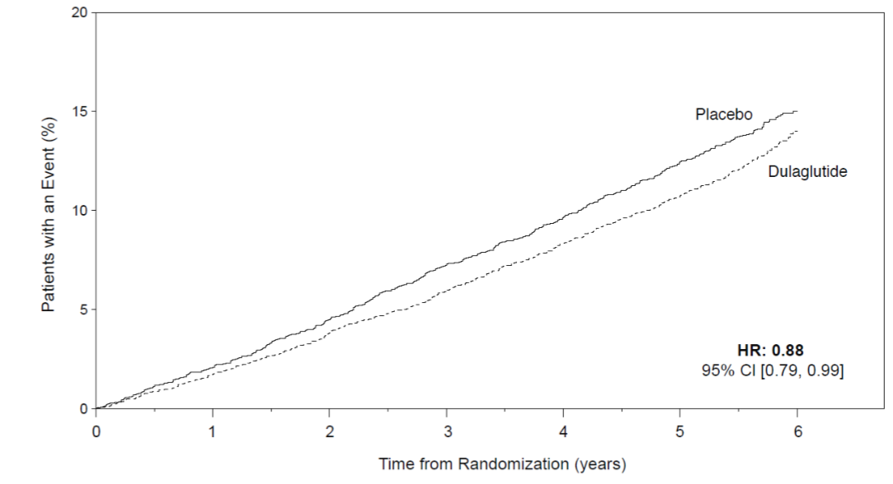
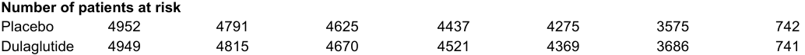

> **PDF page 1**

**HIGHLIGHTS OF PRESCRIBING INFORMATION These highlights do not include all the information needed to use TRULICITY safely and effectively. See full prescribing information for TRULICITY.**

- Injection: 3 mg/0.5 mL solution in a single-dose pen (3)

- Injection: 4.5 mg/0.5 mL solution in a single-dose pen (3)

# **------------------------------- CONTRAINDICATIONS ------------------------------**

## **TRULICITY (dulaglutide) injection, for subcutaneous use Initial U.S. Approval: 2014**

## **WARNING: RISK OF THYROID C-CELL TUMORS** **_See full prescribing information for complete boxed warning._**

- **Dulaglutide causes thyroid C-cell tumors in rats. It is unknown whether TRULICITY causes thyroid C-cell tumors, including medullary thyroid carcinoma (MTC), in humans as the human relevance of dulaglutide-induced rodent thyroid C-cell tumors has not been determined (5.1, 13.1).**

- **TRULICITY is contraindicated in patients with a personal or family history of MTC and in patients with Multiple Endocrine Neoplasia syndrome type 2 (MEN 2). Counsel patients regarding the potential risk of MTC and symptoms of thyroid tumors (4, 5.1).**

**--------------------------- RECENT MAJOR CHANGES --------------------------**

Warnings and Precautions _Severe Gastrointestinal Adverse Reactions_ (5.6) 03/2026

**---------------------------- INDICATIONS AND USAGE ---------------------------** TRULICITY® is a glucagon-like peptide-1 (GLP-1) receptor agonist indicated (1):

- As an adjunct to diet and exercise to improve glycemic control in adults and pediatric patients 10 years of age and older with type 2 diabetes mellitus.

- To reduce the risk of major adverse cardiovascular events in adults with type 2 diabetes mellitus who have established cardiovascular disease or multiple cardiovascular risk factors.

# **------------------------ DOSAGE AND ADMINISTRATION -----------------------**

## Adult Dosage (2.1)

- Recommended starting dosage is 0.75 mg injected subcutaneously once weekly.

- After 4 weeks, the dosage may be increased to 1.5 mg once weekly for additional glycemic control.

- If additional glycemic control is needed, increase dosage in 1.5 mg increments after at least 4 weeks on the current dosage.

- Maximum recommended dosage is 4.5 mg injected subcutaneously once weekly.

- Patients with a personal or family history of medullary thyroid carcinoma or in patients with Multiple Endocrine Neoplasia syndrome type 2 (4).

- Patients with a serious hypersensitivity reaction to dulaglutide or any of the product components (4).

# **------------------------ WARNINGS AND PRECAUTIONS -----------------------**

- _Thyroid C-cell Tumors:_ See Boxed Warning (5.1).

- _Acute Pancreatitis:_ Has been observed in patients treated with GLP1 receptor agonists, including TRULICITY. Discontinue if pancreatitis is suspected (5.2).

- _Hypoglycemia:_ Concomitant use with an insulin secretagogue or insulin may increase the risk of hypoglycemia, including severe hypoglycemia. Reducing the dose of insulin secretagogue or insulin may be necessary (5.3).

- _Hypersensitivity Reactions:_ Serious hypersensitivity reactions (e.g., anaphylactic reactions and angioedema) have occurred. Discontinue TRULICITY and promptly seek medical advice (5.4).

- _Acute Kidney Injury Due to Volume Depletion:_ Monitor renal function in patients reporting adverse reactions that could lead to volume depletion (5.5).

- _Severe Gastrointestinal Adverse Reactions:_ Use may be associated with gastrointestinal adverse reactions, sometimes severe. TRULICITY is not recommended in patients with severe gastroparesis (5.6).

- _Diabetic Retinopathy Complications:_ Have been reported in a cardiovascular outcomes trial. Monitor patients with a history of diabetic retinopathy (5.7).

- _Acute Gallbladder Disease:_ If cholelithiasis or cholecystitis are suspected, gallbladder studies are indicated (5.8).

- _Pulmonary Aspiration During General Anesthesia or Deep Sedation:_ Has been reported in patients receiving GLP-1 receptor agonists undergoing elective surgeries or procedures. Instruct patients to inform healthcare providers of any planned surgeries or procedures (5.9).

**------------------------------- ADVERSE REACTIONS ------------------------------** Most common adverse reactions (incidence ≥ 5%) are nausea, diarrhea, vomiting, abdominal pain, and decreased appetite (6.1).

## **To report SUSPECTED ADVERSE REACTIONS, contact Eli Lilly and Company at 1-800-LillyRx (1-800-545-5979) or FDA at 1-800-FDA-1088 or www.fda.gov/medwatch.**

## Pediatric Dosage (2.2)

- Recommended starting dosage is 0.75 mg injected subcutaneously once weekly.

- If additional glycemic control is needed, increase dosage to the maximum recommended dosage of 1.5 mg once weekly after at least 4 weeks on the 0.75 mg dosage.

## Recommendations Regarding Missed Dose (2.3)

- If a dose is missed, administer the missed dose as soon as possible if there are at least 3 days (72 hours) until the next scheduled dose.

- Important Administration Instructions (2.4)

- Administer once weekly at any time of day with or without food.

- Inject subcutaneously in the abdomen, thigh, or upper arm.

# **----------------------DOSAGE FORMS AND STRENGTHS ---------------------**

**------------------------------- DRUG INTERACTIONS ------------------------------**

_Oral Medications:_ Delays gastric emptying and has the potential to reduce the rate of absorption of concomitantly administered oral medications (7.1).

# **-----------------------USE IN SPECIFIC POPULATIONS----------------------**

_Pregnancy:_ Should be used during pregnancy only if the potential benefit justifies the potential risk to fetus (8.1).

**See 17 for PATIENT COUNSELING INFORMATION and FDAapproved Medication Guide.**

**Revised: 03/2026**

- Injection: 0.75 mg/0.5 mL solution in a single-dose pen (3)

- Injection: 1.5 mg/0.5 mL solution in a single-dose pen (3)

> **PDF page 2 (printed page 2)**

# **FULL PRESCRIBING INFORMATION: CONTENTS***

- 8.4 Pediatric Use

# **WARNING: RISK OF THYROID C-CELL TUMORS**

- **1 INDICATIONS AND USAGE**

- **2 DOSAGE AND ADMINISTRATION**

   - 2.1 Adult Dosage

   - 2.2 Pediatric Dosage

   - 2.3 Recommendations Regarding Missed Dose

   - 2.4 Important Administration Instructions

- **3 DOSAGE FORMS AND STRENGTHS**

- **4 CONTRAINDICATIONS**

- **5 WARNINGS AND PRECAUTIONS**

   - 5.1 Risk of Thyroid C-cell Tumors

   - 5.2 Acute Pancreatitis

   - 5.3 Hypoglycemia with Concomitant Use of Insulin Secretagogues or Insulin

   - 5.4 Hypersensitivity Reactions

   - 5.5 Acute Kidney Injury Due to Volume Depletion

   - 5.6 Severe Gastrointestinal Adverse Reactions

   - 5.7 Diabetic Retinopathy Complications in Patients with a History of Diabetic Retinopathy

   - 5.8 Acute Gallbladder Disease

   - 5.9 Pulmonary Aspiration During General Anesthesia or Deep Sedation

- **6 ADVERSE REACTIONS**

   - 6.1 Clinical Trials Experience

   - 6.2 Postmarketing Experience

- **7 DRUG INTERACTIONS**

   - 7.1 Oral Medications

   - 7.2 Concomitant Use with an Insulin Secretagogue (e.g., Sulfonylurea) or with Insulin

- **8 USE IN SPECIFIC POPULATIONS**

   - 8.1 Pregnancy

   - 8.2 Lactation

   - 8.5 Geriatric Use

   - 8.6 Renal Impairment

   - 8.7 Hepatic Impairment

- **10 OVERDOSAGE**

- **11 DESCRIPTION**

- **12 CLINICAL PHARMACOLOGY**

   - 12.1 Mechanism of Action

   - 12.2 Pharmacodynamics

   - 12.3 Pharmacokinetics

   - 12.6 Immunogenicity

- **13 NONCLINICAL TOXICOLOGY**

   - 13.1 Carcinogenesis, Mutagenesis, and Impairment of Fertility

   - 13.2 Animal Toxicology and/or Pharmacology

- **14 CLINICAL STUDIES**

   - 14.1 Overview of Clinical Trials

   - 14.2 Glycemic Control Monotherapy Trials in Adults with Type 2 Diabetes Mellitus

   - 14.3 Glycemic Control Combination Therapy Trials in Adults with Type 2 Diabetes Mellitus

   - 14.4 Glycemic Control Trials in Adults with Type 2 Diabetes Mellitus and Moderate to Severe Chronic Kidney Disease

   - 14.5 Cardiovascular Outcomes Trial in Adults with Type 2 Diabetes Mellitus and Cardiovascular Disease or Multiple Cardiovascular Risk Factors

   - 14.6 Glycemic Control Trial in Pediatric Patients 10 Years of Age and Older with Type 2 Diabetes Mellitus

- **16 HOW SUPPLIED/STORAGE AND HANDLING**

   - 16.1 How Supplied

   - 16.2 Storage and Handling

- **17 PATIENT COUNSELING INFORMATION**

*Sections or subsections omitted from the full prescribing information are not listed.

# **FULL PRESCRIBING INFORMATION**

# **WARNING: RISK OF THYROID C-CELL TUMORS**

- **In male and female rats, dulaglutide causes a dose-related and treatment-duration-dependent increase in the incidence of thyroid C-cell tumors (adenomas and carcinomas) after lifetime exposure. It is unknown whether TRULICITY causes thyroid C-cell tumors, including medullary thyroid carcinoma (MTC), in humans as human relevance of dulaglutide-induced rodent thyroid C-cell tumors has not been determined** **_[see Warnings and Precautions (5.1), and Nonclinical Toxicology (13.1)]_ .**

- **TRULICITY is contraindicated in patients with a personal or family history of MTC and in patients with Multiple Endocrine Neoplasia syndrome type 2 (MEN 2). Counsel patients regarding the potential risk of MTC with use of TRULICITY and inform them of symptoms of thyroid tumors (e.g., mass in the neck, dysphagia, dyspnea, persistent hoarseness). Routine monitoring of serum calcitonin or using thyroid ultrasound is of uncertain value for early detection of MTC in patients treated with TRULICITY** **_[see Contraindications (4) and Warnings and Precautions (5.1)]_ .**

## **1 INDICATIONS AND USAGE** TRULICITY® is indicated:

- As an adjunct to diet and exercise to improve glycemic control in adults and pediatric patients 10 years of age and older with type 2 diabetes mellitus.

- To reduce the risk of major adverse cardiovascular events (cardiovascular death, non-fatal myocardial infarction, or non-fatal stroke) in adults with type 2 diabetes mellitus who have established cardiovascular disease or multiple cardiovascular risk factors.

> **PDF page 3 (printed page 3)**

# **2 DOSAGE AND ADMINISTRATION**

## **2.1 Adult Dosage**

   - The recommended starting dosage of TRULICITY is 0.75 mg injected subcutaneously once weekly. Follow the dosage escalation below to reduce the risk of gastrointestinal adverse reactions _[see Warnings and Precautions (5.6) and Adverse Reactions (6.1)]._

   - After 4 weeks, the dosage may be increased to 1.5 mg once weekly for additional glycemic control.

   - If additional glycemic control is needed, increase the dosage in 1.5 mg increments after at least 4 weeks on the current dosage.

   - The maximum recommended dosage is 4.5 mg injected subcutaneously once weekly.

- **2.2 Pediatric Dosage**

   - The recommended starting dosage of TRULICITY is 0.75 mg injected subcutaneously once weekly.

   - If additional glycemic control is needed, increase the dosage to the maximum recommended dosage of 1.5 mg once weekly after at least 4 weeks on the 0.75 mg dosage to reduce the risk of gastrointestinal adverse reactions _[see Warnings and Precautions (5.6) and Adverse Reactions (6.1)]_ .

- **2.3 Recommendations Regarding Missed Dose**

   - If a dose is missed, instruct patients to administer the dose as soon as possible if there are at least 3 days (72 hours) until the next scheduled dose. If less than 3 days remain before the next scheduled dose, skip the missed dose and administer the next dose on the regularly scheduled day. In each case, patients can then resume their regular once weekly dosing schedule.

   - The day of weekly administration can be changed, if necessary, as long as the last dose was administered 3 or more days before the new day of administration.

## **2.4 Important Administration Instructions**

- Prior to initiation, train patients and caregivers on proper injection technique _[see Instructions for Use]_ .

- Administer TRULICITY once weekly, any time of day, with or without food.

- Inject TRULICITY subcutaneously in the abdomen, thigh, or upper arm.

- Rotate injection sites with each dose.

- Inspect TRULICITY visually before use. It should appear clear and colorless. Do not use TRULICITY if particulate matter or coloration is seen.

- When using TRULICITY with insulin, administer as separate injections and never mix. It is acceptable to inject TRULICITY and insulin in the same body region, but the injections should not be adjacent to each other.

# **3 DOSAGE FORMS AND STRENGTHS**

Injection: TRULICITY is a clear and colorless solution available as:

- 0.75 mg/0.5 mL solution in a single-dose pen

- 1.5 mg/0.5 mL solution in a single-dose pen

- 3 mg/0.5 mL solution in a single-dose pen

- 4.5 mg/0.5 mL solution in a single-dose pen

# **4 CONTRAINDICATIONS**

TRULICITY is contraindicated in patients with:

- Personal or family history of medullary thyroid carcinoma (MTC) or in patients with Multiple Endocrine Neoplasia syndrome type 2 (MEN 2) _[see Warnings and Precautions (5.1)]_ .

- Serious hypersensitivity reaction to dulaglutide or to any of the product components. Serious hypersensitivity reactions including anaphylactic reactions and angioedema have been reported with TRULICITY _[see Warnings and Precautions (5.4)]_ .

# **5 WARNINGS AND PRECAUTIONS**

## **5.1 Risk of Thyroid C-cell Tumors**

In male and female rats, dulaglutide causes a dose-related and treatment-duration-dependent increase in the incidence of thyroid C-cell tumors (adenomas and carcinomas) after lifetime exposure _[see Nonclinical Toxicology (13.1)]_ . Glucagon-like peptide-1 (GLP-1) receptor agonists have induced thyroid C-cell adenomas and carcinomas in mice and rats at clinically relevant exposures. It is unknown whether TRULICITY will cause thyroid C-cell tumors, including

> **PDF page 4 (printed page 4)**

medullary thyroid carcinoma (MTC), in humans, as the human relevance of dulaglutide-induced rodent thyroid C-cell tumors has not been determined.

One case of MTC was reported in a patient treated with TRULICITY in a clinical trial. This patient had pretreatment calcitonin levels approximately 8 times the upper limit of normal (ULN). An additional case of C-cell hyperplasia with elevated calcitonin levels following treatment was reported in the cardiovascular outcomes trial (REWIND). Cases of MTC in patients treated with liraglutide, another GLP-1 receptor agonist, have been reported in the postmarketing period; the data in these reports are insufficient to establish or exclude a causal relationship between MTC and GLP-1 receptor agonist use in humans.

TRULICITY is contraindicated in patients with a personal or family history of MTC or in patients with MEN 2. Counsel patients regarding the potential risk for MTC with the use of TRULICITY and inform them of symptoms of thyroid tumors (e.g. a mass in the neck, dysphagia, dyspnea, persistent hoarseness).

Routine monitoring of serum calcitonin or using thyroid ultrasound is of uncertain value for early detection of MTC in patients treated with TRULICITY. Such monitoring may increase the risk of unnecessary procedures, due to the low test specificity for serum calcitonin and a high background incidence of thyroid disease. Significantly elevated serum calcitonin values may indicate MTC and patients with MTC usually have calcitonin values >50 ng/L. If serum calcitonin is measured and found to be elevated, the patient should be further evaluated. Patients with thyroid nodules noted on physical examination or neck imaging should also be further evaluated.

# **5.2 Acute Pancreatitis**

Acute pancreatitis, including fatal and non-fatal hemorrhagic or necrotizing pancreatitis, has been observed in patients treated with GLP-1 receptor agonists, including TRULICITY _[see Adverse Reactions (6)]._

After initiation of TRULICITY, observe patients carefully for signs and symptoms of acute pancreatitis which may include persistent or severe abdominal pain (sometimes radiating to the back) and which may or may not be accompanied by nausea or vomiting. If pancreatitis is suspected, discontinue TRULICITY and initiate appropriate management.

# **5.3 Hypoglycemia with Concomitant Use of Insulin Secretagogues or Insulin**

Patients receiving TRULICITY in combination with an insulin secretagogue (e.g., sulfonylurea) or insulin may have an increased risk of hypoglycemia, including severe hypoglycemia _[see Adverse Reactions (6.1) and Drug Interactions (7)]._

The risk of hypoglycemia may be lowered by a reduction in the dose of sulfonylurea (or other concomitantly administered insulin secretagogue) or insulin. Inform patients using these concomitant medications of the risk of hypoglycemia and educate them on the signs and symptoms of hypoglycemia.

# **5.4 Hypersensitivity Reactions**

There have been postmarketing reports of serious hypersensitivity reactions including anaphylactic reactions and angioedema in patients treated with TRULICITY _[see Adverse Reactions (6.2)]_ . If a hypersensitivity reaction occurs, discontinue TRULICITY; treat promptly per standard of care, and monitor until signs and symptoms resolve. TRULICITY is contraindicated in patients with a previous serious hypersensitivity reaction to dulaglutide or to any of the components of TRULICITY.

Anaphylaxis and angioedema have been reported with other GLP-1 receptor agonists. Use caution in a patient with a history of angioedema or anaphylaxis with another GLP-1 receptor agonist because it is unknown whether such patients will be predisposed to anaphylaxis with TRULICITY.

# **5.5 Acute Kidney Injury Due to Volume Depletion**

There have been postmarketing reports of acute kidney injury, in some cases requiring hemodialysis, in patients treated with GLP-1 receptor agonists, including TRULICITY _[see Adverse Reactions (6.2)]_ . The majority of the reported events occurred in patients who experienced gastrointestinal reactions leading to dehydration such as nausea, vomiting, or diarrhea _[see Adverse Reactions (6.1)]._ Monitor renal function in patients reporting adverse reactions to TRULICITY that could lead to volume depletion, especially during dosage initiation and escalation of TRULICITY.

# **5.6 Severe Gastrointestinal Adverse Reactions**

Use of TRULICITY has been associated with gastrointestinal adverse reactions, sometimes severe _[see Adverse Reactions (6)]_ . In the pool of placebo-controlled trials, severe gastrointestinal adverse reactions were reported more frequently among patients receiving TRULICITY (0.75 mg 2.2%, 1.5 mg 4.3%) than placebo (1.4%). Severe gastrointestinal adverse reactions have also been reported postmarketing with GLP-1 receptor agonists.

TRULICITY is not recommended in patients with severe gastroparesis.

> **PDF page 5 (printed page 5)**

# **5.7 Diabetic Retinopathy Complications in Patients with a History of Diabetic Retinopathy**

In a cardiovascular outcomes trial with a median follow up of 5.4 years involving patients with type 2 diabetes with established cardiovascular disease or multiple cardiovascular risk factors, diabetic retinopathy complications occurred in patients treated with TRULICITY 1.5 mg (1.9%) and placebo (1.5%). These events were prospectively ascertained as a secondary composite endpoint. The proportion of patients with diabetic retinopathy complications was larger among patients with a history of diabetic retinopathy at baseline (TRULICITY 8.5%, placebo 6.2%) than among patients without a known history of diabetic retinopathy (TRULICITY 1%, placebo 1%).

Rapid improvement in glucose control has been associated with a temporary worsening of diabetic retinopathy. Patients with a history of diabetic retinopathy should be monitored for progression of diabetic retinopathy.

# **5.8 Acute Gallbladder Disease**

Acute events of gallbladder disease such as cholelithiasis or cholecystitis have been reported in GLP-1 receptor agonist trials and postmarketing. In a cardiovascular outcomes trial with a median follow up of 5.4 years, cholelithiasis occurred at a rate of 0.62/100 patient-years in TRULICITY-treated patients and 0.56/100 patient-years in placebo-treated patients after adjusting for prior cholecystectomy. Serious events of acute cholecystitis were reported in 0.5% and 0.3% of patients on TRULICITY and placebo respectively. If cholelithiasis is suspected, gallbladder studies and appropriate clinical follow-up are indicated.

# **5.9 Pulmonary Aspiration During General Anesthesia or Deep Sedation**

TRULICITY delays gastric emptying _[see Clinical Pharmacology (12.2)]_ . There have been rare postmarketing reports of pulmonary aspiration in patients receiving GLP-1 receptor agonists undergoing elective surgeries or procedures requiring general anesthesia or deep sedation who had residual gastric contents despite reported adherence to preoperative fasting recommendations.

Available data are insufficient to inform recommendations to mitigate the risk of pulmonary aspiration during general anesthesia or deep sedation in patients taking TRULICITY, including whether modifying preoperative fasting recommendations or temporarily discontinuing TRULICITY could reduce the incidence of retained gastric contents. Instruct patients to inform healthcare providers prior to any planned surgeries or procedures if they are taking TRULICITY.

# **6 ADVERSE REACTIONS**

The following serious reactions are described below or elsewhere in the prescribing information:

- Risk of Thyroid C-cell Tumors _[see Warnings and Precautions (5.1)]_

- Acute Pancreatitis _[see Warnings and Precautions (5.2)]_

- Hypoglycemia with Concomitant Use of Insulin Secretagogues or Insulin _[see Warnings and Precautions (5.3)]_

- Hypersensitivity Reactions _[see Warnings and Precautions (5.4)]_

- Acute Kidney Injury Due to Volume Depletion _[see Warnings and Precautions (5.5)]_

- Severe Gastrointestinal Adverse Reactions _[see Warnings and Precautions (5.6)]_

- Diabetic Retinopathy Complications in Patients with a History of Diabetic Retinopathy _[see Warnings and Precautions (5.7)]_

- Acute Gallbladder Disease _[see Warnings and Precautions (5.8)]_

- Pulmonary Aspiration During General Anesthesia or Deep Sedation _[see Warnings and Precautions (5.9)]_

## **6.1 Clinical Trials Experience**

Because clinical studies are conducted under widely varying conditions, adverse reaction rates observed in the clinical studies of a drug cannot be directly compared to rates in the clinical studies of another drug and may not reflect the rates observed in practice.

## **Adverse Reactions in the Clinical Trials in Adults with Type 2 Diabetes Mellitus**

## Pool of Adult Placebo-Controlled Trials for TRULICITY 0.75 mg and 1.5 mg Doses

The data in Table 1 are derived from a pool of placebo-controlled trials and include 1,670 adult patients with type 2 diabetes mellitus exposed to TRULICITY with a mean duration of exposure of 23.8 weeks _[see Clinical Studies (14)]_ . The mean age of patients was 56 years, 1% were 75 years or older and 53% were male. The population was 69% White, 7% Black or African American, 13% Asian; 30% were of Hispanic or Latino ethnicity. At baseline, the population had diabetes for an average of 8 years, a mean HbA1c of 8.0%, and 2.5% of the population reported retinopathy. Baseline estimated renal function was normal or mildly impaired (eGFR ≥ 60 mL/min/1.73 m2 ) in 96%.

Table 1 shows adverse reactions, excluding hypoglycemia, occurring in ≥ 5% of TRULICITY treated adult patients and more commonly than placebo in a pool of placebo-controlled trials.

> **PDF page 6 (printed page 6)**

**Table 1: Adverse Reactions in Pool of Placebo-Controlled Trials That Occurred in ≥5% of TRULICITY-Treated Adult Patients with Type 2 Diabetes Mellitus**

| Item | Placebo
(N=568)
% | TRULICITY 0.75 mg
(N=836)
% | TRULICITY 1.5 mg
(N=834)
% |
| --- | --- | --- | --- |
| Nausea | 5.30 | 12.40 | 21.10 |
| Diarrheaa | 6.70 | 8.90 | 12.60 |
| Vomitingb | 2.30 | 6 | 12.70 |
| Abdominal Painc | 4.90 | 6.50 | 9.40 |
| Decreased Appetite | 1.60 | 4.90 | 8.60 |
| Dyspepsia | 2.30 | 4.10 | 5.80 |
| Fatigued | 2.60 | 4.20 | 5.60 |

a Includes diarrhea, fecal volume increased, frequent bowel movements.

- b Includes retching, vomiting, vomiting projectile.

- c Includes abdominal discomfort, abdominal pain, abdominal pain lower, abdominal pain upper, abdominal tenderness, gastrointestinal pain.

- d Includes fatigue, asthenia, malaise.

Note: Percentages reflect the number of patients that reported at least 1 treatment-emergent occurrence of the adverse reaction.

# _Gastrointestinal Adverse Reactions_

In the pool of placebo-controlled trials, gastrointestinal (GI) adverse reactions occurred more frequently among patients who received TRULICITY compared to patients who received placebo (placebo 21%, 0.75 mg 32%, 1.5 mg 41%). A higher percentage of patients who received TRULICITY 0.75 mg (1.3%) and TRULICITY 1.5 mg (3.5%) discontinued treatment due to GI adverse reactions than patients who received placebo (0.2%). Investigators graded the severity of GI adverse reactions that occurred in those treated with 0.75 mg and 1.5 mg of TRULICITY as “mild” in 58% and 48% of cases, respectively, “ moderate ” in 35% and 42% of cases, respectively, or “ severe ” in 7% and 11% of cases, respectively.

The following GI adverse reactions were reported more frequently in TRULICITY-treated patients than placebo - treated patients (frequencies listed, respectively, as: placebo; 0.75 mg; 1.5 mg): constipation (0.7%, 3.9%, 3.7%), flatulence (1.4%, 1.4%, 3.4%), abdominal distension (0.7%, 2.9%, 2.3%), gastroesophageal reflux disease (0.5%, 1.7%, 2.0%), and eructation (0.2%, 0.6%, 1.6%).

# Adult Dose Ranging Trial for TRULICITY 3 mg and 4.5 mg Doses

Table 2 shows adverse reactions occurring ≥ 5% in any of the treatment groups through 36 weeks in a clinical trial with 1842 adult patients with type 2 diabetes mellitus treated with TRULICITY 1.5 mg, 3 mg, or 4.5 mg subcutaneously once weekly as an add-on to metformin _[see Clinical Studies (14.3)]_ . The adverse reaction profile is consistent with previous clinical trials in adults.

****Table 2: Adverse Reactions That Occurred in ≥ 5% of TRULICITY-treated Adult Patients with Type 2 Diabetes Mellitus in a Clinical Trial through 36 Weeks****a****

| Item | TRULICITY 1.5 mg
(N=612)
% | TRULICITY 3 mg
(N=616)
% | TRULICITY 4.5 mg
(N=614)
% |
| --- | --- | --- | --- |
| Nausea | 13.40 | 15.60 | 16.40 |
| Diarrhea | 7 | 11.40 | 10.70 |
| Vomiting | 5.60 | 8.30 | 9.30 |
| Dyspepsia | 2.80 | 5 | 2.60 |

> a Percentages reflect the number of patients that reported at least 1 treatment-emergent occurrence of the adverse reaction.

# Other Adverse Reactions in Adults

# _Hypoglycemia_

Table 3 summarizes the incidence of hypoglycemia in the placebo-controlled clinical studies in adult patients with type 2 diabetes mellitus: episodes with a glucose level <54 mg/dL with or without symptoms, and severe hypoglycemia, defined as an episode requiring the assistance of another person to actively administer carbohydrate, glucagon, or other resuscitative actions.

> **PDF page 7 (printed page 7)**

**Table 3: Incidence (%) of Hypoglycemia in Adult Patients with Type 2 Diabetes Mellitus in Placebo-Controlled Trials**

| Item | N=140 | N=141 | N=142 |
| --- | --- | --- | --- |
| Hypoglycemia with a
glucose level <54 mg/dL | 0 | 0.30 | 0.70 |
| Severe hypoglycemia | 0 | 0 | 0 |
| Hypoglycemia with a
glucose level <54 mg/dL | 1.40 | 2.10 | 0 |
| Severe hypoglycemia | 0 | 0 | 0 |
| Hypoglycemia with a
glucose level <54 mg/dL | 0 |  | 3.30 |
| Severe hypoglycemia | 0 |  | 0 |
| Hypoglycemia with a
glucose level <54 mg/dL | 9.30 |  | 14.70 |
| Severe hypoglycemia | 0 |  | 0.70 |
| Hypoglycemia with a
glucose level <54 mg/dL | 0.70 | 0.70 | 0.70 |
| Severe hypoglycemia | 0 | 0.70 | 0 |

Hypoglycemia was more frequent when TRULICITY was used in combination with a sulfonylurea or insulin than when used with non-secretagogues. In a 78-week adult clinical trial, hypoglycemia (glucose level <54 mg/dL) occurred in 20% and 21% of patients when TRULICITY 0.75 mg and 1.5 mg, respectively, were co-administered with a sulfonylurea. Severe hypoglycemia occurred in 0% and 0.7% of patients when TRULICITY 0.75 mg and 1.5 mg, respectively, were coadministered with a sulfonylurea. In a 52-week adult clinical trial, hypoglycemia (glucose level <54 mg/dL) occurred in 77% and 69% of patients when TRULICITY 0.75 mg and 1.5 mg, respectively, were co-administered with prandial insulin. Severe hypoglycemia occurred in 2.7% and 3.4% of patients when TRULICITY 0.75 mg and 1.5 mg, respectively, were co-administered with prandial insulin. Refer to Table 3 for the incidence of hypoglycemia in patients treated in combination with basal insulin glargine.

In the clinical trial with adult patients on TRULICITY 1.5 mg, TRULICITY 3 mg, or TRULICITY 4.5 mg once weekly, as add-on to metformin, incidences of hypoglycemia (glucose level <54 mg/dL) through 36 weeks were 1.1%, 0.3%, and 1.1%, respectively, and incidences of severe hypoglycemia were 0.2%, 0%, and 0.2%, respectively.

# _Cholelithiasis and Cholecystitis_

In a cardiovascular outcomes trial in adult patients with type 2 diabetes mellitus and established cardiovascular (CV) disease or multiple cardiovascular risk factors with a median follow up of 5.4 years _[see Clinical Studies 14.5]_ , cholelithiasis occurred at a rate of 0.62/100 patient-years in TRULICITY-treated patients and 0.56/100 patient-years in placebo-treated patients after adjusting for prior cholecystectomy. Serious events of acute cholecystitis were reported in 0.5% and 0.3% of patients on TRULICITY and placebo respectively.

> **PDF page 8 (printed page 8)**

_Heart Rate Increase and Tachycardia-Related Adverse Reactions_

In adult patients, TRULICITY 0.75 mg and 1.5 mg resulted in a mean increase in heart rate (HR) of 2-4 beats per minute (bpm).

Adverse reactions of sinus tachycardia were reported more frequently in patients exposed to TRULICITY. Sinus tachycardia was reported in 3.0%, 2.8%, and 5.6% of patients treated with placebo, TRULICITY 0.75 mg and TRULICITY 1.5 mg, respectively. Persistence of sinus tachycardia (reported at more than 2 visits) was reported in 0.2%, 0.4% and 1.6% of patients treated with placebo, TRULICITY 0.75 mg and TRULICITY 1.5 mg, respectively. Episodes of sinus tachycardia, associated with a concomitant increase from baseline in heart rate of ≥15 beats per minute, were reported in 0.7%, 1.3% and 2.2% of patients treated with placebo, TRULICITY 0.75 mg and TRULICITY 1.5 mg, respectively.

# _Hypersensitivity_

Systemic hypersensitivity adverse reactions, sometimes severe (e.g., severe urticaria, systemic rash, facial edema, lip swelling), occurred in 0.5% of adult patients on TRULICITY in clinical studies.

# _Injection-site Reactions_

In the placebo-controlled studies in adults, injection-site reactions (e.g., injection-site rash, erythema) were reported in 0.5% of TRULICITY-treated patients and in 0.0% of placebo-treated patients.

_PR Interval Prolongation and Adverse Reactions of First-Degree Atrioventricular (AV) Block_

A mean increase from baseline in PR interval of 2-3 milliseconds was observed in TRULICITY-treated adult patients in contrast to a mean decrease of 0.9 milliseconds in placebo-treated patients. The adverse reaction of first-degree AV block occurred more frequently in patients treated with TRULICITY than placebo (0.9%, 1.7% and 2.3% for placebo, TRULICITY 0.75 mg and TRULICITY 1.5 mg, respectively). On electrocardiograms, a PR interval increase to at least 220 milliseconds was observed in 0.7%, 2.5% and 3.2% of patients treated with placebo, TRULICITY 0.75 mg and TRULICITY 1.5 mg, respectively.

# _Acute Pancreatitis_

In a pooled analysis from the original registration studies, 12 (3.4 cases per 1,000 patient years) pancreatitis-related adverse reactions were reported in patients exposed to TRULICITY versus 3 in non-incretin comparators (2.7 cases per 1000 patient years). An analysis of adjudicated events revealed 5 cases of confirmed pancreatitis in patients exposed to TRULICITY (1.4 cases per 1,000 patient years) versus 1 case in non-incretin comparators (0.88 cases per 1,000 patient years).

Based on an analysis of adjudicated events in a clinical trial evaluating Trulicity 1.5 mg, 3 mg, or 4.5 mg once weekly, pancreatitis occurred in 1 patient exposed to TRULICITY 1.5 mg (0.2%), in 2 patients exposed to TRULICITY 3 mg (0.3%), and 3 patients exposed to TRULICITY 4.5 mg (0.5%).

# _Amylase and Lipase Increase_

Adult patients exposed to TRULICITY had mean increases from baseline in lipase and/or pancreatic amylase of 14% to 20%, while placebo-treated patients had mean increases of up to 3%.

# **Adverse Reactions in the Clinical Trial of Pediatric Patients 10 Years of Age and Older with Type 2 Diabetes Mellitus**

TRULICITY was administered to 150 pediatric patients 10 years of age and older with type 2 diabetes mellitus for a mean duration of 41.3 weeks [ _see Clinical Studies (14.6)_ ]. The mean age was 14.5 years and 71% of patients were female. Overall, 55% were White, 15% were Black or African American, 12% were Asian, 10% were American Indian or Alaska Native, 5% were other races, and 3% had unknown race. Additionally, 55% were Hispanic or Latino, 42% were not Hispanic or Latino, and 3% had unknown ethnicity. At baseline, the mean duration of type 2 diabetes mellitus was 2 years, mean HbA1c was 8.1%, mean weight was 90.5 kg and mean BMI was 34.1 kg/m2 .

The safety profile in pediatric patients treated with TRULICITY 0.75 mg and 1.5 mg subcutaneously once-weekly was consistent with that described above for adult patients with type 2 diabetes mellitus with the exception of injection site reactions. In pediatric patients, the incidence of injection site reactions was 3.9% (2 patients) in the TRULICITY 0.75 mg group, 3.8% (2 patients) in the TRULICITY 1.5 mg group, and 2.0% (1 patient) in the placebo group.

# **6.2 Postmarketing Experience**

The following additional adverse reactions have been reported during post-approval use of TRULICITY. Because these events are reported voluntarily from a population of uncertain size, it is generally not possible to reliably estimate their frequency or establish a causal relationship to drug exposure.

- _Gastrointestinal:_ acute pancreatitis, hemorrhagic and necrotizing pancreatitis sometimes resulting in death, ileus, intestinal obstruction, severe constipation including fecal impaction

> **PDF page 9 (printed page 9)**

- _Hepatobiliary:_ cholecystitis, cholelithiasis requiring cholecystectomy, cholestasis, elevation of liver enzymes, hepatitis

- _Hypersensitivity:_ anaphylactic reactions, angioedema

- _Neurologic_ : dysgeusia, dysesthesia

- _Pulmonary:_ Pulmonary aspiration has occurred in patients receiving GLP-1 receptor agonists undergoing elective surgeries or procedures requiring general anesthesia or deep sedation

- _Renal:_ acute renal failure or worsening of chronic renal failure, sometimes requiring hemodialysis

- _Skin and Subcutaneous Tissue:_ alopecia

# **7 DRUG INTERACTIONS**

## **7.1 Oral Medications**

TRULICITY delays gastric emptying and thus has the potential to reduce the rate of absorption of concomitantly administered oral medications. The delay in gastric emptying is dose-dependent but is attenuated with the recommended dose escalation to higher doses of TRULICITY _[see Dosage and Administration (2.1)]_ . The delay is largest after the first dose and diminishes with subsequent doses. In clinical pharmacology studies, TRULICITY 1.5 mg did not affect the absorption of the tested orally administered medications to a clinically relevant degree _[see Clinical Pharmacology (12.3)]_ . There is limited experience with the use of concomitant medications in clinical trials with TRULICITY doses of 3 mg and 4.5 mg.

Monitor drug levels of oral medications with a narrow therapeutic index (e.g., warfarin) when concomitantly administered with TRULICITY.

## **7.2 Concomitant Use with an Insulin Secretagogue (e.g., Sulfonylurea) or with Insulin**

When initiating TRULICITY, consider reducing the dose of concomitantly administered insulin secretagogues (such as sulfonylureas) or insulin to reduce the risk of hypoglycemia _[see Warnings and Precautions (5.3) and Adverse Reactions (6.1)]._

# **8 USE IN SPECIFIC POPULATIONS**

## **8.1 Pregnancy**

## Risk Summary

Limited data with TRULICITY in pregnant women are not sufficient to determine a drug-associated risk for major birth defects and miscarriage. There are clinical considerations regarding the risks of poorly controlled diabetes in pregnancy _[see Clinical Considerations]._ Based on animal reproduction studies, there may be risks to the fetus from exposure to dulaglutide during pregnancy. TRULICITY should be used during pregnancy only if the potential benefit justifies the potential risk to the fetus.

In pregnant rats administered dulaglutide during organogenesis, early embryonic deaths, fetal growth reductions, and fetal abnormalities occurred at systemic exposures at least 6-times human exposure at the maximum recommended human dose (MRHD) of 4.5 mg/week. In pregnant rabbits administered dulaglutide during organogenesis, major fetal abnormalities occurred at 5-times human exposure at the MRHD. Adverse embryo/fetal effects in animals occurred in association with decreased maternal weight and food consumption attributed to the pharmacology of dulaglutide _[see Data]_ .

The estimated background risk of major birth defects is 6 – 10% in women with pre-gestational diabetes with an HbA1c >7% and has been reported to be as high as 20 – 25% in women with an HbA1c >10%. The estimated background risk of miscarriage for the indicated population is unknown. In the U.S. general population, the estimated background risk of major birth defects and miscarriage in clinically recognized pregnancies is 2 – 4% and 15 – 20%, respectively.

## Clinical Considerations

## _Disease-associated maternal and/or embryo/fetal risk_

Poorly controlled diabetes in pregnancy increases the maternal risk for diabetic ketoacidosis, pre-eclampsia, spontaneous abortions, preterm delivery and delivery complications. Poorly controlled diabetes increases the fetal risk for major birth defects, stillbirth, and macrosomia-related morbidity.

## Data

## _Animal Data_

Pregnant rats given subcutaneous doses of 0.49, 1.63, or 4.89 mg/kg dulaglutide every 3 days during organogenesis had systemic exposures 2-, 6-, and 18-times human exposure at the maximum recommended human

> **PDF page 10 (printed page 10)**

dose (MRHD) of 4.5 mg/week, respectively, based on plasma area under the time-concentration curve (AUC) comparison. Reduced fetal weights associated with decreased maternal food intake and decreased weight gain attributed to the pharmacology of dulaglutide were observed at ≥1.63 mg/kg. Irregular skeletal ossifications and increases in postimplantation loss also were observed at 4.89 mg/kg.

In pregnant rabbits given subcutaneous doses of 0.04, 0.12, or 0.41 mg/kg dulaglutide every 3 days during organogenesis, systemic exposures in pregnant rabbits were 0.5-, 2-, and 5-times human exposure at the MRHD, based on plasma AUC comparison. Fetal visceral malformation of lung lobular agenesis and skeletal malformations of the vertebrae and/or ribs were observed in conjunction with decreased maternal food intake and decreased weight gain attributed to the pharmacology of dulaglutide at 0.41 mg/kg.

In a prenatal-postnatal study in F0 maternal rats given subcutaneous doses of 0.2, 0.49, or 1.63 mg/kg every third day from implantation through lactation, systemic exposures in pregnant rats were 1-, 2-, and 7-times human exposure at the MRHD, based on plasma AUC comparison. F1 pups from F0 maternal rats given 1.63 mg/kg dulaglutide had statistically significantly lower mean body weight from birth through postnatal day 63 for males and postnatal day 84 for females. F1 offspring from F0 maternal rats receiving 1.63 mg/kg dulaglutide had decreased forelimb and hindlimb grip strength and males had delayed balano-preputial separation. Females had decreased startle response. These physical findings may relate to the decreased size of the offspring relative to controls as they appeared at early postnatal assessments but were not observed at a later assessment. F1 female offspring of the F0 maternal rats given 1.63 mg/kg of dulaglutide had a longer mean escape time and a higher mean number of errors relative to concurrent control during 1 of 2 trials in the memory evaluation portion of the Biel water maze. These findings occurred in conjunction with decreased F0 maternal food intake and decreased weight gain attributed to the pharmacologic activity at 1.63 mg/kg. The human relevance of these memory deficits in the F1 female rats is not known.

# **8.2 Lactation**

# Risk Summary

There are no data on the presence of dulaglutide in human milk, the effects on the breastfed infant, or the effects on milk production. The presence of dulaglutide in milk of treated lactating animals was not determined. The developmental and health benefits of breastfeeding should be considered along with the mother’s clinical need for TRULICITY and any potential adverse effects on the breastfed infant from TRULICITY or from the underlying maternal condition.

# **8.4 Pediatric Use**

The safety and effectiveness of TRULICITY as an adjunct to diet and exercise to improve glycemic control in pediatric patients 10 years of age and older with type 2 diabetes mellitus have been established. Use of TRULICITY for this indication is supported by a 26-week, multicenter, randomized, double-blind, parallel arm, placebo-controlled trial in 154 pediatric patients 10 years of age and older with type 2 diabetes mellitus _[see Clinical Studies (14.6)]_ .

TRULICITY-treated pediatric patients reported a higher incidence of injection site-related reactions compared to TRULICITY-treated adults _[see Adverse Reactions (6.1)]_ .

The safety and effectiveness of TRULICITY have not been established in pediatric patients less than 10 years of age.

# **8.5 Geriatric Use**

In the adult glycemic control trials _[see Clinical Studies (14.2, 14.3)]_ , 620 (19%) of TRULICITY-treated patients were 65 years of age or older and 65 (2%) of TRULICITY-treated patients were 75 years of age or older at baseline. In the TRULICITY 1.5 mg treatment arm of the REWIND trial (cardiovascular outcomes trial in adults with type 2 diabetes mellitus and cardiovascular disease or multiple cardiovascular risk factors) _[see Clinical Studies (14.5)]_ , 2,619 (53%) patients were 65 years of age or older, and 484 (10%) patients were 75 years of age or older at baseline.

No overall differences in safety or effectiveness for TRULICITY have been observed between patients 65 years of age and older and younger adult patients.

# **8.6 Renal Impairment**

TRULICITY has been studied in patients with varying degrees of renal function, including a dedicated clinical trial in patients with moderate to severe chronic kidney disease. No overall differences in safety or effectiveness were observed in these studies according to renal function _[see Clinical Studies (14.2, 14.3, 14.4)]_ .

In a clinical pharmacology study in patients with renal impairment, including end-stage renal disease (ESRD), no clinically relevant change in dulaglutide pharmacokinetics (PK) was observed. In the 52-week trial in patients with type 2 diabetes and moderate to severe renal impairment, the PK behavior of TRULICITY 0.75 mg and 1.5 mg once weekly was similar to that demonstrated in previous clinical studies _[see Clinical Pharmacology (12.3)]_ .

> **PDF page 11 (printed page 11)**

No dose adjustment is recommended in patients with renal impairment including end-stage renal disease (ESRD). Monitor renal function in patients with renal impairment reporting severe adverse gastrointestinal reactions. Use TRULICITY with caution in patients with ESRD _[see Warning and Precautions (5.5), Clinical Pharmacology (12.3)]_ .

# **8.7 Hepatic Impairment**

In a clinical pharmacology study in patients with varying degrees of hepatic impairment, no clinically relevant change in dulaglutide PK was observed _[see Clinical Pharmacology (12.3)]_ . However, there is limited clinical experience in patients with mild, moderate, or severe hepatic impairment; therefore, use TRULICITY with caution in these patient populations.

# **10 OVERDOSAGE**

Overdoses have been reported in clinical studies. Effects associated with these overdoses were primarily mild or moderate gastrointestinal events (e.g., nausea, vomiting) and non-severe hypoglycemia. In the event of overdose, consider contacting the Poison Help line (1-800-222-1222) or a medical toxicologist for additional overdosage management recommendations. Initiate appropriate supportive care (including frequent plasma glucose monitoring) according to the patient’s clinical signs and symptoms.

# **11 DESCRIPTION**

Dulaglutide is a human GLP-1 receptor agonist. The molecule is a fusion protein that consists of 2 identical, disulfide-linked chains, each containing an N-terminal GLP-1 analog sequence covalently linked to the Fc portion of a modified human immunoglobulin G4 (IgG4) heavy chain by a small peptide linker and is produced using mammalian cell (Chinese hamster ovary) culture. The GLP-1 analog portion of dulaglutide is 90% homologous to native human GLP-1 (737). Structural modifications were introduced in the GLP-1 part of the molecule responsible for interaction with the enzyme dipeptidyl-peptidase-IV (DPP-4). Additional modifications were made in an area with a potential T-cell epitope and in the areas of the IgG4 Fc part of the molecule responsible for binding the high-affinity Fc receptors and half-antibody formation. The overall molecular weight of dulaglutide is approximately 63 kilodaltons.

TRULICITY (dulaglutide) injection is a clear, colorless, sterile, preservative-free solution for subcutaneous use. Each single-dose pen contains a 0.5 mL solution of 0.75 mg, 1.5 mg, 3 mg, or 4.5 mg of dulaglutide and the following excipients: citric acid anhydrous (0.07 mg), mannitol (23.2 mg), polysorbate 80 (0.10 mg for 0.75 mg and 1.5 mg; 0.125 mg for 3 mg and 4.5 mg), and trisodium citrate dihydrate (1.37 mg), in water for injection.

# **12 CLINICAL PHARMACOLOGY**

## **12.1 Mechanism of Action**

TRULICITY contains dulaglutide, which is a human GLP-1 receptor agonist with 90% amino acid sequence homology to endogenous human GLP-1 (7-37). Dulaglutide activates the GLP-1 receptor, a membrane-bound cell-surface receptor coupled to adenylyl cyclase in pancreatic beta cells. Dulaglutide increases intracellular cyclic AMP (cAMP) in beta cells leading to glucose-dependent insulin release. Dulaglutide also decreases glucagon secretion and slows gastric emptying.

## **12.2 Pharmacodynamics**

TRULICITY lowers fasting glucose and reduces postprandial glucose (PPG) concentrations in patients with type 2 diabetes mellitus. The reduction in fasting and postprandial glucose can be observed after a single dose.

## Fasting and Postprandial Glucose

In a clinical pharmacology study in patients with type 2 diabetes mellitus, treatment with once weekly TRULICITY resulted in a reduction of fasting and 2-hour PPG concentrations, and postprandial serum glucose incremental AUC, when compared to placebo (-25.6 mg/dL, -59.5 mg/dL, and -197 mg*h/dL, respectively); these effects were sustained after 6 weeks of dosing with the 1.5 mg dose.

## First- and Second-Phase Insulin Secretion

Both first- and second-phase insulin secretion were increased in patients with type 2 diabetes treated with TRULICITY compared with placebo.

## Insulin and Glucagon Secretion

TRULICITY stimulates glucose-dependent insulin secretion and reduces glucagon secretion. Treatment with TRULICITY 0.75 mg and 1.5 mg once weekly increased fasting insulin from baseline at Week 26 by 35.38 and 17.50 pmol/L, respectively, and C-peptide concentration by 0.09 and 0.07 nmol/L, respectively, in a monotherapy trial. In the same trial, fasting glucagon concentration was reduced by 1.71 and 2.05 pmol/L from baseline with TRULICITY 0.75 mg and 1.5 mg, respectively.

> **PDF page 12 (printed page 12)**

# Gastric Motility

Dulaglutide causes a delay of gastric emptying. The delay in gastric emptying is dose-dependent but is attenuated with adequate dose escalation to higher doses of TRULICITY. The delay is largest after the first dose and diminishes with subsequent doses.

# Cardiac Electrophysiology (QTc)

The effect of dulaglutide on cardiac repolarization was tested in a thorough QTc study. Dulaglutide did not produce QTc prolongation at doses of 4 and 7 mg. The maximum recommended dose is 4.5 mg once weekly.

# **12.3 Pharmacokinetics**

The pharmacokinetics of dulaglutide is similar between healthy subjects and patients with type 2 diabetes mellitus. Following subcutaneous administration, the time to maximum plasma concentration of dulaglutide at steady state ranges from 24 to 72 hours, with a median of 48 hours. After reaching steady state, the accumulation ratio was approximately 1.56. Steady-state plasma dulaglutide concentrations were achieved between 2 and 4 weeks following once weekly administration. Site of subcutaneous administration (abdomen, upper arm, and thigh) had no statistically significant effect on the exposure to dulaglutide.

Absorption – The mean absolute bioavailability of dulaglutide following subcutaneous administration of single 0.75 mg and 1.5 mg doses was 65% and 47%, respectively. Absolute subcutaneous bioavailability for 3 mg and 4.5 mg doses were estimated to be similar to 1.5 mg although this has not been specifically studied. Dulaglutide concentrations increased approximately proportional to dose from 0.75 mg to 4.5 mg.

Distribution – Apparent population mean central volume of distribution was 3.09 L and the apparent population mean peripheral volume of distribution was 5.98 L.

# Elimination

The apparent population mean clearance of dulaglutide was 0.142 L/h. The elimination half-life of dulaglutide was approximately 5 days.

_Metabolism_ – Dulaglutide is presumed to be degraded into its component amino acids by general protein catabolism pathways.

# Specific Populations

The intrinsic factors of age ( ≥ 65 years) , sex, race, ethnicity, body weight, or renal or hepatic impairment did not have a clinically relevant effect on the PK of dulaglutide as shown in Figure 1.

> **PDF page 13 (printed page 13)**

Abbreviations: AUC = area under the time-concentration curve; CI = confidence interval; Cmax = maximum concentration; ESRD = end-stage renal disease; PK = pharmacokinetics.

Note: Reference values for weight, age, gender, and race comparisons are 93 kg, 56 years old, male, and white, respectively; reference groups for renal and hepatic impairment data are subjects with normal renal and hepatic function from the respective clinical pharmacology studies. The weight values shown in the plot (70 and 120 kg) are the 10th and 90th percentiles of weight in the PK population.

**Figure 1: Impact of intrinsic factors on dulaglutide pharmacokinetics.**

# _Pediatric Patients_

A population pharmacokinetic analysis was conducted for dulaglutide 0.75 mg and 1.5 mg using data from 128 pediatric patients 10 years of age and older with type 2 diabetes mellitus. The AUC in pediatric patients was approximately 37% lower than that in adult patients. However, this difference was not determined to be clinically meaningful.

# _Patients with Renal Impairment_

Dulaglutide systemic exposure was increased by 20, 28, 14 and 12% for mild, moderate, severe, and ESRD renal impairment sub-groups, respectively, compared to subjects with normal renal function. The corresponding values for increase in Cmax were 13, 23, 20 and 11%, respectively (Figure 1). Additionally, in a 52 week clinical trial in patients with type 2 diabetes mellitus and moderate to severe renal impairment, the PK behavior of TRULICITY 0.75 mg and 1.5 mg once weekly was similar to that demonstrated in previous clinical studies _[see Warning and Precautions (5.5), Use in Specific Populations (8.6)]_ .

# _Patients with Hepatic Impairment_

Dulaglutide systemic exposure decreased by 23, 33 and 21% for mild, moderate and severe hepatic impairment groups, respectively, compared to subjects with normal hepatic function, and Cmax was decreased by a similar magnitude (Figure 1) _[see Use in Specific Populations (8.7)]_ .

> **PDF page 14 (printed page 14)**

# Drug Interaction Studies

The potential effect of co-administered medications on the PK of dulaglutide 1.5 mg and vice versa was studied in several single- and multiple-dose studies in healthy subjects, patients with type 2 diabetes mellitus, and patients with hypertension.

_Potential for Dulaglutide to Influence the Pharmacokinetics of Other Drugs_

Dulaglutide slows gastric emptying and, as a result, may reduce the extent and rate of absorption of orally coadministered medications. In clinical pharmacology studies, dulaglutide at a dose of 1.5 mg did not affect the absorption of the tested orally administered medications to any clinically relevant degree. The delay in gastric emptying is dosedependent but is attenuated with the recommended dose escalation to higher doses of TRULICITY _[see Dosage and Administration (2.1), Drug Interactions (7.1)]_ . The delay is largest after the first dose and diminishes with subsequent doses. PK measures indicating the magnitude of these interactions are presented in Figure 2.

Abbreviations: AUC = area under the time-concentration curve; CI = confidence interval; Cmax = maximum concentration; PK = pharmacokinetics. Note: Reference group is co-administered medication given alone.

**Figure 2: Impact of dulaglutide 1.5 mg on the pharmacokinetics of co-administered medications.**

# Potential for Co-administered Drugs to Influence the Pharmacokinetics of Dulaglutide

In a clinical pharmacology study, the co-administration of a single dose of 1.5 mg dulaglutide with steady-state dose of 100 mg sitagliptin caused an increase in dulaglutide AUC and Cmax of approximately 38% and 27%, which is not considered clinically relevant.

# **12.6 Immunogenicity**

The observed incidence of anti-drug antibodies is highly dependent on the sensitivity and specificity of the assay. Differences in assay methods preclude meaningful comparisons of the incidence of anti-drug antibodies in the studies described below with the incidence of anti-drug antibodies in other studies.

In glycemic control trials in adults with type 2 diabetes mellitus (monotherapy and combination therapy) _[see Clinical Studies (14.2, 14.3)]_ , during a treatment period ranging from 24 to 104 weeks, 64/3,907 (1.6%) of TRULICITY-treated

> **PDF page 15 (printed page 15)**

patients developed anti-dulaglutide antibodies (referred to as anti-drug-antibodies (ADA)).  Of the 64 TRULICITY-treated patients that developed ADA, 34 patients (0.9% of the overall population) developed dulaglutide-neutralizing antibodies, and 36 patients (0.9% of the overall population) developed antibodies against native GLP-1. There was no identified clinically significant effect of ADA on pharmacokinetics, pharmacodynamics, safety, or effectiveness of TRULICITY over the 24 to 104 week treatment duration in the trials in adults with type 2 diabetes mellitus.

During the 26-week controlled period of the glycemic control trial in pediatric patients 10 years of age or older with type 2 diabetes mellitus _[see Clinical Studies (14.6)]_ , 4/101 (4%) of TRULICITY-treated pediatric patients developed ADA. Of the 4 pediatric patients that developed ADA, 1 patient (1% of the overall population) developed dulaglutide-neutralizing antibodies and 3 patients (3% of the overall population) developed antibodies against native GLP-1. During the 52-week postbaseline period of the same trial (through safety follow-up), 6/103 (6%) of TRULICITY-treated patients developed ADA. Of the 6 patients that developed ADA, 1 patient (1% of the overall population) developed dulaglutide-neutralizing antibodies and 4 patients (4% of the overall population) developed antibodies against native GLP-1. Because of the low occurrence of ADA, the effect of these antibodies on the pharmacokinetics, pharmacodynamics, safety, and/or effectiveness of TRULICITY is unknown in pediatric patients.

# **13 NONCLINICAL TOXICOLOGY**

## **13.1 Carcinogenesis, Mutagenesis, and Impairment of Fertility**

A 2-year carcinogenicity study was conducted with dulaglutide in male and female rats at doses of 0.05, 0.5, 1.5, and 5 mg/kg (0.2-, 3-, 8-, and 24-fold the MRHD of 4.5 mg once weekly based on AUC) administered by subcutaneous injection twice weekly. In rats, dulaglutide caused a dose-related and treatment-duration-dependent increase in the incidence of thyroid C-cell tumors (adenomas and/or carcinomas) compared to controls, at ≥ 3-fold the MRHD based on AUC. A statistically significant increase in C-cell adenomas was observed in rats receiving dulaglutide at ≥0.5 mg/kg. Numerical increases in thyroid C-cell carcinomas occurred at 5 mg/kg (24 times the MRHD based on AUC) and were considered to be treatment-related despite the absence of statistical significance.

A 6-month carcinogenicity study was conducted with dulaglutide in rasH2 transgenic mice at doses of 0.3, 1, and 3 mg/kg administered by subcutaneous injection twice weekly. Dulaglutide did not produce increased incidences of thyroid C-cell hyperplasia or neoplasia at any dose.

Dulaglutide is a recombinant protein; no genotoxicity studies have been conducted.

Human relevance of thyroid C-cell tumors in rats is unknown and could not be determined by clinical studies or nonclinical studies _[see Boxed Warning and Warnings and Precautions (5.1)]_ .

In fertility and early embryonic development studies in male and female rats, no adverse effects of dulaglutide on sperm morphology, mating, fertility, conception, and embryonic survival were observed at up to 16.3 mg/kg (55-fold the MRHD based on AUC). In female rats, an increase in the number of females with prolonged diestrus and a dose-related decrease in the mean number of corpora lutea, implantation sites, and viable embryos were observed at ≥4.9 mg/kg (≥ 13fold the MRHD based on AUC), which occurred in the presence of decreased maternal food consumption and body weight gain.

## **13.2 Animal Toxicology and/or Pharmacology**

Zucker diabetic fatty (ZDF) rats were given 0.5, 1.5, or 5 mg/kg/twice weekly of dulaglutide (1-, 3-, and 13-fold the MRHD based on AUC) for 3 months. Increases of 12% to 33% in total and pancreatic amylase, but not lipase, were observed at all doses without microscopic pancreatic inflammatory correlates in individual animals. Other changes in the dulaglutide-treated animals included increased interlobular ductal epithelium without active ductal cell proliferation (  0.5 mg/kg), increased acinar atrophy with/without inflammation ( ≥ 1.5 mg/kg), and increased neutrophilic inflammation of the acinar pancreas (5 mg/kg).

Treatment of monkeys for 12 months with 8.15 mg/kg/twice weekly of dulaglutide (nearly 200-fold the MRHD based on AUC) demonstrated no evidence of pancreatic inflammation or pancreatic intraepithelial neoplasia. In 4 of 19 monkeys on dulaglutide treatment, there was an increase in goblet cells within the pancreatic ducts, but no differences from the control group in total amylase or lipase at study termination. There were no proliferative changes in the thyroid C-cells.

# **14 CLINICAL STUDIES**

## **14.1 Overview of Clinical Trials**

TRULICITY has been studied in adults as monotherapy and in combination with metformin, sulfonylurea, metformin and sulfonylurea, metformin and thiazolidinedione, sodium-glucose co-transporter-2 inhibitors (SGLT2i) with or without metformin, basal insulin with or without metformin, and prandial insulin with or without metformin. TRULICITY has also been studied in patients with type 2 diabetes mellitus and moderate to severe renal impairment.

> **PDF page 16 (printed page 16)**

Dose escalation was performed in one trial in adults with TRULICITY doses up to 4.5 mg added to metformin. All other clinical studies in adults evaluated TRULICITY 0.75 mg and 1.5 mg without dose escalation; patients were initiated and maintained on either 0.75 mg or 1.5 mg for the duration of the trials _[see Clinical Studies (14.2, 14.3, 14.4)]_ .

TRULICITY 0.75 mg and 1.5 mg was studied in pediatric patients 10 years of age and older with type 2 diabetes in combination with or without metformin and/or basal insulin treatment _[see Clinical Studies (14.6)]_ .

In patients with type 2 diabetes mellitus, TRULICITY produced reductions from baseline in HbA1c compared to placebo. No overall differences in glycemic effectiveness were observed across demographic subgroups (age, gender, race/ethnicity, duration of diabetes).

A cardiovascular outcomes trial was conducted in adult patients with type 2 diabetes mellitus and established cardiovascular (CV) disease or multiple cardiovascular risk factors. Patients were randomized to TRULICITY 1.5 mg or placebo both added to standard of care. TRULICITY significantly reduced the risk of first occurrence of primary composite endpoint of CV death, non-fatal MI, or non-fatal stroke _[see Clinical Studies (14.5)]_ .

# **14.2 Glycemic Control Monotherapy Trials in Adults with Type 2 Diabetes Mellitus**

In a double-blind trial with primary endpoint at 26 weeks, 807 adult patients inadequately treated with diet and exercise, or with diet and exercise and one antidiabetic agent used at submaximal dose, were randomized to TRULICITY 0.75 mg once weekly, TRULICITY 1.5 mg once weekly, or metformin 1500 to 2000 mg/day following a two-week washout. Seventy-five percent (75%) of the randomized population were treated with one antidiabetic agent at the screening visit. Most patients previously treated with an antidiabetic agent were receiving metformin (~90%) at a median dose of 1000 mg daily and approximately 10% were receiving a sulfonylurea.

Patients had a mean age of 56 years and a mean duration of type 2 diabetes of 3 years. Forty-four percent were male. The White, Black and Asian race accounted for 74%, 7% and 8% of the population, respectively. Twenty-nine percent of the trial population were from the US.

Treatment with TRULICITY 0.75 mg and 1.5 mg once weekly resulted in reduction in HbA1c from baseline at 26weeks (Table 4). The difference in observed effect size between TRULICITY 0.75 mg and 1.5 mg, respectively, and metformin excluded the pre-specified non-inferiority margin of 0.4%.

****Table 4: Results at Week 26 in a Trial of TRULICITY as Monotherapy in Adult Patients with Type 2 Diabetes Mellitus****a****

| Column 1 | 26-Week Primary Time Point / TRULICITY 0.75 mg | 26-Week Primary Time Point / TRULICITY 1.5 mg | 26-Week Primary Time Point / Metformin 1500-2000 mg | 26-Week Primary Time Point / Metformin 1500-2000 mg (2) | 26-Week Primary Time Point / Metformin 1500-2000 mg (3) |
| --- | --- | --- | --- | --- | --- |
| Intent-to-Treat (ITT) Population (N)‡ | 270 | 269 | 268 |  |  |
| HbA1c (%) (Mean) |  |  |  |  |  |
| Baseline | 7.6 | 7.6 | 7.6 |  |  |
| Change from baselineb | -0.7 | -0.8 | -0.6 |  |  |
| Fasting Serum Glucose (mg/dL) (Mean) |  |  |  |  |  |
| Baseline | 161 | 164 | 161 |  |  |
| Change from baselineb | -26 | -29 | -24 |  |  |
| Body Weight (kg) (Mean) |  |  |  |  |  |
| Baseline | 91.8 | 92.7 |  | 92.4 |  |
| Change from baselineb | -1.4 | -2.3 |  | 92.4 |  |
|  |  |  |  | -2.2 |  |

Abbreviation: HbA1c = hemoglobin A1c.

> a Intent-to-treat population. Last observation carried forward (LOCF) was used to impute missing data. Data post-onset of rescue therapy are treated as missing. At Week 26, primary efficacy was missing for 10%, 12% and 14% of individuals randomized to TRULICITY 0.75 mg, TRULICITY 1.5 mg and metformin, respectively.

> b Least-squares mean adjusted for baseline value and other stratification factors.

> ‡ Patients included in the analysis are a subset of the ITT population that had at least one post-baseline assessment. The primary analysis included 265 individuals in each of the treatment arms.

> **PDF page 17 (printed page 17)**

# **14.3 Glycemic Control Combination Therapy Trials in Adults with Type 2 Diabetes Mellitus** Sitagliptin-Controlled Trial (Add-on to Metformin)

In this placebo-controlled, double-blind trial with primary endpoint at 52 weeks, 972 adult patients were randomized to placebo, TRULICITY 0.75 mg once weekly, TRULICITY 1.5 mg once weekly, or sitagliptin 100 mg/day (after 26 weeks, patients in the placebo treatment group received blinded sitagliptin 100 mg/day for the remainder of the trial), all as addon to metformin. Randomization occurred after an 11-week lead-in period to allow for a metformin titration period, followed by a 6-week glycemic stabilization period. Patients had a mean age of 54 years; mean duration of type 2 diabetes of 7 years; 48% were male; race: White, Black and Asian were 53%, 4% and 27%, respectively; and 24% of the trial population were in the US.

At the 26-week placebo-controlled time point, the HbA1c change was 0.1%, -1.0%, -1.2%, and -0.6% for placebo, TRULICITY 0.75 mg, TRULICITY 1.5 mg, and sitagliptin, respectively. The percentage of patients who achieved HbA1c <7.0% was 22%, 56%, 62% and 39% for placebo, TRULICITY 0.75 mg, TRULICITY 1.5 mg, and sitagliptin, respectively. At 26 weeks, there was a mean weight reduction of 1.4 kg, 2.7 kg, 3.0 kg, and 1.4 kg for placebo, TRULICITY 0.75 mg, TRULICITY 1.5 mg, and sitagliptin, respectively. There was a mean reduction of fasting glucose of 9 mg/dL, 35 mg/dL, 41 mg/dL, and 18 mg/dL for placebo, TRULICITY 0.75 mg, TRULICITY 1.5 mg, and sitagliptin, respectively.

Treatment with TRULICITY 0.75 mg and 1.5 mg once weekly resulted in a statistically significant reduction in HbA1c compared to placebo (at 26 weeks) and compared to sitagliptin (at 26 and 52 weeks), all in combination with metformin (Table 5 and Figure 3).

****Table 5: Results at Week 52 of TRULICITY Compared to Sitagliptin used as Add-On to Metformin in Adult Patients with Type 2 Diabetes Mellitus****a****

| Item | Column 1 | Column 2 | Column 3 |
| --- | --- | --- | --- |
| Intent-to-Treat (ITT) Population (N)‡ | 281 | 279 | 273 |
| Percentage of patients HbA1c <7.0% |  |  | 33 |
| Baseline
Change from baselineb
Difference from sitagliptinb (95% CI) |  |  | 85.80 |

> Abbreviations: HbA1c = hemoglobin A1c.

> a All ITT patients randomized after the dose-finding portion of the trial. Last observation carried forward (LOCF) was used to impute missing data. At Week 52 primary efficacy was missing for 15%, 19%, and 20% of individuals randomized to TRULICITY 0.75 mg, TRULICITY 1.5 mg and sitagliptin, respectively.

> b Least-squares (LS) mean adjusted for baseline value and other stratification factors.

> ‡ Patients included in the analysis are a subset of the ITT population that had at least one post-baseline assessment. The primary analysis included 276, 277, and 270 individuals randomized to TRULICITY 0.75 mg, TRULICITY 1.5 mg and sitagliptin, respectively.

> †† Multiplicity adjusted 1-sided p-value <0.001, for superiority of TRULICITY compared to sitagliptin, assessed only for HbA1c.

> ## p<0.001 TRULICITY compared to sitagliptin, assessed only for HbA1c <7.0%.

> **PDF page 18 (printed page 18)**

|**Number of patients with o** Placebo|**bserved data** 139|108||
|---|---|---|---|
| TRULICITY 0.75 mg | 281 | 258 | 238 |
| TRULICITY 1.5 mg | 279 | 249 | 225 |
| Sitagliptin | 273 | 241 | 219 |
| Mean HbA1c adjusted for baseline | HbA1c and country. |  |  |

**Figure 3: Adjusted Mean HbA1c at each Time Point (ITT, MMRM) and at Week 52 (ITT, LOCF) in Adult Patients with Type 2 Diabetes Mellitus**

# Dosage Ranging Trial of TRULICITY 1.5, 3 mg, and 4.5 mg (Add-on to Metformin)

In this parallel-arm, double-blind trial with primary endpoint at 36 weeks, a total of 1842 adult patients were randomized 1:1:1 to TRULICITY 1.5 mg, TRULICITY 3 mg, or TRULICITY 4.5 mg once weekly, all as add-on to metformin (NCT03495102).

Following randomization, all patients received TRULICITY 0.75 mg once weekly. The dose was increased every 4 weeks to the next higher dose until the patients reached their assigned dose (1.5 mg, 3 mg, or 4.5 mg). Patients were to remain on the assigned study dose for the duration of the trial.

Patients had a mean age of 57.1 years; a mean duration of type 2 diabetes of 7.6 years; 51.2% were male; race: White, Black, and Asian were 85.8%, 4.5%, and 2.4%, respectively; and 27.6% of the trial population was in the US.

At 36 weeks, treatment with TRULICITY 4.5 mg resulted in a statistically significant reduction in HbA1c and in body weight compared to TRULICITY 1.5 mg (Table 6 and Figure 4).

# **Table 6. Results at Week 36 of TRULICITY 1.5 mg Compared to 3 mg and 4.5 mg as Add-On to Metformin in Adult Patients with Type 2 Diabetes Mellitus****a**

| Column 1 | 36-Week Primary Time Point / TRULICITY 1.5 mg | 36-Week Primary Time Point / TRULICITY 3 mg | 36-Week Primary Time Point / TRULICITY 4.5 mg |
| --- | --- | --- | --- |
| Intent-to-Treat (ITT) Population (N) | 612 | 616 | 614 |
| HbA1c (%) (Mean) |  |  |  |
| Baseline | 8.6&lt;br&gt;-1.5 | 8.6 | 8.6 |
| Change from baselineb | 8.6&lt;br&gt;-1.5 | -1.6 | -1.8 |
| Difference from 1.5 mgb (95% CI) | 8.6&lt;br&gt;-1.5 | -0.1 (-0.2, 0.0) | -0.2 (-0.4, -0.1) ^ |
| Percentage of patients HbA1c &lt;7.0% c | 50 | 56 | 62 |

> **PDF page 19 (printed page 19)**

| Column 1 | Column 2 | Column 3 | Column 4 | Column 5 | Column 6 |
| --- | --- | --- | --- | --- | --- |
| Fasting Serum Glucose (mg/dL) (Mean) |  |  |  |  |  |
| Baseline | 185&lt;br&gt;-45 | 184 | 183 |  |  |
| Change from baselineb | 185&lt;br&gt;-45 | -46 | -51 |  |  |
| Difference from 1.5 mgb (95% CI) | 185&lt;br&gt;-45 | - 2 (-7, 3) | -6 (-11, -2) |  |  |
| Body Weight (kg) (Mean) |  |  |  |  |  |
| Baseline | 95.5&lt;br&gt;-3.0 | 96.3 |  | 95.4 |  |
| Change from baselineb | 95.5&lt;br&gt;-3.0 | -3.8 |  | 95.4 |  |
| Difference from 1.5 mgb (95% CI) | 95.5&lt;br&gt;-3.0 | -0.9 (-1.4, -0.4) |  | 95.4 |  |
|  |  |  |  | -4.6 |  |
|  |  |  |  | -1.6 (-2.2, -1.1) ^^ |  |

Abbreviations: HbA1c = hemoglobin A1c

- a Intent-to-treat population. At Week 36, primary efficacy was missing for 7%, 7%, and 6% of individuals treated with TRULICITY 1.5 mg, TRULICITY 3 mg, and TRULICITY 4.5 mg, respectively.

- b Least-squares mean adjusted for baseline value and other stratification factors. Missing data were imputed using multiple imputation.

- c Patients with missing HbA1c data at Week 36 were considered as not achieving HbA1c target. ^ p=0.0001 for superiority compared to TRULICITY 1.5 mg, overall type I error controlled. ^^ p<0.0001 for superiority compared to TRULICITY 1.5 mg, overall type I error controlled.

<!-- Start of picture text -->
Number of patients with observed data TRULICITY 1.5 mg  612  567 TRULICITY    3 mg  616  572 TRULICITY 4.5 mg  614  575 Observed mean HbA1c at scheduled visits and retrieved dropout multiple imputation (MI) based estimate at week 36. <!-- End of picture text -->

**Figure 4: Mean HbA1c at each Time Point (ITT) and at Week 36 (ITT, MI)**

# Placebo-Controlled Trial (Add-on to Sulfonylurea)

In this 24-week placebo-controlled, double-blind trial, 299 adult patients were randomized to and received placebo or once weekly TRULICITY 1.5 mg, both as add-on to glimepiride. Patients had a mean age of 58 years; mean duration of type 2 diabetes of 8 years; 44% were male; race: White, Black, and Asian were 83%, 4%, and 2%, respectively; and 24% of the trial population were in the US.

At 24 weeks, treatment with once weekly TRULICITY 1.5 mg resulted in a statistically significant reduction in HbA1c compared to placebo (Table 7).

> **PDF page 20 (printed page 20)**

**Table 7: Results at Week 24 of TRULICITY Compared to Placebo as Add-On to Glimepiride in Adult Patients with Type 2 Diabetes Mellitus****a**

| Item | Column 1 | Column 2 | Column 3 |
| --- | --- | --- | --- |
| Intent-to-Treat (ITT) Population (N) | 60 | 239 |  |
| Percentage of patients HbA1c <7.0%c | 17 |  |  |
| Baseline
Change from baselineb
Difference from placebob (95% CI) |  |  | 84.50 |

## Abbreviations: HbA1c = hemoglobin A1c.

- a Intent-to-treat population. Data post-onset of rescue therapy are treated as missing. At Week 24 primary efficacy was missing for 10% and 12% of individuals randomized to TRULICITY 1.5 mg and placebo, respectively.

- b Least-squares mean from ANCOVA adjusted for baseline value and other stratification factors. Placebo multiple imputation, with respect to the baseline values, was used to model a wash-out of the treatment effect for patients having missing Week 24 data.

- c Patients with missing HbA1c data at Week 24 were considered as non-responders.

- †† p<0.001 for superiority of TRULICITY 1.5 mg compared to placebo, overall type I error controlled.

# Placebo- and Exenatide-Controlled Trial (Add-on to Metformin and Thiazolidinedione)

In this placebo-controlled trial with primary endpoint at 26 weeks, 976 adult patients were randomized to and received placebo, TRULICITY 0.75 mg once weekly, TRULICITY 1.5 mg once weekly, or exenatide 10 mcg BID, all as add-on to maximally tolerated doses of metformin (≥1500 mg per day) and pioglitazone (up to 45 mg per day). Exenatide treatment group assignment was open-label while the treatment assignments to placebo, TRULICITY 0.75 mg, and TRULICITY 1.5 mg were blinded. After 26 weeks, patients in the placebo treatment group were randomized to either TRULICITY 0.75 mg once weekly or TRULICITY 1.5 mg once weekly to maintain blinding. Randomization occurred after a 12-week lead-in period; during the initial 4 weeks of the lead-in period, patients were titrated to maximally tolerated doses of metformin and pioglitazone; this was followed by an 8-week glycemic stabilization period prior to randomization. Patients randomized to exenatide started at a dose of 5 mcg BID for 4 weeks and then were escalated to 10 mcg BID. Patients had a mean age of 56 years; mean duration of type 2 diabetes of 9 years; 58% were male; race: White, Black and Asian were 74%, 8% and 3%, respectively; and 81% of the trial population were in the US.

Treatment with TRULICITY 0.75 mg and 1.5 mg once weekly resulted in a statistically significant reduction in HbA1c compared to placebo (at 26 weeks) and compared to exenatide at 26 weeks (Table 8 and Figure 5). Over the 52-week trial period, the percentage of patients who required glycemic rescue was 8.9% in the TRULICITY 0.75 mg once weekly + metformin and pioglitazone treatment group, 3.2% in the TRULICITY 1.5 mg once weekly + metformin and pioglitazone treatment group, and 8.7% in the exenatide BID + metformin and pioglitazone treatment group.

> **PDF page 21 (printed page 21)**

**Table 8: Results at Week 26 of TRULICITY Compared to Placebo and Exenatide, All as Add-On to Metformin and Thiazolidinedione in Adult Patients with Type 2 Diabetes Mellitus****a**

| Item | Column 1 | Column 2 | Column 3 | Column 4 |
| --- | --- | --- | --- | --- |
| Intent-to-Treat (ITT) Population (N)‡ | 141 | 280 | 279 | 276 |
| Percentage of patients HbA1c <7.0% | 43 |  |  | 52 |
| Baseline
Change from baselineb
Difference from placebob (95% CI)
Difference from exenatideb (95% CI) |  |  | 96.20 | 97.40 |

# Abbreviations: BID = twice daily; HbA1c = hemoglobin A1c.

- a Intent-to-treat population. Last observation carried forward (LOCF) was used to impute missing data. Data post-onset of rescue therapy are treated as missing. At Week 26, primary efficacy was missing for 23%, 10%, 7% and 12% of individuals randomized to placebo, TRULICITY 0.75 mg, TRULICITY 1.5 mg, and exenatide, respectively.

- b Least-squares (LS) mean adjusted for baseline value and other stratification factors.

- Patients included in the analysis are a subset of the ITT population that had at least one post-baseline assessment. The primary analysis included 119, 269, 271 and 266 individuals randomized to placebo, TRULICITY 0.75 mg, TRULICITY 1.5 mg, and exenatide, respectively.

- ‡‡ Multiplicity adjusted 1-sided p-value <0.001, for superiority of TRULICITY compared to placebo, assessed only for HbA1c.

- †† Multiplicity adjusted 1-sided p-value <0.001, for superiority of TRULICITY compared to exenatide, assessed only for HbA1c.

- ** p<0.001 TRULICITY compared to placebo, assessed only for HbA1c <7.0%.

- ## p<0.001 TRULICITY compared to exenatide, assessed only for HbA1c <7.0%.

> **PDF page 22 (printed page 22)**

<!-- Start of picture text -->
Number of patients with observed data Placebo  141  108 TRULICITY 0.75 mg   280  251 TRULICITY 1.5 mg   279  259 Exenatide  276  242 Mean HbA1c adjusted for baseline HbA1c and country. <!-- End of picture text -->

**Figure 5: Adjusted Mean HbA1c at Each Time Point (ITT, MMRM) and at Week 26 (ITT, LOCF)**

# Placebo-Controlled Trial (Add-on to SGLT2i, with or without Metformin)

In this 24-week placebo-controlled, double-blind trial, 423 adult patients were randomized to and received TRULICITY 0.75 mg, TRULICITY 1.5 mg, or placebo, as add-on to sodium-glucose co-transporter 2 inhibitor (SGLT2i) therapy (96% with and 4% without metformin). Trulicity was administered once weekly, and SGLT2i was administered according to the local country label. Patients had a mean age of 57 years; mean duration of type 2 diabetes of 9.4 years; 50% were male; race: White, Black, and Asian were 89%, 3%, and 0.2%, respectively; and 21% of the trial population was in the US.

At 24 weeks, treatment with once weekly TRULICITY 0.75 mg and 1.5 mg resulted in a statistically significant reduction from baseline in HbA1c compared to placebo (Table 9).

The mean baseline body weight was 90.5, 91.1, and 92.9 kg in the placebo, TRULICITY 0.75 mg, and TRULICITY 1.5 mg groups, respectively. The mean changes from baseline in body weight at Week 24 were -2.0, -2.5, and -2.9 kg for placebo, TRULICITY 0.75 mg, and TRULICITY 1.5 mg, respectively. The difference from placebo (95% CI) was -0.9 kg (-1.7, -0.1) for TRULICITY 1.5 mg.

> **PDF page 23 (printed page 23)**

**Table 9: Results at Week 24 of TRULICITY as Add-on to SGLT2i in Adult Patients with Type 2 Diabetes Mellitus****a**

| Column 1 | 24-Week Primary Time Point / Placebo | 24-Week Primary Time Point / TRULICITY 0.75 mg | 24-Week Primary Time Point / TRULICITY 1.5 mg |
| --- | --- | --- | --- |
| Intent-to-Treat (ITT) Population (N) | 140 | 141 | 142 |
| HbA1c (%) (Mean) |  |  |  |
| Baseline | 8.1 | 8.1 | 8.0 |
| Change from baselineb | -0.6 | -1.2 | -1.3 |
| Difference from placebob (95% CI) | - | -0.7 (-0.8, -0.5)†† | -0.8 (-0.9, -0.6)†† |
| Percentage of patients HbA1c &lt;7.0%c | 31 | 59†† | 67†† |
| Fasting Serum Glucose (mg/dL) (Mean) |  |  |  |
| Baseline | 153 | 162 | 161 |
| Change from baselineb | -6 | -25 | -30 |
| Difference from placebob (95% CI) | - | -19 (-25, -13) | -24 (-30, -18)†† |

Abbreviations: HbA1c = hemoglobin A1c; SGLT2i = sodium-glucose co-transporter-2 inhibitors.

- a Intent-to-treat population. At Week 24, primary efficacy was missing for 3%, 4%, and 6% of individuals treated with placebo, TRULICITY 0.75 mg, and TRULICITY 1.5 mg, respectively.

- b Least-squares mean adjusted for baseline value and other stratification factors. Placebo multiple imputation, using baseline and 24-week values from the placebo arm, was applied to model a washout of the treatment effect for patients missing 24-week values (HbA1c, fasting serum glucose, and body weight).

- c Patients with missing HbA1c data at Week 24 were considered as non-responders.

> †† p<0.001 for superiority of TRULICITY compared to placebo, overall type I error controlled.

# Insulin Glargine Controlled Trial (Add-on to Metformin and Sulfonylurea)

In this open-label comparator trial (double-blind with respect to TRULICITY dose assignment) with primary endpoint at 52 weeks, 807 adult patients were randomized to and received TRULICITY 0.75 mg once weekly, TRULICITY 1.5 mg once weekly, or insulin glargine once daily, all as add-on to maximally tolerated doses of metformin and glimepiride. Randomization occurred after a 10-week lead-in period; during the initial 2 weeks of the lead-in period, patients were titrated to maximally tolerated doses of metformin and glimepiride. This was followed by a 6- to 8-week glycemic stabilization period prior to randomization.

Patients randomized to insulin glargine were started on a dose of 10 units once daily. Insulin glargine dose adjustments occurred twice weekly for the first 4 weeks of treatment based on self-measured fasting plasma glucose (FPG), followed by once weekly titration through Week 8 of treatment, utilizing an algorithm that targeted a fasting plasma glucose of <100 mg/dL. Only 24% of patients were titrated to goal at the 52-week primary endpoint. The dose of glimepiride could be reduced or discontinued after randomization (at the discretion of the investigator) in the event of persistent hypoglycemia. The dose of glimepiride was reduced or discontinued in 28%, 32%, and 29% of patients randomized to TRULICITY 0.75 mg, TRULICITY 1.5 mg, and glargine.

Patients had a mean age of 57 years; mean duration of type 2 diabetes of 9 years; 51% were male; race: White, Black and Asian were 71%, 1% and 17%, respectively; and 0% of the trial population were in the US.

Treatment with TRULICITY once weekly resulted in a reduction in HbA1c from baseline at 52 weeks when used in combination with metformin and sulfonylurea (Table 10). The difference in observed effect size between TRULICITY 0.75 mg and 1.5 mg, respectively, and glargine in this trial excluded the pre-specified non-inferiority margin of 0.4%.

> **PDF page 24 (printed page 24)**

**Table 10: Results at Week 52 of TRULICITY Compared to Insulin Glargine, Both as Add-on to Metformin and Sulfonylurea in Adult Patients with Type 2 Diabetes Mellitus****a**

| Column 1 | 52-Week Primary Time Point / TRULICITY 0.75 mg | 52-Week Primary Time Point / TRULICITY 1.5 mg | 52-Week Primary Time Point / Insulin Glargine | 52-Week Primary Time Point / Insulin Glargine (2) | 52-Week Primary Time Point / Insulin Glargine (3) |
| --- | --- | --- | --- | --- | --- |
| Intent-to-Treat (ITT) Population (N)‡ | 272 | 273 | 262 |  |  |
| HbA1c (%) (Mean) |  |  |  |  |  |
| Baseline | 8.1 | 8.2 | 8.1 |  |  |
| Change from baselineb | -0.8 | -1.1 | -0.6 |  |  |
| Fasting Serum Glucose (mg/dL) (Mean) |  |  |  |  |  |
| Baseline | 161 | 165 | 163 |  |  |
| Change from baselineb | -16 | -27 | -32 |  |  |
| Difference from insulin glargineb (95% CI) | 16 (9, 23) | 5 (-2, 12) | - |  |  |
| Body Weight (kg) (Mean) |  |  |  |  |  |
| Baseline | 86.4 | 85.2 |  | 87.6 |  |
| Change from baselineb | -1.3 | -1.9 |  | 87.6 |  |
| Difference from insulinb (95% CI) | -2.8 (-3.4, -2.2) | -3.3 (-3.9, -2.7) |  | 87.6 |  |
|  |  |  |  | 1.4 |  |
|  |  |  |  | - |  |

- Abbreviations: HbA1c = hemoglobin A1c.

- a Intent-to-treat population. Last observation carried forward (LOCF) was used to impute missing data. Data post-onset of rescue therapy are treated as missing. At Week 52, primary efficacy was missing for 17%, 13% and 12% of individuals randomized to TRULICITY 0.75 mg, TRULICITY 1.5 mg and glargine, respectively.

- b Least-squares (LS) mean adjusted for baseline value and other stratification factors.

- Patients included in the analysis are a subset of the ITT population that had at least one post-baseline assessment. The primary analysis included 267, 263 and 259 individuals randomized to TRULICITY 0.75 mg, TRULICITY 1.5 mg, and glargine, respectively.

# Placebo-Controlled Trial (Add-on to Basal Insulin, with or without Metformin)

In this 28-week placebo-controlled, double-blind trial, 300 adult patients were randomized to placebo or once weekly TRULICITY 1.5 mg, as add-on to titrated basal insulin glargine (with or without metformin). Patients had a mean age of 60 years; mean duration of type 2 diabetes of 13 years; 58% were male; race: White, Black, and Asian were 94%, 4%, and 0.3%, respectively; and 20% of the trial population was in the US. The mean starting dose of insulin glargine was 37 units/day for patients receiving placebo and 41 units/day for patients receiving TRULICITY 1.5 mg. At randomization, the initial insulin glargine dose in patients with HbA1c <8.0% was reduced by 20%.

At 28 weeks, treatment with once weekly TRULICITY 1.5 mg resulted in a statistically significant reduction in HbA1c compared to placebo (Table 11).

> **PDF page 25 (printed page 25)**

**Table 11: Results at Week 28 of TRULICITY Compared to Placebo as Add-On to Basal Insulin in Adult Patients with Type 2 Diabetes Mellitus****a**

| Item | Column 1 | Column 2 | Column 3 |
| --- | --- | --- | --- |
| Intent-to-Treat (ITT) Population (N) | 150 | 150 |  |
| Percentage of patients HbA1c <7.0%c | 33 |  |  |
| Baseline
Change from baselineb
Difference from placebob (95% CI) |  |  | 93.30 |

Abbreviations: HbA1c = hemoglobin A1c.

- a Intent-to-treat population. At Week 28, primary efficacy was missing for 12% and 8% of individuals randomized to placebo and TRULICITY 1.5 mg, respectively.

- b Least-squares mean from ANCOVA adjusted for baseline value and other stratification factors. Placebo multiple imputation, with respect to baseline values, was used to model a wash-out of the treatment effect for patients having missing Week 28 data.

- c Patients with missing HbA1c data at Week 28 were considered as non-responders.

- †† p<0.001 for superiority of TRULICITY 1.5 mg compared to placebo, overall type I error controlled.

- p ≤ 0.005 for superiority of TRULICITY 1.5 mg compared to placebo, overall type I error controlled.

# Insulin Glargine-Controlled Trial (Combination with Prandial Insulin, with or without Metformin)

In this open-label comparator trial (double-blind with respect to TRULICITY dose assignment) with primary endpoint at 26 weeks, 884 adult patients on 1 or 2 insulin injections per day were enrolled. Randomization occurred after a 9-week lead-in period; during the initial 2 weeks of the lead-in period, patients continued their pre-trial insulin regimen but could be initiated and/or up-titrated on metformin, based on investigator discretion; this was followed by a 7-week glycemic stabilization period prior to randomization.

At randomization, patients discontinued their pre-trial insulin regimen and were randomized to TRULICITY 0.75 mg once weekly, TRULICITY 1.5 mg once weekly, or insulin glargine once daily, all in combination with prandial insulin lispro 3 times daily, with or without metformin. Insulin lispro was titrated in each arm based on preprandial and bedtime glucose, and insulin glargine was titrated to a fasting plasma glucose goal of <100 mg/dL. Only 36% of patients randomized to glargine were titrated to the fasting glucose goal at the 26-week primary timepoint.

Patients had a mean age of 59 years; mean duration of type 2 diabetes of 13 years; 54% were male; race: White, Black and Asian were 79%, 10% and 4%, respectively; and 33% of the trial population were in the US.

Treatment with TRULICITY 0.75 mg and 1.5 mg once weekly resulted in a reduction in HbA1c from baseline. The difference in observed effect size between TRULICITY 0.75 mg and 1.5 mg, respectively, and glargine in this trial excluded the pre-specified non-inferiority margin of 0.4% (Table 12).

> **PDF page 26 (printed page 26)**

**Table 12: Results at Week 26 of TRULICITY Compared to Insulin Glargine, Both in Combination with Insulin Lispro in Adult Patients with Type 2 Diabetes Mellitus****a**

| Column 1 | 26-Week Primary Time Point / TRULICITY 0.75 mg | 26-Week Primary Time Point / TRULICITY 1.5 mg | 26-Week Primary Time Point / Insulin Glargine | 26-Week Primary Time Point / Insulin Glargine (2) | 26-Week Primary Time Point / Insulin Glargine (3) |
| --- | --- | --- | --- | --- | --- |
| Intent-to-Treat (ITT) Population (N)‡ | 293 | 295 | 296 |  |  |
| HbA1c (%) (Mean) |  |  |  |  |  |
| Baseline | 8.4 | 8.5 | 8.5 |  |  |
| Change from baselineb | -1.6 | -1.6 | -1.4 |  |  |
| Fasting Serum Glucose (mg/dL) (Mean) |  |  |  |  |  |
| Baseline | 150 | 157 | 154 |  |  |
| Change from baselineb | 4 | -5 | -28 |  |  |
| Difference from insulin glargineb (95% CI) | 32 (24, 41) | 24 (15, 32) | - |  |  |
| Body Weight (kg) (Mean) |  |  |  |  |  |
| Baseline | 91.7 | 91.0 |  | 90.8 |  |
| Change from baselineb | 0.2 | -0.9 |  | 90.8 |  |
| Difference from insulin glargineb (95% CI) | -2.2 (-2.8, -1.5) | -3.2 (-3.8, -2.6) |  | 90.8 |  |
|  |  |  |  | 2.3 |  |
|  |  |  |  | - |  |

Abbreviation: HbA1c = hemoglobin A1c

- a Intent-to-treat population. Last observation carried forward (LOCF) was used to impute missing data. Data post-onset of rescue therapy are treated as missing. At Week 26, primary efficacy was missing for 14%, 15%, and 14% of individuals randomized to TRULICITY 0.75 mg, TRULICITY 1.5 mg and glargine, respectively.

- b Least-squares (LS) mean adjusted for baseline value and other stratification factors.

- Patients included in the analysis are a subset of the ITT population that had at least one post-baseline assessment. The primary analysis included 275, 273 and 276 individuals randomized to TRULICITY 0.75 mg, TRULICITY 1.5 mg, and glargine, respectively.

# **14.4 Glycemic Control Trials in Adults with Type 2 Diabetes Mellitus and Moderate to Severe Chronic Kidney Disease**

In this open-label comparator trial (double-blind with respect to TRULICITY dose assignment) with primary endpoint at 26 weeks, a total of 576 adult patients with type 2 diabetes were randomized and treated to compare TRULICITY 0.75 mg and 1.5 mg with insulin glargine (NCT01621178).

Patients on insulin and other antidiabetic therapy (e.g., oral antidiabetic drugs, pramlintide) had non-insulin therapies discontinued and had their insulin dose adjusted for 12 weeks prior to randomization. Patients on insulin therapy alone maintained a stable insulin dose for 3 weeks prior to randomization. At randomization, patients discontinued their pre-trial insulin regimen and patients were randomized to TRULICITY 0.75 mg once weekly, TRULICITY 1.5 mg once weekly, or insulin glargine once daily, all in combination with prandial insulin lispro. For patients randomized to insulin glargine, the initial insulin glargine dose was based on the basal insulin dose prior to randomization. Insulin glargine was allowed to be titrated with a fasting plasma glucose goal of ≤ 150 mg/dL. Insulin lispro was allowed to be titrated with a preprandial and bedtime glucose goal of ≤ 180 mg/dL.

Patients had a mean age of 65 years; a mean duration of type 2 diabetes of 18 years; 52% were male; race: White, Black, and Asian were 69%, 16%, and 3%, respectively; and 32% of the trial population were in the US. At baseline, overall mean eGFR was 38 mL/min/1.73 m2 , 30% of patients had eGFR <30 mL/min/1.73 m2 , and 45% of patients had macroalbuminuria. Patients on over 70 units/day of basal insulin were excluded from the trial.

Treatment with TRULICITY 0.75 mg and 1.5 mg once weekly resulted in a reduction in HbA1c at 26-weeks from baseline. The difference in observed effect size between TRULICITY 0.75 mg and 1.5 mg, respectively, and glargine in this trial excluded the pre-specified non-inferiority margin of 0.4%. Mean fasting plasma glucose increased in the TRULICITY arms (Table 13).

Mean baseline body weight was 90.9 kg, 88.1 kg, and 88.2 kg in the TRULICITY 0.75 mg, TRULICITY 1.5 mg, and insulin glargine arms, respectively. The mean changes from baseline at Week 26 were -1.1, -2, and 1.9 kg in the TRULICITY 0.75 mg, TRULICITY 1.5 mg, and insulin glargine arms, respectively.

> **PDF page 27 (printed page 27)**

****Table 13: Results at Week 26 of TRULICITY Compared to Insulin Glargine, Both in Combination with Insulin Lispro, in Patients with Moderate to Severe Chronic Kidney Disease in Adult Patients with Type 2 Diabetes Mellitus****a****

| Column 1 | 26-Week Primary Time Point / TRULICITY 0.75 mg | 26-Week Primary Time Point / TRULICITY 1.5 mg | 26-Week Primary Time Point / Insulin Glargine | 26-Week Primary Time Point / Insulin Glargine (2) | 26-Week Primary Time Point / Insulin Glargine (3) |
| --- | --- | --- | --- | --- | --- |
| Intent-to-Treat Population (N) | 190 | 192 | 194 |  |  |
| HbA1c (%) (Mean) |  |  |  |  |  |
| Baseline | 8.6 | 8.6 | 8.6&lt;br&gt;-1.0 |  |  |
| Change from baselineb | -0.9 | -1.0 | 8.6&lt;br&gt;-1.0 |  |  |
| Difference from insulin glargineb (95% CI) | 0.0 (-0.2, 0.3) | -0.1 (-0.3, 0.2) | 8.6&lt;br&gt;-1.0 |  |  |
| Percentage of patients HbA1c &lt;8.0% | 73 | 75 |  | 74 |  |
| Fasting Serum Glucose (mg/dL) (Mean) |  |  |  |  |  |
| Baseline | 167 | 161 | 170&lt;br&gt;-23 |  |  |
| Change from baselineb | 6 | 14 | 170&lt;br&gt;-23 |  |  |
| Difference from insulin glargineb (95% CI) | 30 (16, 43) | 37 (24, 50) | 170&lt;br&gt;-23 |  |  |

Abbreviation: HbA1c = hemoglobin A1c

a Intent-to-treat population (all randomized and treated patients) was used in the analysis regardless of discontinuation of study drug or initiation of rescue therapy. At Week 26, primary efficacy was missing for 12%, 15%, and 9% of individuals randomized to and treated with TRULICITY 0.75 mg, TRULICITY 1.5 mg, and insulin glargine, respectively. Missing data were imputed using multiple imputation within treatment group.

b Least-squares (LS) mean from ANCOVA pattern mixture model adjusted for baseline value and other stratification factors.

# **14.5 Cardiovascular Outcomes Trial in Adults with Type 2 Diabetes Mellitus and Cardiovascular Disease or Multiple Cardiovascular Risk Factors**

The REWIND trial (NCT01394952) was a multi-national, multi-center, randomized, placebo-controlled, double-blind trial. In this trial, 9901 adult patients with type 2 diabetes mellitus and established cardiovascular (CV) disease or multiple cardiovascular risk factors were randomized to TRULICITY 1.5 mg or placebo both added to standard of care. The median follow-up duration was 5.4 years. The primary endpoint was the time to the first occurrence of a composite 3- component Major Adverse Cardiovascular Events (MACE) outcome, which included CV death, non-fatal myocardial infarction (MI), and non-fatal stroke.

Patients eligible to enter the trial were 50 years of age or older who had type 2 diabetes mellitus, had an HbA1c value ≤9.5% with no lower limit at screening, and had either established CV disease, or did not have established CV disease but had multiple CV risk factors. Patients who were confirmed to have established CV disease (31.5% of randomized patients) had a history of at least one of the following: MI (16.2%); myocardial ischemia by a stress test or with cardiac imaging (9.3%); ischemic stroke (5.3%); coronary, carotid, or peripheral artery revascularization (18.0%); unstable angina (5.9%); or hospitalization for unstable angina with at least one of the following: ECG changes, myocardial ischemia on imaging, or a need for percutaneous coronary intervention (12.0%). Patients confirmed to be without established CV disease, but with multiple CV risk factors, comprised 62.8% of the randomized trial population.

At baseline, demographic and disease characteristics were balanced between treatment groups. Patients had a mean age of 66 years; 46% were female; race: White, Black, and Asian were 76%, 7%, and 4%, respectively.

The median baseline HbA1c was 7.2%. The mean duration of type 2 diabetes was 10.5 years and the mean BMI was 32.3 kg/m2 .

At baseline, 50.5% of patients had mild renal impairment (eGFR ≥60 but <90 mL/min/1.73m2 ), 21.6% had moderate renal impairment (eGFR ≥30 but <60 mL/min/1.73m2 ), and 1.1% of patients had severe renal impairment (eGFR <30 mL/min/1.73m2 ) out of 9713 patients whose eGFR were available.

At baseline, 94.7% of patients were taking antidiabetic medication, with 10.5% of patients taking three or more antidiabetic drugs. The most common background antidiabetic drugs used at baseline were metformin (81.2%), sulfonylurea (46.0%), and insulin (23.9%). At baseline, CV disease and risk factors were managed with ACE inhibitors or angiotensin receptor blockers (81.5%), beta blockers (45.6%), calcium channel blockers (34.4%), diuretics (46.5%), statin therapy (66.1%), antithrombotic agents (58.7%), and aspirin (51.7%). During the trial, investigators were to modify antidiabetic and cardiovascular medications to achieve local standard of care treatment targets with respect to blood glucose,

> **PDF page 28 (printed page 28)**

lipids, and blood pressure, and manage patients recovering from an acute coronary syndrome or stroke event per local treatment guidelines.

For the primary analysis, a Cox proportional hazards model was used to test for superiority. Type I error was controlled across multiple tests. TRULICITY significantly reduced the risk of first occurrence of primary composite endpoint of CV death, non-fatal MI, or non-fatal stroke (HR: 0.88, 95% CI 0.79, 0.99). Refer to Figure 6 and Table 14.

Vital status was available for 99.7% of patients in the trial. A total of 1128 deaths were recorded during the REWIND trial. A majority of the deaths in the trial were adjudicated as CV deaths, and non-CV deaths were comparable between the treatment groups (4.4% in patients treated with TRULICITY and 5.0% in patients treated with placebo). There were 536 all-cause deaths (10.8%) in the dulaglutide group compared to 592 deaths (12.0%) in the placebo group.

<!-- Start of picture text -->
Number of patients at risk Placebo  4952  4791  4625  4437  4275  3575  742 Dulaglutide  4949  4815  4670  4521  4369  3686  741 <!-- End of picture text -->

**Figure 6. KAPLAN MEIER CURVE: Time to First Occurrence of MACE in the REWIND Trial**

> **PDF page 29 (printed page 29)**

**Table 14: Treatment Effect for MACE and the Individual Components in the REWIND Trial, Median Trial Observation Time of 5.4 years in Adult Patients with Type 2 Diabetes Mellitus****a**

| Column 1 | Column 2 | Column 3 | Column 4 |
| --- | --- | --- | --- |
| Time to First Occurrence of: | TRULICITY | Placebo | Hazard Ratio |
| Time to First Occurrence of: | N=4949 | N=4952 | (95% CI)b |
| Composite of non-fatal myocardial infarction, non-fatal stroke, cardiovascular death (MACE)d | 594 (12.0%) | 663 (13.4%) | 0.88 (0.79, 0.99)c |
| Cardiovascular deathd,e | 317 (6.4%) | 346 (7.0%) | 0.91 (0.78, 1.06) |
| Non-fatal myocardial infarctiond,e | 205 (4.1%) | 212 (4.3%) | 0.96 (0.79, 1.16) |
| Non-fatal stroked,e | 135 (2.7%) | 175 (3.5%) | 0.76 (0.61, 0.95) |
| Fatal or non-fatal myocardial infarctiond,e | 223 (4.5%) | 231 (4.7%) | 0.96 (0.79, 1.15) |
| Fatal or non-fatal stroked,e | 158 (3.2%) | 205 (4.1%) | 0.76 (0.62, 0.94) |

a All randomized patients.

- b Cox-proportional hazards model with treatment as a factor. Type I error was controlled for the primary and secondary endpoints.

- c p=0.026 for superiority (2-sided).

- d Number and percentage of patients with events.

- e Results for components of MACE, fatal and non-fatal stroke, and fatal and non-fatal MI are listed descriptively for supportive purposes. No statistical significance should be inferred since these CIs are not adjusted for multiplicity.

# **14.6 Glycemic Control Trial in Pediatric Patients 10 Years of Age and Older with Type 2 Diabetes Mellitus**

In this 26-week randomized, double-blind, placebo-controlled, parallel-arm, multicenter trial with an open-label extension for an additional 26 weeks,154 pediatric patients 10 years of age and older with type 2 diabetes mellitus, who had inadequate glycemic control despite diet and exercise, were randomized to subcutaneous TRULICITY once weekly (0.75 mg and 1.5 mg) or subcutaneous placebo once weekly in combination with or without metformin and/or basal insulin treatment (NCT02963766).

Overall, in this trial demographic and baseline disease characteristics were comparable across the treatment groups. At baseline, 71% of patients were female, and the mean age was 14.5 years (ranging from 10 to 17 years). Overall, 55% were White, 15% were Black or African American, 12% were Asian, 10% were American Indian or Alaska Native, 5% were other races, and 3% had unknown race.  Additionally, 55% were Hispanic or Latino, 42% were not Hispanic or Latino, and 3% had unknown ethnicity.  At baseline, the mean duration of type 2 diabetes mellitus was 2 years, mean HbA1c was 8.1%, mean weight was 90.5 kg and mean BMI was 34.1 kg/m2 .

In this trial, once weekly TRULICITY (0.75 mg and 1.5 mg, pooled) (with or without metformin and/or basal insulin) was superior to placebo (p<0.001) in the change from baseline at Week 26 in HbA1c in pediatric patients 10 years of age and older with type 2 diabetes mellitus (see Table 15).

> **PDF page 30 (printed page 30)**

**Table 15: Glycemic Results at Week 26 in Pediatric Patients 10 Years of Age and Older with Type 2 Diabetes Mellitus with Inadequate Glycemic Control Despite Diet and Exercise (With or Without Metformin and/or Basal Insulin)**

| Column 1 | Placebo | TRULICITY 0.75 mg once weekly | TRULICITY 1.5 mg once weekly | TRULICITY once weekly Pooleda | TRULICITY once weekly Pooleda (2) |
| --- | --- | --- | --- | --- | --- |
| Intent-to-Treat Population (N) | 51 | 51 | 52 | 103 |  |
| HbA1c (%) (Mean)c |  |  |  |  |  |
| Baseline | 8.1 | 7.9 | 8.2 | 8.0 |  |
| Change from baseline at Week 26b | 0.6 | -0.6 | -0.9 | -0.8 |  |
| Difference from placebo (95% CI)b | - | -1.2 (-1.8, -0.6) | -1.5 (-2.1, -0.9) | -1.4 (-1.9, -0.8) |  |
| Percentage of Patients with HbA1c &lt;7.0% at Week 26d | 14% | 55% | 48% | 52% |  |
| Fasting Blood Glucose (mg/dL) (Mean)c |  |  |  |  |  |
| Baseline | 159 | 149 | 163 |  | 156&lt;br&gt;-18.9&lt;br&gt;-35.9 (-54.2, -&lt;br&gt;17.6) |
| Change from baseline at Week 26b | 17.1 | -12.8 | -24.9 |  | 156&lt;br&gt;-18.9&lt;br&gt;-35.9 (-54.2, -&lt;br&gt;17.6) |
| Difference from placebo (95% CI)b | - | -29.9 (-50.7, -9.1) | -42.0 (-63.0, -20.9) |  | 156&lt;br&gt;-18.9&lt;br&gt;-35.9 (-54.2, -&lt;br&gt;17.6) |

Abbreviations: HbA1c = hemoglobin A1c.

- a Combined results for TRULICITY 0.75 mg and 1.5 mg. The comparison of the two dosages together and individually with placebo was prespecified with overall type I error controlled.

- b The change from baseline and difference from placebo were analyzed using analysis of covariance with effects for treatment, the baseline value as a covariate, and stratification factors which were HbA1c at screening (< 8% vs >= 8%), insulin use at baseline (yes/no), metformin use at baseline (yes/no).

c For HbA1c and Fasting Blood Glucose, multiple imputation was performed for missing data guided by washout method. At Week 26 primary efficacy (HbA1c) was missing for 8%, 6%, and 10% of patients on placebo, TRULICITY 0.75 mg and TRULICITY 1.5 mg respectively.

d For percentage of patients HbA1c < 7%, missing data was imputed as not achieving the target.

# **16 HOW SUPPLIED/STORAGE AND HANDLING**

## **16.1 How Supplied**

TRULICITY (dulaglutide) injection is a clear and colorless solution supplied in single-dose pens. TRULICITY is packaged in a cardboard outer carton containing 4 single-dose TRULICITY pens and is supplied as follows:

| Total Strength per Total Volume | NDC |
| --- | --- |
| 0.75 mg/0.5 mL | NDC 0002-1433-80 |
| 1.5 mg/0.5 mL | NDC 0002-1434-80 |
| 3 mg/0.5 mL | NDC 0002-2236-80 |
| 4.5 mg/0.5 mL | NDC 0002-3182-80 |

## **16.2 Storage and Handling**

- Store TRULICITY in the refrigerator at 36°F to 46°F (2°C to 8°C).

- If needed, each single-dose pen can be kept at room temperature, not to exceed 86°F (30°C) for a total of 14 days.

- Do not freeze TRULICITY. Do not use TRULICITY if it has been frozen.

- Protect TRULICITY from light. Storage of TRULICITY in the original carton is recommended until time of administration.

# **17 PATIENT COUNSELING INFORMATION**

Advise the patient to read the FDA-approved patient labeling _(Medication Guide and Instructions for Use)._

- Risk of Thyroid C-cell Tumors

> **PDF page 31 (printed page 31)**

Inform patients that TRULICITY causes benign and malignant thyroid C-cell tumors in rats and that the human relevance of this finding has not been determined. Counsel patients to report symptoms of thyroid tumors (e.g., a lump in the neck, persistent hoarseness, dysphagia, or dyspnea) to their physician _[see Boxed Warning and Warnings and Precautions (5.1)]_ .

- Acute Pancreatitis

Inform patients of the potential risk for acute pancreatitis and its symptoms: severe abdominal pain that may radiate to the back, and which may or may not be accompanied by nausea or vomiting. Instruct patients to discontinue TRULICITY promptly and contact their physician if pancreatitis is suspected _[see Warnings and Precautions (5.2)]_ .

- Hypoglycemia with Concomitant Use of Insulin Secretagogues or Insulin

Inform patients that the risk of hypoglycemia may be increased when TRULICITY is used in combination with an insulin secretagogue (such as a sulfonylurea) or insulin. Educate patients on the signs and symptoms of hypoglycemia _[see Warnings and Precautions (5.3)]_ .

- Hypersensitivity Reactions

Inform patients that serious hypersensitivity reactions have been reported during postmarketing use of TRULICITY. Advise patients on the symptoms of hypersensitivity reactions and instruct them to stop taking TRULICITY and seek medical advice promptly if such symptoms occur _[see Warnings and Precautions (5.4)]._

- Acute Kidney Injury Due to Volume Depletion

Inform patients of the potential risk of acute kidney injury due to dehydration associated with gastrointestinal adverse reactions. Advise patients to take precautions to avoid fluid depletion. Inform patients of the signs and symptoms of acute kidney injury and instruct them to promptly report any of these signs or symptoms or persistent (or extended) nausea, vomiting, and diarrhea to their healthcare provider _[see Warnings and Precautions (5.5)]_ .

- Severe Gastrointestinal Adverse Reactions

   - Inform patients of the potential risk of severe gastrointestinal adverse reactions. Instruct patients to contact their healthcare provider if they have severe or persistent gastrointestinal symptoms _[see Warnings and Precautions (5.6)]._

- Diabetic Retinopathy Complications in Patients with a History of Diabetic Retinopathy

   - Inform patients to contact their physician if changes in vision are experienced during treatment with TRULICITY _[see Warnings and Precautions (5.7)]_ .

- Acute Gallbladder Disease

Inform patients of the potential risk for cholelithiasis or cholecystitis. Instruct patients to contact their physician if cholelithiasis or cholecystitis is suspected for appropriate clinical follow-up _[see Warnings and Precautions (5.8)]_ .

- Pulmonary Aspiration During General Anesthesia or Deep Sedation

   - Inform patients that TRULICITY may cause their stomach to empty more slowly which may lead to complications with anesthesia or deep sedation during planned surgeries or procedures. Instruct patients to inform healthcare providers prior to any planned surgeries or procedures if they are taking TRULICITY _[see Warnings and Precautions (5.9)]._

- Pregnancy

Advise patients to inform their healthcare provider if they are pregnant or intend to become pregnant _[see Use in Specific Populations (8.1)]_ .

- Missed Dose

Inform patients if a dose is missed and there are at least 3 days (72 hours) until the next scheduled dose, they should administer it as soon as possible and then resume their usual once weekly dosing schedule. If a dose is missed and the next regularly scheduled dose is due in 1 or 2 days, inform the patient to not administer the missed dose and instead resume TRULICITY with the next regularly scheduled dose _[see Dosage and Administration (2.3)]_ .

**Eli Lilly and Company, Indianapolis, IN 46285, USA**

**US License Number 1891**

Copyright © 2014, 2026, Eli Lilly and Company. All rights reserved.

Pat.: www.lilly.com/patents

> **PDF page 32 (printed page 32)**

TRU-0021-USPI-20260312