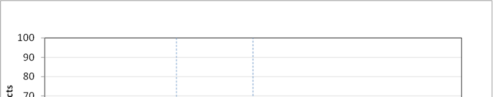
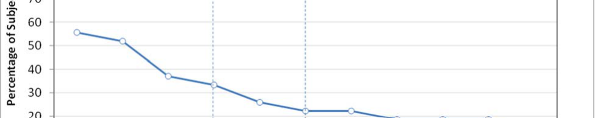
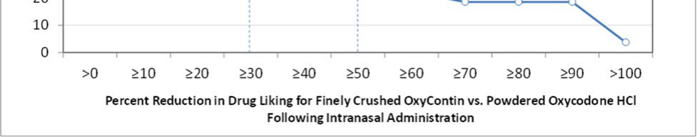
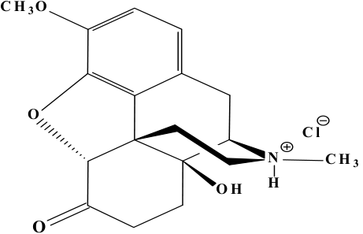

> **PDF page 1**

**HIGHLIGHTS OF PRESCRIBING INFORMATION These highlights do not include all the information needed to use OXYCONTIN****®** **safely and effectively.  See full prescribing information for OXYCONTIN.**

**OXYCONTIN****®** **(oxycodone hydrochloride) extended-release tablets, for oral use, CII**

**Initial U.S. Approval: 1950**

- **WARNING: ADDICTION, ABUSE AND MISUSE; RISK EVALUATION AND MITIGATION STRATEGY (REMS); LIFE-THREATENING RESPIRATORY DEPRESSION; ACCIDENTAL INGESTION;**

- **NEONATAL OPIOID WITHDRAWAL SYNDROME; CYTOCHROME P450 3A4 INTERACTION; and RISKS FROM CONCOMITANT USE WITH BENZODIAZEPINES OR OTHER CNS DEPRESSANTS** **_See full prescribing information for complete boxed warning_ .**

- **OXYCONTIN exposes users to risks of addiction, abuse and misuse, which can lead to overdose and death. Assess patient’s risk before prescribing and monitor regularly for these behaviors and conditions. (5.1)**

- **To ensure that the benefits of opioid analgesics outweigh the risks of addiction, abuse, and misuse, the Food and Drug Administration (FDA) has required a Risk Evaluation and Mitigation Strategy (REMS) for these products. (5.2)**

- **Serious, life-threatening, or fatal respiratory depression may occur. Monitor closely, especially upon initiation or following a dose increase. Instruct patients to swallow OXYCONTIN tablets whole to avoid**

- **exposure to a potentially fatal dose of oxycodone. (5.3)**

- **Accidental ingestion of OXYCONTIN, especially by children, can result in a fatal overdose of oxycodone. (5.3)**

- **Prolonged use of OXYCONTIN during pregnancy can result in neonatal opioid withdrawal syndrome, which may be life-threatening if not recognized and treated. If prolonged opioid use is required in a pregnant woman, advise the patient of the risk of neonatal opioid withdrawal syndrome and ensure that appropriate treatment will be available. (5.4)**

- **Concomitant use with CYP3A4 inhibitors (or discontinuation of CYP3A4 inducers) can result in a fatal overdose of oxycodone. (5.5, 7, 12.3)**

- **Concomitant use of opioids with benzodiazepines or other central nervous system (CNS) depressants, including alcohol, may result in profound sedation, respiratory depression, coma, and death. Reserve concomitant prescribing for use in patients for whom alternative treatment options are inadequate; limit dosages and durations to the minimum required; and follow patients for signs and symptoms of respiratory depression and sedation. (5.6, 7)**

- OXYCONTIN 60 mg and 80 mg tablets, a single dose greater than 40 mg, or a total daily dose greater than 80 mg are only for use in patients in whom tolerance to an opioid of comparable potency has been established. (2.1)

- Patients considered opioid-tolerant are those taking, for one week or longer, at least 60 mg oral morphine per day, 25 mcg transdermal fentanyl per hour, 30 mg oral oxycodone per day, 8 mg oral hydromorphone per day, 25 mg oral oxymorphone per day, 60 mg oral hydrocodone per day, or an equianalgesic dose of another opioid. (2.1)

- Use the lowest effective dosage for the shortest duration consistent with individual patient treatment goals (2.1).

- Individualize dosing based on the severity of pain, patient response, prior analgesic experience, and risk factors for addiction, abuse, and misuse. (2.1)

- Instruct patients to swallow tablets intact and not to cut, break, chew, crush, or dissolve tablets (risk of potentially fatal dose). (2.1, 5.1)

- Instruct patients to take tablets one at a time, with enough water to ensure complete swallowing immediately after placing in mouth. (2.1, 5.10)

- Discuss availability of naloxone with the patient and caregiver and assess each patient’s need for access to naloxone, both when initiating and renewing treatment with OXYCONTIN. Consider prescribing naloxone based on the patient’s risk factors for overdose (2.2, 5.1, 5.3, 5.6).

- Do not abruptly discontinue OXYCONTIN in a physically dependent patient because rapid discontinuation of opioid analgesics has resulted in serious withdrawal symptoms, uncontrolled pain, and suicide. (2.10)

Adults: For opioid-naïve and opioid non-tolerant patients, initiate with 10 mg tablets orally every 12 hours. See full prescribing information for instructions on conversion from opioids to OXYCONTIN, titration and maintenance of

- therapy. (2.3, 2.4, 2.6)

- Pediatric Patients 11 Years of Age and Older

- For use only in pediatric patients 11 years and older already receiving and tolerating opioids for at least 5 consecutive days with a minimum of 20 mg per day of oxycodone or its equivalent for at least two days immediately preceding dosing with OXYCONTIN. (2.5)

- See full prescribing information for instructions on conversion from opioids to OXYCONTIN, titration and maintenance of therapy. (2.5, 2.6)

- Geriatric Patients: In debilitated, opioid non-tolerant geriatric patients, initiate dosing at one third to one half the recommended starting dosage and titrate carefully. (2.8, 8.5)

Patients with Hepatic Impairment: Initiate dosing at one third to one half the recommended starting dosage and titrate carefully. (2.9, 8.6)

**---------------------DOSAGE FORMS AND STRENGTHS----------------------** Extended-release tablets: 10 mg, 15 mg, 20 mg, 30 mg, 40 mg, 60 mg, and 80 mg. (3)

**-------------------------------CONTRAINDICATIONS------------------------------**

- Significant respiratory depression (4)

**----------------------------RECENT MAJOR CHANGES--------------------------**

Dosage and Administration (2.2) 03/2021 Warnings and Precautions (5.1 5.3, 5.6) 03/2021

**----------------------------INDICATIONS AND USAGE---------------------------**

OXYCONTIN is an opioid agonist indicated for the management of pain severe enough to require daily, around-the-clock, long-term opioid treatment and for which alternative treatment options are inadequate in:

- Adults; and

- Opioid-tolerant pediatric patients 11 years of age and older who are already receiving and tolerate a minimum daily opioid dose of at least 20 mg oxycodone orally or its equivalent.

Limitations of Use

- Because of the risks of addiction, abuse and misuse with opioids, even at recommended doses, and because of the greater risks of overdose and death with extended-release opioid formulations, reserve OXYCONTIN for use in patients for whom alternative treatment options (e.g. non-opioid analgesics or immediate-release opioids) are ineffective, not tolerated, or would be otherwise inadequate to provide sufficient management of pain. (1)

- OXYCONTIN is not indicated as an as-needed (prn) analgesic. (1)

**----------------------DOSAGE AND ADMINISTRATION------------------------**

- To be prescribed only by healthcare providers knowledgeable in use of potent opioids for management of chronic pain. (2.1)

- Acute or severe bronchial asthma in an unmonitored setting or in absence of resuscitative equipment (4)

- Known or suspected gastrointestinal obstruction, including paralytic ileus (4)

- Hypersensitivity to oxycodone (4)

- **-----------------------WARNINGS AND PRECAUTIONS------------------------**

- • Life-Threatening Respiratory Depression in Patients with Chronic Pulmonary Disease or in Elderly, Cachectic, or Debilitated Patients: Monitor closely, particularly during initiation and titration. (5.7)

- Adrenal Insufficiency: If diagnosed, treat with physiologic replacement of corticosteroids, and wean patient off of the opioid. (5.8)

- • Severe Hypotension: Monitor during dosage initiation and titration. Avoid use of OXYCONTIN in patients with circulatory shock. (5.9)

- Risks of Use in Patients with Increased Intracranial Pressure, Brain Tumors, Head Injury, or Impaired Consciousness: Monitor for sedation and respiratory depression.  Avoid use of OXYCONTIN in patients with

- impaired consciousness or coma. (5.10)

- Risk of Obstruction in Patients who have Difficulty Swallowing or have Underlying GI Disorders that may Predispose them to Obstruction: Consider use of an alternative analgesic. (5.11)

# **------------------------------ADVERSE REACTIONS-------------------------------**

Most common adverse reactions (incidence >5%) were constipation, nausea, somnolence, dizziness, vomiting, pruritus, headache, dry mouth, asthenia, and sweating. (6.1)

> **PDF page 2**

**To report SUSPECTED ADVERSE REACTIONS, contact Purdue Pharma L.P. at 1-888-726-7535 or FDA at 1-800-FDA-1088 or** **_www.fda.gov/medwatch._**

**------------------------------DRUG INTERACTIONS-------------------------------**

- CNS Depressants: Concomitant use may cause hypotension, profound sedation, respiratory depression, coma, and death. If co-administration is required and the decision to begin OXYCONTIN is made, start with 1/3 to 1/2 the recommended starting dosage, consider using a lower dosage of the concomitant CNS depressant, and monitor closely. (2.6, 5.6, 7)

- Serotonergic Drugs: Concomitant use may result in serotonin syndrome. Discontinue OXYCONTIN if serotonin syndrome is suspected. (7)

- Mixed Agonist/Antagonist and Partial Agonist Opioid Analgesics: Avoid use with OXYCONTIN because they may reduce analgesic effect of OXYCONTIN or precipitate withdrawal symptoms. (5.14, 7)

- Monoamine Oxidase Inhibitors (MAOIs): Can potentiate the effects of morphine. Avoid concomitant use in patients receiving MAOIs or within 14 days of stopping treatment with an MAOI. (7)

**-----------------------USE IN SPECIFIC POPULATIONS------------------------**

Pregnancy: May cause fetal harm. (8.1) Lactation: Not recommended. (8.2)

**See 17 for PATIENT COUNSELING INFORMATION and Medication Guide.**

**Revised: 03/2021**

> **PDF page 3**

# **FULL PRESCRIBING INFORMATION: CONTENTS***

- **6 ADVERSE REACTIONS**

**WARNING: ADDICTION, ABUSE AND MISUSE; RISK EVALUATION AND MITIGATION STRATEGY (REMS); LIFE-THREATENING RESPIRATORY DEPRESSION; ACCIDENTAL INGESTION; NEONATAL OPIOID WITHDRAWAL SYNDROME; CYTOCHROME P450 3A4 INTERACTION; and RISKS FROM CONCOMITANT USE WITH BENZODIAZEPINES OR OTHER CNS DEPRESSANTS**

            - 6.1 Clinical Trial Experience

            - 6.2 Postmarketing Experience

         - **7 DRUG INTERACTIONS**

         - **8 USE IN SPECIFIC POPULATIONS**

            - 8.1 Pregnancy

            - 8.2 Lactation

            - 8.3 Females and Males of Reproductive Potential

- **1 INDICATIONS AND USAGE**

- **2 DOSAGE AND ADMINISTRATION**

   - 2.1 Important Dosage and Administration Instructions

   - 2.2 Patient Access to Naloxone for the Emergency Treatment of Opioid Overdose

   - 2.3 Initial Dosage in Adults who are not Opioid-Tolerant

   - 2.4 Conversion from Opioids to OXYCONTIN in Adults

   - 2.5 Initial Dosage in Pediatric Patients 11 Years and Older

   - 2.6 Titration and Maintenance of Therapy in Adults and Pediatric

      - Patients 11 Years and Older

   - 2.7 Dosage Modifications with Concomitant Use of Central Nervous System Depressants

   - 2.8 Dosage Modifications in Geriatric Patients who are Debilitated and not Opioid-Tolerant

   - 2.9 Dosage Modifications in Patients with Hepatic Impairment

- 2.10 Safe Reduction or Discontinuation of OXYCONTIN

- **3 DOSAGE FORMS AND STRENGTHS 4 CONTRAINDICATIONS 5 WARNINGS AND PRECAUTIONS**

   - 5.1 Addiction, Abuse, and Misuse

   - 8.4 Pediatric Use

   - 8.5 Geriatric Use

   - 8.6 Hepatic Impairment

   - 8.7 Renal Impairment

   - 8.8 Sex Differences

- **9 DRUG ABUSE AND DEPENDENCE**

   - 9.1 Controlled Substance

   - 9.2 Abuse

   - 9.3 Dependence

- **10 OVERDOSAGE**

- **11 DESCRIPTION**

**12 CLINICAL PHARMACOLOGY**

- 12.1 Mechanism of Action

- 12.2 Pharmacodynamics

12.3 Pharmacokinetics

- **13 NONCLINICAL TOXICOLOGY**

   - 13.1 Carcinogenesis, Mutagenesis, Impairment of Fertility

- **14 CLINICAL STUDIES**

**16 HOW SUPPLIED/STORAGE AND HANDLING 17 PATIENT COUNSELING INFORMATION**

- 5.2 Opioid Analgesic Risk Evaluation and Mitigation Strategy (REMS)

- 5.3 Life-Threatening Respiratory Depression

- 5.4 Neonatal Opioid Withdrawal Syndrome

*Sections or subsections omitted from the full prescribing information are not listed

- 5.5 Risks of Concomitant Use or Discontinuation of Cytochrome P450

   - 3A4 Inhibitors and Inducers

- 5.6 Risks from Concomitant Use with Benzodiazepines or Other CNS Depressants

- 5.7 Life-Threatening Respiratory Depression in Patients with Chronic Pulmonary Disease or in Elderly, Cachectic, or Debilitated Patients

- 5.8 Adrenal Insufficiency

- 5.9 Severe Hypotension

- 5.10 Risks of Use in Patients with Increased Intracranial Pressure, Brain

   - Tumors, Head Injury, or Impaired Consciousness

- 5.11 Difficulty in Swallowing and Risk for Obstruction in Patients at

   - Risk for a Small Gastrointestinal Lumen

- 5.12 Risks of Use in Patients with Gastrointestinal Conditions

- 5.13 Increased Risk of Seizures in Patients with Seizure Disorders

- 5.14 Withdrawal

- 5.15 Risks of Driving and Operating Machinery

- 5.16 Laboratory Monitoring

> **PDF page 4**

# **FULL PRESCRIBING INFORMATION**

**WARNING: ADDICTION, ABUSE AND MISUSE; RISK EVALUATION AND MITIGATION STRATEGY (REMS); LIFE-THREATENING RESPIRATORY DEPRESSION; ACCIDENTAL INGESTION; NEONATAL OPIOID WITHDRAWAL SYNDROME; CYTOCHROME P450 3A4 INTERACTION; and RISKS FROM CONCOMITANT USE WITH BENZODIAZEPINES OR OTHER CNS DEPRESSANTS**

## **Addiction, Abuse, and Misuse**

**OXYCONTIN****®** **exposes patients and other users to the risks of opioid addiction, abuse, and misuse, which can lead to overdose and death. Assess each patient’s risk prior to prescribing OXYCONTIN and monitor all patients regularly for the development of these behaviors and conditions** **_[see Warnings and Precautions (5.1)]._**

**Opioid Analgesic Risk Evaluation and Mitigation Strategy (REMS):**

**To ensure that the benefits of opioid analgesics outweigh the risks of addiction, abuse, and misuse, the Food and Drug Administration (FDA) has required a REMS for these products** **_[see Warnings and Precautions (5.2)]_ . Under the requirements of the REMS, drug companies with approved opioid analgesic products must make REMS-compliant education programs available to healthcare providers. Healthcare providers are strongly encouraged to**

- **complete a REMS-compliant education program,**

- **counsel patients and/or their caregivers, with every prescription, on safe use, serious risks, storage, and disposal of these products,**

- **emphasize to patients and their caregivers the importance of reading the Medication Guide every time it is provided by their pharmacist, and**

- **consider other tools to improve patient, household, and community safety.**

**Life-Threatening Respiratory Depression**

**Serious, life-threatening, or fatal respiratory depression may occur with use of OXYCONTIN. Monitor for respiratory depression, especially during initiation of OXYCONTIN or following a dose increase** **_._ Instruct patients to swallow OXYCONTIN tablets whole; crushing, chewing, or dissolving OXYCONTIN tablets can cause rapid release and absorption of a potentially fatal dose of oxycodone** **_[see Warnings and Precautions (5.3)]_ .**

## **Accidental Ingestion**

**Accidental ingestion of even one dose of OXYCONTIN, especially by children, can result in a fatal overdose of oxycodone** **_[see Warnings and Precautions (5.3)]_ .**

## **Neonatal Opioid Withdrawal Syndrome**

**Prolonged use of OXYCONTIN during pregnancy can result in neonatal opioid withdrawal syndrome, which may be life-threatening if not recognized and treated, and requires management according to protocols developed by neonatology experts. If opioid use is required for a prolonged period in a pregnant woman, advise the patient of the risk of neonatal opioid withdrawal syndrome and ensure that appropriate treatment will be available** **_[see Warnings and Precautions (5.4)]_ .**

## **Cytochrome P450 3A4 Interaction**

**The concomitant use of OXYCONTIN with all cytochrome P450 3A4 inhibitors may result in an increase in oxycodone plasma concentrations, which could increase or prolong adverse drug effects and may cause potentially fatal respiratory depression. In addition, discontinuation of a concomitantly used cytochrome**

> **PDF page 5**

**P450 3A4 inducer may result in an increase in oxycodone plasma concentration. Monitor patients receiving OXYCONTIN and any CYP3A4 inhibitor or inducer** **_[see Warnings and Precautions (5.5), Drug Interactions (7), Clinical Pharmacology (12.3)]_ .**

**Risks From Concomitant Use With Benzodiazepines Or Other CNS Depressants**

**Concomitant use of opioids with benzodiazepines or other central nervous system (CNS) depressants, including alcohol, may result in profound sedation, respiratory depression, coma, and death** **_[_ see** **_Warnings and Precautions (5.6), Drug Interactions (7)]_ .**

- **Reserve concomitant prescribing of OXYCONTIN and benzodiazepines or other CNS depressants for use in patients for whom alternative treatment options are inadequate.**

- **Limit dosages and durations to the minimum required.**

- **Follow patients for signs and symptoms of respiratory depression and sedation.**

# **1 INDICATIONS AND USAGE**

OXYCONTIN is indicated for the management of pain severe enough to require daily, aroundthe-clock, long-term opioid treatment and for which alternative treatment options are inadequate in:

- Adults; and

- Opioid-tolerant pediatric patients 11 years of age and older who are already receiving and tolerate a minimum daily opioid dose of at least 20 mg oxycodone orally or its equivalent.

## Limitations of Use

- Because of the risks of addiction, abuse, and misuse with opioids, even at recommended doses, and because of the greater risks of overdose and death with extended-release opioid formulations _[see Warnings and Precautions (5.1)]_ , reserve OXYCONTIN for use in patients for whom alternative treatment options (e.g., non-opioid analgesics or immediate-release opioids) are ineffective, not tolerated, or would be otherwise inadequate to provide sufficient management of pain.

- OXYCONTIN is not indicated as an as-needed (prn) analgesic.

# **2 DOSAGE AND ADMINISTRATION**

## **2.1 Important Dosage and Administration Instructions**

OXYCONTIN should be prescribed only by healthcare professionals who are knowledgeable in the use of potent opioids for the management of chronic pain.

OXYCONTIN 60 mg and 80 mg tablets, a single dose greater than 40 mg, or a total daily dose greater than 80 mg are only for use in patients in whom tolerance to an opioid of comparable potency has been established. Adult patients who are opioid tolerant are those receiving, for one week or longer, at least 60 mg oral morphine per day, 25 mcg transdermal fentanyl per hour, 30

> **PDF page 6**

mg oral oxycodone per day, 8 mg oral hydromorphone per day, 25 mg oral oxymorphone per day, 60 mg oral hydrocodone per day, or an equianalgesic dose of another opioid.

- Use the lowest effective dosage for the shortest duration consistent with individual patient treatment goals _[see Warnings and Precautions (5)]._

- Initiate the dosing regimen for each patient individually; taking into account the patient's severity of pain, patient response, prior analgesic treatment experience, and risk factors for addiction, abuse, and misuse _[see Warnings and Precautions (5.1)]_ .

- Monitor patients closely for respiratory depression, especially within the first 24-72 hours of initiating therapy and following dosage increases with OXYCONTIN and adjust the dosage accordingly _[see Warnings and Precautions (5.3)]._

Instruct patients to swallow OXYCONTIN tablets whole, one tablet at a time, with enough water to ensure complete swallowing immediately after placing in the mouth _[see Patient Counseling Information (17)]_ . Instruct patients not to pre-soak, lick, or otherwise wet the tablet prior to placing in the mouth _[see Warnings and Precautions (5.11)]_ . Cutting, breaking, crushing, chewing, or dissolving OXYCONTIN tablets will result in uncontrolled delivery of oxycodone and can lead to overdose or death _[see Warnings and Precautions (5.1)]_ .

OXYCONTIN is administered orally every 12 hours.

# **2.2 Patient Access to Naloxone for the Emergency Treatment of Opioid Overdose**

Discuss the availability of naloxone for the emergency treatment of opioid overdose with the patient and caregiver and assess the potential need for access to naloxone, both when initiating and renewing treatment with OXYCONTIN _[see Warnings and Precautions (5.3), Patient Counseling Information (17)]._

Inform patients and caregivers about the various ways to obtain naloxone as permitted by individual state naloxone dispensing and prescribing requirements or guidelines (e.g., by prescription, directly from a pharmacist, or as part of a community-based program).

Consider prescribing naloxone, based on the patient’s risk factors for overdose, such as concomitant use of CNS depressants, a history of opioid use disorder, or prior opioid overdose. The presence of risk factors for overdose should not prevent the proper management of pain in any given patient _[see Warnings and Precautions (5.1, 5.3, 5.6)]._

Consider prescribing naloxone if the patient has household members (including children) or other close contacts at risk for accidental ingestion or overdose _._

# **2.3 Initial Dosage in Adults who are not Opioid-Tolerant**

The starting dosage for patients who are not opioid tolerant is OXYCONTIN 10 mg orally every 12 hours.

> **PDF page 7**

Use of higher starting doses in patients who are not opioid tolerant may cause fatal respiratory depression _[see Warnings and Precautions (5.3)]._

# **2.4 Conversion from Opioids to OXYCONTIN in Adults**

Conversion from Other Oral Oxycodone Formulations to OXYCONTIN

If switching from other oral oxycodone formulations to OXYCONTIN, administer one half of the patient's total daily oral oxycodone dose as OXYCONTIN every 12 hours.

Conversion from Other Opioids to OXYCONTIN

Discontinue all other around-the-clock opioid drugs when OXYCONTIN therapy is initiated.

There are no established conversion ratios for conversion from other opioids to OXYCONTIN defined by clinical trials. Initiate dosing using OXYCONTIN 10 mg orally every 12 hours.

It is safer to underestimate a patient’s 24-hour oral oxycodone requirements and provide rescue medication (e.g., immediate-release opioid) than to overestimate the 24-hour oral oxycodone dosage and manage an adverse reaction due to an overdose. While useful tables of opioid equivalents are readily available, there is substantial inter-patient variability in the relative potency of different opioids.

Close observation and frequent titration are warranted until pain management is stable on the new opioid. Monitor patients for signs and symptoms of opioid withdrawal and for signs of oversedation/toxicity after converting patients to OXYCONTIN.

Conversion from Methadone to OXYCONTIN

Close monitoring is of particular importance when converting from methadone to other opioid agonists. The ratio between methadone and other opioid agonists may vary widely as a function of previous dose exposure. Methadone has a long half-life and can accumulate in the plasma.

Conversion from Transdermal Fentanyl to OXYCONTIN

Treatment with OXYCONTIN can be initiated after the transdermal fentanyl patch has been removed for at least 18 hours. Although there has been no systematic assessment of such conversion, start with a conservative conversion:  substitute 10 mg of OXYCONTIN every 12 hours for each 25 mcg per hour fentanyl transdermal patch.  Follow the patient closely during conversion from transdermal fentanyl to OXYCONTIN, as there is limited documented experience with this conversion.

# **2.5 Initial Dosage in Pediatric Patients 11 Years and Older**

The following dosing information is for use only in pediatric patients 11 years and older already receiving and tolerating opioids for at least five consecutive days. For the two days immediately preceding dosing with OXYCONTIN, patients must be taking a minimum of 20 mg per day of oxycodone or its equivalent. OXYCONTIN is not appropriate for use in pediatric patients requiring less than a 20 mg total daily dose.  Table 1, based on clinical trial experience, displays

> **PDF page 8**

the conversion factor when switching pediatric patients 11 years and older (under the conditions described above) from opioids to OXYCONTIN.

Discontinue all other around-the-clock opioid drugs when OXYCONTIN therapy is initiated.

There is substantial inter-patient variability in the relative potency of different opioid drugs and formulations.  Therefore, a conservative approach is advised when determining the total daily dosage of OXYCONTIN.  It is safer to underestimate a patient’s 24-hour oral oxycodone requirements and provide rescue medication (e.g., immediate-release opioid) than to overestimate the 24-hour oral oxycodone requirements and manage an adverse reaction due to an overdose.

Consider the following when using the information in Table 1.

- This is not a table of equianalgesic doses.

- The conversion factors in this table are only for the conversion from one of the listed oral opioid analgesics to OXYCONTIN.

- The table cannot be used to convert from OXYCONTIN to another opioid. Doing so will result in an over-estimation of the dose of the new opioid and may result in fatal overdose.

- The formula for conversion from prior opioids, including oral oxycodone, to the daily dose of OXYCONTIN is mg per day of prior opioid x factor = mg per day of OXYCONTIN. Divide the calculated total daily dose by 2 to get the every-12-hour OXYCONTIN dose. If rounding is necessary, always round the dose down to the nearest OXYCONTIN tablet strength available.

**Table 1: Conversion Factors When Switching Pediatric Patients 11 Years and Older to OXYCONTIN**

| Item | Oral | Parenteral* |
| --- | --- | --- |
| Oxycodone | 1 |  |
| Hydrocodone | 0.90 |  |
| Hydromorphone | 4 | 20 |
| Morphine | 0.50 | 3 |
| Tramadol | 0.17 | 0.20 |

*For patients receiving high-dose parenteral opioids, a more conservative conversion is warranted. For example, for high-dose parenteral morphine, use 1.5 instead of 3 as a multiplication factor.

> **PDF page 9**

Step #1: To calculate the estimated total OXYCONTIN daily dosage using Table 1:

- For pediatric patients taking a single opioid, sum the current total daily dosage of the opioid and then multiply the total daily dosage by the approximate conversion factor to calculate the approximate OXYCONTIN daily dosage.

- For pediatric patients on a regimen of more than one opioid, calculate the approximate oxycodone dose for each opioid and sum the totals to obtain the approximate OXYCONTIN daily dosage.

- For pediatric patients on a regimen of fixed-ratio opioid/non-opioid analgesic products, use only the opioid component of these products in the conversion.

Step #2: If rounding is necessary, always round the dosage down to the nearest OXYCONTIN tablet strength available and initiate OXYCONTIN therapy with that dose.  If the calculated OXYCONTIN total daily dosage is less than 20 mg, there is no safe strength for conversion and do not initiate OXYCONTIN.

Example conversion from a single opioid (e.g., hydrocodone) to OXYCONTIN:  Using the conversion factor of 0.9 for oral hydrocodone in Table 1, a total daily hydrocodone dosage of 50 mg is converted to 45 mg of oxycodone per day or 22.5 mg of OXYCONTIN every 12 hours. After rounding down to the nearest strength available, the recommended OXYCONTIN starting dosage is 20 mg every 12 hours.

Step #3: Close observation and titration are warranted until pain management is stable on the new opioid. Monitor patients for signs and symptoms of opioid withdrawal or for signs of oversedation/toxicity after converting patients to OXYCONTIN.  [ _see Dosage and Administration (2.5)]_ for important instructions on titration and maintenance of therapy.

There is limited experience with conversion from transdermal fentanyl to OXYCONTIN in pediatric patients 11 years and older.  If switching from transdermal fentanyl patch to OXYCONTIN, ensure that the patch has been removed for at least 18 hours prior to starting OXYCONTIN. Although there has been no systematic assessment of such conversion, start with a conservative conversion: substitute 10 mg of OXYCONTIN every 12 hours for each 25 mcg per hour fentanyl transdermal patch.  Follow the patient closely during conversion from transdermal fentanyl to OXYCONTIN.

If using asymmetric dosing, instruct patients to take the higher dose in the morning and the lower dose in the evening.

# **2.6 Titration and Maintenance of Therapy in Adults and Pediatric Patients 11 Years and Older**

Individually titrate OXYCONTIN to a dosage that provides adequate analgesia and minimizes adverse reactions. Continually reevaluate patients receiving OXYCONTIN to assess the maintenance of pain control, signs and symptoms of opioid withdrawal, and adverse reactions, as

> **PDF page 10**

well as monitoring for the development of addiction, abuse and misuse _[see Warnings and Precautions (5.1)]_ . Frequent communication is important among the prescriber, other members of the healthcare team, the patient, and the caregiver/family during periods of changing analgesic requirements, including initial titration. During chronic therapy, periodically reassess the continued need for the use of opioid analgesics.

Patients who experience breakthrough pain may require a dosage adjustment of OXYCONTIN or may need rescue medication with an appropriate dose of an immediate-release analgesic. If the level of pain increases after dose stabilization, attempt to identify the source of increased pain before increasing the OXYCONTIN dosage. Because steady-state plasma concentrations are approximated in 1 day, OXYCONTIN dosage may be adjusted every 1 to 2 days.

If unacceptable opioid-related adverse reactions are observed, consider reducing the dosage. Adjust the dosage to obtain an appropriate balance between management of pain and opioidrelated adverse reactions.

There are no well-controlled clinical studies evaluating the safety and efficacy with dosing more frequently than every 12 hours. As a guideline for pediatric patients 11 years and older, the total daily oxycodone dosage usually can be increased by 25% of the current total daily dosage.  As a guideline for adults, the total daily oxycodone dosage usually can be increased by 25% to 50% of the current total daily dosage, each time an increase is clinically indicated.

# **2.7 Dosage Modifications with Concomitant Use of Central Nervous System Depressants**

If the patient is currently taking a central nervous system (CNS) depressant and the decision is made to begin OXYCONTIN, start with one-third to one-half the recommended starting dosage of OXYCONTIN, consider using a lower dosage of the concomitant CNS depressant, and monitor patients for signs of respiratory depression, sedation, and hypotension _[see Warnings and Precautions (5.6), Drug Interactions (7)]_ .

# **2.8 Dosage Modifications in Geriatric Patients who are Debilitated and not OpioidTolerant**

For geriatric patients who are debilitated and not opioid tolerant, start dosing patients at one-third to one-half the recommended starting dosage and titrate the dosage cautiously _[see Use in Specific Populations (8.5]_ .

# **2.9 Dosage Modifications in Patients with Hepatic Impairment**

For patients with hepatic impairment, start dosing patients at one-third to one-half the recommended starting dosage and titrate the dosage carefully. Monitor for signs of respiratory depression, sedation, and hypotension _[see Use in Specific Populations, (8.6), Clinical Pharmacology (12.3)]_ .

# **2.10 Safe Reduction or Discontinuation of OXYCONTIN**

> **PDF page 11**

Do not abruptly discontinue OXYCONTIN in patients who may be physically dependent on opioids. Rapid discontinuation of opioid analgesics in patients who are physically dependent on opioids has resulted in serious withdrawal symptoms, uncontrolled pain, and suicide. Rapid discontinuation has also been associated with attempts to find other sources of opioid analgesics, which may be confused with drug-seeking for abuse. Patients may also attempt to treat their pain or withdrawal symptoms with illicit opioids, such as heroin, and other substances.

When a decision has been made to decrease the dose or discontinue therapy in an opioiddependent patient taking OXYCONTIN, there are a variety of factors that should be considered, including the dose of OXYCONTIN the patient has been taking, the duration of treatment, the type of pain being treated, and the physical and psychological attributes of the patient. It is important to ensure ongoing care of the patient and to agree on an appropriate tapering schedule and follow-up plan so that patient and provider goals and expectations are clear and realistic. When opioid analgesics are being discontinued due to a suspected substance use disorder, evaluate and treat the patient, or refer for evaluation and treatment of the substance use disorder. Treatment should include evidence-based approaches, such as medication assisted treatment of opioid use disorder. Complex patients with comorbid pain and substance use disorders may benefit from referral to a specialist.

There are no standard opioid tapering schedules that are suitable for all patients. Good clinical practice dictates a patient-specific plan to taper the dose of the opioid gradually. For patients on OXYCONTIN who are physically opioid-dependent, initiate the taper by a small enough increment (e.g., no greater than 10% to 25% of the total daily dose) to avoid withdrawal symptoms, and proceed with dose-lowering at an interval of every 2 to 4 weeks. Patients who have been taking opioids for briefer periods of time may tolerate a more rapid taper.

It may be necessary to provide the patient with lower dosage strengths to accomplish a successful taper. Reassess the patient frequently to manage pain and withdrawal symptoms, should they emerge. Common withdrawal symptoms include restlessness, lacrimation, rhinorrhea, yawning, perspiration, chills, myalgia, and mydriasis. Other signs and symptoms also may develop, including irritability, anxiety, backache, joint pain, weakness, abdominal cramps, insomnia, nausea, anorexia, vomiting, diarrhea, or increased blood pressure, respiratory rate, or heart rate. If withdrawal symptoms arise, it may be necessary to pause the taper for a period of time or raise the dose of the opioid analgesic to the previous dose, and then proceed with a slower taper. In addition, monitor patients for any changes in mood, emergence of suicidal thoughts, or use of other substances.

When managing patients taking opioid analgesics, particularly those who have been treated for a long duration and/or with high doses for chronic pain, ensure that a multimodal approach to pain management, including mental health support (if needed), is in place prior to initiating an opioid analgesic taper. A multimodal approach to pain management may optimize the treatment of chronic pain, as well as assist with the successful tapering of the opioid analgesic _[see Warnings and Precautions (5.14), Drug Abuse and Dependence (9.3)]._

# **3 DOSAGE FORMS AND STRENGTHS**

> **PDF page 12**

Extended-release tablets: 10 mg, 15 mg, 20 mg, 30 mg, 40 mg, 60 mg, and 80 mg.

- 10 mg film-coated extended-release tablets (round, white-colored, bi-convex tablets debossed with OP on one side and 10 on the other)

- 15 mg film-coated extended-release tablets (round, gray-colored, bi-convex tablets debossed with OP on one side and 15 on the other)

- 20 mg film-coated extended-release tablets (round, pink-colored, bi-convex tablets debossed with OP on one side and 20 on the other)

- 30 mg film-coated extended-release tablets (round, brown-colored, bi-convex tablets debossed with OP on one side and 30 on the other)

- 40 mg film-coated extended-release tablets (round, yellow-colored, bi-convex tablets debossed with OP on one side and 40 on the other)

- 60 mg film-coated extended-release tablets (round, red-colored, bi-convex tablets debossed with OP on one side and 60 on the other)

- 80 mg film-coated extended-release tablets (round, green-colored, bi-convex tablets debossed with OP on one side and 80 on the other)

# **4 CONTRAINDICATIONS**

OXYCONTIN is contraindicated in patients with:

- Significant respiratory depression _[see Warnings and Precautions (5.3)]_

- Acute or severe bronchial asthma in an unmonitored setting or in the absence of resuscitative equipment _[see Warnings and Precautions (5.7)]_

- Known or suspected gastrointestinal obstruction, including paralytic ileus _[see Warnings and Precautions (5.12)]_

- Hypersensitivity (e.g., anaphylaxis) to oxycodone _[see Adverse Reactions (6.2)]_

# **5 WARNINGS AND PRECAUTIONS**

## **5.1 Addiction, Abuse, and Misuse**

OXYCONTIN contains oxycodone, a Schedule II controlled substance. As an opioid, OXYCONTIN exposes users to the risks of addiction, abuse, and misuse.  Because extendedrelease products such as OXYCONTIN deliver the opioid over an extended period of time, there is a greater risk for overdose and death due to the larger amount of oxycodone present _[see Drug Abuse and Dependence (9)]_ .

Although the risk of addiction in any individual is unknown, it can occur in patients appropriately prescribed OXYCONTIN. Addiction can occur at recommended doses and if the drug is misused or abused.

Assess each patient’s risk for opioid addiction, abuse, or misuse prior to prescribing OXYCONTIN, and monitor all patients receiving OXYCONTIN for the development of these behaviors and conditions. Risks are increased in patients with a personal or family history of substance abuse (including drug or alcohol abuse or addiction) or mental illness (e.g., major

> **PDF page 13**

depression). The potential for these risks should not, however, prevent the proper management of pain in any given patient. Patients at increased risk may be prescribed opioids such as OXYCONTIN, but use in such patients necessitates intensive counseling about the risks and proper use of OXYCONTIN along with intensive monitoring for signs of addiction, abuse, and misuse. Consider prescribing naloxone for the emergency treatment of opioid overdose _[see Dosage and Administration (2.2), Warnings and Precautions (5.3)]_ .

Abuse or misuse of OXYCONTIN by crushing, chewing, snorting, or injecting the dissolved product will result in the uncontrolled delivery of oxycodone and can result in overdose and death _[see Overdosage (10)]._

Opioids are sought by drug abusers and people with addiction disorders and are subject to criminal diversion.  Consider these risks when prescribing or dispensing OXYCONTIN. Strategies to reduce these risks include prescribing the drug in the smallest appropriate quantity and advising the patient on the proper disposal of unused drug _[see Patient Counseling Information (17)]_ . Contact local state professional licensing board or state-controlled substances authority for information on how to prevent and detect abuse or diversion of this product.

# **5.2 Opioid Analgesic Risk Evaluation and Mitigation Strategy (REMS)**

To ensure that the benefits of opioid analgesics outweigh the risks of addiction, abuse, and misuse, the Food and Drug Administration (FDA) has required a Risk Evaluation and Mitigation Strategy (REMS) for these products. Under the requirements of the REMS, drug companies with approved opioid analgesic products must make REMS-compliant education programs available to healthcare providers. Healthcare providers are strongly encouraged to do all of the following:

- Complete a REMS-compliant education program offered by an accredited provider of continuing education (CE) or another education program that includes all the elements of the FDA Education Blueprint for Health Care Providers Involved in the Management or Support of Patients with Pain.

- Discuss the safe use, serious risks, and proper storage and disposal of opioid analgesics with patients and/or their caregivers every time these medicines are prescribed. The Patient Counseling Guide (PCG) can be obtained at this link: www.fda.gov/OpioidAnalgesicREMSPCG .

- Emphasize to patients and their caregivers the importance of reading the Medication Guide that they will receive from their pharmacist every time an opioid analgesic is dispensed to them.

- Consider using other tools to improve patient, household, and community safety, such as patient-prescriber agreements that reinforce patient-prescriber responsibilities.

To obtain further information on the opioid analgesic REMS and for a list of accredited REMS CME/CE, call 1-800-503-0784, or log on to www.opioidanalgesicrems.com. The FDA Blueprint can be found at www.fda.gov/OpioidAnalgesicREMSBlueprint .

# **5.3 Life-Threatening Respiratory Depression**

> **PDF page 14**

Serious, life-threatening, or fatal respiratory depression has been reported with the use of opioids, even when used as recommended.  Respiratory depression, if not immediately recognized and treated, may lead to respiratory arrest and death. Management of respiratory depression may include close observation, supportive measures, and use of opioid antagonists, depending on the patient’s clinical status _[see Overdosage (10)]_ . Carbon dioxide (CO2) retention from opioid-induced respiratory depression can exacerbate the sedating effects of opioids.

While serious, life-threatening, or fatal respiratory depression can occur at any time during the use of OXYCONTIN, the risk is greatest during the initiation of therapy or following a dosage increase. Monitor patients closely for respiratory depression, especially within the first 24-72 hours of initiating therapy with and following dosage increases of OXYCONTIN.

To reduce the risk of respiratory depression, proper dosing and titration of OXYCONTIN are essential _[see Dosage and Administration (2)]_ . Overestimating the OXYCONTIN dosage when converting patients from another opioid product can result in a fatal overdose with the first dose.

Accidental ingestion of even one dose of OXYCONTIN, especially by children, can result in respiratory depression and death due to an overdose of oxycodone.

Educate patients and caregivers on how to recognize respiratory depression and emphasize the importance of calling 911 or getting emergency medical help right away in the event of a known or suspected overdose _[see Patient Counseling Information (17)]._

Opioids can cause sleep-related breathing disorders including central sleep apnea (CSA) and sleep-related hypoxemia. Opioid use increases the risk of CSA in a dose-dependent fashion. In patients who present with CSA, consider decreasing the opioid dosage using best practices for opioid taper _[see Dosage and Administration (2.6)]_ .

# Patient Access to Naloxone for the Emergency Treatment of Opioid Overdose:

Discuss the availability of naloxone for the emergency treatment of opioid overdose with the patient and caregiver and assess the potential need for access to naloxone, both when initiating and renewing treatment with OXYCONTIN. Inform patients and caregivers about the various ways to obtain naloxone as permitted by individual state naloxone dispensing and prescribing requirements or guidelines (e.g., by prescription, directly from a pharmacist, or as part of a community-based program). Educate patients and caregivers on how to recognize respiratory depression and emphasize the importance of calling 911 or getting emergency medical help, even if naloxone is administered _[see Patient Counseling Information (17)]._

Consider prescribing naloxone, based on the patient’s risk factors for overdose, such as concomitant use of CNS depressants, a history of opioid use disorder, or prior opioid overdose. The presence of risk factors for overdose should not prevent the proper management of pain in any given patient. Also consider prescribing naloxone if the patient has household members (including children) or other close contacts at risk for accidental ingestion or overdose. If naloxone is prescribed, educate patients and caregivers on how to treat with naloxone. _[see Warnings and Precautions (5.1, 5.6), Patient Counseling Information (17)]._

> **PDF page 15**

# **5.4 Neonatal Opioid Withdrawal Syndrome**

Prolonged use of OXYCONTIN during pregnancy can result in withdrawal in the neonate. Neonatal opioid withdrawal syndrome, unlike opioid withdrawal syndrome in adults, may be life-threatening if not recognized and treated, and requires management according to protocols developed by neonatology experts. Observe newborns for signs of neonatal opioid withdrawal syndrome and manage accordingly.  Advise pregnant women using opioids for a prolonged period of the risk of neonatal opioid withdrawal syndrome and ensure that appropriate treatment will be available _[see Use in Specific Populations (8.1), Patient Counseling Information (17)]_ .

# **5.5 Risks of Concomitant Use or Discontinuation of Cytochrome P450 3A4 Inhibitors and Inducers**

Concomitant use of OXYCONTIN with a CYP3A4 inhibitor, such as macrolide antibiotics (e.g., erythromycin), azole-antifungal agents (e.g., ketoconazole), and protease inhibitors (e.g., ritonavir), may increase plasma concentrations of oxycodone and prolong opioid adverse reactions, which may cause potentially fatal respiratory depression _[see Warnings and Precautions (5.3)]_ , particularly when an inhibitor is added after a stable dose of OXYCONTIN is achieved _._ Similarly, discontinuation of a CYP3A4 inducer, such as rifampin, carbamazepine, and phenytoin, in OXYCONTIN-treated patients may increase oxycodone plasma concentrations and prolong opioid adverse reactions. When using OXYCONTIN with CYP3A4 inhibitors or discontinuing CYP3A4 inducers in OXYCONTIN-treated patients, monitor patients closely at frequent intervals and consider dosage reduction of OXYCONTIN until stable drug effects are achieved _[see Drug Interactions (7)]._

Concomitant use of OXYCONTIN with CYP3A4 inducers or discontinuation of a CYP3A4 inhibitor could decrease oxycodone plasma concentrations, decrease opioid efficacy or, possibly, lead to a withdrawal syndrome in a patient who had developed physical dependence to oxycodone. When using OXYCONTIN with CYP3A4 inducers or discontinuing CYP3A4 inhibitors, monitor patients closely at frequent intervals and consider increasing the opioid dosage if needed to maintain adequate analgesia or if symptoms of opioid withdrawal occur _[see Drug Interactions (7)]_ .

# **5.6 Risks from Concomitant Use with Benzodiazepines or Other CNS Depressants**

Profound sedation, respiratory depression, coma, and death may result if OXYCONTIN is used concomitantly with alcohol or other central nervous system (CNS) depressants (e.g., nonbenzodiazepines sedatives/hypnotics, anxiolytics, tranquilizers, muscle relaxants, general anesthetics, antipsychotics, other opioids, alcohol). Because of these risks, reserve concomitant prescribing of these drugs for use in patients for whom alternative treatment options are inadequate.

Observational studies have demonstrated that concomitant use of opioid analgesics and benzodiazepines increases the risk of drug-related mortality compared to use of opioid analgesics alone. Because of similar pharmacological properties, it is reasonable to expect similar risk with the concomitant use of other CNS depressant drugs with opioid analgesics _[see Drug Interactions (7)]_ .

> **PDF page 16**

If the decision is made to prescribe a benzodiazepine or other CNS depressant concomitantly with an opioid analgesic, prescribe the lowest effective dosages and minimum durations of concomitant use.  In patients already receiving an opioid analgesic, prescribe a lower initial dose of the benzodiazepine or other CNS depressant than indicated in the absence of an opioid, and titrate based on clinical response. If an opioid analgesic is initiated in a patient already taking a benzodiazepine or other CNS depressant, prescribe a lower initial dose of the opioid analgesic, and titrate based on clinical response. Follow patients closely for signs and symptoms of respiratory depression and sedation.

If concomitant use is warranted, consider prescribing naloxone for the emergency treatment of opioid overdose _[see Dosage and Administration (2.2), Warnings and Precautions (5.3)]_ .

Advise both patients and caregivers about the risks of respiratory depression and sedation when OXYCONTIN is used with benzodiazepines or other CNS depressants (including alcohol and illicit drugs). Advise patients not to drive or operate heavy machinery until the effects of concomitant use of the benzodiazepine or other CNS depressant have been determined.  Screen patients for risk of substance use disorders, including opioid abuse and misuse, and warn them of the risk for overdose and death associated with the use of additional CNS depressants including alcohol and illicit drugs _[see Drug Interactions (7), Patient Counseling Information (17)]_ .

# **5.7 Life-Threatening Respiratory Depression in Patients with Chronic Pulmonary Disease or in Elderly, Cachectic, or Debilitated Patients**

The use of OXYCONTIN in patients with acute or severe bronchial asthma in an unmonitored setting or in the absence of resuscitative equipment is contraindicated.

Patients with Chronic Pulmonary Disease: OXYCONTIN-treated patients with significant chronic obstructive pulmonary disease or cor pulmonale, and those with a substantially decreased respiratory reserve, hypoxia, hypercapnia, or pre-existing respiratory depression are at increased risk of decreased respiratory drive including apnea, even at recommended dosages of OXYCONTIN _[see Warnings and Precautions (5.3)]._

Elderly, Cachectic, or Debilitated Patients: Life-threatening respiratory depression is more likely to occur in elderly, cachectic, or debilitated patients because they may have altered pharmacokinetics or altered clearance compared to younger, healthier patients _[see Warnings and Precautions (5.3)]._

Monitor such patients closely, particularly when initiating and titrating OXYCONTIN and when OXYCONTIN is given concomitantly with other drugs that depress respiration _[see Warnings and Precautions (5.3, 5.6)]_ . Alternatively, consider the use of non-opioid analgesics in these patients.

# **5.8 Adrenal Insufficiency**

> **PDF page 17**

Cases of adrenal insufficiency have been reported with opioid use, more often following greater than one month of use. Presentation of adrenal insufficiency may include non-specific symptoms and signs including nausea, vomiting, anorexia, fatigue, weakness, dizziness, and low blood pressure. If adrenal insufficiency is suspected, confirm the diagnosis with diagnostic testing as soon as possible. If adrenal insufficiency is diagnosed, treat with physiologic replacement doses of corticosteroids. Wean the patient off of the opioid to allow adrenal function to recover and continue corticosteroid treatment until adrenal function recovers. Other opioids may be tried as some cases reported use of a different opioid without recurrence of adrenal insufficiency. The information available does not identify any particular opioids as being more likely to be associated with adrenal insufficiency.

# **5.9 Severe Hypotension**

OXYCONTIN may cause severe hypotension, including orthostatic hypotension and syncope in ambulatory patients. There is an increased risk in patients whose ability to maintain blood pressure has already been compromised by a reduced blood volume or concurrent administration of certain CNS depressant drugs (e.g., phenothiazines or general anesthetics) _[see Drug Interactions (7)]_ . Monitor these patients for signs of hypotension after initiating or titrating the dosage of OXYCONTIN. In patients with circulatory shock, OXYCONTIN may cause vasodilation that can further reduce cardiac output and blood pressure. Avoid the use of OXYCONTIN in patients with circulatory shock.

**5.10 Risks of Use in Patients with Increased Intracranial Pressure, Brain Tumors, Head Injury, or Impaired Consciousness**

In patients who may be susceptible to the intracranial effects of CO2 retention (e.g., those with evidence of increased intracranial pressure or brain tumors), OXYCONTIN may reduce respiratory drive, and the resultant CO2 retention can further increase intracranial pressure. Monitor such patients for signs of sedation and respiratory depression, particularly when initiating therapy with OXYCONTIN.

Opioids may also obscure the clinical course in a patient with a head injury. Avoid the use of OXYCONTIN in patients with impaired consciousness or coma.

# **5.11 Difficulty in Swallowing and Risk for Obstruction in Patients at Risk for a Small Gastrointestinal Lumen**

There have been post-marketing reports of difficulty in swallowing OXYCONTIN tablets. These reports included choking, gagging, regurgitation and tablets stuck in the throat. Instruct patients not to pre-soak, lick, or otherwise wet OXYCONTIN tablets prior to placing in the mouth, and to take one tablet at a time with enough water to ensure complete swallowing immediately after placing in the mouth.

There have been rare post-marketing reports of cases of intestinal obstruction, and exacerbation of diverticulitis, some of which have required medical intervention to remove the tablet. Patients with underlying GI disorders such as esophageal cancer or colon cancer with a small

> **PDF page 18**

gastrointestinal lumen are at greater risk of developing these complications. Consider use of an alternative analgesic in patients who have difficulty swallowing and patients at risk for underlying GI disorders resulting in a small gastrointestinal lumen.

# **5.12 Risks of Use in Patients with Gastrointestinal Conditions**

OXYCONTIN is contraindicated in patients with known or suspected gastrointestinal obstruction, including paralytic ileus.

The oxycodone in OXYCONTIN may cause spasm of the sphincter of Oddi.  Opioids may cause increases in the serum amylase. Monitor patients with biliary tract disease, including acute pancreatitis, for worsening symptoms.

# **5.13 Increased Risk of Seizures in Patients with Seizure Disorders**

The oxycodone in OXYCONTIN may increase the frequency of seizures in patients with seizure disorders, and may increase the risk of seizures occurring in other clinical settings associated with seizures. Monitor patients with a history of seizure disorders for worsened seizure control during OXYCONTIN therapy.

# **5.14 Withdrawal**

Do not abruptly discontinue OXYCONTIN in a patient physically dependent on opioids. When discontinuing OXYCONTIN in a physically dependent patient, gradually taper the dosage. Rapid tapering of oxycodone in a patient physically dependent on opioids may lead to a withdrawal syndrome and return of pain _[see Dosage and Administration (2.10), Drug Abuse and Dependence (9.3)]._

Additionally, avoid the use of mixed agonist/antagonist (e.g.., pentazocine, nalbuphine, and butorphanol) or partial agonist (e.g., buprenorphine) analgesics in patients who are receiving a full opioid agonist analgesic, including OXYCONTIN.  In these patients, mixed agonist/antagonist and partial agonist analgesics may reduce the analgesic effect and/or may precipitate withdrawal symptoms.

# **5.15 Risks of Driving and Operating Machinery**

OXYCONTIN may impair the mental or physical abilities needed to perform potentially hazardous activities such as driving a car or operating machinery.  Warn patients not to drive or operate dangerous machinery unless they are tolerant to the effects of OXYCONTIN and know how they will react to the medication _[see Patient Counseling Information (17)]_ .

# **5.16 Laboratory Monitoring**

Not every urine drug test for “opioids” or “opiates” detects oxycodone reliably, especially those designed for in-office use. Further, many laboratories will report urine drug concentrations below a specified “cut-off” value as “negative”.  Therefore, if urine testing for oxycodone is considered

> **PDF page 19**

in the clinical management of an individual patient, ensure that the sensitivity and specificity of the assay is appropriate, and consider the limitations of the testing used when interpreting results.

# **6 ADVERSE REACTIONS**

The following serious adverse reactions are described elsewhere in the labeling:

- Addiction, Abuse, and Misuse _[see Warnings and Precautions (5.1)]_

- Life-Threatening Respiratory Depression _[see Warnings and Precautions (5.3)]_

- Neonatal Opioid Withdrawal Syndrome _[see Warnings and Precautions (5.4)]_

- Interactions With Benzodiazepines and Other CNS Depressants _[see Warnings and Precautions (5.6)]_

- Adrenal Insufficiency _[see Warnings and Precautions (5.8)]_

- Severe Hypotension _[see Warnings and Precautions (5.9)]_

- Gastrointestinal Adverse Reactions _[see Warnings and Precautions (5.11, 5.12)]_

- Seizures _[see Warnings and Precautions (5.13)]_

- Withdrawal _[see Warnings and Precautions (5.14)]_

## **6.1 Clinical Trial Experience**

## Adult Clinical Trial Experience

Because clinical trials are conducted under widely varying conditions, adverse reaction rates observed in the clinical trials of a drug cannot be directly compared to rates in the clinical trials of another drug and may not reflect the rates observed in practice.

The safety of OXYCONTIN was evaluated in double-blind clinical trials involving 713 patients with moderate to severe pain of various etiologies.  In open-label studies of cancer pain, 187 patients received OXYCONTIN in total daily doses ranging from 20 mg to 640 mg per day.  The average total daily dose was approximately 105 mg per day.

OXYCONTIN may increase the risk of serious adverse reactions such as those observed with other opioid analgesics, including respiratory depression, apnea, respiratory arrest, circulatory depression, hypotension, or shock _[see Overdosage (10)]_ .

The most common adverse reactions (>5%) reported by patients in clinical trials comparing OXYCONTIN with placebo are shown in Table 2 below:

**TABLE 2: Common Adverse Reactions (>5%)**

|**Adverse** **Reaction**| **OXYCONTIN** **(n=227)**|**Placebo** **(n=45)**|
|---|---|---|
|  | **(%)** | **(%)** |
| Constipation | (23) | (7) |
| Nausea | (23) | (11) |
| Somnolence | (23) | (4) |

> **PDF page 20**

|Dizziness|(13)|(9)|
|---|---|---|
| Pruritus | (13) | (2) |
| Vomiting | (12) | (7) |
| Headache | (7) | (7) |
| Dry Mouth | (6) | (2) |
| Asthenia | (6) | - |
| Sweating | (5) | (2) |

In clinical trials, the following adverse reactions were reported in patients treated with OXYCONTIN with an incidence between 1% and 5%:

_Gastrointestinal disorders:_ abdominal pain, diarrhea, dyspepsia, gastritis

_General disorders and administration site conditions:_ chills, fever

_Metabolism and nutrition disorders:_ anorexia

_Musculoskeletal and connective tissue disorders:_ twitching

_Psychiatric disorders:_ abnormal dreams, anxiety, confusion, dysphoria, euphoria, insomnia, nervousness, thought abnormalities

_Respiratory, thoracic and mediastinal disorders:_ dyspnea, hiccups

- _Skin and subcutaneous tissue disorders:_ rash

_Vascular disorders:_ postural hypotension

The following adverse reactions occurred in less than 1% of patients involved in clinical trials:

_Blood and lymphatic system disorders:_ lymphadenopathy

_Ear and labyrinth disorders:_ tinnitus

_Eye disorders:_ abnormal vision

_Gastrointestinal disorders:_ dysphagia, eructation, flatulence, gastrointestinal disorder, increased appetite, stomatitis

_General disorders and administration site conditions:_ withdrawal syndrome (with and without seizures), edema, peripheral edema, thirst, malaise, chest pain, facial edema

- _Injury, poisoning and procedural complications:_ accidental injury

_Investigations:_ ST depression

> **PDF page 21**

_Metabolism and nutrition disorders:_ dehydration

_Nervous system disorders:_ syncope, migraine, abnormal gait, amnesia, hyperkinesia, hypoesthesia, hypotonia, paresthesia, speech disorder, stupor, tremor, vertigo, taste perversion

_Psychiatric disorders:_ depression, agitation, depersonalization, emotional lability, hallucination

_Renal and urinary disorders:_ dysuria, hematuria, polyuria, urinary retention

_Reproductive system and breast disorders:_ impotence

_Respiratory, thoracic and mediastinal disorders:_ cough increased, voice alteration

_Skin and subcutaneous tissue disorders:_ dry skin, exfoliative dermatitis

Clinical Trial Experience in Pediatric Patients 11 Years and Older

The safety of OXYCONTIN has been evaluated in one clinical trial with 140 patients 11 to 16 years of age. The median duration of treatment was approximately three weeks. The most frequently reported adverse events were vomiting, nausea, headache, pyrexia, and constipation.

Table 3 includes a summary of the incidence of treatment emergent adverse events reported in ≥5% of patients.

**Table 3: Incidence of Adverse Reactions Reported in ≥ 5.0% Patients 11 to 16 Years**

| System Organ Class Preferred Term | 11 to 16 Years (N=140) n (%) |
| --- | --- |
| Any Adverse Event &gt;= 5% | 71 (51) |
|  |  |
| GASTROINTESTINAL DISORDERS | 56 (40) |
| Vomiting | 30 (21) |
| Nausea | 21 (15) |
| Constipation | 13 (9) |
| Diarrhea | 8 (6) |
|  |  |
| GENERAL DISORDERS AND ADMINISTRATION SITE CONDITIONS | 32 (23) |
| Pyrexia | 15 (11) |
|  |  |
| METABOLISM AND NUTRITION DISORDERS | 9 (6) |
| Decreased appetite | 7 (5) |
|  |  |
| NERVOUS SYSTEM DISORDERS | 37 (26) |
| Headache | 20 (14) |
| Dizziness | 12 (9) |

> **PDF page 22**

| Column 1 | Column 2 |
| --- | --- |
|  |  |
| SKIN AND SUBCUTANEOUS TISSUE DISORDERS | 23 (16) |
| Pruritus | 8 (6) |
|  |  |

The following adverse reactions occurred in a clinical trial of OXYCONTIN in patients 11 to 16 years of age with an incidence between ≥1.0% and < 5.0%. Events are listed within each System/Organ Class.

_Blood and lymphatic system disorders:_ febrile neutropenia, neutropenia

_Cardiac disorders:_ tachycardia

_Gastrointestinal disorders:_ abdominal pain, gastroesophageal reflux disease

_General disorders and administration site conditions:_ fatigue, pain, chills, asthenia

_Injury, poisoning, and procedural complications:_ procedural pain, seroma

_Investigations:_ oxygen saturation decreased, alanine aminotransferase increased, hemoglobin decreased, platelet count decreased, neutrophil count decreased, red blood cell count decreased, weight decreased

_Metabolic and nutrition disorders:_ hypochloremia, hyponatremia

_Musculoskeletal and connective tissue disorders:_ pain in extremity, musculoskeletal pain

- _Nervous system disorders:_ somnolence, hypoesthesia, lethargy, paresthesia

_Psychiatric disorders:_ insomnia, anxiety, depression, agitation

- _Renal and urinary disorders:_ dysuria, urinary retention

_Respiratory, thoracic, and mediastinal disorders:_ oropharyngeal pain

_Skin and subcutaneous tissue disorders:_ hyperhidrosis, rash

# **6.2 Postmarketing Experience**

The following adverse reactions have been identified during post-approval use of extendedrelease oxycodone. Because these reactions are reported voluntarily from a population of uncertain size, it is not always possible to reliably estimate their frequency or establish a causal relationship to drug exposure.

> **PDF page 23**

Abuse, addiction, aggression, amenorrhea, cholestasis, completed suicide, death, dental caries, increased hepatic enzymes, hyperalgesia, hypogonadism, hyponatremia, ileus, intentional overdose, mood altered, muscular hypertonia, overdose, palpitations (in the context of withdrawal), seizures, suicidal attempt, suicidal ideation, syndrome of inappropriate antidiuretic hormone secretion, and urticaria.

In addition to the events listed above, the following have also been reported, potentially due to the swelling and hydrogelling property of the tablet: choking, gagging, regurgitation, tablets stuck in the throat and difficulty swallowing the tablet.

Serotonin syndrome: Cases of serotonin syndrome, a potentially life-threatening condition, have been reported during concomitant use of opioids with serotonergic drugs.

Adrenal insufficiency: Cases of adrenal insufficiency have been reported with opioid use, more often following greater than one month of use.

Anaphylaxis: Anaphylaxis has been reported with ingredients contained in OXYCONTIN.

Androgen deficiency: Cases of androgen deficiency have occurred with chronic use of opioids _[see Clinical Pharmacology (12.2)]._

# **7 DRUG INTERACTIONS**

Table 4 includes clinically significant drug interactions with OXYCONTIN.

**Table 4: Clinically Significant Drug Interactions with OXYCONTIN**

| Column 1 | Column 2 |
| --- | --- |
| Inhibitors of CYP3A4 | and CYP2D6 |
| Clinical Impact: | The concomitant use of OXYCONTIN and CYP3A4 inhibitors can increase the plasma concentration of oxycodone, resulting in increased or prolonged opioid effects. These effects could be more pronounced with concomitant use of OXYCONTIN and CYP2D6 and CYP3A4 inhibitors, particularly when an inhibitor is added after a stable dose of OXYCONTIN is achieved [see Warnings and Precautions (5.5)]. After stopping a CYP3A4 inhibitor, as the effects of the inhibitor decline, the oxycodone plasma concentration will decrease [see Clinical Pharmacology (12.3)], resulting in decreased opioid efficacy or a withdrawal syndrome in patients who had developed physical dependence to oxycodone. |
| Intervention: | If concomitant use is necessary, consider dosage reduction of OXYCONTIN until stable drug effects are achieved. Monitor patients for respiratory depression and sedation at frequent intervals. If a CYP3A4 inhibitor is discontinued, consider increasing the OXYCONTIN dosage until stable drug effects are achieved. Monitor for signs of opioid withdrawal. |
| Examples | Macrolide antibiotics (e.g., erythromycin), azole-antifungal agents (e.g. ketoconazole), protease inhibitors (e.g., ritonavir) |
| CYP3A4 Inducers |  |
| Clinical Impact: | The concomitant use of OXYCONTIN and CYP3A4 inducers can decrease the plasma concentration of oxycodone [see Clinical Pharmacology (12.3)], |

> **PDF page 24**

|  | resulting in decreased efficacy or onset of a withdrawal syndrome in patients who have developed physical dependence to oxycodone [see Warnings and Precautions (5.5)]. After stopping a CYP3A4 inducer, as the effects of the inducer decline, the oxycodone plasma concentration will increase [see Clinical Pharmacology (12.3)], which could increase or prolong both the therapeutic effects and adverse reactions, and may cause serious respiratory depression. |
| --- | --- |
| Intervention: | If concomitant use is necessary, consider increasing the OXYCONTIN dosage until stable drug effects are achieved. Monitor for signs of opioid withdrawal. If a CYP3A4 inducer is discontinued, consider OXYCONTIN dosage reduction and monitor for signs of respiratory depression. |
| Examples: | Rifampin, carbamazepine, phenytoin |
| Benzodiazepines and | Other Central Nervous System (CNS) Depressants |
| Clinical Impact: | Due to additive pharmacologic effect, the concomitant use of benzodiazepines or other CNS depressants, including alcohol, can increase the risk of hypotension, respiratory depression, profound sedation, coma, and death. |
| Intervention: | Reserve concomitant prescribing of these drugs for use in patients for whom alternative treatment options are inadequate. Limit dosages and durations to the minimum required. Follow patients closely for signs of respiratory depression and sedation. If concomitant use is warranted, consider prescribing naloxone for the emergency treatment of opioid overdose [see Dosage and Administration (2.2, 2.7), Warnings and Precautions (5.1, 5.3, 5.6)]. |
| Examples: | Benzodiazepines and other sedatives/hypnotics, anxiolytics, tranquilizers, muscle relaxants, general anesthetics, antipsychotics, other opioids, alcohol. |
| Serotonergic Drugs |  |
| Clinical Impact: | The concomitant use of opioids with other drugs that affect the serotonergic neurotransmitter system has resulted in serotonin syndrome. |
| Intervention: | If concomitant use is warranted, carefully observe the patient, particularly during treatment initiation and dose adjustment. Discontinue OXYCONTIN if serotonin syndrome is suspected. |
| Examples: | Selective serotonin reuptake inhibitors (SSRIs), serotonin and norepinephrine reuptake inhibitors (SNRIs), tricyclic antidepressants (TCAs), triptans, 5-HT3 receptor antagonists, drugs that affect the serotonin neurotransmitter system (e.g., mirtazapine, trazodone, tramadol), certain muscle relaxants (i.e., cyclobenzaprine, metaxalone), monoamine oxidase (MAO) inhibitors (those intended to treat psychiatric disorders and also others, such as linezolid and intravenous methylene blue). |
| Monoamine Oxidase | Inhibitors (MAOIs) |
| Clinical Impact: | MAOI interactions with opioids may manifest as serotonin syndrome or opioid toxicity (e.g., respiratory depression, coma) [see Warnings and Precautions (5.3)]. |
| Intervention: | The use of OXYCONTIN is not recommended for patients taking MAOIs or within 14 days of stopping such treatment. |
| Examples: | phenelzine, tranylcypromine, linezolid |

> **PDF page 25**

| Mixed Agonist/Antagonist | and Partial Agonist Opioid Analgesics |
| --- | --- |
| Clinical Impact: | May reduce the analgesic effect of OXYCONTIN and/or precipitate withdrawal symptoms. |
| Intervention: | Avoid concomitant use. |
| Examples: | butorphanol, nalbuphine, pentazocine, buprenorphine |
| Muscle Relaxants |  |
| Clinical Impact: | Oxycodone may enhance the neuromuscular blocking action of skeletal muscle relaxants and produce an increased degree of respiratory depression. |
| Intervention: | Monitor patients for signs of respiratory depression that may be greater than otherwise expected and decrease the dosage of OXYCONTIN and/or the muscle relaxant as necessary. Due to the risk of respiratory depression with concomitant use of skeletal muscle relaxants and opioids, consider prescribing naloxone for the emergency treatment of opioid overdose [see Dosage and Administration (2.2), Warnings and Precautions (5.3, 5.6)] |
| Examples: | Cyclobenzaprine, metaxalone |
| Diuretics |  |
| Clinical Impact: | Opioids can reduce the efficacy of diuretics by inducing the release of antidiuretic hormone. |
| Intervention: | Monitor patients for signs of diminished diuresis and/or effects on blood pressure and increase the dosage of the diuretic as needed. |
| Anticholinergic Drugs |  |
| Clinical Impact: | The concomitant use of anticholinergic drugs may increase risk of urinary retention and/or severe constipation, which may lead to paralytic ileus. |
| Intervention: | Monitor patients for signs of urinary retention or reduced gastric motility when OXYCONTIN is used concomitantly with anticholinergic drugs. |

# **8 USE IN SPECIFIC POPULATIONS**

## **8.1 Pregnancy**

Risk Summary

Prolonged use of opioid analgesics during pregnancy may cause neonatal opioid withdrawal syndrome _[see Warnings and Precautions (5.4)]_ . There are no available data with OXYCONTIN in pregnant women to inform a drug-associated risk for major birth defects and miscarriage.  In animal reproduction studies, there was no embryo-fetal toxicity when oxycodone hydrochloride was orally administered to rats and rabbits, during the period of organogenesis, at doses 1.3 to 40 times the adult human dose of 60 mg/day, respectively.  In a pre- and postnatal toxicity study, when oxycodone was orally administered to rats, there was transiently decreased pup body weight during lactation and the early post-weaning period at the dose equivalent to an adult dose of 60 mg/day.  In several published studies, treatment of pregnant rats with oxycodone hydrochloride at clinically relevant doses and below resulted in neurobehavioral effects in offspring _[see Data]._ Based on animal data, advise pregnant women of the potential risk to a fetus.

> **PDF page 26**

The estimated background risk of major birth defects and miscarriage for the indicated population is unknown. All pregnancies have a background risk of birth defect, loss, or other adverse outcomes. In the U.S. general population, the estimated background risk of major birth defects and miscarriage in clinically recognized pregnancies is 2-4% and 15-20%, respectively. Clinical Considerations

_Fetal/Neonatal Adverse Reactions_

Prolonged use of opioid analgesics during pregnancy for medical or nonmedical purposes can result in physical dependence in the neonate and neonatal opioid withdrawal syndrome shortly after birth.

Neonatal opioid withdrawal syndrome presents as irritability, hyperactivity and abnormal sleep pattern, high pitched cry, tremor, vomiting, diarrhea, and failure to gain weight. The onset, duration, and severity of neonatal opioid withdrawal syndrome vary based on the specific opioid used, duration of use, timing and amount of last maternal use, and rate of elimination of the drug by the newborn. Observe newborns for symptoms of neonatal opioid withdrawal syndrome and manage accordingly _[see Warnings and Precautions (5.4)]_ .

# _Labor or Delivery_

Opioids cross the placenta and may produce respiratory depression and psycho-physiologic effects in neonates. An opioid antagonist, such as naloxone, must be available for reversal of opioid-induced respiratory depression in the neonate.  OXYCONTIN is not recommended for use in women immediately prior to labor, when use of shorter-acting analgesics or other analgesic techniques are more appropriate. Opioid analgesics, including OXYCONTIN, can prolong labor through actions which temporarily reduce the strength, duration, and frequency of uterine contractions. However this effect is not consistent and may be offset by an increased rate of cervical dilatation, which tends to shorten labor. Monitor neonates exposed to opioid analgesics during labor for signs of excess sedation and respiratory depression.

# Data

# _Animal Data_

Pregnant rats were treated with 0.5, 2, 4, and 8 mg/kg oxycodone hydrochloride (0.08, 0.3, 0.7, and 1.3 times the human daily dose of 60 mg/day, respectively based on a mg/m2 basis) during the period of organogenesis. Oxycodone did not cause adverse effects to the fetus at exposures up to 1.3 times the human dose of 60 mg/day.  The high dose produced maternal toxicity characterized by excessive gnawing on forelimbs and decreased body weight gain.

Pregnant rabbits were treated with 1, 5, 25, and 125 mg/kg oxycodone hydrochloride (0.3, 2, 8, and 40 times the human daily dose of 60 mg/day, respectively, based on a mg/m2 basis) during the period of organogenesis. Oxycodone did not cause adverse effects to the fetus at exposures up to 40 times the human dose of 60 mg/day.  The 25 mg/kg and 125 mg/kg doses high doses produced maternal toxicity characterized by decreased food consumption and body weight gain.

> **PDF page 27**

Pregnant rats were treated with 0.5, 2, and 6 mg/kg oxycodone hydrochloride (0.08, 0.32, and 1 times the human daily dose of 60 mg/kg, respective, based on a mg/m2 basis, during the period of organogenesis through lactation.  Decreased body weight was found during lactation and the early post-weaning phase in pups nursed by mothers given the highest dose used (6 mg/kg/day, equivalent to an adult human dose of 60 mg/day, on a mg/m2 basis). However, body weight of these pups recovered.

In published studies, offspring of pregnant rats administered oxycodone hydrochloride during gestation have been reported to exhibit neurobehavioral effects including altered stress responses and increased anxiety-like behavior (2 mg/kg/day IV from Gestation Day 8 to 21 and Postnatal Day 1, 3, and 5; 0.3 times an adult human oral dose of 60 mg/day on a mg/m2 basis), and altered learning and memory (15 mg/kg/day orally from breeding through parturition; 2.4 times an adult human oral dose of 60 mg/day on a mg/m2 basis).

# **8.2 Lactation**

Oxycodone is present in breast milk. Published lactation studies report variable concentrations of oxycodone in breast milk with administration of immediate-release oxycodone to nursing mothers in the early postpartum period. The lactation studies did not assess breastfed infants for potential adverse reactions. Lactation studies have not been conducted with extended–release oxycodone, including OXYCONTIN, and no information is available on the effects of the drug on the breastfed infant or the effects of the drug on milk production.  Because of the potential for serious adverse reactions, including excess sedation and respiratory depression in a breastfed infant, advise patients that breastfeeding is not recommended during treatment with OXYCONTIN.

# Clinical Considerations

Infants exposed to OXYCONTIN through breast milk should be monitored for excess sedation and respiratory depression. Withdrawal symptoms can occur in breast-fed infants when maternal administration of an opioid analgesic is stopped, or when breast-feeding is stopped.

# **8.3 Females and Males of Reproductive Potential**

# Infertility

Chronic use of opioids may cause reduced fertility in females and males of reproductive potential. It is not known whether these effects on fertility are reversible _[see Adverse Reactions (6.2), Clinical Pharmacology (12.2)]_ .

# **8.4 Pediatric Use**

The safety and efficacy of OXYCONTIN have been established in pediatric patients ages 11 to 16 years. Use of OXYCONTIN is supported by evidence from adequate and well-controlled trials with OXYCONTIN in adults as well as an open-label study in pediatric patients ages 6 to

> **PDF page 28**

16 years. However, there were insufficient numbers of patients less than 11 years of age enrolled in this study to establish the safety of the product in this age group.

The safety of OXYCONTIN in pediatric patients was evaluated in 155 patients previously receiving and tolerating opioids for at least 5 consecutive days with a minimum of 20 mg per day of oxycodone or its equivalent on the two days immediately preceding dosing with OXYCONTIN. Patients were started on a total daily dose ranging between 20 mg and 100 mg depending on prior opioid dose.

The most frequent adverse events observed in pediatric patients were vomiting, nausea, headache, pyrexia, and constipation _[see Dosage and Administration (2.5), Adverse Reactions (6.1), Clinical Pharmacology (12.3) and Clinical Studies (14)]_ .

# **8.5 Geriatric Use**

In controlled pharmacokinetic studies in elderly subjects (greater than 65 years) the clearance of oxycodone was slightly reduced. Compared to young adults, the plasma concentrations of oxycodone were increased approximately 15% _[see Clinical Pharmacology (12.3)]_ . Of the total number of subjects (445) in clinical studies of oxycodone hydrochloride controlled-release tablets, 148 (33.3%) were age 65 and older (including those age 75 and older) while 40 (9.0%) were age 75 and older. In clinical trials with appropriate initiation of therapy and dose titration, no untoward or unexpected adverse reactions were seen in the elderly patients who received oxycodone hydrochloride controlled-release tablets.  Thus, the usual doses and dosing intervals may be appropriate for elderly patients. However, a dosage reduction in debilitated, non-opioidtolerant patients is recommended _[see Dosage and Administration (2.8)]_ .

Respiratory depression is the chief risk for elderly patients treated with opioids, and has occurred after large initial doses were administered to patients who are not opioid-tolerant or when opioids were co-administered with other agents that depress respiration. Titrate the dosage of OXYCONTIN slowly in these patients and monitor closely for signs of central nervous system and respiratory depression. _[see Warnings and Precautions (5.7)]_ .

Oxycodone is known to be substantially excreted by the kidney, and the risk of adverse reactions to this drug may be greater in patients with impaired renal function. Because elderly patients are more likely to have decreased renal function, care should be taken in dose selection, and it may be useful to monitor renal function.

# **8.6 Hepatic Impairment**

A study of OXYCONTIN in patients with hepatic impairment demonstrated greater plasma concentrations than those seen at equivalent doses in persons with normal hepatic function _[see Clinical Pharmacology (12.3)]_ . Therefore, a dosage reduction is recommended for these patients _[see Dosage and Administration (2.8)]._ Monitor closely for signs of respiratory depression, sedation, and hypotension.

> **PDF page 29**

# **8.7 Renal Impairment**

In patients with renal impairment, as evidenced by decreased creatinine clearance (<60 mL/min), the concentrations of oxycodone in the plasma are approximately 50% higher than in subjects with normal renal function _[see Clinical Pharmacology (12.3)]_ . Follow a conservative approach to dose initiation and adjust according to the clinical situation.

# **8.8 Sex Differences**

In pharmacokinetic studies with OXYCONTIN, opioid-naïve females demonstrate up to 25% higher average plasma concentrations and greater frequency of typical opioid adverse events than males, even after adjustment for body weight.  The clinical relevance of a difference of this magnitude is low for a drug intended for chronic usage at individualized dosages, and there was no male/female difference detected for efficacy or adverse events in clinical trials.

# **9 DRUG ABUSE AND DEPENDENCE**

## **9.1 Controlled Substance**

OXYCONTIN contains oxycodone, a Schedule II controlled substance.

## **9.2 Abuse**

OXYCONTIN contains oxycodone, a substance with a high potential for abuse similar to other opioids including fentanyl, hydrocodone, hydromorphone, methadone, morphine, oxymorphone, and tapentadol. OXYCONTIN can be abused and is subject to misuse, addiction, and criminal diversion _[see Warnings and Precautions (5.1)]._

The high drug content in extended-release formulations adds to the risk of adverse outcomes from abuse and misuse.

All patients treated with opioids require careful monitoring for signs of abuse and addiction, because use of opioid analgesic products carries the risk of addiction even under appropriate medical use.

Prescription drug abuse is the intentional non-therapeutic use of a prescription drug, even once, for its rewarding psychological or physiological effects.  Drug addiction is a cluster of behavioral, cognitive, and physiological phenomena that develop after repeated substance use and includes: a strong desire to take the drug, difficulties in controlling its use, persisting in its use despite harmful consequences, a higher priority given to drug use than to other activities and obligations, increased tolerance, and sometimes a physical withdrawal.

"Drug-seeking" behavior is very common in persons with substance use disorders. Drug-seeking tactics include emergency calls or visits near the end of office hours, refusal to undergo appropriate examination, testing or referral, repeated “loss” of prescriptions, tampering with prescriptions, and reluctance to provide prior medical records or contact information for other

> **PDF page 30**

treating healthcare provider(s). “Doctor shopping” (visiting multiple prescribers to obtain additional prescriptions) is common among drug abusers and people suffering from untreated addiction. Preoccupation with achieving adequate pain relief can be appropriate behavior in a patient with poor pain control.

Abuse and addiction are separate and distinct from physical dependence and tolerance. Healthcare providers should be aware that addiction may not be accompanied by concurrent tolerance and symptoms of physical dependence in all addicts. In addition, abuse of opioids can occur in the absence of true addiction.

OXYCONTIN, like other opioids, can be diverted for non-medical use into illicit channels of distribution. Careful record-keeping of prescribing information, including quantity, frequency, and renewal requests, as required by state and federal law, is strongly advised.

Proper assessment of the patient, proper prescribing practices, periodic reevaluation of therapy, and proper dispensing and storage are appropriate measures that help to limit abuse of opioid drugs.

Risks Specific to Abuse of OXYCONTIN

OXYCONTIN is for oral use only. Abuse of OXYCONTIN poses a risk of overdose and death. The risk is increased with concurrent use of OXYCONTIN with alcohol and other central nervous system depressants.  Taking cut, broken, chewed, crushed, or dissolved OXYCONTIN enhances drug release and increases the risk of overdose and death.

With parenteral abuse, the inactive ingredients in OXYCONTIN can be expected to result in local tissue necrosis, infection, pulmonary granulomas, increased risk of endocarditis, valvular heart injury, embolism, and death. Cases of thrombotic microangiopathy (a condition characterized clinically by thrombocytopenia and microangiopathic hemolytic anemia) associated with parenteral abuse have been reported.

Parenteral drug abuse is commonly associated with transmission of infectious diseases, such as hepatitis and HIV.

# Abuse Deterrence Studies

OXYCONTIN is formulated with inactive ingredients intended to make the tablet more difficult to manipulate for misuse and abuse. For the purposes of describing the results of studies of the abuse-deterrent characteristics of OXYCONTIN resulting from a change in formulation, in this section, the original formulation of OXYCONTIN, which is no longer marketed, will be referred to as “original OxyContin” and the reformulated, currently marketed product will be referred to as “OXYCONTIN".

# _In Vitro Testing_

_In vitro_ physical and chemical tablet manipulation studies were performed to evaluate the success of different extraction methods in defeating the extended-release formulation. Results

> **PDF page 31**

support that, relative to original OxyContin, there is an increase in the ability of OXYCONTIN to resist crushing, breaking, and dissolution using a variety of tools and solvents.  The results of these studies also support this finding for OXYCONTIN relative to an immediate-release oxycodone. When subjected to an aqueous environment, OXYCONTIN gradually forms a viscous hydrogel (i.e., a gelatinous mass) that resists passage through a needle.

# _Clinical Studies_

In a randomized, double-blind, placebo-controlled 5-period crossover pharmacodynamic study, 30 recreational opioid users with a history of intranasal drug abuse received intranasally administered active and placebo drug treatments.  The five treatment arms were finely crushed OXYCONTIN 30 mg tablets, coarsely crushed OXYCONTIN 30 mg tablets, finely crushed original OxyContin 30 mg tablets, powdered oxycodone HCl 30 mg, and placebo. Data for finely crushed OXYCONTIN, finely crushed original OxyContin, and powdered oxycodone HCl are described below.

Drug liking was measured on a bipolar drug liking scale of 0 to 100 where 50 represents a neutral response of neither liking nor disliking, 0 represents maximum disliking and 100 represents maximum liking.  Response to whether the subject would take the study drug again was also measured on a bipolar scale of 0 to 100 where 50 represents a neutral response, 0 represents the strongest negative response (“definitely would not take drug again”) and 100 represents the strongest positive response (“definitely would take drug again”).

Twenty-seven of the subjects completed the study.  Incomplete dosing due to granules falling from the subjects’ nostrils occurred in 34% (n = 10) of subjects with finely crushed OXYCONTIN, compared with 7% (n = 2) of subjects with finely crushed original OxyContin and no subjects with powdered oxycodone HCl.

The intranasal administration of finely crushed OXYCONTIN was associated with a numerically lower mean and median drug liking score and a lower mean and median score for take drug again, compared to finely crushed original OxyContin or powdered oxycodone HCl as summarized in Table 5.

**Table 5: Summary of Maximum Drug Liking (Emax) Data Following Intranasal Administration**

| Column 1 | Column 2 | Column 3 | Column 4 | Column 5 |
| --- | --- | --- | --- | --- |
| VAS Scale |  | OXYCONTIN (finely | Original&lt;br&gt;OxyContin (finely&lt;br&gt;crushed) | Oxycodone HCl |
| (100 mm)* |  | crushed) | Original&lt;br&gt;OxyContin (finely&lt;br&gt;crushed) | (powdered) |
| Drug Liking | Mean (SE) | 80.4 (3.9) | 94.0 (2.7) | 89.3 (3.1) |
|  | Median (Range) | 88 (36-100) | 100 (51-100) | 100 (50-100) |
| Take Drug Again | Mean (SE) | 64.0 (7.1) | 89.6 (3.9) | 86.6 (4.4) |
|  | Median (Range) | 78 (0-100) | 100 (20-100) | 100 (0-100) |

* Bipolar scales (0 = maximum negative response, 50 = neutral response, 100 = maximum positive response)

> **PDF page 32**

Figure 1 demonstrates a comparison of drug liking for finely crushed OXYCONTIN compared to powdered oxycodone HCl in subjects who received both treatments.  The Y-axis represents the percent of subjects attaining a percent reduction in drug liking for OXYCONTIN vs. oxycodone HCl powder greater than or equal to the value on the X-axis.  Approximately 44%  (n = 12) had no reduction in liking with OXYCONTIN relative to oxycodone HCl.  Approximately 56% (n = 15) of subjects had some reduction in drug liking with OXYCONTIN relative to oxycodone HCl. Thirty-three percent (n = 9) of subjects had a reduction of at least 30% in drug liking with OXYCONTIN compared to oxycodone HCl, and approximately 22% (n = 6) of subjects had a reduction of at least 50% in drug liking with OXYCONTIN compared to oxycodone HCl.

**Figure 1: Percent Reduction Profiles for Emax of Drug Liking VAS for OXYCONTIN vs. oxycodone HCl, N=27 Following Intranasal Administration**

The results of a similar analysis of drug liking for finely crushed OXYCONTIN relative to finely crushed original OxyContin were comparable to the results of finely crushed OXYCONTIN relative to powdered oxycodone HCl.  Approximately 43% (n = 12) of subjects had no reduction in liking with OXYCONTIN relative to original OxyContin.  Approximately 57% (n = 16) of subjects had some reduction in drug liking, 36% (n = 10) of subjects had a reduction of at least 30% in drug liking, and approximately 29% (n = 8) of subjects had a reduction of at least 50% in drug liking with OXYCONTIN compared to original OxyContin.

# _Summary_

The _in vitro_ data demonstrate that OXYCONTIN has physicochemical properties expected to make abuse via injection difficult. The data from the clinical study, along with support from the

> **PDF page 33**

_in vitro_ data, also indicate that OXYCONTIN has physicochemical properties that are expected to reduce abuse via the intranasal route. However, abuse of OXYCONTIN by these routes, as well as by the oral route, is still possible.

Additional data, including epidemiological data, when available, may provide further information on the impact of the current formulation of OXYCONTIN on the abuse liability of the drug. Accordingly, this section may be updated in the future as appropriate.

OXYCONTIN contains oxycodone, an opioid agonist and Schedule II controlled substance with an abuse liability similar to other opioid agonists, legal or illicit, including fentanyl, hydromorphone, methadone, morphine, and oxymorphone. OXYCONTIN can be abused and is subject to misuse, addiction, and criminal diversion _[see Warnings and Precautions (5.1) and Drug Abuse and Dependence (9.1)]._

# **9.3 Dependence**

Both tolerance and physical dependence can develop during chronic opioid therapy. Tolerance is the need for increasing doses of opioids to maintain a defined effect such as analgesia (in the absence of disease progression or other external factors).  Tolerance may occur to both the desired and undesired effects of drugs, and may develop at different rates for different effects.

Physical dependence is a physiological state in which the body adapts to the drug after a period of regular exposure, resulting in withdrawal symptoms after abrupt discontinuation or a significant dosage reduction of a drug. Withdrawal also may be precipitated through the administration of drugs with opioid antagonist activity (e.g., naloxone, nalmefene), mixed agonist/antagonist analgesics (e.g., pentazocine, butorphanol, nalbuphine), or partial agonists (e.g., buprenorphine). Physical dependence may not occur to a clinically significant degree until after several days to weeks of continued opioid usage.

Do not abruptly discontinue OXYCONTIN in a patient physically dependent on opioids. Rapid tapering of OXYCONTIN in a patient physically dependent on opioids may lead to serious withdrawal symptoms, uncontrolled pain, and suicide. Rapid discontinuation has also been associated with attempts to find other sources of opioid analgesics, which may be confused with drug-seeking for abuse.

When discontinuing OXYCONTIN, gradually taper the dosage using a patient specific plan that considers the following: the dose of OXYCONTIN the patient has been taking, the duration of treatment, and the physical and psychological attributes of the patient. To improve the likelihood of a successful taper and minimize withdrawal symptoms, it is important that the opioid tapering schedule is agreed upon by the patient. In patients taking opioids for a long duration at high doses, ensure that a multimodal approach to pain management, including mental health support (if needed), is in place prior to initiating an opioid analgesic taper _[see Dosage and Administration (2.6), Warnings and Precautions (5.14)]_ .

Infants born to mothers physically dependent on opioids will also be physically dependent and may exhibit respiratory difficulties and withdrawal signs _[see Use in Specific Populations (8.1)]_ .

> **PDF page 34**

# **10 OVERDOSAGE**

## Clinical Presentation

Acute overdose with OXYCONTIN can be manifested by respiratory depression, somnolence progressing to stupor or coma, skeletal muscle flaccidity, cold and clammy skin, constricted pupils, and in some cases, pulmonary edema, bradycardia, hypotension, partial or complete airway obstruction, atypical snoring, and death. Marked mydriasis rather than miosis may be seen with hypoxia in overdose situations.

## Treatment of Overdose

In case of overdose, priorities are the reestablishment of a patent and protected airway and institution of assisted or controlled ventilation, if needed.  Employ other supportive measures (including oxygen, vasopressors) in the management of circulatory shock and pulmonary edema as indicated. Cardiac arrest or arrhythmias will require advanced life support techniques.

Opioid antagonists, such as naloxone, are specific antidotes to respiratory depression resulting from opioid overdose. For clinically significant respiratory or circulatory depression secondary to opioid overdose, administer an opioid antagonist.

Because the duration of reversal is expected to be less than the duration of action of oxycodone in OXYCONTIN, carefully monitor the patient until spontaneous respiration is reliably reestablished. OXYCONTIN will continue to release oxycodone and add to the oxycodone load for 24 to 48 hours or longer following ingestion, necessitating prolonged monitoring.  If the response to an opioid antagonist is suboptimal or only brief in nature, administer additional antagonist as directed by the product’s prescribing information.

In an individual physically dependent on opioids, administration of the recommended usual dosage of the antagonist will precipitate an acute withdrawal syndrome. The severity of the withdrawal symptoms experienced will depend on the degree of physical dependence and the dose of the antagonist administered. If a decision is made to treat serious respiratory depression in the physically dependent patient, administration of the antagonist should be initiated with care and by titration with smaller than usual doses of the antagonist.

# **11 DESCRIPTION**

OXYCONTIN® (oxycodone hydrochloride) extended-release tablets is an opioid agonist supplied in 10 mg, 15 mg, 20 mg, 30 mg, 40 mg, 60 mg, and 80 mg tablets for oral administration.  The tablet strengths describe the amount of oxycodone per tablet as the hydrochloride salt. The structural formula for oxycodone hydrochloride is as follows:

> **PDF page 35**

<!-- Start of picture text -->
C H 3O O C l N  C H 3 H O H O <!-- End of picture text -->

C18 H21 NO4  HCl MW 351.83

The chemical name is 4, 5  -epoxy-14-hydroxy-3-methoxy-17-methylmorphinan-6-one hydrochloride.

Oxycodone is a white, odorless crystalline powder derived from the opium alkaloid, thebaine. Oxycodone hydrochloride dissolves in water (1 g in 6 to 7 mL). It is slightly soluble in alcohol (octanol water partition coefficient 0.7).

The 10 mg, 15 mg, 20 mg, 30 mg, 40 mg, 60 mg and 80 mg tablets contain the following inactive ingredients: butylated hydroxytoluene (BHT), hypromellose, polyethylene glycol 400, polyethylene oxide, magnesium stearate, titanium dioxide.

The 10 mg tablets also contain hydroxypropyl cellulose.

The 15 mg tablets also contain black iron oxide, yellow iron oxide, and red iron oxide.

The 20 mg tablets also contain polysorbate 80 and red iron oxide.

The 30 mg tablets also contain polysorbate 80, red iron oxide, yellow iron oxide, and black iron oxide.

The 40 mg tablets also contain polysorbate 80 and yellow iron oxide.

The 60 mg tablets also contain polysorbate 80, red iron oxide and black iron oxide.

The 80 mg tablets also contain hydroxypropyl cellulose, yellow iron oxide and FD&C Blue #2/Indigo Carmine Aluminum Lake.

# **12 CLINICAL PHARMACOLOGY**

## **12.1 Mechanism of Action**

> **PDF page 36**

Oxycodone is a full opioid agonist and is relatively selective for the mu receptor, although it can bind to other opioid receptors at higher doses. The principal therapeutic action of oxycodone is analgesia. Like all full opioid agonists, there is no ceiling effect to analgesia for oxycodone. Clinically, dosage is titrated to provide adequate analgesia and may be limited by adverse reactions, including respiratory and CNS depression.

The precise mechanism of the analgesic action is unknown.  However, specific CNS opioid receptors for endogenous compounds with opioid-like activity have been identified throughout the brain and spinal cord and are thought to play a role in the analgesic effects of this drug.

# **12.2 Pharmacodynamics**

Effects on the Central Nervous System

Oxycodone produces respiratory depression by direct action on brain stem respiratory centers. The respiratory depression involves a reduction in the responsiveness of the brain stem respiratory centers to both increases in CO2 tension and electrical stimulation.

Oxycodone causes miosis, even in total darkness.  Pinpoint pupils are a sign of opioid overdose but are not pathognomonic (e.g., pontine lesions of hemorrhagic or ischemic origin may produce similar findings).  Marked mydriasis rather than miosis may be seen with hypoxia in overdose situations _[see Overdosage (10)]_ .

# Effects on the Gastrointestinal Tract and Other Smooth Muscle

Oxycodone causes a reduction in motility associated with an increase in smooth muscle tone in the antrum of the stomach and duodenum.  Digestion of food in the small intestine is delayed and propulsive contractions are decreased.  Propulsive peristaltic waves in the colon are decreased, while tone may be increased to the point of spasm, resulting in constipation.  Other opioidinduced effects may include a reduction in biliary and pancreatic secretions, spasm of sphincter of Oddi, and transient elevations in serum amylase.

# Effects on the Cardiovascular System

Oxycodone produces peripheral vasodilation which may result in orthostatic hypotension or syncope. Manifestations of histamine release and/or peripheral vasodilation may include pruritus, flushing, red eyes, sweating, and/or orthostatic hypotension.

# Effects on the Endocrine System

Opioids inhibit the secretion of adrenocorticotropic hormone (ACTH), cortisol, and luteinizing hormone (LH) in humans _[see Adverse Reactions (6.2)]_ . They also stimulate prolactin, growth hormone (GH) secretion, and pancreatic secretion of insulin and glucagon.

> **PDF page 37**

Chronic use of opioids may influence the hypothalamic-pituitary-gonadal axis, leading to androgen deficiency that may manifest as low libido, impotence, erectile dysfunction, amenorrhea, or infertility. The causal role of opioids in the clinical syndrome of hypogonadism is unknown because the various medical, physical, lifestyle, and psychological stressors that may influence gonadal hormone levels have not been adequately controlled for in studies conducted to date _[see Adverse Reactions (6.2)]_ .

# Effects on the Immune System

Opioids have been shown to have a variety of effects on components of the immune system in in vitro and animal models.  The clinical significance of these findings is unknown.  Overall, the effects of opioids appear to be modestly immunosuppressive.

# Concentration –Efficacy Relationships

Studies in normal volunteers and patients reveal predictable relationships between oxycodone dosage and plasma oxycodone concentrations, as well as between concentration and certain expected opioid effects, such as pupillary constriction, sedation, overall subjective “drug effect”, analgesia and feelings of relaxation.

The minimum effective analgesic concentration will vary widely among patients, especially among patients who have been previously treated with potent agonist opioids.  The minimum effective analgesic concentration of oxycodone for any individual patient may increase over time due to an increase in pain, the development of a new pain syndrome, and/or the development of analgesic tolerance _[see Dosage and Administration (2.1, 2.5)]_ .

Concentration –Adverse Reaction Relationships

There is a relationship between increasing oxycodone plasma concentration and increasing frequency of dose-related opioid adverse reactions such as nausea, vomiting, CNS effects, and respiratory depression. In opioid-tolerant patients, the situation may be altered by the development of tolerance to opioid-related adverse reactions _[see Dosage and Administration (2.1, 2.6)]_ .

# **12.3 Pharmacokinetics**

The activity of OXYCONTIN is primarily due to the parent drug oxycodone.  OXYCONTIN is designed to provide delivery of oxycodone over 12 hours.

Cutting, breaking, chewing, crushing or dissolving OXYCONTIN impairs the controlled-release delivery mechanism and results in the rapid release and absorption of a potentially fatal dose of oxycodone.

Oxycodone release from OXYCONTIN is pH independent.  The oral bioavailability of oxycodone is 60% to 87%. The relative oral bioavailability of oxycodone from OXYCONTIN to that from immediate-release oral dosage forms is 100%.  Upon repeated dosing with

> **PDF page 38**

OXYCONTIN in healthy subjects in pharmacokinetic studies, steady-state levels were achieved within 24-36 hours. Oxycodone is extensively metabolized and eliminated primarily in the urine as both conjugated and unconjugated metabolites.  The apparent elimination half-life (t½) of oxycodone following the administration of OXYCONTIN was 4.5 hours compared to 3.2 hours for immediate-release oxycodone.

# Absorption

About 60% to 87% of an oral dose of oxycodone reaches the central compartment in comparison to a parenteral dose. This high oral bioavailability is due to low pre-systemic and/or first-pass metabolism.

_Plasma Oxycodone Concentration over Time_

Dose proportionality has been established for OXYCONTIN 10 mg, 15 mg, 20 mg, 30 mg, 40 mg, 60 mg, and 80 mg tablet strengths for both peak plasma concentrations (Cmax) and extent of absorption (AUC) _(see Table 6)_ . Given the short elimination t½ of oxycodone, steady-state plasma concentrations of oxycodone are achieved within 24-36 hours of initiation of dosing with OXYCONTIN. In a study comparing 10 mg of OXYCONTIN every 12 hours to 5 mg of immediate-release oxycodone every 6 hours, the two treatments were found to be equivalent for AUC and Cmax, and similar for Cmin (trough) concentrations.

**TABLE 6**

**Mean [% coefficient of variation]**

|**Regimen**|**Dosage** **Form**|**AUC** **(ng****hr/mL)***|**Cmax** **(ng/mL)**|**Tmax** **(hr)**|
|---|---|---|---|---|
| Single Dose† | 10 mg | 136 [27] | 11.5 [27] | 5.11 [21] |
|  | 15 mg | 196 [28] | 16.8 [29] | 4.59 [19] |
|  | 20 mg | 248 [25] | 22.7 [25] | 4.63 [22] |
|  | 30 mg | 377 [24] | 34.6 [21] | 4.61 [19] |
|  | 40 mg | 497 [27] | 47.4 [30] | 4.40 [22] |
|  | 60 mg | 705 [22] | 64.6 [24] | 4.15 [26] |
|  | 80mg | 908 [21] | 87.1[29] | 4.27 [26] |

* for single-dose AUC = AUC0-inf

†data obtained while subjects received naltrexone, which can enhance absorption

# _Food Effects_

Food has no significant effect on the extent of absorption of oxycodone from OXYCONTIN.

> **PDF page 39**

# Distribution

Following intravenous administration, the steady-state volume of distribution (Vss) for oxycodone was 2.6 L/kg. Oxycodone binding to plasma protein at 37°C and a pH of 7.4 was about 45%. Once absorbed, oxycodone is distributed to skeletal muscle, liver, intestinal tract, lungs, spleen, and brain. Oxycodone has been found in breast milk _[see Use in Specific Populations (8.4)]_ .

# Elimination

# _Metabolism_

Oxycodone is extensively metabolized by multiple metabolic pathways to produce noroxycodone, oxymorphone and noroxymorphone, which are subsequently glucuronidated. Noroxycodone and noroxymorphone are the major circulating metabolites. CYP3A mediated _N_ -demethylation to noroxycodone is the primary metabolic pathway of oxycodone with a lower contribution from CYP2D6 mediated _O_ -demethylation to oxymorphone. Therefore, the formation of these and related metabolites can, in theory, be affected by other drugs _[see Drug Interactions (7)]_ .

Noroxycodone exhibits very weak anti-nociceptive potency compared to oxycodone, however, it undergoes further oxidation to produce noroxymorphone, which is active at opioid receptors.  Although noroxymorphone is an active metabolite and present at relatively high concentrations in circulation, it does not appear to cross the blood-brain barrier to a significant extent. Oxymorphone is present in the plasma only at low concentrations and undergoes further metabolism to form its glucuronide and noroxymorphone.  Oxymorphone has been shown to be active and possessing analgesic activity but its contribution to analgesia following oxycodone administration is thought to be clinically insignificant.  Other metabolites (α- and ß-oxycodol, noroxycodol and oxymorphol) may be present at very low concentrations and demonstrate limited penetration into the brain as compared to oxycodone. The enzymes responsible for keto-reduction and glucuronidation pathways in oxycodone metabolism have not been established.

# _Excretion_

Oxycodone and its metabolites are excreted primarily via the kidney.  The amounts measured in the urine have been reported as follows: free and conjugated oxycodone 8.9%, free noroxycodone 23%, free oxymorphone less than 1%, conjugated oxymorphone 10%, free and conjugated noroxymorphone 14%, reduced free and conjugated metabolites up to 18%.  The total plasma clearance was approximately 1.4 L/min in adults.

# Specific Populations

_Age: Geriatric Population_

> **PDF page 40**

The plasma concentrations of oxycodone are only nominally affected by age, being 15% greater in elderly as compared to young subjects (age 21-45).

_Age: Pediatric Population_

In the pediatric age group of 11 years of age and older, systemic exposure of oxycodone is expected to be similar to adults at any given dose of OXYCONTIN.

# _Sex_

Across individual pharmacokinetic studies, average plasma oxycodone concentrations for female subjects were up to 25% higher than for male subjects on a body weight-adjusted basis. The reason for this difference is unknown _[see Use in Specific Populations (8.8)]_ .

# _Hepatic Impairment_

Data from a study involving 24 patients with mild to moderate hepatic dysfunction show peak plasma oxycodone and noroxycodone concentrations 50% and 20% higher, respectively, than healthy subjects.  AUC values are 95% and 65% higher, respectively. Oxymorphone peak plasma concentrations and AUC values are lower by 30% and 40%. These differences are accompanied by increases in some, but not other, drug effects. The mean elimination t½ for oxycodone increased by 2.3 hours.

# _Renal Impairment_

Data from a pharmacokinetic study involving 13 patients with mild to severe renal dysfunction (creatinine clearance <60 mL/min) showed peak plasma oxycodone and noroxycodone concentrations 50% and 20% higher, respectively, and AUC values for oxycodone, noroxycodone, and oxymorphone 60%, 50%, and 40% higher than normal subjects, respectively.  This was accompanied by an increase in sedation but not by differences in respiratory rate, pupillary constriction, or several other measures of drug effect. There was an increase in mean elimination t½ for oxycodone of 1 hour.

# Drug Interaction Studies

_CYP3A4 Inhibitors_

CYP3A4 is the major isoenzyme involved in noroxycodone formation. Co-administration of OXYCONTIN (10 mg single dose) and the CYP3A4 inhibitor ketoconazole (200 mg BID) increased oxycodone AUC and Cmax by 170% and 100%, respectively _[see Drug Interactions (7)]._

_CYP3A4 Inducers_

> **PDF page 41**

A published study showed that the co-administration of rifampin, a drug metabolizing enzyme inducer, decreased oxycodone AUC and Cmax values by 86% and 63%, respectively _[see Drug Interactions (7)]._

# _CYP2D6 Inhibitors_

Oxycodone is metabolized in part to oxymorphone via CYP2D6. While this pathway may be blocked by a variety of drugs such as certain cardiovascular drugs (e.g., quinidine) and antidepressants (e.g., fluoxetine), such blockade has not been shown to be of clinical significance with OXYCONTIN _[see Drug Interactions (7)]._

# **13 NONCLINICAL TOXICOLOGY**

## **13.1 Carcinogenesis, Mutagenesis, Impairment of Fertility**

## Carcinogenesis

Long-term studies in animals to evaluate the carcinogenic potential of oxycodone have not been conducted.

## Mutagenesis

Oxycodone was genotoxic in the in vitro mouse lymphoma assay.  Oxycodone was negative when tested at appropriate concentrations in the in vitro chromosomal aberration assay, the in vitro bacterial reverse mutation assay (Ames test), and the in vivo bone marrow micronucleus assay in mice.

## Impairment of Fertility

In a study of reproductive performance, rats were administered a once daily gavage dose of the vehicle or oxycodone hydrochloride (0.5, 2, and 8 mg/kg/day).  Male rats were dosed for 28 days before cohabitation with females, during the cohabitation and until necropsy (2-3 weeks postcohabitation). Females were dosed for 14 days before cohabitation with males, during cohabitation and up to Gestation Day 6. Oxycodone hydrochloride did not affect reproductive function in male or female rats at any dose tested (up to 8 mg/kg/day), up to 1.3 times a human dose of 60 mg/day.

# **14 CLINICAL STUDIES**

## Adult Clinical Study

A double-blind, placebo-controlled, fixed-dose, parallel group, two-week study was conducted in 133 patients with persistent, moderate to severe pain, who were judged as having inadequate pain control with their current therapy.  In this study, OXYCONTIN 20 mg, but not 10 mg, was statistically significant in pain reduction compared with placebo.

> **PDF page 42**

# Pediatric Clinical Study

OXYCONTIN has been evaluated in an open-label clinical trial of 155 opioid-tolerant pediatric patients with moderate to severe chronic pain.  The mean duration of therapy was 20.7 days (range 1 to 43 days). The starting total daily doses ranged from 20 mg to 100 mg based on the patient’s prior opioid dose. The mean daily dose was 33.30 mg (range 20 to 140 mg/day).  In an extension study, 23 of the 155 patients were treated beyond four weeks, including 13 for 28 weeks. Too few patients less than 11 years were enrolled in the clinical trial to provide meaningful safety data in this age group.

# **16 HOW SUPPLIED/STORAGE AND HANDLING**

OXYCONTIN (oxycodone hydrochloride) extended-release tablets 10 mg are film-coated, round, white-colored, bi-convex tablets debossed with OP on one side and 10 on the other and are supplied as child-resistant closure, opaque plastic bottles of 100 ( **NDC 59011-410-10** ) and unit dose packaging with 10 individually numbered tablets per card; two cards per glue end carton ( **NDC 59011-410-20** ).

OXYCONTIN (oxycodone hydrochloride) extended-release tablets 15 mg are film-coated, round, gray-colored, bi-convex tablets debossed with OP on one side and 15 on the other and are supplied as child-resistant closure, opaque plastic bottles of 100 ( **NDC 59011-415-10** ) and unit dose packaging with 10 individually numbered tablets per card; two cards per glue end carton ( **NDC 59011-415-20** ).

OXYCONTIN (oxycodone hydrochloride) extended-release tablets 20 mg are film-coated, round, pink-colored, bi-convex tablets debossed with OP on one side and 20 on the other and are supplied as child-resistant closure, opaque plastic bottles of 100 ( **NDC 59011-420-10** ) and unit dose packaging with 10 individually numbered tablets per card; two cards per glue end carton ( **NDC 59011-420-20** ).

OXYCONTIN (oxycodone hydrochloride) extended-release tablets 30 mg are film-coated, round, brown-colored, bi-convex tablets debossed with OP on one side and 30 on the other and are supplied as child-resistant closure, opaque plastic bottles of 100 ( **NDC 59011-430-10** ) and unit dose packaging with 10 individually numbered tablets per card; two cards per glue end carton ( **NDC 59011-430-20** ).

OXYCONTIN (oxycodone hydrochloride) extended-release tablets 40 mg are film-coated, round, yellow-colored, bi-convex tablets debossed with OP on one side and 40 on the other and are supplied as child-resistant closure, opaque plastic bottles of 100 ( **NDC 59011-440-10** ) and unit dose packaging with 10 individually numbered tablets per card; two cards per glue end carton ( **NDC 59011-440-20** ).

OXYCONTIN (oxycodone hydrochloride) extended-release tablets 60 mg are film-coated, round, red-colored, bi-convex tablets debossed with OP on one side and 60 on the other and are

> **PDF page 43**

supplied as child-resistant closure, opaque plastic bottles of 100 ( **NDC 59011-460-10** ) and unit dose packaging with 10 individually numbered tablets per card; two cards per glue end carton ( **NDC 59011-460-20** ).

OXYCONTIN (oxycodone hydrochloride) extended-release tablets 80 mg are film-coated, round, green-colored, bi-convex tablets debossed with OP on one side and 80 on the other and are supplied as child-resistant closure, opaque plastic bottles of 100 ( **NDC 59011-480-10** ) and unit dose packaging with 10 individually numbered tablets per card; two cards per glue end carton ( **NDC 59011-480-20** ).

Store at 25°C (77°F); excursions permitted between 15°-30°C (59°-86°F) [see USP Controlled Room Temperature].

Store OXYCONTIN securely and dispose of properly _[see Patient Counseling Information (17)]_ .

Dispense in tight, light-resistant container.

# **17 PATIENT COUNSELING INFORMATION**

Advise the patient to read the FDA-approved patient labeling (Medication Guide).

Storage and Disposal:

Because of the risks associated with accidental ingestion, misuse, and abuse, advise patients to store OXYCONTIN securely, out of sight and reach of children, and in a location not accessible by others, including visitors to the home _[see Warnings and Precautions (5.1, 5.3), Drug Abuse and Dependence (9.2)]_ . Inform patients that leaving OXYCONTIN unsecured can pose a deadly risk to others in the home.

Advise patients and caregivers that when medicines are no longer needed, they should be disposed of promptly. Expired, unwanted, or unused OXYCONTIN should be disposed of by flushing the unused medication down the toilet if a drug take-back option is not readily available. Inform patients that they can visit www.fda.gov/drugdisposal for a complete list of medicines recommended for disposal by flushing, as well as additional information on disposal of unused medicines.

## Addiction, Abuse and Misuse

Inform patients that the use of OXYCONTIN, even when taken as recommended, can result in addiction, abuse, and misuse, which can lead to overdose and death _[see Warnings and Precautions (5.1)]._ Instruct patients not to share OXYCONTIN with others and to take steps to protect OXYCONTIN from theft or misuse.

Life-Threatening Respiratory Depression

> **PDF page 44**

Inform patients of the risk of life-threatening respiratory depression, including information that the risk is greatest when starting OXYCONTIN or when the dosage is increased, and that it can occur even at recommended dosages.

Educate patients and caregivers on how to recognize respiratory depression and emphasize the importance of calling 911 or getting emergency medical help right away in the event of a known or suspected overdose _[see Warnings and Precautions (5.3)]_ .

To guard against excessive exposure to OXYCONTIN by young children, advise caregivers to strictly adhere to recommended OXYCONTIN dosing.

# Patient Access to Naloxone for the Emergency Treatment of Opioid Overdose

Discuss with the patient and caregiver the availability of naloxone for the emergency treatment of opioid overdose, both when initiating and renewing treatment with OXYCONTIN. Inform patients and caregivers about the various ways to obtain naloxone as permitted by individual state naloxone dispensing and prescribing requirements or guidelines (e.g., by prescription, directly from a pharmacist, or as part of a community-based program) _[see Dosage and Administration (2.2), Warnings and Precautions (5.3)]._

Educate patients and caregivers on how to recognize the signs and symptoms of an overdose.

Explain to patients and caregivers that naloxone’s effects are temporary, and that they must call 911 or get emergency medical help right away in all cases of known or suspected opioid overdose, even if naloxone is administered _[see Overdosage (10)]_ .

If naloxone is prescribed, also advise patients and caregivers:

- How to treat with naloxone in the event of an opioid overdose

- To tell family and friends about their naloxone and to keep it in a place where family and friends can access it in an emergency

- To read the Patient Information (or other educational material) that will come with their naloxone. Emphasize the importance of doing this before an opioid emergency happens, so the patient and caregiver will know what to do

# Accidental Ingestion

Inform patients that accidental ingestion, especially by children, may result in respiratory depression or death _[see Warnings and Precautions (5.3)]_ .

# Interactions with Benzodiazepines or Other CNS Depressants

Inform patients and caregivers that potentially fatal additive effects may occur if OXYCONTIN is used with benzodiazepines or other CNS depressants, including alcohol, and not to use these

> **PDF page 45**

concomitantly unless supervised by a healthcare provider _[see Warnings and Precautions (5.6), Drug Interactions (7)]._

# Serotonin Syndrome

Inform patients that opioids could cause a rare but potentially life-threatening condition resulting from concomitant administration of serotonergic drugs. Warn patients of the symptoms of serotonin syndrome and to seek medical attention right away if symptoms develop. Instruct patients to inform their healthcare provider if they are taking, or plan to take serotonergic medications _[see Drug Interactions (7)]_ .

# MAOI Interaction

Inform patients to avoid taking OXYCONTIN while using any drugs that inhibit monoamine oxidase. Patients should not start MAOIs while taking OXYCONTIN _[see Drug Interactions (7)]_ .

# Adrenal Insufficiency

Inform patients that opioids could cause adrenal insufficiency, a potentially life-threatening condition. Adrenal insufficiency may present with non-specific symptoms and signs such as nausea, vomiting, anorexia, fatigue, weakness, dizziness, and low blood pressure. Advise patients to seek medical attention if they experience a constellation of these symptoms _[see Warnings and Precautions (5.8)]_ .

# Important Administration Instructions

Instruct patients how to properly take OXYCONTIN, including the following:

- OXYCONTIN is designed to work properly only if swallowed intact.  Taking cut, broken, chewed, crushed, or dissolved OXYCONTIN tablets can result in a fatal overdose _[see Dosage and Administration (2.1)]_ .

- OXYCONTIN tablets should be taken one tablet at a time _[see Dosage and Administration (2.1)]_ .

- Do not pre-soak, lick, or otherwise wet the tablet prior to placing in the mouth _[see Dosage and Administration (2.1)]_ .

- Take each tablet with enough water to ensure complete swallowing immediately after placing in the mouth _[see Dosage and Administration (2.1)]_ .

# Important Discontinuation Instructions

In order to avoid developing withdrawal symptoms, instruct patients not to discontinue OXYCONTIN without first discussing a tapering plan with the prescriber _[see Dosage and Administration (2.5)]._

Hypotension

> **PDF page 46**

Inform patients that OXYCONTIN may cause orthostatic hypotension and syncope.  Instruct patients how to recognize symptoms of low blood pressure and how to reduce the risk of serious consequences should hypotension occur (e.g., sit or lie down, carefully rise from a sitting or lying position) _[see Warnings and Precautions (5.9)]_ .

# Anaphylaxis

Inform patients that anaphylaxis has been reported with ingredients contained in OXYCONTIN. Advise patients how to recognize such a reaction and when to seek medical attention _[see Contraindications (4), Adverse Reactions (6)]_ .

# Pregnancy

_Neonatal Opioid Withdrawal Syndrome_ Inform female patients of reproductive potential that prolonged use of OXYCONTIN during pregnancy can result in neonatal opioid withdrawal syndrome, which may be lifethreatening if not recognized and treated _[see Warnings and Precautions (5.4), Use in Specific Populations (8.1)]._

# _Embryo-Fetal Toxicity_

Inform female patients of reproductive potential that OXYCONTIN can cause fetal harm and to inform their healthcare provider of a known or suspected pregnancy _[see Use in Specific Populations (8.1)]._

# Lactation:

Advise patients that breastfeeding is not recommended during treatment with OXYCONTIN _[see Use in Specific Populations (8.2)]_

# Infertility

Inform patients that chronic use of opioids may cause reduced fertility. It is not known whether these effects on fertility are reversible _[see Use in Specific Populations (8.3)]._

# Driving or Operating Heavy Machinery

Inform patients that OXYCONTIN may impair the ability to perform potentially hazardous activities such as driving a car or operating heavy machinery. Advise patients not to perform such tasks until they know how they will react to the medication _[see Warnings and Precautions (5.15)]_ .

# Constipation

Advise patients of the potential for severe constipation, including management instructions and when to seek medical attention _[see Adverse Reactions (6)]_ .

Healthcare professionals can telephone Purdue Pharma’s Medical Services Department (1-888726-7535) for information on this product.

> **PDF page 47**

# **Purdue Pharma L.P. Stamford, CT 06901-3431**

©2021, Purdue Pharma L.P.

U.S. Patent Numbers 7,129,248; 8,309,060; 8,808,741; 8,821,929; 8,894,987; 8,894,988; 9,073,933; 9,492,389; 9,492,391; 9,492,392 ; 9,492,393; 9,522,919; 9,675,610; 9,763,886; 9,763,933; 9,770,416; 9,775,808; 9,775,810; 9,775,811; 9,777,011; 10,130,591; 10,369,109; 10,407,434; 10,675,278 and 10,696,684.

> **PDF page 48**

# **Medication Guide**

# **OXYCONTIN****®** **(ox-e-KON-tin) (oxycodone hydrochloride) extended-release tablets, CII**

# **OXYCONTIN is:**

- A strong prescription pain medicine that contains an opioid (narcotic) that is used to manage pain severe enough to require daily around-the-clock, long-term treatment with an opioid, when other pain treatments such as non-opioid pain medicines or immediate-release opioid medicines do not treat your pain well enough or you cannot tolerate them.

- A long-acting (extended-release) opioid pain medicine that can put you at risk for overdose and death. Even if you take your dose correctly as prescribed you are at risk for opioid addiction, abuse, and misuse that can lead to death.

- Not for use to treat pain that is not around-the-clock.

- Not for use in children less than 11 years of age and who are not already using opioid pain medicines regularly to manage pain severe enough to require daily around-the-clock long-term treatment of pain with an opioid.

# **Important information about OXYCONTIN:**

- **Get emergency help or call 911 right away if you take too much OXYCONTIN (overdose).** When you first start taking OXYCONTIN, when your dose is changed, or if you take too much (overdose), serious or life-threatening breathing problems that can lead to death may occur. Talk to your healthcare provider about naloxone, a medicine for the emergency treatment of an opioid overdose.

- Taking **OXYCONTIN** with other opioid medicines, benzodiazepines, alcohol, or other central nervous system depressants (including street drugs) can cause severe drowsiness, decreased awareness, breathing problems, coma, and death.

- Never give anyone else your OXYCONTIN. They could die from taking it. Selling or giving away OXYCONTIN is against the law.

- Store OXYCONTIN securely, out of sight and reach of children, and in a location not accessible by others, including visitors to the home.

# **Do not take OXYCONTIN if you have:**

- severe asthma, trouble breathing, or other lung problems.

- a bowel blockage or have narrowing of the stomach or intestines.

# **Before taking OXYCONTIN, tell your healthcare provider if you have a history of:**

- head injury, seizures

- problems urinating

   - liver, kidney, thyroid problems

   - pancreas or gallbladder problems

- abuse of street or prescription drugs, alcohol addiction, opioid overdose, or mental health problems.

- **Tell your healthcare provider if you are:**

- **pregnant or planning to become pregnant.** Prolonged use of OXYCONTIN during pregnancy can cause withdrawal symptoms in your newborn baby that could be life-threatening if not recognized and treated.

- **breastfeeding.** Not recommended during treatment with OXYCONTIN. It may harm your baby.

- living in a household where there are small children or someone who has abused street or prescription drugs

- taking prescription or over-the-counter medicines, vitamins, or herbal supplements. Taking OXYCONTIN with certain other medicines can cause serious side effects that could lead to death.

# **When taking OXYCONTIN:**

- Do not change your dose. Take OXYCONTIN exactly as prescribed by your healthcare provider.  Use the lowest dose possible for the shortest time needed.

- Take your prescribed dose every 12 hours at the same time every day. Do not take more than your prescribed dose in 12 hours. If you miss a dose, take your next dose at your usual time.

- Swallow OXYCONTIN whole. Do not cut, break, chew, crush, dissolve, snort, or inject OXYCONTIN because this may cause you to overdose and die.

- OXYCONTIN should be taken 1 tablet at a time. Do not pre-soak, lick, or wet the tablet before placing in your mouth to avoid choking on the tablet.

- **Call your healthcare provider if the dose you are taking does not control your pain.**

- **Do not stop taking OXYCONTIN without talking to your healthcare provider.**

- **Dispose of expired, unwanted, or unused OXYCONTIN by promptly flushing down the toilet, if a drug take-back option is not readily available. Visit www.fda.gov/drugdisposal for additional information on disposal of unused medicines.**

# **While taking OXYCONTIN DO NOT:**

- Drive or operate heavy machinery until you know how OXYCONTIN affects you. OXYCONTIN can make you sleepy, dizzy, or lightheaded.

- Drink alcohol, or use prescription or over-the-counter medicines that contain alcohol. Using products containing alcohol during treatment with OXYCONTIN may cause you to overdose and die.

- **The possible side effects of OXYCONTIN are:**

> **PDF page 49**

- constipation, nausea, sleepiness, vomiting, tiredness, headache, dizziness, abdominal pain. Call your healthcare provider if you have any of these symptoms and they are severe.

# **Get emergency medical help or call 911 right away if you have:**

- trouble breathing, shortness of breath, fast heartbeat, chest pain, swelling of your face, tongue, or throat, extreme drowsiness, light-headedness when changing positions, feeling faint, agitation, high body temperature, trouble walking, stiff muscles, or mental changes such as confusion.

- These are not all the possible side effects of OXYCONTIN. Call your doctor for medical advice about side effects.

- You may report side effects to FDA at 1-800-FDA-1088. **For more information go to dailymed.nlm.nih.gov**

- Manufactured by: Purdue Pharma L.P., Stamford, CT 06901-3431, **www.purduepharma.com or call 1-888-726-7535**

This Medication Guide has been approved by the U.S. Food and Drug Administration.

Revised:  03/2021

