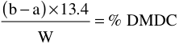
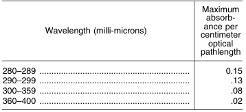
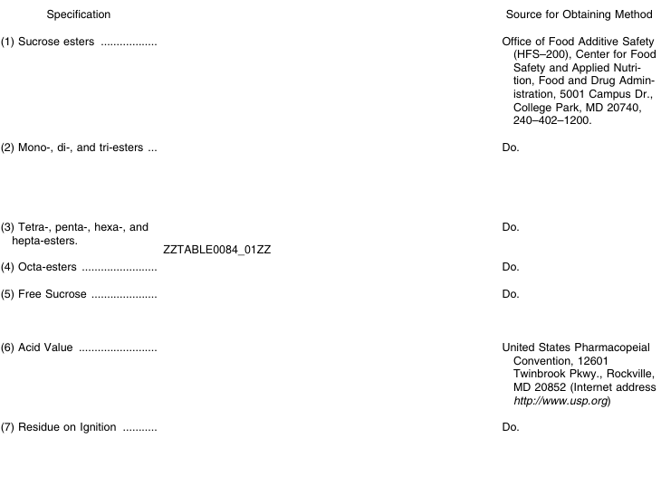

> **PDF page 1**

Pt. 172

## Food and Drug Administration, HHS

substances whose uses it determines meet the criteria in § 170.39 of this chapter from regulation as food additives and, therefore, a food additive petition will not be required for the exempted use.

[60 FR 36596, July 17, 1995]

# Subpart B—Administrative Actions on Applications

### **§ 171.100 Regulation based on petition.**

(a) The Commissioner will forward for publication in the FEDERAL REGISTER, within 90 days after filing of the petition (or within 180 days if the time is extended as provided for in section 409(c)(2) of the Act), a regulation prescribing the conditions under which the food additive may be safely used (including, but not limited to, specifications as to the particular food or classes of food in or on which such additive may be used, the maximum quantity that may be used or permitted to remain in or on such food, the manner in which such additive may be added to or used in or on such food, and any directions or other labeling or packaging requirements for such additive deemed necessary by him to assure the safety of such use), and prior to the forwarding of the order to the FEDERAL REGISTER for publication shall notify the petitioner of such order and the reasons for such action; or by order deny the petition, and shall notify the petitioner of such order and of the reasons for such action.

(b) The regulation shall describe the conditions under which the substance may be safely used in any meat product, meat food product, or poultry product subject to the Federal Meat Inspection Act (FMIA) (21 U.S.C. 601 _et seq._ ) or the Poultry Products Inspection Act (PPIA) (21 U.S.C. 451 _et seq._ ).

(c) If the Commissioner determines that additional time is needed to study and investigate the petition, he shall by written notice to the petitioner extend the 90-day period for not more than 180 days after the filing of the petition.

[42 FR 14489, Mar. 15, 1977, as amended at 65 FR 51763, Aug. 25, 2000]

### **§ 171.102 Effective date of regulation.**

A regulation published in accordance with § 171.100(a) shall become effective upon publication in the FEDERAL REGISTER.

### **§ 171.110 Procedure for objections and hearings.**

Objections and hearings relating to food additive regulations under section 409 (c), (d), or (h) of the Act shall be governed by part 12 of this chapter.

[42 FR 14491, Mar. 15, 1977, as amended at 42 FR 15674, Mar. 22, 1977]

### **§ 171.130 Procedure for amending and repealing tolerances or exemptions from tolerances.**

(a) The Commissioner, on his own initiative or on the petition of any interested person, pursuant to part 10 of this chapter, may propose the issuance of a regulation amending or repealing a regulation pertaining to a food additive or granting or repealing an exception for such additive.

(b) Any such petition shall include an assertion of facts, supported by data, showing that new information exists with respect to the food additive or that new uses have been developed or old uses abandoned, that new data are available as to toxicity of the chemical, or that experience with the existing regulation or exemption may justify its amendment or repeal. New data shall be furnished in the form specified in §§ 171.1 and 171.100 for submitting petitions.

[42 FR 14491, Mar. 15, 1977, as amended at 42 FR 15674, Mar. 22, 1977]

# PART 172—FOOD ADDITIVES PERMITTED FOR DIRECT ADDITION TO FOOD FOR HUMAN CONSUMPTION

Subpart A—General Provisions

Sec. 172.5 General provisions for direct food additives.

### Subpart B—Food Preservatives

172.105 Anoxomer. 172.110 BHA. 172.115 BHT. 172.120 Calcium disodium EDTA. 172.130 Dehydroacetic acid.

VerDate Sep<11>2014 08:34 May 09, 2023 Jkt 259073 PO 00000 Frm 00043 Fmt 8010 Sfmt 8010 Q:\21\21V3.TXT PC31

> **PDF page 2**

Pt. 172

172.133 Dimethyl dicarbonate. 172.135 Disodium EDTA. 172.140 Ethoxyquin. 172.145 Heptylparaben. 172.150 4-Hydroxymethyl-2,6-di- _tert_ -butylphenol. 172.155 Natamycin (pimaricin). 172.160 Potassium nitrate. 172.165 Quaternary ammonium chloride combination. 172.167 Silver nitrate and hydrogen peroxide solution.

172.170 Sodium nitrate. 172.175 Sodium nitrite. 172.177 Sodium nitrite used in processing smoked chub. 172.180 Stannous chloride. 172.185 TBHQ. 172.190 THBP.

## Subpart C—Coatings, Films and Related Substances

172.210 Coatings on fresh citrus fruit. 172.215 Coumarone-indene resin. 172.225 Methyl and ethyl esters of fatty acids produced from edible fats and oils. 172.230 Microcapsules for flavoring substances. 172.235 Morpholine. 172.250 Petroleum naphtha. 172.255 Polyacrylamide. 172.260 Oxidized polyethylene. 172.270 Sulfated butyl oleate. 172.275 Synthetic paraffin and succinic derivatives. 172.280 Terpene resin.

## Subpart D—Special Dietary and Nutritional Additives

172.310 Aluminum nicotinate. 172.315 Nicotinamide-ascorbic acid complex. 172.320 Amino acids. 172.325 Bakers yeast protein. 172.330 Calcium pantothenate, calcium chloride double salt. 172.335 D-Pantothenamide. 172.340 Fish protein isolate. 172.345 Folic acid (folacin). 172.350 Fumaric acid and salts of fumaric acid. 172.365 Kelp. 172.370 Iron-choline citrate complex. 172.372 _N_ -Acetyl-L-methionine. 172.375 Potassium iodide.

- 172.379 Vitamin D2.

- 172.380 Vitamin D3.

- 172.381 Vitamin D2 bakers yeast. 172.382 Vitamin D2 mushroom powder.

172.385 Whole fish protein concentrate. 172.395 Xylitol. 172.399 Zinc methionine sulfate.

## Subpart E—Anticaking Agents

172.410 Calcium silicate.

# 21 CFR Ch. I (4–1–23 Edition)

172.430 Iron ammonium citrate. 172.480 Silicon dioxide. 172.490 Yellow prussiate of soda.

## Subpart F—Flavoring Agents and Related

## Substances

172.510 Natural flavoring substances and natural substances used in conjunction with flavors. 172.515 Synthetic flavoring substances and adjuvants. 172.520 Cocoa with dioctyl sodium sulfosuccinate for manufacturing. 172.530 Disodium guanylate. 172.535 Disodium inosinate. 172.540 DL-Alanine. 172.560 Modified hop extract. 172.575 Quinine. 172.580 Safrole-free extract of sassafras. 172.585 Sugar beet extract flavor base. 172.590 Yeast-malt sprout extract.

## Subpart G—Gums, Chewing Gum Bases and Related Substances

172.610 Arabinogalactan. 172.615 Chewing gum base. 172.620 Carrageenan. 172.623 Carrageenan with polysorbate 80. 172.626 Salts of carrageenan. 172.655 Furcelleran. 172.660 Salts of furcelleran. 172.665 Gellan gum. 172.695 Xanthan gum.

## Subpart H—Other Specific Usage Additives

172.710 Adjuvants for pesticide use dilutions.

172.712 1,3-Butylene glycol. 172.715 Calcium lignosulfonate. 172.720 Calcium lactobionate. 172.723 Epoxidized soybean oil. 172.725 Gibberellic acid and its potassium salt. 172.730 Potassium bromate. 172.735 Glycerol ester of rosin. 172.736 Glycerides and polyglycides of hydrogenated vegetable oils. 172.755 Stearyl monoglyceridyl citrate. 172.765 Succistearin (stearoyl propylene glycol hydrogen succinate). 172.770 Ethylene oxide polymer. 172.775 Methacrylic acid-divinylbenzene copolymer. 172.780 Acacia (gum arabic). 172.785 _Listeria_ -specific bacteriophage preparation.

## Subpart I—Multipurpose Additives

172.800 Acesulfame potassium. 172.802 Acetone peroxides. 172.803 Advantame. 172.804 Aspartame. 172.806 Azodicarbonamide.

VerDate Sep<11>2014 08:34 May 09, 2023 Jkt 259073 PO 00000 Frm 00044 Fmt 8010 Sfmt 8010 Q:\21\21V3.TXT PC31

> **PDF page 3**

§ 172.105

# Food and Drug Administration, HHS

|172.808 |Copolymer condensates of ethylene |172.898 Bakers yeast glycan.|
|---|---|---|
| oxi  | e and propylene oxide.  | AUTHORITY: 21 U.S.C. 321 341 342 348 371 |
| 172.809 172810 | Curdlan. Ditl di lfit | , , , , , 379e. |
| . 172.811 | ocy soum suosuccnae. Glyceryl tristearate. | SOURCE: 42 FR 14491, Mar. 15, 1977, unless |
| 172.812  | Glycine.  | otherwise noted. |
| 172.814 | Hydroxylated lecithin. |  |
| 172816 |  Mthl lid-nt il tr | EDITORIAL NOTE: Nomenclature changes to |
| .  | ey gucosecocou o ese.  | part 172 appear at 61 FR 14482, Apr. 2, 1996; 66 |
| 172.818 172820 | Oxystearin. Polethlene lcol (mean molec- |  FR 56035, Nov. 6, 2001; 66 FR 66742, Dec. 27, |
| . ula | yy gy r weight 200-9,500). | 2001; 68 FR 15355, Mar. 31, 2003; 70 FR 40880,  |
|  172822 |  Sodium laurl sulfate | July 15, 2005; 70 FR 67651, Nov. 8, 2005; 70 FR |
| .  | y .  | 72074, Dec. 1, 2005; and 81 FR 49896, July 29, |
| 172.824 | Sodium mono- and dimethyl naph- |  2016 |
| tha | lene sulfonates | . |
|  172.826 | . Sodium stearyl fumarate. |  |
| 172.828  |  Acetylated monoglycerides.  | Subpart A—General Provisions |
| 172.829 172.830 172.831 | Neotame. Succinylated monoglycerides. Sucralose. | **§ 172.5** **General provisions for direct** **food additives.** |
| 172.832  | Monoglyceride citrate.  | (a) Regulations prescribing condi- |
| 172.833 | Sucrose acetate isobutyrate (SAIB). | tions under which food additive sub- |
| 172.834  | Ethoxylated mono- and diglycerides.  |  stances may be safely used predicate |
| 172.836 | Polysorbate 60. |   |
| 172.838 | Polysorbate 65. | usage under conditions of good manu- |
| 172840 |  Plbt 80 | facturin ractice For the uroses of |
| . 172.841 | oysorae . Polydextrose. | g p.   pp this part good manufacturing practice |
| 172.842  |  Sorbitan monostearate.  | , shall be defined to include the fol- |
| 172.844 172846 | Calcium stearoyl-2-lactylate. Sdi tl ltlt | lowing restrictions. |
| .  | oum searoy acyae.  | (1) The quantity of the substance |
| 172.848 172850 | Lactylic esters of fatty acids. Lactlated fatt acid esters of lc- |  added to food does not exceed the |
| . ero | y y    gy l and propylene glycol. | amount reasonably required to accom- |
|  172852 |  Glcerl-lacto esters of fatt acids | plish its intended physical, nutritive, |
| . 172.854 | yy   y . Polyglycerol esters of fatty acids. |  or other technical effect in food. |
| 172856 | Prolene lcol mono- and diesters | (2) An substance intended for use in |
| . of f | py gy ats and fatty acids. | y or on food is of appropriate food grade |
| 172858 | Prolene lcol alinate |   |
| . 172.859 172860 | py gy g. Sucrose fatty acid esters. Fatt acids | and is prepared and handled as a food ingredient. |
| . 172.861 | y . Cocoa butter substitute from coco- | (b) The existence of a regulation pre-  |
| nut | oil palm kernel oil or both oils | scribing safe conditions of use for a |
|  172.862 | ,   ,   . Oleic acid derived from tall oil fatty | food additive shall not be construed to  |
| aci | ds. | relieve the use of the substance from |
|  172.863 |  Salts of fatty acids. | compliance with any other provision of |
| 172864 | Synthetic fatty alcohols | th At |
| . 172.866 hyd | . Synthetic glycerin produced by the rogenolysis of carbohydrates | e c. (c) The existence of any regulation  |
|  172.867 | . Olestra. | prescribing safe conditions of use for a tit bt d t titt |
| 172.868 | Ethyl cellulose. | nuren susance oes no consue |
| 172.869 172.870 |  Sucrose oligoesters. Hydroxypropyl cellulose. | a finding that the substance is useful or required as a supplement to the diet |
| 172.872 |  Methyl ethyl cellulose. | of humans. |
| 172.874 | Hydroxypropyl methylcellulose. |  |
| 172.876 172.878 |  Castor oil. White mineral oil. | Subpart B—Food Preservatives |
| 172.880  | Petrolatum.      | **§ 172105** **Anoxomer** |
| 172.882 h | Synthetic isoparaffinic petroleum b | **.** **.** A  idtifid i thi |
| y  | rocarons.        | noxomer as ene n s sec-  |
| 172.884 | Odorless light petroleum hydro- | tion may be safely used in accordance |
| car  | bons.  |  with the following conditions: |
| 172.886 | Petroleum wax. |  (a) Anoxomer is 14-benzenediol 2- |
| 172.888  | Synthetic petroleum wax.  | ,, (11-dimethylethyl)-polymer with |
| 172.890 172892 | Rice bran wax. Food starch-modified | ,   diethenylbenzene, 4-(1,1-dimethyl- |
| . 172.894 t | . Modified cottonseed products in- dd f h ti | ethyl)phenol, 4- methoxyphenol, 4,4′-(1- methylethylidene)bis(phenol) and 4- |
| en 172.896 | e or uman consumpon. Dried yeasts. |      methylphenol (CAS Reg. No. 60837–57–2) |

(a) Regulations prescribing conditions under which food additive substances may be safely used predicate usage under conditions of good manufacturing practice. For the purposes of this part, good manufacturing practice shall be defined to include the following restrictions.

(1) The quantity of the substance added to food does not exceed the amount reasonably required to accomplish its intended physical, nutritive, or other technical effect in food.

(2) Any substance intended for use in or on food is of appropriate food grade and is prepared and handled as a food ingredient.

(b) The existence of a regulation prescribing safe conditions of use for a food additive shall not be construed to relieve the use of the substance from compliance with any other provision of the Act.

(c) The existence of any regulation prescribing safe conditions of use for a nutrient substance does not constitute a finding that the substance is useful or required as a supplement to the diet of humans.

Anoxomer as identified in this section may be safely used in accordance with the following conditions:

(a) Anoxomer is 1,4-benzenediol, 2- (1,1-dimethylethyl)-polymer with diethenylbenzene, 4-(1,1-dimethylethyl)phenol, 4- methoxyphenol, 4,4′-(1methylethylidene)bis(phenol) and 4- methylphenol (CAS Reg. No. 60837–57–2)

VerDate Sep<11>2014 08:34 May 09, 2023 Jkt 259073 PO 00000 Frm 00045 Fmt 8010 Sfmt 8010 Q:\21\21V3.TXT PC31

> **PDF page 4**

# § 172.110

# 21 CFR Ch. I (4–1–23 Edition)

_code_  of_  federal_  regulations/ ibr_  locations.html._

prepared by condensation polymerization of divinylbenzene ( _m_ - and _p_ -) with _tert_ -butylhydroquinone, _tert_ -butylphenol, hydroxyanisole, _p_ -cresol and 4,4′-isopropylidenediphenol.

(4) Heavy metals as lead (as Pb), not more than 10 parts per million. Arsenic (as As), not more than 3 parts per million. Mercury (as Hg), not more than 1 part per million.

(b) The polymeric antioxidant meets the following specifications:

(c) Anoxomer may be safely used as an antioxidant in food at a level of not more than 5,000 parts per million based on fat and oil content of the food.

(1) Polymer, not less than 98.0 percent as determined by an ultraviolet method entitled ‘‘Ultraviolet Assay, ‘‘1982, which is incorporated by reference. Copies are available from the Office of Food Additive Safety (HFS– 200), Center for Food Safety and Applied Nutrition, Food and Drug Administration, 5001 Campus Dr., College Park, MD 20740, 240–402–1200, or at the National Archives and Records Administration (NARA). For information on the availability of this material at NARA, call 202–741–6030, or go to: _http:// www.archives.gov/federal_  register/ code_  of_  federal_  regulations/ ibr_  locations.html._

[48 FR 18798, Apr. 26, 1983, as amended at 54 FR 24896, June 12, 1989; 88 FR 17719, Mar. 24, 2023]

# **§ 172.110 BHA.**

The food additive BHA (butylated hydroxyanisole) alone or in combination with other antioxidants permitted in food for human consumption in this subpart B may be safely used in or on specified foods, as follows:

(a) The BHA meets the following specification:

(2) Molecular weight: Total monomers, dimers and trimers below 500 not Assay (total BHA), 98.5 percent minimum. Melting point 48 °C minimum. °C minimum. C minimum. more than 1 percent as determined by a method entitled ‘‘Low Molecular (b) The BHA is used alone or in comWeight Anoxomer Analysis,’’ 1982, bination with BHT, as an antioxidant which is incorporated by reference. in foods, as follows: Copies are available from the Office of Food Additive Safety (HFS–200), Center Limitations (total BHA for Food Safety and Applied Nutrition, Food and BHT) Food and Drug Administration, 5001 parts per million Campus Dr., College Park, MD 20740, 240–402–1200, or at the National ArDehydrated potato shreds ................................... 50 Active dry yeast ................................................... 1 1,000 chives and Records Administration Beverages and desserts prepared from dry (NARA). For information on the availmixes ................................................................ 1 2 ability of this material at NARA, call Dry breakfast cereals .......................................... 50 Dry diced glazed fruit .......................................... 1 32 202–741–6030, or go to: _http://_ Dry mixes for beverages and desserts ............... 1 90 _www.archives.gov/federal_  register/_ Emulsion stabilizers for shortenings .................... 200 _code_  of_  federal_  regulations/_ Potato flakes ........................................................ 50 _ibr_  locations.html._ Potato granulesSweet potato flakes................................................................................................ 10 50

Assay (total BHA), 98.5 percent minimum. Melting point 48 °C minimum. °C minimum. C minimum.

(b) The BHA is used alone or in combination with BHT, as an antioxidant in foods, as follows:

(3) Phenol content: Not less than 3.2 milliequivalent/gram and not more than 3.8 milliequivalent/gram as determined by a method entitled ‘‘Total Phenols,’’ 1982, which is incorporated by reference. Copies are available from the Office of Food Additive Safety (HFS–200), Center for Food Safety and Applied Nutrition, Food and Drug Administration, 5001 Campus Dr., College Park, MD 20740, 240–402–1200, or at the National Archives and Records Administration (NARA). For information on the availability of this material at NARA, call 202–741–6030, or go to: _http:// www.archives.gov/federal_  register/_

1 BHA only.

(c) To assure safe use of the additive:

(1) The label of any market package of the additive shall bear, in addition to the other information required by the Act, the name of the additive.

(2) When the additive is marketed in a suitable carrier, in addition to meeting the requirement of paragraph (c)(1) of this section, the label shall declare the percentage of the additive in the mixture.

(3) The label or labeling of dry mixes for beverages and desserts shall bear adequate directions for use to provide

VerDate Sep<11>2014 08:34 May 09, 2023 Jkt 259073 PO 00000 Frm 00046 Fmt 8010 Sfmt 8010 Q:\21\21V3.TXT PC31

> **PDF page 5**

§ 172.120

# Food and Drug Administration, HHS

that beverages and desserts prepared from the dry mixes contain no more than 2 parts per million BHA.

# **§ 172.115 BHT.**

The food additive BHT (butylated hydroxytoluene), alone or in combination with other antioxidants permitted in this subpart B may be safely used in or on specified foods, as follows:

(a) The BHT meets the following specification: Assay (total BHT) 99 percent minimum.

(b) The BHT is used alone or in combination with BHA, as an antioxidant in foods, as follows:

|Food|Limitations (total BHA and BHT) parts per million|
|---|---|
| Dehydrated potato shreds ................................... | 50 |
| Dry breakfast cereals .......................................... | 50 |
| Emulsion stabilizers for shortenings .................... | 200 |
| Potato flakes ........................................................ | 50 |
| Potato granules ................................................... | 10 |
| Sweetpotato flakes .............................................. | 50 |

(c) To assure safe use of the additive:

(1) The label of any market package of the additive shall bear, in addition to the other information required by the Act, the name of the additive.

(2) When the additive is marketed in a suitable carrier, in addition to meeting the requirement of paragraph (c)(1) of this section, the label shall declare the percentage of the additive in the mixture.

## **§ 172.120 Calcium disodium EDTA.**

The food additive calcium disodium EDTA (calcium disodium ethylenediaminetetraacetate) may be safely used in designated foods for the purposes and in accordance with the conditions prescribed, as follows:

(a) The additive contains a minimum of 99 percent by weight of either the dihydrate C10H12O8N2CaNa2·2H2O or the trihydrate C10H12O8N2CaNa2·3H2O, or any mixture of the two.

(b) It is used or intended for use as follows:

(1) Alone, in the following foods at not to exceed the levels prescribed, calculated as the anhydrous compound:

|Food|Limita- tion (parts per mil- lion)|Use|
|---|---|---|
| Cabbage, pickled .......... | 220 | Promote color, flavor, and texture retention. |
| Canned carbonated soft drinks. | 33 | Promote flavor reten- tion. |
| Canned white potatoes | 110 | Promote color retention. |
| Clams (cooked canned) | 340 | Promote color retention. |
| Crabmeat (cooked canned). | 275 | Retard struvite forma- tion; promote color retention. |
| Cucumbers pickled ....... | 220 | Promote color, flavor,  |
|  |  | and texture retention. |
| Distilled alcoholic bev- erages. | 25 | Promote stability of color, flavor, and/or product clarity. |
| Dressings, nonstandard- ized. | 75 | Preservative. |
| Dried lima beans (cooked canned). | 310 | Promote color retention. |
| Egg product that is hard-cooked and con- sists, in a cylindrical shape, of egg white with an inner core of egg yolk. | 1200 | Preservative. |
| Fermented malt bev- erages. | 25 | Antigushing agent. |
| French dressing ............ | 75 | Preservative. |
| Legumes (all cooked  | 365 | Promote color retention. |
| canned, other than dried lima beans, pink beans, and red beans). |  |  |
| Mayonnaise .................. | 75 | Do. |
| Mushrooms (cooked canned). | 200 | Promote color retention. |
| Oleomargarine .............. | 75 | Preservative. |
| Pecan pie filling ............ | 100 | Promote color retention. |
| Pink beans (cooked  | 165 | Promote color retention. |
| canned). Potato salad .................. | 100 | Preservative. |
| Processed dry pinto beans. | 800 | Promote color retention. |
| Red beans (cooked | 165 | Promote color retention. |
| canned). |  |  |
| Salad dressing .............. | 75 | Preservative. |
| Sandwich spread .......... | 100 | Do. |
| Sauces .......................... | 75 | Do. |
| Shrimp (cooked | 250 | Retard struvite forma- |
|  canned). |  |  tion; promote color retention. |
| Spice extractives in | 60 | Promote color and fla- |
| soluble carriers. |  | vor retention. |
| Spreads, artificially col-  | 100 | Promote color retention. |
| ored and lemon-fla- vored or orange-fla- vored. |  |  |

1 By weight of egg yolk portion.

(2) With disodium EDTA (disodium ethylenediaminetetraacetate) in the following foods at not to exceed, in combination, the levels prescribed, calculated as anhydrous C10H12O8N2CaNa2:

VerDate Sep<11>2014 08:34 May 09, 2023 Jkt 259073 PO 00000 Frm 00047 Fmt 8010 Sfmt 8010 Q:\21\21V3.TXT PC31

> **PDF page 6**

# § 172.130

|Food|Limita- tion (parts per mil- lion)|Use|
|---|---|---|
| Dressings, nonstandardized .... | 75 | Preservative. |
| French dressing ...................... | 75 | Do. |
| Mayonnaise ............................. | 75 | Do. |
| Salad dressing ........................ | 75 | Do. |
| Sandwich spread ..................... | 100 | Do. |
| Sauces .................................... | 75 | Do. |

(c) To assure safe use of the additive:

(1) The label and labeling of the additive container shall bear, in addition to the other information required by the Act, the name of the additive.

(2) The label or labeling of the additive container shall bear adequate use directions to provide a final food product that complies with the limitations provided in paragraph (b) of this section.

(d) In the standardized foods listed in paragraph (b) of this section, the additives are used only in compliance with the applicable standards of identity for such foods.

[42 FR 14491, Mar. 15, 1977, as amended at 48 FR 10815, Mar. 15, 1983; 58 FR 52222, Oct. 7, 1993; 60 FR 33710, June 29, 1995; 65 FR 48379, Aug. 8, 2000]

## **§ 172.130 Dehydroacetic acid.**

The food additive dehydroacetic acid and/or its sodium salt may be safely used in accordance with the following prescribed conditions:

(a) The food additive meets the following specifications:

Dehydroacetic acid: Melting point, 109 °C–111 °C; assay, minimum 98 percent (dry basis). Sodium salt of dehydroacetic acid: Assay, minimum 98 percent (dry basis).

(b) It is used or intended for use as a preservative for cut or peeled squash, and is so used that no more than 65 parts per million expressed as dehydroacetic acid remains in or on the prepared squash.

(c) The label or labeling of any package of the additive intended for use in food shall bear adequate directions for use to insure compliance with this section.

## **§ 172.133 Dimethyl dicarbonate.**

Dimethyl dicarbonate (CAS Reg. No. 4525–33–1) may be safely used in food in

# 21 CFR Ch. I (4–1–23 Edition)

accordance with the following prescribed conditions:

(a) The additive meets the following specifications:

(1) The additive has a purity of not less than 99.8 percent as determined by the following titration method:

# PRINCIPLES OF METHOD

Dimethyl dicarbonate (DMDC) is mixed with excess diisobutylamine with which it reacts quantitatively. The excess amine is backtitrated with acid.

# APPARATUS

250-milliliter (mL) Beaker 100-mL Graduate cylinder 25-mL Pipette 10-mL Burette (automatic, e.g., Metrohm burette)

Stirrer Device for potentiometric titration Reference electrode Glass electrode

# REAGENTS

Acetone, analytical-grade Solution of 1 _N_ diisobutylamine in chlorobenzene, distilled

1 _N_ Acetic Acid

PROCEDURE

Accurately weigh in about 2 grams of the sample (W) and dissolve in 100 mL acetone. Add accurately 25 mL of the 1 _N_ diisobutylamine solution by pipette and allow to stand for 5 minutes. Subsequently, titrate the reaction mixture potentiometrically with 1 _N_ hydrochloric acid (consumption= _a_ mL) while stirring. For determining the blank consumption, carry out the analysis without a sample (consumption= _b_ mL).

CALCULATION

<!-- Start of picture text -->
(b − a) ×13 4. = % DMDC W <!-- End of picture text -->

NOTE: For adding the diisobutylamine solution, always use the same pipette and wait for a further three drops to fall when the flow has stopped.

(2) The additive contains not more than 2,000 ppm (0.2 percent) dimethyl carbonate as determined by a method entitled ‘‘Gas Chromatography Method for Dimethyl Carbonate Impurity in Dimethyl Dicarbonate,’’ which is incorporated by reference in accordance with 5 U.S.C. 552(a). Copies are available from the Office of Food Additive Safety (HFS–200), Center for Food Safety and Applied Nutrition, Food and

VerDate Sep<11>2014 08:34 May 09, 2023 Jkt 259073 PO 00000 Frm 00048 Fmt 8010 Sfmt 8010 Q:\21\21V3.TXT PC31

> **PDF page 7**

# Food and Drug Administration, HHS

Drug Administration, 5001 Campus Dr., College Park, MD 20740, 240–402–1200, or at the National Archives and Records Administration (NARA). For information on the availability of this material at NARA, call 202–741–6030, or go to: _http://www.archives.gov/federal_  register/code_  of_  federal_  regulations/ ibr_  locations.html._

(b) The additive is used or intended for use as a microbial control agent in the following beverages under normal circumstances of bottling, canning, or other forms of final packaging, where the viable microbial load has been reduced to 500 microorganisms per milliliter or less by current good manufacturing practices such as heat treatment, filtration, or other technologies prior to the use of dimethyl dicarbonate:

(1) In wine, dealcoholized wine, and low alcohol wine in an amount not to exceed 200 parts per million.

(2) In ready-to-drink teas in an amount not to exceed 250 parts per million.

(3) In carbonated or noncarbonated, nonjuice-containing (less than or equal to 1 percent juice), flavored or unflavored beverages containing added electrolytes (5–20 milliequivalents/liter sodium ion (Na + ) and 3–7 milliequivalents/liter potassium ion (K + )) in an amount not to exceed 250 parts per million.

(4) In carbonated, dilute beverages containing juice, fruit flavor, or both, with juice content not to exceed 50 percent, in an amount not to exceed 250 parts per million.

(c) To ensure the safe use of the food additive, the label of the package containing the additive shall bear, in addition to other information required by the Federal Food, Drug, and Cosmetic Act:

(1) The name of the additive ‘‘dimethyl dicarbonate.’’

(2) The intended use of the additive.

(3) Adequate directions for use to ensure compliance with this section.

[53 FR 41329, Oct. 21, 1988, as amended at 58 FR 6091, Jan. 26, 1993; 59 FR 5319, Feb. 4, 1994; 61 FR 14245, Apr. 1, 1996; 61 FR 26788, May 29, 1996; 66 FR 13653, Mar. 7, 2001; 88 FR 17719, Mar. 24, 2023]

# § 172.135

## **§ 172.135 Disodium EDTA.**

The food additive disodium EDTA (disodium ethylenediaminetetraacetate) may be safely used in designated foods for the purposes and in accordance with the following prescribed conditions:

(a) The additive contains a minimum of 99 percent disodium ethylenediaminetetraacetate dihydrate (C10H14O8N2Na2·2H2O).

(b) It is used or intended for use as follows:

(1) Alone, in the following foods at not to exceed the levels prescribed, calculated as anhydrous calcium disodium EDTA:

|Food|Limita- tion (parts per mil- lion)|Use|
|---|---|---|
| Aqueous multivitamin prep- arations. | 150 | With iron salts as a stabilizer for vita- min B 12 in liquid multivitamin prep- arations. |
| Canned black-eyed peas .... | 145 | Promote color re- tention. |
| Canned kidney beans ......... | 165 | Preservative. |
| Canned strawberry pie filling | 500 | Promote color re- tention. |
| Cooked sausage ................. | 36 | As a cure accel- erator with so- dium ascorbate or ascorbic acid. |
| Dressings, nonstandardized | 75 | Preservative. |
| French dressing .................. | 75 | Do. |
| Frozen white potatoes in- cluding cut potatoes. | 100 | Promote color re- tention. |
| Gefilte fish balls or patties in packing medium. | 150 | Inhibit discoloration. |
| Legumes (all cooked canned, other than black- eyed peas). | 165 | Promote color re- tention. |
| Mayonnaise ......................... | 75 | Preservative. |
| Ready-to-eat cereal prod- ucts containing dried ba- nanas. | 2315 | Promote color re- tention. |
| Salad dressing .................... | 75 | Preservative. |
| Sandwich spread ................. | 100 | Do. |
| Sauces ................................ | 75 | Do. |

1 Based on total weight of finished product including packing medium.

2 In dried banana component of cereal product.

(2) With calcium disodium EDTA (calcium disodium ethylenediaminetetraacetate; calcium disodium (ethylenedinitrilo) tetraacetate), in the following foods at not to exceed, in combination, the levels prescribed, calculated as anhydrous C10H12O8N2CaNa2:

VerDate Sep<11>2014 08:34 May 09, 2023 Jkt 259073 PO 00000 Frm 00049 Fmt 8010 Sfmt 8010 Q:\21\21V3.TXT PC31

> **PDF page 8**

# § 172.140

|Food|Limita- tion (parts per mil- lion)|Use|
|---|---|---|
| Dressings, nonstandardized | 75 | Preservative. |
| French dressing .................. | 75 | Do. |
| Mayonnaise ......................... | 75 | Do. |
| Salad dressing .................... | 75 | Do. |
| Sandwich spread ................. | 100 | Do. |
| Sauces ................................ | 75 | Do. |

(3) Alone, as a sequestrant in the nonnutritive sweeteners that are listed in § 180.37 of this chapter and that, in addition, are designed for aqueous solution: _Provided,_ That the amount of the additive, calculated as anhydrous calcium disodium EDTA, does not exceed 0.1 percent by weight of the dry nonnutritive sweetener.

(c) To assure the safe use of the additive:

(1) The label and labeling of the additive container shall bear, in addition to the other information required by the act, the name of the additive.

(2) The label or labeling of the additive container shall bear adequate use directions to provide a final food product that complies with the limitations provided in paragraph (b) of this section.

(d) In the standardized foods listed in paragraphs (b)(1) and (2) of this section the additives are used only in compliance with the applicable standards of identity for such foods.

[42 FR 14491, Mar. 15, 1977, as amended at 65 FR 48379, Aug. 8, 2000]

## **§ 172.140 Ethoxyquin.**

(a) Ethoxyquin (1,2-dihydro-6-ethoxy2,2,4-trimethylquinoline) may be safely used as an antioxidant for preservation of color in the production of chili powder, paprika, and ground chili at levels not in excess of 100 parts per million.

(b) In order to provide for the safe use of the additive in feed prepared in accordance with §§ 573.380 and 573.400 of this chapter, tolerances are established for residues of ethoxyquin in or on edible products of animals as follows:

- 5 parts per million in or on the uncooked fat of meat from animals except poultry.

- 3 parts per million in or on the uncooked liver and fat of poultry.

- 0.5 part per million in or on the uncooked muscle meat of animals.

- 0.5 part per million in poultry eggs.

# 21 CFR Ch. I (4–1–23 Edition)

Zero in milk.

## **§ 172.145 Heptylparaben.**

(a) The food additive heptylparaben is the chemical _n_ -heptyl _p_ -hydroxybenzoate.

(b) It may be safely used to inhibit microbiological spoilage in accordance with the following prescribed conditions:

(1) In fermented malt beverages in amounts not to exceed 12 parts per million.

(2) In noncarbonated soft drinks and fruit-based beverages in amounts not to exceed 20 parts per million, when standards of identity established under section 401 of the Act (21 U.S.C. 341) do not preclude such use.

## **§ 172.150 4-Hydroxymethyl-2,6-di-** **_tert_ - butylphenol.**

The food additive 4-hydroxymethyl2,6-di- _tert_ -butylphenol may be safely used in food in accordance with the following prescribed conditions:

(a) The additive has a solidification

point of 140 °C–141 °C.

(b) The additive is used as an antioxidant alone or in combination with other permitted antioxidants.

(c) The total amount of all antioxidants added to such food shall not exceed 0.02 percent of the oil or fat content of the food, including the essential (volatile) oil content of the food.

## **§ 172.155 Natamycin (pimaricin).**

(a) Natamycin (CAS Reg. No. 7681–93– 8), also known as pimaricin, is a polyene macrolide antimycotic substance possessing an empirical formula of C33H47NO13 and a molecular weight of 665.7.

(b) The additive shall conform to the following specifications:

Purity: 97 percent ±2 percent on an anhydrous basis.

Arsenic: Not more than 1 part per million. Heavy metals (as Pb): Not more than 20 parts per million.

(c) The additive may be applied on cheese, as an antimycotic, in amounts not to exceed 20 milligrams per kilogram (20 parts per million) in the finished product as determined by International Dairy Federation (IDF) Standard 140A:1992, ‘‘Cheese and Cheese

VerDate Sep<11>2014 08:34 May 09, 2023 Jkt 259073 PO 00000 Frm 00050 Fmt 8010 Sfmt 8010 Q:\21\21V3.TXT PC31

> **PDF page 9**

§ 172.167

# Food and Drug Administration, HHS

Rind-Determination of Natamycin Content-Method by Molecular Absorption Spectrometry and by High-Performance Liquid Chromatography,’’ which is incorporated by reference. The Director of the Office of the Federal Register approves this incorporation by reference in accordance with 5 U.S.C. 552(a) and 1 CFR part 51. Copies are available from the Office of Food Additive Safety (HFS–200), Center for Food Safety and Applied Nutrition, Food and Drug Administration, 5001 Campus Dr., College Park, MD 20740, 240–402–1200, or may be examined at the Dockets Management Staff (HFA–305), Food and Drug Administration, 5630 Fishers Lane, Rm. 1061, Rockville, MD 20852, 240–402–7500, between 9 a.m. and 4 p.m., Monday through Friday, or at the National Archives and Records Administration (NARA). For information on the availability of this material at NARA, call 202–741–6030, or go to: _http:// www.archives.gov/federal_  register/ code_  of_  federal_  regulations/ ibr_  locations.html._

[47 FR 26823, June 22, 1982, as amended at 50 FR 49536, Dec. 3, 1985; 63 FR 66015, Dec. 1, 1998; 66 FR 13847, Mar. 8, 2001; 81 FR 5591, Feb. 3, 2016; 88 FR 17719, Mar. 24, 2023]

## **§ 172.160 Potassium nitrate.**

The food additive potassium nitrate may be safely used as a curing agent in the processing of cod roe, in an amount not to exceed 200 parts per million of the finished roe.

## **§ 172.165 Quaternary ammonium chloride combination.**

The food additive, quaternary ammonium chloride combination, may be safely used in food in accordance with the following conditions:

(a) The additive contains the following compounds: _n-_ dodecyl dimethyl benzyl ammonium chloride (CAS Reg. No. 139–07–1); _n-_ dodecyl dimethyl ethylbenzyl ammonium chloride (CAS Reg. No. 27479–28–3); _n-_ hexadecyl dimethyl benzyl ammonium chloride (CAS Reg. No. 122–18–9); _n-_ octadecyl dimethyl benzyl ammonium chloride (CAS Reg. No. 122–19–0); _n-_ tetradecyl dimethyl benzyl ammonium chloride (CAS Reg. No. 139–08–2); _n-_ tetradecyl dimethyl ethylbenzyl ammonium chloride (CAS Reg. No. 27479–29–4).

(b) The additive meets the following specifications: pH (5 percent active solution) 7.0–8.0; total amines, maximum 1 percent as combined free amines and amine hydrochlorides.

(c) The additive is used as an antimicrobial agent, as defined in § 170.3(o)(2) of this chapter, in raw sugar cane juice. It is added prior to clarification when further processing of the sugar cane juice must be delayed.

(d) The additive is applied to the sugar juice in the following quantities, based on the weight of the raw cane:

|Component|Parts per million|
|---|---|
| _n-_Dodecyl dimethyl benzyl ammonium chloride | 0.25–1.0 |
| _n-_Dodecyl dimethyl ethylbenzyl ammonium chloride ........................................................... | 3.4–13.5 |
| _n-_Hexadecyl dimethyl benzyl ammonium chlo- ride ................................................................. | 1.5–6.0 |
| _n-_Octadecyl dimethyl benzyl ammonium chlo- ride ................................................................. | 0.25–1.0 |
| _n-_Tetradecyl dimethyl benzyl ammonium chlo- ride ................................................................. | 3.0–12.0 |
| _n-_Tetradecyl dimethyl ethylbenzyl ammonium chloride ........................................................... | 1.6–6.5 |

### [50 FR 3890, Jan. 29, 1985]

## **§ 172.167 Silver nitrate and hydrogen peroxide solution.**

An aqueous solution containing a mixture of silver nitrate and hydrogen peroxide may be safely used in accordance with the following prescribed conditions:

(a) The additive is used as an antimicrobial agent in bottled water.

(b) Hydrogen peroxide meets the specifications of the Food Chemicals Codex, 7th ed. (2010), pp. 496–497, which is incorporated by reference. The Director of the Office of the Federal Register approves this incorporation by reference in accordance with 5 U.S.C. 552(a) and 1 CFR part 51. You may obtain copies from the United States Pharmacopeial Convention, 12601 Twinbrook Pkwy., Rockville, MD 20852 (Internet address _http://www.usp.org_ ). Copies may be examined at the Dockets Management Staff (HFA–305), Food and Drug Administration, 5630 Fishers Lane, Rm. 1061, Rockville, MD 20852, 240–402–7500, between 9 a.m. and 4 p.m., Monday through Friday, or at the National Archives and Records Administration (NARA). For information on the availability of this material at

VerDate Sep<11>2014 08:34 May 09, 2023 Jkt 259073 PO 00000 Frm 00051 Fmt 8010 Sfmt 8010 Q:\21\21V3.TXT PC31

> **PDF page 10**

# § 172.170

NARA, call 202–741–6030 or go to: _http:// www.archives.gov/federal-register/cfr/ibrlocations.html._

(c) The amount of silver added will not exceed 17 micrograms per kilogram in the treated bottled water, and the amount of hydrogen peroxide will not exceed 23 milligrams per kilogram in the treated bottled water. Analyses for silver and hydrogen peroxide shall be conducted on samples of treated bottled water at the site of bottling, using samples of the water intended for treatment for the blank determination.

(d)(1) The amount of silver in the treated bottled water is determined using the method for silver designated in 21 CFR 165.110(b)(4)(iii)(G)( _2_ )( _i_ ).

(2) The amount of hydrogen peroxide in the treated bottled water is determined using a Hydrogen Peroxide Test Kit from the HACH Co., or equivalent. The manual from the Hydrogen Peroxide Test Kit, Model HYP–1, Catalog Number 22917–00, 1991, is incorporated by reference. The Director of the Federal Register approves this incorporation by reference in accordance with 5 U.S.C. 552(a) and 1 CFR part 51. You may obtain copies of the test kit manual from the HACH Co., P.O. Box 389, Loveland CO, 80359 (1–800–227–4224), Model HYP–1, Catalog Number 22917–00. Copies may be examined at the Dockets Management Staff (HFA–305), Food and Drug Administration, 5630 Fishers Lane, Rm. 1061, Rockville, MD 20852, 240–402–7500, between 9 a.m. and 4 p.m., Monday through Friday, or at the National Archives and Records Administration (NARA). For information on the availability of this material at NARA, call 202–741–6030 or go to: _http:// www.archives.gov/federal_  register/ code_  of_  federal_  regulations/ ibr_  locations.html._

(e) Substances generally recognized as safe in or on food may be used to stabilize the additive to ensure that the additive will perform its intended technical effect.

(f) The additive may not be added to bottled water that has been filtered or is intended to be filtered through a silver-containing water filter.

(g) Bottled water must meet the quality standards for bottled water in § 165.110(b)(2) through (b)(5) of this chapter, including the limits specified

# 21 CFR Ch. I (4–1–23 Edition)

for total silver and nitrate, unless the water bears a label statement of substandard quality, as provided for under § 165.110(c) of this chapter.

[74 FR 11478, Mar. 18, 2009, as amended at 78 FR 71461, Nov. 29, 2013; 81 FR 5591, Feb. 3, 2016; 88 FR 17719, Mar. 24, 2023]

## **§ 172.170 Sodium nitrate.**

The food additive sodium nitrate may be safely used in or on specified foods in accordance with the following prescribed conditions:

(a) It is used or intended for use as

follows:

(1) As a preservative and color fixative, with or without sodium nitrite, in smoked, cured sablefish, smoked, cured salmon, and smoked, cured shad, so that the level of sodium nitrate does not exceed 500 parts per million and the level of sodium nitrite does not exceed 200 parts per million in the finished product.

(2) As a preservative and color fixative, with or without sodium nitrite, in meat-curing preparations for the home curing of meat and meat products (including poultry and wild game), with directions for use which limit the amount of sodium nitrate to not more than 500 parts per million in the finished meat product and the amount of sodium nitrite to not more than 200 parts per million in the finished meat product.

(b) To assure safe use of the additive, in addition to the other information required by the Act:

(1) The label of the additive or of a mixture containing the additive shall bear:

(i) The name of the additive.

(ii) A statement of the concentration of the additive in any mixture.

(2) If in a retail package intended for household use, the label and labeling of the additive, or of a mixture containing the additive, shall bear adequate directions for use to provide a final food product that complies with the limitations prescribed in paragraph (a) of this section.

(3) If in a retail package intended for household use, the label of the additive or of a mixture containing the additive, shall bear the statement ‘‘Keep out of the reach of children’’.

VerDate Sep<11>2014 08:34 May 09, 2023 Jkt 259073 PO 00000 Frm 00052 Fmt 8010 Sfmt 8010 Q:\21\21V3.TXT PC31

> **PDF page 11**

§ 172.180

# Food and Drug Administration, HHS

## **§ 172.175 Sodium nitrite.**

The food additive sodium nitrite may be safely used in or on specified foods in accordance with the following prescribed conditions:

(a) It is used or intended for use as follows:

(1) As a color fixative in smoked cured tunafish products so that the level of sodium nitrite does not exceed 10 parts per million (0.001 percent) in the finished product.

(2) As a preservative and color fixative, with or without sodium nitrate, in smoked, cured sablefish, smoked, cured salmon, and smoked, cured shad so that the level of sodium nitrite does not exceed 200 parts per million and the level of sodium nitrate does not exceed 500 parts per million in the finished product.

(3) As a preservative and color fixative, with sodium nitrate, in meat-curing preparations for the home curing of meat and meat products (including poultry and wild game), with directions for use which limit the amount of sodium nitrite to not more than 200 parts per million in the finished meat product, and the amount of sodium nitrate to not more than 500 parts per million in the finished meat product.

(b) To assure safe use of the additive, in addition to the other information required by the Act:

(1) The label of the additive or of a mixture containing the additive shall bear:

(i) The name of the additive.

(ii) A statement of the concentration of the additive in any mixture.

(2) If in a retail package intended for household use, the label and labeling of the additive, or of a mixture containing the additive, shall bear adequate directions for use to provide a final food product which complies with the limitations prescribed in paragraph

(a) of this section.

(3) If in a retail package intended for household use, the label of the additive, or of a mixture containing the additive, shall bear the statement ‘‘Keep out of the reach of children’’.

## **§ 172.177 Sodium nitrite used in processing smoked chub.**

The food additive sodium nitrite may be safely used in combination with salt

(NaCl) to aid in inhibiting the outgrowth and toxin formation from _Clostridium botulinum_ type E in the commercial processing of smoked chub in accordance with the following prescribed conditions:

(a) All fish in smoking establishments shall be clean and wholesome and shall be expeditiously processed, packed, and stored under adequate sanitary conditions in accordance with good manufacturing practice.

(b) The brining procedure is controlled in such a manner that the water phase portion of the edible portion of the finished smoked product has a salt (NaCl) content of not less than 3.5 percent, as measured in the loin muscle, and the sodium nitrite content of the edible portion of the finished smoked product is not less than 100 parts per million and not greater than 200 parts per million, as measured in the loin muscle.

(c) Smoked chub shall be heated by a controlled heat process which provides a monitoring system positioned in as many strategic locations in the smokehouse as necessary to assure a continuous temperature throughout each fish of at least 160 °F for a minimum of 30 minutes.

(d) The finished product shall be cooled to a temperature of 50 °F or below within 3 hours after smoking and further cooled to a temperature of 38 °F or below within 12 hours after smoking. A temperature of 38 °F or below shall be maintained during all subsequent storage and distribution. All shipping containers, retail packages, and shipping records shall indicate with appropriate notice the perishable nature of the product and specify that the product shall be held under refrigeration (38 °F or below) until consumed.

(e) To assure safe use of the additive: (1) The label and labeling of the additive container shall bear, in addition to the other information required by the Act, the name of the additive.

(2) The label or labeling of the additive container shall bear adequate directions to assure use in compliance with the provisions of this section.

## **§ 172.180 Stannous chloride.**

The food additive stannous chloride may be safely used for color retention

VerDate Sep<11>2014 08:34 May 09, 2023 Jkt 259073 PO 00000 Frm 00053 Fmt 8010 Sfmt 8010 Q:\21\21V3.TXT PC31

> **PDF page 12**

## § 172.185

in asparagus packed in glass, with lids lined with an inert material, in an amount not to exceed 20 parts per million calculated as tin (Sn).

# **§ 172.185 TBHQ.**

The food additive TBHQ, which is the chemical 2-(1,1-dimethylethyl)-1,4-benzenediol (Chemical Abstracts Service Registry Number 1948–33–0), also known as tertiary butylhydroquinone, may be safely used in food in accordance with the following prescribed conditions:

(a) The food additive has a melting point of not less than 126.5 °C.

(b) The percentage of TBHQ in the food additive is not less than 99.0 percent when tested by the assay described in the Food Chemicals Codex, 9th ed. (2014), pp. 1192–1194, which is incorporated by reference, or an equivalent method. The Director of the Office of the Federal Register approves this incorporation by reference in accordance with 5 U.S.C. 552(a) and 1 CFR part 51. You may obtain copies from the United States Pharmacopeial Convention, 12601 Twinbrook Pkwy., Rockville, MD 20852 (Internet address: _http:// www.usp.org_ ). Copies may be examined at the Dockets Management Staff (HFA–305), Food and Drug Administration, 5630 Fishers Lane, Rm. 1061, Rockville, MD 20852, 240–402–7500, between 9 a.m. and 4 p.m., Monday through Friday, or at the National Archives and Records Administration (NARA). For information on the availability of this material at NARA, call 202–741–6030 or go to: _http://www.archives.gov/federalregister/cfr/ibr-locations.html_ .

(c) It is used as an antioxidant alone or in combination with BHA and/or BHT.

## 21 CFR Ch. I (4–1–23 Edition)

(d) The total antioxidant content of a food containing the additive will not exceed 0.02 percent of the oil or fat content of the food, including the essential (volatile) oil content of the food.

[42 FR 14491, Mar. 15, 1977, as amended at 80 FR 34276, June 16, 2015; 88 FR 17719, Mar. 24, 2023]

# **§ 172.190 THBP.**

The food additive THBP (2,4,5-trihydroxybutyrophenone) may be safely used in food in accordance with the following prescribed conditions:

(a) The food additive has a melting point of 149 °C–153 °C.

(b) It is used as an antioxidant alone or in combination with other permitted antioxidants.

(c) The total antioxidant content of a food containing the additive will not exceed 0.02 percent of the oil or fat content of the food, including the essential (volatile) oil content of the food.

## Subpart C—Coatings, Films and Related Substances

### **§ 172.210 Coatings on fresh citrus fruit.**

Coatings may be applied to fresh citrus fruit for protection of the fruit in accordance with the following conditions:

(a) The coating is applied in the minimum amount required to accomplish the intended effect.

(b) The coating may be formulated from the following components, each used in the minimum quantity required to accomplish the intended effect:

(1) Substances generally recognized as safe for the purpose or previously sanctioned for the purpose.

(2) One or more of the following:

|Component|Limitations|
|---|---|
| Fatty acids ............................................................ | Complying with § 172.860. |
| Oleic acid derived from tall oil fatty acids ............ | Complying with § 172.862. |
| Partially hydrogenated rosin ................................ | Catalytically hydrogenated to a maximum refractive index of 1.5012 at 100 °C. Color of WG or paler. |
| Pentaerythritol ester of maleic anhydride-modi- fied wood rosin. Do .................................................................. | Acid number of 134–145; drop-softening point of 127°C–173°C; saponifica- tion number of less than 280; and a color of M or paler. Acid number of 176–186; drop-softening point of 110°C–118°C; saponifica- tion number of less than 280; and a color of M or paler. |
| Polyethylene glycol .............................................. | Complying with § 172.820. As a defoamer and dispersing adjuvant. |

VerDate Sep<11>2014 08:34 May 09, 2023 Jkt 259073 PO 00000 Frm 00054 Fmt 8010 Sfmt 8010 Q:\21\21V3.TXT PC31

> **PDF page 13**

§ 172.215

# Food and Drug Administration, HHS

|Component|Limitations|
|---|---|
| Polyhydric alcohol diesters of oxidatively refined (Gersthofen process) montan wax acids. | Complying with § 178.3770 of this chapter and having a dropping point of 77 to 83°C (170.6 to 181.4°F), as determined by ASTM Method D566–76 (Reapproved 1982), ‘‘Standard Test Method for Dropping Point of Lubri- cating Grease,’’ which is incorporated by reference (Copies are available from the American Society for Testing and Materials, 100 Barr Harbor Dr., West Conshohocken, Philadelphia, PA 19428-2959, or at the National Ar- chives and Records Administration (NARA). For information on the avail- ability of this material at NARA, call 202–741–6030, or go to:_http://_ _www.archives.gov/federal_register/code_of_federal_regulations/_ _ibr_locations.html._) using as a solvent xylene-ethyl alcohol in a 2:1 ratio in- stead of toluene-ethyl alcohol in a 2:1 ratio. |
| Sodium lauryl sulfate ............................................ | Complying with § 172.822. As a film former. |
| Wood rosin ........................................................... | Color of K or paler. |

(3) In lieu of the components listed in the following copolymer and one or paragraph (b)(2) and (4) of this section, more of the listed adjuvants.

|Component|Limitations|
|---|---|
| Vinyl chloride-vinylidene chloride copolymer ....... | As an aqueous dispersion containing a minimum of 75 percent water when applied. |
| Polyethylene glycol .............................................. | Complying with § 172.820. As a defoamer and dispersing adjuvant. |
| Polyvinylpyrrolidone .............................................. | As an adjuvant. |
| Potassium persulfate ............................................ | Do. |
| Propylene glycol alginate ..................................... | Do. |
| Sodium decylbenzenesulfonate ........................... | Do. |

(4) In lieu of the components listed in the following rosin derivative and eiparagraph (b)(2) and (3) of this section, ther or both of the listed adjuvants:

|Component|Limitations|
|---|---|
| Calcium salt of partially dimerized rosin .............. | Having a maximum drop-softening point of 197°C and a color of H or paler. It is prepared by reaction with not more than 7 parts hydrated lime per 100 parts of partially dimerized rosin. The partially dimerized rosin is rosin that has been dimerized by sulfuric acid catalyst to a drop-softening point of 95 °C to 105°C and a color of WG or paler. |
| Petroleum naphtha ............................................... Sperm oil .............................................................. | As adjuvant. Complying with § 172.250. As adjuvant. |

[42 FR 14491, Mar. 15, 1977; 49 FR 5747, Feb. 15, 1984, as amended at 51 FR 2693, Jan. 21, 1986; 52 FR 18911, May 20, 1987; 61 FR 14245, Apr. 1, 1996]

**§ 172.215 Coumarone-indene resin.** (b) The food additive meets the following specifications:

The food additive coumarone-indene resin may be safely used on grapefruit, lemons, limes, oranges, tangelos, and tangerines in accordance with the following prescribed conditions:

(1) Softening point, ring and ball: 126 °C minimum as determined by ASTM method E28–67 (Reapproved 1982), ‘‘Standard Test Method for Softening Point by Ring-and-Ball Apparatus,’’ which is incorporated by reference. Copies may be obtained from the American Society for Testing Materials, 100 Barr Harbor Dr., West Conshohocken, Philadelphia, PA 19428-2959, or may be examined at the National Archives and Records Administration (NARA). For information on the availability of this material at NARA, call 202–741–6030, or

(a) The food additive is manufactured by the polymerization of a crude, heavy coal-tar solvent naphtha meeting the following specifications:

(1) It is a mixture of indene, indan (hydrindene), substituted benzenes, and related compounds.

(2) It contains no more than 0.25 percent tar bases.

(3) 95 percent distills in the range 167 °C–184 °C.

VerDate Sep<11>2014 08:34 May 09, 2023 Jkt 259073 PO 00000 Frm 00055 Fmt 8010 Sfmt 8010 Q:\21\21V3.TXT PC31

> **PDF page 14**

# § 172.225

go to: _http://www.archives.gov/federal_  register/code_  of_  federal_  regulations/ ibr_  locations.html._

(2) Refractive index ( _n_25 / _D_ ) 1.63–1.64.

(c) It is used or intended for use as a protective coating for grapefruit, lemons, limes, oranges, tangelos, and tangerines whereby the maximum amount of the resin remaining on the fruit does not exceed 200 parts per million on a fresh-weight basis.

(d) To assure safe use of the additive:

(1) The label of the market package or any intermediate premix of the additive shall bear, in addition to the other information required by the act:

(i) The name of the additive, coumarone-indene resin.

(ii) A statement of the concentration of the additive therein.

(2) The label or accompanying labeling shall bear adequate directions that, if followed, will result in a finished food not in conflict with the requirements of this section.

[42 FR 14491, Mar. 15, 1977, as amended at 49 FR 10103, Mar. 19, 1984]

## **§ 172.225 Methyl and ethyl esters of fatty acids produced from edible fats and oils.**

Methyl esters and ethyl esters of fatty acids produced from edible fats and oils may be safely used in food, subject to the following prescribed conditions:

(a) The additive consists of a mixture of either methyl or ethyl esters of fatty acids produced from edible fats and oils and meets the following specifications:

(1) Not less than 90 percent methyl or ethyl esters of fatty acids.

(2) Not more than 1.5 percent unsaponifiable matter.

(b) The additive is used or intended for use at the level not to exceed 3 percent by weight in an aqueous emulsion in dehydrating grapes to produce raisins, whereby the residue of the additive on the raisins does not exceed 200 parts per million. [57 FR 12711, Apr. 13, 1992]

## **§ 172.230 Microcapsules for flavoring substances.**

Microcapsules may be safely used for encapsulating discrete particles of flavoring substances that are generally

# 21 CFR Ch. I (4–1–23 Edition)

recognized as safe for their intended use or are regulated under this part, in accordance with the following conditions:

(a) The microcapsules may be formulated from the following components, each used in the minimum quantity required to accomplish the intended effect:

(1) Substances generally recognized as safe for the purpose.

(2) One or more of the following components:

# COMPONENT AND LIMITATIONS

Succinylated gelatin—Not to exceed 15 percent by combined weight of the microcapsule and flavoring oil. Succinic acid content of the gelatin is 4.5 to 5.5 percent.

Arabinogalactan—Complying with § 172.610; as adjuvant.

Silicon dioxide—Complying with § 172.480; as adjuvant.

(3) In lieu of the components listed in paragraph (a)(2) of this section, the following components:

# COMPONENT AND LIMITATIONS

Glutaraldehyde—As cross-linking agent for insolubilizing a coacervate of gum arabic and gelatin.

_n_ -Octyl alcohol—As a defoamer.

(4) In lieu of the components listed in paragraphs (a)(2) and (3) of this section, the following component:

# COMPONENT AND LIMITATIONS

Petroleum wax—Complying with § 172.886. Not to exceed 50 percent by combined weight of the microcapsule and spice-flavoring substance.

(b) The microcapsules produced from the components listed in paragraphs (a)(1), (2), and (3) of this section may be used for encapsulating authorized flavoring oils for use, in accordance with good manufacturing practice, in foods for which standards of identity established under section 401 of the Act do not preclude such use, except that microcapsules formulated from components listed in paragraph (a)(2) of this section may be used only for encapsulating lemon oil, distilled lime oil, orange oil, peppermint oil, and spearmint oil for use in dry mixes for puddings and gelatin desserts.

(c) The microcapsules produced from the components listed in paragraphs

VerDate Sep<11>2014 08:34 May 09, 2023 Jkt 259073 PO 00000 Frm 00056 Fmt 8010 Sfmt 8010 Q:\21\21V3.TXT PC31

> **PDF page 15**

§ 172.250

# Food and Drug Administration, HHS

(a)(1) and (4) of this section may be used only for encapsulating authorized spice-flavoring substances for use, in accordance with good manufacturing practice, in frozen pizzas which are to be further processed by heat. Such pizzas shall bear labels or labeling including adequate directions for use to ensure heating to temperatures which will melt the wax to release the spiceflavoring substances.

[45 FR 48123, July 18, 1980]

## **§ 172.235 Morpholine.**

Morpholine may be safely used as a component of food, subject to the following restrictions.

(a) It is used as the salt(s) of one or more of the fatty acids meeting the requirements of § 172.860, as a component of protective coatings applied to fresh fruits and vegetables.

(b) It is used at a level not in excess of that reasonably required to produce its intended effect.

## **§ 172.250 Petroleum naphtha.**

Petroleum naphtha may be safely used in food in accordance with the following conditions:

(a) The additive is a mixture of liquid hydrocarbons, essentially paraffinic and naphthenic in nature obtained from petroleum,

(b) The additive is refined to meet the following specifications when subjected to the procedures described in this paragraph.

- (1) Boiling-point range: 175 °F–300 °F.

- (2) Nonvolatile residue: 0.002 gram

- per 100 milliliters maximum.

- (3) Ultraviolet absorbance limits, as

- follows:

<!-- Start of picture text -->
Maximum absorb- Wavelength (milli-microns)  centimeter ance per optical pathlength 280–289 ............................................................... 0.15 290–299 ............................................................... .13 300–359 ............................................................... .08 360–400 ............................................................... .02 <!-- End of picture text -->

ANALYTICAL SPECIFICATION FOR PETROLEUM NAPHTHA

GENERAL INSTRUCTIONS

All glassware should be scrupulously cleaned to remove all organic matter such as

oil, grease, detergent residues, etc. Examine all glassware, including stoppers and stopcocks, under ultraviolet light to detect any residual fluorescent contamination. As a precautionary measure, it is recommended practice to rinse all glassware with purified isooctane immediately before use. No grease is to be used on stopcocks or joints. Great care to avoid contamination of petroleum naphtha samples in handling and to assure absence of any extraneous material arising from inadequate packaging is essential. Because some of the polynuclear hydrocarbons sought in this test are very susceptible to photo-oxidation, the entire procedure is to be carried out under subdued light.

# APPARATUS

_Separatory funnels._ 250-milliliter, and 2,000milliliter capacity, equipped with tetrafluoroethylene polymer stopcocks.

_Erlenmeyer flask._ 125-milliliter with 24/40 standard taper neck.

_Evaporation flask._ 250-milliliter capacity all-glass flask equipped with 24/40 standard taper stopper having inlet and outlet tubes to permit passage of nitrogen across the surface of the container liquid to be evaporated. _Condenser._ 24/40 joints, fitted with drying tube, length optional.

_Spectrophotometric cells._ Fused quartz cells, optical path length in the range of 5,000 centimeters ±0.005 centimeter; also for checking spectrophotometer performance only, optical path length in the range 1,000 centimeter ±0.005 centimeter. With distilled water in the cells, determine any absorbance difference.

_Spectrophotometer._ Spectral range 250–400 mμ with spectral slit width of 2 mμ or less; under instrument operating conditions for these absorbance measurements, the spectrophotometer shall also meet the following performance requirements:

Absorbance repeatability, ±0.01 at 0.4 absorb-

ance.

Absorbance accuracy,1 ±0.05 at 0.4 absorbance.

1 As determined by procedure using potassium chromate for reference standard and described in National Bureau of Standards Circular 484, Spectrophotometry, U.S. Department of Commerce, (1949). The accuracy is to be determined by comparison with the standard values at 290, 345, and 400 millimicrons. The procedure is incorporated by reference. Copies of the material incorporated by reference are available from the Office of Food Additive Safety (HFS–200), Center for Food Safety and Applied Nutrition, Food and Drug Administration, 5001 Campus Dr., College Park, MD 20740, 240–402– 1200, or available for inspection at the National Archives and Records Administration (NARA). For information on the availability

_Continued_

VerDate Sep<11>2014 08:34 May 09, 2023 Jkt 259073 PO 00000 Frm 00057 Fmt 8010 Sfmt 8010 Q:\21\21V3.TXT PC31

> **PDF page 16**

# § 172.250

Wavelength repeatability, ±0.2 millimicron. Wavelength accuracy, ±1.0 millimicron.

_Ultraviolet lamp._ Long wavelength (3400– 3800A°).

# REAGENTS

_Isooctane_ ( _2,2,4-trimethylpentane_ ). Use 180 milliliters in a 250-milliliter Erlenmeyer flask, add 1 milliliter of purified _n_ -hexadecane, insert the head assembly, allow nitrogen gas to flow into the inlet tube and connect the outlet tube to a solvent trap and vacuum line in such a way as to prevent any back flow of condensate into the flask. The contents of the flask are evaporated on a steam bath until 1 milliliter of residue remains. Dissolve the 1 milliliter of hexadecane residue in isooctane and make up to 25 milliliters. Determine the absorbance in a 5-centimeter path length cell compared to isooctane as reference. The absorbance should not exceed 0.01 per centimeter path length between 280–400 mμ. If necessary, isooctane may be purified by passage through a column of activated silica gel (Grade 12, Davidson Chemical Co., Baltimore, Md., or equivalent) or by distillation.

_Methyl alcohol, A.C.S. reagent grade._ Use 10 milliliters and proceed as with isooctane. The absorbance per centimeter of path length should be 0.00 between 280–400 mμ. Methyl alcohol may be purified by simple distillation or by refluxing in the presence of potassium hydroxide (10 grams/2 liters) and zinc dust (25 grams/2 liters) for 3 hours followed by distillation.

_n-Hexadecane, 99 percent olefin-free._ Dilute 1.0 milliliter of _n-_ hexadecane to 25 milliliters with isooctane and determine the absorbance in a 5-centimeter cell compared to isooctane as reference between 280–400 mμ. The absorbance per centimeter path length shall not exceed 0.00 in this range. Purify, if necessary, by percolation through activated silica gel or by distillation.

_Sodium borohydride._ 98 percent.

_Water._ All distilled water must be extracted with isooctane before use. A series of three successive extracts of 1.5 liters of distilled water with 100-milliliter portions of isooctane is satisfactory.

# PROCEDURE

_Determination of ultraviolet absorbance._ Add a 25-milliliter aliquot of the hydrocarbon solvent together with 1 milliliter of hexadecane to the 125-milliliter Erlenmeyer flask. While flushing with nitrogen, evaporate to 1 milliliter on a steam bath. Nitrogen is admitted through a 8±1-milliliter outer-di-

of this material at NARA, call 202–741–6030, or go to: _http://www.archives.gov/federal_  register/code_  of_  federal_  regulations/ ibr_  locations.html._

## 21 CFR Ch. I (4–1–23 Edition)

ameter tube, drawn out into a 2±1-centimeter long and 1±0.5-millimeter inner-diameter capillary tip. This is positioned so that the capillary tip extends 4 centimeters into the flask. The nitrogen flow rate is such that the surface of the liquid is barely disturbed. After the volume is reduced to that of the 1 milliliter of hexadecane, the flask is left on the steam bath for 10 more minutes before removing. Add 10 milliliters of purified isooctane to the flask and reevaporate the solution to a 1-milliliter volume in the same manner as described above, except do not heat for an added 10 minutes. Repeat this operation twice more. Let the flask cool.

Add 10 milliliters of methyl alcohol and about 0.3 gram of sodium borohydride. (Minimize exposure of the borohydride to the atmosphere; a measuring dipper may be used.) Immediately fit a water-cooled condenser equipped with a 24/40 joint and with a drying tube into the flask, mix until the sodium borohydride is dissolved, and allow to stand for 30 minutes at room temperature, with intermittent swirling. At the end of this time, disconnect the flask and evaporate the methyl alcohol on the steam bath under nitrogen until sodium borohydride begins to drop out of solution. Remove the flask and let it cool.

Add 6 milliliters of isooctane to the flask and swirl to wash the crystalline slurry. Carefully transfer the isooctane extract to a 250-milliliter separatory funnel. Dissolve the crystals in the flask with about 25 milliliters of distilled water and pour this also into the separatory funnel. Adjust the water volume in the separatory funnel to about 100 milliliters and shake for 1 minute. After separation of the layers, draw off the aqueous layer into a second 250-milliliter separatory funnel. Transfer the hydrocarbon layer in the first funnel to a 25-milliliter volumetric flask.

Carefully wash the Erlenmeyer flask with an additional 6 milliliters of isooctane, swirl, and transfer to the second separatory funnel. Shake the funnel for 1 minute. After separation of the layers, draw off the aqueous layer into the first separatory funnel. Transfer the isooctane in the second funnel to the volumetric flask. Again wash the Erlenmeyer flask with an additional 6 milliliters of isooctane, swirl, and transfer to the first separatory funnel. Shake the funnel for 1 minute. After separation of the layers, draw off the aqueous layer and discard. Transfer the isooctane layer to the volumetric flask and adjust the volume to 25 milliliters of isooctane. Mix the contents well, then transfer to the first separatory funnel and wash twice with 50-milliliter portions of distilled water. Discard the aqueous layers after each wash.

Determine the ultraviolet absorbance of the isooctane extract in 5-centimeter path

VerDate Sep<11>2014 08:34 May 09, 2023 Jkt 259073 PO 00000 Frm 00058 Fmt 8010 Sfmt 8010 Q:\21\21V3.TXT PC31

> **PDF page 17**

§ 172.270

# Food and Drug Administration, HHS

length cells compared to isooctane as reference between 280–400 mμ. Determine a reagent blank concurrently with the sample, using 25 milliliters of purified isooctane instead of a solvent sample and measuring the ultraviolet absorbance of the blank between 280–400mμ.

The reagent blank absorbance should not exceed 0.04 per centimeter path length between 280–289 mμ; 0.020 between 290–359 mμ; and 0.010 between 360–400 mμ.

_Determination of boiling-point range._ Use ASTM method D86–82, ‘‘Standard Method for Distillation of Petroleum Products,’’ which is incorporated by reference. Copies may be obtained from the American Society for Testing Materials, 100 Barr Harbor Dr., West Conshohocken, Philadelphia, PA 19428-2959, or may be examined at the National Archives and Records Administration (NARA). For information on the availability of this material at NARA, call 202–741–6030, or go to: _http://www.archives.gov/federal_  register/_

_code_  of_  federal_  regulations/ibr_  locations.html._

_Determination of nonvolatile residue._ For hydrocarbons boiling below 121 °C, determine the nonvolatile residue by ASTM method D1353–78, ‘‘Standard Test Method for Nonvolatile Matter in Volatile Solvents for Use in Paint, Varnish, Lacquer, and Related Products;’’ for those boiling above 121 °C, use ASTM method D381–80, ‘‘Standard Test Method for Existent Gum in Fuels by Jet Evaporation,’’ which methods are incorporated by reference. Copies may be obtained from the American Society for Testing Materials, 100 Barr Harbor Dr., West Conshohocken, Philadelphia, PA 19428-2959, or may be examined at the National Archives and Records Administration (NARA). For information on the availability of this material at NARA, call 202–741–6030, or go to: _http://www.archives.gov/federal_  register/ code_  of_  federal_  regulations/ibr_  locations.html._

(c) Petroleum naphtha containing antioxidants shall meet the specified ultraviolet absorbance limits after correction for any absorbance due to the antioxidants. Petroleum naphtha may contain antioxidants authorized for use in food in an amount not to exceed that reasonably required to accomplish the intended effect or to exceed any prescribed limitations.

(d) Petroleum naphtha is used or intended for use as a solvent in protective coatings on fresh citrus fruit in compliance with § 172.210.

[42 FR 14491, Mar. 15, 1977, as amended at 47 FR 11835, Mar. 19, 1982; 49 FR 10104, Mar. 19, 1984; 54 FR 24896, June 12, 1989; 88 FR 17719, Mar. 24, 2023]

## **§ 172.255 Polyacrylamide.**

Polyacrylamide containing not more than 0.2 percent of acrylamide monomer may be safely used as a film former in the imprinting of soft-shell gelatin capsules when the amount used is not in excess of the minimum required to produce the intended effect.

## **§ 172.260 Oxidized polyethylene.**

Oxidized polyethylene may be safely used as a component of food, subject to the following restrictions:

(a) Oxidized polyethylene is the basic resin produced by the mild air oxidation of polyethylene. The polyethylene used in the oxidation process conforms to the density, maximum _n-_ hexane extractable fraction, and maximum xylene soluble fraction specifications prescribed in item 2.3 of the table in § 177.1520(c) of this chapter. The oxidized polyethylene has a minimum number average molecular weight of 1,200, as determined by high temperature vapor pressure osmometry; contains a maximum of 5 percent by weight of total oxygen; and has an acid value of 9 to 19.

(b) The additive is used or intended for use as a protective coating or component of protective coatings for fresh avocados, bananas, beets, coconuts, eggplant, garlic, grapefruit, lemons, limes, mango, muskmelons, onions, oranges, papaya, peas (in pods), pineapple, plantain, pumpkin, rutabaga, squash (acorn), sweetpotatoes, tangerines, turnips, watermelon, Brazil nuts, chestnuts, filberts, hazelnuts, pecans, and walnuts (all nuts in shells).

(c) The additive is used in accordance with good manufacturing practice and in an amount not to exceed that required to produce the intended effect.

## **§ 172.270 Sulfated butyl oleate.**

Sulfate butyl oleate may be safely used in food, subject to the following prescribed conditions:

(a) The additive is prepared by sulfation, using concentrated sulfuric acid, of a mixture of butyl esters produced by transesterification of an edible vegetable oil using 1-butanol. Following sulfation, the reaction mixture is washed with water and neutralized with aqueous sodium or potassium hydroxide. Prior to sulfation, the butyl

VerDate Sep<11>2014 08:34 May 09, 2023 Jkt 259073 PO 00000 Frm 00059 Fmt 8010 Sfmt 8010 Q:\21\21V3.TXT PC31

> **PDF page 18**

## § 172.275

oleate reaction mixture meets the following specifications:

(1) Not less than 90 percent butyl oleate.

(2) Not more than 1.5 percent unsaponifiable matter.

(b) The additive is used or intended for use at a level not to exceed 2 percent by weight in an aqueous emulsion in dehydrating grapes to produce raisins, whereby the residue of the additive on the raisins does not exceed 100 parts per million.

[57 FR 12711, Apr. 13, 1992]

### **§ 172.275 Synthetic paraffin and succinic derivatives.**

Synthetic paraffin and succinic derivatives identified in this section may be safely used as a component of food, subject to the following restrictions:

(a) The additive is prepared with 50 percent Fischer-Tropsch process synthetic paraffin, meeting the definition and specifications of § 172.615, and 50 percent of such synthetic paraffin to which is bonded succinic anhydride and succinic acid derivatives of isopropyl alcohol, polyethylene glycol, and polypropylene glycol. It consists of a mixture of the Fischer-Tropsch process paraffin (alkane), alkyl succinic anhydride, alkyl succinic anhydride isopropyl half ester, dialkyl succinic anhydride polyethylene glycol half ester, and dialkyl succinic anhydride polypropylene glycol half ester, where the alkane (alkyl) has a chain length of 30– 70 carbon atoms and the polyethylene and polypropylene glycols have molecular weights of 600 and 260, respectively.

(b) The additive meets the following specifications: Molecular weight, 880– 930; melting point, 215°–217 °F; acid number, 43–47; and saponification number, 75–78.

(c) It is used or intended for use as a protective coating or component of protective coatings for fresh grapefruit, lemons, limes, muskmelons, oranges, sweetpotatoes, and tangerines.

(d) It is used in an amount not to exceed that required to produce the intended effect.

## 21 CFR Ch. I (4–1–23 Edition)

### **§ 172.280 Terpene resin.**

The food additive terpene resin may be safely used in accordance with the following prescribed conditions:

(a) The food additive is the betapinene polymer obtained by polymerizing terpene hydrocarbons derived from wood. It has a softening point of 112 °C–118 °C, as determined by ASTM method E28–67 (Reapproved 1982), ‘‘Standard Test Method for Softening Point By Ring-and-Ball Apparatus,’’ which is incorporated by reference. Copies may be obtained from the American Society for Testing Materials, 100 Barr Harbor Dr., West Conshohocken, Philadelphia, PA 19428-2959, or may be examined at the National Archives and Records Administration (NARA). For information on the availability of this material at NARA, call 202–741–6030, or go to: _http://www.archives.gov/federal_  register/code_  of_  federal_  regulations/ ibr_  locations.html._

(b) It is used or intended for use as follows:

(1) As a moisture barrier on soft gelatin capsules in an amount not to exceed 0.07 percent of the weight of the capsule.

(2) As a moisture barrier on powders of ascorbic acid or its salts in an amount not to exceed 7 percent of the weight of the powder.

[42 FR 14491, Mar. 15, 1977, as amended at 49 FR 10104, Mar. 19, 1984]

# Subpart D—Special Dietary and Nutritional Additives

### **§ 172.310 Aluminum nicotinate.**

Aluminum nicotinate may be safely used as a source of niacin in foods for special dietary use. A statement of the concentration of the additive, expressed as niacin, shall appear on the label of the food additive container or on that of any intermediate premix prepared therefrom.

### **§ 172.315 Nicotinamide-ascorbic acid complex.**

Nicotinamide-ascorbic acid complex may be safely used in accordance with the following prescribed conditions:

(a) The additive is the product of the controlled reaction between ascorbic

VerDate Sep<11>2014 08:34 May 09, 2023 Jkt 259073 PO 00000 Frm 00060 Fmt 8010 Sfmt 8010 Q:\21\21V3.TXT PC31

> **PDF page 19**

§ 172.320

# Food and Drug Administration, HHS

acid and nicotinamide, melting in the range 141 °C to 145 °C.

(b) It is used as a source of ascorbic acid and nicotinamide in multivitamin preparations.

## **§ 172.320 Amino acids.**

The food additive amino acids may be safely used as nutrients added to foods in accordance with the following conditions:

(a) The food additive consists of one or more of the following individual amino acids in the free, hydrated, or anhydrous form, or as the hydrochloride, sodium, or potassium salts:

(1) L-Alanine

- (2) L-Arginine

- (3) L-Asparagine

- (4) L-Aspartic acid

- (5) L-Cysteine

- (6) L-Cystine

- (7) L-Glutamic acid

- (8) L-Glutamine

- (9) Aminoacetic acid (glycine)

- (10) L-Histidine

- (11) L-Isoleucine

- (12) L-Leucine

- (13) L-Lysine

(14) DL-Methionine (not for infant foods)

- (15) L-Methionine

- (16) L-Phenylalanine

- (17) L-Proline

- (18) L-Serine

- (19) L-Threonine

- (20) L-Tryptophan

- (21) L-Tyrosine

(22) L-Valine

(b) The food additive meets the following specifications:

(1) As found in Food Chemicals Codex:

(i) L-Alanine, pages 28 and 29.

(ii) L-Arginine, pages 69 and 70.

(iii) L-Arginine Monohydrochloride, pages 70 and 71.

(iv) L-Cysteine Monohydrochloride, pages 269 and 270.

(v) L-Cystine, pages 270 and 271.

(vi) Aminoacetic acid (glycine), pages 457 and 458.

(vii) L-Leucine, pages 577 and 578.

(viii) DL-Methionine, pages 641 and 642.

(ix) L-Methionine, pages 642 and 643. (x) L-Tryptophan, pages 1060 and 1061. (xi) L-Phenylalanine, pages 794 and 795. (xii) L-Proline, pages 864 and 865. (xiii) L-Serine, pages 915 and 916.

(xiv) L-Threonine, pages 1031 and 1032.

(xv) L-Glutamic Acid Hydrochloride, page 440.

(xvi) L-Isoleucine, pages 544 and 545. (xvii) L-Lysine Monohydrochloride, pages 598 and 599.

(xviii) Monopotassium _L_ -glutamate, pages 697 and 698.

(xix) L-Tyrosine, page 1061.

(xx) L-Valine, pages 1072.

(2) As found in ‘‘Specifications and Criteria for Biochemical Compounds,’’ NAS/NRC Publication, for the following:

(i) L-Asparagine

(ii) L-Aspartic acid

(iii) L-Glutamine

(iv) L-Histidine

(c) The additive(s) is used or intended for use to significantly improve the biological quality of the total protein in a food containing naturally occurring primarily intact protein that is considered a significant dietary protein source, provided that:

(1) A reasonable daily adult intake of the finished food furnishes at least 6.5 grams of naturally occurring primarily intact protein (based upon 10 percent of the daily allowance for the ‘‘reference’’ adult male recommended by the National Academy of Sciences in ‘‘Recommended Dietary Allowances,’’ NAS Publication No. 1694.

(2) The additive(s) results in a protein efficiency ratio (PER) of protein in the finished ready-to-eat food equivalent to casein as determined by the method specified in paragraph (d) of this section.

(3) Each amino acid (or combination of the minimum number necessary to achieve a statistically significant increase) added results in a statistically significant increase in the PER as determined by the method described in paragraph (d) of this section. The minimum amount of the amino acid(s) to achieve the desired effect must be used and the increase in PER over the primarily intact naturally occurring protein in the food must be substantiated as a statistically significant difference with at least a probability (P) value of less than 0.05.

(4) The amount of the additive added for nutritive purposes plus the amount naturally present in free and combined (as protein) form does not exceed the

VerDate Sep<11>2014 08:34 May 09, 2023 Jkt 259073 PO 00000 Frm 00061 Fmt 8010 Sfmt 8010 Q:\21\21V3.TXT PC31

> **PDF page 20**

# § 172.320

following levels of amino acids expressed as percent by weight of the total protein of the finished food:

||Percent by weight of total protein (ex- pressed as free amino acid)|
|---|---|
| L-Alanine ...................................................... | 6.1 |
| L-Arginine ..................................................... | 6.6 |
| L-Aspartic acid (including L-asparagine) ...... | 7.0 |
| L-Cystine (including L-cysteine) ................... | 2.3 |
| L-Glutamic acid (including L-glutamine) ....... | 12.4 |
| Aminoacetic acid (glycine) ........................... | 3.5 |
| L-Histidine ..................................................... | 2.4 |
| L-Isoleucine .................................................. | 6.6 |
| L-Leucine ...................................................... | 8.8 |
| L-Lysine ........................................................ | 6.4 |
| L- and DL-Methionine ................................... | 3.1 |
| L-Phenylalanine ............................................ | 5.8 |
| L-Proline ....................................................... | 4.2 |
| L-Serine ........................................................ | 8.4 |
| L-Threonine .................................................. | 5.0 |
| L-Tryptophan ................................................ | 1.6 |
| L-Tyrosine ..................................................... | 4.3 |
| L-Valine ........................................................ | 7.4 |

(d) Compliance with the limitations concerning PER under paragraph (c) of this section shall be determined by the method described in sections 43.212– 43.216, ‘‘Official Methods of Analysis of the Association of Official Analytical Chemists.’’ Each manufacturer or person employing the additive(s) under the provisions of this section shall keep and maintain throughout the period of his use of the additive(s) and for a minimum of 3 years thereafter, records of the tests required by this paragraph and other records required to assure effectiveness and compliance with this regulation and shall make such records available upon request at all reasonable hours by any officer or employee of the Food and Drug Administration, or any other officer or employee acting on behalf of the Secretary of Health and Human Services and shall permit such officer or employee to conduct such inventories of raw and finished materials on hand as he deems necessary and otherwise to check the correctness of such records.

(e) To assure safe use of the additive, the label and labeling of the additive and any premix thereof shall bear, in addition to the other information required by the Act, the following:

(1) The name of the amino acid(s) contained therein including the specific optical and chemical form.

(2) The amounts of each amino acid contained in any mixture.

# 21 CFR Ch. I (4–1–23 Edition)

(3) Adequate directions for use to provide a finished food meeting the limitations prescribed by paragraph (c) of this section.

(f) The food additive amino acids added as nutrients to special dietary foods that are intended for use solely under medical supervision to meet nutritional requirements in specific medical conditions and comply with the requirements of part 105 of this chapter are exempt from the limitations in paragraphs (c) and (d) of this section and may be used in such foods at levels not to exceed good manufacturing practices.

(g) The standards required in this section are incorporated by reference into this section with the approval of the Director of the Federal Register under 5 U.S.C. 552(a) and 1 CFR part 51. Copies may be examined at the Dockets Management Staff (HFA–305), Food and Drug Administration, 5630 Fishers Lane, Rm. 1061, Rockville, MD 20852, 240–402–7500, between 9 a.m. and 4 p.m., Monday through Friday, or at the National Archives and Records Administration (NARA). For information on the availability of this material at NARA, call 202–741–6030 or go to: _http:// www.archives.gov/federal-register/cfr/ibrlocations.html._

(1) AOAC INTERNATIONAL, 481 North Frederick Ave., suite 500, Gaithersburg, MD 20877:

(i) Sections 43.212–43.216, ‘‘Official Methods of Analysis of the Association of Official Analytical Chemists,’’ 13th Ed. (1980).

(ii) [Reserved]

(2) National Academy of Sciences, available from the Dockets Management Staff (HFA–305), Food and Drug Administration, 5630 Fishers Lane, Rm. 1061, Rockville, MD 20852, 240–402–7500, between 9 a.m. and 4 p.m., Monday through Friday:

(i) ‘‘Recommended Dietary Allowances,’’ NAS Publication No. 1694, 7th Ed. (1968).

(ii) ‘‘Specifications and Criteria for Biochemical Compounds,’’ NAS/NRC Publication, 3rd Ed. (1972).

(3) United States Pharmacopeial Convention, 12601 Twinbrook Pkwy., Rockville, MD 20852 (Internet address _http:// www.usp.org_ ):

VerDate Sep<11>2014 08:34 May 09, 2023 Jkt 259073 PO 00000 Frm 00062 Fmt 8010 Sfmt 8010 Q:\21\21V3.TXT PC31

> **PDF page 21**

§ 172.340

# Food and Drug Administration, HHS

(i) Food Chemicals Codex, 7th ed. (2010), pages 28, 29, 69, 70, 71, 269, 270, 271, 440, 457, 458, 544, 545, 577, 578, 598, 599, 641, 642, 643, 697, 698, 794, 795, 864, 865, 915, 916, 1031, 1032, 1060, 1061, and 1072.

## (ii) [Reserved]

[78 FR 71461, Nov. 29, 2013, as amended at 88 FR 17719, Mar. 24, 2023]

## **§ 172.325 Bakers yeast protein.**

Bakers yeast protein may be safely used in food in accordance with the following conditions:

(a) Bakers yeast protein is the insoluble proteinaceous material remaining after the mechanical rupture of yeast cells of _Saccharomyces cerevisiae_ and removal of whole cell walls by centrifugation and separation of soluble cellular materials.

(b) The additive meets the following specifications on a dry weight basis:

(1) Zinc salts less than 500 parts per million (ppm) as zinc.

(2) Nucleic acid less than 2 percent.

(3) Less than 0.3 ppm arsenic, 0.1 ppm cadmium, 0.4 ppm lead, 0.05 ppm mercury, and 0.3 ppm selenium.

(c) The viable microbial content of the finished ingredient is:

(1) Less than 10,000 organisms/gram by aerobic plate count.

(2) Less than 10 yeasts and molds/ gram.

(3) Negative for _Salmonella, E. coli,_ coagulase positive _Staphylococci, Clostridium perfringens, Clostridium botulinum,_ or any other recognized microbial pathogen or any harmful microbial toxin.

(d) The ingredient is used in food as a nutrient supplement as defined in § 170.3(o)(20) of this chapter.

## **§ 172.330 Calcium pantothenate, calcium chloride double salt.**

The food additive calcium chloride double salt of calcium pantothenate may be safely used in foods for special dietary uses in accordance with good manufacturing practice and under the following prescribed conditions:

(a) The food additive is of the _d_ (dextrorotatory) or the _dl_ (racemic) form.

(b) To assure safe use of the additive, the label and labeling of the food additive container, or that of any intermediate premixes prepared therefrom,

shall bear, in addition to the other information required by the Act, the following: (1) The name of the additive ‘‘calcium chloride double salt of _d-_ calcium pantothenate’’ or ‘‘calcium chloride double salt of _dl-_ calcium pantothenate’’, whichever is appropriate. (2) A statement of the appropriate concentration of the additive, expressed as pantothenic acid.

## **§ 172.335 D-Pantothenamide.**

The food additive D-pantothenamide as a source of pantothenic acid activity, may be safely used in foods for special dietary use in an amount not in excess of that reasonably required to produce its intended effect.

## **§ 172.340 Fish protein isolate.**

(a) The food additive fish protein isolate may be safely used as a food supplement in accordance with the following prescribed conditions:

(1) The additive shall consist principally of dried fish protein prepared from the edible portions of fish after removal of the heads, fins, tails, bones, scales, viscera, and intestinal contents.

(2) The additive shall be derived only from species of bony fish that are generally recognized by qualified scientists as safe for human consumption and that can be processed as prescribed to meet the required specifications.

(3) Only wholesome fresh fish otherwise suitable for human consumption may be used. The fish shall be handled expeditiously under sanitary conditions. These conditions shall be in accordance with recognized good manufacturing practice for fish to be used as human food.

(4) The additive shall be prepared by extraction with hexane and food-grade ethanol to remove fat and moisture. Solvent residues shall be reduced by drying.

(b) The food additive meets the following specifications: (Where methods of determination are specified, they are Association of Official Analytical Chemists Methods, 13th ed., 1980, which are incorporated by reference).1

1 Copies are available from: AOAC INTERNATIONAL, 481 North Frederick Ave., suite _Continued_

VerDate Sep<11>2014 08:34 May 09, 2023 Jkt 259073 PO 00000 Frm 00063 Fmt 8010 Sfmt 8010 Q:\21\21V3.TXT PC31

> **PDF page 22**

# § 172.345

(1) Protein content, as N × 6.25, shall not be less than 90 percent by weight of the final product, as determined by the method described in section 2.057, Improved Kjeldahl Method for NitrateFree Samples (20)—Official Final Action.

(2) Moisture content shall not be more than 10 percent by weight of the final product, as determined by the method described in section 24.003, Air Drying (1)—Official First Action.

(3) Fat content shall not be more than 0.5 percent by weight of the final product, as determined by the method described in section 24.005, Crude Fat or Ether Extract—Official Final Action.

(4) Solvent residues in the final product shall not be more than 5 parts per million of hexane and 3.5 percent ethanol by weight.

[46 FR 38072, July 24, 1981, as amended at 47 FR 53344, Nov. 26, 1982; 54 FR 24897, June 12, 1989]

## **§ 172.345 Folic acid (folacin).**

Folic acid (CAS Reg. No. 59–30–3), also known as folacin or folate, may be safely used in food as a nutrient in accordance with the following prescribed conditions:

(a) Folic acid is the chemical _N_ -[4[[(2-amino-1,4-dihydro-4-oxo-6-pteridinyl)methyl]amino]benzoyl]- _L_ -glutamic acid.

(b) Folic acid meets the specifications of the Food Chemicals Codex, 9th ed., updated through Third Supplement, effective December 1, 2015, pp. 495–496, which is incorporated by reference. The Director of the Office of the Federal Register approves this incorporation by reference in accordance with 5 U.S.C. 552(a) and 1 CFR part 51. You may obtain copies from the United States Pharmacopeial Convention, 12601 Twinbrook Pkwy., Rockville, MD 20852 (Internet address _http:// www.usp.org_ ). Copies may be examined at the Dockets Management Staff

500, Gaithersburg, MD 20877, or examined at the National Archives and Records Administration (NARA). For information on the availability of this material at NARA, call 202–741–6030, or go to: _http://www.archives.gov/ federal_  register/code_  of_  federal_  regulations/ ibr_  locations.html._

# 21 CFR Ch. I (4–1–23 Edition)

(HFA–305), Food and Drug Administration, 5630 Fishers Lane, Rm. 1061, Rockville, MD 20852, 240–402–7500, between 9 a.m. and 4 p.m., Monday through Friday, or at the National Archives and Records Administration (NARA). For information on the availability of this material at NARA, call 202–741–6030 or go to: _http://www.archives.gov/federalregister/cfr/ibr-locations.html._

(c) Folic acid may be added to foods subject to a standard of identity established under section 401 of the Federal Food, Drug, and Cosmetic Act (the act) when the standard of identity specifically provides for the addition of folic acid.

(d) Folic acid may be added, at levels not to exceed 400 micrograms (μg) per serving, to breakfast cereals, as defined under § 170.3(n)(4) of this chapter, and to corn grits at a level such that each pound of corn grits contains not more than 1.0 milligram of folic acid.

(e) Folic acid may be added to infant formula in accordance with section 412(i)(1) of the act or with regulations issued under section 412(i)(2) of the act which are codified in § 107.100 of this chapter.

(f) Folic acid may be added to a medical food, as defined in section 5(b)(3) of the Orphan Drug Act (21 U.S.C. 360ee(b)(3)), at levels not to exceed the amount necessary to meet the distinctive nutritional requirements of the disease or condition for which the food is formulated.

(g) Folic acid may be added to food for special dietary use at levels not to exceed the amount necessary to meet the special dietary needs for which the food is formulated.

(h) Folic acid may be added to foods represented as meal-replacement products, in amounts not to exceed:

(1) Four hundred μg per serving if the food is a meal-replacement that is represented for use once per day; or

(2) Two hundred μg per serving if the food is a meal-replacement that is represented for use more than once per day.

(i) Folic acid may be added to corn masa flour at a level not to exceed 0.7

VerDate Sep<11>2014 08:34 May 09, 2023 Jkt 259073 PO 00000 Frm 00064 Fmt 8010 Sfmt 8010 Q:\21\21V3.TXT PC31

> **PDF page 23**

§ 172.372

# Food and Drug Administration, HHS

milligrams of folic acid per pound of corn masa flour.

[61 FR 8807, Mar. 5, 1996, as amended at 61 FR 27779, June 3, 1996; 64 FR 1758, Jan. 12, 1999; 78 FR 71463, Nov. 29, 2013; 81 FR 22183, Apr. 15, 2016; 88 FR 17719, Mar. 24, 2023]

## **§ 172.350 Fumaric acid and salts of fumaric acid.**

Fumaric acid and its calcium, ferrous, magnesium, potassium, and sodium salts may be safely used in food in accordance with the following prescribed conditions:

(a) The additives meet the following specifications:

(1) Fumaric acid contains a minimum of 99.5 percent by weight of fumaric acid, calculated on the anhydrous basis.

(2) The calcium, magnesium, potassium, and sodium salts contain a minimum of 99 percent by weight of the respective salt, calculated on the anhydrous basis. Ferrous fumarate contains a minimum of 31.3 percent total iron and not more than 2 percent ferric iron.

(b) With the exception of ferrous fumarate, fumaric acid and the named salts are used singly or in combination in food at a level not in excess of the amount reasonably required to accomplish the intended effect.

(c) Ferrous fumarate is used as a source of iron in foods for special dietary use, when the use is consistent with good nutrition practice.

## **§ 172.365 Kelp.**

Kelp may be safely added to a food as a source of the essential mineral iodine, provided the maximum intake of the food as may be consumed during a period of one day, or as directed for use in the case of a dietary supplement, will not result in daily ingestion of the additive so as to provide a total amount of iodine in excess of 225 micrograms for foods labeled without reference to age or physiological state; and when age or the conditions of pregnancy or lactation are specified, in excess of 45 micrograms for infants, 105 micrograms for children under 4 years of age, 225 micrograms for adults and children 4 or more years of age, and 300 micrograms for pregnant or lactating women. The food additive kelp is the

dehydrated, ground product prepared from _Macrocystis pyrifera, Laminaria digitata, Laminaria saccharina,_ and _Laminaria cloustoni._

## **§ 172.370 Iron-choline citrate complex.**

Iron-choline citrate complex made by reacting approximately equimolecular quantities of ferric hydroxide, choline, and citric acid may be safely used as a source of iron in foods for special dietary use.

## **§ 172.372** **_N_ -Acetyl-L-methionine.**

The food additive _N_ -acetyl-L-methionine may be safely added to food (except infant foods and foods containing added nitrites/nitrates) as a source of L-methionine for use as a nutrient in accordance with the following conditions:

(a) _N-_ Acetyl-L-methionine (Chemical Abstracts Service Registry No. 65–82–7) is the derivative of the amino acid methionine formed by addition of an acetyl group to the _alpha-_ amino group of methionine. It may be in the free, hydrated or anhydrous form, or as the sodium or potassium salts.

(b) The additive meets the following specifications:

(1) Purity assay, on a dry basis: Minimum 99 percent.

(2) Residue on ignition: Maximum 0.1 percent.

(3) Specific optical rotation [alpha]20 D: Between ¥19° and ¥23°.

(4) The additive may contain residues of not more than 500 ppm ethyl acetate; 50 ppm ethyl alcohol; 10 ppm methyl alcohol; and 10 ppm acetone, when used as processing solvents.

(c) The additive is used or intended for use as a source of L-methionine to improve significantly the biological quality of the total protein in a food containing naturally occurring primarily intact vegetable protein that is considered a significant dietary protein source, provided that:

(1) A reasonable daily adult intake of the finished food furnishes at least 6.5 grams of naturally occurring primarily intact vegetable protein.

(2) The additive results in a protein efficiency ratio (PER) of protein in the finished ready-to-eat food equivalent to casein as determined by the method

VerDate Sep<11>2014 08:34 May 09, 2023 Jkt 259073 PO 00000 Frm 00065 Fmt 8010 Sfmt 8010 Q:\21\21V3.TXT PC31

> **PDF page 24**

# § 172.375

specified in paragraph (d) of this section.

(3) The use of the additive results in a statistically significant increase in the PER as determined by the method described in paragraph (d) of this section. The minimum amount of the additive to achieve the desired effect must be used, and the increase in PER over the primarily intact naturally occurring vegetable protein in the food must be substantiated as a statistically significant difference with at least a probability (P) value of less than 0.05.

(4) The amount of the additive added for nutritive purpose shall not exceed the level that will provide a total of 3.1 percent L- and DL-methionine (expressed as the free amino acid) by weight of the total protein of the finished food, including the amount naturally present in free and combined (as protein) form.

(5) The additive shall not be added to infant foods or to foods containing added nitrites/nitrates.

(d) Compliance with the limitations concerning PER under paragraph (c) of the section shall be determined by the method described in sections 43.212– 43.216, ‘‘Official Methods of Analysis of the Association of Official Analytical Chemists,’’ 13th Ed. (1980), which is incorporated by reference. Copies may be obtained from the AOAC INTERNATIONAL, 481 North Frederick Ave., suite 500, Gaithersburg, MD 20877, or may be examined at the National Archives and Records Administration (NARA). For information on the availability of this material at NARA, call 202–741–6030, or go to: _http:// www.archives.gov/federal_  register/ code_  of_  federal_  regulations/_

_ibr_  locations.html._ Each manufacturer or person employing the additive under the provisions of this section shall keep and maintain throughout the period of use of the additive and for a minimum of 3 years thereafter, records of the tests required by this paragraph and other records required to assure effectiveness and compliance with this regulation. Those records shall be made available upon request at all reasonable hours by any officer or employee acting on behalf of the Secretary of Health and Human Services.

# 21 CFR Ch. I (4–1–23 Edition)

Those officers or employees shall be permitted to conduct inventories of raw and finished materials on hand as are deemed necessary to verify the records.

(e) To assure safe use of the additive, the label and labeling of the additive and any premix thereof shall bear, in addition to the other information required by the Act, the following:

(1) The name of the additive contained therein.

(2) The amounts of additive and each amino acid contained in any mixture.

(3) Adequate directions for use to provide a finished food meeting the limitations prescribed by paragraph (c) of this section.

(f) When the food additive is added as a nutrient to special dietary foods that are intended for use solely under medical supervision to meet nutritional requirements in specific medical conditions and these foods comply with the requirements of part 105 of this chapter, the food additive is exempt from the limitations in paragraphs (c)(1) through (4) and (d) of this section and may be used in those foods at levels not to exceed good manufacturing practices.

[43 FR 27784, June 27, 1978, as amended at 46 FR 59968, Dec. 8, 1981; 49 FR 10104, Mar. 19, 1984; 54 FR 24897, June 12, 1989]

## **§ 172.375 Potassium iodide.**

The food additive potassium iodide may be safely used in accordance with the following prescribed conditions:

(a) Potassium iodide may be safely added to a food as a source of the essential mineral iodine, provided the maximum intake of the food as may be consumed during a period of one day, or as directed for use in the case of a dietary supplement, will not result in daily ingestion of the additive so as to provide a total amount of iodine in excess of 225 micrograms for foods labeled without reference to age or physiological state; and when age or the conditions of pregnancy or lactation are specified, in excess of 45 micrograms for infants, 105 micrograms for children under 4 years of age, 225 micrograms for adults and children 4 or more years of age, and 300 micrograms for pregnant or lactating women.

VerDate Sep<11>2014 08:34 May 09, 2023 Jkt 259073 PO 00000 Frm 00066 Fmt 8010 Sfmt 8010 Q:\21\21V3.TXT PC31

> **PDF page 25**

§ 172.380

# Food and Drug Administration, HHS

(b) To assure safe use of the additive, in addition to the other information required by the Act, the label of the additive shall bear:

(1) The name of the additive.

- (2) A statement of the concentration

- of the additive in any mixture.

## **§ 172.379 Vitamin D2.**

Vitamin D2 may be used safely in foods as a nutrient supplement defined under § 170.3(o)(20) of this chapter in accordance with the following prescribed conditions:

(a) Vitamin D2, also known as ergocalciferol, is the chemical 9,10seco(5Z,7E,22E)-5,7,10(19),22ergostatetraen-3-ol. Vitamin D2 is produced by ultraviolet irradiation of ergosterol isolated from yeast and is purified by crystallization.

(b) Vitamin D2 meets the specifications of the 2015 Food Chemical Codex, 9th edition (through Third Supple-

ment), effective December 1, 2015, pp. 1260–1261, which is incorporated by reference. The Director of the Office of the Federal Register approves this incorporation by reference in accordance with 5 U.S.C. 552(a) and 1 CFR part 51. You may obtain copies from the United States Pharmacopeial Convention, 12601 Twinbrook Pkwy., Rockville, MD 20852 (Internet address _http:// www.usp.org_ ). Copies may be examined at the Dockets Management Staff (HFA–305), Food and Drug Administration, 5630 Fishers Lane, Rm. 1061, Rockville, MD 20852, 240–402–7500, between 9 a.m. and 4 p.m., Monday through Friday, or at the National Archives and Records Administration (NARA). For information on the availability of this material at NARA, call 202–741–6030 or go to: _http://www.archives.gov/federalregister/cfr/ibr-locations.html._ (c) The additive may be used as follows:

| Category of Food | Maximum Levels in Food (as Served) |
| --- | --- |
| Edible plant-based beverages intended as milk alternatives | 84 IU/100 g. |
| Edible plant-based yogurt alternatives | 89 IU/100 g. |
| Soy beverage products | 89 IU/100 g |
| Soy-based butter substitute spreads | 330 IU/100 g |
| Soy-based cheese substitutes and soy-based cheese substitute products | 270 IU/100 g |

[74 FR 11022, Mar. 16, 2009, as amended at 78 FR 71463, Nov. 29, 2013; 81 FR 46581, July 18, 2016; 88 FR 17719, Mar. 24, 2023]

## **§ 172.380 Vitamin D3.**

Vitamin D3 may be used safely in foods as a nutrient supplement defined under § 170.3(o)(20) of this chapter in accordance with the following prescribed conditions:

(a) Vitamin D3, also known as cholecalciferol, is the chemical 9,10seco(5Z,7E)-5,7,10(19)-cholestatrien-3-ol. Vitamin D3 occurs in and is isolated from fish liver oils. It also is manufactured by ultraviolet irradiation of 7-dehydrocholesterol produced from cholesterol and is purified by crystallization.

(b) Vitamin D3 meets the specifications of ‘‘Vitamin D3,’’ _Food Chemicals Codex,_ 13th edition, effective June 1, 2022, which is incorporated by reference. The Director of the Office of

the Federal Register approves this incorporation by reference in accordance with 5 U.S.C. 552(a) and 1 CFR part 51. You may obtain copies from the U.S. Pharmacopeial Convention, 12601 Twinbrook Pkwy., Rockville, MD 20852; website: _https://www.usp.org._ Copies may be examined at the FDA or the National Archives and Records Administration (NARA). Contact FDA at: the Dockets Management Staff (HFA–305), Food and Drug Administration, 5630 Fishers Lane, Rm. 1061, Rockville, MD 20852, 240–402–7500, between 9 a.m. and 4 p.m., Monday through Friday. For information on inspecting this material at NARA, visit _www.archives.gov/federal-register/cfr/ibr-locations.html_ or email _fr.inspection@nara.gov._ (c) The additive may be used as follows:

VerDate Sep<11>2014 08:34 May 09, 2023 Jkt 259073 PO 00000 Frm 00067 Fmt 8010 Sfmt 8010 Q:\21\21V3.TXT PC31

> **PDF page 26**

# § 172.381

(1) At levels not to exceed 100 International Units (IU) per 240 milliliters (mL) in 100 percent fruit juices (as defined under § 170.3(n)(35) of this chapter) that are fortified with greater than or equal to 330 milligrams (mg) of calcium per 240 mL, excluding fruit juices that are specially formulated or processed for infants.

(2) At levels not to exceed 100 IU per 240 mL in fruit juice drinks (as defined under § 170.3(n)(35) of this chapter) that are fortified with greater than or equal to 100 mg of calcium per 240 mL, excluding fruit juice drinks that are specially formulated or processed for infants.

(3) At levels not to exceed 140 IU per 240 mL (prepared beverage) in soy-protein based meal replacement beverages (powder or liquid) that are represented for special dietary use in reducing or maintaining body weight in accordance with § 105.66 of this chapter.

(4) At levels not to exceed 100 IU per 40 grams in meal replacement bars or other-type bars that are represented for special dietary use in reducing or maintaining body weight in accordance with § 105.66 of this chapter.

(5) At levels not to exceed 81 IU per 30 grams in cheese and cheese products as defined under § 170.3(n)(5) of this chapter, excluding cottage cheese, ricotta cheese, and hard grating cheeses such as Parmesan and Romano as defined in §§ 133.165 and 133.183 of this chapter, and those defined by standard of identity in § 133.148 of this chapter.

(6) At levels not to exceed 500 IU per 240 mL (prepared beverage) in meal replacement beverages that are not intended for special dietary use in reducing or maintaining body weight and that are represented for use such that the total amount of Vitamin D3 provided by the product does not exceed 1,000 IU per day.

(7) At levels not to exceed 1.0 IU per kilocalorie in foods represented for use as a sole source of nutrition for enteral feeding.

(8) At levels not to exceed 84 IU per 100 g (800 IU/quart) in milk that contains more than 42 IU vitamin D per 100 g (400 IU/quart) and that meets the requirements for foods named by use of a nutrient content claim and a standard-

# 21 CFR Ch. I (4–1–23 Edition)

ized term in accordance with § 130.10 of this chapter.

(9) At levels not to exceed 560 IU per 100 g in breakfast cereals (as defined under § 170.3(n)(4) of this chapter).

(10) At levels not to exceed 400 IU per 100 g in grain-based bars (e.g., breakfast bars, granola bars, rice cereal bars).

[68 FR 9003, Feb. 27, 2003, as amended at 70 FR 36025, June 22, 2005; 70 FR 37257, June 29, 2005; 70 FR 69438, Nov. 16, 2005; 78 FR 71463, Nov. 29, 2013; 79 FR 46996, Aug. 12, 2014; 81 FR 46582, July 18, 2016; 83 FR 47559, Sept. 20, 2018; 88 FR 749, Jan. 5, 2023; 88 FR 17719, Mar. 24, 2023]

## **§ 172.381 Vitamin D2 bakers yeast.**

Vitamin D2 bakers yeast may be used safely in foods as a source of vitamin D2 and as a leavening agent in accordance with the following prescribed conditions:

(a) Vitamin D2 bakers yeast is the substance produced by exposing bakers yeast ( _Saccharomyces cerevisiae_ ) to ultraviolet light, resulting in the photochemical conversion of endogenous ergosterol in bakers yeast to vitamin D2 (also known as ergocalciferol or (9,10seco(5Z,7E,22E)-5,7,10(19),22ergostatetraen-3-ol)).

(b) Vitamin D2 bakers yeast may be used alone as an active dry yeast concentrate or in combination with conventional bakers yeast.

(c) The additive may be used in yeast-leavened baked goods and baking mixes and yeast-leavened baked snack foods at levels not to exceed 400 International Units of vitamin D2 per 100 grams in the finished food.

(d) To assure safe use of the additive, the label or labeling of the food additive container shall bear, in addition to the other information required by the Federal Food, Drug, and Cosmetic Act, adequate directions for use to provide a final product that complies with the limitations prescribed in paragraph (c) of this section.

(e) Labels of manufactured food products containing the additive shall bear, in the ingredient statement, the name of the additive, ‘‘vitamin D2 bakers yeast,’’ in the proper order of decreasing predominance in the finished food. [77 FR 52231, Aug. 29, 2012]

VerDate Sep<11>2014 08:34 May 09, 2023 Jkt 259073 PO 00000 Frm 00068 Fmt 8010 Sfmt 8010 Q:\21\21V3.TXT PC31

> **PDF page 27**

# Food and Drug Administration, HHS

## **§ 172.382 Vitamin D2 mushroom powder.**

Vitamin D2 mushroom powder may be used safely in foods as a source of vitamin D2 in accordance with the following prescribed conditions:

(a) Vitamin D2 mushroom powder is the substance produced by exposing an aqueous homogenate of edible cultivars of _Agaricus bisporus_ mushrooms to ultraviolet (UV) light, resulting in the photochemical conversion of endogenous ergosterol in the mushrooms to vitamin D2 (also known as ergocalciferol or [9,10-Seco(5Z,7E,22E)5,7,10(19),22- ergostatetraen-3-ol]).

(b) The total dose of UV light applied to the mushroom homogenate shall not exceed 12 Joules/square centimeter (J/ cm2 ).

(c) Vitamin D2 mushroom powder meets the following specifications: (1) Moisture, not more than 10 percent.

(2) Negative for _Salmonella, Staphylococcus aureus,_ and _Listeria monocytogenes,_ and any other recognized microbial pathogen or any harmful microbial toxin.

# § 172.382

(3) Standard plate count, not more than 5,000 colony forming units per gram (CFU/g).

(4) Yeasts and molds, not more than

100 CFU/g.

(5) Lead, not more than 0.5 milligrams per kilogram (mg/kg).

(6) Arsenic, not more than 0.3 mg/kg.

(d) To assure safe use of the additive, the label or labeling of the food additive container shall bear, in addition to the other information required by the Federal Food, Drug, and Cosmetic Act, adequate directions for use to provide a final product that complies with the limitations prescribed in paragraph (f) of this section.

(e) Labels of manufactured food products containing the additive shall bear, in the ingredient statement, the name of the additive ‘‘vitamin D2 mushroom powder,’’ in the proper order of decreasing predominance in the finished food.

(f) Vitamin D2 mushroom powder may be used as a source of vitamin D2 in food as follows:

TABLE 1 TO PARAGRAPH (f)

|Category of food|Maximum level of vitamin D2|
|---|---|
| Breakfast cereals ............................................................................................................ | 350 IU/100 g. |
| Edible plant-based beverages marketed as milk alternatives ....................................... | 84 IU/100 g. |
| Edible plant-based products marketed as yogurt alternatives ....................................... | 89 IU/100 g. |
| Extruded vegetable snacks ............................................................................................ | 80 IU/28 g. |
| Fruit smoothies ............................................................................................................... | 100 IU/240 mL. |
| 100% fruit juices that are fortified with greater than or equal to 330 mg of calcium per 240 mL, excluding fruit juices that are specially formulated or processed for in- fants. | 100 IU/240 mL. |
| Fruit juice drinks that are fortified with greater than or equal to 100 mg of calcium per 240 mL, excluding fruit juice drinks that are specially formulated or processed for infants. | 100 IU/240 mL. |
| Grain products and pastas ............................................................................................. | 90 IU/100 g. |
| Meal replacement bars or other-type bars that are represented for special dietary use in reducing or maintaining body weight. | 100 IU/40 g. |
| Meal replacement beverages that are not intended for special dietary use in reduc- ing or maintaining body weight and that are represented for use such that the total amount of Vitamin D provided by the product does not exceed 1,000 IU per day. | 500 IU/240 mL. |
| Plant protein products .................................................................................................... | 80 IU/85 g. |
| Soups and soup mixes, except for soup and soup mixes containing meat or poultry that are subject to regulation by the U.S. Department of Agriculture under the Fed- eral Meat Inspection Act or the Poultry Products Inspection Act. | 100 IU/245 mL. |
| Soy-based spreads marketed as butter alternatives ..................................................... | 330 IU/100 g. |
| Soy-based products marketed as cheese and cheese-product alternatives ................. | 270 IU/100 g. |
| Soy beverage products .................................................................................................. | 89 IU/100 g. |
| Soy-protein based meal replacement beverages (powder or liquid) that are rep- resented for special dietary use in reducing or maintaining body weight. | 140 IU/240 mL. |
| Vegetable juices ............................................................................................................. | 100 IU/240 mL. |
| Yeast-leavened baked goods and baking mixes and yeast-leavened baked snack foods. | 400 IU/100 g. |

VerDate Sep<11>2014 08:34 May 09, 2023 Jkt 259073 PO 00000 Frm 00069 Fmt 8010 Sfmt 8010 Q:\21\21V3.TXT PC31

> **PDF page 28**

# § 172.385

[85 FR 41920, July 13, 2020]

**§ 172.385 Whole fish protein concentrate.**

The food additive whole fish protein concentrate may be safely used as a food supplement in accordance with the following prescribed conditions:

(a) The additive is derived from whole, wholesome hake and hakelike fish, herring of the genera _Clupea,_ menhaden, and anchovy of the species _Engraulis mordax,_ handled expeditiously and under sanitary conditions in accordance with good manufacturing practices recognized as proper for fish that are used in other forms for human food.

(b) The additive consists essentially of a dried fish protein processed from the whole fish without removal of heads, fins, tails, viscera, or intestinal contents. It is prepared by solvent extraction of fat and moisture with isopropyl alcohol or with ethylene dichloride followed by isopropyl alcohol, except that the additive derived from herring, menhaden and anchovy is prepared by solvent extraction with isopropyl alcohol alone. Solvent residues are reduced by conventional heat drying and/or microwave radiation and there is a partial removal of bone.

(c) The food additive meets the following specifications:

(1) Protein content (N × 6.25) shall not be less than 75 percent by weight of the final product, as determined by the method described in section 2.057 in ‘‘Official Methods of Analysis of the Association of Official Analytical Chemists’’ (AOAC), 13th Ed. (1980). Protein quality shall not be less than 100, as determined by the method described in sections 43.212–43.216 of the AOAC. The 13th Ed. is incorporated by reference, and copies may be obtained from the AOAC INTERNATIONAL, 481 North Frederick Ave., suite 500, Gaithersburg, MD 20877, or may be examined at the National Archives and Records Administration (NARA). For information on the availability of this material at NARA, call 202–741–6030, or go to: _http://www.archives.gov/federal_  register/code_  of_  federal_  regulations/ ibr_  locations.html._

(2) Moisture content shall not exceed 10 percent by weight of the final prod-

# 21 CFR Ch. I (4–1–23 Edition)

uct, as determined by the method described in section 24.003 of the AOAC. See paragraph (c)(1) of this section for availability of the material incorporated by reference.

(3) Fat content shall not exceed 0.5 percent by weight of the final product, as determined by the method described in section 24.005 of the AOAC. See paragraph (c)(1) of the this section for availability of the material incorporated by reference.

(4) The additive may contain residues of isopropyl alcohol and ethylene dichloride not in excess of 250 parts per million and 5 parts per million, respectively, when used as solvents in the extraction process.

(5) Microwave radiation meeting the requirements of § 179.30 of this chapter may be used to reduce residues of the solvents used in the extraction process.

(6) The additive shall contain not in excess of 100 parts per million fluorides (expressed as F).

(7) The additive shall be free of _Escherichia coli_ and pathogenic organisms, including _Salmonella,_ and shall have a total bacterial plate count of not more than 10,000 per gram.

(8) The additive shall have no more than a faint characteristic fish odor and taste.

(d) When the additive is used or intended for use in the household as a protein supplement in food for regular consumption by children up to 8 years of age, the amount of the additive from this source shall not exceed 20 grams per day (about one heaping tablespoon).

(e) When the additive is used as a protein supplement in manufactured food, the total fluoride content (expressed as F) of the finished food shall not exceed 8 ppm based on the dry weight of the food product.

(f) To assure safe use of the additive, in addition to the other information required by the Act:

(1) The label of consumer-sized or bulk containers of the additive shall bear the name ‘‘whole fish protein concentrate’’.

(2) The label or labeling of containers of the additive shall bear adequate directions for use to comply with the limitations prescribed by paragraphs (d) and (e) of this section.

VerDate Sep<11>2014 08:34 May 09, 2023 Jkt 259073 PO 00000 Frm 00070 Fmt 8010 Sfmt 8010 Q:\21\21V3.TXT PC31

> **PDF page 29**

§ 172.490

## Food and Drug Administration, HHS

(3) Labels of manufactured foods containing the additive shall bear, in the ingredient statement, the name of the additive, ‘‘whole fish protein concentrate’’ in the proper order of decreasing predominance in the finished food.

[42 FR 14491, Mar. 15, 1977, as amended at 49 FR 10104, Mar. 19, 1984; 54 FR 24897, June 12, 1989]

### **§ 172.395 Xylitol.**

Xylitol may be safely used in foods for special dietary uses, provided the amount used is not greater than that required to produce its intended effect.

### **§ 172.399 Zinc methionine sulfate.**

Zinc methionine sulfate, CAS Reg. No. 56329–42–1, may be safely used in accordance with the following prescribed conditions:

(a) The additive is the product of the reaction between equimolar amounts of zinc sulfate and DL-methionine in purified water.

(b) The additive meets the following specifications:

Zinc content—19 to 22 percent.

C5H11NO2S ‘‘DL-methionine’’—46 to 50 percent.

Cadmium—not more than 0.05 part per million.

(c) The additive is used in tablet form as a source of dietary zinc. [46 FR 58297, Dec. 1, 1981]

# Subpart E—Anticaking Agents

### **§ 172.410 Calcium silicate.**

Calcium silicate, including synthetic calcium silicate, may be safely used in food in accordance with the following prescribed conditions:

(a) It is used as an anticaking agent in food in an amount not in excess of that reasonably required to produce its intended effect.

(b) It will not exceed 2 percent by weight of the food, except that it may be present up to 5 percent by weight of baking powder.

### **§ 172.430 Iron ammonium citrate.**

Iron ammonium citrate may be safely used in food in accordance with the following prescribed conditions:

(a) The additive is the chemical green ferric ammonium citrate.

(b) The additive is used, or intended for use as an anticaking agent in salt for human consumption so that the level of iron ammonium citrate does not exceed 25 parts per million (0.0025 percent) in the finished salt.

(c) To assure safe use of the additive the label or labeling of the additive shall bear, in addition to the other information required by the Act:

(1) The name of the additive.

(2) Adequate directions to provide a final product that complies with the limitations prescribed in paragraph (b) of this section.

### **§ 172.480 Silicon dioxide.**

The food additive silicon dioxide may be safely used in food in accordance with the following conditions:

(a) The food additive is manufactured by vapor phase hydrolysis or by other means whereby the particle size is such as to accomplish the intended effect.

(b) It is used as an anticaking agent, subject to the following conditions:

(1) It is used in only those foods in which the additive has been demonstrated to have an anticaking effect. (2) It is used in an amount not in excess of that reasonably required to produce its intended effect.

(3) [Reserved]

(4) It is used in an amount not to exceed 2 percent by weight of the food.

(c) It is used or intended for use as a stabilizer in the production of beer, and is removed from the beer by filtration prior to final processing.

(d) It is used or intended for use as an adsorbent for _dl-a-_ tocopheryl acetate and pantothenyl alcohol in tableted foods for special dietary use, in an amount not greater than that required to accomplish the intended physical or technical effect.

### **§ 172.490 Yellow prussiate of soda.**

(a) The food additive yellow prussiate of soda (sodium ferrocyanide decahydrate; Na4Fe(CN)6·10H2O contains a minimum of 99 percent by weight of sodium ferrocyanide decahydrate.

(b) The additive is used or intended for use as an anticaking agent in salt and as an adjuvant in the production of dendritic crystals of salt in an amount

VerDate Sep<11>2014 08:34 May 09, 2023 Jkt 259073 PO 00000 Frm 00071 Fmt 8010 Sfmt 8010 Q:\21\21V3.TXT PC31

> **PDF page 30**

## § 172.510

needed to produce its intended effect but not in excess of 13 parts per million calculated as anhydrous sodium ferrocyanide.

[42 FR 14491, Mar. 15, 1977, as amended at 58 FR 17098, Apr. 1, 1993]

# Subpart F—Flavoring Agents and Related Substances

**§ 172.510 Natural flavoring substances and natural substances used in conjunction with flavors.**

Natural flavoring substances and natural adjuvants may be safely used in food in accordance with the following conditions.

## 21 CFR Ch. I (4–1–23 Edition)

(a) They are used in the minimum quantity required to produce their intended physical or technical effect and in accordance with all the principles of good manufacturing practice.

(b) In the appropriate forms (plant parts, fluid and solid extracts, concentrates, absolutes, oils, gums, balsams, resins, oleoresins, waxes, and distillates) they consist of one or more of the following, used alone or in combination with flavoring substances and adjuvants generally recognized as safe in food, previously sanctioned for such use, or regulated in any section of this part.

|Common name|Scientific name|Limitations|
|---|---|---|
| Aloe ................................................................ | _Aloe perryi_Baker,_A. barbadensis_Mill.,_A. ferox_Mill., and hybrids of this sp. with_A. africana_Mill. and_A._ _spicata_Baker. |  |
| Althea root and flowers .................................. | _Althea officinalis_L. |  |
| Amyris (West Indian sandalwood) ................. | _Amyris balsamifera_L. |  |
| Angola weed .................................................. | _Roccella fuciformis_Ach .............................................. | In alcoholic beverages  |
|  |  | only |
| Arnica flowers ................................................. | _Arnica montana_L.,_A. fulgens_Pursh,_A. sororia_ Greene, or_A. cordifolia_Hooker. |  Do. |
| Artemisia (wormwood) .................................... | _Artemisia_spp .............................................................. | Finished food thujone free 1 |
| Artichoke leaves ............................................. | _Cynara scolymus_L ..................................................... | In alcoholic beverages |
|  |  | only |
| Benzoin resin ................................................. | _Styrax benzoin_Dryander,_S. paralleloneurus_Per- kins,_S. tonkinensis_(Pierre) Craib ex Hartwich, or other spp. of the Section_Anthostyrax_of the genus _Styrax_. |  |
| Blackberry bark .............................................. | _Rubus,_Section_Eubatus_. |  |
| Boldus (boldo) leaves .................................... | _Peumus boldus_Mol .................................................... | Do. |
| Boronia flowers .............................................. | _Boronia megastigma_Nees. |  |
| Bryonia root .................................................... | _Bryonia alba_L., or_B. diocia_Jacq .............................. | Do. |
|  Buchu leaves .................................................. |  _Barosma betulina_Bartl. et Wendl.,_B. crenulata_(L.) Hook. or_B. serratifolia_Willd. |  |
| Buckbean leaves ............................................  | _Menyanthes trifoliata_L ...............................................  | Do. |
| Cajeput ........................................................... | _Melaleuca leucadendron_L. and other_Melaleuca_spp. |  |
| Calumba root .................................................. | _Jateorhiza palmata_(Lam.) Miers ................................ | Do. |
| Camphor tree ................................................. | _Cinnamomum camphora_(L.) Nees et Eberm ............ | Safrole free |
| Cascara sagrada ............................................ | _Rhamnus purshiana_DC. |  |
| Cassie flowers ................................................ | _Acacia farnesiana_(L.) Willd. |  |
| Castor oil ........................................................ | _Ricinus communis_L. |  |
| Catechu, black ............................................... | _Acacia catechu_Willd. |  |
| Cedar, white (aborvitae), leaves and twigs ... | _Thuja occidentalis_L .................................................... | Finished food thujone free 1 |
| Centuary ......................................................... | _Centaurium umbellatum_Gilib ..................................... | In alcoholic beverages only |
| Cherry pits ...................................................... | _Prunus avium_L. or_P. cerasus_L ............................... |  Not to exceed 25 p.p.m. |
|  |  | prussic acid |
| Cherry-laurel leaves ....................................... | _Prunus laurocerasus_L ............................................... | Do. |
| Chestnut leaves ............................................. | _Castanea dentata_(Marsh.) Borkh. |  |
| Chirata ............................................................ |  _Swertia chirata_Buch.-Ham ......................................... | In alcoholic beverages |
|  |  | only |
| Cinchona, red, bark ........................................ | _Cinchona succirubra_Pav. or its hybrids .................... | In beverages only; not more than 83 p.p.m. total cinchona alkaloids |
|  |  | in finished beverage |
| Cinchona, yellow, bark ................................... | _Cinchona ledgeriana_Moens,_C. calisaya_Wedd., or hybrids of these with other spp. of_Cinchona._. |  Do. |
| Copaiba .......................................................... | South American spp. of_Copaifera_L. |  |
| Cork, oak ........................................................ | _Quercus suber_L., or_Q. occidentalis_F. Gay ............. | In alcoholic beverages  |
| Costmary ........................................................ | _Chrysanthemum balsamita_L ...................................... | only Do. |

VerDate Sep<11>2014 08:34 May 09, 2023 Jkt 259073 PO 00000 Frm 00072 Fmt 8010 Sfmt 8010 Q:\21\21V3.TXT PC31

> **PDF page 31**

Food and Drug Administration, HHS § 172.510

|Common name|Scientific name|Limitations|
|---|---|---|
| Costus root ............................................  | ......... _Saussurea lappa_Clarke.   |  |
| Cubeb .................................................... Currant, black, buds and leaves ........... Damiana leaves ..................................... D | ......... _Piper cubeba_L. f. ......... _Ribes nigrum_L. ......... _Turnera diffusa_Willd.  _Aii ll_Wll |  |
| avana .................................................. Dill, Indian ............................................. | ......... _rtemsa paens_a. ......... _Anethum sowa_Roxb. (_Peucedanum graveolens_ |  |
|  | Benth et Hook.,_Anethum graveolens_L.). |  |
| Dittany (fraxinella) roots ........................  |  ......... _Dictamnus albus_L ......................................................   | Do. |
| Dittany of Crete ..................................... Dragon’s blood (dracorubin) .................. | ......... _Origanum dictamnus_L. ......... _Daemonorops_spp. |  |
|  Elder tree leaves ................................... |  ......... _Sambucus nigra_L ...................................................... | In alcoholic beverages  |
|  |  | only; not to exceed 25 p.p.m. prussic acid in the flavor |
| Elecampane rhizome and roots ............ | ......... _Inula helenium_L ......................................................... |  In alcoholic beverages only |
| Elemi .....................................................  | ......... _Canarium commune_L. or_C. luzonicum_Miq.   |  |
| Erigeron .................................................  | ......... _Erigeron canadensis_L.   |  |
| Eucalyptus globulus leaves ................... Fir (‘‘pine’’) needles and twigs .............. | ......... _Eucalyptus globulus_Labill. ......... _Abies sibirica_Ledeb._A. alba_Mill._A. sachalinesis_ |  |
|  | , ,  Masters or_A mariana_Miabe et Kudo |  |
| Fir, balsam, needles and twigs ............. | _. y_y  . ......... _Abies balsamea_(L.) Mill. |  |
| Galanga, greater ................................... Galbanum .............................................. | ......... _Alpinia galanga_Willd .................................................. ......... _Ferula galbaniflua_Boiss. et Buhse and other_Ferula_  | Do. |
| Gambir (catechu, pale) ......................... | spp. ......... _Uncaria gambir_Roxb. |  |
| Genet flowers ........................................ Gentian rhizome and roots ...................  | ......... _Spartium junceum_L. ......... _Gentiana lutea_L.   |  |
| Gentian, stemless .................................. | ......... _Gentiana acaulis_L ...................................................... | Do. |
| Germander, chamaedrys ....................... | ......... _Teucrium chamaedrys_L ............................................. | Do. |
|  Germander olden |   _Teucrium olium_L | Do |
| , g ............................... Guaiac ................................................... | ......... _p_ ...................................................... ......... _Guaiacum officinale_L.,_G. santum_L.,_Bulnesia_ _sarmienti_Lor. | . |
| Guarana | _Paullinia cupana_HBK |  |
| ................................................ Haw, black, bark ................................... Hemlock needles and twigs .................. | .........  . ......... _Viburnum prunifolium_L. ......... _Tsuga canadensis_(L.) Carr. or_T. heterophylla_(Raf.) Sarg |  |
| Hyacinth flowers ....................................  | . ......... _Hyacinthus orientalis_L.   |  |
| Iceland moss ......................................... Imperatoria ............................................ | ......... _Cetraria islandica_Ach ................................................ ......... _Peucedanum ostruthium_(L.). Koch (_Imperatoria_ _tthi_L | Do. |
| Iva .......................................................... | _osruum_.). ......... _Achillea moschata_Jacq .............................................. | Do. |
| Labdanum ............................................. Lemon-verbena | ......... _Cistus_spp.  _Liia citriodora_HBK | Do |
| ..................................... Linaloe wood ......................................... | ......... _pp_ .................................................. ......... _Bursera delpechiana_Poiss. and other_Bursera_spp. | . |
| Linden leaves ........................................ | ......... _Tillia_spp ..................................................................... | Do. |
| Lovage ...................................................  | ......... _Levisticum officinale_Koch.   |  |
| Lungmoss (lungwort) ............................. | ......... _Sticta pulmonacea_Ach. |  |
| Maidenhair fern ..................................... | ......... _Adiantum capillus-veneris_L ....................................... | Do. |
| Maple mountain |   _Acer spicatum_Lam |  |
| , .................................... Mimosa (black wattle) flowers ...............  | .........  . ......... _Acacia decurrens_Willd. var._dealbata_.   |  |
| Mullein flowers ....................................... Myrrh ..................................................... | ......... _Verbascum phlomoides_L. or_V. thapsiforme_Schrad ......... _Commiphora molmol_Engl.,_C. abyssinica_(Berg) El  th_Cih_ | Do. |
| Myrtle leaves ......................................... | ng., or oer_ommpora_spp. ......... _Myrtus communis_L .................................................... | Do. |
| Oak, English, wood ............................... Ok hit hi | ......... _Quercus robur_L .........................................................  _Q lb_L | Do. |
| a, we, cps ................................... Oak moss .............................................. | ......... _uercus aa_. ......... _Evernia prunastri_(L.) Ach.,_E. furfuracea_(L.) Mann, and other lichens. | Finished food thujone free 1 |
| Olibanum | _Boswellia carteri_Birdw and other_Boswellia_s |  |
| ............................................... Opopanax (bisabolmyrrh) ...................... | .........  . pp. ......... _Opopanax chironium_Koch (true opopanax) of _Commiphora erythraea_Engl. var._Llabrescens_. |  |
| Orris root ............................................... |  ......... _Iris germanica_L. (including its variety_florentina_  |  |
| Pansy .................................................... | Dykes) and_I. pallida_Lam. ......... _Viola tricolor_L ............................................................. | In alcoholic beverages l |
| Passion flower .......................................  | ......... _Passiflora incarnata_L.   | ony |
| Patchouly ............................................... | ......... _Pogostemon cablin_Benth. and_P. heyneanus_Benth. |  |
| Peach leaves......................................... | ........ _Prunus persica_(L.) Batsch......................................... | In alcoholic beverages |
|  |  |  only; not to exceed 25 p.p.m. prussic acid in the flavor |
| Pennyroyal, American ........................... Pennyroyal, European ........................... | ......... _Hedeoma pulegioides_(L.) Pers. ......... _Mentha pulegium_L. |  |

VerDate Sep<11>2014 08:34 May 09, 2023 Jkt 259073 PO 00000 Frm 00073 Fmt 8010 Sfmt 8010 Q:\21\21V3.TXT PC31

> **PDF page 32**

# § 172.510

# 21 CFR Ch. I (4–1–23 Edition)

|Common name|Scientific name|Limitations|
|---|---|---|
| Pine, dwarf, needles and twigs ...................... Pine, Scotch, needles and twigs .................... | _Pinus mugo_Turra var._pumilio_(Haenke) Zenari. _Pinus sylvestris_L. |  |
|  Pine, white, bark ............................................ |  _Pinus strobus_L ........................................................... | In alcoholic beverages only |
| Pine, white oil ................................................. | _Pinus palustris_Mill., and other_Pinus_spp. |  |
| Poplar buds .................................................... | _Populus balsamifera_L. (_P. tacamahacca_Mill.),_P._ _candicans_Ait or_P nira_L | Do. |
| Quassia .......................................................... | .,_. g_. _Picrasma excelsa_(Sw.) Planch, or_Quassia amara_L. |  |
| Quebracho bark ............................................. |  _Aspidosperma_ _quebracho-blanco_ Schlecht, or (_Quebrachia lorentzii_(Griseb)). | _Schinopsis lorentzii_ (Griseb.) Engl. |
| Quillaia (soapbark) .........................................  | _Quillaja saponaria_Mol.  |   |
| Red saunders (red sandalwood) .................... | _Pterocarpus san alinus_L ............................................ | In alcoholic beverages l |
| Rhatany root ................................................... | _Krameria triandra_Ruiz et Pav. or_K. argentea_Mart. | ony |
| Rhubarb, garden root ..................................... Rhubarb root .................................................. | _Rheum rhaponticum_L ................................................ _Rheum officinale_Baill.,_R. palmatum_L., or other spp. (excepting_R. rhaponticum_L.) or hybrids of _Rheum_grown in China. | Do. |
| Roselle ...........................................................  | _Hibiscus sabdariffa_L ..................................................  | Do.  |
| Rosin (colophony) .......................................... | _Pinus palustris_Mill., and other_Pinus_spp .................. | Do. |
| St. Johnswort leaves, flowers, and caulis ...... | _Hypericum perforatum_L ............................................. | Hypericin-free alcohol dis- tillate form only; in alco- holic beverages only |
| Sandalwood, white (yellow, or East Indian) ... Sandarac ........................................................ | _Santalum album_L. _Tetraclinis articulata_(Vahl.), Mast .............................. |  In alcoholic beverages only |
| Sarsaparilla ..................................................... | _Smilax aristolochiaefolia_Mill., (Mexican sarsaparilla), _S. regelii_Killip et Morton (Honduras sarsaparilla), _S. febrifuga_Kunth (Ecuadorean sarsaparilla), or undetermined_Smilax_spp. (Ecuadorean or Central American sarsaparilla). |  |
| Sassafras leaves ............................................ | _Sassafras albidum_(Nutt.) Nees ................................. | Safrole free |
| Senna, Alexandria .......................................... | _Cassia acutifolia_Delile. |  |
| Serpentaria (Virginia snakeroot) .................... | _Aristolochia serpentaria_L ........................................... | In alcoholic beverages onl |
| Simaruba bark ................................................ | _Simaruba amara_Aubl ................................................. | y Do. |
| Snakeroot, Canadian (wild ginger) ................ | _Asarum canadense_L. |  |
| Spruce needles and twigs .............................. | _Picea glauca_(Moench) Voss or_P. mariana_(Mill.) BSP |  |
| Storax (styrax) ................................................ | . _Liquidambar orientalis_Mill. or_L. styraciflua_L. |  |
| Tagetes (marigold) ......................................... | _Tagetes patula_L.,_T. erecta_L., or_T. minuta_L. (_T._ _glandulifera_Schrank). | As oil only |
| Tansy.............................................................. |  _Tanacetum vulgare_L.................................................. | In alcoholic beverages |
|  |  |  only; finished alcoholic beverage thujone free 1 |
| Thistle, blessed (holy thistle) .......................... | _Onicus benedictus_L ................................................... |  In alcoholic beverages only |
| _Thymus capitatus_(Spanish ‘‘origanum’’) ....... | _Thymus capitatus_Hoffmg. et Link.  |  |
| Tolu ................................................................ | _Myroxylon balsamum_(L.) Harms. |  |
| Turpentine ...................................................... | _Pinus palustris_Mill. and other_Pinus_spp. which yield terpene oils exclusively. |  |
| Valerian rhizome and roots ............................  |  _Valeriana officinalis_L.  |  |
| Veronica ......................................................... | _Veronica officinalis_L .................................................. | Do. |
| Vervain European | _Verbena officinalis_L | Do |
| , ......................................... Vetiver ............................................................ | ................................................... _Vetiveria zizanioides_Stapf ......................................... | . Do. |
| Violet Swiss | _Viola calcarata_L |  |
| , ................................................... Walnut husks (hulls), leaves, and green nuts | . _Juglans nigra_L. or_J. regia_L. |  |
| Woodruff, sweet ............................................. | _Asperula odorata_L ..................................................... | In alcoholic beverages l |
| Yarrow ............................................................ | _Achillea millefolium_L .................................................. | ony In beverages only; fin- |
|  |  |  ished beverage thujone free 1 |
| Yerba santa .................................................... | _Eriodictyon californicum_(Hook, et Arn.) Torr. |  |
| Yucca, Joshua-tree ........................................ | _Yucca brevifolia_Engelm. |  |
| Yucca, Mohave .............................................. | _Yucca schidigera_Roezl ex Ortgies (_Y. mohavensis_ Sarg.). |  |

1 As determined by using the method (or, in other than alcoholic beverages, a suitable adaptation thereof) in section 9.129 of the ‘‘Official Methods of Analysis of the Association of Official Analytical Chemists,’’ 13th Ed. (1980), which is incorporated by reference. Copies may be obtained from the AOAC INTERNATIONAL, 481 North Frederick Ave., suite 500, Gaithersburg, MD 20877, or may be examined at the National Archives and Records Administration (NARA). For information on the availability of this material at NARA, call 202–741–6030, or go to: _http://www.archives.gov/federal_  register/code_  of_  federal_  regulations/ ibr_  locations.html._

VerDate Sep<11>2014 08:34 May 09, 2023 Jkt 259073 PO 00000 Frm 00074 Fmt 8010 Sfmt 8016 Q:\21\21V3.TXT PC31

> **PDF page 33**

§ 172.515

# Food and Drug Administration, HHS

[42 FR 14491, Mar. 15, 1977, as amended at 43 FR 14644, Apr. 7, 1978; 49 FR 10104, Mar. 19, 1984; 54 FR 24897, June 12, 1989; 69 FR 24511, May 4, 2004; 72 FR 10357, Mar. 8, 2007]

Amyl heptanoate. Amyl hexanoate. Amyl octanoate. Anisole; methoxybenzene. Anisyl acetate. Anisyl alcohol; _p-_ methoxybenzyl alcohol. Anisyl butyrate Anisyl formate. Anisyl phenylacetate. Anisyl propionate. Beechwood creosote. Benzaldehyde dimethyl acetal. Benzaldehyde glyceryl acetal; 2-phenyl _-m-_ dioxan-5-ol. Benzaldehyde propylene glycol acetal; 4- methyl-2-phenyl _-m-_ dioxolane. Benzenethiol; thiophenol.

## **§ 172.515 Synthetic flavoring substances and adjuvants.**

Synthetic flavoring substances and adjuvants may be safely used in food in accordance with the following conditions.

(a) They are used in the minimum quantity required to produce their intended effect, and otherwise in accordance with all the principles of good manufacturing practice.

(b) They consist of one or more of the following, used alone or in combination with flavoring substances and adjuvants generally recognized as safe in food, prior-sanctioned for such use, or regulated by an appropriate section in this part.

Benzoin; 2-hydroxy-2-phenylacetophenone. food, prior-sanctioned for such use, or Benzyl acetate. regulated by an appropriate section in Benzyl acetoacetate. this part. Benzyl alcohol. Benzyl benzoate. Acetal; acetaldehyde diethyl acetal. Benzyl butyl ether. Acetaldehyde phenethyl propyl acetal. Benzyl butyrate. Acetanisole; 4′-methoxyacetophenone. Benzyl cinnamate. Acetophenone; methyl phenyl ketone. Benzyl 2,3–dimethylcrotonate; benzyl methyl Allyl anthranilate. tiglate. Allyl butyrate. Benzyl disulfide; dibenzyl disulfide. Allyl cinnamate. Benzyl ethyl ether. Allyl cyclohexaneacetate. Benzyl formate. Allyl cyclohexanebutyrate. 3-Benzyl-4-heptanone; benzyl dipropyl keAllyl cyclohexanehexanoate. tone. Allyl cyclohexaneproprionate. Benzyl isobutyrate. Allyl cyclohexanevalerate. Benzyl isovalerate. Allyl disulfide. Benzyl mercaptan; a-toluenethiol. Allyl 2-ethylbutyrate. Benzyl methoxyethyl acetal; acetaldehyde Allyl hexanoate; allyl caproate. benzyl b-methoxyethyl acetal. Allyl a-ionone; 1-(2,6,6-trimethyl-2-cyclo-hexBenzyl phenylacetate. ene-1-yl)-1,6-heptadiene-3-one. Benzyl propionate. Allyl isothiocyanate; mustard oil. Benzyl salicylate. Allyl isovalerate. Birch tar oil. Allyl mercaptan; 2-propene-1-thiol. Borneol; _d-_ camphanol. Allyl nonanoate. Bornyl acetate. Allyl octanoate. Bornyl formate. Allyl phenoxyacetate. Bornyl isovalerate. Allyl phenylacetate. Bornyl valerate. Allyl propionate. b-Bourbonene; 1,2,3,3a,3bb,4,5,6,6ab,6ba-decaAllyl sorbate; allyl 2,4-hexadienoate. hydro-la-isopropyl-3aa-methyl-6-methAllyl sulfide. ylene-cyclobuta [1,2:3,4] dicyclopentene. Allyl tiglate; allyl _trans-_ 2-methyl-22-Butanol. butenoate. 2-Butanone; methyl ethyl ketone. Allyl 10-undecenoate. Butter acids. Ammonium isovalerate. Butter esters. Ammonium sulfide. Butyl acetate. Amyl alcohol; pentyl alcohol. Butyl acetoacetate. Amyl butyrate. Butyl alcohol; 1-butanol. a-Amylcinnamaldehyde. Butyl anthranilate. a-Amylcinnamaldehyde dimethyl acetal. Butyl butyrate. a-Amylcinnamyl acetate. Butyl butyryllactate; lactic acid, butyl a-Amylcinnamyl alcohol. ester, butyrate. a-Amylcinnamyl formate. a-Butylcinnamaldehyde. -Butylcinnamaldehyde. a-Amylcinnamyl isovalerate. Butyl cinnamate. Amyl formate. Butyl 2-decenoate.

2-Butanol. 2-Butanone; methyl ethyl ketone. Butter acids. Butter esters. Butyl acetate. Butyl acetoacetate. Butyl alcohol; 1-butanol. Butyl anthranilate. Butyl butyrate. Butyl butyryllactate; lactic acid, butyl ester, butyrate. a-Butylcinnamaldehyde. -Butylcinnamaldehyde. Butyl cinnamate. Butyl 2-decenoate.

VerDate Sep<11>2014 08:34 May 09, 2023 Jkt 259073 PO 00000 Frm 00075 Fmt 8010 Sfmt 8010 Q:\21\21V3.TXT PC31

> **PDF page 34**

# § 172.515

# 21 CFR Ch. I (4–1–23 Edition)

Butyl ethyl malonate. _p-_ Cresol. Butyl formate. Cuminaldehyde; cuminal; _p-_ isopropyl benzButyl heptanoate. aldehyde. Butyl hexanoate. Cyclohexaneacetic acid. Butyl _p-_ hydroxybenzoate. Cyclohexaneethyl acetate. Butyl isobutyrate. Cyclohexyl acetate. Butyl isovalerate. Cyclohexyl anthranilate. Butyl lactate. Cyclohexyl butyrate. Butyl laurate. Cyclohexyl cinnamate. Butyl levulinate. Cyclohexyl formate. Butyl phenylacetate. Cyclohexyl isovalerate. Butyl propionate. Cyclohexyl propionate. Butyl stearate. _p-_ Cymene. Butyl sulfide. g-Decalactone; 4-hydroxy-decanoic acid, g- Butyl 10-undecenoate. lactone. Butyl valerate. g-Decalactone; 5-hydroxy-decanoic acid, d- Butyraldehyde. lactone. Cadinene. Decanal dimethyl acetal. Camphene; 2,2-dimethyl-3-methylene1-Decanol; decylic alcohol. norbornane. 2-Decenal. _d-_ Camphor. 3-Decen-2-one; heptylidene acetone. Carvacrol; 2- _p-_ cymenol. Decyl actate. Carvacryl ethyl ether; 2-ethoxy _-p-_ cymene. Decyl butyrate. Carveol; _p-_ mentha-6,8-dien-2-ol. 4-Carvomenthenol; 1 _-p-_ menthen-4-ol; 4- Decyl propionate. Dibenzyl ether. terpinenol. _cis_ Carvone oxide; 1,6-epoxy _-p-_ menth-8-en-24,4-Dibutyl-g-butyrolactone; 4,4-dibutyl-4-hyone. droxy-butyric acid, g-lactone. Dibutyl sebacate. Carvyl acetate. Diethyl malate. Carvyl propionate. b-Caryophyllene. Diethyl malonate; ethyl malonate. Caryophyllene alcohol. Diethyl sebacate. Caryophyllene alcohol acetate. Diethyl succinate. b-Caryophyllene oxide; 4-12,12-trimethyl-9Diethyl tartrate. methylene-5-oxatricylo [8.2.0.046 ] dode2,5-Diethyltetrahydrofuran. cane. Dihydrocarveol; 8 _-p-_ menthen-2-ol; 6-methylCedarwood oil alcohols. 3-isopropenylcyclohexanol. Cedarwood oil terpenes. Dihydrocarvone. 1,4-Cineole. Dihydrocarvyl acetate. Cinnamaldehyde ethylene glycol acetal. _m-_ Dimethoxybenzene. Cinnamic acid. _p-_ Dimethoxybenzene; dimethyl hydroCinnamyl acetate. quinone. Cinnamyl alcohol; 3-phenyl-2-propen-1-ol. 2,4-Dimethylacetophenone. Cinnamyl benzoate. a,a-Dimethylbenzyl isobutyrate; phenyldiCinnamyl butyrate. methylcarbinyl isobutyrate. Cinnamyl cinnamate. 2,6-Dimethyl-5-heptenal. Cinnamyl formate. 2,6-Dimethyl octanal; isodecylaldehyde. Cinnamyl isobutyrate. 3,7-Dimethyl-1-octanol; tetrahydrogeraniol. Cinnamyl isovalerate. a,a-Dimethylphenethyl ,a-Dimethylphenethyl a-Dimethylphenethyl -Dimethylphenethyl acetate; benzylCinnamyl phenylacetate. propyl acetate; benzyldimethylcarbinyl acCinnamyl propionate. etate. Citral diethyl acetal; 3,7-dimethyl-2,6-octaa,a-Dimethylphenethyl ,a-Dimethylphenethyl a-Dimethylphenethyl -Dimethylphenethyl alcohol; dimethyldienal diethyl acetal. benzyl carbinol. Citral dimethyl acetal; 3,7-dimethyl-2,6-octaa,a-Dimethylphenethyl ,a-Dimethylphenethyl a-Dimethylphenethyl -Dimethylphenethyl butyrate; benzyldienal dimethyl acetal. dimethylcarbinyl butyrate. Citral propylene glycol acetal. a,a-Dimethylphenethyl ,a-Dimethylphenethyl a-Dimethylphenethyl -Dimethylphenethyl formate; benzyldiCitronellal; 3,7-dimethyl-6-octenal; rhodinal. methylcarbinyl formate. Citronellol; 3,7-dimethyl-6-octen-1-ol; _d-_ citDimethyl succinate. ronellol. 1,3-Diphenyl-2-propanone; dibenzyl ketone. Citronelloxyacetaldehyde. delta-Dodecalactone; 5-hydroxydodecanoic Citronellyl acetate. acid, deltalactone. Citronellyl butyrate. g-Dodecalactone; 4-hydroxydodecanoic acid g- -Dodecalactone; 4-hydroxydodecanoic acid g- g- - Citronellyl formate. lactone. Citronellyl isobutyrate. 2-Dodecenal. Citronellyl phenylacetate. Estragole. Citronellyl propionate. r-Ethoxybenzaldehyde. -Ethoxybenzaldehyde. Citronellyl valerate. Ethyl acetoacetate.

3,7-Dimethyl-1-octanol; tetrahydrogeraniol. a,a-Dimethylphenethyl ,a-Dimethylphenethyl a-Dimethylphenethyl -Dimethylphenethyl acetate; benzylpropyl acetate; benzyldimethylcarbinyl acetate. a,a-Dimethylphenethyl ,a-Dimethylphenethyl a-Dimethylphenethyl -Dimethylphenethyl alcohol; dimethylbenzyl carbinol. a,a-Dimethylphenethyl ,a-Dimethylphenethyl a-Dimethylphenethyl -Dimethylphenethyl butyrate; benzyldimethylcarbinyl butyrate. a,a-Dimethylphenethyl ,a-Dimethylphenethyl a-Dimethylphenethyl -Dimethylphenethyl formate; benzyldimethylcarbinyl formate. Dimethyl succinate. 1,3-Diphenyl-2-propanone; dibenzyl ketone. delta-Dodecalactone; 5-hydroxydodecanoic acid, deltalactone. g-Dodecalactone; 4-hydroxydodecanoic acid g- -Dodecalactone; 4-hydroxydodecanoic acid g- g- - lactone. 2-Dodecenal. Estragole. r-Ethoxybenzaldehyde. -Ethoxybenzaldehyde. Ethyl acetoacetate.

VerDate Sep<11>2014 08:34 May 09, 2023 Jkt 259073 PO 00000 Frm 00076 Fmt 8010 Sfmt 8010 Q:\21\21V3.TXT PC31

> **PDF page 35**

# Food and Drug Administration, HHS

§ 172.515

Ethyl 2-acetyl-3-phenylpropionate; ethylFusel oil, refined (mixed amyl alcohols). benzyl acetoacetate. Geranyl acetoacetate; _trans-_ 3,7-dimethyl-2, 6- Ethyl aconitate, mixed esters. octadien-1-yl acetoacetate. Ethyl r-anisate. Geranyl acetone; 6,10-dimethyl-5,9Ethyl anthranilate. undecadien-2-one. Ethyl benzoate. Geranyl benzoate. Ethyl benzoylacetate. Geranyl butyrate. a-Ethylbenzyl butyrate; a-phenylpropyl buGeranyl formate. tyrate. Geranyl hexanoate Ethyl brassylate; tridecanedioic acid cyclic Geranyl isobutyrate. ethylene glycol diester; cyclo 1,13-ethylGeranyl isovalerate. enedioxytridecan-1,13-dione. Geranyl phenylacetate. 2-Ethylbutyl acetate. Geranyl propionate. 2-Ethylbutyraldehyde. Glucose pentaacetate. 2-Ethylbutyric acid. Guaiacol; μ-methoxyphenol. Ethyl cinnamate. Guaiacyl acetate; μ-methoxyphenyl acetate. Ethyl crotonate; _trans-_ 2-butenoic acid ethylGuaiacyl phenylacetate. ester. Guaiene; 1,4-dimethyl-7-isopropenyl-D9,10Ethyl cyclohexanepropionate. octahydroazulene. Ethyl decanoate. Guaiol acetate; 1,4-dimethyl-7-(a-hydroxy2-Ethylfuran. isopropyl)-d9,10-octahydroazulene acetate. Ethyl 2-furanpropionate. g-Heptalactone; 4-hydroxyheptanoic acid, g- 4-Ethylguaiacol; 4-ethyl-2-methoxyphenol. lactone. Ethyl heptanoate. Heptanal; enanthaldehyde. 2-Ethyl-2-heptenal; 2-ethyl-3-butylacrolein. Heptanal dimethyl acetal. Ethyl hexanoate. Heptanal 1,2-glyceryl acetal. Ethyl isobutyrate. 2,3-Heptanedione; acetyl valeryl. Ethyl isovalerate. 3-Heptanol. Ethyl lactate. 2-Heptanone; methyl amyl ketone. Ethyl laurate. 3-Heptanone; ethyl butyl ketone. Ethyl levulinate. 4-Heptanone; dipropyl ketone. Ethyl maltol; 2-ethyl-3-hydroxy-4H-pyran-4- _cis-_ 4-Heptenal; _cis-_ 4-hepten-1-al. one. Heptyl acetate. Ethyl 2-methylbutyrate. Heptyl alcohol; enanthic alcohol. Ethyl myristate. Heptyl butyrate. Ethyl nitrite. Heptyl cinnamate. Ethyl nonanoate. Heptyl formate. Ethyl 2-nonynoate; ethyl octyne carbonate. Heptyl isobutyrate. Ethyl octanoate. Heptyl octanoate. Ethyl oleate. 1-Hexadecanol; cetyl alcohol. Ethyl phenylacetate. w-6-Hexadecenlactone; 16-hydroxy-6Ethyl 4-phenylbutyrate. hexadecenoic acid, w-lactone; Ethyl 3-phenylglycidate. ambrettolide. Ethyl 3-phenylpropionate; ethyl hydrog-Hexalactone; 4-hydroxyhexanoic acid, g-laccinnamate. tone; tonkalide. Ethyl propionate. Hexanal; caproic aldehyde. Ethyl pyruvate. 2,3-Hexanedione; acetyl butyryl. Ethyl salicylate. Hexanoic acid; caproic acid. Ethyl sorbate; ethyl 2,4-hexadienoate. 2-Hexenal. Ethyl tiglate; ethyl _trans-_ 2-methyl-22-Hexen-1-ol. butenoate. 3-Hexen-1-ol; leaf alcohol. Ethyl undecanoate. 2-Hexen-1-yl acetate. Ethyl 10-undecenoate. 3-Hexenyl isovalerate. Ethyl valerate. 3-Hexenyl 2-methylbutyrate. Eucalyptol; 1,8-epoxy _-p-_ menthane; cineole. 3-Hexenyl phenylacetate; _cis-_ 3-hexenyl phenEugenyl acetate. ylacetate. Eugenyl benzoate. Hexyl acetate. Eugenyl formate. 2-Hexyl-4-acetoxytetrahydrofuran. Farnesol; 3,7,11-trimethyl-2,6,10-dodecatrienHexyl alcohol. 1-ol. Hexyl butyrate. _d-_ Fenchone; _d-_ 1,3,3-trimethyl-2-nora-Hexylcinnamaldehyde. bornanone. Hexyl formate. Fenchyl alcohol; 1,3,3-trimethyl-2-norHexyl hexanoate. bornanol. 2-Hexylidene cyclopentanone. Formic acid Hexyl isovalerate. (2-Furyl)-2-propanone; furyl acetone. Hexyl 2-methylbutyrate. 1-Furyl-2-propanone; furyl acetone. Hexyl octanoate.

VerDate Sep<11>2014 08:34 May 09, 2023 Jkt 259073 PO 00000 Frm 00077 Fmt 8010 Sfmt 8010 Q:\21\21V3.TXT PC31

> **PDF page 36**

# § 172.515

# 21 CFR Ch. I (4–1–23 Edition)

Hexyl phenylacetate; _n-_ hexyl phenylacetate. Isobutyl salicylate. Hexyl propionate. 2-Isobutylthiazole. Hydroxycitronellal; 3,7-dimethyl-7-hydroxyIsobutyraldehyde. octanal. Isobutyric acid. Hydroxycitronellal diethyl acetal. Isoeugenol; 2-methoxy-4-propenylphenol. Hydroxycitronellal dimethyl acetal. Isoeugenyl acetate. Hydroxycitronellol; 3,7-dimethyl-1,7Isoeugenyl benzyl ether; benzyl isoeugenol. octanediol. Isoeugenyl ethyl ether; 2-ethoxy-5-propenyl- _N-_ (4-Hydroxy-3-methoxybenzyl)-nonanamide; anisole; ethyl isoeugenol. pelargonyl vanillylamide. Isoeugenyl formate. 5-Hydroxy-4-octanone; butyroin. Isoeugenyl methyl ether; 4-propenyl4-( _p-_ Hydroxyphenyl)-2-butanone; _p-_ hydroxyveratrole; methyl isoeugenol. benzyl acetone. Isoeugenyl phenylacetate. Indole. Isojasmone; mixture of 2-hexylidenecycloa-Ionone; 4-(2,6,6-trimethyl-2-cyclohexen-1pentanone and 2-hexyl-2-cyclopenten-1-one. yl)-3-buten-2-one. a-Isomethylionone; 4-(2,6,6-trimethyl-2b-Ionone; 4-(2,6,6-trimethyl-1-cyclohexen-1cyclohexen-1-yl)-3-methyl-3-buten-2-one; yl)-3-buten-2-one. methyl g-ionone. a-Irone; 4-(2,5,6,6-tetramethyl-2-cyclohexeneIsopropyl acetate. 1-yl)-3-buten-2-one; 6-methylionone. r-Isopropylacetophenone. Isoamyl acetate. Isopropyl alcohol; isopropanol. Isoamyl acetoacetate. Isopropyl benzoate. Isoamyl alcohol; isopentyl alcohol; 3-methylr-Isopropylbenzyl alcohol; cuminic alcohol; 1-butanol. r-cymen-7-ol. Isoamyl benzoate. Isopropyl butyrate. Isoamyl butyrate. Isopropyl cinnamate. Isoamyl cinnamate. Isopropyl formate. Isoamyl formate. Isopropyl hexanoate. Isoamyl 2-furanbutyrate; a-isoamyl furfurylIsopropyl isobutyrate. propionate. Isopropyl isovalerate. Isoamyl 2-furanpropionate; a-isoamyl furfurylacetate. r-Isopropylphenylacetaldehyde; r-cymen-7carboxaldehyde. Isoamyl hexanoate. Isopropyl phenylacetate. Isoamyl isobutyrate. Isoamyl isovalerate. 3-(r-Isopropylphenyl)-propionaldehyde; r-isoIsoamyl laurate. propylhydrocinnamaldehyde; cuminyl acIsoamyl-2-methylbutyrate; isopentyl-2etaldehyde. methylbutyrate. Isopropyl propionate. Isoamyl nonanoate. Isopulegol; _p-_ menth-8-en-3-ol. Isoamyl octanoate. Isopulegone; _p-_ menth-8-en-3-one. Isoamyl phenylacetate. Isopulegyl acetate. Isoamyl propionate. Isoquinoline. Isoamyl pyruvate. Isovaleric acid. Isoamyl salicylate. _cis-_ Jasmone; 3-methyl-2-(2-pentenyl)-2-cycloIsoborneol. penten-1-one. Isobornyl acetate. Lauric aldehyde; dodecanal. Isobornyl formate. Lauryl acetate. Isobornyl isovalerate. Lauryl alcohol; 1-dodecanol. Isobornyl propionate. Lepidine; 4-methylquinoline. Isobutyl acetate. Levulinic acid. Isobutyl acetoacetate. Linalool oxide; _cis-_ and _trans-_ 2-vinyl-2-methIsobutyl alcohol. yl-5-(1′-hydroxy-1′-methylethyl) tetraIsobutyl angelate; isobutyl _cis-_ 2-methyl-2hydrofuran. butenoate. Linalyl anthranilate; 3,7-dimethyl-1,6Isobutyl anthranilate. octadien-3-yl anthranilate. Isobutyl benzoate. Linalyl benzoate. Isobutyl butyrate. Linalyl butyrate. Isobutyl cinnamate. Linalyl cinnamate. Isobutyl formate. Linalyl formate. Isobutyl 2-furanpropionate. Linalyl hexanoate. Isobutyl heptanoate. Linalyl isobutyrate. Isobutyl hexanoate. Linalyl isovalerate. Isobutyl isobutyrate. Linalyl octanoate. a-Isobutylphenethyl alcohol; isobutyl benzyl Linalyl propionate. carbinol; 4-methyl-1-phenyl-2-pentanol. Maltol; 3-hydroxy-2-methyl-4H-pyran-4-one. Isobutyl phenylacetate. Menthadienol; _p-_ mentha-1,8(10)-dien-9-ol. Isobutyl propionate. _p-_ Mentha-1,8-dien-7-ol; perillyl alcohol.

VerDate Sep<11>2014 08:34 May 09, 2023 Jkt 259073 PO 00000 Frm 00078 Fmt 8010 Sfmt 8010 Q:\21\21V3.TXT PC31

> **PDF page 37**

§ 172.515

# Food and Drug Administration, HHS

Menthadienyl acetate; _p-_ mentha-1,8(10)-dien9-yl acetate. _p-_ Menth-3-en-1-ol.

1 _-p-_ Menthen-–9-yl acetate; _p-_ menth-1-en-9-yl acetate. Menthol; 2-isopropyl-5-methylcyclohexanol. Menthone; _p_ -menthan-3-one. Menthyl acetate; _p-_ menth-3-yl acetate. Menthyl isovalerate; _p-_ menth-3-yl isovalerate.

_o-_ Methoxybenzaldehyde.

_p-_ Methoxybenzaldehyde; _p-_ anisaldehyde.

_o-_ Methoxycinnamaldehyde.

2-Methoxy-4-methylphenol; 4-methylguaiacol; 2-methoxy _-p-_ cresol.

4-( _p-_ Methoxyphenyl)-2-butanone; anisyl acetone.

1-(4-Methoxyphenyl)-4-methyl-1-penten-3-

one; methoxystyryl isopropyl ketone. 1-( _p-_ Methoxyphenyl)-1-penten-3-one; a- methylanisylidene acetone; ethone.

1-( _p-_ Methoxyphenyl)-2-propanone; anisylmethyl ketone; anisic ketone. 2-Methoxy-4-vinylphenol; _p-_ vinylguaiacol. Methyl acetate.

4′-Methylacetophenone; _p-_ methylacetophenone; methyl _p-_ tolyl ketone. 2-Methylallyl butyrate; 2-methyl-2-propenlyl butyrate.

Methyl anisate. _o-_ Methylanisole; _o-_ cresyl methyl ether. _p-_ Methylanisole; _p-_ cresyl methyl ether; _p-_ methoxytoluene.

Methyl benzoate.

Methylbenzyl acetate, mixed _o-,m-,p-._ a-Methylbenzyl acetate; styralyl acetate. a-Methylbenzyl alcohol; styralyl alcohol. a-Methylbenzyl butyrate; styralyl butyrate. a-Methylbenzyl isobutyrate; styralyl isobutyrate. a-Methylbenzyl formate; styralyl formate.

a-Methylbenzyl propionate; styralyl propionate.

2-Methyl-3-buten-2-ol.

2-Methylbutyl isovalerate.

Methyl _p-tert-_ butylphenylacetate. 2-Methylbutyraldehyde; methyl ethyl acetaldehyde.

3-Methylbutyraldehyde; isovaleraldehyde. Methyl butyrate. 2-Methylbutyric acid. a-Methylcinnamaldehyde. _p-_ Methylcinnamaldehyde. Methyl cinnamate. 2-Methyl-1,3-cyclohexadiene. Methylcyclopentenolone; 3-methylcyclopentane-1,2-dione.

Methyl disulfide; dimethyl disulfide. Methyl ester of rosin, partially hydrogenated (as defined in § 172.615); methyl dihydroabietate. Methyl heptanoate. 2-Methylheptanoic acid. 6-Methyl-3,5-heptadien-2-one. Methyl-5-hepten-2-ol. 6-Methyl-5-hepten-2-one. Methyl hexanoate.

Methyl 2-hexanoate.

Methyl _p-_ hydroxybenzoate; methylparaben. Methyl a-ionone; 5-(2,6,6-trimethyl-2-cyclohexen-1-yl)-4-penten-3-one. Methyl b-ionone; 5-(2,6,6-trimethyl-1-cyclohexen-1-yl)-4-penten-3-one. Methyl D-ionone; 5-(2,6,6-trimethyl-3-cyclohexen-1-yl-)-4-penten-3-one.

Methyl isobutyrate.

2-Methyl-3-( _p-_ isopropylphenyl)-propionaldehyde; a-methyl _-p-_ isopropylhydrocinnamal- dehyde; cyclamen aldehyde. Methyl isovalerate. Methyl laurate. Methyl mercaptan; methanethiol. Methyl _o-_ methoxybenzoate.

Methyl _N-_ methylanthranilate; dimethyl anthranilate.

Methyl 2-methylbutyrate.

Methyl-3-methylthiopropionate. Methyl 4-methylvalerate. Methyl myristate. Methyl b-naphthyl ketone; 2′-acetonaphthone.

Methyl nonanoate. Methyl 2-nonenoate. Methyl 2-nonynoate; methyloctyne carbonate.

2-Methyloctanal; methyl hexyl acetaldehyde. Methyl octanoate. Methyl 2-octynoate; methyl heptine carbonate.

4-Methyl-2,3-pentanedione; acetyl isobutyryl.

4-Methyl-2-pentanone; methyl isobutyl ketone.

b-Methylphenethyl alcohol; hydratropyl alcohol.

Methyl phenylacetate.

3-Methyl-4-phenyl-3-butene-2-one.

2-Methyl-4-phenyl-2-butyl acetate; dimethylphenylethyl carbinyl acetate.

2-Methyl-4-phenyl-2-butyl isobutyrate; dimethylphenyl ethylcarbinyl isobutyrate. 3-Methyl-2-phenylbutyraldehyde; a-isopropyl phenylacetaldehyde.

Methyl 4-phenylbutyrate.

4-Methyl-1-phenyl-2-pentanone; benzyl isobutyl ketone. Methyl 3-phenylpropionate; methyl hydrocinnamate.

Methyl propionate. 3-Methyl-5-propyl-2-cyclohexen-1-one. Methyl sulfide.

3-Methylthiopropionaldehyde; methional.

2-Methyl-3-tolylpropionaldehyde, mixed _o-, m-, p-._ 2-Methylundecanal; methyl nonyl acetaldehyde.

Methyl 9-undecenoate. Methyl 2-undecynoate; methyl decyne carbonate. Methyl valerate. 2-Methylvaleric acid. Myristaldehyde; tetradecanal. _d-_ Neomenthol; 2-isopropyl-5-methylcyclohexanol.

VerDate Sep<11>2014 08:34 May 09, 2023 Jkt 259073 PO 00000 Frm 00079 Fmt 8010 Sfmt 8010 Q:\21\21V3.TXT PC31

> **PDF page 38**

# § 172.515

# 21 CFR Ch. I (4–1–23 Edition)

Nerol; _cis-_ 3,7-dimethyl-2,6-octadien-1-ol. Phenethyl isobutyrate. Nerolidol; 3,7,11-trimethyl-1,6,10-dodecatrienPhenethyl isovalerate. 3-ol. Phenethyl 2-methylbutyrate. Neryl acetate. Phenethyl phenylacetate. Neryl butyrate. Phenethyl propionate. Neryl formate. Phenethyl salicylate. Neryl isobutyrate. Phenethyl senecioate; phenethyl 3,3-diNeryl isovalerate. methylacrylate. Neryl propionate. Phenethyl tiglate. 2,6-Nonadien-1-ol. Phenoxyacetic acid. g-Nonalactone; 4-hydroxynonanoic acid, g- 2-Phenoxyethyl isobutyrate. lactone; aldehyde C–18. Phenylacetaldehyde; a-toluic aldehyde. Nonanal; pelargonic aldehyde. Phenylacetaldehyde 2,3-butylene glycol ace1,3-Nonanediol acetate, mixed esters. tal. Nonanoic acid; pelargonic acid. Phenylacetaldehyde dimethyl acetal. 2-Nonanone; methylheptyl ketone. Phenylacetaldehyde glyceryl acetal. 3-Nonanon-1-yl acetate; 1-hydroxy-3Phenylacetic acid; a-toluic acid. nonanone acetate. 4-Phenyl-2-butanol; phenylethyl methyl carNonyl acetate. binol. Nonyl alcohol; 1-nonanol. 4-Phenyl-3-buten-2-ol; methyl styryl carNonyl octanoate. binol. Nonyl isovalerate. 4-Phenyl-3-buten-2-one. Nootkatone; 5,6-dimethyl-8-isopropenyl4-Phenyl-2-butyl acetate; phenylethyl methbicyclo[4,4,0]-dec-1-en-3-one. yl carbinyl acetate. Ocimene; _trans_ -b-ocimene; 3,7-dimethyl-1,3,61-Phenyl-3-methyl-3-pentanol; phenylethyl octatriene. methyl ethyl carbinol. g-Octalactone; 4-hydroxyoctanoic acid, g-lac1-Phenyl-1-propanol; phenylethyl carbinol. tone. 3-Phenyl-1-propanol; hydrocinnamyl alcohol. Octanal; caprylaldehyde. 2-Phenylpropionaldehyde; hydratropaldeOctanal dimethyl acetal. hyde. 1-Octanol; octyl alcohol. 3-Phenylpropionaldehyde; hydrocinnamal2-Octanol. dehyde. 3-Octanol. 2-Phenylpropionalde-hyde dimethyl acetal; 2-Octanone; methyl hexyl ketone. hydratropic aldehyde dimethyl acetal. 3-Octanone; ethyl amyl ketone. 3-Phenylpropionic acid; hydrocinnamic acid. 3-Octanon-1-ol. 3-Phenylpropyl acetate. 1-Octen-3-ol; amyl vinyl carbinol. 2-Phenylpropyl butyrate. 1-Octen-3-yl acetate. 3-Phenylpropyl cinnamate. Octyl acetate. 3-Phenylpropyl formate. 3-Octyl acetate. 3-Phenylpropyl hexanoate. Octyl butyrate. 2-Phenylpropyl isobutyrate. Octyl formate. 3-Phenylpropyl isobutyrate. Octyl heptanoate. 3-Phenylpropyl isovalerate. Octyl isobutyrate. 3-Phenylpropyl propionate. Octyl isovalerate. 2-(3-Phenylpropyl)-tetrahydrofuran. Octyl octanoate. a-Pinene; 2-pinene. Octyl phenylacetate. b-Pinene; 2(10)-pinene. Octyl propionate. Pine tar oil. w-Pentadecalactone; 15-hydroxypentadecaPinocarveol; 2(10)-pinen-3-ol. noic acid, w-lactone; pentadecanolide; anPiperidine. gelica lactone. Piperine. 2,3-Pentanedione; acetyl propionyl. _d-_ Piperitone; _p-_ menth-1-en-3-one. 2-Pentanone; methyl propyl ketone. Piperitenone; _p-_ mentha-1,4(8)-dien-3-one. 4-Pentenoic acid. Piperitenone oxide; 1,2-epoxy _-p-_ menth-4-(8)1-Penten-3-ol. en-3-one. Perillaldehyde; 4-isopropenyl-1-cyclohexenePiperonyl acetate; heliotropyl acetate. 1-carboxaldehyde; _p-_ mentha-1,8-dien-7-al. Piperonyl isobutyrate. Perillyl acetate; _p-_ mentha-1,8-dien-7-yl acePolylimonene. tate. Polysorbate 20; polyoxyethylene (20) sorbitan a-Phellandrene; r-mentha-1,5-diene. monolaurate. Phenethyl acetate. Polysorbate 60; polyoxyethylene (20) sorbitan Phenethyl alcohol; b-phenylethyl alcohol. monostereate. Phenethyl anthranilate. Polysorbate 80; polyoxyethylene (20) sorbitan Phenethyl benzoate. monooleate. Phenethyl butyrate. Potassium acetate. Phenethyl cinnamate. Propenylguaethol; 6-ethoxy _-m-_ anol. Phenethyl formate. Propionaldehyde.

VerDate Sep<11>2014 08:34 May 09, 2023 Jkt 259073 PO 00000 Frm 00080 Fmt 8010 Sfmt 8010 Q:\21\21V3.TXT PC31

> **PDF page 39**

§ 172.520

# Food and Drug Administration, HHS

Propyl acetate. _p-_ Tolylacetaldehyde. Propyl alcohol; 1-propanol. _o-_ Tolyl acetate; _o-_ cresyl acetate. _p-_ Propyl anisole; dihydroanethole. _p-_ Tolyl acetate; _p-_ cresyl acetate. Propyl benzoate. 4-( _p-_ Tolyl)-2-butanone; _p-_ methylbenzylacePropyl butyrate. tone. Propyl cinnamate. _p-_ Tolyl isobutyrate. Propyl disulfide. _p-_ Tolyl laurate. Propyl formate. _p-_ Tolyl phenylacetate. Propyl 2-furanacrylate. 2-( _p-_ Tolyl)-propionaldehyde; _p-_ methylhydraPropyl heptanoate. tropic aldehyde. Propyl hexanoate. Tributyl acetylcitrate. Propyl _p-_ hydroxybenzoate; propylparaben. 2-Tridecenal. 3-Propylidenephthalide. 2,3-Undecadione; acetyl nonyryl. Propyl isobutyrate. g-Undecalactone; 4-hydroxyundecanoic acid Propyl isovalerate. g-lactone; peach aldehyde; aldehyde C–14. Propyl mercaptan. Undecenal. a-Propylphenethyl alcohol. 2-Undecanone; methyl nonyl ketone. Propyl phenylacetate. 9-Undecenal; undecenoic aldehyde. Propyl propionate. 10-Undecenal. Pyroligneous acid extract. Undecen-1-ol; undecylenic alcohol. Pyruvaldehyde. 10-Undecen-1-yl acetate. Pyruvic acid. Undecyl alcohol. Rhodinol; 3,7-dimethyl-7-octen-1-ol; _l-_ Valeraldehyde; pentanal. citronellol. Valeric acid; pentanoic acid. Rhodinyl acetate. Vanillin acetate; acetyl vanillin. Rhodinyl butyrate. Veratraldehyde. Rhodinyl formate. Verbenol; 2-pinen-4-ol. Rhodinyl isobutyrate. Zingerone; 4-(4-hydroxy-3-methoxyphenyl)-2Rhodinyl isovalerate. butanone. Rhodinyl phenylacetate. (c) D-Decalactone -Decalactone and D- - Rhodinyl propionate. dodecalactone when used separately or Rum ether; ethyl oxyhydrate. in combination in oleomargarine are Salicylaldehyde. Santalol, a and b. used at levels not to exceed 10 parts per Santalyl acetate. million and 20 parts per million, reSantalyl phenylacetate. spectively, in accordance with § 166.110 Skatole. of this chapter. Sorbitan monostearate. (d) BHA (butylated hydroxyanisole) Sucrose octaacetate. may be used as an antioxidant in flaa-Terpinene. voring substances whereby the additive g-Terpinene. does not exceed 0.5 percent of the esa-Terpineol; _p-_ menth-1-en-8-ol. b-Terpineol. sential (volatile) oil content of the flaTerpinolene; _p-_ menth-1,4(8)-diene. voring substance. Terpinyl acetate. [42 FR 14491, Mar. 15, 1977, as amended at 42 Terpinyl anthranilate. FR 23148, May 6, 1977; 43 FR 19843, May 9, Terpinyl butyrate. 1978; 45 FR 22915, Apr. 4, 1980; 47 FR 27810, Terpinyl cinnamate. June 25, 1982; 48 FR 10812, Mar. 15, 1983; 48 FR Terpinyl formate. 51907, Nov. 15, 1983; 49 FR 5747, Feb. 15, 1984; Terpinyl isobutyrate. 50 FR 42932, Oct. 23, 1985; 54 FR 7402, Feb. 21, Terpinyl isovalerate. 1989; 61 FR 14245, Apr. 1, 1996; 69 FR 24511, Terpinyl propionate. May 4, 2004; 83 FR 50490, 50503, Oct. 9, 2018] Tetrahydrofurfuryl acetate. Tetrahydrofurfuryl alcohol. **§ 172.520 Cocoa with dioctyl sodium** Tetrahydrofurfuryl butyrate. **sulfosuccinate for manufacturing.** Tetrahydrofurfuryl propionate. Tetrahydro-pseudo-ionone; 6,10-dimethyl-9The food additive ‘‘cocoa with dioctyl undecen-2-one. sodium sulfosuccinate for manufacTetrahydrolinalool; 3,7-dimethyloctan-3-ol. turing,’’ conforming to § 163.117 of this Tetramethyl ethylcyclohexenone; mixture of chapter and § 172.810, is used or in5-ethyl-2,3,4,5-tetramethyl-2-cyclohexen-1tended for use as a flavoring substance one and 5-ethyl-3,4,5,6-tetramethyl-2-cyclohexen-1-one. in dry beverage mixes whereby the 2-Thienyl mercaptan; 2-thienylthiol. amount of dioctyl sodium sulfoThymol. succinate does not exceed 75 parts per Tolualdehyde glyceryl acetal, mixed _o, m, p._ million of the finished beverage. The Tolualdehydes, mixed _o, m, p._ labeling of the dry beverage mix shall

(c) D-Decalactone -Decalactone and D- - dodecalactone when used separately or in combination in oleomargarine are used at levels not to exceed 10 parts per million and 20 parts per million, respectively, in accordance with § 166.110

(d) BHA (butylated hydroxyanisole) may be used as an antioxidant in flavoring substances whereby the additive does not exceed 0.5 percent of the essential (volatile) oil content of the flavoring substance.

[42 FR 14491, Mar. 15, 1977, as amended at 42 FR 23148, May 6, 1977; 43 FR 19843, May 9, 1978; 45 FR 22915, Apr. 4, 1980; 47 FR 27810, June 25, 1982; 48 FR 10812, Mar. 15, 1983; 48 FR 51907, Nov. 15, 1983; 49 FR 5747, Feb. 15, 1984; 50 FR 42932, Oct. 23, 1985; 54 FR 7402, Feb. 21, 1989; 61 FR 14245, Apr. 1, 1996; 69 FR 24511, May 4, 2004; 83 FR 50490, 50503, Oct. 9, 2018]

The food additive ‘‘cocoa with dioctyl sodium sulfosuccinate for manufacturing,’’ conforming to § 163.117 of this chapter and § 172.810, is used or intended for use as a flavoring substance in dry beverage mixes whereby the amount of dioctyl sodium sulfosuccinate does not exceed 75 parts per million of the finished beverage. The labeling of the dry beverage mix shall

VerDate Sep<11>2014 08:34 May 09, 2023 Jkt 259073 PO 00000 Frm 00081 Fmt 8010 Sfmt 8010 Q:\21\21V3.TXT PC31

> **PDF page 40**

# § 172.530

bear adequate directions to assure use in compliance with this section.

## **§ 172.530 Disodium guanylate.**

Disodium guanylate may be safely used as a flavor enhancer in foods, at a level not in excess of that reasonably required to produce the intended effect.

## **§ 172.535 Disodium inosinate.**

The food additive disodium inosinate may be safely used in food in accordance with the following prescribed conditions:

(a) The food additive is the disodium salt of inosinic acid, manufactured and purified so as to contain no more than 150 parts per million of soluble barium in the compound disodium inosinate with seven and one-half molecules of water of crystallization.

(b) The food additive is used as a flavoring adjuvant in food.

## **§ 172.540 DL-Alanine.**

DL-Alanine (a racemic mixture of D- and L-alanine; CAS Reg. No. 302–72–7) may be safely used as a flavor enhancer for sweeteners in pickling mixtures at a level not to exceed 1 percent of the pickling spice that is added to the pickling brine.

[56 FR 6968, Feb. 21, 1991]

## **§ 172.560 Modified hop extract.**

The food additive modified hop extract may be safely used in beer in accordance with the following prescribed conditions:

(a) The food additive is used or intended for use as a flavoring agent in the brewing of beer.

(b) The food additive is manufactured by one of the following processes:

(1) The additive is manufactured from a hexane extract of hops by simultaneous isomerization and selective reduction in an alkaline aqueous medium with sodium borohydride, whereby the additive meets the following specifications:

(i) A solution of the food additive solids is made up in approximately 0.012 _n_ alkaline methyl alcohol (6 milliliters of 1 _n_ sodium hydroxide diluted to 500 milliliters with methyl alcohol) to show an absorbance at 253 millimicrons of 0.6 to 0.9 per centimeter. (This ab-

# 21 CFR Ch. I (4–1–23 Edition)

sorbance is obtained by approximately 0.03 milligram solids permilliliter.) The ultraviolet absorption spectrum of this solution exhibits the following characteristics: An absorption peak at 253 millimicrons; no absorption peak at 325 to 330 millimicrons; the absorbance at 268 millimicrons does not exceed the absorbance at 272 millimicrons.

(ii) The boron content of the food additive does not exceed 310 parts per million (0.0310 percent), calculated as boron.

(2) The additive is manufactured from hops by a sequence of extractions and fractionations, using benzene, light petroleum spirits, and methyl alcohol as solvents, followed by isomerization by potassium carbonate treatment. Residues of solvents in the modified hop extract shall not exceed 1.0 part per million of benzene, 1.0 part per million of light petroleum spirits, and 250 parts per million of methyl alcohol. The light petroleum spirits and benzene solvents shall comply with the specifications in § 172.250 except that the boiling point range for light petroleum spirits is 150 °F–300 °F.

(3) The additive is manufactured from hops by a sequence of extractions and fractionations, using methylene chloride, hexane, and methyl alcohol as solvents, followed by isomerization by sodium hydroxide treatment. Residues of the solvents in the modified hop extract shall not exceed 5 parts per million of methylene chloride, 25 parts per million of hexane, and 100 parts per million of methyl alcohol.

(4) The additive is manufactured from hops by a sequence of extractions and fractionations, using benzene, light petroleum spirits, methyl alcohol, _n-_ butyl alcohol, and ethyl acetate as solvents, followed by isomerization by potassium carbonate treatment. Residues of solvents in the modified hop extract shall not exceed 1.0 part per million of benzene, 1.0 part per million of light petroleum spirits, 50 parts per million of methyl alcohol, 50 parts per million of _n-_ butyl alcohol, and 1 part per million of ethyl acetate. The light petroleum spirits and benzene solvents shall comply with the specifications in § 172.250 except that the boiling point range for light petroleum spirits is 150 °F to 300 °F.

VerDate Sep<11>2014 08:34 May 09, 2023 Jkt 259073 PO 00000 Frm 00082 Fmt 8010 Sfmt 8010 Q:\21\21V3.TXT PC31

> **PDF page 41**

§ 172.585

# Food and Drug Administration, HHS

(5) The additive is manufactured from hops by an initial extraction and fractionation using one or more of the following solvents: Ethylene dichloride, hexane, isopropyl alcohol, methyl alcohol, methylene chloride, trichloroethylene, and water; followed by isomerization by calcium chloride or magnesium chloride treatment in ethylene dichloride, methylene chloride, or trichloroethylene and a further sequence of extractions and fractionations using one or more of the solvents set forth in this paragraph. Residues of the solvents in the modified hop extract shall not exceed 125 parts per million of hexane; 150 parts per million of ethylene dichloride, methylene chloride, or trichloroethylene; or 250 parts per million of isopropyl alcohol or methyl alcohol.

(6) The additive is manufactured from hops by an initial extraction and fractionation using one or more of the solvents listed in paragraph (b)(5) of this section followed by: Hydrogenation using palladium as a catalyst in methyl alcohol, ethyl alcohol, or isopropyl alcohol acidified with hydrochloric or sulfuric acid; oxidation with peracetic acid; isomerization by calcium chloride or magnesium chloride treatment in ethylene dichloride, methylene chloride, or trichloroethylene (alternatively, the hydrogenation and isomerization steps may be performed in reverse order); and a further sequence of extractions and fractionations using one or more of the solvents listed in paragraph (b)(5) of this section. The additive shall meet the residue limitations as prescribed in paragraph (b)(5) of this section.

(7) The additive is manufactured from hops as set forth in paragraph (b)(6) of this section followed by reduction with sodium borohydride in aqueous alkaline methyl alcohol, and a sequence of extractions and fractionations using one or more of the solvents listed in paragraph (b)(5) of this section. The additive shall meet the residue limitations as prescribed in paragraph (b)(5) of this section, and a boron content level not in excess of 300 parts per million (0.0300 percent), calculated as boron.

(8) The additive is manufactured from hops as a nonisomerizable non-

volatile hop resin by an initial extraction and fractionation using one or more of the solvents listed in paragraph (b)(5) of this section followed by a sequence of aqueous extractions and removal of nonaqueous solvents to less than 0.5 percent. The additive is added to the wort before or during cooking in the manufacture of beer.

## **§ 172.575 Quinine.**

Quinine, as the hydrochloride salt or sulfate salt, may be safely used in food in accordance with the following condi-

tions:

|Uses|Limitations|
|---|---|
| In carbonated bev- erages as a flavor. | Not to exceed 83 parts per million, as quinine. Label shall bear a promi- nent declaration of the presence of quinine either by the use of the word ‘‘quinine’’ in the name of the article or through a separate dec- laration. |

## **§ 172.580 Safrole-free extract of sassafras.**

The food additive safrole-free extract of sassafras may be safely used in accordance with the following prescribed conditions:

(a) The additive is the aqueous extract obtained from the root bark of the plant _Sassafras albidum_ (Nuttall) Nees (Fam. Lauraceae).

(b) It is obtained by extracting the bark with dilute alcohol, first concentrating the alcoholic solution by vacuum distillation, then diluting the concentrate with water and discarding the oily fraction.

(c) The purified aqueous extract is safrole-free.

(d) It is used as a flavoring in food.

## **§ 172.585 Sugar beet extract flavor base.**

Sugar beet extract flavor base may be safely used in food in accordance with the provisions of this section.

(a) Sugar beet extract flavor base is the concentrated residue of soluble sugar beet extractives from which sugar and glutamic acid have been recovered, and which has been subjected to ion exchange to minimize the concentration of naturally occurring trace minerals.

(b) It is used as a flavor in food.

VerDate Sep<11>2014 08:34 May 09, 2023 Jkt 259073 PO 00000 Frm 00083 Fmt 8010 Sfmt 8010 Q:\21\21V3.TXT PC31

> **PDF page 42**

## § 172.590

### **§ 172.590 Yeast-malt sprout extract.**

Yeast-malt sprout extract, as described in this section, may be safely used in food in accordance with the following prescribed conditions:

(a) The additive is produced by partial hydrolysis of yeast extract (derived from _Saccharomyces cereviseae, Saccharomyces fragilis,_ or _Candida utilis_ ) using the sprout portion of malt barley as the source of enzymes. The additive contains a maximum of 6 percent 5′ nucleotides by weight.

(b) The additive may be used as a flavor enhancer in food at a level not in excess of that reasonably required to produce the intended effect.

# Subpart G—Gums, Chewing Gum Bases and Related Substances

### **§ 172.610 Arabinogalactan.**

Arabinogalactan may be safely used in food in accordance with the following conditions:

## 21 CFR Ch. I (4–1–23 Edition)

(a) Arabinogalactan is a polysaccharide extracted by water from Western larch wood, having galactose units and arabinose units in the approximate ratio of six to one. (b) It is used in the following foods in the minimum quantity required to produce its intended effect as an emulsifier, stabilizer, binder, or bodying agent: Essential oils, nonnutritive sweeteners, flavor bases, nonstandardized dressings, and pudding mixes.

### **§ 172.615 Chewing gum base.**

The food additive chewing gum base may be safely used in the manufacture of chewing gum in accordance with the following prescribed conditions:

(a) The food additive consists of one or more of the following substances that meet the specifications and limitations prescribed in this paragraph, used in amounts not to exceed those required to produce the intended physical or other technical effect.

# MASTICATORY SUBSTANCES

NATURAL (COAGULATED OR CONCENTRATED LATICES) OF VEGETABLE ORIGIN

|Family|Genus and species|
|---|---|
| Sapotaceae: |  |
| Chicle ............................................................ | Manilkara zapotilla Gilly and Manilkara chicle Gilly. |
| Chiquibul ....................................................... | Manilkara zapotilla Gilly. |
| Crown gum .................................................... | Manilkara zapotilla Gilly and Manilkara chicle Gilly. |
| Gutta hang kang ........................................... | Palaquium leiocarpum Boerl. and Palaquium oblongifolium Burck. |
| Massaranduba balata (and the solvent-free resin extract of Massaranduba balata). | Manilkara huberi (Ducke) Chevalier. |
| Massaranduba chocolate .............................. | Manilkara solimoesensis Gilly. |
| Nispero .......................................................... | Manilkara zapotilla Gilly and Manilkara chicle Gilly. |
| Rosidinha (rosadinha) ................................... | Micropholis (also known as Sideroxylon) spp. |
| Venezuelan chicle ......................................... | Manilkara williamsii Standley and related spp. |
| Apocynaceae: |  |
| Jelutong ......................................................... | Dyera costulata Hook, F. and Dyera lowii Hook, F. |
| Leche caspi (sorva) ...................................... | Couma macrocarpa Barb. Rodr. |
| Pendare ......................................................... | Couma macrocarpa Barb. Rodr. and Couma utilis (Mart.) Muell. Arg. |
| Perillo ............................................................ | Couma macrocarpa Barb. Rodr. and Couma utilis (Mart.) Muell. Arg. |
| Moraceae: |  |
| Leche de vaca .............................................. Niger gutta .................................................... | Brosimum utile (H.B.K.) Pittier and Poulsenia spp.; also Lacmellea standleyi (Woodson), Monachino (Apocynaceae). Ficus platyphylla Del. |
| Tunu (tuno) ................................................... | Castilla fallax Cook. |
| Euphorbiaceae: |  |
| Chilte ............................................................. Natural rubber (smoked sheet and latex sol- ids). | Cnidoscolus (also known as Jatropha) elasticus Lundell and Cnidoscolus tepiquensis (Cost. and Gall.) McVaugh. Hevea brasiliensis. |
| Synthetic | Specifications |
| Butadiene-styrene rubber .............................. | Basic polymer. |
| Isobutylene-isoprene copolymer (butyl rub- ber). | Do. |

VerDate Sep<11>2014 08:34 May 09, 2023 Jkt 259073 PO 00000 Frm 00084 Fmt 8010 Sfmt 8010 Q:\21\21V3.TXT PC31

> **PDF page 43**

§ 172.615

# Food and Drug Administration, HHS

|MASTICAT|ORY SUBSTANCES—Continued|
|---|---|
| NATURAL (COAGULATED | OR CONCENTRATED LATICES)OF VEGETABLE ORIGIN |
| Family | Genus and species |
| Paraffin ................................................................. | Synthesized by Fischer-Tropsch process from carbon monoxide and hydro- gen which are catalytically converted to a mixture of paraffin hydrocarbon. Lower molecular weight fractions are removed by distillation. The residue is hydrogenated and further treated by percolation through activated charcoal. The product has a congealing point of 93°–99°C as determined by ASTM method D938–71 (Reapproved 1981), ‘‘Standard Test Method for Con- gealing Point of Petroleum Waxes, Including Petrolatum,’’ a maximum oil content of 0.5 percent as determined by ASTM method D721–56T, ‘‘Ten- tative Method of Test for Oil Content of Petroleum Waxes,’’ and an absorp- tivity of less than 0.01 at 290 millimicrons in decahydronaphthalene at 88 °C as determined by ASTM method D2008–80, ‘‘Standard Test Method for Ultraviolet Absorbance and Absorptivity of Petroleum Products,’’ which are incorporated by reference. Copies may be obtained from the American So- ciety for Testing Materials, 100 Barr Harbor Dr., West Conshohocken, Philadelphia, PA 19428-2959, or may be examined at the National Ar- chives and Records Administration (NARA). For information on the avail- ability of this material at NARA, call 202–741–6030, or go to:_http://_ _www.archives.gov/federal_register/code_of_federal_regulations/_ _ibrlocations.html._ |
| Petroleum wax | _ Complying with § 172886 |
| .............................................. Petroleum wax synthetic ............................... Polyethylene .................................................. | .. Complying with § 172.888. Molecular weight 2,000–21,000. |
| Polyisobutylene ............................................. Polyvinyl acetate ........................................... | Minimum molecular weight 37,000 (Flory). Molecular weight, minimum 2,000. |
| PLAS | TICIZING MATERIALS (SOFTENERS) |
| Glycerol ester of partially dimerized rosin ........... | Having an acid number of 3–8, a minimum drop-softening point of 109°C,  |
| Glycerol ester of partially hydrogenated gum or wood rosin | and a color of M or paler. Having an acid number of 3–10, a minimum drop-softening point of 79°C, and a color of N or aler |
| . Glycerol ester of polymerized rosin ..................... | p. Having an acid number of 3–12, a minimum melting-point of 80°C, and a  |
| Glycerol ester of gum rosin .................................. | color of M or paler. Having an acid number of 5–9, a minimum drop-softening point of 88°C, and  |
| Glycerol ester of tall oil rosin ............................... | a color of N or paler. The ester is purified by steam stripping. Having an acid number of 2–12, a softening point (ring and ball) of 80°–88 °C and a color of N or paler The ester is purified by steam stripping |
| Glycerol ester of wood rosin ................................ Lanolin | ,       .       . Having an acid number of 3–9, a drop-softening point of 88°C–96°C, and a color of N or paler. The ester is purified by steam stripping. |
| .................................................................. Methyl ester of rosin, partially hydrogenated ....... | Having an acid number of 4–8, a refractive index of 1.5170–1.5205 at 20°C, and a viscosity of 23–66 poises at 25°C. The ester is purified by steam  |
| Pentaerythritol ester of partially hydrogenated  | stripping. Having an acid number of 7–18, a minimum drop-softening point of 102°C,  |
| gum or wood rosin. Pentaerythritol ester of gum or wood rosin ......... Ri | and a color of K or paler. Having an acid number of 6–16, a minimum drop-softening point of 109°C, and a color of M or paler. Cli ih |
| ce bran wax ......................................................  | ompyng wt § 172.890.  |
| Stearic acid .......................................................... Sodium and potassium stearates ........................ | Complying with § 172.860. Complying with § 172.863. |
|  | TERPENE RESINS |
| Synthetic resin ...................................................... | Consisting of polymers ofapinene,bpinene, and/or dipentene; acid value less than 5, saponification number less than 5, and color less than 4 on the Gardner scale as measured in 50 percent mineral spirit solution. |
| Natural resin ......................................................... | Consisting of polymers ofa-pinene; softening point minimum 155°C, deter- mined by U.S.P. closed-capillary method, United States Pharmacopeia XX  |
|  | (1980) (page 961). |
|  | ANTIOXIDANTS |
| Butylated hydroxyanisole ..................................... | Not to exceed antioxidant content of 0.1% when used alone or in any com- |
| Btlated hdroxtolene | bination. Do |
| uy yyu ..................................... Propyl gallate ....................................................... | . Do. |
|  | MISCELLANEOUS |
| Sodium sulfate ..................................................... Sodium sulfide ...................................................... | Reaction-control agent in synthetic polymer production. |

VerDate Sep<11>2014 08:34 May 09, 2023 Jkt 259073 PO 00000 Frm 00085 Fmt 8010 Sfmt 8010 Q:\21\21V3.TXT PC31

> **PDF page 44**

# § 172.620

(b) In addition to the substances listed in paragraph (a) of this section, chewing gum base may also include substances generally recognized as safe in food.

(c) To assure safe use of the additive, in addition to the other information required by the act, the label and labeling of the food additive shall bear the name of the additive, ‘‘chewing gum base.’’ As used in this paragraph, the term ‘‘chewing gum base’’ means the manufactured or partially manufactured nonnutritive masticatory substance comprised of one or more of the ingredients named and so defined in paragraph (a) of this section.

[42 FR 14491, Mar. 15, 1977, as amended at 45 FR 56051, Aug. 22, 1980; 49 FR 5747, Feb. 15, 1984; 49 FR 10105, Mar. 19, 1984; 66 FR 38153, July 23, 2001; 66 FR 53711, Oct. 24, 2001]

## **§ 172.620 Carrageenan.**

The food additive carrageenan may be safely used in food in accordance with the following prescribed conditions:

(a) The food additive is the refined hydrocolloid prepared by aqueous extraction from the following members of the families Gigartinaceae and Solieriaceae of the class Rodophyceae (red seaweed):

Chondrus crispus. Chondrus ocellatus. Eucheuma cottonii. Eucheuma spinosum. Gigartina acicularis. Gigartina pistillata. Gigartina radula. Gigartina stellata.

(b) The food additive conforms to the following conditions:

(1) It is a sulfated polysaccharide the dominant hexose units of which are galactose and anhydrogalactose.

(2) Range of sulfate content: 20 percent to 40 percent on a dry-weight basis.

(c) The food additive is used or intended for use in the amount necessary for an emulsifier, stabilizer, or thickener in foods, except for those standardized foods that do not provide for such use.

(d) To assure safe use of the additive, the label and labeling of the additive shall bear the name of the additive, carrageenan.

# 21 CFR Ch. I (4–1–23 Edition)

## **§ 172.623 Carrageenan with polysorbate 80.**

Carrageenan otherwise meeting the definition and specifications of § 172.620 (a) and (b) and salts of carrageenan otherwise meeting the definition of § 172.626(a) may be safely produced with the use of polysorbate 80 meeting the specifications and requirements of § 172.840 (a) and (b) in accordance with the following prescribed conditions: (a) The polysorbate 80 is used only to facilitate separation of sheeted carrageenan and salts of carrageenan from drying rolls.

(b) The carrageenan and salts of carrageenan contain not more than 5 percent by weight of polysorbate 80, and the final food containing the additives contains polysorbate 80 in an amount not to exceed 500 parts per million.

(c) The carrageenan and salts of carrageenan so produced are used only in producing foods in gel form and only for the purposes defined in §§ 172.620(c) and 172.626(b), respectively.

(d) The carrageenan and salts of carrageenan so produced are not used in foods for which standards of identity exist unless the standards provide for the use of carrageenan, or salts of carrageenan, combined with polysorbate 80.

(e) The carrageenan and salts of carrageenan produced in accordance with this section, and foods containing the same, in addition to the other requirements of the Act, are labeled to show the presence of polysorbate 80, and the label or labeling of the carrageenan and salts of carrageenan so produced bear adequate directions for use.

## **§ 172.626 Salts of carrageenan.**

The food additive salts of carrageenan may be safely used in food in accordance with the following prescribed conditions:

(a) The food additive consists of carrageenan, meeting the provisions of § 172.620, modified by increasing the concentration of one of the naturally occurring salts (ammonium, calcium, potassium, or sodium) of carrageenan to the level that it is the dominant salt in the additive.

(b) The food additive is used or intended for use in the amount necessary

VerDate Sep<11>2014 08:34 May 09, 2023 Jkt 259073 PO 00000 Frm 00086 Fmt 8010 Sfmt 8010 Q:\21\21V3.TXT PC31

> **PDF page 45**

# Food and Drug Administration, HHS

for an emulsifier, stabilizer, or thickener in foods, except for those standardized foods that do not provide for such use.

(c) To assure safe use of the additive, the label and labeling of the additive shall bear the name of the salt of carrageenan that dominates the mixture by reason of the modification, e.g., ‘‘sodium carrageenan’’, ‘‘potassium carrageenan’’, etc.

## **§ 172.655 Furcelleran.**

The food additive furcelleran may be safely used in food in accordance with the following prescribed conditions:

(a) The food additive is the refined hydrocolloid prepared by aqueous extraction of furcellaria fastigiata of the class Rodophyceae (red seaweed).

(b) The food additive conforms to the following:

(1) It is a sulfated polysaccharide the dominant hexose units of which are galactose and anhydrogalactose.

(2) Range of sulfate content: 8 percent to 19 percent, on a dry-weight basis.

(c) The food additive is used or intended for use in the amount necessary for an emulsifier, stabilizer, or thickener in foods, except for those standardized foods that do not provide for such use.

(d) To assure safe use of the additive, the label and labeling of the additive shall bear the name of the additive, furcelleran.

## **§ 172.660 Salts of furcelleran.**

The food additive salts of furcelleran may be safely used in food in accordance with the following prescribed conditions:

(a) The food additive consists of furcelleran, meeting the provisions of § 172.655, modified by increasing the concentration of one of the naturally occurring salts (ammonium, calcium, potassium, or sodium) of furcelleran to the level that it is the dominant salt in the additive.

(b) The food additive is used or intended for use in the amount necessary for an emulsifier, stabilizer, or thickener in foods, except for those standardized foods that do not provide for such use.

# § 172.665

(c) To assure safe use of the additive, the label and labeling of the additive shall bear the name of the salt of furcelleran that dominates the mixture by reason of the modification, e.g., ‘‘sodium furcelleran’’, ‘‘potassium furcelleran’’, etc.

## **§ 172.665 Gellan gum.**

The food additive gellan gum may be safely used in food in accordance with the following prescribed conditions:

(a) The additive is a high molecular weight polysaccharide gum produced from _Pseudomonas elodea_ by a pure culture fermentation process and purified by recovery with isopropyl alcohol. It is composed of tetrasaccharide repeat units, each containing one molecule of rhamnose and glucuronic acid, and two molecules of glucose. The glucuronic acid is neutralized to a mixed potassium, sodium, calcium, and magnesium salt. The polysaccharide may contain acyl (glyceryl and acetyl) groups as the O-glycosidically linked esters.

(b) The strain of _P. elodea_ is nonpathogenic and nontoxic in man and animals.

(c) The additive is produced by a process that renders it free of viable cells of _P. elodea._

(d) The additive meets the following specifications:

(1) Positive for gellan gum when subjected to the following identification tests:

(i) A 1-percent solution is made by hydrating 1 gram of gellan gum in 99 milliliters of distilled water. The mixture is stirred for about 2 hours, using a motorized stirrer and a propellertype stirring blade. A small amount of the above solution is drawn into a wide bore pipet and transferred into a solution of 10-percent calcium chloride. A tough worm-like gel will form instantly.

(ii) To the 1-percent distilled water solution prepared for identification test (i), 0.50 gram of sodium chloride is added. The solution is heated to 80 °C with stirring, held at 80 °C for 1 minute, and allowed to cool to room temperature without stirring. A firm gel will form.

(2) Residual isopropyl alcohol (IPA) not to exceed 0.075 percent as determined by the procedure described in

VerDate Sep<11>2014 08:34 May 09, 2023 Jkt 259073 PO 00000 Frm 00087 Fmt 8010 Sfmt 8010 Q:\21\21V3.TXT PC31

> **PDF page 46**

# § 172.695

the ‘‘Gellan gum’’ monograph in the Food Chemicals Codex, 7th ed. (2010), pp. 425–426, which is incorporated by reference. The Director of the Office of the Federal Register approves this incorporation by reference in accordance with 5 U.S.C. 552(a) and 1 CFR part 51. You may obtain copies from the United States Pharmacopeial Convention, 12601 Twinbrook Pkwy., Rockville, MD 20852 (Internet address _http:// www.usp.org_ ). Copies may be examined at the Dockets Management Staff (HFA–305), Food and Drug Administration, 5630 Fishers Lane, Rm. 1061, Rockville, MD 20852, 240–402–7500, between 9 a.m. and 4 p.m., Monday through Friday, or at the National Archives and Records Administration (NARA). For information on the availability of this material at NARA, call 202–741–6030 or go to: _http://www.archives.gov/federalregister/cfr/ibr-locations.html._

(e) The additive is used or intended for use in accordance with current good manufacturing practice as a stabilizer and thickener as defined in § 170.3(o)(28) of this chapter. The additive may be used in foods where standards of identity established under section 401 of the Federal Food, Drug, and Cosmetic Act do not preclude such use.

(f) To assure safe use of the additive:

(1) The label of its container shall bear, in addition to other information required by the Federal Food, Drug, and Cosmetic Act, the name of the additive and the designation ‘‘food grade’’.

(2) The label or labeling of the food additive container shall bear adequate directions for use.

[55 FR 39614, Sept. 28, 1990, as amended at 57 FR 55445, Nov. 25, 1992; 64 FR 1758, Jan. 12, 1999; 78 FR 71463, Nov. 29, 2013; 88 FR 17719, Mar. 24, 2023]

## **§ 172.695 Xanthan gum.**

The food additive xanthan gum may be safely used in food in accordance with the following prescribed conditions:

(a) The additive is a polysaccharide gum derived from _Xanthomonas campestris_ by a pure-culture fermentation process and purified by recovery with isopropyl alcohol. It contains D- glucose, D-mannose, and D-glucuronic acid as the dominant hexose units and

# 21 CFR Ch. I (4–1–23 Edition)

is manufactured as the sodium, potassium, or calcium salt.

(b) The strain of _Xanthomonas campestris_ is nonpathogenic and nontoxic in man or other animals.

(c) The additive is produced by a process that renders it free of viable cells of _Xanthomonas campestris._

(d) The additive meets the following specifications:

(1) Residual isopropyl alcohol not to exceed 750 parts per million.

(2) An aqueous solution containing 1 percent of the additive and 1 percent of potassium chloride stirred for 2 hours has a minimum viscosity of 600 centipoises at 75 °F, as determined by Brookfield Viscometer, Model LVF (or equivalent), using a No. 3 spindle at 60 r.p.m., and the ratio of viscosities at 75 °F and 150 °F is in the range of 1.02 to 1.45.

(3) Positive for xanthan gum when subjected to the following procedure:

LOCUST BEAN GUM GEL TEST

Blend on a weighing paper or in a weighing pan 1.0 gram of powdered locust bean gum with 1.0 gram of the powdered polysaccharide to be tested. Add the blend slowly (approximately1 ⁄2 minute) at the point of maximum agitation to a stirred solution of 200 milliliters of distilled water previously heated to 80 °C in a 400-milliliter beaker. Continue mechanical stirring until the mixture is in solution, but stir for a minimum time of 30 minutes. Do not allow the water temperature to drop below 60 °C.

Set the beaker and its contents aside to cool in the absence of agitation. Allow a minimum time of 2 hours for cooling. Examine the cooled beaker contents for a firm rubbery gel formation after the temperature drops below 40 °C.

In the event that a gel is obtained, make up a 1 percent solution of the polysaccharide to be tested in 200 milliliters of distilled water previously heated to 80 °C (omit the locust bean gum). Allow the solution to cool without agitation as before. Formation of a gel on cooling indicates that the sample is a gelling polysaccharide and not xanthan gum.

Record the sample as ‘‘positive’’ for xanthan gum if a firm, rubbery gel forms in the presence of locust bean gum but not in its absence. Record the sample as ‘‘negative’’ for xanthan gum if no gel forms or if a soft or brittle gel forms both with locust bean gum and in a 1 percent solution of the sample (containing no locust bean gum).

(4) Positive for xanthan gum when subjected to the following procedure:

VerDate Sep<11>2014 08:34 May 09, 2023 Jkt 259073 PO 00000 Frm 00088 Fmt 8010 Sfmt 8010 Q:\21\21V3.TXT PC31

> **PDF page 47**

§ 172.710

## Food and Drug Administration, HHS

PYRUVIC ACID TEST

Pipet 10 milliliters of an 0.6 percent solution of the polysaccharide in distilled water (60 milligrams of water-soluble gum) into a 50-milliliter flask equipped with a standard taper glass joint. Pipet in 20 milliliters of 1 _N_ hydrochloric acid. Weigh the flask. Reflux the mixture for 3 hours. Take precautions to avoid loss of vapor during the refluxing. Cool the solution to room temperature. Add distilled water to make up any weight loss from the flask contents.

Pipet 1 milliliter of a 2,4-dinitrophenylhydrazine reagent (0.5 percent in 2 _N_ hydrochloric acid) into a 30-milliliter separatory funnel followed by a 2-milliliter aliquot (4 milligrams of water-soluble gum) of the polysaccharide hydrolyzate. Mix and allow the reaction mixture to stand at room temperature for 5 minutes. Extract the mixture with 5 milliliters of ethyl acetate. Discard the aqueous layer.

Extract the hydrazone from the ethyl acetate with three 5 milliliter portions of 10 percent sodium carbonate solution. Dilute the combined sodium carbonate extracts to 100 milliliters with additional 10 percent sodium carbonate in a 10-milliliter volumetric flask. Measure the optical density of the sodium carbonate solution at 375 millimicrons.

Compare the results with a curve of the optical density versus concentration of an authentic sample of pyruvic acid that has been run through the procedure starting with the preparation of the hydrazone.

Record the percent by weight of pyruvic acid in the test polysaccharide. Note ‘‘positive’’ for xanthan gum if the sample contains more than 1.5 percent of pyruvic acid and ‘‘negative’’ for xanthan gum if the sample contains less than 1.5 percent of pyruvic acid by weight.

(e) The additive is used or intended for use in accordance with good manufacturing practice as a stabilizer, emulsifier, thickener, suspending agent, bodying agent, or foam enhancer in foods for which standards of identity established under section 401 of the Act do not preclude such use.

(f) To assure safe use of the additive:

(1) The label of its container shall bear, in addition to other information required by the Act, the name of the additive and the designation ‘‘food grade’’.

(2) The label or labeling of the food additive container shall bear adequate directions for use.

# Subpart H—Other Specific Usage Additives

### **§ 172.710 Adjuvants for pesticide use dilutions.**

The following surfactants and related adjuvants may be safely added to pesticide use dilutions by a grower or applicant prior to application to the growing crop:

_n-_ Alkyl (C8-C18) amine acetate, where the alkyl groups (C8-C18) are derived from coconut oil, as a surfactant in emulsifier blends at levels not in excess of 5 percent by weight of the emulsifier blends that are added to herbicides for application to corn and sorghum.

Di _-n-_ alkyl (C8-C18) dimethyl ammonium chloride, where the alkyl groups (C8-C18) are derived from coconut oil, as surfactants in emulsifier blends at levels not in excess of 5 percent by weight of emulsifier blends that are added to herbicides for application to corn or sorghum.

Diethanolamide condensate based on a mixture of saturated and unsaturated soybean oil fatty acids (C16-C18) as a surfactant in emulsifier blends that are added to the herbicide atrazine for application to corn.

Diethanolamide condensate based on stripped coconut fatty acids (C10 C18) as a surfactant in emulsifier blends that are added to the herbicide atrazine for application to corn.

a-( _p-_ Dodecylphenyl) _-omega-_ hydroxypoly (oxyethylene) produced by the condensation of 1 mole of dodecylphenol (dodecyl group is a proplyene tetramer isomer) with an average of 4–14 or 30–70 moles of ethylene oxide; if a blend of products is used, the average number of moles of ethylene oxide reacted to produce any product that is a component of the blend shall be in the range of 4–14 or 30– 70.

Ethylene dichloride. Polyglyceryl phthalate ester of coconut oil fatty acids.

a-[ _p-_ (1,1,3,3-Tetramethylbutyl) phenyl] _- omega-_ hydroxypoly(oxyethylene) produced by the condensation of 1 mole of _p-_ (1,1,3,3tetramethylbutyl) phenol with an average of 4–14 or 30–70 moles of ethylene oxide; if a blend of products is used, the average number of moles of ethylene oxide reacted to produce any product that is a component of the blend shall be in the range of 4–14 or 30– 70.

a-[ _p-_ (1,1,3,3-Tetramethylbutyl) phenyl]- _omega-_ hydroxypoly(oxyethylene) produced by the condensation of 1 mole of _p-_ (1,1,3,3tetramethylbutyl) phenol with 1 mole of ethylene oxide.

Sodium acrylate and acrylamide copolymer with a minimum average molecular weight of 10,000,000 in which 30 percent of the

VerDate Sep<11>2014 08:34 May 09, 2023 Jkt 259073 PO 00000 Frm 00089 Fmt 8010 Sfmt 8010 Q:\21\21V3.TXT PC31

> **PDF page 48**

# § 172.712

polymer is comprised of acrylate units and 70 percent acrylamide units, for use as a drift control agent in herbicide formulations applied to crops at a level not to exceed 0.5 ounces of the additive per acre.

## **§ 172.712 1,3-Butylene glycol.**

The food additive 1,3-butylene glycol (CAS Reg. No. 107–88–0) may be safely used in food in accordance with the following prescribed conditions:

(a) It is prepared by the aldol condensation of acetaldehyde followed by catalytic hydrogenation.

(b) The food additive shall conform to the identity and specifications of the Food Chemicals Codex, 7th ed. (2010), p. 126, which is incorporated by reference. The Director of the Office of the Federal Register approves this incorporation by reference in accordance with 5 U.S.C. 552(a) and 1 CFR part 51. You may obtain copies from the United States Pharmacopeial Convention, 12601 Twinbrook Pkwy., Rockville, MD 20852 (Internet address _http:// www.usp.org_ ). Copies may be examined at the Dockets Management Staff (HFA–305), Food and Drug Administration, 5630 Fishers Lane, Rm. 1061, Rockville, MD 20852, 240–402–7500, between 9 a.m. and 4 p.m., Monday through Friday, or at the National Archives and Records Administration (NARA). For information on the availability of this material at NARA, call 202–741–6030 or go to: _http://www.archives.gov/federalregister/cfr/ibr-locations.html._

(c) It is used in the manufacture of sausage casings as a formulation aid as defined in § 170.3(o)(14) of this chapter and as a processing aid as defined in § 170.3(o)(24) of this chapter.

[62 FR 26228, May 13, 1997, as amended at 78 FR 14664, Mar. 7, 2013; 78 FR 71463, Nov. 29, 2013; 88 FR 17719, Mar. 24, 2023]

## **§ 172.715 Calcium lignosulfonate.**

Calcium lignosulfonate may be safely used in or on food, subject to the provisions of this section.

(a) Calcium lignosulfonate consists of sulfonated lignin, primarily as calcium and sodium salts.

(b) It is used in an amount not to exceed that reasonably required to accomplish the intended physical or technical effect when added as a dispersing agent and stabilizer in pesticides for

# 21 CFR Ch. I (4–1–23 Edition)

preharvest or postharvest application to bananas.

## **§ 172.720 Calcium lactobionate.**

The food additive calcium lactobionate may be safely used in food in accordance with the following prescribed conditions:

(a) The food additive is the calcium salt of lactobionic acid (4-(b,Dgalactosido)-D-gluconic acid) produced by the oxidation of lactose.

(b) It is used or intended for use as a firming agent in dry pudding mixes at a level not greater than that required to accomplish the intended effect.

## **§ 172.723 Epoxidized soybean oil.**

Epoxidized soybean oil may be safely used in accordance with the following prescribed conditions:

(a) The additive is prepared by reacting soybean oil in toluene with hydrogen peroxide and formic acid.

(b) It meets the following specifications:

(1) Epoxidized soybean oil contains oxirane oxygen, between 7.0 and 8.0 percent, as determined by the American Oil Chemists’ Society (A.O.C.S.) method Cd 9–57, ‘‘Oxirane Oxygen,’’ reapproved 1989, which is incorporated by reference in accordance with 5 U.S.C 552(a) and 1 CFR part 51. Copies are available from the American Oil Chemists’ Society, P. O. Box 3489, Champaign, IL 61826–3489, or may be examined at the Dockets Management Staff (HFA–305), Food and Drug Administration, 5630 Fishers Lane, Rm. 1061, Rockville, MD 20852, 240–402–7500, between 9 a.m. and 4 p.m., Monday through Friday, or at the National Archives and Records Administration (NARA). For information on the availability of this material at NARA, call 202–741–6030, or go to: _http://www.archives.gov/federal_  register/code_  of_  federal_  regulations/ ibr_  locations.html._

(2) The maximum iodine value is 3.0, as determined by A.O.C.S. method Cd 1–25, ‘‘Iodine Value of Fats and Oils Wijs Method,’’ revised 1993, which is incorporated by reference in accordance with 5 U.S.C. 552(a) and 1 CFR part 51. The availability of this incorporation by reference is given in paragraph (b)(1) of this section.

VerDate Sep<11>2014 08:34 May 09, 2023 Jkt 259073 PO 00000 Frm 00090 Fmt 8010 Sfmt 8010 Q:\21\21V3.TXT PC31

> **PDF page 49**

§ 172.730

# Food and Drug Administration, HHS

(3) The heavy metals (as Pb) content cannot be more than 10 parts per million, as determined by the ‘‘Heavy Metals Test,’’ of the ‘‘Food Chemicals Codex,’’ 4th ed. (1996), pp. 760–761, Method II (with a 2-gram sample and 20 microgram of lead ion in the control), which is incorporated by reference in accordance with 5 U.S.C. 552(a) and 1 CFR part 51. Copies are available from the National Academy Press, Box 285, 2101 Constitution Ave. NW., Washington, DC 20055 (Internet address _http://www.nap.edu_ ), or may be examined at the Dockets Management Staff (HFA–305), Food and Drug Administration, 5630 Fishers Lane, Rm. 1061, Rockville, MD 20852, 240–402–7500, between 9 a.m. and 4 p.m., Monday through Friday, or at the National Archives and Records Administration (NARA). For information on the availability of this material at NARA, call 202–741–6030, or

go to: _http://www.archives.gov/federal_  register/code_  of_  federal_  regulations/ ibr_  locations.html._

(c) The additive is used as a halogen stabilizer in brominated soybean oil at a level not to exceed 1 percent.

[60 FR 32903, June 26, 1995, as amended at 64 FR 1759, Jan. 12, 1999; 78 FR 14665, Mar. 7, 2013; 81 FR 5591, Feb. 3, 2016; 88 FR 17719, Mar. 24, 2023]

## **§ 172.725 Gibberellic acid and its potassium salt.**

The food additives gibberellic acid and its potassium salt may be used in the malting of barley in accordance with the following prescribed conditions:

(a) The additives meet the following specifications:

(1) The gibberellic acid is produced by deep-culture fermentation of a suitable nutrient medium by a strain of Fusarium moniliforme or a selection of this culture.

(2) The gibberellic acid produced is of 80 percent purity or better. (3) The empirical formula of gibberellic acid is represented by C19H22O6.

(4) Potassium gibberellate is the potassium salt of the specified gibberellic acid.

(5) The potassium gibberellate is of 80 percent purity or better.

(6) The gibberellic acid or potassium gibberellate may be diluted with substances generally recognized as safe in foods or with salts of fatty acids conforming to § 172.863.

(b) They are used or intended for use in the malting of barley under conditions whereby the amount of either or both additives present in the malt is not in excess of 2 parts per million expressed as gibberellic acid, and the treated malt is to be used in the production of fermented malt beverages or distilled spirits only, whereby the finished distilled spirits contain none and the finished malt beverage contains not more than 0.5 part per million of gibberellic acid.

(c) To insure the safe use of the food additives the label of the package shall bear, in addition to the other information required by the Act:

(1) The name of the additive, ‘‘gibberellic acid’’ or ‘‘potassium gibberellate’’, whichever is appropriate.

(2) An accurate statement of the concentration of the additive contained in the package.

(3) Adequate use directions to provide not more than 2 parts per million of gibberellic acid in the finished malt.

(4) Adequate labeling directions to provide that the final malt is properly labeled as described in paragraph (d) of this section.

(d) To insure the safe use of the additive the label of the treated malt shall bear, in addition to the other information required by the Act, the statements:

(1) ‘‘Contains not more than 2 parts per million ______’’, the blank being filled in with the words ‘‘gibberellic acid’’ or ‘‘potassium gibberellate’’, whichever is appropriate; and

(2) ‘‘Brewer’s malt—To be used in the production of fermented malt beverages only’’ or ‘‘Distiller’s malt—To be used in the production of distilled spirits only’’, whichever is appropriate.

## **§ 172.730 Potassium bromate.**

The food additive potassium bromate may be safely used in the malting of barley under the following prescribed conditions:

(a)(1) It is used or intended for use in the malting of barley under conditions

VerDate Sep<11>2014 08:34 May 09, 2023 Jkt 259073 PO 00000 Frm 00091 Fmt 8010 Sfmt 8010 Q:\21\21V3.TXT PC31

> **PDF page 50**

# § 172.735

whereby the amount of the additive present in the malt from the treatment does not exceed 75 parts per million of bromate (calculated as Br), and the treated malt is used only in the production of fermented malt beverages or distilled spirits.

(2) The total residue of inorganic bromides in fermented malt beverages, resulting from the use of the treated malt plus additional residues of inorganic bromides that may be present from uses in accordance with other regulations in this chapter promulgated under sections 408 and/or 409 of the act, does not exceed 25 parts per million of bromide (calculated as Br). No tolerance is established for bromide in distilled spirits because there is evidence that inorganic bromides do not pass over in the distillation process.

(b) To assure safe use of the additive, the label or labeling of the food additive shall bear, in addition to the other information required by the Act, the following:

(1) The name of the additive.

(2) Adequate directions for use.

(c) To assure safe use of the additive, the label or labeling of the treated malt shall bear, in addition to other information required by the Act, the statement, ‘‘Brewer’s Malt—To be used in the production of fermented malt beverages only’’, or ‘‘Distiller’s Malt— To be used in the production of distilled spirits only’’, whichever is the case.

## **§ 172.735 Glycerol ester of rosin.**

Glycerol ester of wood rosin, gum rosin, or tall oil rosin may be safely used in food in accordance with the following prescribed conditions:

(a) It has an acid number of 3 to 9, a drop-softening point of 88 to 96 °C; and a color of N or paler as determined in accordance with Official Naval Stores Standards of the United States. It is purified by countercurrent steam distillation or steam stripping.

(b) It is used to adjust the density of citrus oils used in the preparation of beverages whereby the amount of the additive does not exceed 100 parts per million of the finished beverage.

[42 FR 14491, Mar. 15, 1977, as amended at 70 FR 15758, Mar. 29, 2005; 72 FR 46896, Aug. 22, 2007]

# 21 CFR Ch. I (4–1–23 Edition)

## **§ 172.736 Glycerides and polyglycides of hydrogenated vegetable oils.**

The food additive glycerides and polyglycides of hydrogenated vegetable oils may be safely used in food in accordance with the following prescribed conditions:

(a) The additive is manufactured by heating a mixture of hydrogenated oils of vegetable origin and polyethylene glycol in the presence of an alkaline catalyst followed by neutralization with any acid that is approved or is generally recognized as safe for this use to yield the finished product.

(b) The additive consists of a mixture of mono-, di- and tri-glycerides and polyethylene glycol mono- and diesters of fatty acids (polyglycides) of hydrogenated vegetable oils and meets the following specifications:

(1) Total ester content, greater than 90 percent as determined by a method entitled ‘‘Determination of Esterified Glycerides and Polyoxyethylene Glycols,’’ approved November 16, 2001, printed by Gattefosse S.A.S., and incorporated by reference. The Director of the Office of the Federal Register approves this incorporation by reference in accordance with 5 U.S.C. 552(a) and 1 CFR part 51. You may obtain a copy from the Office of Food Additive Safety (HFS–200), Center for Food Safety and Applied Nutrition, Food and Drug Administration, 5001 Campus Dr., College Park, MD 20740, 240–402–1200 or you may examine a copy at the Dockets Management Staff (HFA–305), Food and Drug Administration, 5630 Fishers Lane, Rm. 1061, Rockville, MD 20852, 240–402–7500, between 9 a.m. and 4 p.m., Monday through Friday, or at the National Archives and Records Administration (NARA). For information on the availability of this material at NARA, call 202–741–6030, or go to _http://www.archives.gov/federal_  register/code_  of_  federal_  regulations/ ibr_  locations.html._

(2) Acid value, not greater than 2, and hydroxyl value, not greater than 56, as determined by the methods entitled ‘‘Acid Value,’’ p. 1220 and ‘‘Hydroxyl Value,’’ p. 1223, respectively, in the Food Chemicals Codex, 7th ed. (2010), which is incorporated by reference. The Director of the Office of

VerDate Sep<11>2014 08:34 May 09, 2023 Jkt 259073 PO 00000 Frm 00092 Fmt 8010 Sfmt 8010 Q:\21\21V3.TXT PC31

> **PDF page 51**

§ 172.765

# Food and Drug Administration, HHS

the Federal Register approves this incorporation by reference in accordance with 5 U.S.C. 552(a) and 1 CFR part 51. You may obtain copies from the United States Pharmacopeial Convention, 12601 Twinbrook Pkwy., Rockville, MD 20852 (Internet address _http:// www.usp.org_ ). Copies may be examined at the Dockets Management Staff (HFA–305), Food and Drug Administration, 5630 Fishers Lane, Rm. 1061, Rockville, MD 20852, 240–402–7500, between 9 a.m. and 4 p.m., Monday through Friday, or at the National Archives and Records Administration (NARA). For information on the availability of this material at NARA, call 202–741–6030 or go to: _http://www.archives.gov/federalregister/cfr/ibr-locations.html._

(3) Lead, not greater than 0.1 mg/kg as determined by the American Oil Chemists’ Society (A.O.C.S.) method Ca 18c–91, ‘‘Determination of Lead by Direct Graphite Furnace Atomic Absorption Spectrophotometry,’’ updated 1995, and incorporated by reference in accordance with 5 U.S.C. 552(a) and 1 CFR part 51. Copies are available from American Oil Chemists’ Society, P. O. Box 3489, Champaign, IL 61826–3489, or may be examined at the Dockets Management Staff (HFA–305), Food and Drug Administration, 5630 Fishers Lane, Rm. 1061, Rockville, MD 20852, 240–402–7500, between 9 a.m. and 4 p.m., Monday through Friday, or at the National Archives and Records Administration (NARA). For information on the availability of this material at NARA, call 202–741–6030, or go to _http:// www.archives.gov/federal_  register/ code_  of_  federal_  regulations/ ibr_  locations.html._

(4) 1,4-Dioxane, not greater than 10 milligrams per kilogram (mg/kg), and ethylene oxide, not greater than 1 mg/ kg, as determined by a gas chromatographic method entitled ‘‘Determination of Ethylene Oxide and 1,4-Dioxane by Headspace Gas Chromatography,’’ approved November 5, 1998, printed by Gattefosse S.A.S., and incorporated by reference in accordance with 5 U.S.C. 552(a) and 1 CFR part 51; see paragraph (b)(1) of this section for availability of the incorporation by reference.

(c) The additive is used or intended for use as an excipient in dietary sup-

plement tablets, capsules, and liquid formulations that are intended for ingestion in daily quantities measured in drops or similar small units of measure.

[71 FR 12620, Mar. 13, 2006, as amended at 78 FR 71463, Nov. 29, 2013; 81 FR 5591, Feb. 3, 2016; 88 FR 17720, Mar. 24, 2023]

## **§ 172.755 Stearyl monoglyceridyl citrate.**

The food additive stearyl monoglyceridyl citrate may be safely used in food in accordance with the following provisions:

(a) The additive is prepared by controlled chemical reaction of the following:

|Reactant|Limitations|
|---|---|
| Citric acid ...................... Monoglycerides of fatty acids. Stearyl alcohol .............. | Prepared by the glycerolysis of ed- ible fats and oils or derived from fatty acids conforming with § 172.860. Derived from fatty acids con- forming with § 172.860, or de- rived synthetically in conformity with § 172.864. |
| (b) The | additive stearyl |

monoglyceridyl citrate, produced as described under paragraph (a) of this section, meets the following specifications:

Acid number 40 to 52. Total citric acid 15 to 18 percent. Saponification number 215–255.

(c) The additive is used or intended for use as an emulsion stabilizer in or with shortenings containing emulsifiers.

## **§ 172.765 Succistearin (stearoyl propylene glycol hydrogen succinate).**

The food additive succistearin (stearoyl propylene glycol hydrogen succinate) may be safely used in food in accordance with the following prescribed conditions:

(a) The additive is the reaction product of succinic anhydride, fully hydrogenated vegetable oil (predominantly C16 or C18 fatty acid chain length), and propylene glycol.

(b) The additive meets the following specifications:

Acid number 50–150. Hydroxyl number 15–50. Succinated ester content 45–75 percent.

VerDate Sep<11>2014 08:34 May 09, 2023 Jkt 259073 PO 00000 Frm 00093 Fmt 8010 Sfmt 8010 Q:\21\21V3.TXT PC31

> **PDF page 52**

# § 172.770

(c) The additive is used or intended for use as an emulsifier in or with shortenings and edible oils intended for use in cakes, cake mixes, fillings, icings, pastries, and toppings, in accordance with good manufacturing practice.

## **§ 172.770 Ethylene oxide polymer.**

The polymer of ethylene oxide may be safely used as a foam stabilizer in fermented malt beverages in accordance with the following conditions.

(a) It is the polymer of ethylene oxide having a minimum viscosity of 1,500 centipoises in a 1 percent aqueous solution at 25 °C.

(b) It is used at a level not to exceed 300 parts per million by weight of the fermented malt beverage.

(c) The label of the additive bears directions for use to insure compliance with paragraph (b) of this section.

## **§ 172.775 Methacrylic aciddivinylbenzene copolymer.**

Methacrylic acid-divinylbenzene copolymer may be safely used in food in accordance with the following prescribed conditions:

(a) The additive is produced by the polymerization of methacrylic acid and divinylbenzene. The divinylbenzene functions as a cross-linking agent and constitutes a minimum of 4 percent of the polymer.

(b) Aqueous extractives from the additive do not exceed 2 percent (dry basis) after 24 hours at 25 °C.

# 21 CFR Ch. I (4–1–23 Edition)

(c) The additive is used as a carrier of vitamin B12 in foods for special dietary use.

## **§ 172.780 Acacia (gum arabic).**

The food additive may be safely used in food in accordance with the following prescribed conditions:

(a) Acacia (gum arabic) is the dried gummy exudate from stems and branches of trees of various species of the genus _Acacia_ , family Leguminosae.

(b) The ingredient meets the specifications of the Food Chemicals Codex, 8th ed. (2012), p. 516, which is incorporated by reference. The Director of the Office of the Federal Register approves this incorporation by reference in accordance with 5 U.S.C. 552(a) and 1 CFR part 51. You may obtain copies from the United States Pharmacopeial Convention, 12601 Twinbrook Pkwy., Rockville, MD 20852 (Internet address: _http://www.usp.org_ ). Copies may be examined at the Dockets Management Staff (HFA–305), Food and Drug Administration, 5630 Fishers Lane, Rm. 1061, Rockville, MD 20852, 240–402–7500, between 9 a.m. and 4 p.m., Monday through Friday. For information on the availability of this material at NARA, call 202–741–6030, or go to: _http:// www.archives.gov/federal-register/cfr/ibrlocations.html._

(c) The ingredient is used in food in accordance with good manufacturing practices under the following conditions:

# MAXIMUM USAGE LEVELS PERMITTED

|Food (as served)|Percent|Function|
|---|---|---|
| Beverages, alcoholic .............................................. | 20.0 ............................... | Thickener, emulsifier, or stabilizer. |
| Breakfast cereals, § 170.3(n)(4) of this chapter ..... | 6.0 ................................. | Dietary fiber; emulsifier and emulsifier salt; fla- voring agent and adjuvant; formulation aid; processing aid; stabilizer and thickener; sur- face-finishing agent; texturizer. |
| Cakes, brownies, pastries, biscuits, muffins, and cookies. | 3.0 ................................. | Do. |
| Grain-based bars (e.g., breakfast bars, granola bars, rice cereal bars). | 35.0 ............................... | Do. |
| Soups and soup mixes, § 170.3(n)(40) of this chapter, except for soups and soup mixes con- taining meat or poultry that are subject to regu- lation by the U.S. Department of Agriculture under the Federal Meat Inspection Act or the Poultry Products Inspection Act. | 2.5 ................................. | Do. |
| Food categories listed in § 184.1330 of this chap- ter, except for meat, poultry, and foods for which standards of identity established under section 401 of the Federal Food, Drug, and Cosmetic Act preclude the use of acacia. | Levels prescribed in § 184.1330 of this chapter. | Dietary fiber. |

VerDate Sep<11>2014 08:34 May 09, 2023 Jkt 259073 PO 00000 Frm 00094 Fmt 8010 Sfmt 8010 Q:\21\21V3.TXT PC31

> **PDF page 53**

§ 172.785

# Food and Drug Administration, HHS

[70 FR 8034, Feb. 17, 2005, as amended at 78 FR 71464, Nov. 29, 2013; 78 FR 73437, Dec. 6, 2013; 88 FR 17720, Mar. 24, 2023]

## **§ 172.785** **_Listeria_ -specific bacteriophage preparation.**

The additive may be safely used as an antimicrobial agent specific for _Listeria monocytogenes_ ( _L. monocytogenes_ ) in accordance with the following conditions:

(a) _Identity._ (1) The additive consists of a mixture of equal proportions of six different individually purified lytictype (lacking lysogenic activity) bacteriophages (phages) specific against _L. monocytogenes._

(2) Each phage is deposited at, and assigned an identifying code by, a scientifically-recognized culture collection center, and is made available to FDA upon request.

(3) The additive is produced from one or more cell cultures of _L. monocytogenes_ in a safe and suitable nutrient medium.

(b) _Specifications._ (1) The additive achieves a positive lytic result (OD600 ≤0.06) when tested against any of the following _L. monocytogenes_ isolates available from American Type Culture Collection (ATCC): ATCC 35152 (serogroup 1/2a), ATCC 19118 (serogroup 4b), and ATCC 15313 (serogroup 1/2b). The analytical method for determining the potency of the additive entitled ‘‘Determination of Potency of LMP– 102TM ,’’ dated October 9, 2003, and printed by Intralytix, Inc., is incorporated by reference. The Director of the Office of the Federal Register approves this incorporation by reference in accordance with 5 U.S.C. 552(a) and 1 CFR part 51. You may obtain a copy from the Office of Food Additive Safety (HFS–200), Center for Food Safety and Applied Nutrition, Food and Drug Administration, 5001 Campus Dr., College Park, MD 20740, 240–402–1200, or you may examine a copy at the Dockets Management Staff (HFA–305), Food and Drug Administration, 5630 Fishers Lane, Rm. 1061, Rockville, MD 20852, 240–402–7500, between 9 a.m. and 4 p.m., Monday through Friday, or at the National Archives and Records Administration (NARA). For information on the availability of this material at NARA, call 202–741–6030, or go to: _http:// www.archives.gov/federal_  register/_

_code_  of_  federal_  regulations/ ibr_  locations.html._

(2) The mean phage titer of each monophage in the additive is 1 × 109 plaque forming units (PFU)/ml. The analytical method for determining phage titer entitled ‘‘Method to Determine Lytic Activity/Phage Titer,’’ dated November 6, 2001, and printed by Intralytix, Inc., is incorporated by reference. Copies are available at locations cited in paragraph (b)(1) of this section.

(3) The phages present in the preparation must not contain a functional portion of any of the toxin-encoding sequences described in 40 CFR 725.421(d). No sequences derived from genes encoding bacterial 16S ribosomal RNA are present in the complete genomic sequence of the phages.

(4) _L. monocytogenes_ toxin, listeriolysin O (LLO), is not greater than 5 hemolytic units (HU)/ml. The analytical method for determining LLO entitled ‘‘Quantitation of Listeriolysin O Levels in LMP–102TM ,’’ dated September 27, 2004, and printed by Intralytix, Inc., is incorporated by reference. Copies are available at locations cited in paragraph (b)(1) of this section.

(5) The additive is negative for _L. monocytogenes._ The modified version of the U.S. Department of Agriculture’s method for determining _L. monocytogenes_ entitled ‘‘LMP–102TM _Listeria monocytogenes_ Sterility Testing,’’ dated May 24, 2004, and printed by Intralytix, Inc., is incorporated by reference. Copies are available at locations cited in paragraph (b)(1) of this section.

(6) The additive is negative for grampositive and gram-negative bacteria capable of growing in commonly used microbiological media (e.g., LuriaBertani (LB) medium), including _Escherichia coli_ , _Salmonella_ species and coagulase-positive _Staphylococci_ , as determined by the ‘‘Method to Determine Microbial Contamination,’’ dated July 11, 2003, and printed by Intralytix, Inc., is incorporated by reference. Copies are available at locations cited in paragraph (b)(1) of this section.

VerDate Sep<11>2014 08:34 May 09, 2023 Jkt 259073 PO 00000 Frm 00095 Fmt 8010 Sfmt 8010 Q:\21\21V3.TXT PC31

> **PDF page 54**

## § 172.800

(7) Total organic carbon (TOC) is less than or equal to 36 mg/kg. The analytical method for determining TOC entitled ‘‘Determination of Total Organic Carbon by Automated Analyzer,’’ dated March 30, 2001, and printed by Intralytix, Inc., is incorporated by reference. Copies are available at locations cited in paragraph (b)(1) of this section.

(c) _Conditions of use._ The additive is used in accordance with current good manufacturing practice to control _L. monocytogenes_ by direct application to meat and poultry products that comply with the ready-to-eat definition in 9 CFR 430.1. Current good manufacturing practice is consistent with direct spray application of the additive at a rate of approximately 1 mL of the additive per 500 cm2 product surface area.

[71 FR 47731, Aug. 18, 2006, as amended at 81 FR v5591, Feb. 3, 2016; 88 FR 17720, Mar. 24, 2023]

# Subpart I—Multipurpose Additives

### **§ 172.800 Acesulfame potassium.**

Acesulfame potassium (CAS Reg. No. 55589–62–3), also known as acesulfame K, may be safely used as a general-purpose sweetener and flavor enhancer in foods generally, except in meat and poultry, in accordance with current good manufacturing practice and in an amount not to exceed that reasonably required to accomplish the intended technical effect in foods for which standards of identity established under section 401 of the Federal Food, Drug, and Cosmetic Act do not preclude such use, under the following conditions:

(a) Acesulfame potassium is the potassium salt of 6-methyl-1,2,3oxathiazine-4(3 _H_ )-one-2,2-dioxide. (b) The additive meets the following specifications:

(1) Purity is not less than 99 percent on a dry basis. The purity shall be determined by a method titled ‘‘Acesulfame Potassium Assay,’’ which is incorporated by reference. Copies are available from the Office of Food Additive Safety (HFS–200), Center for Food Safety and Applied Nutrition, Food and Drug Administration, 5001 Campus Dr., College Park, MD 20740, 240–402–1200, or available for inspection at the National Archives and Records Administration

## 21 CFR Ch. I (4–1–23 Edition)

(NARA). For information on the availability of this material at NARA, call 202–741–6030, or go to: _http:// www.archives.gov/federal_  register/ code_  of_  federal_  regulations/ ibr_  locations.html._

(2) Fluoride content is not more than 30 milligrams per kilogram, as determined by method III of the Fluoride Limit Test of the Food Chemicals Codex, 7th ed. (2010), p. 1151, which is incorporated by reference. The Director of the Office of the Federal Register approves this incorporation by reference in accordance with 5 U.S.C. 552(a) and 1 CFR part 51. You may obtain copies from the United States Pharmacopeial Convention, 12601 Twinbrook Pkwy., Rockville, MD 20852 (Internet address _http://www.usp.org_ ). Copies may be examined at the Dockets Management Staff (HFA–305), Food and Drug Administration, 5630 Fishers Lane, Rm. 1061, Rockville, MD 20852, 240–402–7500, between 9 a.m. and 4 p.m., Monday through Friday, or at the National Archives and Records Administration (NARA). For information on the availability of this material at NARA, call 202–741–6030 or go to: _http:// www.archives.gov/federal-register/cfr/ibrlocations.html._

(c) If the food containing the additive is represented to be for special dietary uses, it shall be labeled in compliance with part 105 of this chapter.

[53 FR 28382, July 28, 1988, as amended at 57 FR 57961, Dec. 8, 1992; 59 FR 61540, 61543, 61545, Dec. 1, 1994; 60 FR 21702, May 3, 1995; 63 FR 36362, July 6, 1998; 68 FR 75413, Dec. 31, 2003; 78 FR 71464, Nov. 29, 2013; 88 FR 17720, Mar. 24, 2023]

### **§ 172.802 Acetone peroxides.**

The food additive acetone peroxides may be safely used in flour, and in bread and rolls where standards of identity do not preclude its use, in accordance with the following prescribed conditions:

(a) The additive is a mixture of monomeric and linear dimeric acetone peroxide, with minor proportions of higher polymers, manufactured by reaction of hydrogen peroxide and acetone.

VerDate Sep<11>2014 08:34 May 09, 2023 Jkt 259073 PO 00000 Frm 00096 Fmt 8010 Sfmt 8010 Q:\21\21V3.TXT PC31

> **PDF page 55**

§ 172.804

# Food and Drug Administration, HHS

(b) The additive may be mixed with an edible carrier to give a concentration of: (1) 3 grams to 10 grams of hydrogen peroxide equivalent per 100 grams of the additive, plus carrier, for use in flour maturing and bleaching; or

(2) approximately 0.75 gram of hydrogen peroxide equivalent per 100 grams of the additive, plus carrier, for use in dough conditioning.

(c) It is used or intended for use: (1) In maturing and bleaching of flour in a quantity not more than sufficient for such effect; and (2) as a dough-conditioning agent in bread and roll production at not to exceed the quantity of hydrogen peroxide equivalent necessary for the artificial maturing effect.

(d) To insure safe use of the additive, the label of the food additive container and any intermediate premix thereof shall bear, in addition to the other information required by the act:

(1) The name of the additive, ‘‘acetone peroxides’’.

(2) The concentration of the additive expressed in hydrogen peroxide equivalents per 100 grams.

(3) Adequate use directions to provide a final product that complies with the limitations prescribed in paragraph (c) of this section.

## **§ 172.803 Advantame.**

(a) Advantame is the chemical _N_ -[ _N_ - [3-(3-hydroxy-4methoxyphenyl)propyl]-a-aspartyl]-Lphenylalanine 1-methyl ester, monohydrate (CAS Reg. No. 714229–20– 6).

(b) Advantame meets the following specifications when it is tested according to the methods described or referenced in the document entitled ‘‘Specifications and Analytical Methods for Advantame’’ dated April 1, 2009, by the Ajinomoto Co. Inc., Sweetener Department 15–1, Kyobashi 1-chome, Chuo-ku, Tokyo 104–8315, Japan. The Director of the Office of the Federal Register approves this incorporation by reference in accordance with 5 U.S.C. 552(a) and 1 CFR part 51. Copies are available from the Office of Food Additive Safety (HFS–200), Center for Food Safety and Applied Nutrition, Food and Drug Administration, 5001 Campus Dr., College Park, MD 20740,

240–402–1200. Copies may be examined at the Dockets Management Staff (HFA–305), Food and Drug Administration, 5630 Fishers Lane, Rm. 1061, Rockville, MD 20852, 240–402–7500, between 9 a.m. and 4 p.m., Monday through Friday, or at the National Archives and Records Administration (NARA). For information on the availability of this material at NARA, call 202–741–6030 or go to: _http://www.archives.gov/federalregister/cfr/ibr-locations.html._

(1) Assay for advantame, not less than 97.0 percent and not more than 102.0 percent on a dry basis.

(2) Free _N_ -[ _N_ -[3-(3-hydroxy-4methoxyphenyl)propyl]-a-aspartyl]-Lphenylalanine, not more than 1.0 percent.

(3) Total other related substances, not more than 1.5 percent.

(4) Lead, not more than 1.0 milligram per kilogram. (5) Water, not more than 5.0 percent. (6) Residue on ignition, not more than 0.2 percent.

(5) Water, not more than 5.0 percent.

(7) Specific rotation, determined at20 °C [a]D: ¥45.0 to ¥38.0° calculated on a dry basis.

(c) The food additive advantame may be safely used as a sweetening agent and flavor enhancer in foods generally, except in meat and poultry, in accordance with current good manufacturing practice, in an amount not to exceed that reasonably required to achieve the intended technical effect, in foods for which standards of identity established under section 401 of the Federal Food, Drug, and Cosmetic Act do not preclude such use.

(d) If the food containing the additive purports to be or is represented to be for special dietary use, it must be labeled in compliance with part 105 of this chapter.

[79 FR 29085, May 21, 2014, as amended at 88 FR 17720, Mar. 24, 2023]

## **§ 172.804 Aspartame.**

The food additive aspartame may be safely used in food in accordance with good manufacturing practice as a sweetening agent and a flavor enhancer in foods for which standards of identity established under section 401 of the Federal Food, Drug, and Cosmetic Act do not preclude such use under the following conditions:

VerDate Sep<11>2014 08:34 May 09, 2023 Jkt 259073 PO 00000 Frm 00097 Fmt 8010 Sfmt 8010 Q:\21\21V3.TXT PC31

> **PDF page 56**

# § 172.804

(a) Aspartame is the chemical 1- methyl _N-_ L-a-aspartyl-L-phenylalanine (C14H18N2O5).

(b) The additive meets the specifications of the Food Chemicals Codex, 7th ed. (2010), pp. 73–74, which is incorporated by reference. The Director of the Office of the Federal Register approves this incorporation by reference in accordance with 5 U.S.C. 552(a) and 1 CFR part 51. You may obtain copies from the United States Pharmacopeial Convention, 12601 Twinbrook Pkwy., Rockville, MD 20852 (Internet address _http://www.usp.org_ ). Copies may be examined at the Dockets Management Staff (HFA–305), Food and Drug Administration, 5630 Fishers Lane, Rm. 1061, Rockville, MD 20852, 240–402–7500, between 9 a.m. and 4 p.m., Monday through Friday, or at the National Archives and Records Administration (NARA). For information on the availability of this material at NARA, call 202–741–6030 or go to: _http:// www.archives.gov/federal-register/cfr/ibrlocations.html._

(c)(1) When aspartame is used as a sugar substitute tablet for sweetening hot beverages, including coffee and tea, L-leucine may be used as a lubricant in the manufacture of such tablets at a level not to exceed 3.5 percent of the weight of the tablet.

(2) When aspartame is used in baked goods and baking mixes, the amount of the additive is not to exceed 0.5 percent by weight of ready-to-bake products or of finished formulations prior to baking. Generally recognized as safe (GRAS) ingredients or food additives approved for use in baked goods shall be used in combination with aspartame to ensure its functionality as a sweetener in the final baked product. The level of aspartame used in these products is determined by an analytical method entitled ‘‘Analytical Method for the Determination of Aspartame and Diketopiperazine in Baked Goods and Baking Mixes,’’ October 8, 1992, which was developed by the Nutrasweet Co. Copies are available from the Office of Food Additive Safety (HFS–200), Center for Food Safety and Applied Nutrition, Food and Drug Administration, 5001 Campus Dr., College Park, MD 20740, 240–402–1200, or are available for inspection at the Dockets Management

# 21 CFR Ch. I (4–1–23 Edition)

Staff (HFA–305), Food and Drug Administration, 5630 Fishers Lane, Rm. 1061, Rockville, MD 20852, 240–402–7500, between 9 a.m. and 4 p.m., Monday through Friday, and at the National Archives and Records Administration (NARA). For information on the availability of this material at NARA, call 202–741–6030, or go to: _http:// www.archives.gov/federal_  register/ code_  of_  federal_  regulations/ ibr_  locations.html._

(d) To assure safe use of the additive, in addition to the other information required by the Act:

(1) The principal display panel of any intermediate mix of the additive for manufacturing purposes shall bear a statement of the concentration of the additive contained therein;

(2) The label of any food containing the additive shall bear, either on the principal display panel or on the information panel, the following statement:

# PHENYLKETONURICS: CONTAINS PHENYLALANINE

The statement shall appear in the labeling prominently and conspicuously as compared to other words, statements, designs or devices and in bold type and on clear contrasting background in order to render it likely to be read and understood by the ordinary individual under customary conditions of purchase and use.

(3) When the additive is used in a sugar substitute for table use, its label shall bear instructions not to use in cooking or baking.

(4) Packages of the dry, free-flowing additive shall prominently display the sweetening equivalence in teaspoons of sugar.

(e) If the food containing the additive purports to be or is represented for special dietary uses, it shall be labeled in compliance with part 105 of this chapter.

[39 FR 27319, July 26, 1974]

EDITORIAL NOTE: For FEDERAL REGISTER citations affecting § 172.804, see the List of CFR Sections Affected, which appears in the Finding Aids section of the printed volume and at _www.govinfo.gov._

VerDate Sep<11>2014 08:34 May 09, 2023 Jkt 259073 PO 00000 Frm 00098 Fmt 8010 Sfmt 8010 Q:\21\21V3.TXT PC31

> **PDF page 57**

§ 172.809

# Food and Drug Administration, HHS

## **§ 172.806 Azodicarbonamide.**

The food additive azodicarbonamide may be safely used in food in accordance with the following prescribed conditions:

(a) It is used or intended for use:

(1) As an aging and bleaching ingredient in cereal flour in an amount not to exceed 2.05 grams per 100 pounds of flour (0.0045 percent; 45 parts per million).

(2) As a dough conditioner in bread baking in a total amount not to exceed 0.0045 percent (45 parts per million) by weight of the flour used, including any quantity of azodicarbonamide added to flour in accordance with paragraph (a)(1) of this section.

(b) To assure safe use of the additive:

(1) The label and labeling of the additive and any intermediate premix prepared therefrom shall bear, in addition to the other information required by the Act, the following:

(i) The name of the additive.

(ii) A statement of the concentration or the strength of the additive in any intermediate premixes.

(2) The label or labeling of the food additive shall also bear adequate directions for use.

## **§ 172.808 Copolymer condensates of ethylene oxide and propylene oxide.**

Copolymer condensates of ethylene oxide and propylene oxide may be safely used in food under the following prescribed conditions:

(a) The additive consists of one of the following:

(1) a-Hydro- _omega_ -hydroxy-poly (oxyethylene) poly(oxypropylene)-(55–61 moles)poly(oxyethylene) block copolymer, having a molecular weight range of 9,760–13,200 and a cloud point above 100 °C in 1 percent aqueous solution.

(2) a-Hydro _-omega-_ hydroxy-poly (oxyethylene)poly(oxypropylene)-(53–59 moles)poly(oxyethylene)(14–16 moles) block copolymer, having a molecular weight range of 3,500–4,125 and a cloud point of 9 °C–12 °C in 10 percent aqueous solution.

(3) a-Hydro- _omega_ -hydroxy-poly(oxyethylene)/poly(oxypropylene) (minimum 15 moles)/poly(oxyethylene) block copolymer, having a minimum average molecular weight of 1900 and a

minimum cloud point of 9 °C–12 °C in 10 percent aqueous solution.

(4) a-Hydro- _omega_ -hydroxy-poly(oxyethylene) poly (oxypropylene)-(51–57 moles) poly(oxyethylene) block copolymer, having an average molecular weight of 14,000 and a cloud point above 100 °C in 1 percent aqueous solution.

(b) The additive is used or intended for use as follows:

(1) The additive identified in paragraph (a)(1) of this section is used in practice as a solubilizing and stabilizing agent in flavor concentrates (containing authorized flavoring oils) for use in foods for which standards of identity established under section 401 of the Act do not preclude such use, provided that the weight of the additive does not exceed the weight of the flavoring oils in the flavor concentrate.

(2) The additive identified in paragraph (a)(2) of this section is used as a processing aid and wetting agent in combination with dioctyl sodium sulfosuccinate for fumaric acid as prescribed in § 172.810.

(3) The additive identified in paragraph (a)(3) of this section is used:

(i) As a surfactant and defoaming agent, at levels not to exceed 0.05 percent by weight, in scald baths for poultry defeathering, followed by potable water rinse. The temperatures of the scald baths shall be not less than 125 °F.

(ii) As a foam control and rinse adjuvant in hog dehairing machines at a use level of not more than 5 grams per hog.

(4) The additive identified in paragraph (a)(4) of this section is used as a dough conditioner in yeast-leavened bakery products for which standards of identity established under section 401 of the Act do not preclude such use, provided that the amount of the additive dose not exceed 0.5 percent by weight of the flour used.

[42 FR 14491, Mar. 15, 1977, as amended at 46 FR 57476, Nov. 24, 1981]

## **§ 172.809 Curdlan.**

Curdlan may be safely used in accordance with the following conditions: (a) Curdlan is a high molecular weight polymer of glucose (b-1,3glucan; CAS Reg. No. 54724–00–4) produced by pure culture fermentation

VerDate Sep<11>2014 08:34 May 09, 2023 Jkt 259073 PO 00000 Frm 00099 Fmt 8010 Sfmt 8010 Q:\21\21V3.TXT PC31

> **PDF page 58**

# § 172.810

from the nonpathogenic and nontoxicogenic bacterium _Alcaligenes faecalis_ var. _myxogenes._

(b) Curdlan meets the following specifications when it is tested according to the methods described or referenced in the document entitled ‘‘Analytical Methods for Specification Tests for Curdlan,’’ by Takeda Chemical Industries, Ltd., 12–10 Nihonbashi, 2–Chome, Chuo-ku, Tokyo, 103, Japan, 1996, which is incorporated by reference in accordance with 5 U.S.C. 552(a) and 1 CFR part 51. Copies are available from the Office of Food Additive Safety (HFS– 200), Center for Food Safety and Applied Nutrition, Food and Drug Administration, 5001 Campus Dr., College Park, MD 20740, 240–402–1200, or may be examined at the Dockets Management Staff (HFA–305), Food and Drug Administration, 5630 Fishers Lane, Rm. 1061, Rockville, MD 20852, 240–402–7500, between 9 a.m. and 4 p.m., Monday through Friday, or at the National Archives and Records Administration (NARA). For information on the availability of this material at NARA, call 202–741–6030, or go to: _http:// www.archives.gov/federal_  register/ code_  of_  federal_  regulations/ ibr_  locations.html._

(1) Positive for curdlan.

(2) Assay for curdlan (calculated as anhydrous glucose), not less than 80 percent. (3) pH of 1 percent aqueous suspension, 6.0–7.5.

(4) Lead, not more than 0.5 mg/kg.

- (5) Heavy metals (as Pb), not more

- than 0.002 percent.

- (6) Total nitrogen, not more than 0.2

- percent.

- (7) Loss on drying, not more than 10

- percent.

- (8) Residue on ignition, not more

- than 6 percent.

(9) Gel strength of 2 percent aqueous suspension, not less than 600 × 103 dyne per square centimeter.

(10) Aerobic plate count, not more than 103 per gram.

- (11) Coliform bacteria, not more than

- 3 per gram.

(c) Curdlan is used or intended for use in accordance with good manufacturing practice as a formulation aid, processing aid, stabilizer and thickener, and texturizer in foods for which

# 21 CFR Ch. I (4–1–23 Edition)

standards of identity established under section 401 of the act do not preclude such use.

[61 FR 65941, Dec. 16, 1996, as amended at 78 FR 14665, Mar. 7, 2013; 81 FR 5591, Feb. 3, 2016; 88 FR 17720, Mar. 24, 2023]

## **§ 172.810 Dioctyl sodium sulfosuccinate.**

The food additive, dioctyl sodium sulfosuccinate, meets the specifications of the Food Chemicals Codex, 7th ed. (2010), pp. 313–314, which is incorporated by reference. The Director of the Office of the Federal Register approves this incorporation by reference in accordance with 5 U.S.C. 552(a) and 1 CFR part 51. You may obtain copies from the United States Pharmacopeial Convention, 12601 Twinbrook Pkwy., Rockville, MD 20852 (Internet address _http://www.usp.org_ ). Copies may be examined at the Dockets Management Staff (HFA–305), Food and Drug Administration, 5630 Fishers Lane, Rm. 1061, Rockville, MD 20852, 240–402–7500, between 9 a.m. and 4 p.m., Monday through Friday, or at the National Archives and Records Administration (NARA). For information on the availability of this material at NARA, call 202–741–6030 or go to: _http:// www.archives.gov/federal-register/cfr/ibrlocations.html_ ). The food additive, dioctyl sodium sulfosuccinate, may be safely used in food in accordance with the following prescribed conditions:

(a) As a wetting agent in the following fumaric acid-acidulated foods: Dry gelatin dessert, dry beverage base, and fruit juice drinks, when standards of identity do not preclude such use. The labeling of the dry gelatin dessert and dry beverage base shall bear adequate directions for use, and the additive shall be used in such an amount that the finished gelatin dessert will contain not in excess of 15 parts per million of the additive and the finished beverage or fruit juice drink will contain not in excess of 10 parts per million of the additive.

(b) As a processing aid in sugar factories in the production of unrefined cane sugar, in an amount not in excess of 0.5 part per million of the additive per percentage point of sucrose in the

VerDate Sep<11>2014 08:34 May 09, 2023 Jkt 259073 PO 00000 Frm 00100 Fmt 8010 Sfmt 8010 Q:\21\21V3.TXT PC31

> **PDF page 59**

§ 172.812

# Food and Drug Administration, HHS

juice, syrup, or massecuite being processed, and so used that the final molasses will contain no more than 25 parts per million of the additive.

(c) As a solubilizing agent on gums and hydrophilic colloids to be used in food as stabilizing and thickening agents, when standards of identity do not preclude such use. The additive is used in an amount not to exceed 0.5 percent by weight of the gums or hydrophilic colloids.

(d) As an emulsifying agent for cocoa fat in noncarbonated beverages containing cocoa, whereby the amount of the additive does not exceed 25 parts per million of the finished beverage.

(e) As a dispersing agent in ‘‘cocoa with dioctyl sodium sulfosuccinate for manufacturing’’ that conforms to the provisions of § 163.117 of this chapter and the use limitations prescribed in § 172.520, in an amount not to exceed 0.4 percent by weight thereof.

(f) As a processing aid and wetting agent in combination with a-hydro- _omega -_ hydroxy - poly(oxyethylene) - poly-(oxypropylene) (53–59 moles) poly(oxyethylene) (14–16 moles) block copolymer, having a molecular weight range of 3,500–4,125 and a cloud point of 9 °C–12 °C in 10 percent aqueous solution, for fumaric acid used in fumaric acid-acidulated dry beverage base and in fumaric acid-acidulated fruit juice drinks, when standards of identity do not preclude such use. The labeling of the dry beverage base shall bear adequate directions for use, and the additives shall be used in such an amount that the finished beverage or fruit juice drink will contain not in excess of a total of 10 parts per million of the dioctyl sodium sulfosuccinate-block copolymer combination.

[42 FR 14491, Mar. 15, 1977, as amended at 49 FR 10105, Mar. 19, 1984; 78 FR 71464, Nov. 29, 2013; 88 FR 17720, Mar. 24, 2023]

## **§ 172.811 Glyceryl tristearate.**

The food additive glyceryl tristearate may be safely used in food in accordance with the following prescribed conditions:

(a) The food additive (CAS Reg. No. 555–43–1) is prepared by reacting stearic acid with glycerol in the presence of a suitable catalyst.

(b) The food additive meets the following specifications:

Acid number: Not to exceed 1.0. Iodine number: Not to exceed 1.0. Saponification number: 186–192. Hydroxyl number: Not to exceed 5.0. Free glycerol content: Not to exceed 0.5 percent.

Unsaponifiable matter: Not to exceed 0.5 percent.

Melting point (Class II): 69 °C–73 °C.

(c) The additive is used or intended for use as follows when standards of identity established under section 401 of the Act do not preclude such use:

|Uses|Limitations|
|---|---|
| 1. As a crystallization accel- erator in cocoa products, in imitation chocolate, and in compound coatings. | Not to exceed 1 percent of the combined weight of the formulation. |
| 2. As a formulation aid as de- fined in § 170.3(o)(14) of this chapter, lubricant and release agent as defined in § 170.3(o)(18) of this chapter, and surface-finishing agent as defined in § 170.3(o)(30) of this chapter in food. | Not to exceed 0.5 percent. |
| 3. As a formulation aid as de- fined in § 170.3(o)(14) of this chapter in confections. | Not to exceed 3.0 percent of the combined weight of the formulation. |
| 4. As a formulation aid as de- fined in § 170.3(o)(14) of this chapter in fats and oils as de- fined in § 170.3 (n)(12) of this chapter. | Not to exceed 1.0 percent of the combined weight of the formulation. |
| 5. As a winterization and frac- tionation aid in fat and oil processing. | Not to exceed 0.5 percent by weight of the proc- essed fat or oil. |

(d) To assure safe use of the additive:

(1) In addition to the other information required by the act, the label or labeling of the additive shall bear the name of the additive.

(2) The label of the additive shall bear adequate directions to provide a final product that complies with the limitations prescribed in paragraph (c) of this section.

[53 FR 21632, June 9, 1988, as amended at 59 FR 24924, May 13, 1994]

## **§ 172.812 Glycine.**

The food additive glycine may be safely used for technological purposes in food in accordance with the following prescribed conditions:

(a) The additive meets the specifications of the Food Chemicals Codex, 7th ed. (2010), pp. 457–458, which is incorporated by reference. The Director of

VerDate Sep<11>2014 08:34 May 09, 2023 Jkt 259073 PO 00000 Frm 00101 Fmt 8010 Sfmt 8010 Q:\21\21V3.TXT PC31

> **PDF page 60**

# § 172.814

the Office of the Federal Register approves this incorporation by reference in accordance with 5 U.S.C. 552(a) and 1 CFR part 51. You may obtain copies from the United States Pharmacopeial Convention, 12601 Twinbrook Pkwy., Rockville, MD 20852 (Internet address _http://www.usp.org_ ). Copies may be examined at the Dockets Management Staff (HFA–305), Food and Drug Administration, 5630 Fishers Lane, Rm. 1061, Rockville, MD 20852, 240–402–7500, between 9 a.m. and 4 p.m., Monday through Friday, or at the National Archives and Records Administration (NARA). For information on the availability of this material at NARA, call 202–741–6030 or go to: _http:// www.archives.gov/federal-register/cfr/ibrlocations.html._

(b) The additive is used or intended for use as follows:

|Uses|Limitations|
|---|---|
| As a masking agent for the bitter aftertaste of sac- charin used in manufac- tured beverages and bev- erage bases. | Not to exceed 0.2 percent in the finished beverage. |
| As a stabilizer in mono- and diglycerides prepared by the glycerolysis of edible fats or oils. | Not to exceed 0.02 percent of the mono- and diglycerides. |

(c) To assure safe use of the additive, in addition to the other information required by the Act:

(1) The labeling of the additive shall bear adequate directions for use of the additive in compliance with the provisions of this section.

(2) The labeling of beverage bases containing the additive shall bear adequate directions for use to provide that beverages prepared therefrom shall contain no more than 0.2 percent glycine.

[42 FR 14491, Mar. 15, 1977, as amended at 49 FR 10105, Mar. 19, 1984; 78 FR 71464, Nov. 29, 2013; 88 FR 17720, Mar. 24, 2023]

## **§ 172.814 Hydroxylated lecithin.**

The food additive hydroxylated lecithin may be safely used as an emulsifier in foods in accordance with the following conditions:

(a) The additive is obtained by the treatment of lecithin in one of the following ways, under controlled conditions whereby the separated fatty acid

# 21 CFR Ch. I (4–1–23 Edition)

fraction of the resultant product has an acetyl value of 30 to 38:

(1) With hydrogen peroxide, benzoyl peroxide, lactic acid, and sodium hydroxide.

(2) With hydrogen peroxide, acetic acid, and sodium hydroxide.

(b) It is used or intended for use, in accordance with good manufacturing practice, as an emulsifier in foods, except for those standardized foods that do not provide for such use.

(c) To assure safe use of the additive, the label of the food additive container shall bear, in addition to the other information required by the Act:

(1) The name of the additive, ‘‘hydroxylated lecithin’’.

(2) Adequate directions for its use.

## **§ 172.816 Methyl glucoside-coconut oil ester.**

Methyl glucoside-coconut oil ester may be safely used in food in accordance with the following conditions:

(a) It is the methyl glucoside-coconut oil ester having the following specifications:

Acid number: 10–20 Hydroxyl number: 200–300 pH (5% aqueous): 4.8–5.0 Saponification number: 178–190

(b) It is used or intended for use as follows:

(1) As an aid in crystallization of sucrose and dextrose at a level not to exceed the minimum quantity required to produce its intended effect.

(2) As a surfactant in molasses at a level not to exceed 320 parts per million in the molasses.

## **§ 172.818 Oxystearin.**

The food additive oxystearin may be safely used in foods, when such use is not precluded by standards of identity in accordance with the following conditions:

(a) The additive is a mixture of the glycerides of partially oxidized stearic and other fatty acids obtained by heating hydrogenated cottonseed or soybean oil under controlled conditions, in the presence of air and a suitable catalyst which is not a food additive as so defined. The resultant product meets the following specifications: Acid number: Maximum 15.

VerDate Sep<11>2014 08:34 May 09, 2023 Jkt 259073 PO 00000 Frm 00102 Fmt 8010 Sfmt 8010 Q:\21\21V3.TXT PC31

> **PDF page 61**

§ 172.820

# Food and Drug Administration, HHS

Iodine number: Maximum 15. Saponification number: 225–240. Hydroxyl number: 30–45. Unsaponifiable material: Maximum 0.8 percent.

Refractive index (butyro): 60±1 at 48 °C.

(b) It is used or intended for use as a crystallization inhibitor in vegetable oils and as a release agent in vegetable oils and vegetable shortenings, whereby the additive does not exceed 0.125 percent of the combined weight of the oil or shortening.

(c) To insure safe use of the additive, the label and labeling of the additive container shall bear, in addition to the other information required by the Act:

(1) The name of the additive.

(2) Adequate directions to provide an oil or shortening that complies with the limitations prescribed in paragraph

(b) of this section.

## **§ 172.820 Polyethylene glycol (mean molecular weight 200-9,500).**

Polyethylene glycol identified in this section may be safely used in food in accordance with the following prescribed conditions:

(a) _Identity._ (1) The additive is an addition polymer of ethylene oxide and water with a mean molecular weight of 200 to 9,500.

(2) It contains no more than 0.2 percent total by weight of ethylene and diethylene glycols when tested by the analytical methods prescribed in paragraph (b) of this section.

(b) _Analytical method._ (1) The analytical method prescribed in the National Formulary XV (1980), page 1244, for polyethylene glycol 400 shall be used to determine the total ethylene and diethylene glycol content of polyethylene glycols having mean molecular weights of 450 or higher.

(2) The following analytical method shall be used to determine the total ethylene and diethylene glycol content of polyethylene glycols having mean molecular weights below 450.

# ANALYTICAL METHOD

ETHYLENE GLYCOL AND DIETHYLENE GLYCOL

CONTENT OF POLYETHYLENE GLYCOLS

The analytical method for determining ethylene glycol and diethylene glycol is as follows:

# APPARATUS

Gas chromatograph with hydrogen flame ionization detector (Varian Aerograph 600 D or equivalent). The following conditions shall be employed with the Varian Aerograph 600 D gas chromatograph:

Column temperature: 165 °C.

Inlet temperature: 260 °C.

Carrier gas (nitrogen) flow rate: 70 milliliters per minute.

Hydrogen and air flow to burner: Optimize to give maximum sensitivity. Sample size: 2 microliters.

Elution time: Ethylene glycol: 2.0 minutes. Diethylene glycol: 6.5 minutes.

Recorder: ¥0.5 to + 1.05 millivolt, full span, 1 second full response time. Syringe: 10-microliter (Hamilton 710 N or equivalent).

Chromatograph column: 5 feet ×1 ⁄8 inch. I.D. stainless steel tube packed with sorbitol (Mathieson-Coleman-Bell 2768 Sorbitol SX850, or equivalent) 12 percent in H2O by weight on 60–80 mesh nonacid washed diatomaceous earth (Chromosorb W. Johns-Manville, or equivalent).

# REAGENTS AND MATERIALS

Carrier gas, nitrogen: Commercial grade in cylinder equipped with reducing regulator to provide 50 p.s.i.g. to the gas chromatograph.

Ethylene glycol: Commercial grade. Purify if necessary, by distillation.

Diethylene glycol: Commercial grade. Purify, if necessary, by distillation. Glycol standards: Prepare chromatographic standards by dissolving known amounts of ethylene glycol and diethylene glycol in water. Suitable concentrations for standardization range from 1 to 6 milligrams of each component per milliliter (for example 10 milligrams diluted to volume in a 10-milliliter volumetric flask is equivalent to 1 milligram per milliliter).

# STANDARDIZATION

Inject a 2-microliter aliquot of the glycol standard into the gas chromatograph employing the conditions described above. Measure the net peak heights for the ethylene glycol and for the diethylene glycol. Record the values as follows:

_A_ = Peak height in millimeters of the ethylene glycol peak. _B_ = milligrams of ethylene glycol per milliliter of standard solution.

_C_ = Peak height in millimeters of the diethylene glycol peak.

_D_ = Milligrams of diethylene glycol per milliliter of standard solution.

# PROCEDURE

Weigh approximately 4 grams of polyethylene glycol sample accurately into a 10milliliter volumetric flask. Dilute to volume with water. Mix the solution thoroughly and

VerDate Sep<11>2014 08:34 May 09, 2023 Jkt 259073 PO 00000 Frm 00103 Fmt 8010 Sfmt 8010 Q:\21\21V3.TXT PC31

> **PDF page 62**

# § 172.822

inject a 2-microliter aliquot into the gas chromatograph. Measure the heights, in millimeters, of the ethylene glycol peak and of the diethylene glycol peak and record as E and F, respectively.

Percent ethylene glycol = ( _E_ × _B_ ) / ( _A_ × sample weight in grams)

- Percent diethylene glycol = ( _F_ × _D_ ) / ( _C_ × sample weight in grams)

(c) _Uses._ It may be used, except in milk or preparations intended for addition to milk, as follows:

(1) As a coating, binder, plasticizing agent, and/or lubricant in tablets used for food.

(2) As an adjuvant to improve flavor and as a bodying agent in nonnutritive sweeteners identified in § 180.37 of this chapter.

(3) As an adjuvant in dispersing vitamin and/or mineral preparations.

(4) As a coating on sodium nitrite to inhibit hygroscopic properties.

(d) _Limitations._ (1) It is used in an amount not greater than that required to produce the intended physical or technical effect.

(2) A tolerance of zero is established for residues of polyethylene glycol in milk.

[42 FR 14491, Mar. 15, 1977, as amended at 49 FR 10105, Mar. 19, 1984]

## **§ 172.822 Sodium lauryl sulfate.**

The food additive sodium lauryl sulfate may be safely used in food in accordance with the following conditions: (a) The additive meets the following specifications:

(1) It is a mixture of sodium alkyl sulfates consisting chiefly of sodium lauryl sulfate [CH2(CH2)10CH2OSO2Na].

(2) It has a minimum content of 90 percent sodium alkyl sulfates.

(b) It is used or intended for use:

(1) As an emulsifier in or with egg whites whereby the additive does not exceed the following limits:

Egg white solids, 1,000 parts per million. Frozen egg whites, 125 parts per million. Liquid egg whites, 125 parts per million.

(2) As a whipping agent at a level not to exceed 0.5 percent by weight of gelatine used in the preparation of marshmallows.

- (3) As a surfactant in:

(i) Fumaric acid-acidulated dry beverage base whereby the additive does

# 21 CFR Ch. I (4–1–23 Edition)

not exceed 25 parts per million of the finished beverage and such beverage base is not for use in a food for which a standard of identity established under section 401 of the Act precludes such use.

(ii) Fumaric acid-acidulated fruit juice drinks whereby the additive does not exceed 25 parts per million of the finished fruit juice drink and it is not used in a fruit juice drink for which a standard of identity established under section 401 of the Act precludes such use.

(4) As a wetting agent at a level not to exceed 10 parts per million in the partition of high and low melting fractions of crude vegetable oils and animal fats, provided that the partition step is followed by a conventional refining process that includes alkali neutralization and deodorization of the fats and oils.

(c) To insure the safe use of the additive, the label of the food additive container shall bear, in addition to the other information required by the Act:

(1) The name of the additive, sodium lauryl sulfate.

(2) Adequate use directions to provide a final product that complies with the limitations prescribed in paragraph (b) of this section.

[42 FR 14491, Mar. 15, 1977, as amended at 43 FR 18668, May 2, 1978]

## **§ 172.824 Sodium mono- and dimethyl naphthalene sulfonates.**

The food additive sodium mono- and dimethyl naphthalene sulfonates may be safely used in accordance with the following prescribed conditions:

(a) The additive has a molecular weight range of 245–260.

(b) The additive is used or intended

for use:

(1) In the crystallization of sodium carbonate in an amount not to exceed 250 parts per million of the sodium carbonate. Such sodium carbonate is used or intended for use in potable water systems to reduce hardness and aid in sedimentation and coagulation by raising the pH for the efficient utilization of other coagulation materials.

(2) As an anticaking agent in sodium nitrite at a level not in excess of 0.1 percent by weight thereof for authorized uses in cured fish and meat.

VerDate Sep<11>2014 08:34 May 09, 2023 Jkt 259073 PO 00000 Frm 00104 Fmt 8010 Sfmt 8010 Q:\21\21V3.TXT PC31

> **PDF page 63**

§ 172.829

# Food and Drug Administration, HHS

(c) In addition to the general labeling requirements of the Act:

(1) Sodium carbonate produced in accordance with paragraph (b)(1) of this section shall be labeled to show the presence of the additive and its label or labeling shall bear adequate directions for use.

(2) Sodium nitrite produced in accordance with paragraph (b)(2) of this section shall bear the labeling required by § 172.175 and a statement declaring the presence of sodium mono- and dimethyl naphthalene sulfonates.

[42 FR 14491, Mar. 15, 1977, as amended at 63 FR 7069, Feb. 12, 1998]

## **§ 172.826 Sodium stearyl fumarate.**

Sodium stearyl fumarate may be safely used in food in accordance with the following conditions:

(a) It contains not less than 99 percent sodium stearyl fumarate calculated on the anhydrous basis, and not more than 0.25 percent sodium stearyl maleate.

(b) The additive is used or intended for use:

- (1) As a dough conditioner in yeast-

- leavened bakery products in an amount not to exceed 0.5 percent by weight of the flour used.

(2) As a conditioning agent in dehydrated potatoes in an amount not to exceed 1 percent by weight thereof.

(3) As a stabilizing agent in nonyeast-leavened bakery products in an amount not to exceed 1 percent by weight of the flour used.

(4) As a conditioning agent in processed cereals for cooking in an amount not to exceed 1 percent by weight of the dry cereal, except for foods for which standards of identity preclude such use.

(5) As a conditioning agent in starchthickened or flour-thickened foods in an amount not to exceed 0.2 percent by weight of the food.

## **§ 172.828 Acetylated monoglycerides.**

The food additive acetylated monoglycerides may be safely used in or on food in accordance with the following prescribed conditions:

(a) The additive is manufactured by:

(1) The interesterification of edible fats with triacetin and in the presence of catalytic agents that are not food

additives or are authorized by regulation, followed by a molecular distillation or by steam stripping; or

(2) The direct acetylation of edible monoglycerides with acetic anhydride without the use of catalyst or molecular distillation, and with the removal by vacuum distillation, if necessary, of the acetic acid, acetic anhydride, and triacetin.

(b) The food additive has a ReichertMeissl value of 75–200 and an acid value of less than 6.

(c) The food additive is used at a level not in excess of the amount reasonably required to produce its intended effect in food, or in food-processing, food-packing, or food-storage equipment.

[42 FR 14491, Mar. 15, 1977, as amended at 50 FR 3508, Jan. 25, 1985]

## **§ 172.829 Neotame.**

(a) Neotame is the chemical _N_ -[ _N_ - (3,3-dimethylbutyl)-L-a-aspartyl]-Lphenylalanine-1-methyl ester (CAS Reg. No. 165450–17–9).

(b) Neotame meets the following specifications when it is tested according to the methods described or referenced in the document entitled ‘‘Specifications and Analytical Methods for Neotame’’ dated April 3, 2001, by the NutraSweet Co., 699 North Wheeling Rd., Mount Prospect, IL 60056. The Director of the Office of the Federal Register has approved the incorporation by reference of this material in accordance with 5 U.S.C. 552(a) and 1 CFR part 51. Copies are available from the Office of Food Additive Safety (HFS–200), Center for Food Safety and Applied Nutrition, Food and Drug Administration, 5001 Campus Dr., College Park, MD 20740, 240–402–1200. Copies may be examined at the Dockets Management Staff (HFA–305), Food and Drug Administration, 5630 Fishers Lane, Rm. 1061, Rockville, MD 20852, 240–402–7500, between 9 a.m. and 4 p.m., Monday through Friday, or at the National Archives and Records Administration (NARA). For information on the availability of this material at NARA, call 202–741–6030, or go to: _http:// www.archives.gov/federal_  register/ code_  of_  federal_  regulations/ ibr_  locations.html._

VerDate Sep<11>2014 08:34 May 09, 2023 Jkt 259073 PO 00000 Frm 00105 Fmt 8010 Sfmt 8010 Q:\21\21V3.TXT PC31

> **PDF page 64**

# § 172.830

(1) Assay for neotame, not less than 97.0 percent and not more than 102.0 percent on a dry basis.

(2) Free dipeptide acid ( _N_ -[ _N_ -(3,3dimethylbutyl)-L-a-aspartyl]-Lphenylalanine), not more than 1.5 percent.

- (3) Other related substances, not

- more than 2.0 percent.

- (4) Lead, not more than 2.0 milli-

- grams per kilogram.

- (5) Water, not more than 5.0 percent.

- (6) Residue on ignition, not more

- than 0.2 percent

- (7) Specific rotation, determined at

- 20 °C [a]D: ¥40.0° to 43.4° calculated on a dry basis.

(c) The food additive neotame may be safely used as a sweetening agent and flavor enhancer in foods generally, except in meat and poultry, in accordance with current good manufacturing practice, in an amount not to exceed that reasonably required to accomplish the intended technical effect, in foods for which standards of identity established under section 401 of the Federal Food, Drug, and Cosmetic Act do not preclude such use.

(d) When neotame is used as a sugar substitute tablet, L-leucine may be used as a lubricant in the manufacture of tablets at a level not to exceed 3.5 percent of the weight of the tablet.

(e) If the food containing the additive purports to be or is represented to be for special dietary use, it shall be labeled in compliance with part 105 of this chapter.

[67 FR 45310, July 9, 2002, as amended at 81 FR 5591, Feb. 3, 2016; 88 FR 17721, Mar. 24, 2023]

## **§ 172.830 Succinylated monoglycerides.**

The food additive succinylated monoglycerides may be safely used in food in accordance with the following prescribed conditions:

(a) The additive is a mixture of semiand neutral succinic acid esters of mono- and diglycerides produced by the succinylation of a product obtained by the glycerolysis of edible fats and oils, or by the direct esterification of glycerol with edible fat-forming fatty acids.

(b) The additive meets the following specifications:

Succinic acid content: 14.8%–25.6%

# 21 CFR Ch. I (4–1–23 Edition)

Melting point: 50 °C–60 °C. Acid number: 70–120

- (c) The additive is used or intended

- for use in the following foods:

(1) As an emulsifier in liquid and plastic shortenings at a level not to exceed 3 percent by weight of the shortening.

(2) As a dough conditioner in bread baking, when such use is permitted by an appropriate food standard, at a level not to exceed 0.5 percent by weight of the flour used.

## **§ 172.831 Sucralose.**

(a) Sucralose is the chemical 1,6dichloro-1,6-dideoxy-b-Dfructofuranosyl-4-chloro-4-deoxy-a-Dgalactopyranoside (CAS Reg. No. 56038– 13–2).

(b) The additive meets the specifications of the Food Chemicals Codex, 7th ed. (2010), pp. 993–995, which is incorporated by reference. The Director of the Office of the Federal Register approves this incorporation by reference in accordance with 5 U.S.C. 552(a) and 1 CFR part 51. You may obtain copies from the United States Pharmacopeial Convention, 12601 Twinbrook Pkwy., Rockville, MD 20852 (Internet address _http://www.usp.org_ ). Copies may be examined at the Dockets Management Staff (HFA–305), Food and Drug Administration, 5630 Fishers Lane, Rm. 1061, Rockville, MD 20852, 240–402–7500, between 9 a.m. and 4 p.m., Monday through Friday, or at the National Archives and Records Administration (NARA). For information on the availability of this material at NARA, call 202–741–6030 or go to: _http:// www.archives.gov/federal-register/cfr/ibrlocations.html._

(c) The additive may be used as a sweetener in foods generally, in accordance with current good manufacturing practice in an amount not to exceed that reasonably required to accomplish the intended effect.

(d) If the food containing the additive purports to be or is represented to be for special dietary use, it shall be labeled in compliance with part 105 of this chapter.

[63 FR 16433, Apr. 3, 1998, as amended at 64 FR 43909, Aug. 12, 1999; 78 FR 14665, Mar. 7, 2013; 78 FR 71464, Nov. 29, 2013; 88 FR 17721, Mar. 24, 2023]

VerDate Sep<11>2014 08:34 May 09, 2023 Jkt 259073 PO 00000 Frm 00106 Fmt 8010 Sfmt 8010 Q:\21\21V3.TXT PC31

> **PDF page 65**

§ 172.833

# Food and Drug Administration, HHS

## **§ 172.832 Monoglyceride citrate.**

A food additive that is a mixture of glyceryl monooleate and its citric acid monoester manufactured by the reaction of glyceryl monooleate with citric acid under controlled conditions may be safely used as a synergist and solubilizer for antioxidants in oils and fats, when used in accordance with the conditions prescribed in this section.

(a) The food additive meets the following specifications:

Acid number, 70–100.

Total citric acid (free and combined), 14 percent–17 percent.

(b) It is used, or intended for use, in antioxidant formulations for addition to oils and fats whereby the additive does not exceed 200 parts per million of the combined weight of the oil or fat and the additive.

(c) To assure safe use of the additive:

(1) The container label shall bear, in addition to the other information required by the Act, the name of the additive.

(2) The label or accompanying labeling shall bear adequate directions for the use of the additive which, if followed, will result in a food that complies with the requirements of this section.

## **§ 172.833 Sucrose acetate isobutyrate (SAIB).**

Sucrose acetate isobutyrate may be safely used in foods in accordance with the following prescribed conditions:

(a) Sucrose acetate isobutyrate (CAS Reg. No. 27216–37–1), or SAIB, is the chemical _alpha_ -D-glucopyranoside, O- acetyl-tris-O-(2-methyl-1-oxopropyl)- _beta_ -D-fructofuranosyl, acetate tris(2methyl propanoate).

(b) SAIB, a pale, straw-colored liquid, meets the following specifications: (1) Assay: Not less than 98.8 percent and not more than 101.9 percent, based on the following formula:

Assay = ((SV 0.10586) ÷ 56.1) × 100

Where SV = Saponification value

(2) Saponification value: 524–540 determined using 1 gram of sample by the ‘‘Guide to Specifications for General Notices, General Analytical Techniques, Identification Tests, Test Solutions, and Other Reference Materials,’’

in the ‘‘Compendium of Food Additive Specifications, Addendum 4, Food and Agriculture Organization of the United Nations (FAO), Food and Nutrition Paper 5, Revision 2’’ (1991), pp. 203 and 204, which is incorporated by reference, in accordance with 5 U.S.C. 552(a) and 1 CFR part 51. Copies are available from the Office of Food Additive Safety (HFS–200), Center for Food Safety and Applied Nutrition, Food and Drug Administration, 5001 Campus Dr., College Park, MD 20740, 240–402–1200, or may be examined at the Dockets Management Staff (HFA–305), Food and Drug Administration, 5630 Fishers Lane, Rm. 1061, Rockville, MD 20852, 240–402–7500, between 9 a.m. and 4 p.m., Monday through Friday, or at the National Archives and Records Administration (NARA). For information on the availability of this material at NARA, call 202–741–6030, or go to: _http:// www.archives.gov/federal_  register/ code_  of_  federal_  regulations/ ibr_  locations.html._

(3) Acid value: Not to exceed 0.20 determined using 50 grams of sample by the ‘‘Guide to Specifications for General Notices, General Analytical Techniques, Identification Tests, Test Solutions, and Other Reference Materials,’’ in the ‘‘Compendium of Food Additive Specifications, Addendum 4, FAO Food and Nutrition Paper 5, Revision 2,’’ p. 189 (1991), which is incorporated by reference; see paragraph (b)(2) of this section for availability of the incorporation by reference.

(4) Lead: Not to exceed 1.0 milligrams/kilogram determined by the ‘‘Atomic Absorption Spectrophotometric Graphite Furnace Method, Method I,’’ in the ‘‘Food Chemicals Codex,’’ 4th ed. (1996), pp. 763 and 764, with an attached modification to the sample digestion section in Appendix III.B (July 1996), which is incorporated by reference. Copies are available from the National Academy Press, 2101 Constitution Ave. NW., Box 285, Washington, DC 20055 (Internet _http:// www.nap.edu_ ), or may be examined at the Dockets Management Staff (HFA– 305), Food and Drug Administration, 5630 Fishers Lane, Rm. 1061, Rockville, MD 20852, 240–402–7500, between 9 a.m. and 4 p.m., Monday through Friday, or at the National Archives and Records

VerDate Sep<11>2014 08:34 May 09, 2023 Jkt 259073 PO 00000 Frm 00107 Fmt 8010 Sfmt 8010 Q:\21\21V3.TXT PC31

> **PDF page 66**

# § 172.834

Administration (NARA). For information on the availability of this material at NARA, call 202–741–6030, or go to: _http://www.archives.gov/federal_  register/code_  of_  federal_  regulations/ ibr_  locations.html._

(5) Triacetin: Not to exceed 0.10 percent determined by gas chromatography as described in the ‘‘Guide to Specifications for General Notices, General Analytical Techniques, Identification Tests, Test Solutions, and Other Reference Materials,’’ in the ‘‘Compendium of Food Additive Specifications, Addendum 4, FAO Food and Nutrition Paper 5, Revision 2,’’ (1991), pp. 13–26, which is incorporated by reference; see paragraph (b)(2) of this section for availability of the incorporation by reference.

(c) The food additive is used as a stabilizer (as defined in § 170.3(o)(28) of this chapter) of emulsions of flavoring oils in nonalcoholic beverages.

(d) The total SAIB content of a beverage containing the additive does not exceed 300 milligrams/kilogram of the finished beverage.

[64 FR 29958, June 4, 1999; 64 FR 43072, Aug. 9, 1999, as amended at 78 FR 14665, Mar. 7, 2013; 81 FR 5591, Feb. 3, 2016; 88 FR 17721, Mar. 24, 2023]

## **§ 172.834 Ethoxylated monodiglycerides.**

**and**

The food additive ethoxylated monoand diglycerides (polyoxyethylene (20) mono- and diglycerides of fatty acids) (polyglycerate 60) may be safely used in food in accordance with the following prescribed conditions:

(a) The food additive is manufactured by:

(1) Glycerolysis of edible fats primarily composed of stearic, palmitic, and myristic acids; or

(2) Direct esterification of glycerol with a mixture of primarily stearic, palmitic, and myristic acids;

to yield a product with less than 0.3 acid number and less than 0.2 percent water, which is then reacted with ethylene oxide.

(b) The additive meets the following specifications:

Saponification number, 65–75. Acid number, 0–2. Hydroxyl number, 65–80. Oxyethylene content, 60.5–65.0 percent.

# 21 CFR Ch. I (4–1–23 Edition)

(c) The additive is used or intended for use in the following foods when standards of identity established under section 401 of the Act do not preclude such use:

|Use|Limitations|
|---|---|
| 1. As an emulsifier in pan-re- lease agents for and as a dough conditioner in yeast- leavened bakery products. | Not to exceed levels required to produce the intended ef- fects, total not to exceed 0.5 percent by weight of the flour used. |
| 2. As an emulsifier in cakes and cake mixes. | Not to exceed 0.5 percent by weight of the dry ingredi- ents. |
| 3. As an emulsifier in whipped vegetable oil top- pings and topping mixes. | Not to exceed 0.45 percent by weight of the finished whipped vegetable oil top- pings. |
| 4. As an emulsifier in icings and icing mixes. | Not to exceed 0.5 percent by weight of the finished icings. |
| 5. As an emulsifier in frozen desserts. | Not to exceed 0.2 percent by weight of the finished fro- zen desserts. |
| 6. As an emulsifier in edible vegetable fat-water emul- sions intended for use as substitutes for milk or cream in beverage coffee. | Not to exceed 0.4 percent by weight of the finished vege- table fat-water emulsions. |

(d) When the name ‘‘polyglycerate 60’’ is used in labeling it shall be followed by either ‘‘polyoxyethylene (20) mono-and diglycerides of fatty acids’’ or ‘‘ethoxylated monoand diglycerides’’ in parentheses.

[42 FR 14491, Mar. 15, 1977, as amended at 42 FR 37973, July 26, 1977; 50 FR 49536, Dec. 3, 1985]

## **§ 172.836 Polysorbate 60.**

The food additive polysorbate 60 (polyoxyethylene (20) sorbitan monostearate) which is a mixture of polyoxyethylene ethers of mixed partial stearic and palmitic acid esters of sorbitol anhydrides and related compounds, may be safely used in food in accordance with the following prescribed conditions:

(a) The food additive is manufactured by reacting stearic acid (usually containing associated fatty acids, chiefly palmitic) with sorbitol to yield a product with a maximum acid number of 10 and a maximum water content of 0.2 percent, which is then reacted with ethylene oxide.

(b) The food additive meets the following specifications:

Saponification number 45–55. Acid number 0–2.

VerDate Sep<11>2014 08:34 May 09, 2023 Jkt 259073 PO 00000 Frm 00108 Fmt 8010 Sfmt 8010 Q:\21\21V3.TXT PC31

> **PDF page 67**

# Food and Drug Administration, HHS

Hydroxyl number 81–96. Oxyethylene content 65 percent–69.5 percent.

- (c) It is used or intended for use as

- follows:

- (1) As an emulsifier in whipped edible

- oil topping with or without one or a combination of the following:

- (i) Sorbitan monostearate;

- (ii) Polysorbate 65;

- (iii) Polysorbate 80;

whereby the maximum amount of the additive or additives used does not exceed 0.4 percent of the weight of the finished whipped edible oil topping; except that a combination of the additive with sorbitan monostearate may be used in excess of 0.4 percent, provided that the amount of the additive does not exceed 0.77 percent and the amount of sorbitan monostearate does not exceed 0.27 percent of the weight of the finished whipped edible oil topping.

(2) As an emulsifier in cakes and cake mixes, with or without one or a combination of the following:

- (i) Polysorbate 65.

- (ii) Sorbitan monostearate.

When used alone, the maximum amount of polysorbate 60 shall not exceed 0.46 percent of the cake or cake mix, on a dry-weight basis. When used with polysorbate 65 and/or sorbitan monostearate, it shall not exceed 0.46 percent, nor shall the polysorbate 65 exceed 0.32 percent or the sorbitan monostearate exceed 0.61 percent, and no combination of these emulsifiers shall exceed 0.66 percent of the cake or cake mix, all calculated on a dryweight basis.

(3) As an emulsifier, alone or in combination with sorbitan monostearate, in nonstandardized confectionery coatings and standardized cacao products specified in §§ 163.123, 163.130, 163.135, 163.140, 163.145, and 163.150 of this chapter, as follows:

(i) It is used alone in an amount not to exceed 0.5 percent of the weight of the finished nonstandardized confectionery coating or standardized cacao product.

(ii) It is used with sorbitan monostearate in any combination of up to 0.5 percent of polysorbate 60 and up to 1 percent of sorbitan monostearate: _Provided,_ That the total combination does not exceed 1 percent of the weight

# § 172.836

of the finished nonstandardized confectionery coating or standardized cacao product.

- (4) [Reserved]

(5) As an emulsifier in cake icings and cake fillings, with or without one or a combination of the following:

- (i) Polysorbate 65.

- (ii) Sorbitan monostearate.

When used alone, the maximum amount of polysorbate 60 shall not exceed 0.46 percent of the weight of the cake icings and cake fillings. When used with polysorbate 65 and/or sorbitan monostearate, it shall not exceed 0.46 percent, nor shall the polysorbate 65 exceed 0.32 percent or the sorbitan monostearate exceed 0.7 percent, and no combination of these emulsifiers shall exceed 1 percent of the weight of the cake icing or cake filling.

(6) To impart greater opacity to sugar-type confection coatings whereby the maximum amount of the additive does not exceed 0.2 percent of the weight of the finished sugar coating.

(7) As an emulsifier in nonstandardized dressings whereby the maximum amount of the additive does not exceed 0.3 percent of the weight of the finished dressings.

(8) As an emulsifier, alone or in combination with polysorbate 80, in shortenings and edible oils intended for use in foods as follows, when standards of identity established under section 401 of the act do not preclude such use:

(i) It is used alone in an amount not to exceed 1 percent of the weight of the finished shortening or oil.

(ii) It is used with polysorbate 80 in any combination providing no more than 1 percent of polysorbate 60 and no more than 1 percent of polysorbate 80, provided that the total combination does not exceed 1 percent of the finished shortening or oil.

(iii) The 1–percent limitation specified in paragraph (c)(8)(i) and (ii) of this section may be exceeded in premix concentrates of shortening or edible oil if the labeling complies with the requirements of paragraph (d) of this section.

(9) As an emulsifier in solid-state, edible vegetable fat-water emulsions intended for use as substitutes for milk or cream in beverage coffee, with or

VerDate Sep<11>2014 08:34 May 09, 2023 Jkt 259073 PO 00000 Frm 00109 Fmt 8010 Sfmt 8010 Q:\21\21V3.TXT PC31

> **PDF page 68**

# § 172.838

without one or a combination of the following:

- (i) Polysorbate 65.

(ii) Sorbitan monostearate.

The maximum amount of the additive or additives shall not exceed 0.4 percent by weight of the finished edible vegetable fat-water emulsion.

(10) As a foaming agent in nonalcoholic mixes, to be added to alcoholic beverages in the preparation of mixed alcoholic drinks, at a level not to exceed 4.5 percent by weight of the nonalcoholic mix.

(11) As a dough conditioner in yeastleavened bakery products in an amount not to exceed 0.5 percent by weight of the flour used.

(12) As an emulsifier, alone or in combination with sorbitan monostearate, in the minimum quantity required to accomplish the intended effect, in formulations of white mineral oil conforming with § 172.878 and/or petroleum wax conforming with § 172.886 for use as protective coatings on raw fruits and vegetables.

(13) As a dispersing agent in artificially sweetened gelatin desserts and in artificially sweetened gelatin dessert mixes, whereby the amount of the additive does not exceed 0.5 percent on a dry-weight basis.

(14) As an emulsifier in chocolate flavored syrups, whereby the maximum amount of the additive does not exceed

0.05 percent in the finished product.

(15) As a surfactant and wetting agent for natural and artificial colors in food as follows:

(i) In powdered soft drink mixes in an amount not to exceed 4.5 percent by weight of the mix.

(ii) In sugar-based gelatin dessert mixes in an amount not to exceed 0.5 percent by weight of the mix.

(iii) In artificially sweetened gelatin dessert mixes in an amount not to exceed 3.6 percent by weight of the mix.

(iv) In sugar-based pudding mixes in an amount not to exceed 0.5 percent by weight of the mix.

(v) In artificially sweetened pudding mixes in an amount not to exceed 0.5 percent by weight of the mix.

(16) As an emulsifier in ice cream, frozen custard, fruit sherbet, and nonstandardized frozen desserts when used alone or in combination with poly-

# 21 CFR Ch. I (4–1–23 Edition)

sorbate 65 and/or polysorbate 80, whereby the maximum amount of the additives, alone or in combination, does not exceed 0.1 percent of the finished frozen dessert.

(d) To assure safe use of the additive, in addition to the other information required by the Act:

(1) The label of the additive and any intermediate premixes shall bear:

- (i) The name of the additive.

(ii) A statement of the concentration or strength of the additive in any intermediate premixes.

(2) The label or labeling shall bear adequate directions to provide a final product that complies with the limitations prescribed in paragraph (c) of this section.

[42 FR 14491, Mar. 15, 1977, as amended at 43 FR 2871, Jan. 25, 1978; 45 FR 58836, Sept. 5, 1980; 46 FR 8466, Jan. 27, 1981; 64 FR 57976, Oct. 28, 1999]

## **§ 172.838 Polysorbate 65.**

The food additive polysorbate 65 (polyoxyethylene (20) sorbitan tristearate), which is a mixture of polyoxyethylene ethers of mixed stearic acid esters of sorbitol anhydrides and related compounds, may be safely used in food in accordance with the following prescribed conditions:

(a) The food additive is manufactured by reacting stearic acid (usually containing associated fatty acids, chiefly palmitic) with sorbitol to yield a product with a maximum acid number of 15 and a maximum water content of 0.2 percent, which is then reacted with ethylene oxide.

(b) The food additive meets the following specifications:

Saponification number 88–98. Acid number 0–2. Hydroxyl number 44–60. Oxyethylene content 46 percent–50 percent.

(c) The additive is used, or intended for use, as follows:

(1) As an emulsifier in ice cream, frozen custard, ice milk, fruit sherbet and nonstandardized frozen desserts when used alone or in combination with polysorbate 80, whereby the maximum amount of the additives, alone or in combination, does not exceed 0.1 percent of the finished frozen dessert.

VerDate Sep<11>2014 08:34 May 09, 2023 Jkt 259073 PO 00000 Frm 00110 Fmt 8010 Sfmt 8010 Q:\21\21V3.TXT PC31

> **PDF page 69**

# Food and Drug Administration, HHS

(2) As an emulsifier in cakes and cake mixes, with or without one or a combination of the following:

- (i) Sorbitan monostearate.

- (ii) Polysorbate 60.

When used alone, the maximum amount of polysorbate 65 shall not exceed 0.32 percent of the cake or cake mix, on a dry-weight basis. When used with sorbitan monostearate and/or polysorbate 60, it shall not exceed 0.32 percent, nor shall the sorbitan monostearate exceed 0.61 percent or the polysorbate 60 exceed 0.46 percent, and no combination of these emulsifiers shall exceed 0.66 percent of the cake or cake mix, all calculated on a dryweight basis.

(3) As an emulsifier in whipped edible oil topping with or without one or a combination of the following:

(i) Sorbitan monostearate;

- (ii) Polysorbate 60;

(iii) Polysorbate 80;

whereby the maximum amount of the additive or additives used does not exceed 0.4 percent of the weight of the finished whipped edible oil topping.

(4) As an emulsifier in solid-state, edible vegetable fat-water emulsions intended for use as substitutes for milk or cream in beverage coffee, with or without one or a combination of the following:

(i) Sorbitan monostearate.

(ii) Polysorbate 60.

The maximum amount of the additive or additives shall not exceed 0.4 percent by weight of the finished edible vegetable fat-water emulsion.

(5) As an emulsifier in cake icings and cake fillings, with or without one or a combination of the following:

(i) Sorbitan monostearate.

(ii) Polysorbate 60.

When used alone, the maximum amount of polysorbate 65 shall not exceed 0.32 percent of the weight of the cake icing or cake filling. When used with sorbitan monostearate and/or polysorbate 60, it shall not exceed 0.32 percent, nor shall the sorbitan monostearate exceed 0.7 percent or the polysorbate 60 exceed 0.46 percent, and no combination of these emulsifiers shall exceed 1 percent of the weight of the cake icing or cake filling.

# § 172.840

(d) To assure safe use of the additive, in addition to the other information required by the Act:

(1) The label of the additive and any intermediate premixes shall bear:

(i) The name of the additive.

(ii) A statement of the concentration or strength of the additive in any intermediate premixes.

(2) The label or labeling shall bear adequate directions to provide a final product that complies with the limitations prescribed in paragraph (c) of this section.

[42 FR 14491, Mar. 15, 1977, as amended at 43 FR 2871, Jan. 20, 1978]

## **§ 172.840 Polysorbate 80.**

The food additive polysorbate 80 (polyoxyethylene (20) sorbitan monooleate), which is a mixture of polyoxyethylene ethers of mixed partial oleic acid esters of sorbitol anhydrides and related compounds, may be safely used in food in accordance with the following prescribed conditions:

(a) The food additive is manufactured by reacting oleic acid (usually containing associated fatty acids) with sorbitol to yield a product with a maximum acid number of 7.5 and a maximum water content of 0.5 percent, which is then reacted with ethylene oxide.

(b) The food additive meets the following specifications:

Saponification number 45–55. Acid number 0–2. Hydroxyl number 65–80. Oxyethylene content 65 percent–69.5 percent.

(c) The additive is used or intended for use as follows:

(1) An emulsifier in ice cream, frozen custard, ice milk, fruit sherbet, and nonstandardized frozen desserts, when used alone or in combination with polysorbate 65 whereby the maximum amount of the additives, alone or in combination, does not exceed 0.1 percent of the finished frozen dessert.

(2) In yeast-defoamer formulations whereby the maximum amount of the additive does not exceed 4 percent of the finished yeast defoamer and the maximum amount of the additive in the yeast from such use does not exceed 4 parts per million.

VerDate Sep<11>2014 08:34 May 09, 2023 Jkt 259073 PO 00000 Frm 00111 Fmt 8010 Sfmt 8010 Q:\21\21V3.TXT PC31

> **PDF page 70**

# § 172.840

(3) As a solubilizing and dispersing agent in pickles and pickle products, whereby the maximum amount of the additive does not exceed 500 parts per million.

- (4) As a solubilizing and dispersing

- agent in:

(i) Vitamin-mineral preparations containing calcium caseinate in the absence of fat-soluble vitamins, whereby the maximum intake of polysorbate 80 shall not exceed 175 milligrams from the recommended daily dose of the preparations.

(ii) Fat-soluble vitamins in vitamin and vitamin-mineral preparations containing no calcium caseinate, whereby the maximum intake of polysorbate 80 shall not exceed 300 milligrams from the recommended daily dose of the preparations.

(iii) In vitamin-mineral preparations containing both calcium caseinate and fat-soluble vitamins, whereby the maximum intake of polysorbate 80 shall not exceed 475 milligrams from the recommended daily dose of the preparations.

(5) As a surfactant in the production of coarse crystal sodium chloride whereby the maximum amount of the additive in the finished sodium chloride does not exceed 10 parts per million.

(6) In special dietary foods, as an emulsifier for edible fats and oils, with directions for use which provide for the ingestion of not more than 360 milligrams of polysorbate 80 per day.

(7) As a solubilizing and dispersing agent for dill oil in canned spiced green beans, not to exceed 30 parts per million.

(8) As an emulsifier, alone or in combination with polysorbate 60, in shortenings and edible oils intended for use in foods as follows, when standards of identity established under section 401 of the act do not preclude such use:

(i) It is used alone in an amount not to exceed 1 percent of the weight of the finished shortening or oil.

(ii) It is used with polysorbate 60 in any combination providing no more than 1 percent of polysorbate 80 and no more than 1 percent of polysorbate 60, provided that the total combination does not exceed 1 percent of the finished shortening or oil.

# 21 CFR Ch. I (4–1–23 Edition)

(iii) The 1–percent limitation specified in paragraph (c)(8)(i) and (ii) of this section may be exceeded in premix concentrates of shortening or edible oil if the labeling complies with the requirements of paragraph (d) of this section.

(9) As an emulsifier in whipped edible oil topping with or without one or a combination of the following:

(i) Sorbitan monostearate;

(ii) Polysorbate 60;

(iii) Polysorbate 65;

whereby the maximum amount of the additive or additives used does not exceed 0.4 percent of the weight of the finished whipped edible oil topping.

(10) It is used as a wetting agent in scald water for poultry defeathering, followed by potable water rinse. The concentration of the additive in the scald water does not exceed 0.0175 percent.

(11) As a dispersing agent in gelatin desserts and in gelatin dessert mixes, whereby the amount of the additive does not exceed 0.082 percent on a dryweight basis.

(12) As an adjuvant added to herbicide use and plant-growth regulator use dilutions by a grower or applicator prior to application of such dilutions to the growing crop. Residues resulting from such use are exempt from the requirement of a tolerance. When so used or intended for use, the additive shall be exempt from the requirements of paragraph (d)(1) of this section.

(13) As a defoaming agent in the preparation of the creaming mixture for cottage cheese as identified in § 133.128 of this chapter, whereby the amount of the additive does not exceed .008 percent by weight of the finished product.

(14) As a surfactant and wetting agent for natural and artificial colors for use in barbecue sauce where the level of the additive does not exceed 0.005 percent by weight of the barbecue sauce.

(d) To assure safe use of the additive, in addition to the other information required by the Act:

(1) The label of the additive and any intermediate premixes shall bear:

(i) The name of the additive.

(ii) A statement of the concentration or strength of the additive in any intermediate premixes.

VerDate Sep<11>2014 08:34 May 09, 2023 Jkt 259073 PO 00000 Frm 00112 Fmt 8010 Sfmt 8010 Q:\21\21V3.TXT PC31

> **PDF page 71**

§ 172.842

# Food and Drug Administration, HHS

(2) The label or labeling shall bear adequate directions to provide a final product that complies with the limitations prescribed in paragraph (c) of this section.

[42 FR 14491, Mar. 15, 1977, as amended at 43 FR 2871, Jan. 20, 1978; 45 FR 58835, Sept. 5, 1980; 46 FR 8466, Jan. 27, 1981; 85 FR 72907, Nov. 16, 2020]

## **§ 172.841 Polydextrose.**

Polydextrose as identified in this section may be safely used in food in accordance with the following prescribed conditions:

(a)(1) Polydextrose (CAS Reg. No. 68424–04–4) is a partially metabolizable water-soluble polymer prepared by the condensation of a melt which consists either of approximately 89 percent D- glucose, 10 percent sorbitol, and 1 percent citric acid or of approximately 90 percent D-glucose, 10 percent sorbitol, and 0.1 percent phosphoric acid, on a weight basis.

(2) Polydextrose may be partially neutralized with potassium hydroxide, or partially reduced by transition metal catalytic hydrogenation in aqueous solution.

(b) The additive meets the specifications of the Food Chemicals Codex, 7th ed. (2010), pp. 811–814, which is incorporated by reference. The Director of the Office of the Federal Register approves this incorporation by reference in accordance with 5 U.S.C. 552(a) and 1 CFR part 51. You may obtain copies from the United States Pharmacopeial Convention, 12601 Twinbrook Pkwy., Rockville, MD 20852 (Internet address _http://www.usp.org_ ). Copies may be examined at the Dockets Management Staff (HFA–305), Food and Drug Administration, 5630 Fishers Lane, Rm. 1061, Rockville, MD 20852, 240–402–7500, between 9 a.m. and 4 p.m., Monday through Friday, or at the National Archives and Records Administration (NARA). For information on the availability of this material at NARA, call 202–741–6030 or go to: _http:// www.archives.gov/federal-register/cfr/ibrlocations.html._

(c) When standards of identity established under section 401 of the act do not preclude such use, polydextrose may be used in accordance with current good manufacturing practices as a

bulking agent, formulation aid, humectant, and texturizer in all foods, except meat and poultry, baby food, and infant formula.

(d) If the food containing the additive purports to be or is represented for special dietary uses, it shall be labeled in compliance with part 105 of this chapter.

(e) The label and labeling of food a single serving of which would be expected to exceed 15 grams of the additive shall bear the statement: ‘‘Sensitive individuals may experience a laxative effect from excessive consumption of this product’’.

[46 FR 30081, June 5, 1981, as amended at 59 FR 37421, July 22, 1994; 60 FR 54425, Oct. 24, 1995; 61 FR 14480, Apr. 2, 1996; 62 FR 30985, June 6, 1997; 63 FR 57597, Oct. 28, 1998; 65 FR 64605, Oct. 30, 2000; 65 FR 79719, Dec. 20, 2000; 72 FR 46564, Aug. 21, 2007; 78 FR 71464, Nov. 29, 2013; 88 FR 17721, Mar. 24, 2023]

## **§ 172.842 Sorbitan monostearate.**

The food additive sorbitan monostearate, which is a mixture of partial stearic and palmitic acid esters of sorbitol anhydrides, may be safely used in or on food in accordance with the following prescribed conditions:

(a) The food additive is manufactured by reacting stearic acid (usually containing associated fatty acids, chiefly palmitic) with sorbitol to yield essentially a mixture of esters.

(b) The food additive meets the following specifications:

Saponification number, 147–157 Acid number, 5–10

Hydroxyl number, 235–260

(c) It is used or intended for use, alone or in combination with polysorbate 60 as follows:

(1) As an emulsifier in whipped edible oil topping with or without one or a combination of the following:

(i) Polysorbate 60;

(ii) Polysorbate 65;

(iii) Polysorbate 80;

whereby the maximum amount of the additive or additives used does not exceed 0.4 percent of the weight of the finished whipped edible oil topping; except that a combination of the additive with polysorbate 60 may be used in excess of 0.4 percent: _Provided,_ That the amount of the additive does not exceed

VerDate Sep<11>2014 08:34 May 09, 2023 Jkt 259073 PO 00000 Frm 00113 Fmt 8010 Sfmt 8010 Q:\21\21V3.TXT PC31

> **PDF page 72**

# § 172.844

0.27 percent and the amount of polysorbate 60 does not exceed 0.77 percent of the weight of the finished whipped edible oil topping.

(2) As an emulsifier in cakes and cake mixes, with or without one or a combination of the following:

- (i) Polysorbate 65.

- (ii) Polysorbate 60.

When used alone, the maximum amount of sorbitan monostearate shall not exceed 0.61 percent of the cake or cake mix, on a dry-weight basis. When used with polysorbate 65 and/or polysorbate 60, it shall not exceed 0.61 percent, nor shall the polysorbate 65 exceed 0.32 percent or the polysorbate 60 exceed 0.46 percent, and no combination of the emulsifiers shall exceed 0.66 percent of the weight of the cake or cake mix, calculated on a dry-weight basis.

(3) As an emulsifier, alone or in combination with polysorbate 60 in nonstandardized confectionery coatings and standardized cacao products specified in §§ 163.123, 163.130, 163.135, 163.140, 163.145, and 163.150 of this chapter, as follows:

(i) It is used alone in an amount not to exceed 1 percent of the weight of the finished nonstandardized confectionery coating or standardized cacao product.

(ii) It is used with polysorbate 60 in any combination of up to 1 percent sorbitan monostearate and up to 0.5 percent polysorbate 60 provided that the total combination does not exceed 1 percent of the weight of the finished nonstandardized confectionery coating or standardized cacao product.

(4) As an emulsifier in cake icings and cake fillings, with or without one or a combination of the following:

(i) Polysorbate 65.

- (ii) Polysorbate 60.

When used alone, the maximum amount of sorbitan monostearate shall not exceed 0.7 percent of the weight of the cake icing or cake filling. When used with polysorbate 65 and/or polysorbate 60, it shall not exceed 0.7 percent, nor shall the polysorbate 65 exceed 0.32 percent or the polysorbate 60 exceed 0.46 percent, and no combination of these emulsifiers shall exceed 1 percent of the weight of the cake icing or cake filling.

# 21 CFR Ch. I (4–1–23 Edition)

(5) As an emulsifier in solid-state, edible vegetable fat-water emulsions intended for use as substitutes for milk or cream in beverage coffee, with or without one or a combination of the following:

(i) Polysorbate 60.

(ii) Polysorbate 65.

The maximum amount of the additive or additives shall not exceed 0.4 percent by weight of the finished edible vegetable fat-water emulsion.

(6) It is used alone as a rehydration aid in the production of active dry yeast in an amount not to exceed 1 percent by weight of the dry yeast.

(7) As an emulsifier, alone or in combination with polysorbate 60, in the minimum quantity required to accomplish the intended effect, in formulations of white mineral oil conforming with § 172.878 and/or petroleum wax conforming with § 172.886 for use as protective coatings on raw fruits and vegetables.

(d) To assure safe use of the additive, in addition to the other information required by the Act:

(1) The label of the additive and any intermediate premixes shall bear:

(i) The name of the additive.

(ii) A statement of the concentration or strength of the additive in any intermediate premixes.

(2) The label or labeling shall bear adequate directions to provide a final product that complies with the limitations prescribed in paragraph (c) of this section.

[42 FR 14491, Mar. 15, 1977, as amended at 43 FR 2871, Jan. 20, 1978]

## **§ 172.844 Calcium stearoyl-2-lactylate.**

The food additive calcium stearoyl-2lactylate may be safely used in or on food in accordance with the following prescribed conditions:

(a) The additive, which is a mixture of calcium salts of stearoyl lactylic acids and minor proportions of other calcium salts of related acids, is manufactured by the reaction of stearic acid and lactic acid and conversion to the calcium salts.

(b) The additive meets the following specifications:

Acid number, 50–86. Calcium content, 4.2–5.2 percent.

VerDate Sep<11>2014 08:34 May 09, 2023 Jkt 259073 PO 00000 Frm 00114 Fmt 8010 Sfmt 8010 Q:\21\21V3.TXT PC31

> **PDF page 73**

§ 172.846

# Food and Drug Administration, HHS

Lactic acid content, 32–38 percent. Ester number, 125–164.

- (c) It is used or intended for use as

- follows:

- (1) As a dough conditioner in yeast-

- leavened bakery products and prepared mixes for yeast-leavened bakery products in an amount not to exceed 0.5 part for each 100 parts by weight of flour used.

- (2) As a whipping agent in:

- (i) Liquid and frozen egg white at a

- level not to exceed 0.05 percent.

- (ii) Dried egg white at a level not to

- exceed 0.5 percent.

(iii) Whipped vegetable oil topping at a level not to exceed 0.3 percent of the weight of the finished whipped vegetable oil topping.

(3) As a conditioning agent in dehydrated potatoes in an amount not to exceed 0.5 percent by weight thereof.

(d) To assure safe use of the additive:

(1) The label and labeling of the food additive and any intermediate premix prepared therefrom shall bear, in addition to the other information required by the act, the following:

(i) The name of the additive.

(ii) A statement of the concentration or strength of the additive in any intermediate premixes.

(2) The label or labeling of the food additive shall also bear adequate directions of use to provide a finished food that complies with the limitations prescribed in paragraph (c) of this section.

## **§ 172.846 Sodium stearoyl lactylate.**

The food additive sodium stearoyl lactylate (CAS Reg. No. 25–383–997) may be safely used in food in accordance with the following prescribed conditions:

(a) The additive, which is a mixture of sodium salts of stearoyl lactylic acids and minor proportions of sodium salts of related acids, is manufactured by the reaction of stearic acid and lactic acid and conversion to the sodium salts.

(b) The additive meets the specifications of the ‘‘Food Chemicals Codex,’’ 3d Ed. (1981), pp. 300–301, which is incorporated by reference. Copies may be obtained from the National Academy Press, 2101 Constitution Ave. NW., Washington, DC 20418, or may be examined at the National Archives and

Records Administration (NARA). For information on the availability of this material at NARA, call 202–741–6030, or go to: _http://www.archives.gov/federal_  register/code_  of_  federal_  regulations/ ibr_  locations.html._

(c) It is used or intended for use as follows when standards of identity established under section 401 of the Act do not preclude such use:

(1) As a dough strengthener, emulsifier, or processing aid in baked products, pancakes, and waffles, in an amount not to exceed 0.5 part for each 100 parts by weight of flour used.

(2) As a surface-active agent, emulsifier, or stabilizer in icings, fillings, puddings, and toppings, at a level not to exceed 0.2 percent by weight of the finished food.

(3) As an emulsifier or stabilizer in liquid and solid edible fat-water emulsions intended for use as substitutes for milk or cream in beverage coffee, at a level not to exceed 0.3 percent by weight of the finished edible fat-water emulsion.

(4) As a formulation aid, processing aid, or surface-active agent in dehydrated potatoes, in an amount not to exceed 0.5 percent of the dry weight of

the food.

(5) As an emulsifier, stabilizer, or texturizer in snack dips, at a level not to exceed 0.2 percent by weight of the finished product.

(6) As an emulsifier, stabilizer, or texturizer in cheese substitutes and imitations and cheese product substitutes and imitations, at a level not to exceed 0.2 percent by weight of the finished food.

(7) As an emulsifier, stabilizer, or texturizer in sauces or gravies, and the products containing the same, in an amount not to exceed 0.25 percent by weight of the finished food.

(8) In prepared mixes for each of the foods listed in paragraphs (c)(1) through (7) of this section, provided the additive is used only as specified in each of those paragraphs.

(9) As an emulsifier, stabilizer, or texturizer in cream liqueur drinks, at a

VerDate Sep<11>2014 08:34 May 09, 2023 Jkt 259073 PO 00000 Frm 00115 Fmt 8010 Sfmt 8010 Q:\21\21V3.TXT PC31

> **PDF page 74**

# § 172.848

level not to exceed 0.5 percent by weight of the finished product.

[45 FR 51767, Aug. 5, 1980, as amended at 49 FR 10105, Mar. 19, 1984; 50 FR 49536, Dec. 3, 1985; 51 FR 1495, Jan. 14, 1986; 51 FR 3333, Jan. 27, 1986; 65 FR 60859, Oct. 13, 2000]

## **§ 172.848 Lactylic esters of fatty acids.**

Lactylic esters of fatty acids may be safely used in food in accordance with the following prescribed conditions:

(a) They are prepared from lactic acid and fatty acids meeting the requirements of § 172.860(b) and/or oleic acid derived from tall oil fatty acids meeting the requirements of § 172.862.

(b) They are used as emulsifiers, plasticizers, or surface-active agents in the following foods, when standards of identity do not preclude their use:

|Foods|Limitations|
|---|---|
| Bakery mixes ................................ |  |
| Baked products ............................. |  |
| Cake icings, fillings, and toppings |  |
| Dehydrated fruits and vegetables |  |
| Dehydrated fruit and vegetable juices. |  |
| Edible vegetable fat-water emul- sions. | As substitutes for milk or cream in beverage cof- fee. |
| Frozen desserts ............................ |  |
| Liquid shortening .......................... Pancake mixes ............................. | For household use. |
| Precooked instant rice .................. |  |
| Pudding mixes .............................. |  |

(c) They are used in an amount not greater than required to produce the intended physical or technical effect, and they may be used with shortening and edible fats and oils when such are required in the foods identified in paragraph (b) of this section.

## **§ 172.850 Lactylated fatty acid esters of glycerol and propylene glycol.**

The food additive lactylated fatty acid esters of glycerol and propylene glycol may be safely used in food in accordance with the following prescribed conditions:

(a) The additive is a mixture of esters produced by the lactylation of a product obtained by reacting edible fats or oils with propylene glycol.

(b) The additive meets the following specifications: Water insoluble combined lactic acid, 14–18 percent; and acid number, 12 maximum.

(c) It is used in amounts not in excess of that reasonably required to produce

# 21 CFR Ch. I (4–1–23 Edition)

the intended physical effect as an emulsifier, plasticizer, or surface-active agent in food.

## **§ 172.852 Glyceryl-lacto esters of fatty acids.**

Glyceryl-lacto esters of fatty acids (the lactic acid esters of mono- and diglycerides) may be safely used in food in accordance with the following prescribed conditions:

(a) They are manufactured from glycerin, lactic acid, and fatty acids conforming with § 172.860 and/or oleic acid derived from tall oil fatty acids conforming with § 172.862 and/or edible fats and oils.

(b) They are used in amounts not in excess of those reasonably required to accomplish their intended physical or technical effect as emulsifiers and plasticizers in food.

## **§ 172.854 Polyglycerol esters of fatty acids.**

Polyglycerol esters of fatty acids, up to and including the decaglycerol esters, may be safely used in food in accordance with the following prescribed conditions:

(a) They are prepared from corn oil, cottonseed oil, lard, palm oil from fruit, peanut oil, safflower oil, sesame oil, soybean oil, and tallow and the fatty acids derived from these substances (hydrogenated and nonhydrogenated) meeting the requirements of § 172.860(b) and/or oleic acid derived from tall oil fatty acids meeting the requirements of § 172.862.

(b) They are used as emulsifiers in food, in amounts not greater than that required to produce the intended physical or technical effect.

(c) Polyglycerol esters of a mixture of stearic, oleic, and coconut fatty acids are used as a cloud inhibitor in vegetable and salad oils when use is not precluded by standards of identity. The fatty acids used in the production of the polyglycerol esters meet the requirements of § 172.860(b), and the polyglycerol esters are used at a level not in excess of the amount required to perform its cloud-inhibiting effect. Oleic acid derived from tall oil fatty acids conforming with § 172.862 may be used as a substitute for or together

VerDate Sep<11>2014 08:34 May 09, 2023 Jkt 259073 PO 00000 Frm 00116 Fmt 8010 Sfmt 8010 Q:\21\21V3.TXT PC31

> **PDF page 75**

§ 172.859

# Food and Drug Administration, HHS

with the oleic acid permitted by this paragraph.

(d) Polyglycerol esters of butter oil fatty acids are used as emulsifiers in combination with other approved emulsifiers in dry, whipped topping base. The fatty acids used in the production of the polyglycerol esters meet the requirements of § 172.860(b), and the polyglycerol esters are used at a level not in excess of the amount required to perform their emulsifying effect.

## **§ 172.856 Propylene glycol mono- and diesters of fats and fatty acids.**

Propylene glycol mono- and diesters of fats and fatty acids may be safely used in food, subject to the following prescribed conditions:

(a) They are produced from edible fats and/or fatty acids in compliance with § 172.860 and/or oleic acid derived from tall oil fatty acids in compliance with § 172.862.

(b) They are used in food in amounts not in excess of that reasonably required to produce their intended effect.

## **§ 172.858 Propylene glycol alginate.**

The food additive propylene glycol alginate (CAS Reg. No. 9005–37–2) may be used as an emulsifier, flavoring adjuvant, formulation aid, stabilizer, surfactant, or thickener in foods in accordance with the following prescribed conditions:

(a) The additive meets the specifications of the Food Chemicals Codex, 3d Ed. (1981), p. 256, which is incorporated by reference (Copies are available from the National Academy Press, 2101 Constitution Ave. NW., Washington, DC 20418, or available for inspection at the National Archives and Records Administration (NARA). For information on the availability of this material at NARA, call 202–741–6030, or go to: _http:// www.archives.gov/federal_  register/ code_  of_  federal_  regulations/_

_ibr_  locations.html._ ), and the additional specification that it shall have up to 85 percent of the carboxylic acid groups esterified with the remaining groups either free or neutralized.

(b) The additive is used or intended for use in the following foods as defined in § 170.3(n) of this chapter, when standards of identity established under sec-

tion 401 of the act do not preclude such use:

(1) As a stabilizer in frozen dairy desserts, in fruit and water ices, and in confections and frostings at a level not to exceed 0.5 percent by weight of the finished product.

(2) As an emulsifier, flavoring adjuvant, stabilizer, or thickener in baked goods at a level not to exceed 0.5 percent by weight of the finished product.

(3) As an emulsifier, stabilizer, or thickener in cheeses at a level not to exceed 0.9 percent by weight of the finished product.

(4) As an emulsifier, stabilizer, or thickener in fats and oils at a level not to exceed 1.1 percent by weight of the finished product.

(5) As an emulsifier, stabilizer, or thickener in gelatins and puddings at a level not to exceed 0.6 percent by weight of the finished product.

(6) As a stabilizer or thickener in gravies and in sweet sauces at a level not to exceed 0.5 percent by weight of the finished product.

(7) As a stabilizer in jams and jellies at a level not to exceed 0.4 percent by weight of the finished product.

(8) As an emulsifier, stabilizer, or thickener in condiments and relishes at a level not to exceed 0.6 percent by weight of the finished product.

(9) As a flavoring adjunct or adjuvant in seasonings and flavors at a level not to exceed 1.7 percent by weight of the finished product.

(10) As an emulsifier, flavoring adjuvant, formulation aid, stabilizer or thickener, or surface active agent in other foods, where applicable, at a level not to exceed 0.3 percent by weight of the finished product.

(c) To ensure safe use of the additive, the label of the food additive container shall bear, in addition to the other information required by the act:

(1) The name of the additive, ‘‘propylene glycol alginate’’ or ‘‘propylene glycol ester of alginic acid’’.

(2) Adequate directions for use.

[47 FR 29950, July 9, 1982]

## **§ 172.859 Sucrose fatty acid esters.**

Sucrose fatty acid esters identified in this section may be safely used in accordance with the following prescribed conditions:

VerDate Sep<11>2014 08:34 May 09, 2023 Jkt 259073 PO 00000 Frm 00117 Fmt 8010 Sfmt 8010 Q:\21\21V3.TXT PC31

> **PDF page 76**

# § 172.859

(a) Sucrose fatty acid esters are the mono-, di-, and tri-esters of sucrose with fatty acids and are derived from sucrose and edible tallow or hydrogenated edible tallow or edible vegetable oils. The only solvents which may be used in the preparation of sucrose fatty acid esters are those generally recognized as safe in food or regulated for such use by an appropriate section in this part. Ethyl acetate or methyl ethyl ketone or dimethyl sulfoxide and isobutyl alcohol (2-methyl-1propanol) may be used in the preparation of sucrose fatty acid esters.

(b) Sucrose fatty acid esters meet the following specifications:

(1) The total content of mono-, di-, and tri-esters is not less than 80 percent as determined by a method title ‘‘Sucrose Fatty Acid Esters, Method of Assay,’’ which is incorporated by reference. Copies are available from the Office of Food Additive Safety (HFS– 200), Center for Food Safety and Applied Nutrition, Food and Drug Administration, 5001 Campus Dr., College Park, MD 20740, 240–402–1200, or available for inspection at the National Archives and Records Administration (NARA). For information on the availability of this material at NARA, call 202–741–6030, or go to: _http:// www.archives.gov/federal_  register/ code_  of_  federal_  regulations/ ibr_  locations.html._

(2) The free sucrose content is not more than 5 percent as determined by Test S.2 in the method titled ‘‘Sucrose Fatty Acid Esters, Method of Assay,’’ which is incorporated by reference. The availability of this incorporation by reference is given in paragraph (b)(1) of this section.

(3) The acid value is not more than 6.

(4) The residue on ignition (sulfated ash) is not more than 2 percent.

(5) The total ethyl acetate content is not more than 350 parts per million as determined by a method titled ‘‘Determination of Ethyl Acetate,’’ which is incorporated by reference. Copies are available from the Office of Food Additive Safety (HFS–200), Center for Food Safety and Applied Nutrition, Food and Drug Administration, 5001 Campus Dr., College Park, MD 20740, 240–402–1200, or available for inspection at the National Archives and Records Administration

# 21 CFR Ch. I (4–1–23 Edition)

(NARA). For information on the availability of this material at NARA, call 202–741–6030, or go to: _http:// www.archives.gov/federal_  register/ code_  of_  federal_  regulations/ ibr_  locations.html._

(6) Arsenic is not more than 3 parts per million.

(7) Total heavy metal content (as Pb) is not more than 50 parts per million.

(8) Lead is not more than 10 parts per million.

(9) The total content of methyl ethyl ketone or of methanol shall not be more than 10 parts per million as determined by a method titled ‘‘Methyl Ethyl Ketone Test; Methyl Alcohol Test,’’ which is incorporated by reference. Copies are available from the Office of Food Additive Safety (HFS– 200), Center for Food Safety and Applied Nutrition, Food and Drug Administration, 5001 Campus Dr., College Park, MD 20740, 240–402–1200, or available for inspection at the National Archives and Records Administration (NARA). For information on the availability of this material at NARA, call 202–741–6030, or go to: _http:// www.archives.gov/federal_  register/ code_  of_  federal_  regulations/ ibr_  locations.html._

(10) The total dimethyl sulfoxide content is not more than 2 parts per million as determined by a method entitled ‘‘Determination of Dimethyl Sulfoxide,’’ which is incorporated by reference. Copies are available from the Office of Food Additive Safety (HFS– 200), Center for Food Safety and Applied Nutrition, Food and Drug Administration, 5001 Campus Dr., College Park, MD 20740, 240–402–1200, or available for inspection at the National Archives and Records Administration (NARA). For information on the availability of this material at NARA, call 202–741–6030, or go to: _http:// www.archives.gov/federal_  register/ code_  of_  federal_  regulations/ ibr_  locations.html._

(11) The total isobuytl alcohol (2methyl-1-propanol) content is not more than 10 parts per million as determined by a method entitled ‘‘Determination of Isobutyl Alcohol,’’ which is incorporated by reference. Copies are available from the Office of Food Additive

VerDate Sep<11>2014 08:34 May 09, 2023 Jkt 259073 PO 00000 Frm 00118 Fmt 8010 Sfmt 8010 Q:\21\21V3.TXT PC31

> **PDF page 77**

# Food and Drug Administration, HHS

Safety (HFS–200), Center for Food Safety and Applied Nutrition, Food and Drug Administration, 5001 Campus Dr., College Park, MD 20740, 240–402–1200, or available for inspection at the National Archives and Records Administration (NARA). For information on the availability of this material at NARA, call 202–741–6030, or go to: _http:// www.archives.gov/federal_  register/ code_  of_  federal_  regulations/ ibr_  locations.html._

(c) Sucrose fatty acid esters may be used as follows when standards of identity established under section 401 of the Federal Food, Drug, and Cosmetic Act do not preclude such use:

(1) As emulsifiers as defined in § 170.3(o)(8) of this chapter, or as stabilizers as defined in § 170.3(o)(28) of this chapter, in baked goods and baking mixes as defined in § 170.3(n)(1) of this chapter, in chewing gum as defined in § 170.3(n)(6) of this chapter, in coffee and tea beverages with added dairy ingredients and/or dairy product analogues, in confections and frostings as defined in § 170.3(n)(9) of this chapter, in dairy product analogues as defined in § 170.3(n)(10) of this chapter, in frozen dairy desserts and mixes as defined in § 170.3(n)(20) of this chapter, and in whipped milk products.

(2) As texturizers as defined in § 170.3(o)(32) of this chapter in biscuit mixes, in chewing gum as defined in § 170.3(n)(6) of this chapter, in confections and frostings as defined in § 170.3(n)(9) of this chapter, and in surimi-based fabricated seafood products.

(3) As components of protective coatings applied to fresh apples, avocados, bananas, banana plantains, limes, melons (honeydew and cantaloupe), papaya, peaches, pears, pineapples, and plums to retard ripening and spoiling.

(d) Sucrose fatty acid esters are used in accordance with current good manufacturing practice and in an amount not to exceed that reasonably required to accomplish the intended effect.

[47 FR 55475, Dec. 10, 1982, as amended at 48 FR 38226, Aug. 23, 1983; 52 FR 10883, Apr. 6, 1987; 53 FR 22294, 22297, June 15, 1988; 54 FR 24897, June 12, 1989; 60 FR 44756, Aug. 29, 1995; 88 FR 17721, Mar. 24, 2023]

# § 172.860

## **§ 172.860 Fatty acids.**

The food additive fatty acids may be safely used in food and in the manufacture of food components in accordance with the following prescribed conditions:

(a) The food additive consists of one or any mixture of the following straight-chain monobasic carboxylic acids and their associated fatty acids manufactured from fats and oils derived from edible sources: Capric acid, caprylic acid, lauric acid, myristic acid, oleic acid, palmitic acid, and stearic acid.

(b) The food additive meets the following specifications: (1) Unsaponifiable matter does not exceed 2 percent.

(2) It is free of chick-edema factor:

(i) As evidenced during the bioassay method for determining the chickedema factor as prescribed in paragraph (c)(2) of this section; or

(ii) As evidenced by the absence of chromatographic peaks with a retention time relative to aldrin (RA) between 10 and 25, using the gas chromatographic-electron capture method prescribed in paragraph (c)(3) of this section. If chromatographic peaks are found with RA values between 10 and 25, the food additive shall meet the requirements of the bioassay method prescribed in paragraph (c)(2) of this section for determining chickedema factor.

(c) For the purposes of this section:

(1) Unsaponifiable matter shall be determined by the method described in the 13th Ed. (1980) of the ‘‘Official Methods of Analysis of the Association of Official Analytical Chemists,’’ which is incorporated by reference. Copies are available from the AOAC INTERNATIONAL, 481 North Frederick Ave., suite 500, Gaithersburg, MD 20877, or available for inspection at the National Archives and Records Administration (NARA). For information on the availability of this material at NARA, call 202–741–6030, or go to: _http:// www.archives.gov/federal_  register/ code_  of_  federal_  regulations/ ibr_  locations.html._

VerDate Sep<11>2014 08:34 May 09, 2023 Jkt 259073 PO 00000 Frm 00119 Fmt 8010 Sfmt 8010 Q:\21\21V3.TXT PC31

> **PDF page 78**

# § 172.861

(2) Chick-edema factor shall be determined by the bioassay method described in ‘‘Official Methods of Analysis of the Association of Official Analytical Chemists,’’ 13th Ed. (1980), sections 28.127–28.130, which is incorporated by reference. Copies may be obtained from the AOAC INTERNATIONAL, 481 North Frederick Ave., suite 500, Gaithersburg, MD 20877, or may be examined at the National Archives and Records Administration (NARA). For information on the availability of this material at NARA, call 202–741–6030, or go to: _http:// www.archives.gov/federal_  register/ code_  of_  federal_  regulations/ ibr_  locations.html._

(3) The gas chromatographic-electron capture method for testing fatty acids for chick-edema shall be the method described in the ‘‘Journal of the Association of Official Analytical Chemists,’’ Volume 50 (No. 1), pages 216–218 (1967), or the modified method using a sulfuric acid clean-up procedure, as described in the ‘‘Journal of the Association of the Official Analytical Chemists,’’ Volume 51 (No. 2), pages 489–490 (1968), which are incorporated by reference. See paragraph (c)(2) of this section for availability of these ref-

erences.

(d) It is used or intended for use as follows:

(1) In foods as a lubricant, binder, and as a defoaming agent in accordance with good manufacturing practice.

(2) As a component in the manufacture of other food-grade additives.

(e) To assure safe use of the additive, the label and labeling of the additive and any premix thereof shall bear, in addition to the other information required by the act, the following:

(1) The common or usual name of the acid or acids contained therein.

(2) The words ‘‘food grade,’’ in juxtaposition with and equally as prominent as the name of the acid.

[42 FR 14491, Mar. 15, 1977, as amended at 47 FR 11837, Mar. 19, 1982; 49 FR 10105, Mar. 19, 1984; 54 FR 24897, June 12, 1989]

## **§ 172.861 Cocoa butter substitute from coconut oil, palm kernel oil, or both oils.**

The food additive, cocoa butter substitute from coconut oil, palm kernel

# 21 CFR Ch. I (4–1–23 Edition)

oil, or both oils, may be safely used in food in accordance with the following conditions:

(a) Cocoa butter substitute from coconut oil, palm kernel oil (CAS Reg. No. 85665–33–4), or both oils is a mixture of triglycerides. It is manufactured by esterification of glycerol with foodgrade fatty acids (complying with § 172.860) derived from edible coconut oil, edible palm kernel oil, or both oils.

(b) The ingredient meets the following specifications:

Acid number: Not to exceed 0.5. Saponification number: 220 to 260. Iodine number: Not to exceed 3. Melting range: 30 to 44 °C.

(c) The ingredient is used or intended

for use as follows:

(1) As coating material for sugar, table salt, vitamins, citric acid, succinic acid, and spices; and

(2) In compound coatings, cocoa creams, cocoa-based sweets, toffees, caramel masses, and chewing sweets as defined in § 170.3 (n)(9) and (n)(38) of this chapter, except that the ingredient may not be used in a standardized food unless permitted by the standard of identity.

(d) The ingredient is used in accordance with current good manufacturing practice and in an amount not to exceed that reasonably required to accomplish the intended effect.

[56 FR 66970, Dec. 27, 1991; 57 FR 2814, Jan. 23, 1992]

## **§ 172.862 Oleic acid derived from tall oil fatty acids.**

The food additive oleic acid derived from tall oil fatty acids may be safely used in food and as a component in the manufacture of food-grade additives in accordance with the following prescribed conditions:

(a) The additive consists of purified oleic acid separated from refined tall oil fatty acids.

(b) The additive meets the following specifications:

(1) Specifications for oleic acid prescribed in the Food Chemicals Codex, 7th ed. (2010), pp. 743–744, which is incorporated by reference, except that titer (solidification point) shall not exceed 13.5 °C and unsaponifiable matter

VerDate Sep<11>2014 08:34 May 09, 2023 Jkt 259073 PO 00000 Frm 00120 Fmt 8010 Sfmt 8010 Q:\21\21V3.TXT PC31

> **PDF page 79**

§ 172.864

# Food and Drug Administration, HHS

shall not exceed 0.5 percent. The Director of the Office of the Federal Register approves this incorporation by reference in accordance with 5 U.S.C. 552(a) and 1 CFR part 51. You may obtain copies from the United States Pharmacopeial Convention, 12601 Twinbrook Pkwy., Rockville, MD 20852 (Internet address _http://www.usp.org_ ). Copies may be examined at the Dockets Management Staff (HFA–305), Food and Drug Administration, 5630 Fishers Lane, Rm. 1061, Rockville, MD 20852, 240–402–7500, between 9 a.m. and 4 p.m., Monday through Friday, or at the National Archives and Records Administration (NARA). For information on the availability of this material at NARA, call 202–741–6030 or go to: _http:// www.archives.gov/federal-register/cfr/ibrlocations.html._

(2) The resin acid content does not exceed 0.01 as determined by ASTM method D1240–82, ‘‘Standard Test Method for Rosin Acids in Fatty Acids,’’ which is incorporated by reference. Copies may be obtained from the American Society for Testing Materials, 100 Barr Harbor Dr., West Conshohocken, Philadelphia, PA 19428-2959, or may be examined at the National Archives and Records Administration (NARA). For information on the availability of this material at NARA, call 202–741–6030, or go to: _http://www.archives.gov/federal_  register/code_  of_  federal_  regulations/ ibr_  locations.html._

(3) The requirements for absence of chick-edema factor as prescribed in § 172.860.

(c) It is used or intended for use as follows:

(1) In foods as a lubricant, binder, and defoaming agent in accordance with good manufacturing practice.

(2) As a component in the manufacture of other food-grade additives.

(d) To assure safe use of the additive, the label and labeling of the additive and any premix thereof shall bear, in addition to the other information required by the Act, the following:

(1) The common or usual name of the acid.

(2) The words ‘‘food grade’’ in juxtaposition with and equally as prominent as the name of the acid.

[42 FR 14491, Mar. 15, 1977, as amended at 49 FR 10105, Mar. 19, 1984; 78 FR 71465, Nov. 29, 2013; 88 FR 17721, Mar. 24, 2023]

## **§ 172.863 Salts of fatty acids.**

The food additive salts of fatty acids may be safely used in food and in the manufacture of food components in accordance with the following prescribed conditions:

(a) The additive consists of one or any mixture of two or more of the aluminum, calcium, magnesium, potassium, and sodium salts of the fatty acids conforming with § 172.860 and/or oleic acid derived from tall oil fatty acids conforming with § 172.862.

(b) The food additive is used or intended for use as a binder, emulsifier, and anticaking agent in food in accordance with good manufacturing practice.

(c) To assure safe use of the additive, the label and labeling of the additive and any premix thereof shall bear, in addition to the other information required by the Act, the following:

(1) The common or usual name of the fatty acid salt or salts contained therein.

(2) The words ‘‘food grade,’’ in juxtaposition with and equally as prominent as the name of the salt.

## **§ 172.864 Synthetic fatty alcohols.**

Synthetic fatty alcohols may be safely used in food and in the synthesis of food components in accordance with the following prescribed conditions:

(a) The food additive consists of any one of the following fatty alcohols: (1) Hexyl, octyl, decyl, lauryl, myristyl, cetyl, and stearyl; manufactured by fractional distillation of alcohols obtained by a sequence of oxidation and hydrolysis of organo-aluminums generated by the controlled reaction of low molecular weight trialkylaluminum with purified ethylene (minimum 99 percent by volume C2H4), and utilizing the hydrocarbon solvent as defined in paragraph (b) of this section, such that:

(i) Hexyl, octyl, decyl, lauryl, and myristyl alcohols contain not less than 99 percent of total alcohols and not less

VerDate Sep<11>2014 08:34 May 09, 2023 Jkt 259073 PO 00000 Frm 00121 Fmt 8010 Sfmt 8010 Q:\21\21V3.TXT PC31

> **PDF page 80**

# § 172.864

than 96 percent of straight chain alcohols. Any nonalcoholic impurities are primarily paraffins.

(ii) Cetyl and stearyl alcohols contain not less than 98 percent of total alcohols and not less than 94 percent of straight chain alcohols. Any nonalcoholic impurities are primarily paraffins.

(iii) The synthetic fatty alcohols contain no more than 0.1 weight percent of total diols as determined by a method available upon request from the Commissioner of Food and Drugs.

(2) Hexyl, octyl, and decyl; manufactured by fractional distillation of alcohols obtained by a sequence of oxidation, hydrolysis, and catalytic hydrogenation (catalyst consists of copper, chromium, and nickel) of organo-aluminums generated by the controlled reaction of low molecular weight trialkylaluminum with purified ethylene (minimum 99 percent by volume C2H4), and utilizing an external coolant such that these alcohols meet the specifications prescribed in paragraph (a)(1)(i) and (iii) of this section.

(3) n-Octyl; manufactured by the hydrodimerization of 1,3-butadiene, followed by catalytic hydrogenation of the resulting dienol, and distillation to produce _n_ -octyl alcohol with a minimum purity of 99 percent. The analytical method for _n_ -octyl alcohol entitled ‘‘Test Method [Normal-octanol]’’ dated October 2003, and printed by Kuraray Co., Ltd., is incorporated by reference. The Director of the Office of the Federal Register approves this incorporation by reference in accordance with 5 U.S.C. 552(a) and 1 CFR part 51. You may obtain a copy from the Office of Food Additive Safety (HFS–200), Center for Food Safety and Applied Nutrition, Food and Drug Administration, 5001 Campus Dr., College Park, MD 20740, 240–402–1200, or you may examine a copy at the Dockets Management Staff (HFA–305), Food and Drug Administration, 5630 Fishers Lane, Rm. 1061, Rockville, MD 20852, 240–402–7500, between 9 a.m. and 4 p.m., Monday through Friday, or at the National Archives and Records Administration (NARA). For information on the availability of this material at NARA, call 202–741–6030, or go to _http://www.archives.gov/fed-_

# 21 CFR Ch. I (4–1–23 Edition)

_eral_  register/code_  of_  federal_  regulations/ ibr_  locations.html._

(b) The hydrocarbon solvent used in the process described in paragraph (a)(1) of this section is a mixture of liquid hydrocarbons essentially paraffinic in nature, derived from petroleum and refined to meet the specifications described in paragraph (b)(1) of this section when subjected to the procedures described in paragraph (b)(2) and (3) of this section.

(1) The hydrocarbon solvent meets the following specifications:

(i) Boiling-point range: 175 °C–275 °C.

(ii) Ultraviolet absorbance limits as follows:

|Wavelength (millicrons)|Maximum absorb- ance per centimeter optical path length|
|---|---|
| 280–289 ............................................................... | 0.15 |
| 290–299 ............................................................... | .12 |
| 300–359 ............................................................... | .05 |
| 360–400 ............................................................... | .02 |

(2) Use ASTM method D86–82, ‘‘Standard Method for Distillation of Petroleum Products,’’ which is incorporated by reference, to determine boiling point range. Copies of the material incorporated by reference may be obtained from the American Society for Testing Materials, 100 Barr Harbor Dr., West Conshohocken, Philadelphia, PA 19428-2959, or may be examined at the National Archives and Records Administration (NARA). For information on the availability of this material at NARA, call 202–741–6030, or go to: _http:// www.archives.gov/federal_  register/ code_  of_  federal_  regulations/ ibr_  locations.html._

(3) The analytical method for determining ultraviolet absorbance limits is as follows:

GENERAL INSTRUCTIONS

All glassware should be scrupulously cleaned to remove all organic matter such as oil, grease, detergent residues, etc. Examine all glassware, including stoppers and stopcocks, under ultraviolet light to detect any residual fluorescent contamination. As a precautionary measure, it is recommended practice to rinse all glassware with purified isooctane immediately before use. No grease is to be used on stopcocks or joints. Great care

VerDate Sep<11>2014 08:34 May 09, 2023 Jkt 259073 PO 00000 Frm 00122 Fmt 8010 Sfmt 8010 Q:\21\21V3.TXT PC31

> **PDF page 81**

# Food and Drug Administration, HHS

to avoid contamination of hydrocarbon solvent samples in handling and to assure absence of any extraneous material arising from inadequate packaging is essential. Because some of the polynuclear hydrocarbons sought in this test are very susceptible to photo-oxidation, the entire procedure is to be carried out under subdued light.

APPARATUS

_Chromatographic tube._ 450 millimeters in length (packing section), inside diameter 19 millimeters ±1 millimeter, equipped with a wad of clean Pyrex brand filtering wool (Corning Glass Works Catalog No. 3950 or equivalent). The tube shall contain a 250-milliliter reservoir and a 2-millimeter tetrafluoroethylene polymer stopcock at the opposite end. Overall length of the tube is 670 millimeters.

_Stainless steel rod._ 2 feet in length, 2 to 4 millimeters in diameter.

_Vacuum oven._ Similar to Labline No. 3610 but modified as follows: A copper tube onefourth inch in diameter and 13 inches in length is bent to a right angle at the 4-inch point and plugged at the opposite end; eight copper tubes one-eighth inch in diameter and 5 inches in length are silver soldered in drilled holes (one-eighth inch in diameter) to the one-fourth-inch tube, one on each side at the 5-, 7.5-, 10- and 12.5-inch points; the oneeighth-inch copper tubes are bent to conform with the inner periphery of the oven.

_Beakers._ 250-milliliter and 500-milliliter capacity.

_Graduated cylinders._ 25-milliliter, 50-milliliter, and 150-milliliter capacity. _Tuberculin syringe._ 1-milliliter capacity, with 3-inch, 22-gauge needle.

_Volumetric flask._ 5-milliliter capacity. _Spectrophotometric cells._ Fused quartz ground glass stoppered cells, optical path length in the range of 1.000 centimeter ±0.005 centimeter. With distilled water in the cells, determine any absorbance difference.

_Spectrophotometer._ Spectral range 250 millimicrons—400 millimicrons with spectral slit width of 2 millimicrons or less: under instrument operating conditions for these absorbance measurements, the spectrophotometer shall also meet the following performance requirements:

Absorbance repeatability, ±0.01 at 0.4 absorbance.

Absorbance accuracy,1 ±0.05 at 0.4 absorbance.

1 As determined by using potassium chromate for reference standard and described in National Bureau of Standards Circular 484, Spectrophotometry, U.S. Department of Commerce, (1949). The accuracy is to be determined by comparison with the standard values at 290, 345, and 400 millimicrons. Circular 484 is incorporated by reference. Copies

§ 172.864

Wavelength repeatability, ±0.2 millimicron.

Wavelength accuracy, ±1.0 millimicron. _Nitrogen cylinder._ Water-pumped or equivalent purity nitrogen in cylinder equipped with regulator and valve to control flow at 5 p.s.i.g.

# REAGENTS AND MATERIALS

_Organic solvents._ All solvents used throughout the procedure shall meet the specifications and tests described in this specification. The isooctane, benzene, hexane, and 1,2dichloroethane designated in the list following this paragraph shall pass the following test:

To the specified quantity of solvent in a 250-milliliter beaker, add 1 milliliter of purified _n-_ hexadecane and evaporate in the vacuum oven under a stream of nitrogen. Discontinue evaporation when not over 1 milliliter of residue remains. (To the residue from benzene add a 5-milliliter portion of purified isooctane, reevaporate, and repeat once to insure complete removal of benzene.)

Dissolve the 1 milliliter of hexadecane residue in isooctane and make to 5 milliliters volume. Determine the absorbance in the 1- centimeter path length cells compared to isooctane as reference. The absorbance of the solution of the solvent residue shall not exceed 0.02 per centimeter path length between 280 and 300 mμ and shall not exceed 0.01 per centimeter path length between 300 and 400 mμ.

_Isooctane_ ( _2,2,4-trimethylpentane_ ). Use 10 milliliters for the test described in the preceding paragraph. If necessary, isooctane may be purified by passage through a column of activated silica gel (Grade 12, Davison Chemical Co., Baltimore, Md., or equivalent).

_Benzene, spectro grade_ ( _Burdick and Jackson Laboratories, Inc., Muskegon, Mich., or equivalent_ ). Use 80 milliliters for the test. If necessary, benzene may be purified by distillation or otherwise.

_Hexane, spectro grade_ ( _Burdick and Jackson Laboratories, Inc., Muskegon, Mich., or equivalent_ ). Use 650 milliliters for the test. If necessary, hexane may be purified by distillation or otherwise.

_1,2-Dichloroethane, spectro grade_ ( _Matheson, Coleman, and Bell, East Rutherford, N.J., or_

are available from the Office of Food Additive Safety (HFS–200), Center for Food Safety and Applied Nutrition, Food and Drug Administration, 5001 Campus Dr., College Park, MD 20740, 240–402–1200, or available for inspection at the National Archives and Records Administration (NARA). For information on the availability of this material at NARA, call 202–741–6030, or go to: _http:// www.archives.gov/federal_  register/ code_  of_  federal_  regulations/ibr_  locations.html._

VerDate Sep<11>2014 08:34 May 09, 2023 Jkt 259073 PO 00000 Frm 00123 Fmt 8010 Sfmt 8010 Q:\21\21V3.TXT PC31

> **PDF page 82**

# § 172.864

_equivalent_ ). Use 20 milliliters for test. If necessary, 1,2-dichloroethane may be purified by distillation.

_Eluting mixtures:_

1. _10 percent 1,2-dichloroethane in hexane._ Pipet 100 milliliters of 1,2-dichloroethane into a 1-liter glass-stoppered volumetric flask and adjust to volume with hexane, with mixing.

2. _40 percent benzene in hexane._ Pipet 400 milliliters of benzene into a 1-liter glassstoppered volumetric flask and adjust to volume with hexane, with mixing.

_n-Hexadecane, 99 percent olefin-free._ Dilute 1.0 milliliter of _n-_ hexadecane to 5 milliliters with isooctane and determine the absorbance in a 1-centimeter cell compared to isooctane as reference between 280 mμ-400mμ. The absorbance per centimeter path length shall not exceed 0.00 in this range. If necessary, _n-_ hexadecane may be purified by percolation through activated silica gel or by distillation.

_Silica gel, 28–200 mesh_ ( _Grade 12, Davison Chemical Co., Baltimore, Md., or equivalent_ ). Activate as follows: Weigh about 900 grams into a 1-gallon bottle, add 100 milliliters of de-ionized water, seal the bottle and shake and roll at intervals for 1 hour. Allow to equilibrate overnight in the sealed bottle. Activate the gel at 150 °C for 16 hours, in a 2-inch × 7-inch × 12-inch porcelain pan loosely covered with aluminum foil, cool in a dessicator, transfer to a bottle and seal.

# PROCEDURE

_Determination of ultraviolet absorbance._ Before proceeding with the analysis of a sample determine the absorbance in a 1-centimeter path cell for the reagent blank by carrying out the procedure without a sample. Record the absorbance in the wavelength range of 280 to 400 millimicrons. Typical reagent blank absorbance in this range should not exceed 0.04 in the 280 to 299 millimicron range, 0.02 in the 300 to 359 millimicron range, and 0.01 in the 360 to 400 millimicron range. If the characteristic benzene peaks in the 250 to 260 millimicron region are present, remove the benzene by the procedure described above under ‘‘Reagents and Materials,’’ ‘‘Organic Solvents,’’ and record absorbance again.

Transfer 50 grams of silica gel to the chromatographic tube for sample analysis. Raise and drop the column on a semisoft, clean surface for about 1 minute to settle the gel. Pour 100 milliliters of hexane into the column with the stopcock open and allow to drain to about one-half inch above the gel. Turn off the stopcock and allow the column to cool for 30 minutes. After cooling, vibrate the column to eliminate air and stir the top 1 to 2 inches with a small diameter stainless steel rod. Take care not to get the gel above the liquid and onto the sides of the column.

## 21 CFR Ch. I (4–1–23 Edition)

Weigh out 40 grams ±0.1 gram of the hydrocarbon solvent sample into a 250-milliliter beaker, add 50 milliliters of hexane, and pour the solution into the column. Rinse the beaker with 50 milliliters of hexane and add this to the column. Allow the hexane sample solution to elute into a 500-milliliter beaker until the solution is about one-half inch above the gel. Rinse the column three times with 50-milliliter portions of hexane. Allow each hexane rinse to separately elute to about one-half inch above the gel. Replace the eluate beaker (discard the hexane eluate) with a 250-milliliter beaker. Add two separate 25-milliliter portions of 10 percent 1,2dichloroethane and allow each to separately elute as before. Finally, add 150 milliliters of 10 percent 1,2-dichloroethane for a total of 200 milliliters. When the final 10 percent 1,2dichloroethane fraction is about one-half inch above the top of the gel bed, replace the receiving beaker (discard the 1,2dichloroethane eluate) with a 250-milliliter beaker containing 1 milliliter of hexadecane. Adjust the elution rate to 2 to 3 milliliters per minute, add two 25-milliliter portions of 40 percent benzene and allow each to separately elute as before to within about onehalf inch of the gel bed. Finally, add 150 milliliters of 40 percent benzene for a total of 200 milliliters. Evaporate the benzene in the oven with vacuum and sufficient nitrogen flow to just ripple the top of the benzene solution. When the benzene is removed (as determined by a constant volume of hexadecane) add 5 milliliters of isooctane and evaporate. Repeat once to insure complete removal of benzene. Remove the beaker and cover with aluminum foil (previously rinsed with hexane) until cool.

Quantitatively transfer the hexadecane residue to a 5-milliliter volumetric flask and dilute to volume with isooctane. Determine the absorbance of the solution in 1-centimeter path length cells between 280 and 400 millimicrons using isooctane as a reference. Correct the absorbance values for any absorbance derived from reagents as determined by carrying out the procedure without a sample. If the corrected absorbance does not exceed the limits prescribed in paragraph (b)(1)(ii) of this section, the sample meets the ultraviolet absorbance specifications for hydrocarbon solvent.

(c) Synthetic fatty alcohols may be used as follows:

(1) As substitutes for the corresponding naturally derived fatty alcohols permitted in food by existing regulations in this part or part 173 of this chapter provided that the use is in compliance with any prescribed limitations.

VerDate Sep<11>2014 08:34 May 09, 2023 Jkt 259073 PO 00000 Frm 00124 Fmt 8010 Sfmt 8010 Q:\21\21V3.TXT PC31

> **PDF page 83**

§ 172.868

# Food and Drug Administration, HHS

(2) As substitutes for the corresponding naturally derived fatty alcohols used as intermediates in the synthesis of food additives and other substances permitted in food.

[42 FR 14491, Mar. 15, 1977, as amended at 47 FR 11837, Mar. 19, 1982; 49 FR 10105, Mar. 19, 1984; 54 FR 24897, June 12, 1989; 70 FR 72908, Dec. 8, 2005; 81 FR 5591, Feb. 3, 2016; 88 FR 17721, Mar. 24, 2023]

## **§ 172.866 Synthetic glycerin produced by the hydrogenolysis of carbohydrates.**

Synthetic glycerin produced by the hydrogenolysis of carbohydrates may be safely used in food, subject to the provisions of this section:

(a) It shall contain not in excess of 0.2 percent by weight of a mixture of butanetriols.

(b) It is used or intended for use in an amount not to exceed that reasonably required to produce its intended effect.

## **§ 172.867 Olestra.**

Olestra, as identified in this section, may be safely used in accordance with the following conditions:

(a) Olestra is a mixture of octa-, hepta-, and hexa-esters of sucrose with fatty acids derived from edible fats and oils or fatty acid sources that are generally recognized as safe or approved for use as food ingredients. The chain lengths of the fatty acids are no less than 12 carbon atoms.

(b) Olestra meets the specifications of the Food Chemicals Codex, 7th ed. (2010), pp. 744–746, which is incorporated by reference. The Director of the Office of the Federal Register approves this incorporation by reference in accordance with 5 U.S.C. 552(a) and 1 CFR part 51. You may obtain copies from the United States Pharmacopeial Convention, 12601 Twinbrook Pkwy., Rockville, MD 20852 (Internet address _http:// www.usp.org_ ). Copies may be examined at the Dockets Management Staff (HFA–305), Food and Drug Administration, 5630 Fishers Lane, Rm. 1061, Rockville, MD 20852, 240–402–7500, between 9 a.m. and 4 p.m., Monday through Friday, or at the National Archives and Records Administration (NARA). For information on the availability of this material at NARA, call 202–741–6030 or

go to: _http://www.archives.gov/federalregister/cfr/ibr-locations.html._

(c) Olestra may be used in place of fats and oils in prepackaged ready-toeat savory (i.e., salty or piquant but not sweet) snacks and prepackaged, unpopped popcorn kernels that are ready-to-heat. In such foods, the additive may be used in place of fats and oils for frying or baking, in dough conditioners, in sprays, in filling ingredients, or in flavors.

(d) To compensate for any interference with absorption of fat soluble vitamins, the following vitamins shall be added to foods containing olestra: 1.9 milligrams alpha-tocopherol equivalents per gram olestra; 51 retinol equivalents per gram olestra (as retinyl acetate or retinyl palmitate); 12 IU vitamin D per gram olestra; and 8 μg vitamin K1 per gram olestra.

(e)(1) Vitamins A, D, E, and K present in foods as a result of the requirement in paragraph (d) of this section shall be declared in the listing of ingredients. Such vitamins shall not be considered in determining nutrient content for the nutritional label or for any nutrient claims, express or implied.

(i) An asterisk shall follow vitamins A, D, E, and K in the listing of ingredients;

(ii) The asterisk shall appear as a superscript following each vitamin;

(iii) Immediately following the ingredient list an asterisk and statement, ‘‘Dietarily insignificant’’ shall appear prominently and conspicuously as specified in § 101.2(c) of this chapter;

(2) Olestra shall not be considered as a source of fat or calories for purposes of §§ 101.9 and 101.13 of this chapter.

[61 FR 3171, Jan. 30, 1996; 61 FR 11546, Mar. 21, 1996, as amended at 68 FR 46402, Aug. 5, 2003; 69 FR 29432, May 24, 2004; 78 FR 71465, Nov. 29, 2013; 88 FR 17721, Mar. 24, 2023]

## **§ 172.868 Ethyl cellulose.**

The food additive ethyl cellulose may be safely used in food in accordance with the following prescribed conditions:

(a) The food additive is a cellulose ether containing ethoxy (OC2H5) groups attached by an ether linkage and containing on an anhydrous basis not more than 2.6 ethoxy groups per anhydroglucose unit.

VerDate Sep<11>2014 08:34 May 09, 2023 Jkt 259073 PO 00000 Frm 00125 Fmt 8010 Sfmt 8010 Q:\21\21V3.TXT PC31

> **PDF page 84**

# § 172.869

- (b) It is used or intended for use as

- follows:

(1) As a binder and filler in dry vitamin preparations.

(2) As a component of protective coatings for vitamin and mineral tablets.

- (3) As a fixative in flavoring com-

- pounds.

## **§ 172.869 Sucrose oligoesters.**

Sucrose oligoesters, as identified in this section, may be safely used in accordance with the following conditions:

(a) Sucrose oligoesters consist of mixtures of sucrose fatty acid esters with an average degree of esterification ranging from four to seven. It is produced by interesterification of sucrose with methyl esters of fatty acids derived from edible fats and oils (including hydrogenated fats and oils). The only solvents which may be used in the preparation of sucrose oligoesters are dimethyl sulfoxide, isobutyl alcohol, and

# 21 CFR Ch. I (4–1–23 Edition)

those solvents generally recognized as safe in food.

(b) Sucrose oligoesters meet the specifications in the methods listed in the table in this paragraph. The methods for determining compliance with each specification are incorporated by reference. The Director of the Office of the Federal Register approves this incorporation by reference in accordance with 5 U.S.C. 552(a) and 1 CFR part 51. Copies may be examined at the Dockets Management Staff (HFA–305), Food and Drug Administration, 5630 Fishers Lane, Rm. 1061, Rockville, MD 20852, 240–402–7500, between 9 a.m. and 4 p.m., Monday through Friday, or at the National Archives and Records Administration (NARA). For information on the availability of this material at NARA, call 202–741–6030 or go to: _http:// www.archives.gov/federal-register/cfr/ibrlocations.html._ Copies of the methods are available from the sources listed in the table in this paragraph:

<!-- Start of picture text -->
Specification  Source for Obtaining Method (1) Sucrose esters .................. Office of Food Additive Safety (HFS–200), Center for Food Safety and Applied Nutri- tion, Food and Drug Admin- istration, 5001 Campus Dr., College Park, MD 20740, 240–402–1200. (2) Mono-, di-, and tri-esters ... Do. (3) Tetra-, penta-, hexa-, and  Do. hepta-esters. **Table 1 on page 84 extracted below.** (4) Octa-esters ........................ Do. (5) Free Sucrose ..................... Do. (6) Acid Value ......................... United States Pharmacopeial Convention, 12601 Twinbrook Pkwy., Rockville, MD 20852 (Internet address http://www.usp.org ) (7) Residue on Ignition ........... Do. <!-- End of picture text -->

| Limit | Method Cited |
| --- | --- |
| Not less than 90%.................. | ‘‘Method for Analyzing the Pu- rity of Sucrose Fatty Acid Esters,’’ Chemical Corp., June 17, 1998 |
| Not more than 45%................ | ‘‘Method for Measuring the Ester Distribution of Su- crose Oligoesters,’’ issued by Mitsubishi Chemical Corp., June 17, 1998. |
| Not less than 50%.................. | Do. |
| Not more than 40%................ | Do. |
| Not more than 0.5%............... | ‘‘Free Sucrose Method,’’ issued by Mitsubishi Chem- ical Corp., June 17, 1998. |
| Not more than 4.0.................. | ‘‘Acid Value,’’ Appendix VII, Method I (Commercial Fatty Acids), in the Food Chemi- cals Codex, 7th ed. (2010), p. 1220. |
| Not more than 0.7%............... | ‘‘Residue on Ignition,’’ Appen- dix IIC, Method I, in the Food Chemicals Codex, 7th ed. (2010), pp. 1141–1142 (using a 1-gram sample). |

VerDate Sep<11>2014 08:34 May 09, 2023 Jkt 259073 PO 00000 Frm 00126 Fmt 8010 Sfmt 8010 Q:\21\21V3.TXT PC31

> **PDF page 85**

|Food and Drug Administration, HHS||§ 172.872|
|---|---|---|
| Specification | Source f | or Obtaining Method |
| (8) Residual Methanol ............. | Do |  |
| (9) Residual Dimethyl Sulf- oxide. **Table 1 on page 85 extracted below.** | Do. |  |
| (10) Residual Isobutyl Alcohol | Do. |  |
| (11) Lead ................................. | Do. |  |

| Limit | Method Cited |
| --- | --- |
| Not more than 10 milligrams/ kilogram. | Method listed in the mono- graph for ‘‘Sucrose Fatty Acid Esters’’ in the Food Chemicals Codex, 7th ed. (2010), pp. 998–1000. |
| Not more than 2.0 milligrams/ kilogram. | ......do |
| Not more than 10 milligrams/ kilogram. | ......do |
| Not more than 1.0 milligram/ kilogram. | ‘‘Atomic Absorption Spectrophometric Graphite Furnace Method,’’ Method I in the Food Chemicals Codex, 7th ed. (2010), p. 1154–1155 |

(c) The additive is used as an emulsifier (as defined in § 170.3(o)(8) of this chapter) or stabilizer (as defined in § 170.3(o)(28) of this chapter) in chocolate and in butter-substitute spreads, at a level not to exceed 2.0 percent; except that the additive may not be used in a standardized food unless permitted by the standard of identity.

[68 FR 50072, Aug. 20, 2003, as amended at 78 FR 71465, Nov. 29, 2013; 88 FR 17721, Mar. 24, 2023]

# **§ 172.870 Hydroxypropyl cellulose.**

The food additive hydroxypropyl cellulose may be safely used in food, except standardized foods that do not provide for such use, in accordance with the following prescribed conditions:

(a) The additive consists of one of the following:

(1) A cellulose ether containing propylene glycol groups attached by an ether linkage that contains, on an anhydrous basis, not more than 4.6 hydroxypropyl groups per anhydroglucose unit. The additive has a minimum viscosity of 10 centipoises for a 10 percent by weight aqueous solution at 25 degrees C.

(2) A cellulose ether containing propylene glycol groups attached by an ether linkage having a hydroxypropoxy (OC3H6OH) content of 5 to 16 percent weight in weight (w/w) on an anhydrous basis, i.e., 0.1 to 0.4 hydroxypropyl groups per anhydroglucose unit. The common name for this form of the additive is low substituted hydroxypropyl cellulose.

(b) The additive is used or intended for use as follows:

(1) The additive identified in paragraph (a)(1) of this section is used or intended for use as an emulsifier, film former, protective colloid, stabilizer, suspending agent, or thickener in food, in accordance with good manufacturing practice. The additive also may be used as a binder in dietary supplements, in accordance with good manufacturing practice.

(2) The additive identified in paragraph (a)(2) of this section is used or intended for use as a binder and disintegrator in tablets or wafers containing dietary supplements of vitamins and/or minerals. The additive is used in accordance with good manufacturing practice.

[46 FR 50065, Oct. 9, 1981, as amended at 76 FR 41689, July 15, 2011]

# **§ 172.872 Methyl ethyl cellulose.**

The food additive methyl ethyl cellulose may be safely used in food in accordance with the following prescribed conditions.

(a) The additive is a cellulose ether having the general formula [C6H(10 _-x-y_ )O5(CH3) _x_ (C2H5) _y_ ] _n_ , where _x_ is the number of methyl groups and _y_ is the number of ethyl groups. The average value of _x_ is 0.3 and the average value of _y_ is 0.7.

(b) The additive meets the following specifications:

(1) The methoxy content shall be not less than 3.5 percent and not more than 6.5 percent, calculated as OCH3, and the ethoxy content shall be not less than

VerDate Sep<11>2014 08:34 May 09, 2023 Jkt 259073 PO 00000 Frm 00127 Fmt 8010 Sfmt 8010 Q:\21\21V3.TXT PC31

> **PDF page 86**

# § 172.874

14.5 percent and not more than 19 percent, calculated as OC2H5, both measured on the dry sample.

(2) The viscosity of an aqueous solution, 2.5 grams of the material in 100 milliliters of water, at 20 °C, is 20 to 60 centipoises.

(3) The ash content on a dry basis has a maximum of 0.6 percent.

(c) The food additive is used as an aerating, emulsifying, and foaming agent, in an amount not in excess of that reasonably required to produce its intended effect.

## **§ 172.874 Hydroxypropyl methylcellulose.**

The food additive hydroxypropyl methylcellulose (CAS Reg. No. 9004–65– 3) may be safely used in food, except in standardized foods which do not provide for such use if:

(a) The additive complies with the definition and specifications prescribed in the National Formulary, 12th edition.

(b) It is used or intended for use as an emulsifier, film former, protective colloid, stabilizer, suspending agent, or thickener, in accordance with good manufacturing practice.

(c) To insure safe use of the additive, the container of the additive, in addition to being labeled as required by the general provisions of the act, shall be accompanied by labeling which contains adequate directions for use to provide a final product that complies with the limitations prescribed in paragraph (b) of this section.

[42 FR 14491, Mar. 15, 1977, as amended at 47 FR 38273, Aug. 31, 1982]

## **§ 172.876 Castor oil.**

The food additive castor oil may be safely used in accordance with the following conditions:

(a) The additive meets the specifications of the United States Pharmacopeia XX (1980).

(b) The additive is used or intended for use as follows:

# 21 CFR Ch. I (4–1–23 Edition)

_Use and Limitations_

Hard candy production—As a release agent and antisticking agent, not to exceed 500 parts per million in hard candy.

Vitamin and mineral tablets—As a component of protective coatings.

[42 FR 14491, Mar. 15, 1977, as amended at 49 FR 10105, Mar. 19, 1984]

## **§ 172.878 White mineral oil.**

White mineral oil may be safely used in food in accordance with the following conditions:

(a) White mineral oil is a mixture of liquid hydrocarbons, essentially paraffinic and naphthenic in nature obtained from petroleum. It is refined to meet the following specifications:

(1) It meets the test requirements of the United States Pharmacopeia XX (1980) for readily carbonizable substances (page 532).

(2) It meets the test requirements of U.S.P. XVII for sulfur compounds (page 400).

(3) It meets the specifications prescribed in the ‘‘Journal of the Association of Official Analytical Chemists,’’ Volume 45, page 66 (1962), which is incorporated by reference, after correction of the ultraviolet absorbance for any absorbance due to added antioxidants. Copies of the material incorporated by reference are available from the Office of Food Additive Safety (HFS–200), Center for Food Safety and Applied Nutrition, Food and Drug Administration, 5001 Campus Dr., College Park, MD 20740, 240–402–1200, or available for inspection at the National Archives and Records Administration (NARA). For information on the availability of this material at NARA, call 202–741–6030, or go to: _http:// www.archives.gov/federal_  register/ code_  of_  federal_  regulations/ ibr_  locations.html._

(b) White mineral oil may contain any antioxidant permitted in food by regulations issued in accordance with section 409 of the Act, in an amount not greater than that required to produce its intended effect.

(c) White mineral oil is used or intended for use as follows:

VerDate Sep<11>2014 08:34 May 09, 2023 Jkt 259073 PO 00000 Frm 00128 Fmt 8010 Sfmt 8010 Q:\21\21V3.TXT PC31

> **PDF page 87**

|Food and Drug Administration, HHS|§ 172.880|
|---|---|
| Use | Limitation (inclusive of all petroleum hydro- carbons that may be used in combination with white mineral oil) |
| 1. As a release agent, binder, and lubricant in or on capsules and tablets con- taining concentrates of flavoring, spices, condiments, and nutrients intended for addition to food, excluding confectionery. | Not to exceed 0.6% of the capsule or tab- let. |
| 2. As a release agent, binder, and lubricant in or on capsules and tablets con- taining food for special dietary use. 3. As a float on fermentation fluids in the manufacture of vinegar and wine to pre- vent or retard access of air, evaporation, and wild yeast contamination during fermentation. | Not to exceed 0.6% of the capsule or tab- let. In an amount not to exceed good manu- facturing practice. |
| 4. As a defoamer in food ............................................................................................. | In accordance with § 173.340 of this chap- ter. |
| 5. In bakery products, as a release agent and lubricant ............................................. 6. In dehydrated fruits and vegetables, as a release agent ........................................ | Not to exceed 0.15% of bakery products. Not to exceed 0.02% of dehydrated fruits and vegetables. |
| 7. In egg white solids, as a release agent .................................................................. | Not to exceed 0.1% of egg white solids. |
| 8. On raw fruits and vegetables, as a protective coating ............................................ | In an amount not to exceed good manu- facturing practice. |
| 9. In frozen meat, as a component of hot-melt coating .............................................. | Not to exceed 0.095% of meat. |
| 10. As a protective float on brine used in the curing of pickles .................................. | In an amount not to exceed good manu- facturing practice. |
| 11. In molding starch used in the manufacture of confectionery ................................ |  Not to exceed 0.3 percent in the molding starch. |
| 12. As a release agent, binder, and lubricant in the manufacture of yeast ................ 13. As an antidusting agent in sorbic acid for food use .............................................. | Not to exceed 0.15 percent of yeast. Not to exceed 0.25 percent in the sorbic acid. |
| 14. As release agent and as sealing and polishing agent in the manufacture of confectionery. | Not to exceed 0.2 percent of confectionery. |
| 15. As a dust control agent for wheat, corn, soybean, barley, rice, rye, oats, and sorghum. | Applied at a level of no more than 0.02 percent by weight of grain. |
| 16. As a dust control agent for rice ............................................................................. | ISO 100 oil viscosity (100 centistokes (cSt) at 100°F) applied at a level of no more than 0.08 percent by weight of the rice grain. |

[42 FR 14491, Mar. 15, 1977, as amended at 47 FR 8764, Mar. 2, 1982; 47 FR 11838, Mar. 19, 1982; 48 FR 55728, Dec. 15, 1983; 49 FR 10105, Mar. 19, 1984; 54 FR 24897, June 12, 1989; 63 FR 66014, Dec. 1, 1998; 88 FR 17722, Mar. 24, 2023]

# **§ 172.880 Petrolatum.**

Petrolatum may be safely used in food, subject to the provisions of this section.

(a) Petrolatum complies with the specifications set forth in the United States Pharmacopeia XX (1980) for white petrolatum or in the National Formulary XV (1980) for petrolatum.

(b) Petrolatum meets the following ultraviolet absorbance limits when

subjected to the analytical procedure described in § 172.886(b):

Ultraviolet absorbance per centimeter path length:

|Millimicrons|Maximum|
|---|---|
| 280–289 ............................................................... | 0.25 |
| 290–299 ............................................................... | .20 |
| 300–359 ............................................................... | .14 |
| 360–400 ............................................................... | .04 |

(c) Petrolatum is used or intended for

use as follows:

|Use|Limitation (inclusive of all petroleum hydrocarbons that may be used in combination with petrolatum)|
|---|---|
| In bakery products; as release agent and lubricant ................................... | With white mineral oil, not to exceed 0.15 percent of bakery product. |
| In confectionery; as release agent and as sealing and polishing agent ... | Not to exceed 0.2 percent of confectionery. |
| In dehydrated fruits and vegetables; as release agent .............................. | Not to exceed 0.02 percent of dehydrated fruits and vegetables. |
| In egg white solids; as release agent ........................................................ | Not to exceed 0.1 percent of egg white solids. |
| On raw fruits and vegetables; as protective coating .................................. | In an amount not to exceed good manufacturing prac- tice. |
| In beet sugar and yeast; as defoaming agent ........................................... | As prescribed in § 173.340 of this chapter. |

VerDate Sep<11>2014 08:34 May 09, 2023 Jkt 259073 PO 00000 Frm 00129 Fmt 8010 Sfmt 8010 Q:\21\21V3.TXT PC31

> **PDF page 88**

# § 172.882

(d) Petrolatum may contain any antioxidant permitted in food by regulations issued in accordance with section 409 of the Act, in an amount not greater than that required to produce its intended effect.

[42 FR 14491, Mar. 15, 1977, as amended at 49 FR 10105, Mar. 19, 1984]

## **§ 172.882 Synthetic isoparaffinic petroleum hydrocarbons.**

Synthetic isoparaffinic petroleum hydrocarbons may be safely used in food, in accordance with the following conditions:

(a) They are produced by synthesis from petroleum gases and consist of a mixture of liquid hydrocarbons meeting the following specifications:

Boiling point 93–260 °C as determined by ASTM method D86–82, ‘‘Standard Method for Distillation of Petroleum Products,’’ which is incorporated by reference. Copies may be obtained from the American Society for Testing Materials, 100 Barr Harbor Dr., West Conshohocken, Philadelphia, PA 19428-2959, or may be examined at the National Archives and Records Administration (NARA). For information on the availability of this material at NARA, call 202–741–6030, or go to: _http://www.archives.gov/federal_  register/ code_  of_  federal_  regulations/ibr_  locations.html._

Ultraviolet absorbance:

260–319 millimicrons—1.5 maximum. 320–329 millimicrons—0.08 maximum. 330–350 millimicrons—0.05 maximum.

Nonvolatile residual: 0.002 gram per 100 milliliters maximum.

Synthetic isoparaffinic petroleum hydrocarbons containing antioxidants shall meet the specified ultraviolet absorbance limits after correction for any absorbance due to the antioxidants. The ultraviolet absorbance shall be determined by the procedure described for application of mineral oil, disregarding the last sentence of the procedure, under ‘‘Specifications’’ on page 66 of the ‘‘Journal of the Association of Official Analytical Chemists,’’ Volume 45 (February 1962), which is incorporated by reference. Copies are available from the Office of Food Additive Safety (HFS–200), Center for Food Safety and Applied Nutrition, Food and Drug Administration, 5001 Campus Dr., College Park, MD 20740, 240–402–1200, or available for inspection at the National Archives and Records Administration (NARA). For information on the availability of this material at NARA, call 202–741–6030, or go to: _http:// www.archives.gov/federal_  register/_

_code_  of_  federal_  regulations/ibr_  locations.html._ For hydrocarbons boiling below 250 °F, the nonvolatile residue shall be determined by

# 21 CFR Ch. I (4–1–23 Edition)

ASTM method D1353–78, ‘‘Standard Test Method for Nonvolatile Matter in Volatile Solvents for Use in Paint, Varnish, Lacquer, and Related Products;’’ for those boiling above 121 °C, ASTM method D381–80, ‘‘Standard Test Method for Existent Gum in Fuels by Jet Evaporation’’ shall be used. These methods are incorporated by reference. Copies may be obtained from the American Society for Testing Materials, 100 Barr Harbor Dr., West Conshohocken, Philadelphia, PA 19428-2959, or may be examined at the National Archives and Records Administration (NARA). For information on the availability of this material at NARA, call 202–741–6030, or go to: _http://www.archives.gov/federal_  register/code_  of_  federal_  regulations/ ibr_  locations.html._

(b) Isoparaffinic petroleum hydrocarbons may contain antioxidants authorized for use in food in an amount not to exceed that reasonably required to accomplish the intended technical effect nor to exceed any prescribed limitations.

(c) Synthetic isoparaffinic petroleum hydrocarbons are used or intended for use as follows:

|Uses|Limitations|
|---|---|
| 1. In the froth-flotation cleaning of vegetables. | In an amount not to ex- ceed good manufac- turing practice. |
| 2. As a component of insecticide formulations for use on proc- essed foods. | Do. |
| 3. As a component of coatings on fruits and vegetables. | Do. |
| 4. As a coating on shell eggs ....... | Do. |
| 5. As a float on fermentation | Do. |
| fluids in the manufacture of vin- egar and wine and on brine used in curing pickles, to pre- vent or retard access of air, evaporation, and contamination with wild organisms during fer- mentation. |  |

[42 FR 14491, Mar. 15, 1977, as amended at 47 FR 11838, Mar. 19, 1982; 49 FR 10106, Mar. 19, 1984; 54 FR 24897, June 12, 1989; 88 FR 17722, Mar. 24, 2023]

## **§ 172.884 Odorless light petroleum hydrocarbons.**

Odorless light petroleum hydrocarbons may be safely used in food, in accordance with the following prescribed conditions: (a) The additive is a mixture of liquid hydrocarbons derived from petroleum or synthesized from petroleum gases. The additive is chiefly paraffinic, isoparaffinic, or naphthenic in nature.

VerDate Sep<11>2014 08:34 May 09, 2023 Jkt 259073 PO 00000 Frm 00130 Fmt 8010 Sfmt 8010 Q:\21\21V3.TXT PC31

> **PDF page 89**

# Food and Drug Administration, HHS

- (b) The additive meets the following

- specifications:

- (1) Odor is faint and not kerosenic.

- (2) Initial boiling point is 300 °F min-

- imum.

- (3) Final boiling point is 650 °F max-

- imum.

(4) Ultraviolet absorbance limits determined by method specified in § 178.3620(b)(1)(ii) of this chapter, as follows:

# § 172.886

||Maximum ultraviolet absorb- ance per centimeter path length|
|---|---|
| 290–299 millimicrons ........................................... | 0.12 |
| 300–359 millimicrons ........................................... | 0.08 |
| 360–400 millimicrons ........................................... | 0.02 |

ANALYTICAL SPECIFICATION FOR PETROLEUM WAX

# GENERAL INSTRUCTIONS

|Wavelength mμ|Maximum absorb- ance per centimeter optical pathlength|
|---|---|
| 280–289 ............................................................... | 4.0 |
| 290–299 ............................................................... | 3.3 |
| 300–329 ............................................................... | 2.3 |
| 330–360 ............................................................... | .8 |

- (c) The additive is used as follows:

|Use|Limitations|
|---|---|
| As a coating on shell eggs ........... | In an amount not to ex- ceed good manufac- turing practice. |
| As a defoamer in processing beet sugar and yeast. | Complying with § 173.340 of this chap- ter. |
| As a float on fermentation fluids in the manufacture of vinegar and wine to prevent or retard ac- cess of air, evaporation, and wild yeast contamination during fermentation. | In an amount not to ex- ceed good manufac- turing practice. |
| In the froth-flotation cleaning of vegetables. | Do. |
| As a component of insecticide for- mulations used in compliance with regulations issued in parts 170 through 189 of this chapter. | Do. |

## **§ 172.886 Petroleum wax.**

Petroleum wax may be safely used in or on food, in accordance with the following conditions:

(a) Petroleum wax is a mixture of solid hydrocarbons, paraffinic in nature, derived from petroleum, and refined to meet the specifications prescribed by this section.

(b) Petroleum wax meets the following ultraviolet absorbance limits when subjected to the analytical procedure described in this paragraph.

||Maximum ultraviolet absorb-|
|---|---|
|  | ance per centimeter path length |
| 280–289 millimicrons ........................................... | 0.15 |

Because of the sensitivity of the test, the possibility of errors arising from contamination is great. It is of the greatest importance that all glassware be scrupulously cleaned to remove all organic matter such as oil, grease, detergent residues, etc. Examine all glassware, including stoppers and stopcocks, under ultraviolet light to detect any residual fluorescent contamination. As a precautionary measure it is recommended practice to rinse all glassware with purified isooctane immediately before use. No grease is to be used on stopcocks or joints. Great care to avoid contamination of wax samples in handling and to assure absence of any extraneous material arising from inadequate packaging is essential. Because some of the polynuclear hydrocarbons sought in this test are very susceptible to photo-oxidation, the entire procedure is to be carried out under subdued light.

# APPARATUS

_Separatory funnels._ 250–milliliter, 500–milliliter, 1,000–milliliter, and preferably 2,000– milliliter capacity, equipped with tetrafluoroethylene polymer stopcocks.

_Reservoir._ 500–milliliter capacity, equipped with a 24/40 standard taper male fitting at the bottom and a suitable ball-joint at the top for connecting to the nitrogen supply. The male fitting should be equipped with glass hooks.

_Chromatographic tube._ 180 millimeters in length, inside diameter to be 15.7 millimeters ±0.1 millimeter, equipped with a coarse, fritted-glass disc, a tetrafluoroethylene polymer stopcock, and a female 24/40 standard tapered fitting at the opposite end. (Overall length of the column with the female joint is 235 millimeters.) The female fitting should be equipped with glass hooks.

_Disc._ Tetrafluoroethylene polymer 2–inch diameter disc approximately3 ⁄16–inch thick with a hole bored in the center to closely fit the stem of the chromatographic tube.

_Heating jacket._ Conical, for 500–milliliter separatory funnel. (Used with variable transformer heat control.)

_Suction flask._ 250–milliliter or 500–milliliter filter flask.

_Condenser._ 24/40 joints, fitted with a drying tube, length optional.

VerDate Sep<11>2014 08:34 May 09, 2023 Jkt 259073 PO 00000 Frm 00131 Fmt 8010 Sfmt 8010 Q:\21\21V3.TXT PC31

> **PDF page 90**

# § 172.886

_Evaporation flask_ ( _optional_ ). 250–milliliter or 500–milliliter capacity all-glass flask equipped with standard taper stopper having inlet and outlet tubes to permit passage of nitrogen across the surface of contained liquid to be evaporated.

_Vacuum distillation assembly._ All glass (for purification of dimethyl sulfoxide); 2–liter distillation flask with heating mantle; Vigreaux vacuum-jacketed condenser (or equivalent) about 45 centimeters in length and distilling head with separable cold finger condenser. Use of tetrafluoroethylene polymer sleeves on the glass joints will prevent freezing. Do not use grease on stopcocks or joints.

_Spectrophotometric cells._ Fused quartz cells, optical path length in the range of 5.000 centimeters ±0.005 centimeter; also for checking spectrophotometer performance only, optical path length in the range 1.000 centimeter ±0.005 centimeter. With distilled water in the cells, determine any absorbance differences.

_Spectrophotometer._ Spectral range 250 millimicrons–400 millimicrons with spectral slit width of 2 millimicrons or less, under instrument operating conditions for these absorbance measurements, the spectrophotometer shall also meet the following performance requirements:

Absorbance repeatability, ±0.01 at 0.4 absorbance.

Absorbance accuracy,1 ±0.05 at 0.4 absorbance. Wavelength repeatability, ±0.2 millimicron.

Wavelength accuracy, ±1.0 millimicron.

_Nitrogen cylinder._ Water-pumped or equivalent purity nitrogen in cylinder equipped with regulator and valve to control flow at 5 p.s.i.g.

# REAGENTS AND MATERIALS

_Organic solvents._ All solvents used throughout the procedure shall meet the specifications and tests described in this specifica-

1 As determined by using potassium chromate for reference standard and described in National Bureau of Standards Circular 484, Spectrophotometry, U.S. Department of Commerce, (1949). The accuracy is to be determined by comparison with the standard values at 290, 345, and 400 millimicrons. Circular 484 is incorporated by reference. Copies are available from the Office of Food Additive Safety (HFS–200), Center for Food Safety and Applied Nutrition, Food and Drug Administration, 5001 Campus Dr., College Park, MD 20740, 240–402–1200, or available for inspection at the National Archives and Records Administration (NARA). For information on the availability of this material at NARA, call 202–741–6030, or go to: _http:// www.archives.gov/federal_  register/ code_  of_  federal_  regulations/ibr_  locations.html._

## 21 CFR Ch. I (4–1–23 Edition)

tion. The isooctane, benzene, acetone, and methyl alcohol designated in the list following this paragraph shall pass the following test:

To the specified quantity of solvent in a 250–milliliter Erlenmeyer flask, add 1 milliliter of purified _n-_ hexadecane and evaporate on the steam bath under a stream of nitrogen (a) loose aluminum foil jacket around the flask will speed evaporation). Discontinue evaporation when not over 1 milliliter of residue remains. (To the residue from benzene add a 10–milliliter portion of purified isooctane, reevaporate, and repeat once to insure complete removal of benzene.)

Alternatively, the evaporation time can be reduced by using the optional evaporation flask. In this case the solvent and _n-_ hexadecane are placed in the flask on the steam bath, the tube assembly is inserted, and a stream of nitrogen is fed through the inlet tube while the outlet tube is connected to a solvent trap and vacuum line in such a way as to prevent any flow-back of condensate into the flask.

Dissolve the 1 milliliter of hexadecane residue in isooctane and make to 25 milliliters volume. Determine the absorbance in the 5– centimeter path length cells compared to isooctane as reference. The absorbance of the solution of the solvent residue (except for methyl alcohol) shall not exceed 0.01 per centimeter path length between 280 and 400 mμ. For methyl alcohol this absorbance value shall be 0.00.

_Isooctane_ ( _2,2,4–trimethylpentane_ ). Use 180 milliliters for the test described in the preceding paragraph. Purify, if necessary, by passage through a column of activated silica gel (Grade 12, Davison Chemical Company, Baltimore, Maryland, or equivalent) about 90 centimeters in length and 5 centimeters to 8 centimeters in diameter.

_Benzene, A.C.S. reagent grade._ Use 150 milliliters for the test. Purify, if necessary, by distillation or otherwise.

_Acetone, A.C.S. reagent grade._ Use 200 milliliters for the test. Purify, if necessary, by distillation.

Eluting mixtures:

1. _10 percent benzene in isooctane._ Pipet 50 milliliters of benzene into a 500–milliliter glass-stoppered volumetric flask and adjust to volume with isooctane, with mixing.

2. _20 percent benzene in isooctane._ Pipet 50 milliliters of benzene into a 250–milliliter glass-stoppered volumetric flask, and adjust to volume with isooctane, with mixing.

3. _Acetone-benzene-water mixture._ Add 20 milliliters of water to 380 milliliters of acetone and 200 milliliters of benzene, and mix.

_n-Hexadecane, 99 percent olefin-free._ Dilute 1.0 milliliter of _n-_ hexadecane to 25 milliliters with isooctane and determine the absorbance in a 5–centimeter cell compared to isooctane as reference point between 280 mμ–400 mμ. The absorbance per centimeter path length

VerDate Sep<11>2014 08:34 May 09, 2023 Jkt 259073 PO 00000 Frm 00132 Fmt 8010 Sfmt 8010 Q:\21\21V3.TXT PC31

> **PDF page 91**

§ 172.886

# Food and Drug Administration, HHS

shall not exceed 0.00 in this range. Purify, if necessary, by percolation through activated silica gel or by distillation.

_Methyl alcohol, A.C.S. reagent grade._ Use 10.0 milliliters of methyl alcohol. Purify, if necessary, by distillation.

_Dimethyl sulfoxide._ Pure grade, clear, water-white, m.p. 18° minimum. Dilute 120 milliliters of dimethyl sulfoxide with 240 milliliters of distilled water in a 500–milliliter separatory funnel, mix and allow to cool for 5–10 minutes. Add 40 milliliters of isooctane to the solution and extract by shaking the funnel vigorously for 2 minutes. Draw off the lower aqueous layer into a second 500–milliliter separatory funnel and repeat the extraction with 40 milliliters of isooctane. Draw off and discard the aqueous layer. Wash each of the 40–milliliter extractives three times with 50–milliliter portions of distilled water. Shaking time for each wash is 1 minute. Discard the aqueous layers. Filter the first extractive through anhydrous sodium sulfate prewashed with isooctane (see _Sodium sulfate under_ ‘‘Reagents and Materials’’ for preparation of filter), into a 250–milliliter Erlenmeyer flask, or optionally into the evaporating flask. Wash the first separatory funnel with the second 40– milliliter isooctane extractive, and pass through the sodium sulfate into the flask. Then wash the second and first separatory funnels successively with a 10–milliliter portion of isooctane, and pass the solvent through the sodium sulfate into the flask. Add 1 milliliter of _n-_ hexadecane and evaporate the isooctane on the steam bath under nitrogen. Discontinue evaporation when not over 1 milliliter of residue remains. To the residue, add a 10–milliliter portion of isooctane and reevaporate to 1 milliliter of hexadecane. Again, add 10 milliliters of isooctane to the residue and evaporate to 1 milliliter of hexadecane to insure complete removal of all volatile materials. Dissolve the 1 milliliter of hexadecane in isooctane and make to 25–milliliter volume. Determine the reference. The absorbance of the solution should not exceed 0.02 per centimeter path length in the 280 mμ–400 mμ range. (NOTE. Difficulty in meeting this absorbance specification may be due to organic impurities in the distilled water. Repetition of the test omitting the dimethyl sulfoxide will disclose their presence. If necessary to meet the specification, purify the water by redistillation, passage through an ion-exchange resin, or otherwise.)

Purify, if necessary, by the following procedure: To 1,500 milliliters of dimethyl sulfoxide in a 2–liter glass-stoppered flask, add 6.0 milliliters of phosphoric acid and 50 grams of Norit A (decolorizing carbon, alkaline) or equivalent. Stopper the flask, and with the use of a magnetic stirrer (tetrafluoroethylene polymer coated bar) stir the solvent for 15 minutes. Filter the dimethyl

sulfoxide through four thicknesses of fluted paper (18.5 centimeters, Schleicher & Schuell, No. 597, or equivalent). If the initial filtrate contains carbon fines, refilter through the same filter until a clear filtrate is obtained. Protect the sulfoxide from air and moisture during this operation by covering the solvent in the funnel and collection flask with a layer of isooctane. Transfer the filtrate to a 2–liter separatory funnel and draw off the dimethyl sulfoxide into the 2– liter distillation flask of the vacuum distillation assembly and distill at approximately 3–millimeter Hg pressure or less. Discard the first 200–milliliter fraction of the distillate and replace the distillate collection flask with a clean one. Continue the distillation until approximately 1 liter of the sulfoxide has been collected.

At completion of the distillation, the reagent should be stored in glass-stoppered bottles since it is very hygroscopic and will react with some metal containers in the presence of air.

_Phosphoric acid._ 85 percent A.C.S. reagent grade.

_Sodium borohydride._ 98 percent.

_Magnesium oxide_ ( _Sea Sorb 43, Food Machinery Company, Westvaco Division, distributed by chemical supply firms, or equivalent_ ). Place 100 grams of the magnesium oxide in a large beaker, add 700 milliliters of distilled water to make a thin slurry, and heat on a steam bath for 30 minutes with intermittent stirring. Stir well initially to insure that all the absorbent is completely wetted. Using a Buchner funnel and a filter paper (Schleicher & Schuell No. 597, or equivalent) of suitable diameter, filter with suction. Continue suction until water no longer drips from the funnel. Transfer the absorbent to a glass trough lined with aluminum foil (free from rolling oil). Break up the magnesia with a clean spatula and spread out the absorbent on the aluminum foil in a layer about 1 centimeter to 2 centimeters thick. Dry for 24 hours at 160 °C ±1 °C. Pulverize the magnesia with mortar and pestle. Sieve the pulverized absorbent between 60–180 mesh. Use the magnesia retained on the 180–mesh sieve.

_Celite 545._ Johns-Manville Company, diatomaceous earth, or equivalent.

_Magnesium oxide-Celite 545 mixture_ ( _2_ + _1_ ) _by weight._ Place the magnesium oxide (60–180 mesh) and the Celite 545 in 2 to 1 proportions, respectively, by weight in a glassstoppered flask large enough for adequate mixing. Shake vigorously for 10 minutes. Transfer the mixture to a glass trough lined with aluminum foil (free from rolling oil) and spread it out on a layer about 1 centimeter to 2 centimeters thick. Reheat the mixture at 160 °C ±1 °C for 2 hours, and store in a tightly closed flask.

_Sodium sulfate, anhydrous, A.C.S. reagent grade, preferably in granular form._ For each

VerDate Sep<11>2014 08:34 May 09, 2023 Jkt 259073 PO 00000 Frm 00133 Fmt 8010 Sfmt 8010 Q:\21\21V3.TXT PC31

> **PDF page 92**

# § 172.886

bottle of sodium sulfate reagent used, establish as follows the necessary sodium sulfate prewash to provide such filters required in the method: Place approximately 35 grams of anhydrous sodium sulfate in a 30–milliliter coarse, fritted-glass funnel or in a 65–millimeter filter funnel with glass wool plug; wash with successive 15–milliliter portions of the indicated solvent until a 15–milliliter portion of the wash shows 0.00 absorbance per centimeter path length between 280 mμ and 400 mμ when tested as prescribed under ‘‘Organic solvents.’’ Usually three portions of wash solvent are sufficient.

Before proceeding with analysis of a sample, determine the absorbance in a 5–centimeter path cell between 250 mμ and 400 mμ for the reagent blank by carrying out the procedure, without a wax sample, at room temperature, recording the spectra after the extraction stage and after the complete procedure as prescribed. The absorbance per centimeter path length following the extraction stage should not exceed 0.040 in the wavelength range from 280 mμ to 400 mμ; the absorbance per centimeter path length following the complete procedure should not exceed 0.070 in the wavelength range from 280 mμ to 299 mμ, inclusive, nor 0.045 in the wavelength range from 300 mμ to 400 mμ. If in either spectrum the characteristic benzene peaks in the 250 mμ–260 mμ region are present, remove the benzene by the procedure under ‘‘Organic solvents’’ and record absorbance again.

Place 300 milliliters of dimethyl sulfoxide in a 1–liter separatory funnel and add 75 milliliters of phosphoric acid. Mix the contents of the funnel and allow to stand for 10 minutes. (The reaction between the sulfoxide and the acid is exothermic. Release pressure after mixing, then keep funnel stoppered.) Add 150 milliliters of isooctane and shake to preequilibrate the solvents. Draw off the individual layers and store in glass-stoppered flasks.

Place a representative 1–kilogram sample of wax, or if this amount is not available, the entire sample, in a beaker of a capacity about three times the volume of the sample and heat with occasional stirring on a steam bath until the wax is completely melted and homogeneous. Weigh four 25–gram ±0.2 gram portions of the melted wax in separate 100– milliliter beakers. Reserve three of the portions for later replicate analyses as necessary. Pour one weighed portion immediately after remelting (on the steam bath) into a 500–milliliter separatory funnel containing 100 milliliters of the preequilibrated sulfoxide-phosphoric acid mixture that has been heated in the heating jacket at a temperature just high enough to keep the wax melted. (NOTE: In preheating the sulfoxideacid mixture, remove the stopper of the separatory funnel at intervals to release the pressure.)

# 21 CFR Ch. I (4–1–23 Edition)

Promptly complete the transfer of the sample to the funnel in the jacket with portions of the preequilibrated isooctane, warming the beaker, if necessary, and using a total volume of just 50 milliliters of the solvent. If the wax comes out of solution during these operations, let the stoppered funnel remain in the jacket until the wax redissolves. (Remove stopper from the funnel at intervals to release pressure.) When the wax is in solution, remove the funnel from the jacket and shake it vigorously for 2 minutes. Set up three 250–milliliter separatory funnels with each containing 30 milliliters of preequilibrated isooctane. After separation of the liquid phases, allow to cool until the main portion of the wax-isooctane solution begins to show a precipitate. Gently swirl the funnel when precipitation first occurs on the inside surface of the funnel to accelerate this process. Carefully draw off the lower layer, filter it slowly through a thin layer of glass wool fitted loosely in a filter funnel into the first 250–milliliter separatory funnel, and wash in tandem with the 30–milliliter portions of isooctane contained in the 250–milliliter separatory funnels. Shaking time for each wash is 1 minute. Repeat the extraction operation with two additional portions of the sulfoxide-acid mixture, replacing the funnel in the jacket after each extraction to keep the wax in solution and washing each extractive in tandem through the same three portions of isooctane.

Collect the successive extractives (300 milliliters total) in a separatory funnel (preferably 2–liter), containing 480 milliliters of distilled water, mix, and allow to cool for a few minutes after the last extractive has been added. Add 80 milliliters of isooctane to the solution and extract by shaking the funnel vigorously for 2 minutes. Draw off the lower aqueous layer into a second separatory funnel (preferably 2–liter) and repeat the extraction with 80 milliliters of isooctane. Draw off and discard the aqueous layer. Wash each of the 80–milliliter extractives three times with 100–milliliter portions of distilled water. Shaking time for each wash is 1 minute. Discard the aqueous layers. Filter the first extractive through anhydrous sodium sulfate prewashed with isooctane (see _Sodium Sulfate_ under ‘‘Reagents and Materials’’ for preparation of filter) into a 250– milliliter Erlenmeyer flask (or optionally into the evaporation flask). Wash the first separatory funnel with the second 80–milliliter isooctane extractive and pass through the sodium sulfate. Then wash the second and first separatory funnels successively with a 20–milliliter portion of isooctane and pass the solvent through the sodium sulfate into the flask. Add 1 milliliter of _n-_ hexadecane and evaporate the isooctane on the steam bath under nitrogen. Discontinue

VerDate Sep<11>2014 08:34 May 09, 2023 Jkt 259073 PO 00000 Frm 00134 Fmt 8010 Sfmt 8010 Q:\21\21V3.TXT PC31

> **PDF page 93**

§ 172.886

# Food and Drug Administration, HHS

evaporation when not over 1 milliliter of residue remains. To the residue, add a 10–milliliter portion of isooctane, reevaporate to 1 milliliter of hexadecane, and repeat this operation once.

Quantitatively transfer the residue with isooctane to a 25–milliliter volumetric flask, make to volume, and mix. Determine the absorbance of the solution in the 5–centimeter path length cells compared to isooctane as reference between 280 mμ–400 mμ (take care to lose none of the solution in filling the sample cell). Correct the absorbance values for any absorbance derived from reagents as determined by carrying out the procedure without a wax sample. If the corrected absorbance does not exceed the limits prescribed in this paragraph (b), the wax meets the ultraviolet absorbance specifications. If the corrected absorbance per centimeter path length exceeds the limits prescribed in this paragraph (b), proceed as follows:

Quantitatively transfer the isooctane solution to a 125–milliliter flask equipped with 24/40 joint and evaporate the isooctane on the steam bath under a stream of nitrogen to a volume of 1 milliliter of hexadecane. Add 10 milliliters of methyl alcohol and approximately 0.3 gram of sodium borohydride. (Minimize exposure of the borohydride to the atmosphere. A measuring dipper may be used.) Immediately fit a water-cooled condenser equipped with a 24/40 joint and with a drying tube into the flask, mix until the borohydride is dissolved, and allow to stand for 30 minutes at room temperature, with intermittent swirling. At the end of this period, disconnect the flask and evaporate the methyl alcohol on the steam bath under nitrogen until the sodium borohydride begins to come out of the solution. Then add 10 milliliters of isooctane and evaporate to a volume of about 2–3 milliliters. Again, add 10 milliliters of isooctane and concentrate to a volume of approximately 5 milliliters. Swirl the flask repeatedly to assure adequate washing of the sodium borohydride residues. Fit the tetrafluoroethylene polymer disc on the upper part of the stem of the chromatographic tube, then place the tube with the disc on the suction flask and apply the vacuum (approximately 135 millimeters Hg pressure). Weight out 14 grams of the 2:1 magnesium oxide-Celite 545 mixture and pour the adsorbent mixture into the chromatographic tube in approximately 3– centimeter layers. After the addition of each layer, level off the top of the adsorbent with a flat glass rod or metal plunger by pressing down firmly until the adsorbent is well packed. Loosen the topmost few millimeters of each adsorbent layer with the end of a metal rod before the addition of the next layer. Continue packing in this manner until all the 14 grams of the adsorbent is added to the tube. Level off the top of the adsorbent by pressing down firmly with a flat glass rod

or metal plunger to make the depth of the adsorbent bed approximately 12.5 centimeters in depth. Turn off the vacuum and remove the suction flask. Fit the 500–milliliter reservoir onto the top of the chromatographic column and prewet the column by passing 100 milliliters of isooctane through the column. Adjust the nitrogen pressure so that the rate of descent of the isooctane coming off of the column is between 2–3 milliliters per minute. Discontinue pressure just before the last of the isooctane reaches the level of the adsorbent. (CAUTION: Do not allow the liquid level to recede below the adsorbent level at any time.) Remove the reservoir and decant the 5–milliliter isooctane concentrate solution onto the column and with slight pressure again allow the liquid level to recede to barely above the adsorbent level. Rapidly complete the transfer similarly with two 5–milliliter portions of isooctane, swirling the flask repeatedly each time to assure adequate washing of the residue. Just before the final 5–milliliter wash reaches the top of the adsorbent, add 100 milliliters of isooctane to the reservoir and continue the percolation at the 2–3 milliliter per minute rate. Just before the last of the isooctane reaches the adsorbent level, add 100 milliliters of 10 percent benzene in isooctane to the reservoir and continue the percolation at the aforementioned rate. Just before the solvent mixture reaches adsorbent level, add 25 milliliters of 20 percent benzene in isooctane to the reservoir and continue the percolation at 2–3 milliliters per minute until all this solvent mixture has been removed from the column. Discard all the elution solvents collected up to this point. Add 300 milliliters of the acetone-benzene-water mixture to the reservoir and percolate through the column to elute the polynuclear compounds. Collect the eluate in a clean 1–liter separatory funnel. Allow the column to drain until most of the solvent mixture is removed. Wash the eluate three times with 300–milliliter portions of distilled water, shaking well for each wash. (The addition of small amounts of sodium chloride facilitates separation.) Discard the aqueous layer after each wash. After the final separation, filter the residual benzene through anhydrous sodium sulfate prewashed with benzene (see _Sodium sulfate_ under ‘‘Reagents and Materials’’ for preparation of filter) into a 250–milliliter Erlenmeyer flask (or optionally into the evaporation flask). Wash the separatory funnel with two additional 20–milliliter portions of benzene which are also filtered through the sodium sulfate. Add 1 milliliter of _n-_ hexadecane and completely remove the benzene by evaporation under nitrogen, using the special procedure to eliminate benzene as previously described under ‘‘Organic Solvents.’’ Quantitatively transfer the residue with isooctane to a 25–milliliter volumetric flask and adjust to volume. Determine the

VerDate Sep<11>2014 08:34 May 09, 2023 Jkt 259073 PO 00000 Frm 00135 Fmt 8010 Sfmt 8010 Q:\21\21V3.TXT PC31

> **PDF page 94**

# § 172.888

absorbance of the solution in the 5–centimeter path length cells compared to isooctane as reference between 250 mμ–400 mμ. Correct for any absorbance derived from the reagents as determined by carrying out the procedure without a wax sample. If either spectrum shows the characteristic benzene peaks in the 250 mμ–260 mμ region, evaporate the solution to remove benzene by the procedure under ‘‘Organic Solvents.’’ Dissolve the residue, transfer quantitatively, and adjust to volume in isooctane in a 25–milliliter volumetric flask. Record the absorbance again. If the corrected absorbance does not exceed the limits prescribed in this paragraph (b), the wax meets the ultraviolet absorbance specifications.

(c) Petroleum wax may contain one or more of the following adjuvants in amounts not greater than that required to produce their intended effect:

(1) Antioxidants permitted in food by regulations issued in accordance with section 409 of the act.

(2) Poly(alkylacrylate) (CAS Reg. No. 27029–57–8), made from long chain (C16C22) alcohols and acrylic acid, or poly(alkylmethacrylate) (CAS Reg. No. 179529–36–3), made from long chain (C18C22) methacrylate esters, having:

(i) A number average molecular weight between 40,000 and 100,000;

(ii) A weight average molecular weight (MWw) to number average molecular weight (MWn) ratio (MWw/MWn) of not less than 3; and

(iii) Unreacted alkylacrylate or alkylmethacrylate monomer content not in excess of 14 percent, as determined by a method entitled ‘‘Method for Determining Weight-Average and Number-Average Molecular Weight and for Determining Alkylacrylate Monomer Content of Poly(alkylacrylate) used as Processing Aid in Manufacture of Petroleum Wax,’’ which is incorporated by reference in accordance with 5 U.S.C. 552(a) and 1 CFR part 51. Copies are available from the Office of Food Additive Safety (HFS–200), Center for Food Safety and Applied Nutrition, Food and Drug Administration, 5001 Campus Dr., College Park, MD 20740, 240–402–1200, or may be examined at the Dockets Management Staff (HFA–305), Food and Drug Administration, 5630 Fishers Lane, Rm. 1061, Rockville, MD 20852, 240–402–7500, between 9 a.m. and 4 p.m., Monday through Friday or at the National Archives and Records Administration (NARA). For information on

# 21 CFR Ch. I (4–1–23 Edition)

the availability of this material at NARA, call 202–741–6030, or go to: _http:// www.archives.gov/federal_  register/ code_  of_  federal_  regulations/ ibr_  locations.html._ Petroleum wax shall contain not more than 1,050 parts per million of poly(alkylacrylate) or poly(alkylmethacrylate) residues as determined by a method entitled ‘‘Method for Determining Residual Level of Poly(alkylacrylate) in Petroleum Wax,’’ which is incorporated by reference. Copies are available from the addresses cited in this paragraph. (d) Petroleum wax is used or intended for use as follows:

|Use|Limitations|
|---|---|
| In chewing gum base, as a mas- ticatory substance. On cheese and raw fruits and vegetables as a protective coat- ing. As a defoamer in food .................. | In an amount not to ex- ceed good manufac- turing practice. Do. In accordance with § 173.340 of this chap- ter. |
| As a component of microcapsules for spice-flavoring substances. | In accordance with § 172.230 of this chap- ter. |

[42 FR 14491, Mar. 15, 1977, as amended at 45 FR 48123, July 18, 1980; 47 FR 11838, Mar. 19, 1982; 50 FR 32561, Aug. 13, 1985; 51 FR 19544, May 30, 1986; 54 FR 24897, June 12, 1989; 64 FR 44122, Aug. 13, 1999; 78 FR 14665, Mar. 7, 2013; 81 FR 5592, Feb. 3, 2016; 88 FR 17722, Mar. 24, 2023]

## **§ 172.888 Synthetic petroleum wax.**

Synthetic petroleum wax may be safely used in or on foods in accordance with the following conditions:

(a) Synthetic petroleum wax is a mixture of solid hydrocarbons, paraffinic in nature, prepared by either catalytic polymerization of ethylene or copolymerization of ethylene with linear (C3 to C12) alpha-olefins, and refined to meet the specifications prescribed in this section.

(b) Synthetic petroleum wax meets the ultraviolet absorbance limits of § 172.886(b) when subjected to the analytical procedure described therein.

(c) Synthetic petroleum wax has a number average molecular weight of not less than 500 nor greater than 1,200 as determined by vapor pressure osmometry.

(d) Synthetic petroleum wax may contain any antioxidant permitted in

VerDate Sep<11>2014 08:34 May 09, 2023 Jkt 259073 PO 00000 Frm 00136 Fmt 8010 Sfmt 8010 Q:\21\21V3.TXT PC31

> **PDF page 95**

§ 172.892

# Food and Drug Administration, HHS

food by regulations issued in accordance with section 409 of the act, in an amount not greater than that required to produce its intended effect.

(e) Synthetic petroleum wax is used or intended for use as follows:

|Use|Limitations|
|---|---|
| In chewing gum base, as a masticatory substance. | In accordance with § 172.615 in an amount not to exceed good manufacturing prac- tice. |
| On cheese and raw fruits and vegetables as a protective coating. | In an amount not to exceed good manufacturing prac- tice. |
| As a defoamer in food ........... | In accordance with § 173.340 of this chapter. |

[42 FR 14491, Mar. 15, 1977, as amended at 59 FR 10986, Mar. 9, 1994]

## **§ 172.890 Rice bran wax.**

Rice bran wax may be safely used in food in accordance with the following conditions:

(a) It is the refined wax obtained from rice bran and meets the following specifications:

Melting point 75 °C to 80 °C. Free fatty acids, maximum 10 percent. Iodine number, maximum 20. Saponification number 75 to 120.

(b) It is used or intended for use as follows:

|Food|Limitation in food|Use|
|---|---|---|
| Candy ............................. | 50 p.p.m ............ | Coating. |
| Fresh fruits and fresh vegetables. | ......do ................ | Do. |
| Chewing gum ................. | 21⁄2 pct ............... | Plasticizing material. |

## **§ 172.892 Food starch-modified.**

Food starch-modified as described in this section may be safely used in food. The quantity of any substance employed to effect such modification shall not exceed the amount reasonably required to accomplish the intended physical or technical effect, nor exceed any limitation prescribed. To insure safe use of the food starch-modified, the label of the food additive container shall bear the name of the additive ‘‘food starch-modified’’ in addition to other information required by the Act. Food starch may be modified by treatment prescribed as follows:

(a) Food starch may be acid-modified by treatment with hydrochloric acid or sulfuric acid or both.

(b) Food starch may be bleached by treatment with one or more of the following:

||Limitations|
|---|---|
| Active oxygen obtained from hy- drogen peroxide and/or per- acetic acid, not to exceed 0.45 percent of active oxygen. |  |
| Ammonium persulfate, not to ex- ceed 0.075 percent and sulfur dioxide, not to exceed 0.05 per- cent. |  |
| Chlorine, as calcium hypochlorite, not to exceed 0.036 percent of dry starch. | The finished food starch- modified is limited to use only as a compo- nent of batter for com- mercially processed foods. |
| Chlorine, as sodium hypochlorite, not to exceed 0.0082 pound of chlorine per pound of dry starch. |  |
| Potassium permanganate, not to exceed 0.2 percent. | Residual manganese (calculated as Mn), not to exceed 50 parts per million in food starch- modified. |
| Sodium chlorite, not to exceed 0.5 percent. |  |

(c) Food starch may be oxidized by treatment with chlorine, as sodium hypochlorite, not to exceed 0.055 pound of chlorine per pound of dry starch.

(d) Food starch may be esterified by treatment with one of the following:

||Limitations|
|---|---|
| Acetic anhydride ........................... | Acetyl groups in food starch-modified not to exceed 2.5 percent. |
| Adipic anhydride, not to exceed 0.12 percent, and acetic anhy- dride. | Do. |
| Monosodium orthophosphate ....... | Residual phosphate in food starch-modified not to exceed 0.4 per- cent calculated as phosphorus. |
| 1–Octenyl succinic anhydride, not to exceed 3 percent. |  |
| 1–Octenyl succinic anhydride, not to exceed 2 percent, and alu- minum sulfate, not to exceed 2 percent. |  |
| 1-Octenyl succinic anhydride, not | Limited to use as a sta- |
| to exceed 3 percent, followed | bilizer or emulsifier in |
| by treatment with a_beta_-amy- | beverages and bev- |
| lase enzyme that is either an approved food additive of is generally recognized as safe. | erage bases as de- fined in § 170.3(n)(3) of this chapter. |
| Phosphorus oxychloride, not to exceed 0.1 percent. |  |

VerDate Sep<11>2014 08:34 May 09, 2023 Jkt 259073 PO 00000 Frm 00137 Fmt 8010 Sfmt 8010 Q:\21\21V3.TXT PC31

> **PDF page 96**

# § 172.894

# 21 CFR Ch. I (4–1–23 Edition)

||Limitations||Limitations|
|---|---|---|---|
| Phosphorus oxychloride, not to exceed 0.1 percent, followed by either acetic anhydride, not to exceed 8 percent, or vinyl ace- tate, not to exceed 7.5 percent. Sodium trimetaphosphate ............. | Acetyl groups in food starch-modified not to exceed 2.5 percent. Residual phosphate in food starch-modified not to exceed 0.04 percent, calculated as hoshors | Chlorine, as sodium hypochlorite, not to exceed 0.055 pound of chlorine per pound of dry starch; 0.45 percent of active oxygen obtained from hydrogen peroxide; and propylene oxide, not to exceed 25 percent. Sodium hydroxide, not to exceed 1 percent. | Residual propylene chlorohydrin not more than 5 parts per million in food starch-modi- fied. |
|  | ppu. |  |  |
| Sodium tripolyphosphate and so- dium trimetaphosphate. Succinic anhydride, not to exceed 4 percent. Vinyl acetate ................................. | Residual phosphate in food starch-modified not to exceed 0.4 per- cent calculated as phosphorus. Acetyl groups in food starch-modified not to exceed 2.5 percent. | (h) Food starch may combination of the scribed by paragraphs of this section and treatments prescribed (d), (e), (f), or (g) of t ject to any limitatio the paragraphs named | be modified by a treatments pre- (a), (b), and/or (i) any one of the by paragraph (c), his section, sub- ns prescribed by  |

(h) Food starch may be modified by a combination of the treatments prescribed by paragraphs (a), (b), and/or (i) of this section and any one of the treatments prescribed by paragraph (c), (d), (e), (f), or (g) of this section, subject to any limitations prescribed by the paragraphs named.

(i) Food starch may be modified by treatment with the following enzymes:

(e) Food starch may be etherified by treatment with one of the following:

|Enzyme|Limitations|
|---|---|
| Alpha-amylase (E.C. 3.2.1.1) .... | ... The enzyme must be generally recognized as safe or approved as a food additive for this purpose. The resulting nonsweet nutritive sac- charide polymer has a dextrose equivalent of less than 20. |
| Beta-amylase (E.C. 3.2.1.2). |  |
| Glucoamylase (E.C. 3.2.1.3). Isoamylase (E.C. 3.2.1.68). |  |
| Pullulanase (E.C. 3.2.1.41). |  |

||Limitations|
|---|---|
| Acrolein, not to exceed 0.6 per- cent. |  |
| Epichlorohydrin, not to exceed 0.3 percent. |  |
| Epichlorohydrin, not to exceed 0.1 percent, and propylene oxide, not to exceed 10 per- cent, added in combination or in any sequence. | Residual propylene chlorohydrin not more than 5 parts per million in food starch-modified. |
| Epichlorohydrin, not to exceed 0.1 percent, followed by pro- pylene oxide, not to exceed 25 percent. | Do. |
| Propylene oxide, not to exceed 25 percent. | Do. |

[42 FR 14491, Mar. 15, 1977, as amended at 43 FR 11697, Mar. 21, 1978; 46 FR 32015, June 19, 1981; 57 FR 54700, Nov. 20, 1992; 58 FR 21100, Apr. 19, 1993; 66 FR 17509, Apr. 2, 2001]

(f) Food starch may be esterified and etherified by treatment with one of the following:

## **§ 172.894 Modified cottonseed products intended for human consumption.**

||Limitations|
|---|---|
| Acrolein, not to exceed 0.6 per- cent and vinyl acetate, not to exceed 7.5 percent. | Acetyl groups in food starch-modified not to exceed 2.5 percent. |
| Epichlorohydrin, not to exceed 0.3 percent, and acetic anhydride. | Acetyl groups in food starch-modified not to exceed 2.5 percent. |
| Epichlorohydrin, not to exceed 0.3 percent, and succinic anhy- dride, not to exceed 4 percent. |  |
| Phosphorus oxychloride, not to exceed 0.1 percent, and pro- pylene oxide, not to exceed 10 percent. | Residual propylene chlorohydrin not more than 5 parts per million in food starch-modi- fied. |

The food additive modified cottonseed products may be used for human consumption in accordance with the following prescribed conditions:

(a) The additive is derived from:

(1) Decorticated, partially defatted, cooked, ground cottonseed kernels; or

(2) Decorticated, ground cottonseed kernels, in a process that utilizes _n-_ hexane as an extracting solvent in such a way that no more than 60 parts per million of _n-_ hexane residues and less than 1 percent fat by weight remain in the finished product; or

(g) Food starch may be modified by treatment with one of the following:

(3) Glandless cottonseed kernels roasted to attain a temperature of not less than 250 °F in the kernel for not less than 5 minutes for use as a snack

VerDate Sep<11>2014 08:34 May 09, 2023 Jkt 259073 PO 00000 Frm 00138 Fmt 8010 Sfmt 8010 Q:\21\21V3.TXT PC31

> **PDF page 97**

# Food and Drug Administration, HHS

food, or in baked goods, or in soft candy; or

(4) Raw glandless cottonseed kernels may be used in hard candy where the kernel temperature during cooking will exceed 250 °F for not less than 5 minutes.

(b) The additive is prepared to meet the following specifications:

(1) Free gossypol content not to exceed 450 parts per million.

(2) It contains no added arsenic compound and therefore may not exceed a maximum natural background level of 0.2 part per million total arsenic, calculated as As.

(c) To assure safe use of the additive, the label of the food additive container shall bear, in addition to other information required by the act, the name of the additive as follows:

(1) The additive identified in paragraph (a)(1) of this section as ‘‘partially defatted, cooked cottonseed flour’’.

(2) The additive identified in paragraph (a)(2) of this section as ‘‘defatted cottonseed flour’’.

(3) The additive identified in paragraph (a)(3) of this section as ‘‘roasted glandless cottonseed kernels’’.

(4) The additive identified in paragraph (a)(4) of this section as ‘‘raw glandless cottonseed kernels for use in cooked hard candy’’.

(d) The Food and Drug Administration and the Environmental Protection Agency have determined that glandless cottonseed kernels permitted for use by this section are a distinct commodity from glanded cottonseed.

## **§ 172.896 Dried yeasts.**

Dried yeast ( _Saccharomyces cerevisiae_ and _Saccharomyces fragilis_ ) and dried torula yeast ( _Candida utilis_ ) may be safely used in food provided the total folic acid content of the yeast does not exceed 0.04 milligram per gram of yeast (approximately 0.008 milligram of pteroyglutamic acid per gram of yeast).

## **§ 172.898 Bakers yeast glycan.**

Bakers yeast glycan may be safely used in food in accordance with the following conditions:

(a) Bakers yeast glycan is the comminuted, washed, pasteurized, and

# § 172.898

dried cell walls of the yeast, _Saccharomyces cerevisiae._ It is composed principally of long chain carbohydrates, not less than 85 percent on a dry solids basis. The carbohydrate is composed of glycan and mannan units in approximately a 2:1 ratio.

(b) The additive meets the following specifications on a dry weight basis: Less than 0.4 part per million (ppm) arsenic, 0.13 ppm cadmium, 0.2 ppm lead, 0.05 ppm mercury, 0.09 ppm selenium, and 10 ppm zinc.

(c) The viable microbial content of

the finished ingredient is:

(1) Less than 10,000 organisms/gram by aerobic plate count.

(2) Less than 10 yeasts and molds/

gram.

(3) Negative for _Salmonella, E. coli,_ coagulase positive _Staphylococci, Clostridium perfringens, Clostridium botulinum,_ or any other recognized microbial pathogen or any harmful microbial toxin.

(d) The additive is used or intended for use in the following foods when standards of identity established under section 401 of the Act do not preclude such use:

|Use|Limitations|
|---|---|
| (1) In salad dressings as an emul- sifier and emulsifier salt as de- fined in § 170.3(o)(8) of this chapter, stabilizer and thickener as defined in § 170.3(o)(28) of this chapter, or texturizer as de- fined in § 170.3(o)(32) of this chapter. | Not to exceed a con- centration of 5 percent of the finished salad dressing. |
| (2) In frozen dessert analogs as a stabilizer and thickener as de- fined in § 170.3(o)(28) of this chapter, or texturizer as defined in § 170.3(o)(32) of this chapter. | In an amount not to ex- ceed good manufac- turing practice. |
| (3) In sour cream analogs as a stabilizer and thickener as de- | Do. |
| fined in § 170.3(o)(28) of this chapter, or texturizer as defined in § 170.3(o)(32) of this chapter. |  |
| (4) In cheese spread analogs as a stabilizer and thickener as de- fined in § 170.3(o)(28) of this chapter, or texturizer as defined in § 170.3(o)(32) of this chapter. | Do. |
| (5) In cheese-flavored and sour cream-flavored snack dips as a stabilizer and thickener as de- fined in § 170.3(o)(28) of this chapter, or texturizer as defined in § 170.3(o)(32) of this chapter. | Do. |

(e) The label and labeling of the ingredient shall bear adequate directions

VerDate Sep<11>2014 08:34 May 09, 2023 Jkt 259073 PO 00000 Frm 00139 Fmt 8010 Sfmt 8010 Q:\21\21V3.TXT PC31

> **PDF page 98**

## Pt. 173

to assure that use of the ingredient complies with this regulation. [42 FR 14491, Mar. 15, 1977, as amended at 45 FR 58836, Sept. 5, 1980]

# PART 173—SECONDARY DIRECT FOOD ADDITIVES PERMITTED IN FOOD FOR HUMAN CONSUMPTION

### Subpart A—Polymer Substances and Polymer Adjuvants for Food Treatment

Sec. 173.5 Acrylate-acrylamide resins. 173.10 Modified polyacrylamide resin. 173.20 Ion-exchange membranes. 173.21 Perfluorinated ion exchange membranes.

173.25 Ion-exchange resins. 173.40 Molecular sieve resins. 173.45 Polymaleic acid and its sodium salt. 173.50 Polyvinylpolypyrrolidone. 173.55 Polyvinylpyrrolidone. 173.60 Dimethylamine-epichlorohydrin copolymer.

173.65 Divinylbenzene copolymer. 173.70 Chloromethylated aminated styrenedivinylbenzene resin. 173.73 Sodium polyacrylate. 173.75 Sorbitan monooleate.

### Subpart B—Enzyme Preparations and Microorganisms

173.110 Amyloglucosidase derived from _Rhizopus niveus._

173.115 Alpha-acetolactate decarboxylase (aALDC) enzyme preparation derived from a recombinant Bacillus subtilis. 173.120 Carbohydrase and cellulase derived from _Aspergillus niger._ 173.130 Carbohydrase derived from _Rhizopus oryzae._ 173.135 Catalase derived from _Microccocus lysodeikticus._ 173.140 Esterase-lipase derived from _Mucor miehei._

173.145 Alpha-Galactosidase derived from _Mortierella vinaceae_ var. _raffinoseutilizer._

173.150 Milk-clotting enzymes, microbial. 173.160 _Candida guilliermondii._ 173.165 _Candida lipolytica._ 173.170 Aminoglycoside 3′phosphotransferase II.

### Subpart C—Solvents, Lubricants, Release Agents and Related Substances

173.210 Acetone. 173.220 1,3-Butylene glycol. 173.228 Ethyl acetate. 173.230 Ethylene dichloride. 173.240 Isopropyl alcohol. 173.250 Methyl alcohol residues.

## 21 CFR Ch. I (4–1–23 Edition)

- 173.255 Methylene chloride. 173.270 Hexane.

173.275 Hydrogenated sperm oil. 173.280 Solvent extraction process for citric acid. 173.290 Trichloroethylene.

### Subpart D—Specific Usage Additives

173.300 Chlorine dioxide. 173.310 Boiler water additives. 173.315 Chemicals used in washing or to assist in the peeling of fruits and vegetables. 173.320 Chemicals for controlling microorganisms in cane-sugar and beet-sugar mills. 173.322 Chemicals used in delinting cottonseed.

173.325 Acidified sodium chlorite solutions. 173.340 Defoaming agents. 173.342 Chlorofluorocarbon 113 and perfluorohexane. 173.345 Chloropentafluoroethane. 173.350 Combustion product gas. 173.355 Dichlorodifluoromethane. 173.356 Hydrogen peroxide. 173.357 Materials used as fixing agents in the immobilization of enzyme preparations.

173.360 Octafluorocyclobutane. 173.368 Ozone. 173.370 Peroxyacids. 173.375 Cetylpyridinium chloride. 173.385 Sodium methyl sulfate. 173.395 Trifluoromethane sulfonic acid. 173.400 Dimethyldialkylammonium chloride.

173.405 Sodium dodecylbenzenesulfonate.

AUTHORITY: 21 U.S.C. 321, 342, 348.

SOURCE: 42 FR 14526, Mar. 15, 1977, unless otherwise noted.

EDITORIAL NOTE: Nomenclature changes to part 173 appear at 61 FR 14482, Apr. 2, 1996; 66 FR 56035, Nov. 6, 2001; 66 FR 66742, Dec. 27, 2001; and 81 FR 49896, July 29, 2016.

## Subpart A—Polymer Substances and Polymer Adjuvants for Food Treatment

### **§ 173.5 Acrylate-acrylamide resins.**

Acrylate-acrylamide resins may be safely used in food under the following prescribed conditions:

(a) The additive consists of one of the following:

(1) Acrylamide-acrylic acid resin (hydrolyzed polyacrylamide) is produced by the polymerization of acrylamide with partial hydrolysis, or by copolymerization of acrylamide and acrylic acid, with the greater part of

VerDate Sep<11>2014 08:34 May 09, 2023 Jkt 259073 PO 00000 Frm 00140 Fmt 8010 Sfmt 8010 Q:\21\21V3.TXT PC31